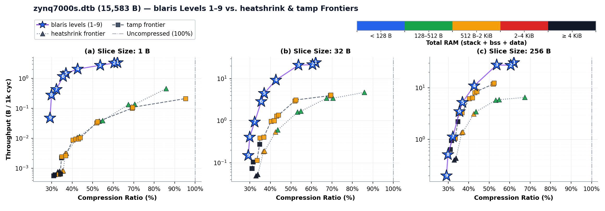
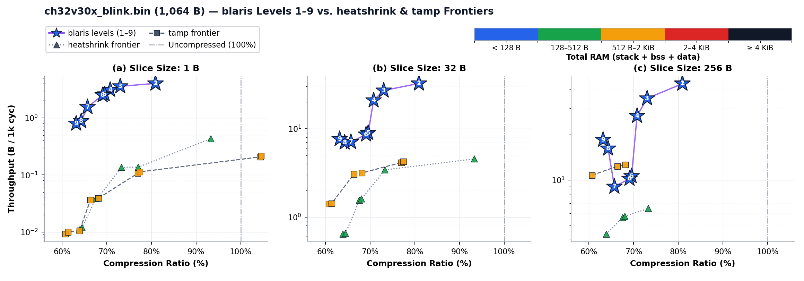
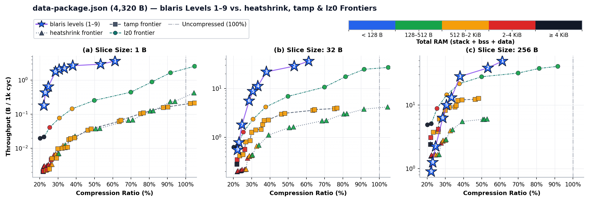
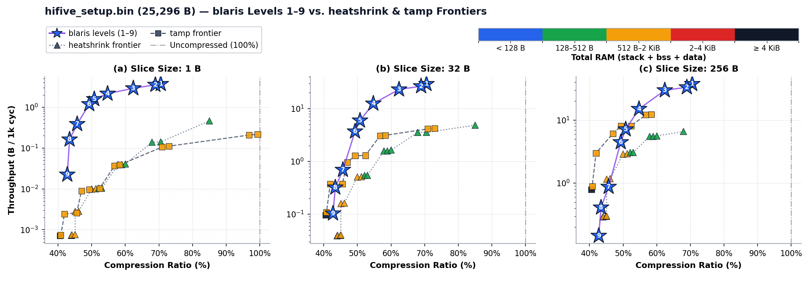
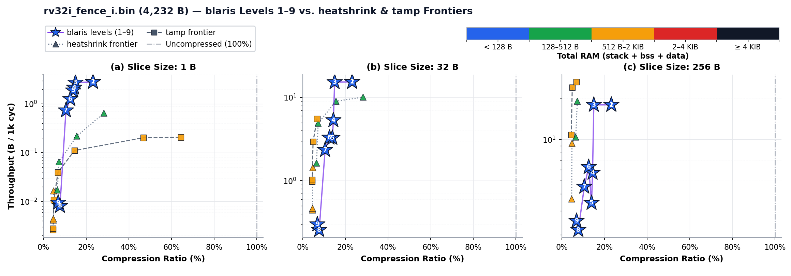
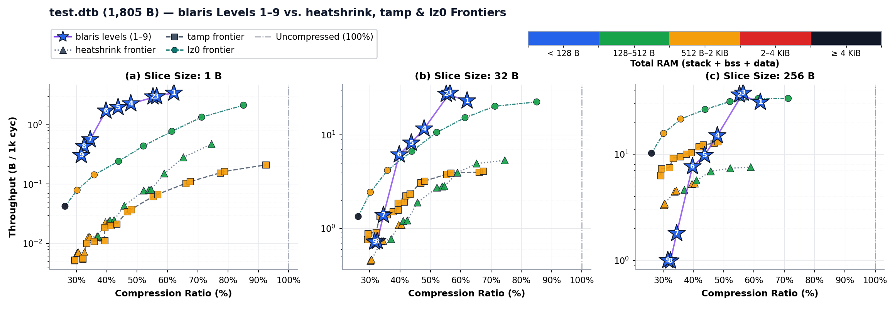
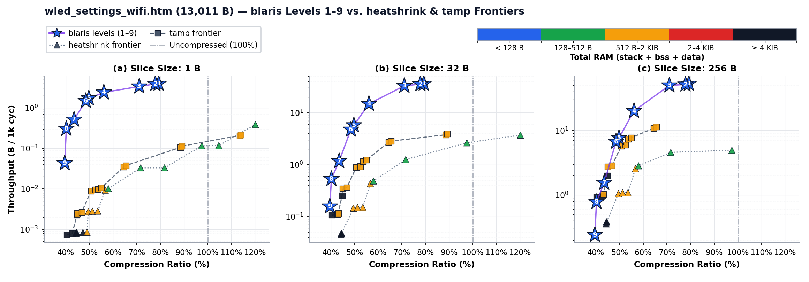
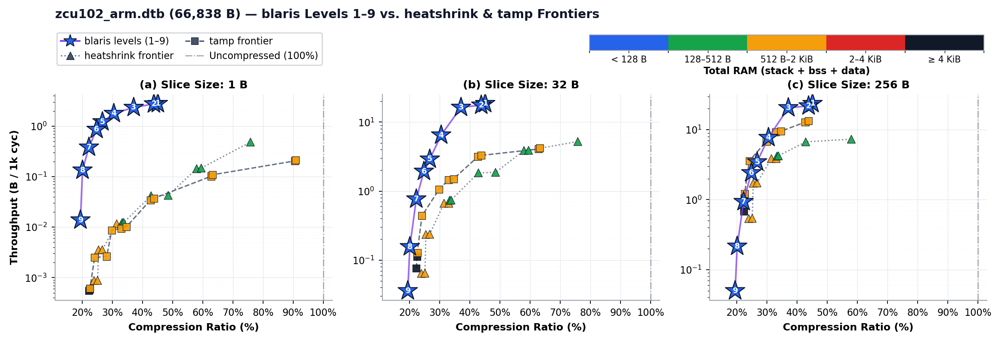

# blaris

**Windowless Random-Access LZSS for Constrained Microcontrollers**

[](https://arxiv.org/abs/2611.22900)

`blaris` is a windowless random-access LZSS decompressor designed for systems with very little
Flash and RAM memory. Because it is windowless, it never allocates a buffer in RAM to
resolve bytes; instead, the compressed payload is structured in a way which allows
the decompressor to walk it in both directions.

`blaris` should be used in workflows where some data is compressed once and
decompressed many times on the MCU. It supports super efficient partial decompression
(imagine decompressing a single record from a configuration table), as well as $O(n)$ full-file
decompression, although the latter is not the intended use case.

`blaris` is incredibly tiny in both Flash and RAM usage. Unlike traditional codecs
like `heatshrink` and `tamp`, `blaris` uses the exact same amount of memory regardless of
how large the input file is.

## Flash and RAM usage

| Codec | Flash (`.text` + `.rodata`) | Peak Stack | Static RAM (`.bss` + `.data`) | Total RAM |
| :--- | ---: | ---: | ---: | ---: |
| **`blaris`** | **614–792 B** | **88 B** | **28–36 B** | **116–124 B** |
| `heatshrink` | 1,300–1,464 B | 140–144 B | 66–16,450 B | 206–16,594 B |
| `tamp` | 2,238–3,238 B | 228–248 B | 292–16,424 B | 520–16,672 B |


## Performance note
Across the benchmark corpus (21 files: `.csv`, `.bin`, `.dtb`, `.c`, `.html`, etc.),
`blaris` is extremely fast when decompressing small slices (`<= 32 B`).
For larger slices, `blaris` stays very fast and delivers compression ratios comparable to or
beating `heatshrink` and `tamp`.

Benchmarks were compiled with Clang (`-Os`) for 32-bit RISC-V (**RV32IMC**) and run in `rv32emu` across 1,000 pseudorandom unaligned offsets per slice size. Because `heatshrink` and `tamp` only decode sequentially, they are wrapped in a block-indexing layer (`2^4` to `2^14 B` blocks).

### 1. Devicetree Blob — `zynq7000s.dtb` (15.2 KiB)


### 2. RTOS Configuration — `FreeRTOSConfig.h` (35.7 KiB)


### 3. Web Asset — `cp.html` (24.0 KiB)


### Hardware Check (ESP32-C3FN4 XIP)
> Note: tested on v1.0.0, not v1.1.0

To check whether SPI Flash wait states on real hardware disproportionately penalize `blaris`'s backward token walking, we also tested one balanced configuration of each codec (`blaris_o2_a0_s8_f1`, `heatshrink_b10_i16_w8_l4`, and `tamp_b10_w8_e1`) on a physical **ESP32-C3FN4** in direct-boot XIP mode (mapping both code and compressed payload to external quad-SPI Flash without copying either to SRAM). Overall hardware cycle counts increased by **29.3% (`1.29×`)** for `blaris`, compared to **+33.5% (`1.33×`)** for `heatshrink` and **+23.6% (`1.24×`)** for `tamp` (`1.51×` on 1 B reads for `blaris` due to cold cache-line fills, stabilizing at `1.30×–1.33×` for slices `>= 4 B`).

---

## Usage & C API

`blaris` can be used either with a predefined configuration or by tuning the
parameters for the specific use case. I highly recommend going with the latter, as
decompression speed and ratio are very dependent on the data, and while predefined
levels are fine, they might not give the best results.

9 configuration levels are supported, with `1` being the fastest and `9` compressing the
best. Levels `1` through `7` use
`src/blaris-compress-greedymaxhops.c` for compression, which is made for fast
decompression and deterministic worst-case latency. Specifically, a slice of size `L`
can be decompressed in `O(L * H * D/2)` time (with `s > 0`), where `H` is `BLARIS_MAX_HOPS` and `D`
is `1 << BLARIS_CHECKPOINTS_SPREAD_LOG`.

Levels `8` and `9` use a different compressor, `src/blaris-compress-optimal.c`, which is
designed to provide the best possible ratio. However, this method suffers from an
unconstrained number of hops any byte can take, and should not be used in systems
where latency predictability is of the highest importance.

If `BLARIS_LEVEL` is set to any number from `1` to `9` (identically on both compressor and decompressor), simply compile
`src/blaris-compress.c` as the compressor and `src/blaris-decompress.c` as the
decompressor. Predefined levels can be found in `include/config.h`.

If `BLARIS_LEVEL` is not defined, or is set to `0`, include either
`src/blaris-compress-optimal.c` or `src/blaris-compress-greedymaxhops.c` as the
compressor file. To tune parameters manually, check the defines in
`include/blaris.h`, `src/blaris-decompress.c`, and the chosen compressor.

> By default, setting `BLARIS_LEVEL` to `4` or `5` should be fine, as those levels are relatively
> fast and produce good compression ratios.

### Decompression Example (Target MCU)

Compile with `src/blaris-decompress.c` and `-DBLARIS_LEVEL=4` (matching the compressor):

```c
#define BLARIS_LEVEL 4
#include <blaris.h>

// Must be 4-byte aligned in Flash / XIP memory
extern const uint32_t compressed_payload[];

static struct Decoder dec;
static struct Checkpoint cp;

void init_assets(void) {
    blaris_init(compressed_payload, &dec);
    cp = (struct Checkpoint){0};
}

// Read `size` bytes starting at uncompressed `offset` into `out_buf`
void read_slice(uint32_t offset, uint8_t *out_buf, uint32_t size) {
    blaris_decompress(&dec, offset, out_buf, size, &cp);
}
```

### Compression Example (Host)

Compile and link with `src/blaris-compress.c` and `-DBLARIS_LEVEL=4`:

```c
#define BLARIS_LEVEL 4
#define BLARIS_COMPRESS
#include <blaris.h>

size_t max_len = blaris_compress_bound(input_len);
uint8_t *compressed = malloc(max_len);
size_t compressed_len = max_len;

if (blaris_compress(input_data, input_len, compressed, &compressed_len) == 0) {
    // `compressed` now holds `compressed_len` bytes of blaris payload
}
```

## Running the Benchmarks & Plotting Scripts

Requires `clang` (with `riscv32-unknown-elf` support), `lld` (`ld.lld`), `llvm-size`, [`rv32emu`](https://github.com/sysprog21/rv32emu), and Python packages `matplotlib` and `numpy` (`PyQt5` optional for interactive `--all` plots; `esptool` and `pyserial` optional for ESP32-C3 runs).

```bash
# Run the full benchmark suite in rv32emu
python3 bench/run.py

# Summarize Flash, Stack, and Static RAM footprints
python3 bench/scripts/summary.py

# View per-file level tables in plain text in the terminal
python3 bench/scripts/generate_tables.py --dataset FreeRTOSConfig.h --slice 32

# Plot Pareto frontier for a dataset and slice size (e.g., s=5 -> 32 B)
python3 bench/scripts/compare.py zynq7000s.dtb 5
```

---

## License

Licensed under either of

- Apache License, Version 2.0 ([LICENSE-APACHE](LICENSE-APACHE) or http://www.apache.org/licenses/LICENSE-2.0)
- MIT license ([LICENSE-MIT](LICENSE-MIT) or http://opensource.org/licenses/MIT)

at your option.

## Benchmarking

Detailed per-file comparisons across all 21 corpus datasets at slice sizes of **4 B**, **32 B**, and **256 B**.
For each slice size, all 9 `blaris` preset levels (`L9` tightest to `L1` fastest) are grouped with the most lightweight (lowest RAM usage) `heatshrink` and `tamp` configuration that achieves the same or better compression ratio (`ratio <= blaris_ratio`, tie-breaking by lowest decompression cycles; if none reaches that ratio, the best-ratio configuration for that codec is shown as a fallback and marked with `*`).

<details>
<summary><strong><code>FreeRTOSConfig.h</code></strong> (36,522 B)</summary>


#### `FreeRTOSConfig.h` — 4 B Slices

| Configuration | Ratio | Decompression Cycles | vs. `blaris` | RAM Usage |
| :--- | ---: | ---: | ---: | ---: |
| **`L9`** | **29.37%** | **115,112 cyc** | **-** | **116 B** |
| `heatshrink_b14_i16_w14_l6` | 38.11%* | 937,639 cyc | x8.15 | 16,578 B |
| `tamp_b14_w12_e1` | 34.88%* | 631,535 cyc | x5.49 | 4,384 B |
| | | | | |
| **`L8`** | **30.06%** | **14,778 cyc** | **-** | **124 B** |
| `heatshrink_b14_i16_w14_l6` | 38.11%* | 937,639 cyc | x63.4 | 16,578 B |
| `tamp_b14_w12_e1` | 34.88%* | 631,535 cyc | x42.7 | 4,384 B |
| | | | | |
| **`L7`** | **33.33%** | **5,967 cyc** | **-** | **124 B** |
| `heatshrink_b14_i16_w14_l6` | 38.11%* | 937,639 cyc | x157 | 16,578 B |
| `tamp_b14_w12_e1` | 34.88%* | 631,535 cyc | x106 | 4,384 B |
| | | | | |
| **`L6`** | **37.56%** | **1,620 cyc** | **-** | **124 B** |
| `heatshrink_b14_i16_w14_l6` | 38.11%* | 937,639 cyc | x579 | 16,578 B |
| `tamp_b14_w12_e1` | 34.88% | 631,535 cyc | x390 | 4,384 B |
| | | | | |
| **`L5`** | **38.91%** | **1,161 cyc** | **-** | **124 B** |
| `heatshrink_b14_i16_w12_l6` | 38.64% | 889,849 cyc | x767 | 4,290 B |
| `tamp_b14_w10_e1` | 37.98% | 606,549 cyc | x523 | 1,312 B |
| | | | | |
| **`L4`** | **45.48%** | **679 cyc** | **-** | **124 B** |
| `heatshrink_b14_i16_w10_l6` | 43.83% | 926,694 cyc | x1,365 | 1,214 B |
| `tamp_b12_w10_e0` | 43.48% | 154,477 cyc | x228 | 1,288 B |
| | | | | |
| **`L3`** | **58.66%** | **423 cyc** | **-** | **124 B** |
| `heatshrink_b14_i16_w8_l4` | 58.45% | 1,093,102 cyc | x2,585 | 446 B |
| `tamp_b12_w8_e0` | 56.57% | 151,365 cyc | x358 | 520 B |
| | | | | |
| **`L2`** | **65.27%** | **378 cyc** | **-** | **124 B** |
| `heatshrink_b10_i16_w8_l4` | 62.29% | 75,830 cyc | x201 | 446 B |
| `tamp_b10_w8_e0` | 58.77% | 41,892 cyc | x111 | 520 B |
| | | | | |
| **`L1`** | **66.35%** | **377 cyc** | **-** | **124 B** |
| `heatshrink_b10_i16_w8_l4` | 62.29% | 75,830 cyc | x201 | 446 B |
| `tamp_b10_w8_e0` | 58.77% | 41,892 cyc | x111 | 520 B |

#### `FreeRTOSConfig.h` — 32 B Slices

| Configuration | Ratio | Decompression Cycles | vs. `blaris` | RAM Usage |
| :--- | ---: | ---: | ---: | ---: |
| **`L9`** | **29.37%** | **622,080 cyc** | **-** | **116 B** |
| `heatshrink_b14_i16_w14_l6` | 38.11%* | 768,429 cyc | x1.24 | 16,578 B |
| `tamp_b14_w12_e1` | 34.88%* | 324,050 cyc | x0.52 | 4,384 B |
| | | | | |
| **`L8`** | **30.06%** | **106,683 cyc** | **-** | **124 B** |
| `heatshrink_b14_i16_w14_l6` | 38.11%* | 768,429 cyc | x7.20 | 16,578 B |
| `tamp_b14_w12_e1` | 34.88%* | 324,050 cyc | x3.04 | 4,384 B |
| | | | | |
| **`L7`** | **33.33%** | **38,860 cyc** | **-** | **124 B** |
| `heatshrink_b14_i16_w14_l6` | 38.11%* | 768,429 cyc | x19.8 | 16,578 B |
| `tamp_b14_w12_e1` | 34.88%* | 324,050 cyc | x8.34 | 4,384 B |
| | | | | |
| **`L6`** | **37.56%** | **9,048 cyc** | **-** | **124 B** |
| `heatshrink_b14_i16_w14_l6` | 38.11%* | 768,429 cyc | x84.9 | 16,578 B |
| `tamp_b14_w12_e1` | 34.88% | 324,050 cyc | x35.8 | 4,384 B |
| | | | | |
| **`L5`** | **38.91%** | **5,818 cyc** | **-** | **124 B** |
| `heatshrink_b14_i16_w12_l6` | 38.64% | 721,225 cyc | x124 | 4,290 B |
| `tamp_b14_w10_e1` | 37.98% | 304,929 cyc | x52.4 | 1,312 B |
| | | | | |
| **`L4`** | **45.48%** | **2,765 cyc** | **-** | **124 B** |
| `heatshrink_b14_i16_w10_l6` | 43.83% | 764,763 cyc | x277 | 1,214 B |
| `tamp_b12_w10_e0` | 43.48% | 89,964 cyc | x32.5 | 1,288 B |
| | | | | |
| **`L3`** | **58.66%** | **1,330 cyc** | **-** | **124 B** |
| `heatshrink_b14_i16_w8_l4` | 58.45% | 925,011 cyc | x696 | 446 B |
| `tamp_b12_w8_e0` | 56.57% | 91,054 cyc | x68.5 | 520 B |
| | | | | |
| **`L2`** | **65.27%** | **1,236 cyc** | **-** | **124 B** |
| `heatshrink_b10_i16_w8_l4` | 62.29% | 70,753 cyc | x57.3 | 446 B |
| `tamp_b10_w8_e0` | 58.77% | 27,428 cyc | x22.2 | 520 B |
| | | | | |
| **`L1`** | **66.35%** | **1,229 cyc** | **-** | **124 B** |
| `heatshrink_b10_i16_w8_l4` | 62.29% | 70,753 cyc | x57.6 | 446 B |
| `tamp_b10_w8_e0` | 58.77% | 27,428 cyc | x22.3 | 520 B |

#### `FreeRTOSConfig.h` — 256 B Slices

| Configuration | Ratio | Decompression Cycles | vs. `blaris` | RAM Usage |
| :--- | ---: | ---: | ---: | ---: |
| **`L9`** | **29.37%** | **3,967,882 cyc** | **-** | **116 B** |
| `heatshrink_b14_i16_w14_l6` | 38.11%* | 767,623 cyc | x0.19 | 16,578 B |
| `tamp_b14_w12_e1` | 34.88%* | 290,940 cyc | x0.07 | 4,384 B |
| | | | | |
| **`L8`** | **30.06%** | **731,857 cyc** | **-** | **124 B** |
| `heatshrink_b14_i16_w14_l6` | 38.11%* | 767,623 cyc | x1.05 | 16,578 B |
| `tamp_b14_w12_e1` | 34.88%* | 290,940 cyc | x0.40 | 4,384 B |
| | | | | |
| **`L7`** | **33.33%** | **271,095 cyc** | **-** | **124 B** |
| `heatshrink_b14_i16_w14_l6` | 38.11%* | 767,623 cyc | x2.83 | 16,578 B |
| `tamp_b14_w12_e1` | 34.88%* | 290,940 cyc | x1.07 | 4,384 B |
| | | | | |
| **`L6`** | **37.56%** | **61,948 cyc** | **-** | **124 B** |
| `heatshrink_b14_i16_w14_l6` | 38.11%* | 767,623 cyc | x12.4 | 16,578 B |
| `tamp_b14_w12_e1` | 34.88% | 290,940 cyc | x4.70 | 4,384 B |
| | | | | |
| **`L5`** | **38.91%** | **41,400 cyc** | **-** | **124 B** |
| `heatshrink_b14_i16_w12_l6` | 38.64% | 719,427 cyc | x17.4 | 4,290 B |
| `tamp_b14_w10_e1` | 37.98% | 272,496 cyc | x6.58 | 1,312 B |
| | | | | |
| **`L4`** | **45.48%** | **18,104 cyc** | **-** | **124 B** |
| `heatshrink_b14_i16_w10_l6` | 43.83% | 764,863 cyc | x42.2 | 1,214 B |
| `tamp_b12_w10_e0` | 43.48% | 89,264 cyc | x4.93 | 1,288 B |
| | | | | |
| **`L3`** | **58.66%** | **8,273 cyc** | **-** | **124 B** |
| `heatshrink_b14_i16_w8_l4` | 58.45% | 927,050 cyc | x112 | 446 B |
| `tamp_b12_w8_e0` | 56.57% | 91,806 cyc | x11.1 | 520 B |
| | | | | |
| **`L2`** | **65.27%** | **7,780 cyc** | **-** | **124 B** |
| `heatshrink_b10_i16_w8_l4` | 62.29% | 97,193 cyc | x12.5 | 446 B |
| `tamp_b10_w8_e0` | 58.77% | 34,438 cyc | x4.43 | 520 B |
| | | | | |
| **`L1`** | **66.35%** | **7,641 cyc** | **-** | **124 B** |
| `heatshrink_b10_i16_w8_l4` | 62.29% | 97,193 cyc | x12.7 | 446 B |
| `tamp_b10_w8_e0` | 58.77% | 34,438 cyc | x4.51 | 520 B |

</details>

<details>
<summary><strong><code>ch32v003_bootloader.bin</code></strong> (1,920 B)</summary>


#### `ch32v003_bootloader.bin` — 4 B Slices

| Configuration | Ratio | Decompression Cycles | vs. `blaris` | RAM Usage |
| :--- | ---: | ---: | ---: | ---: |
| **`L9`** | **90.73%** | **2,296 cyc** | **-** | **116 B** |
| `heatshrink_b12_i16_w10_l4` | 91.20%* | 188,453 cyc | x82.1 | 1,214 B |
| `tamp_b10_w8_e0` | 89.79% | 41,337 cyc | x18.0 | 520 B |
| | | | | |
| **`L8`** | **91.56%** | **1,119 cyc** | **-** | **124 B** |
| `heatshrink_b12_i16_w10_l4` | 91.20% | 188,453 cyc | x168 | 1,214 B |
| `tamp_b10_w8_e0` | 89.79% | 41,337 cyc | x36.9 | 520 B |
| | | | | |
| **`L7`** | **93.49%** | **957 cyc** | **-** | **124 B** |
| `heatshrink_b10_i16_w8_l4` | 92.81% | 91,391 cyc | x95.5 | 446 B |
| `tamp_b10_w8_e0` | 89.79% | 41,337 cyc | x43.2 | 520 B |
| | | | | |
| **`L6`** | **97.66%** | **308 cyc** | **-** | **124 B** |
| `heatshrink_b10_i16_w6_l4` | 97.40% | 93,797 cyc | x304 | 254 B |
| `tamp_b8_w8_e0` | 95.36% | 13,140 cyc | x42.6 | 520 B |
| | | | | |
| **`L5`** | **98.70%** | **279 cyc** | **-** | **124 B** |
| `heatshrink_b10_i16_w6_l4` | 97.40% | 93,797 cyc | x337 | 254 B |
| `tamp_b8_w8_e0` | 95.36% | 13,140 cyc | x47.2 | 520 B |
| | | | | |
| **`L4`** | **100.89%** | **245 cyc** | **-** | **124 B** |
| `heatshrink_b8_i16_w6_l4` | 98.85% | 25,473 cyc | x104 | 254 B |
| `tamp_b8_w8_e0` | 95.36% | 13,140 cyc | x53.7 | 520 B |
| | | | | |
| **`L3`** | **104.38%** | **215 cyc** | **-** | **124 B** |
| `heatshrink_b8_i16_w6_l4` | 98.85% | 25,473 cyc | x119 | 254 B |
| `tamp_b8_w8_e0` | 95.36% | 13,140 cyc | x61.2 | 520 B |
| | | | | |
| **`L2`** | **111.51%** | **210 cyc** | **-** | **124 B** |
| `heatshrink_b6_i16_w4_l3` | 109.43% | 7,547 cyc | x35.9 | 206 B |
| `tamp_b6_w8_e0` | 107.81% | 6,032 cyc | x28.7 | 520 B |
| | | | | |
| **`L1`** | **112.45%** | **207 cyc** | **-** | **124 B** |
| `heatshrink_b6_i16_w4_l3` | 109.43% | 7,547 cyc | x36.5 | 206 B |
| `tamp_b6_w8_e0` | 107.81% | 6,032 cyc | x29.2 | 520 B |

#### `ch32v003_bootloader.bin` — 32 B Slices

| Configuration | Ratio | Decompression Cycles | vs. `blaris` | RAM Usage |
| :--- | ---: | ---: | ---: | ---: |
| **`L9`** | **90.73%** | **4,536 cyc** | **-** | **116 B** |
| `heatshrink_b12_i16_w10_l4` | 91.20%* | 177,059 cyc | x39.0 | 1,214 B |
| `tamp_b10_w8_e0` | 89.79% | 27,964 cyc | x6.17 | 520 B |
| | | | | |
| **`L8`** | **91.56%** | **2,872 cyc** | **-** | **124 B** |
| `heatshrink_b12_i16_w10_l4` | 91.20% | 177,059 cyc | x61.6 | 1,214 B |
| `tamp_b10_w8_e0` | 89.79% | 27,964 cyc | x9.74 | 520 B |
| | | | | |
| **`L7`** | **93.49%** | **2,305 cyc** | **-** | **124 B** |
| `heatshrink_b10_i16_w8_l4` | 92.81% | 83,574 cyc | x36.3 | 446 B |
| `tamp_b10_w8_e0` | 89.79% | 27,964 cyc | x12.1 | 520 B |
| | | | | |
| **`L6`** | **97.66%** | **888 cyc** | **-** | **124 B** |
| `heatshrink_b10_i16_w6_l4` | 97.40% | 86,141 cyc | x97.0 | 254 B |
| `tamp_b8_w8_e0` | 95.36% | 11,455 cyc | x12.9 | 520 B |
| | | | | |
| **`L5`** | **98.70%** | **722 cyc** | **-** | **124 B** |
| `heatshrink_b10_i16_w6_l4` | 97.40% | 86,141 cyc | x119 | 254 B |
| `tamp_b8_w8_e0` | 95.36% | 11,455 cyc | x15.9 | 520 B |
| | | | | |
| **`L4`** | **100.89%** | **548 cyc** | **-** | **124 B** |
| `heatshrink_b8_i16_w6_l4` | 98.85% | 27,892 cyc | x50.9 | 254 B |
| `tamp_b8_w8_e0` | 95.36% | 11,455 cyc | x20.9 | 520 B |
| | | | | |
| **`L3`** | **104.38%** | **428 cyc** | **-** | **124 B** |
| `heatshrink_b8_i16_w6_l4` | 98.85% | 27,892 cyc | x65.2 | 254 B |
| `tamp_b8_w8_e0` | 95.36% | 11,455 cyc | x26.8 | 520 B |
| | | | | |
| **`L2`** | **111.51%** | **435 cyc** | **-** | **124 B** |
| `heatshrink_b6_i16_w4_l3` | 109.43% | 12,745 cyc | x29.3 | 206 B |
| `tamp_b6_w8_e0` | 107.81% | 8,155 cyc | x18.7 | 520 B |
| | | | | |
| **`L1`** | **112.45%** | **426 cyc** | **-** | **124 B** |
| `heatshrink_b6_i16_w4_l3` | 109.43% | 12,745 cyc | x30.0 | 206 B |
| `tamp_b6_w8_e0` | 107.81% | 8,155 cyc | x19.2 | 520 B |

#### `ch32v003_bootloader.bin` — 256 B Slices

| Configuration | Ratio | Decompression Cycles | vs. `blaris` | RAM Usage |
| :--- | ---: | ---: | ---: | ---: |
| **`L9`** | **90.73%** | **16,482 cyc** | **-** | **116 B** |
| `heatshrink_b12_i16_w10_l4` | 91.20%* | 192,114 cyc | x11.7 | 1,214 B |
| `tamp_b10_w8_e0` | 89.79% | 36,521 cyc | x2.22 | 520 B |
| | | | | |
| **`L8`** | **91.56%** | **11,586 cyc** | **-** | **124 B** |
| `heatshrink_b12_i16_w10_l4` | 91.20% | 192,114 cyc | x16.6 | 1,214 B |
| `tamp_b10_w8_e0` | 89.79% | 36,521 cyc | x3.15 | 520 B |
| | | | | |
| **`L7`** | **93.49%** | **9,429 cyc** | **-** | **124 B** |
| `heatshrink_b10_i16_w8_l4` | 92.81% | 117,781 cyc | x12.5 | 446 B |
| `tamp_b10_w8_e0` | 89.79% | 36,521 cyc | x3.87 | 520 B |
| | | | | |
| **`L6`** | **97.66%** | **3,945 cyc** | **-** | **124 B** |
| `heatshrink_b10_i16_w6_l4` | 97.40% | 121,987 cyc | x30.9 | 254 B |
| `tamp_b8_w8_e0` | 95.36% | 24,735 cyc | x6.27 | 520 B |
| | | | | |
| **`L5`** | **98.70%** | **3,330 cyc** | **-** | **124 B** |
| `heatshrink_b10_i16_w6_l4` | 97.40% | 121,987 cyc | x36.6 | 254 B |
| `tamp_b8_w8_e0` | 95.36% | 24,735 cyc | x7.43 | 520 B |
| | | | | |
| **`L4`** | **100.89%** | **2,606 cyc** | **-** | **124 B** |
| `heatshrink_b8_i16_w6_l4` | 98.85% | 69,326 cyc | x26.6 | 254 B |
| `tamp_b8_w8_e0` | 95.36% | 24,735 cyc | x9.49 | 520 B |
| | | | | |
| **`L3`** | **104.38%** | **2,117 cyc** | **-** | **124 B** |
| `heatshrink_b8_i16_w6_l4` | 98.85% | 69,326 cyc | x32.7 | 254 B |
| `tamp_b8_w8_e0` | 95.36% | 24,735 cyc | x11.7 | 520 B |
| | | | | |
| **`L2`** | **111.51%** | **2,172 cyc** | **-** | **124 B** |
| `heatshrink_b6_i16_w4_l3` | 109.43% | 56,272 cyc | x25.9 | 206 B |
| `tamp_b8_w8_e0` | 95.36% | 24,735 cyc | x11.4 | 520 B |
| | | | | |
| **`L1`** | **112.45%** | **2,107 cyc** | **-** | **124 B** |
| `heatshrink_b6_i16_w4_l3` | 109.43% | 56,272 cyc | x26.7 | 206 B |
| `tamp_b8_w8_e0` | 95.36% | 24,735 cyc | x11.7 | 520 B |

</details>

<details>
<summary><strong><code>ch32v30x_blink.bin</code></strong> (1,064 B)</summary>



#### `ch32v30x_blink.bin` — 4 B Slices

| Configuration | Ratio | Decompression Cycles | vs. `blaris` | RAM Usage |
| :--- | ---: | ---: | ---: | ---: |
| **`L9`** | **63.16%** | **2,830 cyc** | **-** | **116 B** |
| `heatshrink_b12_i16_w8_l6` | 63.91%* | 56,339 cyc | x19.9 | 446 B |
| `tamp_b10_w8_e1` | 61.37% | 38,028 cyc | x13.4 | 544 B |
| | | | | |
| **`L8`** | **64.29%** | **3,037 cyc** | **-** | **124 B** |
| `heatshrink_b12_i16_w8_l6` | 63.91% | 56,339 cyc | x18.6 | 446 B |
| `tamp_b10_w8_e0` | 63.91% | 37,042 cyc | x12.2 | 520 B |
| | | | | |
| **`L7`** | **65.70%** | **1,094 cyc** | **-** | **124 B** |
| `heatshrink_b12_i16_w6_l4` | 65.70% | 58,036 cyc | x53.1 | 254 B |
| `tamp_b10_w8_e0` | 63.91% | 37,042 cyc | x33.9 | 520 B |
| | | | | |
| **`L6`** | **69.08%** | **796 cyc** | **-** | **124 B** |
| `heatshrink_b8_i16_w6_l4` | 68.05% | 18,063 cyc | x22.7 | 254 B |
| `tamp_b8_w8_e0` | 68.14% | 12,441 cyc | x15.6 | 520 B |
| | | | | |
| **`L5`** | **69.55%** | **761 cyc** | **-** | **124 B** |
| `heatshrink_b8_i16_w6_l4` | 68.05% | 18,063 cyc | x23.7 | 254 B |
| `tamp_b8_w8_e0` | 68.14% | 12,441 cyc | x16.4 | 520 B |
| | | | | |
| **`L4`** | **70.77%** | **471 cyc** | **-** | **124 B** |
| `heatshrink_b8_i16_w6_l4` | 68.05% | 18,063 cyc | x38.3 | 254 B |
| `tamp_b8_w8_e0` | 68.14% | 12,441 cyc | x26.4 | 520 B |
| | | | | |
| **`L3`** | **73.03%** | **381 cyc** | **-** | **124 B** |
| `heatshrink_b8_i16_w4_l3` | 72.74% | 18,731 cyc | x49.1 | 206 B |
| `tamp_b8_w8_e0` | 68.14% | 12,441 cyc | x32.6 | 520 B |
| | | | | |
| **`L2`** | **80.92%** | **336 cyc** | **-** | **124 B** |
| `heatshrink_b6_i16_w4_l3` | 77.07% | 5,809 cyc | x17.3 | 206 B |
| `tamp_b6_w8_e0` | 77.44% | 5,875 cyc | x17.5 | 520 B |
| | | | | |
| **`L1`** | **80.92%** | **339 cyc** | **-** | **124 B** |
| `heatshrink_b6_i16_w4_l3` | 77.07% | 5,809 cyc | x17.2 | 206 B |
| `tamp_b6_w8_e0` | 77.44% | 5,875 cyc | x17.4 | 520 B |

#### `ch32v30x_blink.bin` — 32 B Slices

| Configuration | Ratio | Decompression Cycles | vs. `blaris` | RAM Usage |
| :--- | ---: | ---: | ---: | ---: |
| **`L9`** | **63.16%** | **4,191 cyc** | **-** | **116 B** |
| `heatshrink_b12_i16_w8_l6` | 63.91%* | 50,546 cyc | x12.1 | 446 B |
| `tamp_b10_w8_e1` | 61.37% | 22,468 cyc | x5.36 | 544 B |
| | | | | |
| **`L8`** | **64.29%** | **4,590 cyc** | **-** | **124 B** |
| `heatshrink_b12_i16_w8_l6` | 63.91% | 50,546 cyc | x11.0 | 446 B |
| `tamp_b10_w8_e0` | 63.91% | 22,585 cyc | x4.92 | 520 B |
| | | | | |
| **`L7`** | **65.70%** | **4,529 cyc** | **-** | **124 B** |
| `heatshrink_b12_i16_w6_l4` | 65.70% | 52,457 cyc | x11.6 | 254 B |
| `tamp_b10_w8_e0` | 63.91% | 22,585 cyc | x4.99 | 520 B |
| | | | | |
| **`L6`** | **69.08%** | **3,726 cyc** | **-** | **124 B** |
| `heatshrink_b8_i16_w6_l4` | 68.05% | 20,128 cyc | x5.40 | 254 B |
| `tamp_b8_w8_e0` | 68.14% | 10,148 cyc | x2.72 | 520 B |
| | | | | |
| **`L5`** | **69.55%** | **3,572 cyc** | **-** | **124 B** |
| `heatshrink_b8_i16_w6_l4` | 68.05% | 20,128 cyc | x5.64 | 254 B |
| `tamp_b8_w8_e0` | 68.14% | 10,148 cyc | x2.84 | 520 B |
| | | | | |
| **`L4`** | **70.77%** | **1,531 cyc** | **-** | **124 B** |
| `heatshrink_b8_i16_w6_l4` | 68.05% | 20,128 cyc | x13.1 | 254 B |
| `tamp_b8_w8_e0` | 68.14% | 10,148 cyc | x6.63 | 520 B |
| | | | | |
| **`L3`** | **73.03%** | **1,184 cyc** | **-** | **124 B** |
| `heatshrink_b8_i16_w4_l3` | 72.74% | 21,035 cyc | x17.8 | 206 B |
| `tamp_b8_w8_e0` | 68.14% | 10,148 cyc | x8.57 | 520 B |
| | | | | |
| **`L2`** | **80.92%** | **984 cyc** | **-** | **124 B** |
| `heatshrink_b6_i16_w4_l3` | 77.07% | 9,503 cyc | x9.66 | 206 B |
| `tamp_b6_w8_e0` | 77.44% | 7,507 cyc | x7.63 | 520 B |
| | | | | |
| **`L1`** | **80.92%** | **987 cyc** | **-** | **124 B** |
| `heatshrink_b6_i16_w4_l3` | 77.07% | 9,503 cyc | x9.63 | 206 B |
| `tamp_b6_w8_e0` | 77.44% | 7,507 cyc | x7.61 | 520 B |

#### `ch32v30x_blink.bin` — 256 B Slices

| Configuration | Ratio | Decompression Cycles | vs. `blaris` | RAM Usage |
| :--- | ---: | ---: | ---: | ---: |
| **`L9`** | **63.16%** | **13,838 cyc** | **-** | **116 B** |
| `heatshrink_b12_i16_w8_l6` | 63.91%* | 59,743 cyc | x4.32 | 446 B |
| `tamp_b12_w8_e1` | 60.71% | 23,825 cyc | x1.72 | 544 B |
| | | | | |
| **`L8`** | **64.29%** | **15,825 cyc** | **-** | **124 B** |
| `heatshrink_b12_i16_w8_l6` | 63.91% | 59,743 cyc | x3.78 | 446 B |
| `tamp_b12_w8_e0` | 63.25% | 23,981 cyc | x1.52 | 520 B |
| | | | | |
| **`L7`** | **65.70%** | **28,404 cyc** | **-** | **124 B** |
| `heatshrink_b12_i16_w6_l4` | 65.70% | 62,324 cyc | x2.19 | 254 B |
| `tamp_b12_w8_e0` | 63.25% | 23,981 cyc | x0.84 | 520 B |
| | | | | |
| **`L6`** | **69.08%** | **25,153 cyc** | **-** | **124 B** |
| `heatshrink_b8_i16_w6_l4` | 68.05% | 45,427 cyc | x1.81 | 254 B |
| `tamp_b8_w8_e0` | 68.14% | 20,206 cyc | x0.80 | 520 B |
| | | | | |
| **`L5`** | **69.55%** | **24,166 cyc** | **-** | **124 B** |
| `heatshrink_b8_i16_w6_l4` | 68.05% | 45,427 cyc | x1.88 | 254 B |
| `tamp_b8_w8_e0` | 68.14% | 20,206 cyc | x0.84 | 520 B |
| | | | | |
| **`L4`** | **70.77%** | **9,594 cyc** | **-** | **124 B** |
| `heatshrink_b8_i16_w6_l4` | 68.05% | 45,427 cyc | x4.73 | 254 B |
| `tamp_b8_w8_e0` | 68.14% | 20,206 cyc | x2.11 | 520 B |
| | | | | |
| **`L3`** | **73.03%** | **7,336 cyc** | **-** | **124 B** |
| `heatshrink_b8_i16_w4_l3` | 72.74% | 48,539 cyc | x6.62 | 206 B |
| `tamp_b8_w8_e0` | 68.14% | 20,206 cyc | x2.75 | 520 B |
| | | | | |
| **`L2`** | **80.92%** | **5,855 cyc** | **-** | **124 B** |
| `heatshrink_b6_i16_w4_l3` | 77.07% | 41,336 cyc | x7.06 | 206 B |
| `tamp_b8_w8_e0` | 68.14% | 20,206 cyc | x3.45 | 520 B |
| | | | | |
| **`L1`** | **80.92%** | **5,830 cyc** | **-** | **124 B** |
| `heatshrink_b6_i16_w4_l3` | 77.07% | 41,336 cyc | x7.09 | 206 B |
| `tamp_b8_w8_e0` | 68.14% | 20,206 cyc | x3.47 | 520 B |

</details>

<details>
<summary><strong><code>cp.html</code></strong> (24,603 B)</summary>


#### `cp.html` — 4 B Slices

| Configuration | Ratio | Decompression Cycles | vs. `blaris` | RAM Usage |
| :--- | ---: | ---: | ---: | ---: |
| **`L9`** | **37.34%** | **78,976 cyc** | **-** | **116 B** |
| `heatshrink_b14_i16_w14_l6` | 45.87%* | 898,741 cyc | x11.4 | 16,578 B |
| `tamp_b14_w12_e1` | 42.19%* | 578,912 cyc | x7.33 | 4,384 B |
| | | | | |
| **`L8`** | **38.05%** | **9,729 cyc** | **-** | **124 B** |
| `heatshrink_b14_i16_w14_l6` | 45.87%* | 898,741 cyc | x92.4 | 16,578 B |
| `tamp_b14_w12_e1` | 42.19%* | 578,912 cyc | x59.5 | 4,384 B |
| | | | | |
| **`L7`** | **41.95%** | **4,174 cyc** | **-** | **124 B** |
| `heatshrink_b14_i16_w14_l6` | 45.87%* | 898,741 cyc | x215 | 16,578 B |
| `tamp_b14_w12_e1` | 42.19%* | 578,912 cyc | x139 | 4,384 B |
| | | | | |
| **`L6`** | **46.87%** | **1,254 cyc** | **-** | **124 B** |
| `heatshrink_b14_i16_w12_l4` | 46.69% | 867,867 cyc | x692 | 4,290 B |
| `tamp_b14_w10_e1` | 45.90% | 556,674 cyc | x444 | 1,312 B |
| | | | | |
| **`L5`** | **47.91%** | **918 cyc** | **-** | **124 B** |
| `heatshrink_b14_i16_w12_l6` | 47.02% | 859,615 cyc | x936 | 4,290 B |
| `tamp_b14_w10_e0` | 47.66% | 518,834 cyc | x565 | 1,288 B |
| | | | | |
| **`L4`** | **53.13%** | **598 cyc** | **-** | **124 B** |
| `heatshrink_b14_i16_w10_l4` | 51.21% | 928,127 cyc | x1,553 | 1,214 B |
| `tamp_b12_w10_e0` | 49.59% | 166,614 cyc | x279 | 1,288 B |
| | | | | |
| **`L3`** | **63.95%** | **416 cyc** | **-** | **124 B** |
| `heatshrink_b12_i16_w8_l4` | 60.17% | 295,558 cyc | x711 | 446 B |
| `tamp_b10_w8_e0` | 60.52% | 43,209 cyc | x104 | 520 B |
| | | | | |
| **`L2`** | **70.86%** | **378 cyc** | **-** | **124 B** |
| `heatshrink_b10_i16_w8_l4` | 64.72% | 81,234 cyc | x215 | 446 B |
| `tamp_b10_w8_e0` | 60.52% | 43,209 cyc | x114 | 520 B |
| | | | | |
| **`L1`** | **71.89%** | **362 cyc** | **-** | **124 B** |
| `heatshrink_b10_i16_w8_l4` | 64.72% | 81,234 cyc | x225 | 446 B |
| `tamp_b10_w8_e0` | 60.52% | 43,209 cyc | x119 | 520 B |

#### `cp.html` — 32 B Slices

| Configuration | Ratio | Decompression Cycles | vs. `blaris` | RAM Usage |
| :--- | ---: | ---: | ---: | ---: |
| **`L9`** | **37.34%** | **386,430 cyc** | **-** | **116 B** |
| `heatshrink_b14_i16_w14_l6` | 45.87%* | 793,222 cyc | x2.05 | 16,578 B |
| `tamp_b14_w12_e1` | 42.19%* | 331,293 cyc | x0.86 | 4,384 B |
| | | | | |
| **`L8`** | **38.05%** | **64,065 cyc** | **-** | **124 B** |
| `heatshrink_b14_i16_w14_l6` | 45.87%* | 793,222 cyc | x12.4 | 16,578 B |
| `tamp_b14_w12_e1` | 42.19%* | 331,293 cyc | x5.17 | 4,384 B |
| | | | | |
| **`L7`** | **41.95%** | **24,230 cyc** | **-** | **124 B** |
| `heatshrink_b14_i16_w14_l6` | 45.87%* | 793,222 cyc | x32.7 | 16,578 B |
| `tamp_b14_w12_e1` | 42.19%* | 331,293 cyc | x13.7 | 4,384 B |
| | | | | |
| **`L6`** | **46.87%** | **6,132 cyc** | **-** | **124 B** |
| `heatshrink_b14_i16_w12_l4` | 46.69% | 764,857 cyc | x125 | 4,290 B |
| `tamp_b14_w10_e1` | 45.90% | 315,492 cyc | x51.5 | 1,312 B |
| | | | | |
| **`L5`** | **47.91%** | **4,020 cyc** | **-** | **124 B** |
| `heatshrink_b14_i16_w12_l6` | 47.02% | 756,064 cyc | x188 | 4,290 B |
| `tamp_b14_w10_e0` | 47.66% | 298,996 cyc | x74.4 | 1,288 B |
| | | | | |
| **`L4`** | **53.13%** | **2,043 cyc** | **-** | **124 B** |
| `heatshrink_b14_i16_w10_l4` | 51.21% | 835,401 cyc | x409 | 1,214 B |
| `tamp_b12_w10_e0` | 49.59% | 96,931 cyc | x47.4 | 1,288 B |
| | | | | |
| **`L3`** | **63.95%** | **1,305 cyc** | **-** | **124 B** |
| `heatshrink_b12_i16_w8_l4` | 60.17% | 257,533 cyc | x197 | 446 B |
| `tamp_b10_w8_e0` | 60.52% | 27,588 cyc | x21.1 | 520 B |
| | | | | |
| **`L2`** | **70.86%** | **1,252 cyc** | **-** | **124 B** |
| `heatshrink_b10_i16_w8_l4` | 64.72% | 73,914 cyc | x59.0 | 446 B |
| `tamp_b10_w8_e0` | 60.52% | 27,588 cyc | x22.0 | 520 B |
| | | | | |
| **`L1`** | **71.89%** | **1,169 cyc** | **-** | **124 B** |
| `heatshrink_b10_i16_w8_l4` | 64.72% | 73,914 cyc | x63.2 | 446 B |
| `tamp_b10_w8_e0` | 60.52% | 27,588 cyc | x23.6 | 520 B |

#### `cp.html` — 256 B Slices

| Configuration | Ratio | Decompression Cycles | vs. `blaris` | RAM Usage |
| :--- | ---: | ---: | ---: | ---: |
| **`L9`** | **37.34%** | **2,505,290 cyc** | **-** | **116 B** |
| `heatshrink_b14_i16_w14_l6` | 45.87%* | 774,176 cyc | x0.31 | 16,578 B |
| `tamp_b14_w12_e1` | 42.19%* | 293,594 cyc | x0.12 | 4,384 B |
| | | | | |
| **`L8`** | **38.05%** | **431,840 cyc** | **-** | **124 B** |
| `heatshrink_b14_i16_w14_l6` | 45.87%* | 774,176 cyc | x1.79 | 16,578 B |
| `tamp_b14_w12_e1` | 42.19%* | 293,594 cyc | x0.68 | 4,384 B |
| | | | | |
| **`L7`** | **41.95%** | **171,362 cyc** | **-** | **124 B** |
| `heatshrink_b14_i16_w14_l6` | 45.87%* | 774,176 cyc | x4.52 | 16,578 B |
| `tamp_b14_w12_e1` | 42.19%* | 293,594 cyc | x1.71 | 4,384 B |
| | | | | |
| **`L6`** | **46.87%** | **42,834 cyc** | **-** | **124 B** |
| `heatshrink_b14_i16_w12_l4` | 46.69% | 743,803 cyc | x17.4 | 4,290 B |
| `tamp_b14_w10_e1` | 45.90% | 277,555 cyc | x6.48 | 1,312 B |
| | | | | |
| **`L5`** | **47.91%** | **28,256 cyc** | **-** | **124 B** |
| `heatshrink_b14_i16_w12_l6` | 47.02% | 735,558 cyc | x26.0 | 4,290 B |
| `tamp_b14_w10_e0` | 47.66% | 264,096 cyc | x9.35 | 1,288 B |
| | | | | |
| **`L4`** | **53.13%** | **13,537 cyc** | **-** | **124 B** |
| `heatshrink_b14_i16_w10_l4` | 51.21% | 812,708 cyc | x60.0 | 1,214 B |
| `tamp_b12_w10_e0` | 49.59% | 98,057 cyc | x7.24 | 1,288 B |
| | | | | |
| **`L3`** | **63.95%** | **8,348 cyc** | **-** | **124 B** |
| `heatshrink_b12_i16_w8_l4` | 60.17% | 286,198 cyc | x34.3 | 446 B |
| `tamp_b10_w8_e0` | 60.52% | 35,447 cyc | x4.25 | 520 B |
| | | | | |
| **`L2`** | **70.86%** | **8,205 cyc** | **-** | **124 B** |
| `heatshrink_b10_i16_w8_l4` | 64.72% | 102,906 cyc | x12.5 | 446 B |
| `tamp_b10_w8_e0` | 60.52% | 35,447 cyc | x4.32 | 520 B |
| | | | | |
| **`L1`** | **71.89%** | **7,678 cyc** | **-** | **124 B** |
| `heatshrink_b10_i16_w8_l4` | 64.72% | 102,906 cyc | x13.4 | 446 B |
| `tamp_b10_w8_e0` | 60.52% | 35,447 cyc | x4.62 | 520 B |

</details>

<details>
<summary><strong><code>cp.html.gz</code></strong> (7,960 B)</summary>


#### `cp.html.gz` — 4 B Slices

| Configuration | Ratio | Decompression Cycles | vs. `blaris` | RAM Usage |
| :--- | ---: | ---: | ---: | ---: |
| **`L9`** | **103.53%** | **1,703 cyc** | **-** | **116 B** |
| `heatshrink_b14_i16_w10_l4` | 112.07%* | 846,798 cyc | x497 | 1,214 B |
| `tamp_b14_w12_e0` | 110.20%* | 349,673 cyc | x205 | 4,360 B |
| | | | | |
| **`L8`** | **104.23%** | **289 cyc** | **-** | **124 B** |
| `heatshrink_b14_i16_w10_l4` | 112.07%* | 846,798 cyc | x2,929 | 1,214 B |
| `tamp_b14_w12_e0` | 110.20%* | 349,673 cyc | x1,210 | 4,360 B |
| | | | | |
| **`L7`** | **104.28%** | **282 cyc** | **-** | **124 B** |
| `heatshrink_b14_i16_w10_l4` | 112.07%* | 846,798 cyc | x3,003 | 1,214 B |
| `tamp_b14_w12_e0` | 110.20%* | 349,673 cyc | x1,240 | 4,360 B |
| | | | | |
| **`L6`** | **106.38%** | **210 cyc** | **-** | **124 B** |
| `heatshrink_b14_i16_w10_l4` | 112.07%* | 846,798 cyc | x4,026 | 1,214 B |
| `tamp_b14_w12_e0` | 110.20%* | 349,673 cyc | x1,662 | 4,360 B |
| | | | | |
| **`L5`** | **106.38%** | **210 cyc** | **-** | **124 B** |
| `heatshrink_b14_i16_w10_l4` | 112.07%* | 846,798 cyc | x4,026 | 1,214 B |
| `tamp_b14_w12_e0` | 110.20%* | 349,673 cyc | x1,662 | 4,360 B |
| | | | | |
| **`L4`** | **106.38%** | **210 cyc** | **-** | **124 B** |
| `heatshrink_b14_i16_w10_l4` | 112.07%* | 846,798 cyc | x4,026 | 1,214 B |
| `tamp_b14_w12_e0` | 110.20%* | 349,673 cyc | x1,662 | 4,360 B |
| | | | | |
| **`L3`** | **106.38%** | **210 cyc** | **-** | **124 B** |
| `heatshrink_b14_i16_w10_l4` | 112.07%* | 846,798 cyc | x4,026 | 1,214 B |
| `tamp_b14_w12_e0` | 110.20%* | 349,673 cyc | x1,662 | 4,360 B |
| | | | | |
| **`L2`** | **114.52%** | **194 cyc** | **-** | **124 B** |
| `heatshrink_b8_i16_w4_l3` | 113.35% | 28,318 cyc | x146 | 206 B |
| `tamp_b8_w8_e0` | 113.54% | 13,446 cyc | x69.1 | 520 B |
| | | | | |
| **`L1`** | **114.52%** | **194 cyc** | **-** | **124 B** |
| `heatshrink_b8_i16_w4_l3` | 113.35% | 28,318 cyc | x146 | 206 B |
| `tamp_b8_w8_e0` | 113.54% | 13,446 cyc | x69.1 | 520 B |

#### `cp.html.gz` — 32 B Slices

| Configuration | Ratio | Decompression Cycles | vs. `blaris` | RAM Usage |
| :--- | ---: | ---: | ---: | ---: |
| **`L9`** | **103.53%** | **1,911 cyc** | **-** | **116 B** |
| `heatshrink_b14_i16_w10_l4` | 112.07%* | 794,819 cyc | x416 | 1,214 B |
| `tamp_b14_w12_e0` | 110.20%* | 254,301 cyc | x133 | 4,360 B |
| | | | | |
| **`L8`** | **104.23%** | **497 cyc** | **-** | **124 B** |
| `heatshrink_b14_i16_w10_l4` | 112.07%* | 794,819 cyc | x1,599 | 1,214 B |
| `tamp_b14_w12_e0` | 110.20%* | 254,301 cyc | x512 | 4,360 B |
| | | | | |
| **`L7`** | **104.28%** | **481 cyc** | **-** | **124 B** |
| `heatshrink_b14_i16_w10_l4` | 112.07%* | 794,819 cyc | x1,652 | 1,214 B |
| `tamp_b14_w12_e0` | 110.20%* | 254,301 cyc | x529 | 4,360 B |
| | | | | |
| **`L6`** | **106.38%** | **408 cyc** | **-** | **124 B** |
| `heatshrink_b14_i16_w10_l4` | 112.07%* | 794,819 cyc | x1,950 | 1,214 B |
| `tamp_b14_w12_e0` | 110.20%* | 254,301 cyc | x624 | 4,360 B |
| | | | | |
| **`L5`** | **106.38%** | **408 cyc** | **-** | **124 B** |
| `heatshrink_b14_i16_w10_l4` | 112.07%* | 794,819 cyc | x1,950 | 1,214 B |
| `tamp_b14_w12_e0` | 110.20%* | 254,301 cyc | x624 | 4,360 B |
| | | | | |
| **`L4`** | **106.38%** | **408 cyc** | **-** | **124 B** |
| `heatshrink_b14_i16_w10_l4` | 112.07%* | 794,819 cyc | x1,950 | 1,214 B |
| `tamp_b14_w12_e0` | 110.20%* | 254,301 cyc | x624 | 4,360 B |
| | | | | |
| **`L3`** | **106.38%** | **408 cyc** | **-** | **124 B** |
| `heatshrink_b14_i16_w10_l4` | 112.07%* | 794,819 cyc | x1,950 | 1,214 B |
| `tamp_b14_w12_e0` | 110.20%* | 254,301 cyc | x624 | 4,360 B |
| | | | | |
| **`L2`** | **114.52%** | **391 cyc** | **-** | **124 B** |
| `heatshrink_b8_i16_w4_l3` | 113.35% | 31,468 cyc | x80.4 | 206 B |
| `tamp_b8_w8_e0` | 113.54% | 11,870 cyc | x30.3 | 520 B |
| | | | | |
| **`L1`** | **114.52%** | **391 cyc** | **-** | **124 B** |
| `heatshrink_b8_i16_w4_l3` | 113.35% | 31,468 cyc | x80.4 | 206 B |
| `tamp_b8_w8_e0` | 113.54% | 11,870 cyc | x30.3 | 520 B |

#### `cp.html.gz` — 256 B Slices

| Configuration | Ratio | Decompression Cycles | vs. `blaris` | RAM Usage |
| :--- | ---: | ---: | ---: | ---: |
| **`L9`** | **103.53%** | **3,590 cyc** | **-** | **116 B** |
| `heatshrink_b14_i16_w10_l4` | 112.07%* | 848,723 cyc | x236 | 1,214 B |
| `tamp_b14_w12_e0` | 110.20%* | 255,360 cyc | x71.1 | 4,360 B |
| | | | | |
| **`L8`** | **104.23%** | **2,132 cyc** | **-** | **124 B** |
| `heatshrink_b14_i16_w10_l4` | 112.07%* | 848,723 cyc | x398 | 1,214 B |
| `tamp_b14_w12_e0` | 110.20%* | 255,360 cyc | x120 | 4,360 B |
| | | | | |
| **`L7`** | **104.28%** | **2,066 cyc** | **-** | **124 B** |
| `heatshrink_b14_i16_w10_l4` | 112.07%* | 848,723 cyc | x411 | 1,214 B |
| `tamp_b14_w12_e0` | 110.20%* | 255,360 cyc | x124 | 4,360 B |
| | | | | |
| **`L6`** | **106.38%** | **1,996 cyc** | **-** | **124 B** |
| `heatshrink_b14_i16_w10_l4` | 112.07%* | 848,723 cyc | x425 | 1,214 B |
| `tamp_b14_w12_e0` | 110.20%* | 255,360 cyc | x128 | 4,360 B |
| | | | | |
| **`L5`** | **106.38%** | **1,996 cyc** | **-** | **124 B** |
| `heatshrink_b14_i16_w10_l4` | 112.07%* | 848,723 cyc | x425 | 1,214 B |
| `tamp_b14_w12_e0` | 110.20%* | 255,360 cyc | x128 | 4,360 B |
| | | | | |
| **`L4`** | **106.38%** | **1,996 cyc** | **-** | **124 B** |
| `heatshrink_b14_i16_w10_l4` | 112.07%* | 848,723 cyc | x425 | 1,214 B |
| `tamp_b14_w12_e0` | 110.20%* | 255,360 cyc | x128 | 4,360 B |
| | | | | |
| **`L3`** | **106.38%** | **1,996 cyc** | **-** | **124 B** |
| `heatshrink_b14_i16_w10_l4` | 112.07%* | 848,723 cyc | x425 | 1,214 B |
| `tamp_b14_w12_e0` | 110.20%* | 255,360 cyc | x128 | 4,360 B |
| | | | | |
| **`L2`** | **114.52%** | **1,980 cyc** | **-** | **124 B** |
| `heatshrink_b8_i16_w4_l3` | 113.35% | 75,887 cyc | x38.3 | 206 B |
| `tamp_b8_w8_e0` | 113.54% | 25,345 cyc | x12.8 | 520 B |
| | | | | |
| **`L1`** | **114.52%** | **1,980 cyc** | **-** | **124 B** |
| `heatshrink_b8_i16_w4_l3` | 113.35% | 75,887 cyc | x38.3 | 206 B |
| `tamp_b8_w8_e0` | 113.54% | 25,345 cyc | x12.8 | 520 B |

</details>

<details>
<summary><strong><code>data-package.json</code></strong> (4,320 B)</summary>



#### `data-package.json` — 4 B Slices

| Configuration | Ratio | Decompression Cycles | vs. `blaris` | RAM Usage |
| :--- | ---: | ---: | ---: | ---: |
| **`L9`** | **22.22%** | **10,817 cyc** | **-** | **116 B** |
| `heatshrink_b14_i16_w12_l6` | 22.06% | 203,953 cyc | x18.9 | 4,290 B |
| `tamp_b14_w12_e1` | 21.78% | 197,336 cyc | x18.2 | 4,384 B |
| | | | | |
| **`L8`** | **23.06%** | **6,230 cyc** | **-** | **124 B** |
| `heatshrink_b14_i16_w12_l6` | 22.06% | 203,953 cyc | x32.7 | 4,290 B |
| `tamp_b14_w12_e1` | 21.78% | 197,336 cyc | x31.7 | 4,384 B |
| | | | | |
| **`L7`** | **24.68%** | **3,162 cyc** | **-** | **124 B** |
| `heatshrink_b14_i16_w10_l6` | 24.38% | 194,500 cyc | x61.5 | 1,214 B |
| `tamp_b14_w10_e1` | 23.47% | 164,311 cyc | x52.0 | 1,312 B |
| | | | | |
| **`L6`** | **27.62%** | **1,401 cyc** | **-** | **124 B** |
| `heatshrink_b14_i16_w8_l6` | 26.60% | 192,284 cyc | x137 | 446 B |
| `tamp_b14_w8_e1` | 26.04% | 156,637 cyc | x112 | 544 B |
| | | | | |
| **`L5`** | **28.59%** | **1,054 cyc** | **-** | **124 B** |
| `heatshrink_b14_i16_w8_l6` | 26.60% | 192,284 cyc | x182 | 446 B |
| `tamp_b12_w8_e1` | 27.73% | 143,376 cyc | x136 | 544 B |
| | | | | |
| **`L4`** | **31.83%** | **741 cyc** | **-** | **124 B** |
| `heatshrink_b12_i16_w8_l6` | 28.73% | 176,915 cyc | x239 | 446 B |
| `tamp_b12_w8_e0` | 31.32% | 137,935 cyc | x186 | 520 B |
| | | | | |
| **`L3`** | **38.06%** | **473 cyc** | **-** | **124 B** |
| `heatshrink_b10_i16_w8_l6` | 33.96% | 52,764 cyc | x112 | 446 B |
| `tamp_b10_w8_e0` | 35.16% | 37,682 cyc | x79.7 | 520 B |
| | | | | |
| **`L2`** | **45.97%** | **419 cyc** | **-** | **124 B** |
| `heatshrink_b10_i16_w8_l6` | 33.96% | 52,764 cyc | x126 | 446 B |
| `tamp_b10_w8_e0` | 35.16% | 37,682 cyc | x89.9 | 520 B |
| | | | | |
| **`L1`** | **46.81%** | **414 cyc** | **-** | **124 B** |
| `heatshrink_b10_i16_w8_l6` | 33.96% | 52,764 cyc | x127 | 446 B |
| `tamp_b10_w8_e0` | 35.16% | 37,682 cyc | x91.0 | 520 B |

#### `data-package.json` — 32 B Slices

| Configuration | Ratio | Decompression Cycles | vs. `blaris` | RAM Usage |
| :--- | ---: | ---: | ---: | ---: |
| **`L9`** | **22.22%** | **58,147 cyc** | **-** | **116 B** |
| `heatshrink_b14_i16_w12_l6` | 22.06% | 163,469 cyc | x2.81 | 4,290 B |
| `tamp_b14_w12_e1` | 21.78% | 114,372 cyc | x1.97 | 4,384 B |
| | | | | |
| **`L8`** | **23.06%** | **41,018 cyc** | **-** | **124 B** |
| `heatshrink_b14_i16_w12_l6` | 22.06% | 163,469 cyc | x3.99 | 4,290 B |
| `tamp_b14_w12_e1` | 21.78% | 114,372 cyc | x2.79 | 4,384 B |
| | | | | |
| **`L7`** | **24.68%** | **17,800 cyc** | **-** | **124 B** |
| `heatshrink_b14_i16_w10_l6` | 24.38% | 156,615 cyc | x8.80 | 1,214 B |
| `tamp_b14_w10_e1` | 23.47% | 82,165 cyc | x4.62 | 1,312 B |
| | | | | |
| **`L6`** | **27.62%** | **8,209 cyc** | **-** | **124 B** |
| `heatshrink_b14_i16_w8_l6` | 26.60% | 154,283 cyc | x18.8 | 446 B |
| `tamp_b14_w8_e1` | 26.04% | 75,375 cyc | x9.18 | 544 B |
| | | | | |
| **`L5`** | **28.59%** | **5,759 cyc** | **-** | **124 B** |
| `heatshrink_b14_i16_w8_l6` | 26.60% | 154,283 cyc | x26.8 | 446 B |
| `tamp_b12_w8_e1` | 27.73% | 70,204 cyc | x12.2 | 544 B |
| | | | | |
| **`L4`** | **31.83%** | **3,268 cyc** | **-** | **124 B** |
| `heatshrink_b12_i16_w8_l6` | 28.73% | 143,979 cyc | x44.1 | 446 B |
| `tamp_b12_w8_e0` | 31.32% | 69,678 cyc | x21.3 | 520 B |
| | | | | |
| **`L3`** | **38.06%** | **1,465 cyc** | **-** | **124 B** |
| `heatshrink_b10_i16_w8_l6` | 33.96% | 46,844 cyc | x32.0 | 446 B |
| `tamp_b10_w8_e0` | 35.16% | 22,066 cyc | x15.1 | 520 B |
| | | | | |
| **`L2`** | **45.97%** | **1,329 cyc** | **-** | **124 B** |
| `heatshrink_b10_i16_w8_l6` | 33.96% | 46,844 cyc | x35.2 | 446 B |
| `tamp_b10_w8_e0` | 35.16% | 22,066 cyc | x16.6 | 520 B |
| | | | | |
| **`L1`** | **46.81%** | **1,288 cyc** | **-** | **124 B** |
| `heatshrink_b10_i16_w8_l6` | 33.96% | 46,844 cyc | x36.4 | 446 B |
| `tamp_b10_w8_e0` | 35.16% | 22,066 cyc | x17.1 | 520 B |

#### `data-package.json` — 256 B Slices

| Configuration | Ratio | Decompression Cycles | vs. `blaris` | RAM Usage |
| :--- | ---: | ---: | ---: | ---: |
| **`L9`** | **22.22%** | **285,817 cyc** | **-** | **116 B** |
| `heatshrink_b14_i16_w12_l6` | 22.06% | 164,784 cyc | x0.58 | 4,290 B |
| `tamp_b14_w12_e1` | 21.78% | 106,018 cyc | x0.37 | 4,384 B |
| | | | | |
| **`L8`** | **23.06%** | **204,236 cyc** | **-** | **124 B** |
| `heatshrink_b14_i16_w12_l6` | 22.06% | 164,784 cyc | x0.81 | 4,290 B |
| `tamp_b14_w12_e1` | 21.78% | 106,018 cyc | x0.52 | 4,384 B |
| | | | | |
| **`L7`** | **24.68%** | **114,979 cyc** | **-** | **124 B** |
| `heatshrink_b14_i16_w10_l6` | 24.38% | 158,163 cyc | x1.38 | 1,214 B |
| `tamp_b14_w10_e1` | 23.47% | 73,890 cyc | x0.64 | 1,312 B |
| | | | | |
| **`L6`** | **27.62%** | **53,551 cyc** | **-** | **124 B** |
| `heatshrink_b14_i16_w8_l6` | 26.60% | 156,199 cyc | x2.92 | 446 B |
| `tamp_b14_w8_e1` | 26.04% | 67,414 cyc | x1.26 | 544 B |
| | | | | |
| **`L5`** | **28.59%** | **41,009 cyc** | **-** | **124 B** |
| `heatshrink_b14_i16_w8_l6` | 26.60% | 156,199 cyc | x3.81 | 446 B |
| `tamp_b14_w8_e1` | 26.04% | 67,414 cyc | x1.64 | 544 B |
| | | | | |
| **`L4`** | **31.83%** | **22,534 cyc** | **-** | **124 B** |
| `heatshrink_b14_i16_w8_l6` | 26.60% | 156,199 cyc | x6.93 | 446 B |
| `tamp_b14_w8_e0` | 29.86% | 67,612 cyc | x3.00 | 520 B |
| | | | | |
| **`L3`** | **38.06%** | **9,148 cyc** | **-** | **124 B** |
| `heatshrink_b10_i16_w8_l6` | 33.96% | 63,537 cyc | x6.95 | 446 B |
| `tamp_b10_w8_e0` | 35.16% | 27,540 cyc | x3.01 | 520 B |
| | | | | |
| **`L2`** | **45.97%** | **8,332 cyc** | **-** | **124 B** |
| `heatshrink_b10_i16_w8_l6` | 33.96% | 63,537 cyc | x7.63 | 446 B |
| `tamp_b10_w8_e0` | 35.16% | 27,540 cyc | x3.31 | 520 B |
| | | | | |
| **`L1`** | **46.81%** | **8,204 cyc** | **-** | **124 B** |
| `heatshrink_b10_i16_w8_l6` | 33.96% | 63,537 cyc | x7.74 | 446 B |
| `tamp_b10_w8_e0` | 35.16% | 27,540 cyc | x3.36 | 520 B |

</details>

<details>
<summary><strong><code>fields.c</code></strong> (11,150 B)</summary>


#### `fields.c` — 4 B Slices

| Configuration | Ratio | Decompression Cycles | vs. `blaris` | RAM Usage |
| :--- | ---: | ---: | ---: | ---: |
| **`L9`** | **31.13%** | **36,154 cyc** | **-** | **116 B** |
| `heatshrink_b14_i16_w12_l6` | 35.17%* | 629,513 cyc | x17.4 | 4,290 B |
| `tamp_b14_w12_e1` | 33.00%* | 470,523 cyc | x13.0 | 4,384 B |
| | | | | |
| **`L8`** | **31.85%** | **10,225 cyc** | **-** | **124 B** |
| `heatshrink_b14_i16_w12_l6` | 35.17%* | 629,513 cyc | x61.6 | 4,290 B |
| `tamp_b14_w12_e1` | 33.00%* | 470,523 cyc | x46.0 | 4,384 B |
| | | | | |
| **`L7`** | **34.36%** | **5,716 cyc** | **-** | **124 B** |
| `heatshrink_b14_i16_w12_l6` | 35.17%* | 629,513 cyc | x110 | 4,290 B |
| `tamp_b14_w12_e1` | 33.00% | 470,523 cyc | x82.3 | 4,384 B |
| | | | | |
| **`L6`** | **39.02%** | **1,799 cyc** | **-** | **124 B** |
| `heatshrink_b14_i16_w12_l6` | 35.17% | 629,513 cyc | x350 | 4,290 B |
| `tamp_b14_w10_e0` | 38.67% | 417,412 cyc | x232 | 1,288 B |
| | | | | |
| **`L5`** | **40.34%** | **1,303 cyc** | **-** | **124 B** |
| `heatshrink_b14_i16_w10_l4` | 39.48% | 670,204 cyc | x514 | 1,214 B |
| `tamp_b12_w10_e0` | 40.22% | 151,359 cyc | x116 | 1,288 B |
| | | | | |
| **`L4`** | **47.43%** | **689 cyc** | **-** | **124 B** |
| `heatshrink_b12_i16_w10_l6` | 42.96% | 238,502 cyc | x346 | 1,214 B |
| `tamp_b12_w8_e0` | 47.38% | 145,095 cyc | x211 | 520 B |
| | | | | |
| **`L3`** | **62.46%** | **381 cyc** | **-** | **124 B** |
| `heatshrink_b10_i16_w8_l4` | 51.23% | 68,004 cyc | x179 | 446 B |
| `tamp_b8_w8_e0` | 59.87% | 13,160 cyc | x34.6 | 520 B |
| | | | | |
| **`L2`** | **69.00%** | **337 cyc** | **-** | **124 B** |
| `heatshrink_b12_i16_w6_l4` | 68.38% | 301,793 cyc | x896 | 254 B |
| `tamp_b8_w8_e0` | 59.87% | 13,160 cyc | x39.1 | 520 B |
| | | | | |
| **`L1`** | **70.89%** | **318 cyc** | **-** | **124 B** |
| `heatshrink_b10_i16_w6_l4` | 69.11% | 80,766 cyc | x254 | 254 B |
| `tamp_b8_w8_e0` | 59.87% | 13,160 cyc | x41.3 | 520 B |

#### `fields.c` — 32 B Slices

| Configuration | Ratio | Decompression Cycles | vs. `blaris` | RAM Usage |
| :--- | ---: | ---: | ---: | ---: |
| **`L9`** | **31.13%** | **181,347 cyc** | **-** | **116 B** |
| `heatshrink_b14_i16_w12_l6` | 35.17%* | 522,592 cyc | x2.88 | 4,290 B |
| `tamp_b14_w12_e1` | 33.00%* | 252,695 cyc | x1.39 | 4,384 B |
| | | | | |
| **`L8`** | **31.85%** | **65,278 cyc** | **-** | **124 B** |
| `heatshrink_b14_i16_w12_l6` | 35.17%* | 522,592 cyc | x8.01 | 4,290 B |
| `tamp_b14_w12_e1` | 33.00%* | 252,695 cyc | x3.87 | 4,384 B |
| | | | | |
| **`L7`** | **34.36%** | **32,867 cyc** | **-** | **124 B** |
| `heatshrink_b14_i16_w12_l6` | 35.17%* | 522,592 cyc | x15.9 | 4,290 B |
| `tamp_b14_w12_e1` | 33.00% | 252,695 cyc | x7.69 | 4,384 B |
| | | | | |
| **`L6`** | **39.02%** | **9,750 cyc** | **-** | **124 B** |
| `heatshrink_b14_i16_w12_l6` | 35.17% | 522,592 cyc | x53.6 | 4,290 B |
| `tamp_b14_w10_e0` | 38.67% | 221,912 cyc | x22.8 | 1,288 B |
| | | | | |
| **`L5`** | **40.34%** | **6,688 cyc** | **-** | **124 B** |
| `heatshrink_b14_i16_w10_l4` | 39.48% | 570,485 cyc | x85.3 | 1,214 B |
| `tamp_b12_w10_e0` | 40.22% | 85,492 cyc | x12.8 | 1,288 B |
| | | | | |
| **`L4`** | **47.43%** | **2,876 cyc** | **-** | **124 B** |
| `heatshrink_b12_i16_w10_l6` | 42.96% | 204,591 cyc | x71.1 | 1,214 B |
| `tamp_b12_w8_e0` | 47.38% | 82,035 cyc | x28.5 | 520 B |
| | | | | |
| **`L3`** | **62.46%** | **1,150 cyc** | **-** | **124 B** |
| `heatshrink_b10_i16_w8_l4` | 51.23% | 62,061 cyc | x54.0 | 446 B |
| `tamp_b8_w8_e0` | 59.87% | 10,743 cyc | x9.34 | 520 B |
| | | | | |
| **`L2`** | **69.00%** | **1,064 cyc** | **-** | **124 B** |
| `heatshrink_b12_i16_w6_l4` | 68.38% | 270,464 cyc | x254 | 254 B |
| `tamp_b8_w8_e0` | 59.87% | 10,743 cyc | x10.1 | 520 B |
| | | | | |
| **`L1`** | **70.89%** | **931 cyc** | **-** | **124 B** |
| `heatshrink_b10_i16_w6_l4` | 69.11% | 75,599 cyc | x81.2 | 254 B |
| `tamp_b8_w8_e0` | 59.87% | 10,743 cyc | x11.5 | 520 B |

#### `fields.c` — 256 B Slices

| Configuration | Ratio | Decompression Cycles | vs. `blaris` | RAM Usage |
| :--- | ---: | ---: | ---: | ---: |
| **`L9`** | **31.13%** | **1,015,574 cyc** | **-** | **116 B** |
| `heatshrink_b14_i16_w12_l6` | 35.17%* | 524,980 cyc | x0.52 | 4,290 B |
| `tamp_b14_w12_e1` | 33.00%* | 229,324 cyc | x0.23 | 4,384 B |
| | | | | |
| **`L8`** | **31.85%** | **380,336 cyc** | **-** | **124 B** |
| `heatshrink_b14_i16_w12_l6` | 35.17%* | 524,980 cyc | x1.38 | 4,290 B |
| `tamp_b14_w12_e1` | 33.00%* | 229,324 cyc | x0.60 | 4,384 B |
| | | | | |
| **`L7`** | **34.36%** | **204,464 cyc** | **-** | **124 B** |
| `heatshrink_b14_i16_w12_l6` | 35.17%* | 524,980 cyc | x2.57 | 4,290 B |
| `tamp_b14_w12_e1` | 33.00% | 229,324 cyc | x1.12 | 4,384 B |
| | | | | |
| **`L6`** | **39.02%** | **58,554 cyc** | **-** | **124 B** |
| `heatshrink_b14_i16_w12_l6` | 35.17% | 524,980 cyc | x8.97 | 4,290 B |
| `tamp_b14_w10_e0` | 38.67% | 201,328 cyc | x3.44 | 1,288 B |
| | | | | |
| **`L5`** | **40.34%** | **42,829 cyc** | **-** | **124 B** |
| `heatshrink_b14_i16_w10_l4` | 39.48% | 575,120 cyc | x13.4 | 1,214 B |
| `tamp_b12_w10_e0` | 40.22% | 83,093 cyc | x1.94 | 1,288 B |
| | | | | |
| **`L4`** | **47.43%** | **17,774 cyc** | **-** | **124 B** |
| `heatshrink_b12_i16_w10_l6` | 42.96% | 218,878 cyc | x12.3 | 1,214 B |
| `tamp_b12_w8_e0` | 47.38% | 80,291 cyc | x4.52 | 520 B |
| | | | | |
| **`L3`** | **62.46%** | **6,454 cyc** | **-** | **124 B** |
| `heatshrink_b10_i16_w8_l4` | 51.23% | 85,868 cyc | x13.3 | 446 B |
| `tamp_b8_w8_e0` | 59.87% | 21,952 cyc | x3.40 | 520 B |
| | | | | |
| **`L2`** | **69.00%** | **5,932 cyc** | **-** | **124 B** |
| `heatshrink_b12_i16_w6_l4` | 68.38% | 292,682 cyc | x49.3 | 254 B |
| `tamp_b8_w8_e0` | 59.87% | 21,952 cyc | x3.70 | 520 B |
| | | | | |
| **`L1`** | **70.89%** | **5,259 cyc** | **-** | **124 B** |
| `heatshrink_b10_i16_w6_l4` | 69.11% | 106,071 cyc | x20.2 | 254 B |
| `tamp_b8_w8_e0` | 59.87% | 21,952 cyc | x4.17 | 520 B |

</details>

<details>
<summary><strong><code>fvp_base_gicv3.dtb</code></strong> (10,908 B)</summary>


#### `fvp_base_gicv3.dtb` — 4 B Slices

| Configuration | Ratio | Decompression Cycles | vs. `blaris` | RAM Usage |
| :--- | ---: | ---: | ---: | ---: |
| **`L9`** | **28.77%** | **29,418 cyc** | **-** | **116 B** |
| `heatshrink_b14_i16_w10_l4` | 31.99%* | 518,916 cyc | x17.6 | 1,214 B |
| `tamp_b14_w12_e1` | 29.81%* | 430,582 cyc | x14.6 | 4,384 B |
| | | | | |
| **`L8`** | **29.46%** | **10,308 cyc** | **-** | **124 B** |
| `heatshrink_b14_i16_w10_l4` | 31.99%* | 518,916 cyc | x50.3 | 1,214 B |
| `tamp_b14_w12_e1` | 29.81%* | 430,582 cyc | x41.8 | 4,384 B |
| | | | | |
| **`L7`** | **31.55%** | **4,767 cyc** | **-** | **124 B** |
| `heatshrink_b14_i16_w10_l4` | 31.99%* | 518,916 cyc | x109 | 1,214 B |
| `tamp_b14_w10_e1` | 30.64% | 397,758 cyc | x83.4 | 1,312 B |
| | | | | |
| **`L6`** | **34.58%** | **1,823 cyc** | **-** | **124 B** |
| `heatshrink_b12_i16_w8_l6` | 34.21% | 170,989 cyc | x93.8 | 446 B |
| `tamp_b12_w8_e0` | 34.38% | 129,205 cyc | x70.9 | 520 B |
| | | | | |
| **`L5`** | **36.07%** | **1,343 cyc** | **-** | **124 B** |
| `heatshrink_b10_i16_w8_l4` | 35.67% | 51,561 cyc | x38.4 | 446 B |
| `tamp_b12_w8_e0` | 34.38% | 129,205 cyc | x96.2 | 520 B |
| | | | | |
| **`L4`** | **41.17%** | **856 cyc** | **-** | **124 B** |
| `heatshrink_b10_i16_w8_l4` | 35.67% | 51,561 cyc | x60.2 | 446 B |
| `tamp_b10_w8_e0` | 36.53% | 36,622 cyc | x42.8 | 520 B |
| | | | | |
| **`L3`** | **51.63%** | **477 cyc** | **-** | **124 B** |
| `heatshrink_b10_i16_w6_l4` | 49.72% | 60,272 cyc | x126 | 254 B |
| `tamp_b8_w8_e0` | 46.24% | 12,398 cyc | x26.0 | 520 B |
| | | | | |
| **`L2`** | **58.33%** | **411 cyc** | **-** | **124 B** |
| `heatshrink_b12_i16_w4_l3` | 58.31% | 261,208 cyc | x636 | 206 B |
| `tamp_b8_w8_e0` | 46.24% | 12,398 cyc | x30.2 | 520 B |
| | | | | |
| **`L1`** | **60.08%** | **396 cyc** | **-** | **124 B** |
| `heatshrink_b8_i16_w4_l3` | 59.64% | 18,405 cyc | x46.5 | 206 B |
| `tamp_b8_w8_e0` | 46.24% | 12,398 cyc | x31.3 | 520 B |

#### `fvp_base_gicv3.dtb` — 32 B Slices

| Configuration | Ratio | Decompression Cycles | vs. `blaris` | RAM Usage |
| :--- | ---: | ---: | ---: | ---: |
| **`L9`** | **28.77%** | **168,634 cyc** | **-** | **116 B** |
| `heatshrink_b14_i16_w10_l4` | 31.99%* | 428,030 cyc | x2.54 | 1,214 B |
| `tamp_b14_w12_e1` | 29.81%* | 227,712 cyc | x1.35 | 4,384 B |
| | | | | |
| **`L8`** | **29.46%** | **79,119 cyc** | **-** | **124 B** |
| `heatshrink_b14_i16_w10_l4` | 31.99%* | 428,030 cyc | x5.41 | 1,214 B |
| `tamp_b14_w12_e1` | 29.81%* | 227,712 cyc | x2.88 | 4,384 B |
| | | | | |
| **`L7`** | **31.55%** | **31,498 cyc** | **-** | **124 B** |
| `heatshrink_b14_i16_w10_l4` | 31.99%* | 428,030 cyc | x13.6 | 1,214 B |
| `tamp_b14_w10_e1` | 30.64% | 196,947 cyc | x6.25 | 1,312 B |
| | | | | |
| **`L6`** | **34.58%** | **10,433 cyc** | **-** | **124 B** |
| `heatshrink_b12_i16_w8_l6` | 34.21% | 135,622 cyc | x13.0 | 446 B |
| `tamp_b12_w8_e0` | 34.38% | 63,797 cyc | x6.12 | 520 B |
| | | | | |
| **`L5`** | **36.07%** | **7,215 cyc** | **-** | **124 B** |
| `heatshrink_b10_i16_w8_l4` | 35.67% | 45,718 cyc | x6.34 | 446 B |
| `tamp_b12_w8_e0` | 34.38% | 63,797 cyc | x8.84 | 520 B |
| | | | | |
| **`L4`** | **41.17%** | **3,850 cyc** | **-** | **124 B** |
| `heatshrink_b10_i16_w8_l4` | 35.67% | 45,718 cyc | x11.9 | 446 B |
| `tamp_b10_w8_e0` | 36.53% | 21,810 cyc | x5.66 | 520 B |
| | | | | |
| **`L3`** | **51.63%** | **1,481 cyc** | **-** | **124 B** |
| `heatshrink_b10_i16_w6_l4` | 49.72% | 56,088 cyc | x37.9 | 254 B |
| `tamp_b8_w8_e0` | 46.24% | 9,860 cyc | x6.66 | 520 B |
| | | | | |
| **`L2`** | **58.33%** | **1,277 cyc** | **-** | **124 B** |
| `heatshrink_b12_i16_w4_l3` | 58.31% | 226,593 cyc | x177 | 206 B |
| `tamp_b8_w8_e0` | 46.24% | 9,860 cyc | x7.72 | 520 B |
| | | | | |
| **`L1`** | **60.08%** | **1,212 cyc** | **-** | **124 B** |
| `heatshrink_b8_i16_w4_l3` | 59.64% | 19,815 cyc | x16.4 | 206 B |
| `tamp_b8_w8_e0` | 46.24% | 9,860 cyc | x8.14 | 520 B |

#### `fvp_base_gicv3.dtb` — 256 B Slices

| Configuration | Ratio | Decompression Cycles | vs. `blaris` | RAM Usage |
| :--- | ---: | ---: | ---: | ---: |
| **`L9`** | **28.77%** | **775,978 cyc** | **-** | **116 B** |
| `heatshrink_b14_i16_w10_l4` | 31.99%* | 416,744 cyc | x0.54 | 1,214 B |
| `tamp_b14_w12_e1` | 29.81%* | 199,837 cyc | x0.26 | 4,384 B |
| | | | | |
| **`L8`** | **29.46%** | **356,600 cyc** | **-** | **124 B** |
| `heatshrink_b14_i16_w10_l4` | 31.99%* | 416,744 cyc | x1.17 | 1,214 B |
| `tamp_b14_w12_e1` | 29.81%* | 199,837 cyc | x0.56 | 4,384 B |
| | | | | |
| **`L7`** | **31.55%** | **183,576 cyc** | **-** | **124 B** |
| `heatshrink_b14_i16_w10_l4` | 31.99%* | 416,744 cyc | x2.27 | 1,214 B |
| `tamp_b14_w10_e1` | 30.64% | 169,241 cyc | x0.92 | 1,312 B |
| | | | | |
| **`L6`** | **34.58%** | **58,975 cyc** | **-** | **124 B** |
| `heatshrink_b12_i16_w8_l6` | 34.21% | 150,803 cyc | x2.56 | 446 B |
| `tamp_b12_w8_e0` | 34.38% | 62,389 cyc | x1.06 | 520 B |
| | | | | |
| **`L5`** | **36.07%** | **46,514 cyc** | **-** | **124 B** |
| `heatshrink_b10_i16_w8_l4` | 35.67% | 62,796 cyc | x1.35 | 446 B |
| `tamp_b12_w8_e0` | 34.38% | 62,389 cyc | x1.34 | 520 B |
| | | | | |
| **`L4`** | **41.17%** | **25,304 cyc** | **-** | **124 B** |
| `heatshrink_b10_i16_w8_l4` | 35.67% | 62,796 cyc | x2.48 | 446 B |
| `tamp_b10_w8_e0` | 36.53% | 26,782 cyc | x1.06 | 520 B |
| | | | | |
| **`L3`** | **51.63%** | **8,828 cyc** | **-** | **124 B** |
| `heatshrink_b10_i16_w6_l4` | 49.72% | 77,158 cyc | x8.74 | 254 B |
| `tamp_b8_w8_e0` | 46.24% | 19,579 cyc | x2.22 | 520 B |
| | | | | |
| **`L2`** | **58.33%** | **7,691 cyc** | **-** | **124 B** |
| `heatshrink_b12_i16_w4_l3` | 58.31% | 251,760 cyc | x32.7 | 206 B |
| `tamp_b8_w8_e0` | 46.24% | 19,579 cyc | x2.55 | 520 B |
| | | | | |
| **`L1`** | **60.08%** | **7,249 cyc** | **-** | **124 B** |
| `heatshrink_b8_i16_w4_l3` | 59.64% | 47,544 cyc | x6.56 | 206 B |
| `tamp_b8_w8_e0` | 46.24% | 19,579 cyc | x2.70 | 520 B |

</details>

<details>
<summary><strong><code>grammar.lsp</code></strong> (3,721 B)</summary>


#### `grammar.lsp` — 4 B Slices

| Configuration | Ratio | Decompression Cycles | vs. `blaris` | RAM Usage |
| :--- | ---: | ---: | ---: | ---: |
| **`L9`** | **38.70%** | **10,102 cyc** | **-** | **116 B** |
| `heatshrink_b12_i16_w10_l4` | 41.41%* | 207,677 cyc | x20.6 | 1,214 B |
| `tamp_b12_w10_e1` | 39.08%* | 150,496 cyc | x14.9 | 1,312 B |
| | | | | |
| **`L8`** | **39.45%** | **5,448 cyc** | **-** | **124 B** |
| `heatshrink_b12_i16_w10_l4` | 41.41%* | 207,677 cyc | x38.1 | 1,214 B |
| `tamp_b12_w10_e1` | 39.08% | 150,496 cyc | x27.6 | 1,312 B |
| | | | | |
| **`L7`** | **41.90%** | **3,082 cyc** | **-** | **124 B** |
| `heatshrink_b12_i16_w10_l4` | 41.41% | 207,677 cyc | x67.4 | 1,214 B |
| `tamp_b12_w10_e0` | 40.47% | 141,308 cyc | x45.9 | 1,288 B |
| | | | | |
| **`L6`** | **47.03%** | **1,104 cyc** | **-** | **124 B** |
| `heatshrink_b12_i16_w8_l4` | 44.91% | 203,239 cyc | x184 | 446 B |
| `tamp_b10_w8_e0` | 46.20% | 38,338 cyc | x34.7 | 520 B |
| | | | | |
| **`L5`** | **48.16%** | **900 cyc** | **-** | **124 B** |
| `heatshrink_b12_i16_w8_l6` | 47.14% | 203,221 cyc | x226 | 446 B |
| `tamp_b10_w8_e0` | 46.20% | 38,338 cyc | x42.6 | 520 B |
| | | | | |
| **`L4`** | **54.02%** | **589 cyc** | **-** | **124 B** |
| `heatshrink_b10_i16_w8_l4` | 48.27% | 61,163 cyc | x104 | 446 B |
| `tamp_b10_w8_e0` | 46.20% | 38,338 cyc | x65.1 | 520 B |
| | | | | |
| **`L3`** | **71.32%** | **364 cyc** | **-** | **124 B** |
| `heatshrink_b8_i16_w6_l4` | 68.18% | 20,788 cyc | x57.0 | 254 B |
| `tamp_b8_w8_e0` | 55.79% | 12,930 cyc | x35.5 | 520 B |
| | | | | |
| **`L2`** | **76.59%** | **329 cyc** | **-** | **124 B** |
| `heatshrink_b8_i16_w6_l4` | 68.18% | 20,788 cyc | x63.1 | 254 B |
| `tamp_b8_w8_e0` | 55.79% | 12,930 cyc | x39.3 | 520 B |
| | | | | |
| **`L1`** | **78.55%** | **323 cyc** | **-** | **124 B** |
| `heatshrink_b8_i16_w6_l4` | 68.18% | 20,788 cyc | x64.3 | 254 B |
| `tamp_b8_w8_e0` | 55.79% | 12,930 cyc | x40.0 | 520 B |

#### `grammar.lsp` — 32 B Slices

| Configuration | Ratio | Decompression Cycles | vs. `blaris` | RAM Usage |
| :--- | ---: | ---: | ---: | ---: |
| **`L9`** | **38.70%** | **48,281 cyc** | **-** | **116 B** |
| `heatshrink_b12_i16_w10_l4` | 41.41%* | 177,947 cyc | x3.69 | 1,214 B |
| `tamp_b12_w10_e1` | 39.08%* | 81,299 cyc | x1.68 | 1,312 B |
| | | | | |
| **`L8`** | **39.45%** | **33,115 cyc** | **-** | **124 B** |
| `heatshrink_b12_i16_w10_l4` | 41.41%* | 177,947 cyc | x5.37 | 1,214 B |
| `tamp_b12_w10_e1` | 39.08% | 81,299 cyc | x2.46 | 1,312 B |
| | | | | |
| **`L7`** | **41.90%** | **16,789 cyc** | **-** | **124 B** |
| `heatshrink_b12_i16_w10_l4` | 41.41% | 177,947 cyc | x10.6 | 1,214 B |
| `tamp_b12_w10_e0` | 40.47% | 77,746 cyc | x4.63 | 1,288 B |
| | | | | |
| **`L6`** | **47.03%** | **5,208 cyc** | **-** | **124 B** |
| `heatshrink_b12_i16_w8_l4` | 44.91% | 173,835 cyc | x33.4 | 446 B |
| `tamp_b10_w8_e0` | 46.20% | 24,250 cyc | x4.66 | 520 B |
| | | | | |
| **`L5`** | **48.16%** | **4,180 cyc** | **-** | **124 B** |
| `heatshrink_b12_i16_w8_l4` | 44.91% | 173,835 cyc | x41.6 | 446 B |
| `tamp_b10_w8_e0` | 46.20% | 24,250 cyc | x5.80 | 520 B |
| | | | | |
| **`L4`** | **54.02%** | **2,256 cyc** | **-** | **124 B** |
| `heatshrink_b10_i16_w8_l4` | 48.27% | 57,588 cyc | x25.5 | 446 B |
| `tamp_b10_w8_e0` | 46.20% | 24,250 cyc | x10.8 | 520 B |
| | | | | |
| **`L3`** | **71.32%** | **1,007 cyc** | **-** | **124 B** |
| `heatshrink_b8_i16_w6_l4` | 68.18% | 22,187 cyc | x22.0 | 254 B |
| `tamp_b8_w8_e0` | 55.79% | 10,411 cyc | x10.3 | 520 B |
| | | | | |
| **`L2`** | **76.59%** | **998 cyc** | **-** | **124 B** |
| `heatshrink_b8_i16_w6_l4` | 68.18% | 22,187 cyc | x22.2 | 254 B |
| `tamp_b8_w8_e0` | 55.79% | 10,411 cyc | x10.4 | 520 B |
| | | | | |
| **`L1`** | **78.55%** | **960 cyc** | **-** | **124 B** |
| `heatshrink_b8_i16_w6_l4` | 68.18% | 22,187 cyc | x23.1 | 254 B |
| `tamp_b8_w8_e0` | 55.79% | 10,411 cyc | x10.8 | 520 B |

#### `grammar.lsp` — 256 B Slices

| Configuration | Ratio | Decompression Cycles | vs. `blaris` | RAM Usage |
| :--- | ---: | ---: | ---: | ---: |
| **`L9`** | **38.70%** | **198,507 cyc** | **-** | **116 B** |
| `heatshrink_b12_i16_w10_l4` | 41.41%* | 179,918 cyc | x0.91 | 1,214 B |
| `tamp_b12_w10_e1` | 39.08%* | 73,900 cyc | x0.37 | 1,312 B |
| | | | | |
| **`L8`** | **39.45%** | **135,875 cyc** | **-** | **124 B** |
| `heatshrink_b12_i16_w10_l4` | 41.41%* | 179,918 cyc | x1.32 | 1,214 B |
| `tamp_b12_w10_e1` | 39.08% | 73,900 cyc | x0.54 | 1,312 B |
| | | | | |
| **`L7`** | **41.90%** | **76,944 cyc** | **-** | **124 B** |
| `heatshrink_b12_i16_w10_l4` | 41.41% | 179,918 cyc | x2.34 | 1,214 B |
| `tamp_b12_w10_e0` | 40.47% | 71,064 cyc | x0.92 | 1,288 B |
| | | | | |
| **`L6`** | **47.03%** | **23,507 cyc** | **-** | **124 B** |
| `heatshrink_b12_i16_w8_l4` | 44.91% | 175,960 cyc | x7.49 | 446 B |
| `tamp_b10_w8_e0` | 46.20% | 29,051 cyc | x1.24 | 520 B |
| | | | | |
| **`L5`** | **48.16%** | **21,199 cyc** | **-** | **124 B** |
| `heatshrink_b12_i16_w8_l6` | 47.14% | 175,944 cyc | x8.30 | 446 B |
| `tamp_b10_w8_e0` | 46.20% | 29,051 cyc | x1.37 | 520 B |
| | | | | |
| **`L4`** | **54.02%** | **11,070 cyc** | **-** | **124 B** |
| `heatshrink_b10_i16_w8_l4` | 48.27% | 75,336 cyc | x6.81 | 446 B |
| `tamp_b10_w8_e0` | 46.20% | 29,051 cyc | x2.62 | 520 B |
| | | | | |
| **`L3`** | **71.32%** | **4,696 cyc** | **-** | **124 B** |
| `heatshrink_b8_i16_w6_l4` | 68.18% | 51,595 cyc | x11.0 | 254 B |
| `tamp_b8_w8_e0` | 55.79% | 20,919 cyc | x4.45 | 520 B |
| | | | | |
| **`L2`** | **76.59%** | **4,680 cyc** | **-** | **124 B** |
| `heatshrink_b8_i16_w6_l4` | 68.18% | 51,595 cyc | x11.0 | 254 B |
| `tamp_b8_w8_e0` | 55.79% | 20,919 cyc | x4.47 | 520 B |
| | | | | |
| **`L1`** | **78.55%** | **4,608 cyc** | **-** | **124 B** |
| `heatshrink_b8_i16_w6_l4` | 68.18% | 51,595 cyc | x11.2 | 254 B |
| `tamp_b8_w8_e0` | 55.79% | 20,919 cyc | x4.54 | 520 B |

</details>

<details>
<summary><strong><code>hifive-unleashed.dts</code></strong> (2,290 B)</summary>


#### `hifive-unleashed.dts` — 4 B Slices

| Configuration | Ratio | Decompression Cycles | vs. `blaris` | RAM Usage |
| :--- | ---: | ---: | ---: | ---: |
| **`L9`** | **45.24%** | **6,827 cyc** | **-** | **116 B** |
| `heatshrink_b12_i16_w10_l4` | 47.12%* | 164,975 cyc | x24.2 | 1,214 B |
| `tamp_b12_w10_e1` | 42.31% | 104,465 cyc | x15.3 | 1,312 B |
| | | | | |
| **`L8`** | **46.29%** | **4,037 cyc** | **-** | **124 B** |
| `heatshrink_b12_i16_w10_l4` | 47.12%* | 164,975 cyc | x40.9 | 1,214 B |
| `tamp_b12_w8_e1` | 45.81% | 96,003 cyc | x23.8 | 544 B |
| | | | | |
| **`L7`** | **48.95%** | **2,733 cyc** | **-** | **124 B** |
| `heatshrink_b12_i16_w10_l6` | 47.34% | 160,276 cyc | x58.7 | 1,214 B |
| `tamp_b12_w8_e0` | 48.43% | 90,500 cyc | x33.1 | 520 B |
| | | | | |
| **`L6`** | **53.28%** | **1,055 cyc** | **-** | **124 B** |
| `heatshrink_b10_i16_w8_l6` | 52.97% | 61,861 cyc | x58.6 | 446 B |
| `tamp_b10_w8_e0` | 51.05% | 37,520 cyc | x35.6 | 520 B |
| | | | | |
| **`L5`** | **54.76%** | **697 cyc** | **-** | **124 B** |
| `heatshrink_b10_i16_w8_l6` | 52.97% | 61,861 cyc | x88.8 | 446 B |
| `tamp_b10_w8_e0` | 51.05% | 37,520 cyc | x53.9 | 520 B |
| | | | | |
| **`L4`** | **59.26%** | **437 cyc** | **-** | **124 B** |
| `heatshrink_b10_i16_w8_l6` | 52.97% | 61,861 cyc | x142 | 446 B |
| `tamp_b10_w8_e0` | 51.05% | 37,520 cyc | x85.9 | 520 B |
| | | | | |
| **`L3`** | **67.99%** | **330 cyc** | **-** | **124 B** |
| `heatshrink_b8_i16_w8_l4` | 67.55% | 22,326 cyc | x67.7 | 446 B |
| `tamp_b8_w8_e0` | 64.24% | 13,187 cyc | x40.0 | 520 B |
| | | | | |
| **`L2`** | **75.81%** | **295 cyc** | **-** | **124 B** |
| `heatshrink_b10_i16_w6_l4` | 73.93% | 77,501 cyc | x263 | 254 B |
| `tamp_b8_w8_e0` | 64.24% | 13,187 cyc | x44.7 | 520 B |
| | | | | |
| **`L1`** | **76.59%** | **292 cyc** | **-** | **124 B** |
| `heatshrink_b10_i16_w6_l4` | 73.93% | 77,501 cyc | x266 | 254 B |
| `tamp_b8_w8_e0` | 64.24% | 13,187 cyc | x45.2 | 520 B |

#### `hifive-unleashed.dts` — 32 B Slices

| Configuration | Ratio | Decompression Cycles | vs. `blaris` | RAM Usage |
| :--- | ---: | ---: | ---: | ---: |
| **`L9`** | **45.24%** | **33,136 cyc** | **-** | **116 B** |
| `heatshrink_b12_i16_w10_l4` | 47.12%* | 143,630 cyc | x4.33 | 1,214 B |
| `tamp_b12_w10_e1` | 42.31% | 61,162 cyc | x1.85 | 1,312 B |
| | | | | |
| **`L8`** | **46.29%** | **25,863 cyc** | **-** | **124 B** |
| `heatshrink_b12_i16_w10_l4` | 47.12%* | 143,630 cyc | x5.55 | 1,214 B |
| `tamp_b12_w8_e1` | 45.81% | 53,743 cyc | x2.08 | 544 B |
| | | | | |
| **`L7`** | **48.95%** | **15,576 cyc** | **-** | **124 B** |
| `heatshrink_b12_i16_w10_l6` | 47.34% | 139,197 cyc | x8.94 | 1,214 B |
| `tamp_b12_w8_e0` | 48.43% | 51,773 cyc | x3.32 | 520 B |
| | | | | |
| **`L6`** | **53.28%** | **5,351 cyc** | **-** | **124 B** |
| `heatshrink_b10_i16_w8_l6` | 52.97% | 59,477 cyc | x11.1 | 446 B |
| `tamp_b10_w8_e0` | 51.05% | 24,296 cyc | x4.54 | 520 B |
| | | | | |
| **`L5`** | **54.76%** | **2,881 cyc** | **-** | **124 B** |
| `heatshrink_b10_i16_w8_l6` | 52.97% | 59,477 cyc | x20.6 | 446 B |
| `tamp_b10_w8_e0` | 51.05% | 24,296 cyc | x8.43 | 520 B |
| | | | | |
| **`L4`** | **59.26%** | **1,354 cyc** | **-** | **124 B** |
| `heatshrink_b10_i16_w8_l6` | 52.97% | 59,477 cyc | x43.9 | 446 B |
| `tamp_b10_w8_e0` | 51.05% | 24,296 cyc | x17.9 | 520 B |
| | | | | |
| **`L3`** | **67.99%** | **840 cyc** | **-** | **124 B** |
| `heatshrink_b8_i16_w8_l4` | 67.55% | 24,042 cyc | x28.6 | 446 B |
| `tamp_b8_w8_e0` | 64.24% | 10,866 cyc | x12.9 | 520 B |
| | | | | |
| **`L2`** | **75.81%** | **802 cyc** | **-** | **124 B** |
| `heatshrink_b10_i16_w6_l4` | 73.93% | 75,954 cyc | x94.7 | 254 B |
| `tamp_b8_w8_e0` | 64.24% | 10,866 cyc | x13.5 | 520 B |
| | | | | |
| **`L1`** | **76.59%** | **786 cyc** | **-** | **124 B** |
| `heatshrink_b10_i16_w6_l4` | 73.93% | 75,954 cyc | x96.6 | 254 B |
| `tamp_b8_w8_e0` | 64.24% | 10,866 cyc | x13.8 | 520 B |

#### `hifive-unleashed.dts` — 256 B Slices

| Configuration | Ratio | Decompression Cycles | vs. `blaris` | RAM Usage |
| :--- | ---: | ---: | ---: | ---: |
| **`L9`** | **45.24%** | **133,860 cyc** | **-** | **116 B** |
| `heatshrink_b12_i16_w10_l4` | 47.12%* | 152,161 cyc | x1.14 | 1,214 B |
| `tamp_b12_w10_e1` | 42.31% | 58,886 cyc | x0.44 | 1,312 B |
| | | | | |
| **`L8`** | **46.29%** | **107,496 cyc** | **-** | **124 B** |
| `heatshrink_b12_i16_w10_l4` | 47.12%* | 152,161 cyc | x1.42 | 1,214 B |
| `tamp_b12_w8_e1` | 45.81% | 51,691 cyc | x0.48 | 544 B |
| | | | | |
| **`L7`** | **48.95%** | **78,340 cyc** | **-** | **124 B** |
| `heatshrink_b12_i16_w10_l6` | 47.34% | 147,220 cyc | x1.88 | 1,214 B |
| `tamp_b12_w8_e0` | 48.43% | 50,058 cyc | x0.64 | 520 B |
| | | | | |
| **`L6`** | **53.28%** | **27,746 cyc** | **-** | **124 B** |
| `heatshrink_b10_i16_w8_l6` | 52.97% | 86,131 cyc | x3.10 | 446 B |
| `tamp_b10_w8_e0` | 51.05% | 32,037 cyc | x1.15 | 520 B |
| | | | | |
| **`L5`** | **54.76%** | **16,111 cyc** | **-** | **124 B** |
| `heatshrink_b10_i16_w8_l6` | 52.97% | 86,131 cyc | x5.35 | 446 B |
| `tamp_b10_w8_e0` | 51.05% | 32,037 cyc | x1.99 | 520 B |
| | | | | |
| **`L4`** | **59.26%** | **7,084 cyc** | **-** | **124 B** |
| `heatshrink_b10_i16_w8_l6` | 52.97% | 86,131 cyc | x12.2 | 446 B |
| `tamp_b10_w8_e0` | 51.05% | 32,037 cyc | x4.52 | 520 B |
| | | | | |
| **`L3`** | **67.99%** | **4,120 cyc** | **-** | **124 B** |
| `heatshrink_b8_i16_w8_l4` | 67.55% | 54,137 cyc | x13.1 | 446 B |
| `tamp_b8_w8_e0` | 64.24% | 22,015 cyc | x5.34 | 520 B |
| | | | | |
| **`L2`** | **75.81%** | **3,946 cyc** | **-** | **124 B** |
| `heatshrink_b10_i16_w6_l4` | 73.93% | 113,235 cyc | x28.7 | 254 B |
| `tamp_b8_w8_e0` | 64.24% | 22,015 cyc | x5.58 | 520 B |
| | | | | |
| **`L1`** | **76.59%** | **3,935 cyc** | **-** | **124 B** |
| `heatshrink_b10_i16_w6_l4` | 73.93% | 113,235 cyc | x28.8 | 254 B |
| `tamp_b8_w8_e0` | 64.24% | 22,015 cyc | x5.60 | 520 B |

</details>

<details>
<summary><strong><code>hifive_setup.bin</code></strong> (25,296 B)</summary>



#### `hifive_setup.bin` — 4 B Slices

| Configuration | Ratio | Decompression Cycles | vs. `blaris` | RAM Usage |
| :--- | ---: | ---: | ---: | ---: |
| **`L9`** | **39.97%** | **51,145 cyc** | **-** | **116 B** |
| `heatshrink_b14_i16_w12_l6` | 43.98%* | 961,263 cyc | x18.8 | 4,290 B |
| `tamp_b14_w12_e1` | 40.58%* | 568,593 cyc | x11.1 | 4,384 B |
| | | | | |
| **`L8`** | **40.67%** | **13,054 cyc** | **-** | **124 B** |
| `heatshrink_b14_i16_w12_l6` | 43.98%* | 961,263 cyc | x73.6 | 4,290 B |
| `tamp_b14_w12_e1` | 40.58% | 568,593 cyc | x43.6 | 4,384 B |
| | | | | |
| **`L7`** | **43.11%** | **4,710 cyc** | **-** | **124 B** |
| `heatshrink_b14_i16_w12_l6` | 43.98%* | 961,263 cyc | x204 | 4,290 B |
| `tamp_b12_w10_e1` | 41.93% | 151,171 cyc | x32.1 | 1,312 B |
| | | | | |
| **`L6`** | **46.56%** | **1,365 cyc** | **-** | **124 B** |
| `heatshrink_b12_i16_w10_l8` | 46.13% | 226,163 cyc | x166 | 1,214 B |
| `tamp_b12_w10_e0` | 45.54% | 146,141 cyc | x107 | 1,288 B |
| | | | | |
| **`L5`** | **48.10%** | **994 cyc** | **-** | **124 B** |
| `heatshrink_b12_i16_w10_l8` | 46.13% | 226,163 cyc | x228 | 1,214 B |
| `tamp_b14_w8_e1` | 48.04% | 530,571 cyc | x534 | 544 B |
| | | | | |
| **`L4`** | **51.38%** | **649 cyc** | **-** | **124 B** |
| `heatshrink_b12_i16_w8_l4` | 50.73% | 238,652 cyc | x368 | 446 B |
| `tamp_b12_w8_e0` | 50.91% | 139,485 cyc | x215 | 520 B |
| | | | | |
| **`L3`** | **59.65%** | **404 cyc** | **-** | **124 B** |
| `heatshrink_b10_i16_w6_l4` | 58.05% | 69,816 cyc | x173 | 254 B |
| `tamp_b8_w8_e0` | 58.37% | 12,615 cyc | x31.2 | 520 B |
| | | | | |
| **`L2`** | **66.48%** | **384 cyc** | **-** | **124 B** |
| `heatshrink_b10_i16_w4_l3` | 65.87% | 76,872 cyc | x200 | 206 B |
| `tamp_b8_w8_e0` | 58.37% | 12,615 cyc | x32.8 | 520 B |
| | | | | |
| **`L1`** | **68.09%** | **380 cyc** | **-** | **124 B** |
| `heatshrink_b8_i16_w4_l3` | 66.77% | 19,558 cyc | x51.5 | 206 B |
| `tamp_b8_w8_e0` | 58.37% | 12,615 cyc | x33.2 | 520 B |

#### `hifive_setup.bin` — 32 B Slices

| Configuration | Ratio | Decompression Cycles | vs. `blaris` | RAM Usage |
| :--- | ---: | ---: | ---: | ---: |
| **`L9`** | **39.97%** | **214,275 cyc** | **-** | **116 B** |
| `heatshrink_b14_i16_w12_l6` | 43.98%* | 829,944 cyc | x3.87 | 4,290 B |
| `tamp_b14_w12_e1` | 40.58%* | 329,178 cyc | x1.54 | 4,384 B |
| | | | | |
| **`L8`** | **40.67%** | **78,858 cyc** | **-** | **124 B** |
| `heatshrink_b14_i16_w12_l6` | 43.98%* | 829,944 cyc | x10.5 | 4,290 B |
| `tamp_b14_w12_e1` | 40.58% | 329,178 cyc | x4.17 | 4,384 B |
| | | | | |
| **`L7`** | **43.11%** | **30,331 cyc** | **-** | **124 B** |
| `heatshrink_b14_i16_w12_l6` | 43.98%* | 829,944 cyc | x27.4 | 4,290 B |
| `tamp_b12_w10_e1` | 41.93% | 85,359 cyc | x2.81 | 1,312 B |
| | | | | |
| **`L6`** | **46.56%** | **7,162 cyc** | **-** | **124 B** |
| `heatshrink_b12_i16_w10_l8` | 46.13% | 199,535 cyc | x27.9 | 1,214 B |
| `tamp_b12_w10_e0` | 45.54% | 85,180 cyc | x11.9 | 1,288 B |
| | | | | |
| **`L5`** | **48.10%** | **4,893 cyc** | **-** | **124 B** |
| `heatshrink_b12_i16_w10_l8` | 46.13% | 199,535 cyc | x40.8 | 1,214 B |
| `tamp_b14_w8_e1` | 48.04% | 300,840 cyc | x61.5 | 544 B |
| | | | | |
| **`L4`** | **51.38%** | **2,537 cyc** | **-** | **124 B** |
| `heatshrink_b12_i16_w8_l4` | 50.73% | 212,021 cyc | x83.6 | 446 B |
| `tamp_b12_w8_e0` | 50.91% | 80,848 cyc | x31.9 | 520 B |
| | | | | |
| **`L3`** | **59.65%** | **1,238 cyc** | **-** | **124 B** |
| `heatshrink_b10_i16_w6_l4` | 58.05% | 63,295 cyc | x51.1 | 254 B |
| `tamp_b8_w8_e0` | 58.37% | 10,227 cyc | x8.26 | 520 B |
| | | | | |
| **`L2`** | **66.48%** | **1,240 cyc** | **-** | **124 B** |
| `heatshrink_b10_i16_w4_l3` | 65.87% | 70,734 cyc | x57.0 | 206 B |
| `tamp_b8_w8_e0` | 58.37% | 10,227 cyc | x8.25 | 520 B |
| | | | | |
| **`L1`** | **68.09%** | **1,224 cyc** | **-** | **124 B** |
| `heatshrink_b8_i16_w4_l3` | 66.77% | 21,161 cyc | x17.3 | 206 B |
| `tamp_b8_w8_e0` | 58.37% | 10,227 cyc | x8.36 | 520 B |

#### `hifive_setup.bin` — 256 B Slices

| Configuration | Ratio | Decompression Cycles | vs. `blaris` | RAM Usage |
| :--- | ---: | ---: | ---: | ---: |
| **`L9`** | **39.97%** | **1,261,266 cyc** | **-** | **116 B** |
| `heatshrink_b14_i16_w12_l6` | 43.98%* | 894,971 cyc | x0.71 | 4,290 B |
| `tamp_b14_w12_e1` | 40.58%* | 322,953 cyc | x0.26 | 4,384 B |
| | | | | |
| **`L8`** | **40.67%** | **510,269 cyc** | **-** | **124 B** |
| `heatshrink_b14_i16_w12_l6` | 43.98%* | 894,971 cyc | x1.75 | 4,290 B |
| `tamp_b14_w12_e1` | 40.58% | 322,953 cyc | x0.63 | 4,384 B |
| | | | | |
| **`L7`** | **43.11%** | **202,078 cyc** | **-** | **124 B** |
| `heatshrink_b14_i16_w12_l6` | 43.98%* | 894,971 cyc | x4.43 | 4,290 B |
| `tamp_b12_w10_e1` | 41.93% | 85,361 cyc | x0.42 | 1,312 B |
| | | | | |
| **`L6`** | **46.56%** | **47,901 cyc** | **-** | **124 B** |
| `heatshrink_b12_i16_w10_l8` | 46.13% | 221,313 cyc | x4.62 | 1,214 B |
| `tamp_b12_w10_e0` | 45.54% | 85,727 cyc | x1.79 | 1,288 B |
| | | | | |
| **`L5`** | **48.10%** | **33,529 cyc** | **-** | **124 B** |
| `heatshrink_b12_i16_w10_l8` | 46.13% | 221,313 cyc | x6.60 | 1,214 B |
| `tamp_b14_w8_e1` | 48.04% | 296,729 cyc | x8.85 | 544 B |
| | | | | |
| **`L4`** | **51.38%** | **17,235 cyc** | **-** | **124 B** |
| `heatshrink_b12_i16_w8_l4` | 50.73% | 237,120 cyc | x13.8 | 446 B |
| `tamp_b12_w8_e0` | 50.91% | 81,967 cyc | x4.76 | 520 B |
| | | | | |
| **`L3`** | **59.65%** | **7,703 cyc** | **-** | **124 B** |
| `heatshrink_b10_i16_w6_l4` | 58.05% | 90,942 cyc | x11.8 | 254 B |
| `tamp_b8_w8_e0` | 58.37% | 20,722 cyc | x2.69 | 520 B |
| | | | | |
| **`L2`** | **66.48%** | **7,885 cyc** | **-** | **124 B** |
| `heatshrink_b10_i16_w4_l3` | 65.87% | 101,806 cyc | x12.9 | 206 B |
| `tamp_b8_w8_e0` | 58.37% | 20,722 cyc | x2.63 | 520 B |
| | | | | |
| **`L1`** | **68.09%** | **7,794 cyc** | **-** | **124 B** |
| `heatshrink_b8_i16_w4_l3` | 66.77% | 50,739 cyc | x6.51 | 206 B |
| `tamp_b8_w8_e0` | 58.37% | 20,722 cyc | x2.66 | 520 B |

</details>

<details>
<summary><strong><code>rv32i_add.bin</code></strong> (8,708 B)</summary>


#### `rv32i_add.bin` — 4 B Slices

| Configuration | Ratio | Decompression Cycles | vs. `blaris` | RAM Usage |
| :--- | ---: | ---: | ---: | ---: |
| **`L9`** | **12.08%** | **204,036 cyc** | **-** | **116 B** |
| `heatshrink_b12_i16_w8_l6` | 11.99% | 138,738 cyc | x0.68 | 446 B |
| `tamp_b10_w8_e1` | 9.77% | 30,034 cyc | x0.15 | 544 B |
| | | | | |
| **`L8`** | **12.82%** | **236,513 cyc** | **-** | **124 B** |
| `heatshrink_b10_i16_w8_l6` | 12.13% | 30,656 cyc | x0.13 | 446 B |
| `tamp_b8_w8_e1` | 12.12% | 10,099 cyc | x0.04 | 544 B |
| | | | | |
| **`L7`** | **15.57%** | **6,345 cyc** | **-** | **124 B** |
| `heatshrink_b8_i16_w8_l6` | 13.32% | 8,992 cyc | x1.42 | 446 B |
| `tamp_b8_w8_e1` | 12.12% | 10,099 cyc | x1.59 | 544 B |
| | | | | |
| **`L6`** | **18.03%** | **1,489 cyc** | **-** | **124 B** |
| `heatshrink_b10_i16_w6_l4` | 17.34% | 35,009 cyc | x23.5 | 254 B |
| `tamp_b8_w8_e1` | 12.12% | 10,099 cyc | x6.78 | 544 B |
| | | | | |
| **`L5`** | **19.45%** | **1,301 cyc** | **-** | **124 B** |
| `heatshrink_b8_i16_w6_l4` | 18.06% | 9,321 cyc | x7.16 | 254 B |
| `tamp_b8_w8_e1` | 12.12% | 10,099 cyc | x7.76 | 544 B |
| | | | | |
| **`L4`** | **19.71%** | **772 cyc** | **-** | **124 B** |
| `heatshrink_b8_i16_w6_l4` | 18.06% | 9,321 cyc | x12.1 | 254 B |
| `tamp_b14_w8_e0` | 19.52% | 293,383 cyc | x380 | 520 B |
| | | | | |
| **`L3`** | **20.42%** | **567 cyc** | **-** | **124 B** |
| `heatshrink_b8_i16_w6_l4` | 18.06% | 9,321 cyc | x16.4 | 254 B |
| `tamp_b10_w8_e0` | 20.31% | 36,010 cyc | x63.5 | 520 B |
| | | | | |
| **`L2`** | **28.61%** | **513 cyc** | **-** | **124 B** |
| `heatshrink_b6_i16_w4_l3` | 24.60% | 3,148 cyc | x6.13 | 206 B |
| `tamp_b8_w8_e0` | 23.11% | 11,598 cyc | x22.6 | 520 B |
| | | | | |
| **`L1`** | **28.61%** | **513 cyc** | **-** | **124 B** |
| `heatshrink_b6_i16_w4_l3` | 24.60% | 3,148 cyc | x6.13 | 206 B |
| `tamp_b8_w8_e0` | 23.11% | 11,598 cyc | x22.6 | 520 B |

#### `rv32i_add.bin` — 32 B Slices

| Configuration | Ratio | Decompression Cycles | vs. `blaris` | RAM Usage |
| :--- | ---: | ---: | ---: | ---: |
| **`L9`** | **12.08%** | **233,293 cyc** | **-** | **116 B** |
| `heatshrink_b12_i16_w8_l6` | 11.99% | 102,441 cyc | x0.44 | 446 B |
| `tamp_b10_w8_e1` | 9.77% | 11,739 cyc | x0.05 | 544 B |
| | | | | |
| **`L8`** | **12.82%** | **270,903 cyc** | **-** | **124 B** |
| `heatshrink_b10_i16_w8_l6` | 12.13% | 23,768 cyc | x0.09 | 446 B |
| `tamp_b8_w8_e1` | 12.12% | 6,255 cyc | x0.02 | 544 B |
| | | | | |
| **`L7`** | **15.57%** | **42,294 cyc** | **-** | **124 B** |
| `heatshrink_b8_i16_w8_l6` | 13.32% | 8,450 cyc | x0.20 | 446 B |
| `tamp_b8_w8_e1` | 12.12% | 6,255 cyc | x0.15 | 544 B |
| | | | | |
| **`L6`** | **18.03%** | **8,644 cyc** | **-** | **124 B** |
| `heatshrink_b10_i16_w6_l4` | 17.34% | 28,057 cyc | x3.25 | 254 B |
| `tamp_b8_w8_e1` | 12.12% | 6,255 cyc | x0.72 | 544 B |
| | | | | |
| **`L5`** | **19.45%** | **7,447 cyc** | **-** | **124 B** |
| `heatshrink_b8_i16_w6_l4` | 18.06% | 8,899 cyc | x1.19 | 254 B |
| `tamp_b8_w8_e1` | 12.12% | 6,255 cyc | x0.84 | 544 B |
| | | | | |
| **`L4`** | **19.71%** | **3,122 cyc** | **-** | **124 B** |
| `heatshrink_b8_i16_w6_l4` | 18.06% | 8,899 cyc | x2.85 | 254 B |
| `tamp_b14_w8_e0` | 19.52% | 131,627 cyc | x42.2 | 520 B |
| | | | | |
| **`L3`** | **20.42%** | **2,196 cyc** | **-** | **124 B** |
| `heatshrink_b8_i16_w6_l4` | 18.06% | 8,899 cyc | x4.05 | 254 B |
| `tamp_b10_w8_e0` | 20.31% | 17,756 cyc | x8.09 | 520 B |
| | | | | |
| **`L2`** | **28.61%** | **1,993 cyc** | **-** | **124 B** |
| `heatshrink_b6_i16_w4_l3` | 24.60% | 4,668 cyc | x2.34 | 206 B |
| `tamp_b8_w8_e0` | 23.11% | 8,085 cyc | x4.06 | 520 B |
| | | | | |
| **`L1`** | **28.61%** | **1,993 cyc** | **-** | **124 B** |
| `heatshrink_b6_i16_w4_l3` | 24.60% | 4,668 cyc | x2.34 | 206 B |
| `tamp_b8_w8_e0` | 23.11% | 8,085 cyc | x4.06 | 520 B |

#### `rv32i_add.bin` — 256 B Slices

| Configuration | Ratio | Decompression Cycles | vs. `blaris` | RAM Usage |
| :--- | ---: | ---: | ---: | ---: |
| **`L9`** | **12.08%** | **366,330 cyc** | **-** | **116 B** |
| `heatshrink_b12_i16_w8_l6` | 11.99% | 108,183 cyc | x0.30 | 446 B |
| `tamp_b10_w8_e1` | 9.77% | 12,848 cyc | x0.04 | 544 B |
| | | | | |
| **`L8`** | **12.82%** | **426,357 cyc** | **-** | **124 B** |
| `heatshrink_b10_i16_w8_l6` | 12.13% | 33,092 cyc | x0.08 | 446 B |
| `tamp_b8_w8_e1` | 12.12% | 10,922 cyc | x0.03 | 544 B |
| | | | | |
| **`L7`** | **15.57%** | **223,761 cyc** | **-** | **124 B** |
| `heatshrink_b8_i16_w8_l6` | 13.32% | 18,072 cyc | x0.08 | 446 B |
| `tamp_b8_w8_e1` | 12.12% | 10,922 cyc | x0.05 | 544 B |
| | | | | |
| **`L6`** | **18.03%** | **44,101 cyc** | **-** | **124 B** |
| `heatshrink_b10_i16_w6_l4` | 17.34% | 40,082 cyc | x0.91 | 254 B |
| `tamp_b8_w8_e1` | 12.12% | 10,922 cyc | x0.25 | 544 B |
| | | | | |
| **`L5`** | **19.45%** | **57,402 cyc** | **-** | **124 B** |
| `heatshrink_b8_i16_w6_l4` | 18.06% | 20,180 cyc | x0.35 | 254 B |
| `tamp_b8_w8_e1` | 12.12% | 10,922 cyc | x0.19 | 544 B |
| | | | | |
| **`L4`** | **19.71%** | **22,118 cyc** | **-** | **124 B** |
| `heatshrink_b8_i16_w6_l4` | 18.06% | 20,180 cyc | x0.91 | 254 B |
| `tamp_b14_w8_e0` | 19.52% | 116,050 cyc | x5.25 | 520 B |
| | | | | |
| **`L3`** | **20.42%** | **15,335 cyc** | **-** | **124 B** |
| `heatshrink_b8_i16_w6_l4` | 18.06% | 20,180 cyc | x1.32 | 254 B |
| `tamp_b10_w8_e0` | 20.31% | 22,048 cyc | x1.44 | 520 B |
| | | | | |
| **`L2`** | **28.61%** | **13,923 cyc** | **-** | **124 B** |
| `heatshrink_b6_i16_w4_l3` | 24.60% | 18,686 cyc | x1.34 | 206 B |
| `tamp_b8_w8_e0` | 23.11% | 15,612 cyc | x1.12 | 520 B |
| | | | | |
| **`L1`** | **28.61%** | **13,923 cyc** | **-** | **124 B** |
| `heatshrink_b6_i16_w4_l3` | 24.60% | 18,686 cyc | x1.34 | 206 B |
| `tamp_b8_w8_e0` | 23.11% | 15,612 cyc | x1.12 | 520 B |

</details>

<details>
<summary><strong><code>rv32i_fence_i.bin</code></strong> (4,232 B)</summary>



#### `rv32i_fence_i.bin` — 4 B Slices

| Configuration | Ratio | Decompression Cycles | vs. `blaris` | RAM Usage |
| :--- | ---: | ---: | ---: | ---: |
| **`L9`** | **6.88%** | **104,775 cyc** | **-** | **116 B** |
| `heatshrink_b10_i16_w8_l6` | 6.50% | 28,222 cyc | x0.27 | 446 B |
| `tamp_b8_w8_e1` | 6.76% | 9,871 cyc | x0.09 | 544 B |
| | | | | |
| **`L8`** | **7.73%** | **122,526 cyc** | **-** | **124 B** |
| `heatshrink_b8_i16_w8_l6` | 7.25% | 7,941 cyc | x0.06 | 446 B |
| `tamp_b8_w8_e1` | 6.76% | 9,871 cyc | x0.08 | 544 B |
| | | | | |
| **`L7`** | **10.52%** | **2,542 cyc** | **-** | **124 B** |
| `heatshrink_b8_i16_w8_l6` | 7.25% | 7,941 cyc | x3.12 | 446 B |
| `tamp_b8_w8_e1` | 6.76% | 9,871 cyc | x3.88 | 544 B |
| | | | | |
| **`L6`** | **12.57%** | **1,700 cyc** | **-** | **124 B** |
| `heatshrink_b8_i16_w6_l4` | 12.33% | 8,322 cyc | x4.90 | 254 B |
| `tamp_b8_w8_e1` | 6.76% | 9,871 cyc | x5.81 | 544 B |
| | | | | |
| **`L5`** | **13.92%** | **1,437 cyc** | **-** | **124 B** |
| `heatshrink_b8_i16_w6_l4` | 12.33% | 8,322 cyc | x5.79 | 254 B |
| `tamp_b8_w8_e1` | 6.76% | 9,871 cyc | x6.87 | 544 B |
| | | | | |
| **`L4`** | **14.39%** | **982 cyc** | **-** | **124 B** |
| `heatshrink_b8_i16_w6_l4` | 12.33% | 8,322 cyc | x8.47 | 254 B |
| `tamp_b8_w8_e1` | 6.76% | 9,871 cyc | x10.1 | 544 B |
| | | | | |
| **`L3`** | **14.98%** | **537 cyc** | **-** | **124 B** |
| `heatshrink_b8_i16_w6_l4` | 12.33% | 8,322 cyc | x15.5 | 254 B |
| `tamp_b6_w8_e1` | 14.51% | 5,408 cyc | x10.1 | 544 B |
| | | | | |
| **`L2`** | **23.20%** | **524 cyc** | **-** | **124 B** |
| `heatshrink_b6_i16_w4_l3` | 18.62% | 2,931 cyc | x5.59 | 206 B |
| `tamp_b8_w8_e0` | 18.29% | 11,449 cyc | x21.8 | 520 B |
| | | | | |
| **`L1`** | **23.20%** | **525 cyc** | **-** | **124 B** |
| `heatshrink_b6_i16_w4_l3` | 18.62% | 2,931 cyc | x5.59 | 206 B |
| `tamp_b8_w8_e0` | 18.29% | 11,449 cyc | x21.8 | 520 B |

#### `rv32i_fence_i.bin` — 32 B Slices

| Configuration | Ratio | Decompression Cycles | vs. `blaris` | RAM Usage |
| :--- | ---: | ---: | ---: | ---: |
| **`L9`** | **6.88%** | **106,719 cyc** | **-** | **116 B** |
| `heatshrink_b10_i16_w8_l6` | 6.50% | 19,638 cyc | x0.18 | 446 B |
| `tamp_b8_w8_e1` | 6.76% | 5,741 cyc | x0.05 | 544 B |
| | | | | |
| **`L8`** | **7.73%** | **124,764 cyc** | **-** | **124 B** |
| `heatshrink_b8_i16_w8_l6` | 7.25% | 6,520 cyc | x0.05 | 446 B |
| `tamp_b8_w8_e1` | 6.76% | 5,741 cyc | x0.05 | 544 B |
| | | | | |
| **`L7`** | **10.52%** | **13,642 cyc** | **-** | **124 B** |
| `heatshrink_b8_i16_w8_l6` | 7.25% | 6,520 cyc | x0.48 | 446 B |
| `tamp_b8_w8_e1` | 6.76% | 5,741 cyc | x0.42 | 544 B |
| | | | | |
| **`L6`** | **12.57%** | **9,717 cyc** | **-** | **124 B** |
| `heatshrink_b8_i16_w6_l4` | 12.33% | 7,152 cyc | x0.74 | 254 B |
| `tamp_b8_w8_e1` | 6.76% | 5,741 cyc | x0.59 | 544 B |
| | | | | |
| **`L5`** | **13.92%** | **9,782 cyc** | **-** | **124 B** |
| `heatshrink_b8_i16_w6_l4` | 12.33% | 7,152 cyc | x0.73 | 254 B |
| `tamp_b8_w8_e1` | 6.76% | 5,741 cyc | x0.59 | 544 B |
| | | | | |
| **`L4`** | **14.39%** | **5,992 cyc** | **-** | **124 B** |
| `heatshrink_b8_i16_w6_l4` | 12.33% | 7,152 cyc | x1.19 | 254 B |
| `tamp_b8_w8_e1` | 6.76% | 5,741 cyc | x0.96 | 544 B |
| | | | | |
| **`L3`** | **14.98%** | **2,093 cyc** | **-** | **124 B** |
| `heatshrink_b8_i16_w6_l4` | 12.33% | 7,152 cyc | x3.42 | 254 B |
| `tamp_b8_w8_e1` | 6.76% | 5,741 cyc | x2.74 | 544 B |
| | | | | |
| **`L2`** | **23.20%** | **2,080 cyc** | **-** | **124 B** |
| `heatshrink_b6_i16_w4_l3` | 18.62% | 3,866 cyc | x1.86 | 206 B |
| `tamp_b8_w8_e0` | 18.29% | 7,737 cyc | x3.72 | 520 B |
| | | | | |
| **`L1`** | **23.20%** | **2,081 cyc** | **-** | **124 B** |
| `heatshrink_b6_i16_w4_l3` | 18.62% | 3,866 cyc | x1.86 | 206 B |
| `tamp_b8_w8_e0` | 18.29% | 7,737 cyc | x3.72 | 520 B |

#### `rv32i_fence_i.bin` — 256 B Slices

| Configuration | Ratio | Decompression Cycles | vs. `blaris` | RAM Usage |
| :--- | ---: | ---: | ---: | ---: |
| **`L9`** | **6.88%** | **101,102 cyc** | **-** | **116 B** |
| `heatshrink_b10_i16_w8_l6` | 6.50% | 24,666 cyc | x0.24 | 446 B |
| `tamp_b8_w8_e1` | 6.76% | 9,688 cyc | x0.10 | 544 B |
| | | | | |
| **`L8`** | **7.73%** | **117,784 cyc** | **-** | **124 B** |
| `heatshrink_b8_i16_w8_l6` | 7.25% | 13,411 cyc | x0.11 | 446 B |
| `tamp_b8_w8_e1` | 6.76% | 9,688 cyc | x0.08 | 544 B |
| | | | | |
| **`L7`** | **10.52%** | **56,770 cyc** | **-** | **124 B** |
| `heatshrink_b8_i16_w8_l6` | 7.25% | 13,411 cyc | x0.24 | 446 B |
| `tamp_b8_w8_e1` | 6.76% | 9,688 cyc | x0.17 | 544 B |
| | | | | |
| **`L6`** | **12.57%** | **40,737 cyc** | **-** | **124 B** |
| `heatshrink_b8_i16_w6_l4` | 12.33% | 15,797 cyc | x0.39 | 254 B |
| `tamp_b8_w8_e1` | 6.76% | 9,688 cyc | x0.24 | 544 B |
| | | | | |
| **`L5`** | **13.92%** | **74,590 cyc** | **-** | **124 B** |
| `heatshrink_b8_i16_w6_l4` | 12.33% | 15,797 cyc | x0.21 | 254 B |
| `tamp_b8_w8_e1` | 6.76% | 9,688 cyc | x0.13 | 544 B |
| | | | | |
| **`L4`** | **14.39%** | **44,917 cyc** | **-** | **124 B** |
| `heatshrink_b8_i16_w6_l4` | 12.33% | 15,797 cyc | x0.35 | 254 B |
| `tamp_b8_w8_e1` | 6.76% | 9,688 cyc | x0.22 | 544 B |
| | | | | |
| **`L3`** | **14.98%** | **14,265 cyc** | **-** | **124 B** |
| `heatshrink_b8_i16_w6_l4` | 12.33% | 15,797 cyc | x1.11 | 254 B |
| `tamp_b8_w8_e1` | 6.76% | 9,688 cyc | x0.68 | 544 B |
| | | | | |
| **`L2`** | **23.20%** | **14,253 cyc** | **-** | **124 B** |
| `heatshrink_b6_i16_w4_l3` | 18.62% | 15,710 cyc | x1.10 | 206 B |
| `tamp_b8_w8_e0` | 18.29% | 14,724 cyc | x1.03 | 520 B |
| | | | | |
| **`L1`** | **23.20%** | **14,250 cyc** | **-** | **124 B** |
| `heatshrink_b6_i16_w4_l3` | 18.62% | 15,710 cyc | x1.10 | 206 B |
| `tamp_b8_w8_e0` | 18.29% | 14,724 cyc | x1.03 | 520 B |

</details>

<details>
<summary><strong><code>speed_7578.csv</code></strong> (25,928 B)</summary>


#### `speed_7578.csv` — 4 B Slices

| Configuration | Ratio | Decompression Cycles | vs. `blaris` | RAM Usage |
| :--- | ---: | ---: | ---: | ---: |
| **`L9`** | **18.65%** | **61,601 cyc** | **-** | **116 B** |
| `heatshrink_b14_i16_w8_l4` | 21.20%* | 543,896 cyc | x8.83 | 446 B |
| `tamp_b14_w8_e1` | 23.37%* | 507,119 cyc | x8.23 | 544 B |
| | | | | |
| **`L8`** | **19.36%** | **16,608 cyc** | **-** | **124 B** |
| `heatshrink_b14_i16_w8_l4` | 21.20%* | 543,896 cyc | x32.7 | 446 B |
| `tamp_b14_w8_e1` | 23.37%* | 507,119 cyc | x30.5 | 544 B |
| | | | | |
| **`L7`** | **21.31%** | **5,505 cyc** | **-** | **124 B** |
| `heatshrink_b14_i16_w8_l4` | 21.20% | 543,896 cyc | x98.8 | 446 B |
| `tamp_b14_w8_e1` | 23.37%* | 507,119 cyc | x92.1 | 544 B |
| | | | | |
| **`L6`** | **24.20%** | **2,566 cyc** | **-** | **124 B** |
| `heatshrink_b12_i16_w6_l4` | 23.67% | 157,210 cyc | x61.3 | 254 B |
| `tamp_b14_w8_e0` | 23.84% | 473,007 cyc | x184 | 520 B |
| | | | | |
| **`L5`** | **25.93%** | **1,744 cyc** | **-** | **124 B** |
| `heatshrink_b10_i16_w6_l4` | 25.41% | 43,723 cyc | x25.1 | 254 B |
| `tamp_b12_w8_e0` | 24.40% | 131,384 cyc | x75.3 | 520 B |
| | | | | |
| **`L4`** | **33.40%** | **876 cyc** | **-** | **124 B** |
| `heatshrink_b8_i16_w6_l4` | 32.41% | 14,403 cyc | x16.4 | 254 B |
| `tamp_b10_w8_e0` | 26.60% | 36,694 cyc | x41.9 | 520 B |
| | | | | |
| **`L3`** | **42.92%** | **693 cyc** | **-** | **124 B** |
| `heatshrink_b8_i16_w6_l4` | 32.41% | 14,403 cyc | x20.8 | 254 B |
| `tamp_b8_w8_e0` | 35.16% | 12,461 cyc | x18.0 | 520 B |
| | | | | |
| **`L2`** | **50.14%** | **566 cyc** | **-** | **124 B** |
| `heatshrink_b8_i16_w6_l4` | 32.41% | 14,403 cyc | x25.4 | 254 B |
| `tamp_b8_w8_e0` | 35.16% | 12,461 cyc | x22.0 | 520 B |
| | | | | |
| **`L1`** | **50.93%** | **540 cyc** | **-** | **124 B** |
| `heatshrink_b8_i16_w6_l4` | 32.41% | 14,403 cyc | x26.7 | 254 B |
| `tamp_b8_w8_e0` | 35.16% | 12,461 cyc | x23.1 | 520 B |

#### `speed_7578.csv` — 32 B Slices

| Configuration | Ratio | Decompression Cycles | vs. `blaris` | RAM Usage |
| :--- | ---: | ---: | ---: | ---: |
| **`L9`** | **18.65%** | **314,796 cyc** | **-** | **116 B** |
| `heatshrink_b14_i16_w8_l4` | 21.20%* | 403,287 cyc | x1.28 | 446 B |
| `tamp_b14_w8_e1` | 23.37%* | 225,323 cyc | x0.72 | 544 B |
| | | | | |
| **`L8`** | **19.36%** | **102,704 cyc** | **-** | **124 B** |
| `heatshrink_b14_i16_w8_l4` | 21.20%* | 403,287 cyc | x3.93 | 446 B |
| `tamp_b14_w8_e1` | 23.37%* | 225,323 cyc | x2.19 | 544 B |
| | | | | |
| **`L7`** | **21.31%** | **33,687 cyc** | **-** | **124 B** |
| `heatshrink_b14_i16_w8_l4` | 21.20% | 403,287 cyc | x12.0 | 446 B |
| `tamp_b14_w8_e1` | 23.37%* | 225,323 cyc | x6.69 | 544 B |
| | | | | |
| **`L6`** | **24.20%** | **14,155 cyc** | **-** | **124 B** |
| `heatshrink_b12_i16_w6_l4` | 23.67% | 122,436 cyc | x8.65 | 254 B |
| `tamp_b14_w8_e0` | 23.84% | 207,260 cyc | x14.6 | 520 B |
| | | | | |
| **`L5`** | **25.93%** | **9,261 cyc** | **-** | **124 B** |
| `heatshrink_b10_i16_w6_l4` | 25.41% | 36,047 cyc | x3.89 | 254 B |
| `tamp_b12_w8_e0` | 24.40% | 60,935 cyc | x6.58 | 520 B |
| | | | | |
| **`L4`** | **33.40%** | **3,723 cyc** | **-** | **124 B** |
| `heatshrink_b8_i16_w6_l4` | 32.41% | 13,952 cyc | x3.75 | 254 B |
| `tamp_b10_w8_e0` | 26.60% | 19,380 cyc | x5.21 | 520 B |
| | | | | |
| **`L3`** | **42.92%** | **2,465 cyc** | **-** | **124 B** |
| `heatshrink_b8_i16_w6_l4` | 32.41% | 13,952 cyc | x5.66 | 254 B |
| `tamp_b8_w8_e0` | 35.16% | 9,010 cyc | x3.66 | 520 B |
| | | | | |
| **`L2`** | **50.14%** | **2,164 cyc** | **-** | **124 B** |
| `heatshrink_b8_i16_w6_l4` | 32.41% | 13,952 cyc | x6.45 | 254 B |
| `tamp_b8_w8_e0` | 35.16% | 9,010 cyc | x4.16 | 520 B |
| | | | | |
| **`L1`** | **50.93%** | **1,906 cyc** | **-** | **124 B** |
| `heatshrink_b8_i16_w6_l4` | 32.41% | 13,952 cyc | x7.32 | 254 B |
| `tamp_b8_w8_e0` | 35.16% | 9,010 cyc | x4.73 | 520 B |

#### `speed_7578.csv` — 256 B Slices

| Configuration | Ratio | Decompression Cycles | vs. `blaris` | RAM Usage |
| :--- | ---: | ---: | ---: | ---: |
| **`L9`** | **18.65%** | **1,440,470 cyc** | **-** | **116 B** |
| `heatshrink_b14_i16_w8_l4` | 21.20%* | 401,769 cyc | x0.28 | 446 B |
| `tamp_b14_w8_e1` | 23.37%* | 198,312 cyc | x0.14 | 544 B |
| | | | | |
| **`L8`** | **19.36%** | **461,875 cyc** | **-** | **124 B** |
| `heatshrink_b14_i16_w8_l4` | 21.20%* | 401,769 cyc | x0.87 | 446 B |
| `tamp_b14_w8_e1` | 23.37%* | 198,312 cyc | x0.43 | 544 B |
| | | | | |
| **`L7`** | **21.31%** | **199,274 cyc** | **-** | **124 B** |
| `heatshrink_b14_i16_w8_l4` | 21.20% | 401,769 cyc | x2.02 | 446 B |
| `tamp_b14_w8_e1` | 23.37%* | 198,312 cyc | x1.00 | 544 B |
| | | | | |
| **`L6`** | **24.20%** | **83,026 cyc** | **-** | **124 B** |
| `heatshrink_b12_i16_w6_l4` | 23.67% | 139,206 cyc | x1.68 | 254 B |
| `tamp_b14_w8_e0` | 23.84% | 181,443 cyc | x2.19 | 520 B |
| | | | | |
| **`L5`** | **25.93%** | **56,679 cyc** | **-** | **124 B** |
| `heatshrink_b10_i16_w6_l4` | 25.41% | 50,644 cyc | x0.89 | 254 B |
| `tamp_b12_w8_e0` | 24.40% | 60,995 cyc | x1.08 | 520 B |
| | | | | |
| **`L4`** | **33.40%** | **23,264 cyc** | **-** | **124 B** |
| `heatshrink_b8_i16_w6_l4` | 32.41% | 30,429 cyc | x1.31 | 254 B |
| `tamp_b10_w8_e0` | 26.60% | 24,082 cyc | x1.04 | 520 B |
| | | | | |
| **`L3`** | **42.92%** | **15,164 cyc** | **-** | **124 B** |
| `heatshrink_b8_i16_w6_l4` | 32.41% | 30,429 cyc | x2.01 | 254 B |
| `tamp_b8_w8_e0` | 35.16% | 17,385 cyc | x1.15 | 520 B |
| | | | | |
| **`L2`** | **50.14%** | **13,713 cyc** | **-** | **124 B** |
| `heatshrink_b8_i16_w6_l4` | 32.41% | 30,429 cyc | x2.22 | 254 B |
| `tamp_b8_w8_e0` | 35.16% | 17,385 cyc | x1.27 | 520 B |
| | | | | |
| **`L1`** | **50.93%** | **11,842 cyc** | **-** | **124 B** |
| `heatshrink_b8_i16_w6_l4` | 32.41% | 30,429 cyc | x2.57 | 254 B |
| `tamp_b8_w8_e0` | 35.16% | 17,385 cyc | x1.47 | 520 B |

</details>

<details>
<summary><strong><code>test.dtb</code></strong> (1,805 B)</summary>



#### `test.dtb` — 4 B Slices

| Configuration | Ratio | Decompression Cycles | vs. `blaris` | RAM Usage |
| :--- | ---: | ---: | ---: | ---: |
| **`L9`** | **31.58%** | **7,741 cyc** | **-** | **116 B** |
| `heatshrink_b12_i16_w10_l6` | 30.36% | 90,221 cyc | x11.7 | 1,214 B |
| `tamp_b12_w10_e1` | 29.25% | 77,320 cyc | x9.99 | 1,312 B |
| | | | | |
| **`L8`** | **32.47%** | **6,718 cyc** | **-** | **124 B** |
| `heatshrink_b12_i16_w10_l6` | 30.36% | 90,221 cyc | x13.4 | 1,214 B |
| `tamp_b12_w10_e0` | 32.02% | 73,849 cyc | x11.0 | 1,288 B |
| | | | | |
| **`L7`** | **34.52%** | **3,925 cyc** | **-** | **124 B** |
| `heatshrink_b12_i16_w10_l6` | 30.36% | 90,221 cyc | x23.0 | 1,214 B |
| `tamp_b12_w10_e0` | 32.02% | 73,849 cyc | x18.8 | 1,288 B |
| | | | | |
| **`L6`** | **38.67%** | **1,438 cyc** | **-** | **124 B** |
| `heatshrink_b10_i16_w8_l4` | 37.06% | 47,815 cyc | x33.2 | 446 B |
| `tamp_b12_w8_e0` | 37.34% | 66,168 cyc | x46.0 | 520 B |
| | | | | |
| **`L5`** | **39.72%** | **1,030 cyc** | **-** | **124 B** |
| `heatshrink_b10_i16_w8_l4` | 37.06% | 47,815 cyc | x46.4 | 446 B |
| `tamp_b10_w8_e0` | 39.28% | 34,325 cyc | x33.3 | 520 B |
| | | | | |
| **`L4`** | **44.65%** | **787 cyc** | **-** | **124 B** |
| `heatshrink_b10_i16_w8_l4` | 37.06% | 47,815 cyc | x60.8 | 446 B |
| `tamp_b10_w8_e0` | 39.28% | 34,325 cyc | x43.6 | 520 B |
| | | | | |
| **`L3`** | **56.45%** | **415 cyc** | **-** | **124 B** |
| `heatshrink_b8_i16_w6_l4` | 51.58% | 17,107 cyc | x41.2 | 254 B |
| `tamp_b8_w8_e0` | 48.03% | 12,768 cyc | x30.8 | 520 B |
| | | | | |
| **`L2`** | **62.88%** | **366 cyc** | **-** | **124 B** |
| `heatshrink_b6_i16_w4_l3` | 61.44% | 5,135 cyc | x14.0 | 206 B |
| `tamp_b8_w8_e0` | 48.03% | 12,768 cyc | x34.9 | 520 B |
| | | | | |
| **`L1`** | **64.04%** | **356 cyc** | **-** | **124 B** |
| `heatshrink_b6_i16_w4_l3` | 61.44% | 5,135 cyc | x14.4 | 206 B |
| `tamp_b8_w8_e0` | 48.03% | 12,768 cyc | x35.9 | 520 B |

#### `test.dtb` — 32 B Slices

| Configuration | Ratio | Decompression Cycles | vs. `blaris` | RAM Usage |
| :--- | ---: | ---: | ---: | ---: |
| **`L9`** | **31.58%** | **44,464 cyc** | **-** | **116 B** |
| `heatshrink_b12_i16_w10_l6` | 30.36% | 71,762 cyc | x1.61 | 1,214 B |
| `tamp_b12_w10_e1` | 29.25% | 41,767 cyc | x0.94 | 1,312 B |
| | | | | |
| **`L8`** | **32.47%** | **43,909 cyc** | **-** | **124 B** |
| `heatshrink_b12_i16_w10_l6` | 30.36% | 71,762 cyc | x1.63 | 1,214 B |
| `tamp_b12_w10_e0` | 32.02% | 40,705 cyc | x0.93 | 1,288 B |
| | | | | |
| **`L7`** | **34.52%** | **23,117 cyc** | **-** | **124 B** |
| `heatshrink_b12_i16_w10_l6` | 30.36% | 71,762 cyc | x3.10 | 1,214 B |
| `tamp_b12_w10_e0` | 32.02% | 40,705 cyc | x1.76 | 1,288 B |
| | | | | |
| **`L6`** | **38.67%** | **8,109 cyc** | **-** | **124 B** |
| `heatshrink_b10_i16_w8_l4` | 37.06% | 41,894 cyc | x5.17 | 446 B |
| `tamp_b12_w8_e0` | 37.34% | 33,938 cyc | x4.19 | 520 B |
| | | | | |
| **`L5`** | **39.72%** | **5,215 cyc** | **-** | **124 B** |
| `heatshrink_b10_i16_w8_l4` | 37.06% | 41,894 cyc | x8.03 | 446 B |
| `tamp_b10_w8_e0` | 39.28% | 20,352 cyc | x3.90 | 520 B |
| | | | | |
| **`L4`** | **44.65%** | **3,597 cyc** | **-** | **124 B** |
| `heatshrink_b10_i16_w8_l4` | 37.06% | 41,894 cyc | x11.6 | 446 B |
| `tamp_b10_w8_e0` | 39.28% | 20,352 cyc | x5.66 | 520 B |
| | | | | |
| **`L3`** | **56.45%** | **1,142 cyc** | **-** | **124 B** |
| `heatshrink_b8_i16_w6_l4` | 51.58% | 17,681 cyc | x15.5 | 254 B |
| `tamp_b8_w8_e0` | 48.03% | 9,985 cyc | x8.75 | 520 B |
| | | | | |
| **`L2`** | **62.88%** | **1,144 cyc** | **-** | **124 B** |
| `heatshrink_b6_i16_w4_l3` | 61.44% | 8,368 cyc | x7.32 | 206 B |
| `tamp_b8_w8_e0` | 48.03% | 9,985 cyc | x8.73 | 520 B |
| | | | | |
| **`L1`** | **64.04%** | **1,055 cyc** | **-** | **124 B** |
| `heatshrink_b6_i16_w4_l3` | 61.44% | 8,368 cyc | x7.93 | 206 B |
| `tamp_b8_w8_e0` | 48.03% | 9,985 cyc | x9.46 | 520 B |

#### `test.dtb` — 256 B Slices

| Configuration | Ratio | Decompression Cycles | vs. `blaris` | RAM Usage |
| :--- | ---: | ---: | ---: | ---: |
| **`L9`** | **31.58%** | **255,950 cyc** | **-** | **116 B** |
| `heatshrink_b12_i16_w10_l6` | 30.36% | 78,423 cyc | x0.31 | 1,214 B |
| `tamp_b12_w10_e1` | 29.25% | 40,750 cyc | x0.16 | 1,312 B |
| | | | | |
| **`L8`** | **32.47%** | **258,560 cyc** | **-** | **124 B** |
| `heatshrink_b12_i16_w10_l6` | 30.36% | 78,423 cyc | x0.30 | 1,214 B |
| `tamp_b12_w10_e0` | 32.02% | 39,849 cyc | x0.15 | 1,288 B |
| | | | | |
| **`L7`** | **34.52%** | **142,770 cyc** | **-** | **124 B** |
| `heatshrink_b12_i16_w10_l6` | 30.36% | 78,423 cyc | x0.55 | 1,214 B |
| `tamp_b12_w10_e0` | 32.02% | 39,849 cyc | x0.28 | 1,288 B |
| | | | | |
| **`L6`** | **38.67%** | **49,451 cyc** | **-** | **124 B** |
| `heatshrink_b10_i16_w8_l4` | 37.06% | 56,564 cyc | x1.14 | 446 B |
| `tamp_b12_w8_e0` | 37.34% | 33,495 cyc | x0.68 | 520 B |
| | | | | |
| **`L5`** | **39.72%** | **33,592 cyc** | **-** | **124 B** |
| `heatshrink_b10_i16_w8_l4` | 37.06% | 56,564 cyc | x1.68 | 446 B |
| `tamp_b10_w8_e0` | 39.28% | 24,670 cyc | x0.73 | 520 B |
| | | | | |
| **`L4`** | **44.65%** | **23,390 cyc** | **-** | **124 B** |
| `heatshrink_b10_i16_w8_l4` | 37.06% | 56,564 cyc | x2.42 | 446 B |
| `tamp_b10_w8_e0` | 39.28% | 24,670 cyc | x1.05 | 520 B |
| | | | | |
| **`L3`** | **56.45%** | **6,820 cyc** | **-** | **124 B** |
| `heatshrink_b8_i16_w6_l4` | 51.58% | 40,303 cyc | x5.91 | 254 B |
| `tamp_b8_w8_e0` | 48.03% | 19,541 cyc | x2.87 | 520 B |
| | | | | |
| **`L2`** | **62.88%** | **6,828 cyc** | **-** | **124 B** |
| `heatshrink_b6_i16_w4_l3` | 61.44% | 35,839 cyc | x5.25 | 206 B |
| `tamp_b8_w8_e0` | 48.03% | 19,541 cyc | x2.86 | 520 B |
| | | | | |
| **`L1`** | **64.04%** | **6,120 cyc** | **-** | **124 B** |
| `heatshrink_b6_i16_w4_l3` | 61.44% | 35,839 cyc | x5.86 | 206 B |
| `tamp_b8_w8_e0` | 48.03% | 19,541 cyc | x3.19 | 520 B |

</details>

<details>
<summary><strong><code>wled_index.htm</code></strong> (19,395 B)</summary>


#### `wled_index.htm` — 4 B Slices

| Configuration | Ratio | Decompression Cycles | vs. `blaris` | RAM Usage |
| :--- | ---: | ---: | ---: | ---: |
| **`L9`** | **30.17%** | **42,099 cyc** | **-** | **116 B** |
| `heatshrink_b14_i16_w14_l6` | 34.49%* | 781,345 cyc | x18.6 | 16,578 B |
| `tamp_b14_w14_e1` | 32.82%* | 687,154 cyc | x16.3 | 16,672 B |
| | | | | |
| **`L8`** | **30.85%** | **9,534 cyc** | **-** | **124 B** |
| `heatshrink_b14_i16_w14_l6` | 34.49%* | 781,345 cyc | x82.0 | 16,578 B |
| `tamp_b14_w14_e1` | 32.82%* | 687,154 cyc | x72.1 | 16,672 B |
| | | | | |
| **`L7`** | **33.48%** | **4,361 cyc** | **-** | **124 B** |
| `heatshrink_b14_i16_w14_l6` | 34.49%* | 781,345 cyc | x179 | 16,578 B |
| `tamp_b14_w12_e1` | 32.95% | 552,332 cyc | x127 | 4,384 B |
| | | | | |
| **`L6`** | **36.83%** | **1,535 cyc** | **-** | **124 B** |
| `heatshrink_b14_i16_w12_l8` | 36.73% | 729,037 cyc | x475 | 4,290 B |
| `tamp_b14_w10_e1` | 34.79% | 520,599 cyc | x339 | 1,312 B |
| | | | | |
| **`L5`** | **38.63%** | **1,128 cyc** | **-** | **124 B** |
| `heatshrink_b14_i16_w10_l6` | 38.06% | 731,546 cyc | x648 | 1,214 B |
| `tamp_b14_w10_e0` | 38.60% | 498,229 cyc | x442 | 1,288 B |
| | | | | |
| **`L4`** | **42.25%** | **680 cyc** | **-** | **124 B** |
| `heatshrink_b12_i16_w10_l6` | 41.07% | 224,080 cyc | x329 | 1,214 B |
| `tamp_b12_w10_e0` | 40.73% | 150,250 cyc | x221 | 1,288 B |
| | | | | |
| **`L3`** | **50.51%** | **470 cyc** | **-** | **124 B** |
| `heatshrink_b12_i16_w8_l4` | 50.17% | 249,222 cyc | x530 | 446 B |
| `tamp_b12_w8_e0` | 48.91% | 146,388 cyc | x312 | 520 B |
| | | | | |
| **`L2`** | **57.46%** | **415 cyc** | **-** | **124 B** |
| `heatshrink_b10_i16_w8_l4` | 53.84% | 72,642 cyc | x175 | 446 B |
| `tamp_b10_w8_e0` | 51.79% | 42,649 cyc | x103 | 520 B |
| | | | | |
| **`L1`** | **58.44%** | **382 cyc** | **-** | **124 B** |
| `heatshrink_b10_i16_w8_l4` | 53.84% | 72,642 cyc | x190 | 446 B |
| `tamp_b10_w8_e0` | 51.79% | 42,649 cyc | x112 | 520 B |

#### `wled_index.htm` — 32 B Slices

| Configuration | Ratio | Decompression Cycles | vs. `blaris` | RAM Usage |
| :--- | ---: | ---: | ---: | ---: |
| **`L9`** | **30.17%** | **205,940 cyc** | **-** | **116 B** |
| `heatshrink_b14_i16_w14_l6` | 34.49%* | 658,791 cyc | x3.20 | 16,578 B |
| `tamp_b14_w14_e1` | 32.82%* | 428,125 cyc | x2.08 | 16,672 B |
| | | | | |
| **`L8`** | **30.85%** | **66,523 cyc** | **-** | **124 B** |
| `heatshrink_b14_i16_w14_l6` | 34.49%* | 658,791 cyc | x9.90 | 16,578 B |
| `tamp_b14_w14_e1` | 32.82%* | 428,125 cyc | x6.44 | 16,672 B |
| | | | | |
| **`L7`** | **33.48%** | **27,852 cyc** | **-** | **124 B** |
| `heatshrink_b14_i16_w14_l6` | 34.49%* | 658,791 cyc | x23.7 | 16,578 B |
| `tamp_b14_w12_e1` | 32.95% | 294,354 cyc | x10.6 | 4,384 B |
| | | | | |
| **`L6`** | **36.83%** | **8,177 cyc** | **-** | **124 B** |
| `heatshrink_b14_i16_w12_l8` | 36.73% | 608,437 cyc | x74.4 | 4,290 B |
| `tamp_b14_w10_e1` | 34.79% | 265,611 cyc | x32.5 | 1,312 B |
| | | | | |
| **`L5`** | **38.63%** | **5,633 cyc** | **-** | **124 B** |
| `heatshrink_b14_i16_w10_l6` | 38.06% | 617,998 cyc | x110 | 1,214 B |
| `tamp_b14_w10_e0` | 38.60% | 261,889 cyc | x46.5 | 1,288 B |
| | | | | |
| **`L4`** | **42.25%** | **2,912 cyc** | **-** | **124 B** |
| `heatshrink_b12_i16_w10_l6` | 41.07% | 191,177 cyc | x65.7 | 1,214 B |
| `tamp_b12_w10_e0` | 40.73% | 84,486 cyc | x29.0 | 1,288 B |
| | | | | |
| **`L3`** | **50.51%** | **1,516 cyc** | **-** | **124 B** |
| `heatshrink_b12_i16_w8_l4` | 50.17% | 218,558 cyc | x144 | 446 B |
| `tamp_b12_w8_e0` | 48.91% | 84,031 cyc | x55.4 | 520 B |
| | | | | |
| **`L2`** | **57.46%** | **1,432 cyc** | **-** | **124 B** |
| `heatshrink_b10_i16_w8_l4` | 53.84% | 64,095 cyc | x44.7 | 446 B |
| `tamp_b10_w8_e0` | 51.79% | 25,736 cyc | x18.0 | 520 B |
| | | | | |
| **`L1`** | **58.44%** | **1,243 cyc** | **-** | **124 B** |
| `heatshrink_b10_i16_w8_l4` | 53.84% | 64,095 cyc | x51.5 | 446 B |
| `tamp_b10_w8_e0` | 51.79% | 25,736 cyc | x20.7 | 520 B |

#### `wled_index.htm` — 256 B Slices

| Configuration | Ratio | Decompression Cycles | vs. `blaris` | RAM Usage |
| :--- | ---: | ---: | ---: | ---: |
| **`L9`** | **30.17%** | **1,253,973 cyc** | **-** | **116 B** |
| `heatshrink_b14_i16_w14_l6` | 34.49%* | 672,316 cyc | x0.54 | 16,578 B |
| `tamp_b14_w14_e1` | 32.82%* | 405,836 cyc | x0.32 | 16,672 B |
| | | | | |
| **`L8`** | **30.85%** | **424,566 cyc** | **-** | **124 B** |
| `heatshrink_b14_i16_w14_l6` | 34.49%* | 672,316 cyc | x1.58 | 16,578 B |
| `tamp_b14_w14_e1` | 32.82%* | 405,836 cyc | x0.96 | 16,672 B |
| | | | | |
| **`L7`** | **33.48%** | **199,660 cyc** | **-** | **124 B** |
| `heatshrink_b14_i16_w14_l6` | 34.49%* | 672,316 cyc | x3.37 | 16,578 B |
| `tamp_b14_w12_e1` | 32.95% | 270,601 cyc | x1.36 | 4,384 B |
| | | | | |
| **`L6`** | **36.83%** | **58,057 cyc** | **-** | **124 B** |
| `heatshrink_b14_i16_w12_l8` | 36.73% | 622,322 cyc | x10.7 | 4,290 B |
| `tamp_b14_w10_e1` | 34.79% | 242,327 cyc | x4.17 | 1,312 B |
| | | | | |
| **`L5`** | **38.63%** | **41,237 cyc** | **-** | **124 B** |
| `heatshrink_b14_i16_w10_l6` | 38.06% | 633,491 cyc | x15.4 | 1,214 B |
| `tamp_b14_w10_e0` | 38.60% | 241,115 cyc | x5.85 | 1,288 B |
| | | | | |
| **`L4`** | **42.25%** | **19,807 cyc** | **-** | **124 B** |
| `heatshrink_b12_i16_w10_l6` | 41.07% | 207,593 cyc | x10.5 | 1,214 B |
| `tamp_b12_w10_e0` | 40.73% | 83,384 cyc | x4.21 | 1,288 B |
| | | | | |
| **`L3`** | **50.51%** | **9,587 cyc** | **-** | **124 B** |
| `heatshrink_b12_i16_w8_l4` | 50.17% | 238,472 cyc | x24.9 | 446 B |
| `tamp_b12_w8_e0` | 48.91% | 83,649 cyc | x8.73 | 520 B |
| | | | | |
| **`L2`** | **57.46%** | **9,175 cyc** | **-** | **124 B** |
| `heatshrink_b10_i16_w8_l4` | 53.84% | 89,768 cyc | x9.78 | 446 B |
| `tamp_b10_w8_e0` | 51.79% | 33,036 cyc | x3.60 | 520 B |
| | | | | |
| **`L1`** | **58.44%** | **7,446 cyc** | **-** | **124 B** |
| `heatshrink_b10_i16_w8_l4` | 53.84% | 89,768 cyc | x12.1 | 446 B |
| `tamp_b10_w8_e0` | 51.79% | 33,036 cyc | x4.44 | 520 B |

</details>

<details>
<summary><strong><code>wled_settings_leds.htm</code></strong> (67,173 B)</summary>


#### `wled_settings_leds.htm` — 4 B Slices

| Configuration | Ratio | Decompression Cycles | vs. `blaris` | RAM Usage |
| :--- | ---: | ---: | ---: | ---: |
| **`L9`** | **31.52%** | **215,668 cyc** | **-** | **116 B** |
| `heatshrink_b14_i16_w14_l4` | 43.18%* | 1,010,496 cyc | x4.69 | 16,578 B |
| `tamp_b14_w12_e1` | 39.99%* | 660,258 cyc | x3.06 | 4,384 B |
| | | | | |
| **`L8`** | **32.22%** | **15,770 cyc** | **-** | **124 B** |
| `heatshrink_b14_i16_w14_l4` | 43.18%* | 1,010,496 cyc | x64.1 | 16,578 B |
| `tamp_b14_w12_e1` | 39.99%* | 660,258 cyc | x41.9 | 4,384 B |
| | | | | |
| **`L7`** | **35.54%** | **7,024 cyc** | **-** | **124 B** |
| `heatshrink_b14_i16_w14_l4` | 43.18%* | 1,010,496 cyc | x144 | 16,578 B |
| `tamp_b14_w12_e1` | 39.99%* | 660,258 cyc | x94.0 | 4,384 B |
| | | | | |
| **`L6`** | **39.95%** | **1,753 cyc** | **-** | **124 B** |
| `heatshrink_b14_i16_w14_l4` | 43.18%* | 1,010,496 cyc | x576 | 16,578 B |
| `tamp_b14_w12_e1` | 39.99%* | 660,258 cyc | x377 | 4,384 B |
| | | | | |
| **`L5`** | **41.58%** | **1,315 cyc** | **-** | **124 B** |
| `heatshrink_b14_i16_w14_l4` | 43.18%* | 1,010,496 cyc | x769 | 16,578 B |
| `tamp_b14_w12_e1` | 39.99% | 660,258 cyc | x502 | 4,384 B |
| | | | | |
| **`L4`** | **48.57%** | **724 cyc** | **-** | **124 B** |
| `heatshrink_b14_i16_w10_l4` | 47.13% | 1,014,240 cyc | x1,402 | 1,214 B |
| `tamp_b12_w10_e0` | 46.51% | 159,107 cyc | x220 | 1,288 B |
| | | | | |
| **`L3`** | **63.84%** | **413 cyc** | **-** | **124 B** |
| `heatshrink_b10_i16_w8_l4` | 61.09% | 76,728 cyc | x186 | 446 B |
| `tamp_b10_w8_e0` | 57.90% | 42,436 cyc | x103 | 520 B |
| | | | | |
| **`L2`** | **70.10%** | **368 cyc** | **-** | **124 B** |
| `heatshrink_b10_i16_w8_l4` | 61.09% | 76,728 cyc | x208 | 446 B |
| `tamp_b8_w8_e0` | 68.50% | 13,419 cyc | x36.4 | 520 B |
| | | | | |
| **`L1`** | **72.20%** | **352 cyc** | **-** | **124 B** |
| `heatshrink_b10_i16_w8_l4` | 61.09% | 76,728 cyc | x218 | 446 B |
| `tamp_b8_w8_e0` | 68.50% | 13,419 cyc | x38.2 | 520 B |

#### `wled_settings_leds.htm` — 32 B Slices

| Configuration | Ratio | Decompression Cycles | vs. `blaris` | RAM Usage |
| :--- | ---: | ---: | ---: | ---: |
| **`L9`** | **31.52%** | **1,164,731 cyc** | **-** | **116 B** |
| `heatshrink_b14_i16_w14_l4` | 43.18%* | 858,080 cyc | x0.74 | 16,578 B |
| `tamp_b14_w12_e1` | 39.99%* | 354,266 cyc | x0.30 | 4,384 B |
| | | | | |
| **`L8`** | **32.22%** | **120,118 cyc** | **-** | **124 B** |
| `heatshrink_b14_i16_w14_l4` | 43.18%* | 858,080 cyc | x7.14 | 16,578 B |
| `tamp_b14_w12_e1` | 39.99%* | 354,266 cyc | x2.95 | 4,384 B |
| | | | | |
| **`L7`** | **35.54%** | **47,622 cyc** | **-** | **124 B** |
| `heatshrink_b14_i16_w14_l4` | 43.18%* | 858,080 cyc | x18.0 | 16,578 B |
| `tamp_b14_w12_e1` | 39.99%* | 354,266 cyc | x7.44 | 4,384 B |
| | | | | |
| **`L6`** | **39.95%** | **10,106 cyc** | **-** | **124 B** |
| `heatshrink_b14_i16_w14_l4` | 43.18%* | 858,080 cyc | x84.9 | 16,578 B |
| `tamp_b14_w12_e1` | 39.99%* | 354,266 cyc | x35.1 | 4,384 B |
| | | | | |
| **`L5`** | **41.58%** | **6,952 cyc** | **-** | **124 B** |
| `heatshrink_b14_i16_w14_l4` | 43.18%* | 858,080 cyc | x123 | 16,578 B |
| `tamp_b14_w12_e1` | 39.99% | 354,266 cyc | x51.0 | 4,384 B |
| | | | | |
| **`L4`** | **48.57%** | **2,934 cyc** | **-** | **124 B** |
| `heatshrink_b14_i16_w10_l4` | 47.13% | 868,623 cyc | x296 | 1,214 B |
| `tamp_b12_w10_e0` | 46.51% | 92,795 cyc | x31.6 | 1,288 B |
| | | | | |
| **`L3`** | **63.84%** | **1,236 cyc** | **-** | **124 B** |
| `heatshrink_b10_i16_w8_l4` | 61.09% | 69,851 cyc | x56.5 | 446 B |
| `tamp_b10_w8_e0` | 57.90% | 26,939 cyc | x21.8 | 520 B |
| | | | | |
| **`L2`** | **70.10%** | **1,181 cyc** | **-** | **124 B** |
| `heatshrink_b10_i16_w8_l4` | 61.09% | 69,851 cyc | x59.1 | 446 B |
| `tamp_b8_w8_e0` | 68.50% | 11,282 cyc | x9.55 | 520 B |
| | | | | |
| **`L1`** | **72.20%** | **1,079 cyc** | **-** | **124 B** |
| `heatshrink_b10_i16_w8_l4` | 61.09% | 69,851 cyc | x64.7 | 446 B |
| `tamp_b8_w8_e0` | 68.50% | 11,282 cyc | x10.5 | 520 B |

#### `wled_settings_leds.htm` — 256 B Slices

| Configuration | Ratio | Decompression Cycles | vs. `blaris` | RAM Usage |
| :--- | ---: | ---: | ---: | ---: |
| **`L9`** | **31.52%** | **7,288,809 cyc** | **-** | **116 B** |
| `heatshrink_b14_i16_w14_l4` | 43.18%* | 875,482 cyc | x0.12 | 16,578 B |
| `tamp_b14_w12_e1` | 39.99%* | 326,774 cyc | x0.04 | 4,384 B |
| | | | | |
| **`L8`** | **32.22%** | **760,417 cyc** | **-** | **124 B** |
| `heatshrink_b14_i16_w14_l4` | 43.18%* | 875,482 cyc | x1.15 | 16,578 B |
| `tamp_b14_w12_e1` | 39.99%* | 326,774 cyc | x0.43 | 4,384 B |
| | | | | |
| **`L7`** | **35.54%** | **320,927 cyc** | **-** | **124 B** |
| `heatshrink_b14_i16_w14_l4` | 43.18%* | 875,482 cyc | x2.73 | 16,578 B |
| `tamp_b14_w12_e1` | 39.99%* | 326,774 cyc | x1.02 | 4,384 B |
| | | | | |
| **`L6`** | **39.95%** | **64,519 cyc** | **-** | **124 B** |
| `heatshrink_b14_i16_w14_l4` | 43.18%* | 875,482 cyc | x13.6 | 16,578 B |
| `tamp_b14_w12_e1` | 39.99%* | 326,774 cyc | x5.06 | 4,384 B |
| | | | | |
| **`L5`** | **41.58%** | **46,323 cyc** | **-** | **124 B** |
| `heatshrink_b14_i16_w14_l4` | 43.18%* | 875,482 cyc | x18.9 | 16,578 B |
| `tamp_b14_w12_e1` | 39.99% | 326,774 cyc | x7.05 | 4,384 B |
| | | | | |
| **`L4`** | **48.57%** | **18,465 cyc** | **-** | **124 B** |
| `heatshrink_b14_i16_w10_l4` | 47.13% | 890,487 cyc | x48.2 | 1,214 B |
| `tamp_b12_w10_e0` | 46.51% | 92,640 cyc | x5.02 | 1,288 B |
| | | | | |
| **`L3`** | **63.84%** | **6,838 cyc** | **-** | **124 B** |
| `heatshrink_b10_i16_w8_l4` | 61.09% | 97,196 cyc | x14.2 | 446 B |
| `tamp_b10_w8_e0` | 57.90% | 34,312 cyc | x5.02 | 520 B |
| | | | | |
| **`L2`** | **70.10%** | **6,721 cyc** | **-** | **124 B** |
| `heatshrink_b10_i16_w8_l4` | 61.09% | 97,196 cyc | x14.5 | 446 B |
| `tamp_b8_w8_e0` | 68.50% | 22,888 cyc | x3.41 | 520 B |
| | | | | |
| **`L1`** | **72.20%** | **6,127 cyc** | **-** | **124 B** |
| `heatshrink_b10_i16_w8_l4` | 61.09% | 97,196 cyc | x15.9 | 446 B |
| `tamp_b8_w8_e0` | 68.50% | 22,888 cyc | x3.74 | 520 B |

</details>

<details>
<summary><strong><code>wled_settings_wifi.htm</code></strong> (13,011 B)</summary>



#### `wled_settings_wifi.htm` — 4 B Slices

| Configuration | Ratio | Decompression Cycles | vs. `blaris` | RAM Usage |
| :--- | ---: | ---: | ---: | ---: |
| **`L9`** | **39.56%** | **41,252 cyc** | **-** | **116 B** |
| `heatshrink_b14_i16_w14_l6` | 44.32%* | 863,334 cyc | x20.9 | 16,578 B |
| `tamp_b14_w12_e1` | 40.41%* | 550,726 cyc | x13.4 | 4,384 B |
| | | | | |
| **`L8`** | **40.24%** | **8,812 cyc** | **-** | **124 B** |
| `heatshrink_b14_i16_w14_l6` | 44.32%* | 863,334 cyc | x98.0 | 16,578 B |
| `tamp_b14_w12_e1` | 40.41%* | 550,726 cyc | x62.5 | 4,384 B |
| | | | | |
| **`L7`** | **43.50%** | **4,732 cyc** | **-** | **124 B** |
| `heatshrink_b14_i16_w14_l6` | 44.32%* | 863,334 cyc | x182 | 16,578 B |
| `tamp_b14_w10_e1` | 43.14% | 524,468 cyc | x111 | 1,312 B |
| | | | | |
| **`L6`** | **48.48%** | **1,305 cyc** | **-** | **124 B** |
| `heatshrink_b14_i16_w10_l4` | 47.25% | 841,978 cyc | x645 | 1,214 B |
| `tamp_b12_w10_e0` | 46.74% | 149,980 cyc | x115 | 1,288 B |
| | | | | |
| **`L5`** | **49.74%** | **1,076 cyc** | **-** | **124 B** |
| `heatshrink_b12_i16_w10_l4` | 49.50% | 249,128 cyc | x232 | 1,214 B |
| `tamp_b12_w10_e0` | 46.74% | 149,980 cyc | x139 | 1,288 B |
| | | | | |
| **`L4`** | **56.10%** | **593 cyc** | **-** | **124 B** |
| `heatshrink_b12_i16_w8_l4` | 54.76% | 244,290 cyc | x412 | 446 B |
| `tamp_b10_w8_e0` | 55.03% | 41,572 cyc | x70.1 | 520 B |
| | | | | |
| **`L3`** | **71.08%** | **362 cyc** | **-** | **124 B** |
| `heatshrink_b10_i16_w8_l4` | 58.00% | 72,557 cyc | x201 | 446 B |
| `tamp_b8_w8_e0` | 65.51% | 13,333 cyc | x36.9 | 520 B |
| | | | | |
| **`L2`** | **77.86%** | **320 cyc** | **-** | **124 B** |
| `heatshrink_b12_i16_w6_l4` | 77.12% | 317,722 cyc | x993 | 254 B |
| `tamp_b8_w8_e0` | 65.51% | 13,333 cyc | x41.7 | 520 B |
| | | | | |
| **`L1`** | **79.29%** | **319 cyc** | **-** | **124 B** |
| `heatshrink_b10_i16_w6_l4` | 77.90% | 85,746 cyc | x269 | 254 B |
| `tamp_b8_w8_e0` | 65.51% | 13,333 cyc | x41.8 | 520 B |

#### `wled_settings_wifi.htm` — 32 B Slices

| Configuration | Ratio | Decompression Cycles | vs. `blaris` | RAM Usage |
| :--- | ---: | ---: | ---: | ---: |
| **`L9`** | **39.56%** | **204,725 cyc** | **-** | **116 B** |
| `heatshrink_b14_i16_w14_l6` | 44.32%* | 729,346 cyc | x3.56 | 16,578 B |
| `tamp_b14_w12_e1` | 40.41%* | 299,767 cyc | x1.46 | 4,384 B |
| | | | | |
| **`L8`** | **40.24%** | **60,281 cyc** | **-** | **124 B** |
| `heatshrink_b14_i16_w14_l6` | 44.32%* | 729,346 cyc | x12.1 | 16,578 B |
| `tamp_b14_w12_e1` | 40.41%* | 299,767 cyc | x4.97 | 4,384 B |
| | | | | |
| **`L7`** | **43.50%** | **27,400 cyc** | **-** | **124 B** |
| `heatshrink_b14_i16_w14_l6` | 44.32%* | 729,346 cyc | x26.6 | 16,578 B |
| `tamp_b14_w10_e1` | 43.14% | 277,872 cyc | x10.1 | 1,312 B |
| | | | | |
| **`L6`** | **48.48%** | **6,786 cyc** | **-** | **124 B** |
| `heatshrink_b14_i16_w10_l4` | 47.25% | 713,826 cyc | x105 | 1,214 B |
| `tamp_b12_w10_e0` | 46.74% | 88,311 cyc | x13.0 | 1,288 B |
| | | | | |
| **`L5`** | **49.74%** | **5,603 cyc** | **-** | **124 B** |
| `heatshrink_b12_i16_w10_l4` | 49.50% | 223,042 cyc | x39.8 | 1,214 B |
| `tamp_b12_w10_e0` | 46.74% | 88,311 cyc | x15.8 | 1,288 B |
| | | | | |
| **`L4`** | **56.10%** | **2,168 cyc** | **-** | **124 B** |
| `heatshrink_b12_i16_w8_l4` | 54.76% | 218,890 cyc | x101 | 446 B |
| `tamp_b10_w8_e0` | 55.03% | 26,175 cyc | x12.1 | 520 B |
| | | | | |
| **`L3`** | **71.08%** | **976 cyc** | **-** | **124 B** |
| `heatshrink_b10_i16_w8_l4` | 58.00% | 66,587 cyc | x68.3 | 446 B |
| `tamp_b8_w8_e0` | 65.51% | 11,309 cyc | x11.6 | 520 B |
| | | | | |
| **`L2`** | **77.86%** | **904 cyc** | **-** | **124 B** |
| `heatshrink_b12_i16_w6_l4` | 77.12% | 292,865 cyc | x324 | 254 B |
| `tamp_b8_w8_e0` | 65.51% | 11,309 cyc | x12.5 | 520 B |
| | | | | |
| **`L1`** | **79.29%** | **889 cyc** | **-** | **124 B** |
| `heatshrink_b10_i16_w6_l4` | 77.90% | 79,832 cyc | x89.8 | 254 B |
| `tamp_b8_w8_e0` | 65.51% | 11,309 cyc | x12.7 | 520 B |

#### `wled_settings_wifi.htm` — 256 B Slices

| Configuration | Ratio | Decompression Cycles | vs. `blaris` | RAM Usage |
| :--- | ---: | ---: | ---: | ---: |
| **`L9`** | **39.56%** | **1,060,774 cyc** | **-** | **116 B** |
| `heatshrink_b14_i16_w14_l6` | 44.32%* | 729,092 cyc | x0.69 | 16,578 B |
| `tamp_b14_w12_e1` | 40.41%* | 272,546 cyc | x0.26 | 4,384 B |
| | | | | |
| **`L8`** | **40.24%** | **327,466 cyc** | **-** | **124 B** |
| `heatshrink_b14_i16_w14_l6` | 44.32%* | 729,092 cyc | x2.23 | 16,578 B |
| `tamp_b14_w12_e1` | 40.41%* | 272,546 cyc | x0.83 | 4,384 B |
| | | | | |
| **`L7`** | **43.50%** | **165,234 cyc** | **-** | **124 B** |
| `heatshrink_b14_i16_w14_l6` | 44.32%* | 729,092 cyc | x4.41 | 16,578 B |
| `tamp_b14_w10_e1` | 43.14% | 250,491 cyc | x1.52 | 1,312 B |
| | | | | |
| **`L6`** | **48.48%** | **38,278 cyc** | **-** | **124 B** |
| `heatshrink_b14_i16_w10_l4` | 47.25% | 713,451 cyc | x18.6 | 1,214 B |
| `tamp_b12_w10_e0` | 46.74% | 89,411 cyc | x2.34 | 1,288 B |
| | | | | |
| **`L5`** | **49.74%** | **33,535 cyc** | **-** | **124 B** |
| `heatshrink_b12_i16_w10_l4` | 49.50% | 247,796 cyc | x7.39 | 1,214 B |
| `tamp_b12_w10_e0` | 46.74% | 89,411 cyc | x2.67 | 1,288 B |
| | | | | |
| **`L4`** | **56.10%** | **12,834 cyc** | **-** | **124 B** |
| `heatshrink_b12_i16_w8_l4` | 54.76% | 244,305 cyc | x19.0 | 446 B |
| `tamp_b10_w8_e0` | 55.03% | 33,178 cyc | x2.59 | 520 B |
| | | | | |
| **`L3`** | **71.08%** | **5,161 cyc** | **-** | **124 B** |
| `heatshrink_b10_i16_w8_l4` | 58.00% | 92,031 cyc | x17.8 | 446 B |
| `tamp_b8_w8_e0` | 65.51% | 22,624 cyc | x4.38 | 520 B |
| | | | | |
| **`L2`** | **77.86%** | **4,999 cyc** | **-** | **124 B** |
| `heatshrink_b12_i16_w6_l4` | 77.12% | 331,203 cyc | x66.3 | 254 B |
| `tamp_b8_w8_e0` | 65.51% | 22,624 cyc | x4.53 | 520 B |
| | | | | |
| **`L1`** | **79.29%** | **4,862 cyc** | **-** | **124 B** |
| `heatshrink_b10_i16_w6_l4` | 77.90% | 114,069 cyc | x23.5 | 254 B |
| `tamp_b8_w8_e0` | 65.51% | 22,624 cyc | x4.65 | 520 B |

</details>

<details>
<summary><strong><code>xargs.1</code></strong> (4,227 B)</summary>


#### `xargs.1` — 4 B Slices

| Configuration | Ratio | Decompression Cycles | vs. `blaris` | RAM Usage |
| :--- | ---: | ---: | ---: | ---: |
| **`L9`** | **48.55%** | **16,351 cyc** | **-** | **116 B** |
| `heatshrink_b14_i16_w12_l4` | 50.77%* | 307,136 cyc | x18.8 | 4,290 B |
| `tamp_b12_w12_e0` | 48.47% | 194,590 cyc | x11.9 | 4,360 B |
| | | | | |
| **`L8`** | **49.30%** | **5,390 cyc** | **-** | **124 B** |
| `heatshrink_b14_i16_w12_l4` | 50.77%* | 307,136 cyc | x57.0 | 4,290 B |
| `tamp_b14_w10_e0` | 49.16% | 172,522 cyc | x32.0 | 1,288 B |
| | | | | |
| **`L7`** | **53.28%** | **3,374 cyc** | **-** | **124 B** |
| `heatshrink_b14_i16_w10_l4` | 53.04% | 304,970 cyc | x90.4 | 1,214 B |
| `tamp_b12_w10_e0` | 49.59% | 162,090 cyc | x48.0 | 1,288 B |
| | | | | |
| **`L6`** | **59.66%** | **829 cyc** | **-** | **124 B** |
| `heatshrink_b12_i16_w10_l6` | 57.53% | 285,770 cyc | x345 | 1,214 B |
| `tamp_b12_w8_e0` | 59.40% | 156,744 cyc | x189 | 520 B |
| | | | | |
| **`L5`** | **61.04%** | **717 cyc** | **-** | **124 B** |
| `heatshrink_b12_i16_w10_l8` | 60.70% | 285,227 cyc | x398 | 1,214 B |
| `tamp_b12_w8_e0` | 59.40% | 156,744 cyc | x219 | 520 B |
| | | | | |
| **`L4`** | **67.75%** | **487 cyc** | **-** | **124 B** |
| `heatshrink_b10_i16_w8_l4` | 66.78% | 77,270 cyc | x159 | 446 B |
| `tamp_b10_w8_e0` | 61.25% | 41,495 cyc | x85.3 | 520 B |
| | | | | |
| **`L3`** | **84.43%** | **298 cyc** | **-** | **124 B** |
| `heatshrink_b8_i16_w6_l4` | 83.70% | 24,009 cyc | x80.5 | 254 B |
| `tamp_b8_w8_e0` | 69.32% | 13,708 cyc | x46.0 | 520 B |
| | | | | |
| **`L2`** | **91.37%** | **278 cyc** | **-** | **124 B** |
| `heatshrink_b8_i16_w6_l4` | 83.70% | 24,009 cyc | x86.4 | 254 B |
| `tamp_b6_w8_e0` | 85.33% | 6,278 cyc | x22.6 | 520 B |
| | | | | |
| **`L1`** | **93.61%** | **270 cyc** | **-** | **124 B** |
| `heatshrink_b8_i16_w6_l4` | 83.70% | 24,009 cyc | x88.8 | 254 B |
| `tamp_b6_w8_e0` | 85.33% | 6,278 cyc | x23.2 | 520 B |

#### `xargs.1` — 32 B Slices

| Configuration | Ratio | Decompression Cycles | vs. `blaris` | RAM Usage |
| :--- | ---: | ---: | ---: | ---: |
| **`L9`** | **48.55%** | **76,663 cyc** | **-** | **116 B** |
| `heatshrink_b14_i16_w12_l4` | 50.77%* | 268,812 cyc | x3.51 | 4,290 B |
| `tamp_b12_w12_e0` | 48.47% | 129,855 cyc | x1.69 | 4,360 B |
| | | | | |
| **`L8`** | **49.30%** | **32,821 cyc** | **-** | **124 B** |
| `heatshrink_b14_i16_w12_l4` | 50.77%* | 268,812 cyc | x8.19 | 4,290 B |
| `tamp_b14_w10_e0` | 49.16% | 101,819 cyc | x3.10 | 1,288 B |
| | | | | |
| **`L7`** | **53.28%** | **18,959 cyc** | **-** | **124 B** |
| `heatshrink_b14_i16_w10_l4` | 53.04% | 268,535 cyc | x14.2 | 1,214 B |
| `tamp_b12_w10_e0` | 49.59% | 98,360 cyc | x5.19 | 1,288 B |
| | | | | |
| **`L6`** | **59.66%** | **3,754 cyc** | **-** | **124 B** |
| `heatshrink_b12_i16_w10_l4` | 53.47% | 258,500 cyc | x68.9 | 1,214 B |
| `tamp_b12_w8_e0` | 59.40% | 97,373 cyc | x25.9 | 520 B |
| | | | | |
| **`L5`** | **61.04%** | **3,172 cyc** | **-** | **124 B** |
| `heatshrink_b12_i16_w10_l4` | 53.47% | 258,500 cyc | x81.5 | 1,214 B |
| `tamp_b12_w8_e0` | 59.40% | 97,373 cyc | x30.7 | 520 B |
| | | | | |
| **`L4`** | **67.75%** | **1,772 cyc** | **-** | **124 B** |
| `heatshrink_b10_i16_w8_l4` | 66.78% | 74,205 cyc | x41.9 | 446 B |
| `tamp_b10_w8_e0` | 61.25% | 28,187 cyc | x15.9 | 520 B |
| | | | | |
| **`L3`** | **84.43%** | **761 cyc** | **-** | **124 B** |
| `heatshrink_b8_i16_w6_l4` | 83.70% | 26,312 cyc | x34.6 | 254 B |
| `tamp_b8_w8_e0` | 69.32% | 11,501 cyc | x15.1 | 520 B |
| | | | | |
| **`L2`** | **91.37%** | **757 cyc** | **-** | **124 B** |
| `heatshrink_b8_i16_w6_l4` | 83.70% | 26,312 cyc | x34.8 | 254 B |
| `tamp_b6_w8_e0` | 85.33% | 8,055 cyc | x10.6 | 520 B |
| | | | | |
| **`L1`** | **93.61%** | **706 cyc** | **-** | **124 B** |
| `heatshrink_b8_i16_w6_l4` | 83.70% | 26,312 cyc | x37.3 | 254 B |
| `tamp_b6_w8_e0` | 85.33% | 8,055 cyc | x11.4 | 520 B |

#### `xargs.1` — 256 B Slices

| Configuration | Ratio | Decompression Cycles | vs. `blaris` | RAM Usage |
| :--- | ---: | ---: | ---: | ---: |
| **`L9`** | **48.55%** | **456,466 cyc** | **-** | **116 B** |
| `heatshrink_b14_i16_w12_l4` | 50.77%* | 278,483 cyc | x0.61 | 4,290 B |
| `tamp_b14_w12_e0` | 47.93% | 127,407 cyc | x0.28 | 4,360 B |
| | | | | |
| **`L8`** | **49.30%** | **200,686 cyc** | **-** | **124 B** |
| `heatshrink_b14_i16_w12_l4` | 50.77%* | 278,483 cyc | x1.39 | 4,290 B |
| `tamp_b14_w10_e0` | 49.16% | 96,804 cyc | x0.48 | 1,288 B |
| | | | | |
| **`L7`** | **53.28%** | **118,142 cyc** | **-** | **124 B** |
| `heatshrink_b14_i16_w10_l4` | 53.04% | 278,831 cyc | x2.36 | 1,214 B |
| `tamp_b14_w10_e0` | 49.16% | 96,804 cyc | x0.82 | 1,288 B |
| | | | | |
| **`L6`** | **59.66%** | **22,109 cyc** | **-** | **124 B** |
| `heatshrink_b14_i16_w10_l4` | 53.04% | 278,831 cyc | x12.6 | 1,214 B |
| `tamp_b14_w8_e0` | 59.21% | 97,199 cyc | x4.40 | 520 B |
| | | | | |
| **`L5`** | **61.04%** | **19,480 cyc** | **-** | **124 B** |
| `heatshrink_b14_i16_w10_l4` | 53.04% | 278,831 cyc | x14.3 | 1,214 B |
| `tamp_b14_w8_e0` | 59.21% | 97,199 cyc | x4.99 | 520 B |
| | | | | |
| **`L4`** | **67.75%** | **10,880 cyc** | **-** | **124 B** |
| `heatshrink_b10_i16_w8_l4` | 66.78% | 102,814 cyc | x9.45 | 446 B |
| `tamp_b10_w8_e0` | 61.25% | 35,821 cyc | x3.29 | 520 B |
| | | | | |
| **`L3`** | **84.43%** | **4,364 cyc** | **-** | **124 B** |
| `heatshrink_b8_i16_w6_l4` | 83.70% | 61,085 cyc | x14.0 | 254 B |
| `tamp_b8_w8_e0` | 69.32% | 23,508 cyc | x5.39 | 520 B |
| | | | | |
| **`L2`** | **91.37%** | **4,481 cyc** | **-** | **124 B** |
| `heatshrink_b8_i16_w6_l4` | 83.70% | 61,085 cyc | x13.6 | 254 B |
| `tamp_b8_w8_e0` | 69.32% | 23,508 cyc | x5.25 | 520 B |
| | | | | |
| **`L1`** | **93.61%** | **4,021 cyc** | **-** | **124 B** |
| `heatshrink_b8_i16_w6_l4` | 83.70% | 61,085 cyc | x15.2 | 254 B |
| `tamp_b8_w8_e0` | 69.32% | 23,508 cyc | x5.85 | 520 B |

</details>

<details>
<summary><strong><code>zcu102_arm.dtb</code></strong> (66,838 B)</summary>



#### `zcu102_arm.dtb` — 4 B Slices

| Configuration | Ratio | Decompression Cycles | vs. `blaris` | RAM Usage |
| :--- | ---: | ---: | ---: | ---: |
| **`L9`** | **19.45%** | **150,309 cyc** | **-** | **116 B** |
| `heatshrink_b14_i16_w10_l6` | 23.98%* | 635,586 cyc | x4.23 | 1,214 B |
| `tamp_b14_w14_e1` | 22.30%* | 718,068 cyc | x4.78 | 16,672 B |
| | | | | |
| **`L8`** | **20.14%** | **27,290 cyc** | **-** | **124 B** |
| `heatshrink_b14_i16_w10_l6` | 23.98%* | 635,586 cyc | x23.3 | 1,214 B |
| `tamp_b14_w14_e1` | 22.30%* | 718,068 cyc | x26.3 | 16,672 B |
| | | | | |
| **`L7`** | **22.28%** | **6,454 cyc** | **-** | **124 B** |
| `heatshrink_b14_i16_w10_l6` | 23.98%* | 635,586 cyc | x98.5 | 1,214 B |
| `tamp_b14_w14_e1` | 22.30%* | 718,068 cyc | x111 | 16,672 B |
| | | | | |
| **`L6`** | **24.81%** | **2,686 cyc** | **-** | **124 B** |
| `heatshrink_b14_i16_w10_l6` | 23.98% | 635,586 cyc | x237 | 1,214 B |
| `tamp_b12_w10_e1` | 24.16% | 152,726 cyc | x56.8 | 1,312 B |
| | | | | |
| **`L5`** | **26.75%** | **1,825 cyc** | **-** | **124 B** |
| `heatshrink_b12_i16_w10_l8` | 26.71% | 175,103 cyc | x96.0 | 1,214 B |
| `tamp_b12_w10_e1` | 24.16% | 152,726 cyc | x83.7 | 1,312 B |
| | | | | |
| **`L4`** | **30.53%** | **976 cyc** | **-** | **124 B** |
| `heatshrink_b14_i16_w8_l6` | 30.33% | 684,694 cyc | x702 | 446 B |
| `tamp_b12_w8_e1` | 30.27% | 148,476 cyc | x152 | 544 B |
| | | | | |
| **`L3`** | **37.11%** | **562 cyc** | **-** | **124 B** |
| `heatshrink_b10_i16_w8_l6` | 33.81% | 48,444 cyc | x86.2 | 446 B |
| `tamp_b10_w8_e0` | 34.63% | 35,729 cyc | x63.6 | 520 B |
| | | | | |
| **`L2`** | **43.82%** | **495 cyc** | **-** | **124 B** |
| `heatshrink_b8_i16_w8_l4` | 42.88% | 16,565 cyc | x33.4 | 446 B |
| `tamp_b10_w8_e0` | 34.63% | 35,729 cyc | x72.1 | 520 B |
| | | | | |
| **`L1`** | **45.13%** | **478 cyc** | **-** | **124 B** |
| `heatshrink_b8_i16_w8_l4` | 42.88% | 16,565 cyc | x34.6 | 446 B |
| `tamp_b8_w8_e0` | 43.84% | 12,181 cyc | x25.5 | 520 B |

#### `zcu102_arm.dtb` — 32 B Slices

| Configuration | Ratio | Decompression Cycles | vs. `blaris` | RAM Usage |
| :--- | ---: | ---: | ---: | ---: |
| **`L9`** | **19.45%** | **890,092 cyc** | **-** | **116 B** |
| `heatshrink_b14_i16_w10_l6` | 23.98%* | 503,998 cyc | x0.57 | 1,214 B |
| `tamp_b14_w14_e1` | 22.30%* | 416,994 cyc | x0.47 | 16,672 B |
| | | | | |
| **`L8`** | **20.14%** | **204,729 cyc** | **-** | **124 B** |
| `heatshrink_b14_i16_w10_l6` | 23.98%* | 503,998 cyc | x2.46 | 1,214 B |
| `tamp_b14_w14_e1` | 22.30%* | 416,994 cyc | x2.04 | 16,672 B |
| | | | | |
| **`L7`** | **22.28%** | **41,709 cyc** | **-** | **124 B** |
| `heatshrink_b14_i16_w10_l6` | 23.98%* | 503,998 cyc | x12.1 | 1,214 B |
| `tamp_b14_w14_e1` | 22.30%* | 416,994 cyc | x10.0 | 16,672 B |
| | | | | |
| **`L6`** | **24.81%** | **16,555 cyc** | **-** | **124 B** |
| `heatshrink_b14_i16_w10_l6` | 23.98% | 503,998 cyc | x30.4 | 1,214 B |
| `tamp_b12_w10_e1` | 24.16% | 73,006 cyc | x4.41 | 1,312 B |
| | | | | |
| **`L5`** | **26.75%** | **11,034 cyc** | **-** | **124 B** |
| `heatshrink_b12_i16_w10_l8` | 26.71% | 136,158 cyc | x12.3 | 1,214 B |
| `tamp_b12_w10_e1` | 24.16% | 73,006 cyc | x6.62 | 1,312 B |
| | | | | |
| **`L4`** | **30.53%** | **4,937 cyc** | **-** | **124 B** |
| `heatshrink_b14_i16_w8_l6` | 30.33% | 553,524 cyc | x112 | 446 B |
| `tamp_b12_w8_e1` | 30.27% | 69,823 cyc | x14.1 | 544 B |
| | | | | |
| **`L3`** | **37.11%** | **1,960 cyc** | **-** | **124 B** |
| `heatshrink_b10_i16_w8_l6` | 33.81% | 43,521 cyc | x22.2 | 446 B |
| `tamp_b10_w8_e0` | 34.63% | 21,263 cyc | x10.9 | 520 B |
| | | | | |
| **`L2`** | **43.82%** | **1,821 cyc** | **-** | **124 B** |
| `heatshrink_b8_i16_w8_l4` | 42.88% | 17,460 cyc | x9.59 | 446 B |
| `tamp_b10_w8_e0` | 34.63% | 21,263 cyc | x11.7 | 520 B |
| | | | | |
| **`L1`** | **45.13%** | **1,727 cyc** | **-** | **124 B** |
| `heatshrink_b8_i16_w8_l4` | 42.88% | 17,460 cyc | x10.1 | 446 B |
| `tamp_b8_w8_e0` | 43.84% | 9,718 cyc | x5.63 | 520 B |

#### `zcu102_arm.dtb` — 256 B Slices

| Configuration | Ratio | Decompression Cycles | vs. `blaris` | RAM Usage |
| :--- | ---: | ---: | ---: | ---: |
| **`L9`** | **19.45%** | **5,146,351 cyc** | **-** | **116 B** |
| `heatshrink_b14_i16_w10_l6` | 23.98%* | 483,955 cyc | x0.09 | 1,214 B |
| `tamp_b14_w14_e1` | 22.30%* | 378,404 cyc | x0.07 | 16,672 B |
| | | | | |
| **`L8`** | **20.14%** | **1,188,507 cyc** | **-** | **124 B** |
| `heatshrink_b14_i16_w10_l6` | 23.98%* | 483,955 cyc | x0.41 | 1,214 B |
| `tamp_b14_w14_e1` | 22.30%* | 378,404 cyc | x0.32 | 16,672 B |
| | | | | |
| **`L7`** | **22.28%** | **273,000 cyc** | **-** | **124 B** |
| `heatshrink_b14_i16_w10_l6` | 23.98%* | 483,955 cyc | x1.77 | 1,214 B |
| `tamp_b14_w14_e1` | 22.30%* | 378,404 cyc | x1.39 | 16,672 B |
| | | | | |
| **`L6`** | **24.81%** | **105,814 cyc** | **-** | **124 B** |
| `heatshrink_b14_i16_w10_l6` | 23.98% | 483,955 cyc | x4.57 | 1,214 B |
| `tamp_b12_w10_e1` | 24.16% | 71,184 cyc | x0.67 | 1,312 B |
| | | | | |
| **`L5`** | **26.75%** | **73,900 cyc** | **-** | **124 B** |
| `heatshrink_b12_i16_w10_l8` | 26.71% | 149,666 cyc | x2.03 | 1,214 B |
| `tamp_b12_w10_e1` | 24.16% | 71,184 cyc | x0.96 | 1,312 B |
| | | | | |
| **`L4`** | **30.53%** | **33,133 cyc** | **-** | **124 B** |
| `heatshrink_b14_i16_w8_l6` | 30.33% | 534,596 cyc | x16.1 | 446 B |
| `tamp_b12_w8_e1` | 30.27% | 69,090 cyc | x2.09 | 544 B |
| | | | | |
| **`L3`** | **37.11%** | **12,428 cyc** | **-** | **124 B** |
| `heatshrink_b10_i16_w8_l6` | 33.81% | 61,269 cyc | x4.93 | 446 B |
| `tamp_b10_w8_e0` | 34.63% | 26,894 cyc | x2.16 | 520 B |
| | | | | |
| **`L2`** | **43.82%** | **11,698 cyc** | **-** | **124 B** |
| `heatshrink_b8_i16_w8_l4` | 42.88% | 38,592 cyc | x3.30 | 446 B |
| `tamp_b10_w8_e0` | 34.63% | 26,894 cyc | x2.30 | 520 B |
| | | | | |
| **`L1`** | **45.13%** | **10,827 cyc** | **-** | **124 B** |
| `heatshrink_b8_i16_w8_l4` | 42.88% | 38,592 cyc | x3.56 | 446 B |
| `tamp_b8_w8_e0` | 43.84% | 19,157 cyc | x1.77 | 520 B |

</details>

<details>
<summary><strong><code>zynq7000s.dtb</code></strong> (15,583 B)</summary>


#### `zynq7000s.dtb` — 4 B Slices

| Configuration | Ratio | Decompression Cycles | vs. `blaris` | RAM Usage |
| :--- | ---: | ---: | ---: | ---: |
| **`L9`** | **29.17%** | **38,972 cyc** | **-** | **116 B** |
| `heatshrink_b14_i16_w14_l6` | 32.97%* | 783,732 cyc | x20.1 | 16,578 B |
| `tamp_b14_w14_e1` | 30.96%* | 720,491 cyc | x18.5 | 16,672 B |
| | | | | |
| **`L8`** | **29.89%** | **10,705 cyc** | **-** | **124 B** |
| `heatshrink_b14_i16_w14_l6` | 32.97%* | 783,732 cyc | x73.2 | 16,578 B |
| `tamp_b14_w14_e1` | 30.96%* | 720,491 cyc | x67.3 | 16,672 B |
| | | | | |
| **`L7`** | **32.29%** | **5,289 cyc** | **-** | **124 B** |
| `heatshrink_b14_i16_w14_l6` | 32.97%* | 783,732 cyc | x148 | 16,578 B |
| `tamp_b14_w12_e1` | 31.57% | 585,790 cyc | x111 | 4,384 B |
| | | | | |
| **`L6`** | **35.52%** | **1,813 cyc** | **-** | **124 B** |
| `heatshrink_b14_i16_w10_l4` | 35.24% | 751,853 cyc | x415 | 1,214 B |
| `tamp_b12_w10_e1` | 34.82% | 155,257 cyc | x85.6 | 1,312 B |
| | | | | |
| **`L5`** | **36.94%** | **1,305 cyc** | **-** | **124 B** |
| `heatshrink_b12_i16_w10_l4` | 36.62% | 209,985 cyc | x161 | 1,214 B |
| `tamp_b12_w10_e0` | 36.76% | 146,310 cyc | x112 | 1,288 B |
| | | | | |
| **`L4`** | **42.66%** | **762 cyc** | **-** | **124 B** |
| `heatshrink_b12_i16_w8_l4` | 41.00% | 207,570 cyc | x272 | 446 B |
| `tamp_b12_w8_e0` | 41.67% | 139,157 cyc | x183 | 520 B |
| | | | | |
| **`L3`** | **53.67%** | **471 cyc** | **-** | **124 B** |
| `heatshrink_b10_i16_w6_l4` | 52.23% | 64,625 cyc | x137 | 254 B |
| `tamp_b8_w8_e0` | 52.40% | 12,844 cyc | x27.3 | 520 B |
| | | | | |
| **`L2`** | **60.53%** | **424 cyc** | **-** | **124 B** |
| `heatshrink_b8_i16_w6_l4` | 54.88% | 18,167 cyc | x42.9 | 254 B |
| `tamp_b8_w8_e0` | 52.40% | 12,844 cyc | x30.3 | 520 B |
| | | | | |
| **`L1`** | **62.07%** | **402 cyc** | **-** | **124 B** |
| `heatshrink_b8_i16_w6_l4` | 54.88% | 18,167 cyc | x45.2 | 254 B |
| `tamp_b8_w8_e0` | 52.40% | 12,844 cyc | x32.0 | 520 B |

#### `zynq7000s.dtb` — 32 B Slices

| Configuration | Ratio | Decompression Cycles | vs. `blaris` | RAM Usage |
| :--- | ---: | ---: | ---: | ---: |
| **`L9`** | **29.17%** | **215,034 cyc** | **-** | **116 B** |
| `heatshrink_b14_i16_w14_l6` | 32.97%* | 663,326 cyc | x3.08 | 16,578 B |
| `tamp_b14_w14_e1` | 30.96%* | 439,454 cyc | x2.04 | 16,672 B |
| | | | | |
| **`L8`** | **29.89%** | **78,686 cyc** | **-** | **124 B** |
| `heatshrink_b14_i16_w14_l6` | 32.97%* | 663,326 cyc | x8.43 | 16,578 B |
| `tamp_b14_w14_e1` | 30.96%* | 439,454 cyc | x5.58 | 16,672 B |
| | | | | |
| **`L7`** | **32.29%** | **34,467 cyc** | **-** | **124 B** |
| `heatshrink_b14_i16_w14_l6` | 32.97%* | 663,326 cyc | x19.2 | 16,578 B |
| `tamp_b14_w12_e1` | 31.57% | 306,481 cyc | x8.89 | 4,384 B |
| | | | | |
| **`L6`** | **35.52%** | **11,212 cyc** | **-** | **124 B** |
| `heatshrink_b14_i16_w10_l4` | 35.24% | 642,163 cyc | x57.3 | 1,214 B |
| `tamp_b12_w10_e1` | 34.82% | 81,887 cyc | x7.30 | 1,312 B |
| | | | | |
| **`L5`** | **36.94%** | **7,169 cyc** | **-** | **124 B** |
| `heatshrink_b12_i16_w10_l4` | 36.62% | 175,264 cyc | x24.4 | 1,214 B |
| `tamp_b12_w10_e0` | 36.76% | 78,559 cyc | x11.0 | 1,288 B |
| | | | | |
| **`L4`** | **42.66%** | **3,457 cyc** | **-** | **124 B** |
| `heatshrink_b12_i16_w8_l4` | 41.00% | 173,487 cyc | x50.2 | 446 B |
| `tamp_b12_w8_e0` | 41.67% | 73,763 cyc | x21.3 | 520 B |
| | | | | |
| **`L3`** | **53.67%** | **1,526 cyc** | **-** | **124 B** |
| `heatshrink_b10_i16_w6_l4` | 52.23% | 59,110 cyc | x38.7 | 254 B |
| `tamp_b8_w8_e0` | 52.40% | 10,269 cyc | x6.73 | 520 B |
| | | | | |
| **`L2`** | **60.53%** | **1,483 cyc** | **-** | **124 B** |
| `heatshrink_b8_i16_w6_l4` | 54.88% | 19,110 cyc | x12.9 | 254 B |
| `tamp_b8_w8_e0` | 52.40% | 10,269 cyc | x6.92 | 520 B |
| | | | | |
| **`L1`** | **62.07%** | **1,328 cyc** | **-** | **124 B** |
| `heatshrink_b8_i16_w6_l4` | 54.88% | 19,110 cyc | x14.4 | 254 B |
| `tamp_b8_w8_e0` | 52.40% | 10,269 cyc | x7.73 | 520 B |

#### `zynq7000s.dtb` — 256 B Slices

| Configuration | Ratio | Decompression Cycles | vs. `blaris` | RAM Usage |
| :--- | ---: | ---: | ---: | ---: |
| **`L9`** | **29.17%** | **1,300,546 cyc** | **-** | **116 B** |
| `heatshrink_b14_i16_w14_l6` | 32.97%* | 651,454 cyc | x0.50 | 16,578 B |
| `tamp_b14_w14_e1` | 30.96%* | 401,759 cyc | x0.31 | 16,672 B |
| | | | | |
| **`L8`** | **29.89%** | **505,704 cyc** | **-** | **124 B** |
| `heatshrink_b14_i16_w14_l6` | 32.97%* | 651,454 cyc | x1.29 | 16,578 B |
| `tamp_b14_w14_e1` | 30.96%* | 401,759 cyc | x0.79 | 16,672 B |
| | | | | |
| **`L7`** | **32.29%** | **228,822 cyc** | **-** | **124 B** |
| `heatshrink_b14_i16_w14_l6` | 32.97%* | 651,454 cyc | x2.85 | 16,578 B |
| `tamp_b14_w12_e1` | 31.57% | 268,989 cyc | x1.18 | 4,384 B |
| | | | | |
| **`L6`** | **35.52%** | **74,177 cyc** | **-** | **124 B** |
| `heatshrink_b14_i16_w10_l4` | 35.24% | 632,285 cyc | x8.52 | 1,214 B |
| `tamp_b12_w10_e1` | 34.82% | 80,423 cyc | x1.08 | 1,312 B |
| | | | | |
| **`L5`** | **36.94%** | **49,113 cyc** | **-** | **124 B** |
| `heatshrink_b12_i16_w10_l4` | 36.62% | 192,459 cyc | x3.92 | 1,214 B |
| `tamp_b12_w10_e0` | 36.76% | 77,480 cyc | x1.58 | 1,288 B |
| | | | | |
| **`L4`** | **42.66%** | **23,509 cyc** | **-** | **124 B** |
| `heatshrink_b12_i16_w8_l4` | 41.00% | 191,512 cyc | x8.15 | 446 B |
| `tamp_b12_w8_e0` | 41.67% | 73,252 cyc | x3.12 | 520 B |
| | | | | |
| **`L3`** | **53.67%** | **9,246 cyc** | **-** | **124 B** |
| `heatshrink_b10_i16_w6_l4` | 52.23% | 85,130 cyc | x9.21 | 254 B |
| `tamp_b8_w8_e0` | 52.40% | 20,633 cyc | x2.23 | 520 B |
| | | | | |
| **`L2`** | **60.53%** | **9,395 cyc** | **-** | **124 B** |
| `heatshrink_b8_i16_w6_l4` | 54.88% | 44,217 cyc | x4.71 | 254 B |
| `tamp_b8_w8_e0` | 52.40% | 20,633 cyc | x2.20 | 520 B |
| | | | | |
| **`L1`** | **62.07%** | **8,341 cyc** | **-** | **124 B** |
| `heatshrink_b8_i16_w6_l4` | 54.88% | 44,217 cyc | x5.30 | 254 B |
| `tamp_b8_w8_e0` | 52.40% | 20,633 cyc | x2.47 | 520 B |

</details>
