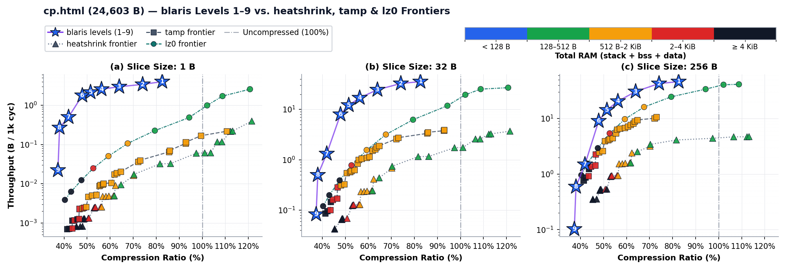
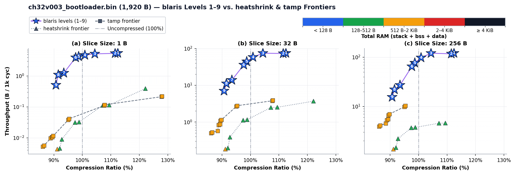
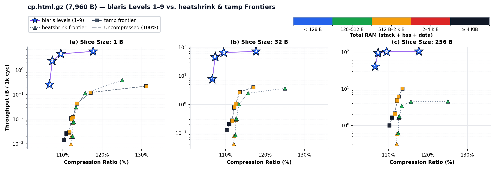
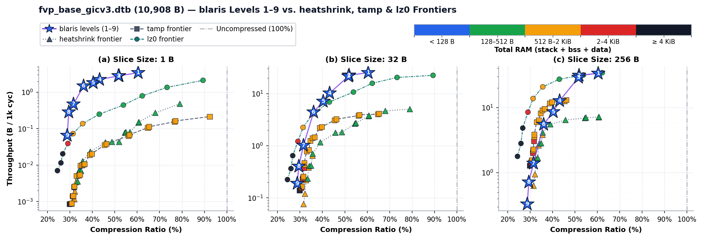
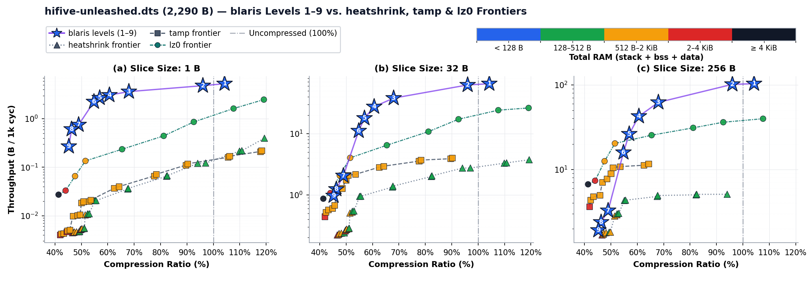

# blaris

**Windowless Random-Access LZSS for Constrained Microcontrollers**

[](https://arxiv.org/abs/2611.22900)

`blaris` is a windowless random-access LZSS decompressor designed for systems with very little
Flash and RAM memory. Because it is windowless, it never allocates a buffer in RAM to
resolve bytes; instead, the compressed payload is structured in a way which allows
the decompressor to walk it in both directions.

`blaris` should be used in workflows where some data is compressed once and
decompressed many times on the MCU. It supports super efficient partial decompression
(imagine decompressing a single record from a configuration table), as well as $O(n)$ full-file
decompression, although the latter is not the intended use case.

`blaris` is incredibly tiny in both Flash and RAM usage. Unlike traditional codecs
like `heatshrink` and `tamp`, `blaris` uses the exact same amount of memory regardless of
how large the input file is.

## Flash and RAM usage

| Codec | Flash (`.text` + `.rodata`) | Peak Stack | Static RAM (`.bss` + `.data`) | Total RAM |
| :--- | ---: | ---: | ---: | ---: |
| **`blaris`** | **532–756 B** | **76–84 B** | **28–36 B** | **104–120 B** |
| `heatshrink` | 1,300–1,464 B | 140–144 B | 66–16,450 B | 206–16,594 B |
| `tamp` | 2,238–3,238 B | 228–248 B | 292–16,424 B | 520–16,672 B |


## Performance note
Across the benchmark corpus (21 files: `.csv`, `.bin`, `.dtb`, `.c`, `.html`, etc.),
`blaris` is extremely fast when decompressing small slices (`<= 32 B`).
For larger slices, `blaris` stays very fast and delivers compression ratios comparable to or
beating `heatshrink` and `tamp`.

Benchmarks were compiled with Clang (`-Os`) for 32-bit RISC-V (**RV32IMC**) and run in `rv32emu` across 1,000 pseudorandom unaligned offsets per slice size. Because `heatshrink` and `tamp` only decode sequentially, they are wrapped in a block-indexing layer (`2^4` to `2^14 B` blocks).

### 1. Devicetree Blob — `zynq7000s.dtb` (15.2 KiB)


### 2. RTOS Configuration — `FreeRTOSConfig.h` (35.7 KiB)


### 3. Web Asset — `cp.html` (24.0 KiB)


### Hardware Check (ESP32-C3FN4 XIP)
> Note: tested on v1.0.0, not v1.1.0

To check whether SPI Flash wait states on real hardware disproportionately penalize `blaris`'s backward token walking, we also tested one balanced configuration of each codec (`blaris_o2_a0_s8_f1`, `heatshrink_b10_i16_w8_l4`, and `tamp_b10_w8_e1`) on a physical **ESP32-C3FN4** in direct-boot XIP mode (mapping both code and compressed payload to external quad-SPI Flash without copying either to SRAM). Overall hardware cycle counts increased by **29.3% (`1.29×`)** for `blaris`, compared to **+33.5% (`1.33×`)** for `heatshrink` and **+23.6% (`1.24×`)** for `tamp` (`1.51×` on 1 B reads for `blaris` due to cold cache-line fills, stabilizing at `1.30×–1.33×` for slices `>= 4 B`).

---

## Usage & C API

`blaris` can be used either with a predefined configuration or by tuning the
parameters for the specific use case. I highly recommend going with the latter, as
decompression speed and ratio are very dependent on the data, and while predefined
levels are fine, they might not give the best results.

9 configuration levels are supported, with `1` being the fastest and `9` compressing the
best. Levels `1` through `7` use
`src/blaris-compress-greedymaxhops.c` for compression, which is made for fast
decompression and deterministic worst-case latency. Specifically, a slice of size `L`
can be decompressed in `O(L * H * D/2)` time (with `s > 0`), where `H` is `BLARIS_MAX_HOPS` and `D`
is `1 << BLARIS_CHECKPOINTS_SPREAD_LOG`.

Levels `8` and `9` use a different compressor, `src/blaris-compress-optimal.c`, which is
designed to provide the best possible ratio. However, this method suffers from an
unconstrained number of hops any byte can take, and should not be used in systems
where latency predictability is of the highest importance.

If `BLARIS_LEVEL` is set to any number from `1` to `9` (identically on both compressor and decompressor), simply compile
`src/blaris-compress.c` as the compressor and `src/blaris-decompress.c` as the
decompressor. Predefined levels can be found in `include/config.h`.

If `BLARIS_LEVEL` is not defined, or is set to `0`, include either
`src/blaris-compress-optimal.c` or `src/blaris-compress-greedymaxhops.c` as the
compressor file. To tune parameters manually, check the defines in
`include/blaris.h`, `src/blaris-decompress.c`, and the chosen compressor.

> By default, setting `BLARIS_LEVEL` to `4` or `5` should be fine, as those levels are relatively
> fast and produce good compression ratios.

### Decompression Example (Target MCU)

Compile with `src/blaris-decompress.c` and `-DBLARIS_LEVEL=4` (matching the compressor):

```c
#define BLARIS_LEVEL 4
#include <blaris.h>

// Must be 4-byte aligned in Flash / XIP memory
extern const uint32_t compressed_payload[];

static struct Decoder dec;
static struct Checkpoint cp;

void init_assets(void) {
    blaris_init(compressed_payload, &dec);
    cp = (struct Checkpoint){0};
}

// Read `size` bytes starting at uncompressed `offset` into `out_buf`
void read_slice(uint32_t offset, uint8_t *out_buf, uint32_t size) {
    blaris_decompress(&dec, offset, out_buf, size, &cp);
}
```

### Compression Example (Host)

Compile and link with `src/blaris-compress.c` and `-DBLARIS_LEVEL=4`:

```c
#define BLARIS_LEVEL 4
#define BLARIS_COMPRESS
#include <blaris.h>

size_t max_len = blaris_compress_bound(input_len);
uint8_t *compressed = malloc(max_len);
size_t compressed_len = max_len;

if (blaris_compress(input_data, input_len, compressed, &compressed_len) == 0) {
    // `compressed` now holds `compressed_len` bytes of blaris payload
}
```

## Running the Benchmarks & Plotting Scripts

Requires `clang` (with `riscv32-unknown-elf` support), `lld` (`ld.lld`), `llvm-size`, [`rv32emu`](https://github.com/sysprog21/rv32emu), and Python packages `matplotlib` and `numpy` (`PyQt5` optional for interactive `--all` plots; `esptool` and `pyserial` optional for ESP32-C3 runs).

```bash
# Run the full benchmark suite in rv32emu
python3 bench/run.py

# Summarize Flash, Stack, and Static RAM footprints
python3 bench/scripts/summary.py

# View per-file level tables in plain text in the terminal
python3 bench/scripts/generate_tables.py --dataset FreeRTOSConfig.h --slice 32

# Plot Pareto frontier for a dataset and slice size (e.g., s=5 -> 32 B)
python3 bench/scripts/compare.py zynq7000s.dtb 5
```

---

## License

Licensed under either of

- Apache License, Version 2.0 ([LICENSE-APACHE](LICENSE-APACHE) or http://www.apache.org/licenses/LICENSE-2.0)
- MIT license ([LICENSE-MIT](LICENSE-MIT) or http://opensource.org/licenses/MIT)

at your option.

## Benchmarking

Detailed per-file comparisons across all 21 corpus datasets at slice sizes of **4 B**, **32 B**, and **256 B**.
For each slice size, all 9 `blaris` preset levels (`L9` tightest to `L1` fastest) are grouped with the most lightweight (lowest RAM usage) `heatshrink` and `tamp` configuration that achieves the same or better compression ratio (`ratio <= blaris_ratio`, tie-breaking by lowest decompression cycles; if none reaches that ratio, the best-ratio configuration for that codec is shown as a fallback and marked with `*`).

<details>
<summary><strong><code>FreeRTOSConfig.h</code></strong> (36,522 B)</summary>


#### `FreeRTOSConfig.h` — 4 B Slices

| Configuration | Ratio | Decompression Cycles | vs. `blaris` | RAM Usage |
| :--- | ---: | ---: | ---: | ---: |
| **`L9` (`blaris_optimal_o2_a0_s0_f0_r1`)** | **32.71%** | **175,413 cyc** | **-** | **112 B** |
| `heatshrink_b14_i16_w14_l6` | 38.11%* | 937,639 cyc | x5.35 | 16,578 B |
| `tamp_b14_w12_e1` | 34.88%* | 631,535 cyc | x3.60 | 4,384 B |
| | | | | |
| **`L8` (`blaris_optimal_o2_a0_s10_f0_r1`)** | **33.40%** | **19,787 cyc** | **-** | **120 B** |
| `heatshrink_b14_i16_w14_l6` | 38.11%* | 937,639 cyc | x47.4 | 16,578 B |
| `tamp_b14_w12_e1` | 34.88%* | 631,535 cyc | x31.9 | 4,384 B |
| | | | | |
| **`L7` (`blaris_greedymaxhops_o2_a0_s10_p1_h32_c0_l8_r1`)** | **36.26%** | **7,745 cyc** | **-** | **120 B** |
| `heatshrink_b14_i16_w14_l6` | 38.11%* | 937,639 cyc | x121 | 16,578 B |
| `tamp_b14_w12_e1` | 34.88% | 631,535 cyc | x81.5 | 4,384 B |
| | | | | |
| **`L6` (`blaris_greedymaxhops_o2_a0_s8_p1_h32_c0_l16_r1`)** | **40.29%** | **1,848 cyc** | **-** | **120 B** |
| `heatshrink_b14_i16_w12_l6` | 38.64% | 889,849 cyc | x482 | 4,290 B |
| `tamp_b12_w10_e1` | 40.24% | 161,228 cyc | x87.3 | 1,312 B |
| | | | | |
| **`L5` (`blaris_greedymaxhops_o2_a0_s8_p4_h8_c0_l16_r1`)** | **41.66%** | **1,298 cyc** | **-** | **120 B** |
| `heatshrink_b14_i16_w12_l8` | 40.77% | 887,920 cyc | x684 | 4,290 B |
| `tamp_b14_w10_e0` | 41.31% | 580,240 cyc | x447 | 1,288 B |
| | | | | |
| **`L4` (`blaris_greedymaxhops_o2_a0_s8_p16_h8_c128_l16_r1`)** | **48.37%** | **718 cyc** | **-** | **120 B** |
| `heatshrink_b12_i16_w10_l6` | 46.71% | 245,633 cyc | x342 | 1,214 B |
| `tamp_b12_w10_e0` | 43.48% | 154,477 cyc | x215 | 1,288 B |
| | | | | |
| **`L3` (`blaris_greedymaxhops_o2_a0_s8_p16_h8_c384_l64_r1`)** | **61.95%** | **484 cyc** | **-** | **120 B** |
| `heatshrink_b12_i16_w8_l4` | 59.29% | 276,001 cyc | x570 | 446 B |
| `tamp_b10_w8_e0` | 58.77% | 41,892 cyc | x86.5 | 520 B |
| | | | | |
| **`L2` (`blaris_greedymaxhops_o2_a0_s6_p16_h8_c128_l64_r1`)** | **67.63%** | **377 cyc** | **-** | **120 B** |
| `heatshrink_b10_i16_w8_l4` | 62.29% | 75,830 cyc | x201 | 446 B |
| `tamp_b8_w8_e0` | 67.58% | 13,486 cyc | x35.8 | 520 B |
| | | | | |
| **`L1` (`blaris_greedymaxhops_o2_a0_s6_p16_h8_c384_l64_r1`)** | **69.85%** | **374 cyc** | **-** | **120 B** |
| `heatshrink_b10_i16_w8_l4` | 62.29% | 75,830 cyc | x203 | 446 B |
| `tamp_b8_w8_e0` | 67.58% | 13,486 cyc | x36.1 | 520 B |

#### `FreeRTOSConfig.h` — 32 B Slices

| Configuration | Ratio | Decompression Cycles | vs. `blaris` | RAM Usage |
| :--- | ---: | ---: | ---: | ---: |
| **`L9` (`blaris_optimal_o2_a0_s0_f0_r1`)** | **32.71%** | **926,463 cyc** | **-** | **112 B** |
| `heatshrink_b14_i16_w14_l6` | 38.11%* | 768,429 cyc | x0.83 | 16,578 B |
| `tamp_b14_w12_e1` | 34.88%* | 324,050 cyc | x0.35 | 4,384 B |
| | | | | |
| **`L8` (`blaris_optimal_o2_a0_s10_f0_r1`)** | **33.40%** | **134,397 cyc** | **-** | **120 B** |
| `heatshrink_b14_i16_w14_l6` | 38.11%* | 768,429 cyc | x5.72 | 16,578 B |
| `tamp_b14_w12_e1` | 34.88%* | 324,050 cyc | x2.41 | 4,384 B |
| | | | | |
| **`L7` (`blaris_greedymaxhops_o2_a0_s10_p1_h32_c0_l8_r1`)** | **36.26%** | **48,873 cyc** | **-** | **120 B** |
| `heatshrink_b14_i16_w14_l6` | 38.11%* | 768,429 cyc | x15.7 | 16,578 B |
| `tamp_b14_w12_e1` | 34.88% | 324,050 cyc | x6.63 | 4,384 B |
| | | | | |
| **`L6` (`blaris_greedymaxhops_o2_a0_s8_p1_h32_c0_l16_r1`)** | **40.29%** | **9,865 cyc** | **-** | **120 B** |
| `heatshrink_b14_i16_w12_l6` | 38.64% | 721,225 cyc | x73.1 | 4,290 B |
| `tamp_b12_w10_e1` | 40.24% | 91,350 cyc | x9.26 | 1,312 B |
| | | | | |
| **`L5` (`blaris_greedymaxhops_o2_a0_s8_p4_h8_c0_l16_r1`)** | **41.66%** | **6,504 cyc** | **-** | **120 B** |
| `heatshrink_b14_i16_w12_l8` | 40.77% | 720,693 cyc | x111 | 4,290 B |
| `tamp_b14_w10_e0` | 41.31% | 301,226 cyc | x46.3 | 1,288 B |
| | | | | |
| **`L4` (`blaris_greedymaxhops_o2_a0_s8_p16_h8_c128_l16_r1`)** | **48.37%** | **2,728 cyc** | **-** | **120 B** |
| `heatshrink_b12_i16_w10_l6` | 46.71% | 217,225 cyc | x79.6 | 1,214 B |
| `tamp_b12_w10_e0` | 43.48% | 89,964 cyc | x33.0 | 1,288 B |
| | | | | |
| **`L3` (`blaris_greedymaxhops_o2_a0_s8_p16_h8_c384_l64_r1`)** | **61.95%** | **1,500 cyc** | **-** | **120 B** |
| `heatshrink_b12_i16_w8_l4` | 59.29% | 247,688 cyc | x165 | 446 B |
| `tamp_b10_w8_e0` | 58.77% | 27,428 cyc | x18.3 | 520 B |
| | | | | |
| **`L2` (`blaris_greedymaxhops_o2_a0_s6_p16_h8_c128_l64_r1`)** | **67.63%** | **1,260 cyc** | **-** | **120 B** |
| `heatshrink_b10_i16_w8_l4` | 62.29% | 70,753 cyc | x56.2 | 446 B |
| `tamp_b8_w8_e0` | 67.58% | 11,207 cyc | x8.90 | 520 B |
| | | | | |
| **`L1` (`blaris_greedymaxhops_o2_a0_s6_p16_h8_c384_l64_r1`)** | **69.85%** | **1,208 cyc** | **-** | **120 B** |
| `heatshrink_b10_i16_w8_l4` | 62.29% | 70,753 cyc | x58.6 | 446 B |
| `tamp_b8_w8_e0` | 67.58% | 11,207 cyc | x9.28 | 520 B |

#### `FreeRTOSConfig.h` — 256 B Slices

| Configuration | Ratio | Decompression Cycles | vs. `blaris` | RAM Usage |
| :--- | ---: | ---: | ---: | ---: |
| **`L9` (`blaris_optimal_o2_a0_s0_f0_r1`)** | **32.71%** | **5,798,582 cyc** | **-** | **112 B** |
| `heatshrink_b14_i16_w14_l6` | 38.11%* | 767,623 cyc | x0.13 | 16,578 B |
| `tamp_b14_w12_e1` | 34.88%* | 290,940 cyc | x0.05 | 4,384 B |
| | | | | |
| **`L8` (`blaris_optimal_o2_a0_s10_f0_r1`)** | **33.40%** | **904,835 cyc** | **-** | **120 B** |
| `heatshrink_b14_i16_w14_l6` | 38.11%* | 767,623 cyc | x0.85 | 16,578 B |
| `tamp_b14_w12_e1` | 34.88%* | 290,940 cyc | x0.32 | 4,384 B |
| | | | | |
| **`L7` (`blaris_greedymaxhops_o2_a0_s10_p1_h32_c0_l8_r1`)** | **36.26%** | **333,835 cyc** | **-** | **120 B** |
| `heatshrink_b14_i16_w14_l6` | 38.11%* | 767,623 cyc | x2.30 | 16,578 B |
| `tamp_b14_w12_e1` | 34.88% | 290,940 cyc | x0.87 | 4,384 B |
| | | | | |
| **`L6` (`blaris_greedymaxhops_o2_a0_s8_p1_h32_c0_l16_r1`)** | **40.29%** | **66,650 cyc** | **-** | **120 B** |
| `heatshrink_b14_i16_w12_l6` | 38.64% | 719,427 cyc | x10.8 | 4,290 B |
| `tamp_b12_w10_e1` | 40.24% | 89,950 cyc | x1.35 | 1,312 B |
| | | | | |
| **`L5` (`blaris_greedymaxhops_o2_a0_s8_p4_h8_c0_l16_r1`)** | **41.66%** | **44,198 cyc** | **-** | **120 B** |
| `heatshrink_b14_i16_w12_l8` | 40.77% | 719,272 cyc | x16.3 | 4,290 B |
| `tamp_b14_w10_e0` | 41.31% | 271,513 cyc | x6.14 | 1,288 B |
| | | | | |
| **`L4` (`blaris_greedymaxhops_o2_a0_s8_p16_h8_c128_l16_r1`)** | **48.37%** | **17,910 cyc** | **-** | **120 B** |
| `heatshrink_b12_i16_w10_l6` | 46.71% | 236,942 cyc | x13.2 | 1,214 B |
| `tamp_b12_w10_e0` | 43.48% | 89,264 cyc | x4.98 | 1,288 B |
| | | | | |
| **`L3` (`blaris_greedymaxhops_o2_a0_s8_p16_h8_c384_l64_r1`)** | **61.95%** | **9,477 cyc** | **-** | **120 B** |
| `heatshrink_b12_i16_w8_l4` | 59.29% | 272,180 cyc | x28.7 | 446 B |
| `tamp_b10_w8_e0` | 58.77% | 34,438 cyc | x3.63 | 520 B |
| | | | | |
| **`L2` (`blaris_greedymaxhops_o2_a0_s6_p16_h8_c128_l64_r1`)** | **67.63%** | **8,041 cyc** | **-** | **120 B** |
| `heatshrink_b10_i16_w8_l4` | 62.29% | 97,193 cyc | x12.1 | 446 B |
| `tamp_b8_w8_e0` | 67.58% | 23,173 cyc | x2.88 | 520 B |
| | | | | |
| **`L1` (`blaris_greedymaxhops_o2_a0_s6_p16_h8_c384_l64_r1`)** | **69.85%** | **7,580 cyc** | **-** | **120 B** |
| `heatshrink_b10_i16_w8_l4` | 62.29% | 97,193 cyc | x12.8 | 446 B |
| `tamp_b8_w8_e0` | 67.58% | 23,173 cyc | x3.06 | 520 B |

</details>

<details>
<summary><strong><code>ch32v003_bootloader.bin</code></strong> (1,920 B)</summary>



#### `ch32v003_bootloader.bin` — 4 B Slices

| Configuration | Ratio | Decompression Cycles | vs. `blaris` | RAM Usage |
| :--- | ---: | ---: | ---: | ---: |
| **`L9` (`blaris_optimal_o2_a0_s0_f0_r1`)** | **92.50%** | **3,270 cyc** | **-** | **112 B** |
| `heatshrink_b12_i16_w8_l4` | 92.08% | 176,291 cyc | x53.9 | 446 B |
| `tamp_b10_w8_e0` | 89.79% | 41,337 cyc | x12.6 | 520 B |
| | | | | |
| **`L8` (`blaris_optimal_o2_a0_s10_f0_r1`)** | **93.12%** | **1,568 cyc** | **-** | **120 B** |
| `heatshrink_b10_i16_w8_l4` | 92.81% | 91,391 cyc | x58.3 | 446 B |
| `tamp_b10_w8_e0` | 89.79% | 41,337 cyc | x26.4 | 520 B |
| | | | | |
| **`L7` (`blaris_greedymaxhops_o2_a0_s10_p1_h32_c0_l8_r1`)** | **95.00%** | **1,248 cyc** | **-** | **120 B** |
| `heatshrink_b10_i16_w8_l4` | 92.81% | 91,391 cyc | x73.3 | 446 B |
| `tamp_b10_w8_e0` | 89.79% | 41,337 cyc | x33.1 | 520 B |
| | | | | |
| **`L6` (`blaris_greedymaxhops_o2_a0_s8_p1_h32_c0_l16_r1`)** | **100.52%** | **346 cyc** | **-** | **120 B** |
| `heatshrink_b8_i16_w6_l4` | 98.85% | 25,473 cyc | x73.6 | 254 B |
| `tamp_b8_w8_e0` | 95.36% | 13,140 cyc | x38.0 | 520 B |
| | | | | |
| **`L5` (`blaris_greedymaxhops_o2_a0_s8_p4_h8_c0_l16_r1`)** | **101.88%** | **319 cyc** | **-** | **120 B** |
| `heatshrink_b8_i16_w6_l4` | 98.85% | 25,473 cyc | x79.9 | 254 B |
| `tamp_b8_w8_e0` | 95.36% | 13,140 cyc | x41.2 | 520 B |
| | | | | |
| **`L4` (`blaris_greedymaxhops_o2_a0_s8_p16_h8_c128_l16_r1`)** | **103.96%** | **284 cyc** | **-** | **120 B** |
| `heatshrink_b8_i16_w6_l4` | 98.85% | 25,473 cyc | x89.8 | 254 B |
| `tamp_b8_w8_e0` | 95.36% | 13,140 cyc | x46.3 | 520 B |
| | | | | |
| **`L3` (`blaris_greedymaxhops_o2_a0_s8_p16_h8_c384_l64_r1`)** | **107.55%** | **251 cyc** | **-** | **120 B** |
| `heatshrink_b8_i16_w4_l3` | 105.83% | 26,270 cyc | x104 | 206 B |
| `tamp_b8_w8_e0` | 95.36% | 13,140 cyc | x52.3 | 520 B |
| | | | | |
| **`L2` (`blaris_greedymaxhops_o2_a0_s6_p16_h8_c128_l64_r1`)** | **114.48%** | **214 cyc** | **-** | **120 B** |
| `heatshrink_b6_i16_w4_l3` | 109.43% | 7,547 cyc | x35.2 | 206 B |
| `tamp_b6_w8_e0` | 107.81% | 6,032 cyc | x28.1 | 520 B |
| | | | | |
| **`L1` (`blaris_greedymaxhops_o2_a0_s6_p16_h8_c384_l64_r1`)** | **115.62%** | **215 cyc** | **-** | **120 B** |
| `heatshrink_b6_i16_w4_l3` | 109.43% | 7,547 cyc | x35.1 | 206 B |
| `tamp_b6_w8_e0` | 107.81% | 6,032 cyc | x28.1 | 520 B |

#### `ch32v003_bootloader.bin` — 32 B Slices

| Configuration | Ratio | Decompression Cycles | vs. `blaris` | RAM Usage |
| :--- | ---: | ---: | ---: | ---: |
| **`L9` (`blaris_optimal_o2_a0_s0_f0_r1`)** | **92.50%** | **7,327 cyc** | **-** | **112 B** |
| `heatshrink_b12_i16_w8_l4` | 92.08% | 164,913 cyc | x22.5 | 446 B |
| `tamp_b10_w8_e0` | 89.79% | 27,964 cyc | x3.82 | 520 B |
| | | | | |
| **`L8` (`blaris_optimal_o2_a0_s10_f0_r1`)** | **93.12%** | **4,440 cyc** | **-** | **120 B** |
| `heatshrink_b10_i16_w8_l4` | 92.81% | 83,574 cyc | x18.8 | 446 B |
| `tamp_b10_w8_e0` | 89.79% | 27,964 cyc | x6.30 | 520 B |
| | | | | |
| **`L7` (`blaris_greedymaxhops_o2_a0_s10_p1_h32_c0_l8_r1`)** | **95.00%** | **2,876 cyc** | **-** | **120 B** |
| `heatshrink_b10_i16_w8_l4` | 92.81% | 83,574 cyc | x29.1 | 446 B |
| `tamp_b10_w8_e0` | 89.79% | 27,964 cyc | x9.72 | 520 B |
| | | | | |
| **`L6` (`blaris_greedymaxhops_o2_a0_s8_p1_h32_c0_l16_r1`)** | **100.52%** | **962 cyc** | **-** | **120 B** |
| `heatshrink_b8_i16_w6_l4` | 98.85% | 27,892 cyc | x29.0 | 254 B |
| `tamp_b8_w8_e0` | 95.36% | 11,455 cyc | x11.9 | 520 B |
| | | | | |
| **`L5` (`blaris_greedymaxhops_o2_a0_s8_p4_h8_c0_l16_r1`)** | **101.88%** | **808 cyc** | **-** | **120 B** |
| `heatshrink_b8_i16_w6_l4` | 98.85% | 27,892 cyc | x34.5 | 254 B |
| `tamp_b8_w8_e0` | 95.36% | 11,455 cyc | x14.2 | 520 B |
| | | | | |
| **`L4` (`blaris_greedymaxhops_o2_a0_s8_p16_h8_c128_l16_r1`)** | **103.96%** | **642 cyc** | **-** | **120 B** |
| `heatshrink_b8_i16_w6_l4` | 98.85% | 27,892 cyc | x43.4 | 254 B |
| `tamp_b8_w8_e0` | 95.36% | 11,455 cyc | x17.8 | 520 B |
| | | | | |
| **`L3` (`blaris_greedymaxhops_o2_a0_s8_p16_h8_c384_l64_r1`)** | **107.55%** | **520 cyc** | **-** | **120 B** |
| `heatshrink_b8_i16_w4_l3` | 105.83% | 29,006 cyc | x55.8 | 206 B |
| `tamp_b8_w8_e0` | 95.36% | 11,455 cyc | x22.0 | 520 B |
| | | | | |
| **`L2` (`blaris_greedymaxhops_o2_a0_s6_p16_h8_c128_l64_r1`)** | **114.48%** | **488 cyc** | **-** | **120 B** |
| `heatshrink_b6_i16_w4_l3` | 109.43% | 12,745 cyc | x26.1 | 206 B |
| `tamp_b6_w8_e0` | 107.81% | 8,155 cyc | x16.7 | 520 B |
| | | | | |
| **`L1` (`blaris_greedymaxhops_o2_a0_s6_p16_h8_c384_l64_r1`)** | **115.62%** | **484 cyc** | **-** | **120 B** |
| `heatshrink_b6_i16_w4_l3` | 109.43% | 12,745 cyc | x26.3 | 206 B |
| `tamp_b6_w8_e0` | 107.81% | 8,155 cyc | x16.8 | 520 B |

#### `ch32v003_bootloader.bin` — 256 B Slices

| Configuration | Ratio | Decompression Cycles | vs. `blaris` | RAM Usage |
| :--- | ---: | ---: | ---: | ---: |
| **`L9` (`blaris_optimal_o2_a0_s0_f0_r1`)** | **92.50%** | **28,074 cyc** | **-** | **112 B** |
| `heatshrink_b12_i16_w8_l4` | 92.08% | 179,230 cyc | x6.38 | 446 B |
| `tamp_b10_w8_e0` | 89.79% | 36,521 cyc | x1.30 | 520 B |
| | | | | |
| **`L8` (`blaris_optimal_o2_a0_s10_f0_r1`)** | **93.12%** | **18,110 cyc** | **-** | **120 B** |
| `heatshrink_b10_i16_w8_l4` | 92.81% | 117,781 cyc | x6.50 | 446 B |
| `tamp_b10_w8_e0` | 89.79% | 36,521 cyc | x2.02 | 520 B |
| | | | | |
| **`L7` (`blaris_greedymaxhops_o2_a0_s10_p1_h32_c0_l8_r1`)** | **95.00%** | **11,366 cyc** | **-** | **120 B** |
| `heatshrink_b10_i16_w8_l4` | 92.81% | 117,781 cyc | x10.4 | 446 B |
| `tamp_b10_w8_e0` | 89.79% | 36,521 cyc | x3.21 | 520 B |
| | | | | |
| **`L6` (`blaris_greedymaxhops_o2_a0_s8_p1_h32_c0_l16_r1`)** | **100.52%** | **4,239 cyc** | **-** | **120 B** |
| `heatshrink_b8_i16_w6_l4` | 98.85% | 69,326 cyc | x16.4 | 254 B |
| `tamp_b8_w8_e0` | 95.36% | 24,735 cyc | x5.83 | 520 B |
| | | | | |
| **`L5` (`blaris_greedymaxhops_o2_a0_s8_p4_h8_c0_l16_r1`)** | **101.88%** | **3,715 cyc** | **-** | **120 B** |
| `heatshrink_b8_i16_w6_l4` | 98.85% | 69,326 cyc | x18.7 | 254 B |
| `tamp_b8_w8_e0` | 95.36% | 24,735 cyc | x6.66 | 520 B |
| | | | | |
| **`L4` (`blaris_greedymaxhops_o2_a0_s8_p16_h8_c128_l16_r1`)** | **103.96%** | **3,133 cyc** | **-** | **120 B** |
| `heatshrink_b8_i16_w6_l4` | 98.85% | 69,326 cyc | x22.1 | 254 B |
| `tamp_b8_w8_e0` | 95.36% | 24,735 cyc | x7.90 | 520 B |
| | | | | |
| **`L3` (`blaris_greedymaxhops_o2_a0_s8_p16_h8_c384_l64_r1`)** | **107.55%** | **2,612 cyc** | **-** | **120 B** |
| `heatshrink_b8_i16_w4_l3` | 105.83% | 72,140 cyc | x27.6 | 206 B |
| `tamp_b8_w8_e0` | 95.36% | 24,735 cyc | x9.47 | 520 B |
| | | | | |
| **`L2` (`blaris_greedymaxhops_o2_a0_s6_p16_h8_c128_l64_r1`)** | **114.48%** | **2,590 cyc** | **-** | **120 B** |
| `heatshrink_b6_i16_w4_l3` | 109.43% | 56,272 cyc | x21.7 | 206 B |
| `tamp_b8_w8_e0` | 95.36% | 24,735 cyc | x9.55 | 520 B |
| | | | | |
| **`L1` (`blaris_greedymaxhops_o2_a0_s6_p16_h8_c384_l64_r1`)** | **115.62%** | **2,541 cyc** | **-** | **120 B** |
| `heatshrink_b6_i16_w4_l3` | 109.43% | 56,272 cyc | x22.1 | 206 B |
| `tamp_b8_w8_e0` | 95.36% | 24,735 cyc | x9.74 | 520 B |

</details>

<details>
<summary><strong><code>ch32v30x_blink.bin</code></strong> (1,064 B)</summary>


#### `ch32v30x_blink.bin` — 4 B Slices

| Configuration | Ratio | Decompression Cycles | vs. `blaris` | RAM Usage |
| :--- | ---: | ---: | ---: | ---: |
| **`L9` (`blaris_optimal_o2_a0_s0_f0_r1`)** | **65.41%** | **3,114 cyc** | **-** | **112 B** |
| `heatshrink_b10_i16_w8_l6` | 64.47% | 53,019 cyc | x17.0 | 446 B |
| `tamp_b10_w8_e0` | 63.91% | 37,042 cyc | x11.9 | 520 B |
| | | | | |
| **`L8` (`blaris_optimal_o2_a0_s10_f0_r1`)** | **66.54%** | **3,124 cyc** | **-** | **120 B** |
| `heatshrink_b10_i16_w6_l4` | 66.26% | 54,597 cyc | x17.5 | 254 B |
| `tamp_b10_w8_e0` | 63.91% | 37,042 cyc | x11.9 | 520 B |
| | | | | |
| **`L7` (`blaris_greedymaxhops_o2_a0_s10_p1_h32_c0_l8_r1`)** | **68.05%** | **1,400 cyc** | **-** | **119 B** |
| `heatshrink_b8_i16_w6_l4` | 68.05% | 18,063 cyc | x12.9 | 254 B |
| `tamp_b10_w8_e0` | 63.91% | 37,042 cyc | x26.5 | 520 B |
| | | | | |
| **`L6` (`blaris_greedymaxhops_o2_a0_s8_p1_h32_c0_l16_r1`)** | **72.27%** | **885 cyc** | **-** | **119 B** |
| `heatshrink_b10_i16_w4_l3` | 71.80% | 58,939 cyc | x66.6 | 206 B |
| `tamp_b8_w8_e0` | 68.14% | 12,441 cyc | x14.1 | 520 B |
| | | | | |
| **`L5` (`blaris_greedymaxhops_o2_a0_s8_p4_h8_c0_l16_r1`)** | **72.93%** | **788 cyc** | **-** | **119 B** |
| `heatshrink_b8_i16_w4_l3` | 72.74% | 18,731 cyc | x23.8 | 206 B |
| `tamp_b8_w8_e0` | 68.14% | 12,441 cyc | x15.8 | 520 B |
| | | | | |
| **`L4` (`blaris_greedymaxhops_o2_a0_s8_p16_h8_c128_l16_r1`)** | **74.34%** | **492 cyc** | **-** | **120 B** |
| `heatshrink_b8_i16_w4_l3` | 72.74% | 18,731 cyc | x38.1 | 206 B |
| `tamp_b8_w8_e0` | 68.14% | 12,441 cyc | x25.3 | 520 B |
| | | | | |
| **`L3` (`blaris_greedymaxhops_o2_a0_s8_p16_h8_c384_l64_r1`)** | **76.60%** | **412 cyc** | **-** | **120 B** |
| `heatshrink_b8_i16_w4_l3` | 72.74% | 18,731 cyc | x45.5 | 206 B |
| `tamp_b8_w8_e0` | 68.14% | 12,441 cyc | x30.2 | 520 B |
| | | | | |
| **`L2` (`blaris_greedymaxhops_o2_a0_s6_p16_h8_c128_l64_r1`)** | **84.68%** | **314 cyc** | **-** | **120 B** |
| `heatshrink_b6_i16_w4_l3` | 77.07% | 5,809 cyc | x18.5 | 206 B |
| `tamp_b6_w8_e0` | 77.44% | 5,875 cyc | x18.7 | 520 B |
| | | | | |
| **`L1` (`blaris_greedymaxhops_o2_a0_s6_p16_h8_c384_l64_r1`)** | **85.34%** | **322 cyc** | **-** | **120 B** |
| `heatshrink_b6_i16_w4_l3` | 77.07% | 5,809 cyc | x18.1 | 206 B |
| `tamp_b6_w8_e0` | 77.44% | 5,875 cyc | x18.3 | 520 B |

#### `ch32v30x_blink.bin` — 32 B Slices

| Configuration | Ratio | Decompression Cycles | vs. `blaris` | RAM Usage |
| :--- | ---: | ---: | ---: | ---: |
| **`L9` (`blaris_optimal_o2_a0_s0_f0_r1`)** | **65.41%** | **4,582 cyc** | **-** | **112 B** |
| `heatshrink_b10_i16_w8_l6` | 64.47% | 49,640 cyc | x10.8 | 446 B |
| `tamp_b10_w8_e0` | 63.91% | 22,585 cyc | x4.93 | 520 B |
| | | | | |
| **`L8` (`blaris_optimal_o2_a0_s10_f0_r1`)** | **66.54%** | **4,643 cyc** | **-** | **120 B** |
| `heatshrink_b10_i16_w6_l4` | 66.26% | 51,480 cyc | x11.1 | 254 B |
| `tamp_b10_w8_e0` | 63.91% | 22,585 cyc | x4.86 | 520 B |
| | | | | |
| **`L7` (`blaris_greedymaxhops_o2_a0_s10_p1_h32_c0_l8_r1`)** | **68.05%** | **4,730 cyc** | **-** | **119 B** |
| `heatshrink_b8_i16_w6_l4` | 68.05% | 20,128 cyc | x4.26 | 254 B |
| `tamp_b10_w8_e0` | 63.91% | 22,585 cyc | x4.77 | 520 B |
| | | | | |
| **`L6` (`blaris_greedymaxhops_o2_a0_s8_p1_h32_c0_l16_r1`)** | **72.27%** | **3,522 cyc** | **-** | **119 B** |
| `heatshrink_b10_i16_w4_l3` | 71.80% | 56,557 cyc | x16.1 | 206 B |
| `tamp_b8_w8_e0` | 68.14% | 10,148 cyc | x2.88 | 520 B |
| | | | | |
| **`L5` (`blaris_greedymaxhops_o2_a0_s8_p4_h8_c0_l16_r1`)** | **72.93%** | **3,578 cyc** | **-** | **119 B** |
| `heatshrink_b8_i16_w4_l3` | 72.74% | 21,035 cyc | x5.88 | 206 B |
| `tamp_b8_w8_e0` | 68.14% | 10,148 cyc | x2.84 | 520 B |
| | | | | |
| **`L4` (`blaris_greedymaxhops_o2_a0_s8_p16_h8_c128_l16_r1`)** | **74.34%** | **1,519 cyc** | **-** | **120 B** |
| `heatshrink_b8_i16_w4_l3` | 72.74% | 21,035 cyc | x13.8 | 206 B |
| `tamp_b8_w8_e0` | 68.14% | 10,148 cyc | x6.68 | 520 B |
| | | | | |
| **`L3` (`blaris_greedymaxhops_o2_a0_s8_p16_h8_c384_l64_r1`)** | **76.60%** | **1,179 cyc** | **-** | **120 B** |
| `heatshrink_b8_i16_w4_l3` | 72.74% | 21,035 cyc | x17.8 | 206 B |
| `tamp_b8_w8_e0` | 68.14% | 10,148 cyc | x8.60 | 520 B |
| | | | | |
| **`L2` (`blaris_greedymaxhops_o2_a0_s6_p16_h8_c128_l64_r1`)** | **84.68%** | **992 cyc** | **-** | **120 B** |
| `heatshrink_b6_i16_w4_l3` | 77.07% | 9,503 cyc | x9.58 | 206 B |
| `tamp_b6_w8_e0` | 77.44% | 7,507 cyc | x7.57 | 520 B |
| | | | | |
| **`L1` (`blaris_greedymaxhops_o2_a0_s6_p16_h8_c384_l64_r1`)** | **85.34%** | **966 cyc** | **-** | **120 B** |
| `heatshrink_b6_i16_w4_l3` | 77.07% | 9,503 cyc | x9.84 | 206 B |
| `tamp_b6_w8_e0` | 77.44% | 7,507 cyc | x7.78 | 520 B |

#### `ch32v30x_blink.bin` — 256 B Slices

| Configuration | Ratio | Decompression Cycles | vs. `blaris` | RAM Usage |
| :--- | ---: | ---: | ---: | ---: |
| **`L9` (`blaris_optimal_o2_a0_s0_f0_r1`)** | **65.41%** | **12,699 cyc** | **-** | **112 B** |
| `heatshrink_b12_i16_w8_l6` | 63.91% | 59,743 cyc | x4.70 | 446 B |
| `tamp_b12_w8_e0` | 63.25% | 23,981 cyc | x1.89 | 520 B |
| | | | | |
| **`L8` (`blaris_optimal_o2_a0_s10_f0_r1`)** | **66.54%** | **13,408 cyc** | **-** | **120 B** |
| `heatshrink_b12_i16_w6_l4` | 65.70% | 62,324 cyc | x4.65 | 254 B |
| `tamp_b12_w8_e0` | 63.25% | 23,981 cyc | x1.79 | 520 B |
| | | | | |
| **`L7` (`blaris_greedymaxhops_o2_a0_s10_p1_h32_c0_l8_r1`)** | **68.05%** | **14,160 cyc** | **-** | **119 B** |
| `heatshrink_b8_i16_w6_l4` | 68.05% | 45,427 cyc | x3.21 | 254 B |
| `tamp_b12_w8_e0` | 63.25% | 23,981 cyc | x1.69 | 520 B |
| | | | | |
| **`L6` (`blaris_greedymaxhops_o2_a0_s8_p1_h32_c0_l16_r1`)** | **72.27%** | **11,022 cyc** | **-** | **119 B** |
| `heatshrink_b12_i16_w4_l3` | 71.15% | 68,626 cyc | x6.23 | 206 B |
| `tamp_b8_w8_e0` | 68.14% | 20,206 cyc | x1.83 | 520 B |
| | | | | |
| **`L5` (`blaris_greedymaxhops_o2_a0_s8_p4_h8_c0_l16_r1`)** | **72.93%** | **24,349 cyc** | **-** | **119 B** |
| `heatshrink_b8_i16_w4_l3` | 72.74% | 48,539 cyc | x1.99 | 206 B |
| `tamp_b8_w8_e0` | 68.14% | 20,206 cyc | x0.83 | 520 B |
| | | | | |
| **`L4` (`blaris_greedymaxhops_o2_a0_s8_p16_h8_c128_l16_r1`)** | **74.34%** | **9,407 cyc** | **-** | **120 B** |
| `heatshrink_b8_i16_w4_l3` | 72.74% | 48,539 cyc | x5.16 | 206 B |
| `tamp_b8_w8_e0` | 68.14% | 20,206 cyc | x2.15 | 520 B |
| | | | | |
| **`L3` (`blaris_greedymaxhops_o2_a0_s8_p16_h8_c384_l64_r1`)** | **76.60%** | **6,827 cyc** | **-** | **120 B** |
| `heatshrink_b8_i16_w4_l3` | 72.74% | 48,539 cyc | x7.11 | 206 B |
| `tamp_b8_w8_e0` | 68.14% | 20,206 cyc | x2.96 | 520 B |
| | | | | |
| **`L2` (`blaris_greedymaxhops_o2_a0_s6_p16_h8_c128_l64_r1`)** | **84.68%** | **6,175 cyc** | **-** | **120 B** |
| `heatshrink_b6_i16_w4_l3` | 77.07% | 41,336 cyc | x6.69 | 206 B |
| `tamp_b8_w8_e0` | 68.14% | 20,206 cyc | x3.27 | 520 B |
| | | | | |
| **`L1` (`blaris_greedymaxhops_o2_a0_s6_p16_h8_c384_l64_r1`)** | **85.34%** | **5,890 cyc** | **-** | **120 B** |
| `heatshrink_b6_i16_w4_l3` | 77.07% | 41,336 cyc | x7.02 | 206 B |
| `tamp_b8_w8_e0` | 68.14% | 20,206 cyc | x3.43 | 520 B |

</details>

<details>
<summary><strong><code>cp.html</code></strong> (24,603 B)</summary>


#### `cp.html` — 4 B Slices

| Configuration | Ratio | Decompression Cycles | vs. `blaris` | RAM Usage |
| :--- | ---: | ---: | ---: | ---: |
| **`L9` (`blaris_optimal_o2_a0_s0_f0_r1`)** | **40.48%** | **122,923 cyc** | **-** | **112 B** |
| `heatshrink_b14_i16_w14_l6` | 45.87%* | 898,741 cyc | x7.31 | 16,578 B |
| `tamp_b14_w12_e1` | 42.19%* | 578,912 cyc | x4.71 | 4,384 B |
| | | | | |
| **`L8` (`blaris_optimal_o2_a0_s10_f0_r1`)** | **41.19%** | **15,851 cyc** | **-** | **120 B** |
| `heatshrink_b14_i16_w14_l6` | 45.87%* | 898,741 cyc | x56.7 | 16,578 B |
| `tamp_b14_w12_e1` | 42.19%* | 578,912 cyc | x36.5 | 4,384 B |
| | | | | |
| **`L7` (`blaris_greedymaxhops_o2_a0_s10_p1_h32_c0_l8_r1`)** | **44.36%** | **5,390 cyc** | **-** | **120 B** |
| `heatshrink_b14_i16_w14_l6` | 45.87%* | 898,741 cyc | x167 | 16,578 B |
| `tamp_b14_w12_e0` | 44.35% | 544,235 cyc | x101 | 4,360 B |
| | | | | |
| **`L6` (`blaris_greedymaxhops_o2_a0_s8_p1_h32_c0_l16_r1`)** | **48.60%** | **1,425 cyc** | **-** | **120 B** |
| `heatshrink_b14_i16_w12_l6` | 47.02% | 859,615 cyc | x603 | 4,290 B |
| `tamp_b14_w10_e0` | 47.66% | 518,834 cyc | x364 | 1,288 B |
| | | | | |
| **`L5` (`blaris_greedymaxhops_o2_a0_s8_p4_h8_c0_l16_r1`)** | **49.67%** | **1,022 cyc** | **-** | **120 B** |
| `heatshrink_b14_i16_w12_l8` | 49.63% | 859,029 cyc | x840 | 4,290 B |
| `tamp_b12_w10_e0` | 49.59% | 166,614 cyc | x163 | 1,288 B |
| | | | | |
| **`L4` (`blaris_greedymaxhops_o2_a0_s8_p16_h8_c128_l16_r1`)** | **55.10%** | **631 cyc** | **-** | **120 B** |
| `heatshrink_b12_i16_w10_l4` | 53.75% | 295,922 cyc | x469 | 1,214 B |
| `tamp_b14_w8_e1` | 55.09% | 556,609 cyc | x882 | 544 B |
| | | | | |
| **`L3` (`blaris_greedymaxhops_o2_a0_s8_p16_h8_c384_l64_r1`)** | **66.04%** | **477 cyc** | **-** | **120 B** |
| `heatshrink_b10_i16_w8_l4` | 64.72% | 81,234 cyc | x170 | 446 B |
| `tamp_b10_w8_e0` | 60.52% | 43,209 cyc | x90.7 | 520 B |
| | | | | |
| **`L2` (`blaris_greedymaxhops_o2_a0_s6_p16_h8_c128_l64_r1`)** | **72.80%** | **375 cyc** | **-** | **120 B** |
| `heatshrink_b10_i16_w8_l4` | 64.72% | 81,234 cyc | x216 | 446 B |
| `tamp_b10_w8_e0` | 60.52% | 43,209 cyc | x115 | 520 B |
| | | | | |
| **`L1` (`blaris_greedymaxhops_o2_a0_s6_p16_h8_c384_l64_r1`)** | **74.19%** | **356 cyc** | **-** | **120 B** |
| `heatshrink_b10_i16_w8_l4` | 64.72% | 81,234 cyc | x228 | 446 B |
| `tamp_b8_w8_e0` | 72.97% | 13,683 cyc | x38.4 | 520 B |

#### `cp.html` — 32 B Slices

| Configuration | Ratio | Decompression Cycles | vs. `blaris` | RAM Usage |
| :--- | ---: | ---: | ---: | ---: |
| **`L9` (`blaris_optimal_o2_a0_s0_f0_r1`)** | **40.48%** | **644,476 cyc** | **-** | **112 B** |
| `heatshrink_b14_i16_w14_l6` | 45.87%* | 793,222 cyc | x1.23 | 16,578 B |
| `tamp_b14_w12_e1` | 42.19%* | 331,293 cyc | x0.51 | 4,384 B |
| | | | | |
| **`L8` (`blaris_optimal_o2_a0_s10_f0_r1`)** | **41.19%** | **109,277 cyc** | **-** | **120 B** |
| `heatshrink_b14_i16_w14_l6` | 45.87%* | 793,222 cyc | x7.26 | 16,578 B |
| `tamp_b14_w12_e1` | 42.19%* | 331,293 cyc | x3.03 | 4,384 B |
| | | | | |
| **`L7` (`blaris_greedymaxhops_o2_a0_s10_p1_h32_c0_l8_r1`)** | **44.36%** | **29,293 cyc** | **-** | **120 B** |
| `heatshrink_b14_i16_w14_l6` | 45.87%* | 793,222 cyc | x27.1 | 16,578 B |
| `tamp_b14_w12_e0` | 44.35% | 317,316 cyc | x10.8 | 4,360 B |
| | | | | |
| **`L6` (`blaris_greedymaxhops_o2_a0_s8_p1_h32_c0_l16_r1`)** | **48.60%** | **6,827 cyc** | **-** | **120 B** |
| `heatshrink_b14_i16_w12_l6` | 47.02% | 756,064 cyc | x111 | 4,290 B |
| `tamp_b14_w10_e0` | 47.66% | 298,996 cyc | x43.8 | 1,288 B |
| | | | | |
| **`L5` (`blaris_greedymaxhops_o2_a0_s8_p4_h8_c0_l16_r1`)** | **49.67%** | **4,469 cyc** | **-** | **120 B** |
| `heatshrink_b14_i16_w12_l6` | 47.02% | 756,064 cyc | x169 | 4,290 B |
| `tamp_b12_w10_e0` | 49.59% | 96,931 cyc | x21.7 | 1,288 B |
| | | | | |
| **`L4` (`blaris_greedymaxhops_o2_a0_s8_p16_h8_c128_l16_r1`)** | **55.10%** | **2,205 cyc** | **-** | **120 B** |
| `heatshrink_b12_i16_w10_l4` | 53.75% | 257,464 cyc | x117 | 1,214 B |
| `tamp_b14_w8_e1` | 55.09% | 329,698 cyc | x150 | 544 B |
| | | | | |
| **`L3` (`blaris_greedymaxhops_o2_a0_s8_p16_h8_c384_l64_r1`)** | **66.04%** | **1,525 cyc** | **-** | **120 B** |
| `heatshrink_b10_i16_w8_l4` | 64.72% | 73,914 cyc | x48.5 | 446 B |
| `tamp_b10_w8_e0` | 60.52% | 27,588 cyc | x18.1 | 520 B |
| | | | | |
| **`L2` (`blaris_greedymaxhops_o2_a0_s6_p16_h8_c128_l64_r1`)** | **72.80%** | **1,272 cyc** | **-** | **120 B** |
| `heatshrink_b10_i16_w8_l4` | 64.72% | 73,914 cyc | x58.1 | 446 B |
| `tamp_b10_w8_e0` | 60.52% | 27,588 cyc | x21.7 | 520 B |
| | | | | |
| **`L1` (`blaris_greedymaxhops_o2_a0_s6_p16_h8_c384_l64_r1`)** | **74.19%** | **1,197 cyc** | **-** | **120 B** |
| `heatshrink_b10_i16_w8_l4` | 64.72% | 73,914 cyc | x61.7 | 446 B |
| `tamp_b8_w8_e0` | 72.97% | 11,630 cyc | x9.71 | 520 B |

#### `cp.html` — 256 B Slices

| Configuration | Ratio | Decompression Cycles | vs. `blaris` | RAM Usage |
| :--- | ---: | ---: | ---: | ---: |
| **`L9` (`blaris_optimal_o2_a0_s0_f0_r1`)** | **40.48%** | **4,105,525 cyc** | **-** | **112 B** |
| `heatshrink_b14_i16_w14_l6` | 45.87%* | 774,176 cyc | x0.19 | 16,578 B |
| `tamp_b14_w12_e1` | 42.19%* | 293,594 cyc | x0.07 | 4,384 B |
| | | | | |
| **`L8` (`blaris_optimal_o2_a0_s10_f0_r1`)** | **41.19%** | **695,135 cyc** | **-** | **120 B** |
| `heatshrink_b14_i16_w14_l6` | 45.87%* | 774,176 cyc | x1.11 | 16,578 B |
| `tamp_b14_w12_e1` | 42.19%* | 293,594 cyc | x0.42 | 4,384 B |
| | | | | |
| **`L7` (`blaris_greedymaxhops_o2_a0_s10_p1_h32_c0_l8_r1`)** | **44.36%** | **204,621 cyc** | **-** | **120 B** |
| `heatshrink_b14_i16_w14_l6` | 45.87%* | 774,176 cyc | x3.78 | 16,578 B |
| `tamp_b14_w12_e0` | 44.35% | 282,510 cyc | x1.38 | 4,360 B |
| | | | | |
| **`L6` (`blaris_greedymaxhops_o2_a0_s8_p1_h32_c0_l16_r1`)** | **48.60%** | **45,914 cyc** | **-** | **120 B** |
| `heatshrink_b14_i16_w12_l6` | 47.02% | 735,558 cyc | x16.0 | 4,290 B |
| `tamp_b14_w10_e0` | 47.66% | 264,096 cyc | x5.75 | 1,288 B |
| | | | | |
| **`L5` (`blaris_greedymaxhops_o2_a0_s8_p4_h8_c0_l16_r1`)** | **49.67%** | **31,287 cyc** | **-** | **120 B** |
| `heatshrink_b14_i16_w12_l6` | 47.02% | 735,558 cyc | x23.5 | 4,290 B |
| `tamp_b12_w10_e0` | 49.59% | 98,057 cyc | x3.13 | 1,288 B |
| | | | | |
| **`L4` (`blaris_greedymaxhops_o2_a0_s8_p16_h8_c128_l16_r1`)** | **55.10%** | **14,661 cyc** | **-** | **120 B** |
| `heatshrink_b12_i16_w10_l4` | 53.75% | 285,027 cyc | x19.4 | 1,214 B |
| `tamp_b14_w8_e1` | 55.09% | 293,019 cyc | x20.0 | 544 B |
| | | | | |
| **`L3` (`blaris_greedymaxhops_o2_a0_s8_p16_h8_c384_l64_r1`)** | **66.04%** | **9,880 cyc** | **-** | **120 B** |
| `heatshrink_b10_i16_w8_l4` | 64.72% | 102,906 cyc | x10.4 | 446 B |
| `tamp_b10_w8_e0` | 60.52% | 35,447 cyc | x3.59 | 520 B |
| | | | | |
| **`L2` (`blaris_greedymaxhops_o2_a0_s6_p16_h8_c128_l64_r1`)** | **72.80%** | **8,508 cyc** | **-** | **120 B** |
| `heatshrink_b10_i16_w8_l4` | 64.72% | 102,906 cyc | x12.1 | 446 B |
| `tamp_b10_w8_e0` | 60.52% | 35,447 cyc | x4.17 | 520 B |
| | | | | |
| **`L1` (`blaris_greedymaxhops_o2_a0_s6_p16_h8_c384_l64_r1`)** | **74.19%** | **7,902 cyc** | **-** | **120 B** |
| `heatshrink_b10_i16_w8_l4` | 64.72% | 102,906 cyc | x13.0 | 446 B |
| `tamp_b8_w8_e0` | 72.97% | 23,887 cyc | x3.02 | 520 B |

</details>

<details>
<summary><strong><code>cp.html.gz</code></strong> (7,960 B)</summary>



#### `cp.html.gz` — 4 B Slices

| Configuration | Ratio | Decompression Cycles | vs. `blaris` | RAM Usage |
| :--- | ---: | ---: | ---: | ---: |
| **`L9` (`blaris_optimal_o2_a0_s0_f0_r1`)** | **106.62%** | **3,937 cyc** | **-** | **112 B** |
| `heatshrink_b14_i16_w10_l4` | 112.07%* | 846,798 cyc | x215 | 1,214 B |
| `tamp_b14_w12_e0` | 110.20%* | 349,673 cyc | x88.8 | 4,360 B |
| | | | | |
| **`L8` (`blaris_optimal_o2_a0_s10_f0_r1`)** | **107.32%** | **457 cyc** | **-** | **120 B** |
| `heatshrink_b14_i16_w10_l4` | 112.07%* | 846,798 cyc | x1,854 | 1,214 B |
| `tamp_b14_w12_e0` | 110.20%* | 349,673 cyc | x766 | 4,360 B |
| | | | | |
| **`L7` (`blaris_greedymaxhops_o2_a0_s10_p1_h32_c0_l8_r1`)** | **107.39%** | **447 cyc** | **-** | **120 B** |
| `heatshrink_b14_i16_w10_l4` | 112.07%* | 846,798 cyc | x1,894 | 1,214 B |
| `tamp_b14_w12_e0` | 110.20%* | 349,673 cyc | x782 | 4,360 B |
| | | | | |
| **`L6` (`blaris_greedymaxhops_o2_a0_s8_p1_h32_c0_l16_r1`)** | **109.50%** | **248 cyc** | **-** | **120 B** |
| `heatshrink_b14_i16_w10_l4` | 112.07%* | 846,798 cyc | x3,417 | 1,214 B |
| `tamp_b14_w12_e0` | 110.20%* | 349,673 cyc | x1,411 | 4,360 B |
| | | | | |
| **`L5` (`blaris_greedymaxhops_o2_a0_s8_p4_h8_c0_l16_r1`)** | **109.50%** | **248 cyc** | **-** | **120 B** |
| `heatshrink_b14_i16_w10_l4` | 112.07%* | 846,798 cyc | x3,417 | 1,214 B |
| `tamp_b14_w12_e0` | 110.20%* | 349,673 cyc | x1,411 | 4,360 B |
| | | | | |
| **`L4` (`blaris_greedymaxhops_o2_a0_s8_p16_h8_c128_l16_r1`)** | **109.50%** | **248 cyc** | **-** | **120 B** |
| `heatshrink_b14_i16_w10_l4` | 112.07%* | 846,798 cyc | x3,417 | 1,214 B |
| `tamp_b14_w12_e0` | 110.20%* | 349,673 cyc | x1,411 | 4,360 B |
| | | | | |
| **`L3` (`blaris_greedymaxhops_o2_a0_s8_p16_h8_c384_l64_r1`)** | **109.50%** | **248 cyc** | **-** | **120 B** |
| `heatshrink_b14_i16_w10_l4` | 112.07%* | 846,798 cyc | x3,417 | 1,214 B |
| `tamp_b14_w12_e0` | 110.20%* | 349,673 cyc | x1,411 | 4,360 B |
| | | | | |
| **`L2` (`blaris_greedymaxhops_o2_a0_s6_p16_h8_c128_l64_r1`)** | **117.69%** | **203 cyc** | **-** | **120 B** |
| `heatshrink_b6_i16_w4_l3` | 115.69% | 8,057 cyc | x39.7 | 206 B |
| `tamp_b6_w8_e0` | 117.02% | 6,169 cyc | x30.4 | 520 B |
| | | | | |
| **`L1` (`blaris_greedymaxhops_o2_a0_s6_p16_h8_c384_l64_r1`)** | **117.69%** | **203 cyc** | **-** | **120 B** |
| `heatshrink_b6_i16_w4_l3` | 115.69% | 8,057 cyc | x39.7 | 206 B |
| `tamp_b6_w8_e0` | 117.02% | 6,169 cyc | x30.4 | 520 B |

#### `cp.html.gz` — 32 B Slices

| Configuration | Ratio | Decompression Cycles | vs. `blaris` | RAM Usage |
| :--- | ---: | ---: | ---: | ---: |
| **`L9` (`blaris_optimal_o2_a0_s0_f0_r1`)** | **106.62%** | **4,198 cyc** | **-** | **112 B** |
| `heatshrink_b14_i16_w10_l4` | 112.07%* | 794,819 cyc | x189 | 1,214 B |
| `tamp_b14_w12_e0` | 110.20%* | 254,301 cyc | x60.6 | 4,360 B |
| | | | | |
| **`L8` (`blaris_optimal_o2_a0_s10_f0_r1`)** | **107.32%** | **718 cyc** | **-** | **120 B** |
| `heatshrink_b14_i16_w10_l4` | 112.07%* | 794,819 cyc | x1,107 | 1,214 B |
| `tamp_b14_w12_e0` | 110.20%* | 254,301 cyc | x354 | 4,360 B |
| | | | | |
| **`L7` (`blaris_greedymaxhops_o2_a0_s10_p1_h32_c0_l8_r1`)** | **107.39%** | **694 cyc** | **-** | **120 B** |
| `heatshrink_b14_i16_w10_l4` | 112.07%* | 794,819 cyc | x1,145 | 1,214 B |
| `tamp_b14_w12_e0` | 110.20%* | 254,301 cyc | x366 | 4,360 B |
| | | | | |
| **`L6` (`blaris_greedymaxhops_o2_a0_s8_p1_h32_c0_l16_r1`)** | **109.50%** | **496 cyc** | **-** | **120 B** |
| `heatshrink_b14_i16_w10_l4` | 112.07%* | 794,819 cyc | x1,603 | 1,214 B |
| `tamp_b14_w12_e0` | 110.20%* | 254,301 cyc | x513 | 4,360 B |
| | | | | |
| **`L5` (`blaris_greedymaxhops_o2_a0_s8_p4_h8_c0_l16_r1`)** | **109.50%** | **496 cyc** | **-** | **120 B** |
| `heatshrink_b14_i16_w10_l4` | 112.07%* | 794,819 cyc | x1,603 | 1,214 B |
| `tamp_b14_w12_e0` | 110.20%* | 254,301 cyc | x513 | 4,360 B |
| | | | | |
| **`L4` (`blaris_greedymaxhops_o2_a0_s8_p16_h8_c128_l16_r1`)** | **109.50%** | **496 cyc** | **-** | **120 B** |
| `heatshrink_b14_i16_w10_l4` | 112.07%* | 794,819 cyc | x1,603 | 1,214 B |
| `tamp_b14_w12_e0` | 110.20%* | 254,301 cyc | x513 | 4,360 B |
| | | | | |
| **`L3` (`blaris_greedymaxhops_o2_a0_s8_p16_h8_c384_l64_r1`)** | **109.50%** | **496 cyc** | **-** | **120 B** |
| `heatshrink_b14_i16_w10_l4` | 112.07%* | 794,819 cyc | x1,603 | 1,214 B |
| `tamp_b14_w12_e0` | 110.20%* | 254,301 cyc | x513 | 4,360 B |
| | | | | |
| **`L2` (`blaris_greedymaxhops_o2_a0_s6_p16_h8_c128_l64_r1`)** | **117.69%** | **449 cyc** | **-** | **120 B** |
| `heatshrink_b6_i16_w4_l3` | 115.69% | 13,007 cyc | x28.9 | 206 B |
| `tamp_b6_w8_e0` | 117.02% | 8,000 cyc | x17.8 | 520 B |
| | | | | |
| **`L1` (`blaris_greedymaxhops_o2_a0_s6_p16_h8_c384_l64_r1`)** | **117.69%** | **449 cyc** | **-** | **120 B** |
| `heatshrink_b6_i16_w4_l3` | 115.69% | 13,007 cyc | x28.9 | 206 B |
| `tamp_b6_w8_e0` | 117.02% | 8,000 cyc | x17.8 | 520 B |

#### `cp.html.gz` — 256 B Slices

| Configuration | Ratio | Decompression Cycles | vs. `blaris` | RAM Usage |
| :--- | ---: | ---: | ---: | ---: |
| **`L9` (`blaris_optimal_o2_a0_s0_f0_r1`)** | **106.62%** | **6,310 cyc** | **-** | **112 B** |
| `heatshrink_b14_i16_w10_l4` | 112.07%* | 848,723 cyc | x135 | 1,214 B |
| `tamp_b14_w12_e0` | 110.20%* | 255,360 cyc | x40.5 | 4,360 B |
| | | | | |
| **`L8` (`blaris_optimal_o2_a0_s10_f0_r1`)** | **107.32%** | **2,751 cyc** | **-** | **120 B** |
| `heatshrink_b14_i16_w10_l4` | 112.07%* | 848,723 cyc | x309 | 1,214 B |
| `tamp_b14_w12_e0` | 110.20%* | 255,360 cyc | x92.8 | 4,360 B |
| | | | | |
| **`L7` (`blaris_greedymaxhops_o2_a0_s10_p1_h32_c0_l8_r1`)** | **107.39%** | **2,665 cyc** | **-** | **120 B** |
| `heatshrink_b14_i16_w10_l4` | 112.07%* | 848,723 cyc | x318 | 1,214 B |
| `tamp_b14_w12_e0` | 110.20%* | 255,360 cyc | x95.8 | 4,360 B |
| | | | | |
| **`L6` (`blaris_greedymaxhops_o2_a0_s8_p1_h32_c0_l16_r1`)** | **109.50%** | **2,481 cyc** | **-** | **120 B** |
| `heatshrink_b14_i16_w10_l4` | 112.07%* | 848,723 cyc | x342 | 1,214 B |
| `tamp_b14_w12_e0` | 110.20%* | 255,360 cyc | x103 | 4,360 B |
| | | | | |
| **`L5` (`blaris_greedymaxhops_o2_a0_s8_p4_h8_c0_l16_r1`)** | **109.50%** | **2,481 cyc** | **-** | **120 B** |
| `heatshrink_b14_i16_w10_l4` | 112.07%* | 848,723 cyc | x342 | 1,214 B |
| `tamp_b14_w12_e0` | 110.20%* | 255,360 cyc | x103 | 4,360 B |
| | | | | |
| **`L4` (`blaris_greedymaxhops_o2_a0_s8_p16_h8_c128_l16_r1`)** | **109.50%** | **2,481 cyc** | **-** | **120 B** |
| `heatshrink_b14_i16_w10_l4` | 112.07%* | 848,723 cyc | x342 | 1,214 B |
| `tamp_b14_w12_e0` | 110.20%* | 255,360 cyc | x103 | 4,360 B |
| | | | | |
| **`L3` (`blaris_greedymaxhops_o2_a0_s8_p16_h8_c384_l64_r1`)** | **109.50%** | **2,481 cyc** | **-** | **120 B** |
| `heatshrink_b14_i16_w10_l4` | 112.07%* | 848,723 cyc | x342 | 1,214 B |
| `tamp_b14_w12_e0` | 110.20%* | 255,360 cyc | x103 | 4,360 B |
| | | | | |
| **`L2` (`blaris_greedymaxhops_o2_a0_s6_p16_h8_c128_l64_r1`)** | **117.69%** | **2,437 cyc** | **-** | **120 B** |
| `heatshrink_b6_i16_w4_l3` | 115.69% | 58,001 cyc | x23.8 | 206 B |
| `tamp_b8_w8_e0` | 113.54% | 25,345 cyc | x10.4 | 520 B |
| | | | | |
| **`L1` (`blaris_greedymaxhops_o2_a0_s6_p16_h8_c384_l64_r1`)** | **117.69%** | **2,437 cyc** | **-** | **120 B** |
| `heatshrink_b6_i16_w4_l3` | 115.69% | 58,001 cyc | x23.8 | 206 B |
| `tamp_b8_w8_e0` | 113.54% | 25,345 cyc | x10.4 | 520 B |

</details>

<details>
<summary><strong><code>data-package.json</code></strong> (4,320 B)</summary>


#### `data-package.json` — 4 B Slices

| Configuration | Ratio | Decompression Cycles | vs. `blaris` | RAM Usage |
| :--- | ---: | ---: | ---: | ---: |
| **`L9` (`blaris_optimal_o2_a0_s0_f0_r1`)** | **25.93%** | **16,503 cyc** | **-** | **112 B** |
| `heatshrink_b14_i16_w10_l8` | 25.53% | 193,897 cyc | x11.7 | 1,214 B |
| `tamp_b12_w10_e1` | 25.32% | 151,209 cyc | x9.16 | 1,312 B |
| | | | | |
| **`L8` (`blaris_optimal_o2_a0_s10_f0_r1`)** | **26.76%** | **8,539 cyc** | **-** | **120 B** |
| `heatshrink_b14_i16_w8_l6` | 26.60% | 192,284 cyc | x22.5 | 446 B |
| `tamp_b14_w8_e1` | 26.04% | 156,637 cyc | x18.3 | 544 B |
| | | | | |
| **`L7` (`blaris_greedymaxhops_o2_a0_s10_p1_h32_c0_l8_r1`)** | **28.31%** | **4,082 cyc** | **-** | **120 B** |
| `heatshrink_b14_i16_w8_l6` | 26.60% | 192,284 cyc | x47.1 | 446 B |
| `tamp_b12_w8_e1` | 27.73% | 143,376 cyc | x35.1 | 544 B |
| | | | | |
| **`L6` (`blaris_greedymaxhops_o2_a0_s8_p1_h32_c0_l16_r1`)** | **31.13%** | **1,476 cyc** | **-** | **120 B** |
| `heatshrink_b12_i16_w8_l6` | 28.73% | 176,915 cyc | x120 | 446 B |
| `tamp_b14_w8_e0` | 29.86% | 150,788 cyc | x102 | 520 B |
| | | | | |
| **`L5` (`blaris_greedymaxhops_o2_a0_s8_p4_h8_c0_l16_r1`)** | **32.75%** | **1,113 cyc** | **-** | **120 B** |
| `heatshrink_b12_i16_w8_l6` | 28.73% | 176,915 cyc | x159 | 446 B |
| `tamp_b12_w8_e0` | 31.32% | 137,935 cyc | x124 | 520 B |
| | | | | |
| **`L4` (`blaris_greedymaxhops_o2_a0_s8_p16_h8_c128_l16_r1`)** | **35.72%** | **765 cyc** | **-** | **120 B** |
| `heatshrink_b10_i16_w8_l6` | 33.96% | 52,764 cyc | x69.0 | 446 B |
| `tamp_b10_w8_e0` | 35.16% | 37,682 cyc | x49.3 | 520 B |
| | | | | |
| **`L3` (`blaris_greedymaxhops_o2_a0_s8_p16_h8_c384_l64_r1`)** | **44.72%** | **507 cyc** | **-** | **120 B** |
| `heatshrink_b10_i16_w8_l6` | 33.96% | 52,764 cyc | x104 | 446 B |
| `tamp_b10_w8_e0` | 35.16% | 37,682 cyc | x74.3 | 520 B |
| | | | | |
| **`L2` (`blaris_greedymaxhops_o2_a0_s6_p16_h8_c128_l64_r1`)** | **51.30%** | **405 cyc** | **-** | **120 B** |
| `heatshrink_b8_i16_w8_l4` | 50.62% | 19,496 cyc | x48.2 | 446 B |
| `tamp_b8_w8_e0` | 48.15% | 12,976 cyc | x32.1 | 520 B |
| | | | | |
| **`L1` (`blaris_greedymaxhops_o2_a0_s6_p16_h8_c384_l64_r1`)** | **52.89%** | **400 cyc** | **-** | **120 B** |
| `heatshrink_b8_i16_w8_l4` | 50.62% | 19,496 cyc | x48.8 | 446 B |
| `tamp_b8_w8_e0` | 48.15% | 12,976 cyc | x32.5 | 520 B |

#### `data-package.json` — 32 B Slices

| Configuration | Ratio | Decompression Cycles | vs. `blaris` | RAM Usage |
| :--- | ---: | ---: | ---: | ---: |
| **`L9` (`blaris_optimal_o2_a0_s0_f0_r1`)** | **25.93%** | **90,564 cyc** | **-** | **112 B** |
| `heatshrink_b14_i16_w10_l8` | 25.53% | 156,047 cyc | x1.72 | 1,214 B |
| `tamp_b12_w10_e1` | 25.32% | 77,276 cyc | x0.85 | 1,312 B |
| | | | | |
| **`L8` (`blaris_optimal_o2_a0_s10_f0_r1`)** | **26.76%** | **56,587 cyc** | **-** | **120 B** |
| `heatshrink_b14_i16_w8_l6` | 26.60% | 154,283 cyc | x2.73 | 446 B |
| `tamp_b14_w8_e1` | 26.04% | 75,375 cyc | x1.33 | 544 B |
| | | | | |
| **`L7` (`blaris_greedymaxhops_o2_a0_s10_p1_h32_c0_l8_r1`)** | **28.31%** | **22,661 cyc** | **-** | **120 B** |
| `heatshrink_b14_i16_w8_l6` | 26.60% | 154,283 cyc | x6.81 | 446 B |
| `tamp_b12_w8_e1` | 27.73% | 70,204 cyc | x3.10 | 544 B |
| | | | | |
| **`L6` (`blaris_greedymaxhops_o2_a0_s8_p1_h32_c0_l16_r1`)** | **31.13%** | **8,288 cyc** | **-** | **120 B** |
| `heatshrink_b12_i16_w8_l6` | 28.73% | 143,979 cyc | x17.4 | 446 B |
| `tamp_b14_w8_e0` | 29.86% | 74,886 cyc | x9.04 | 520 B |
| | | | | |
| **`L5` (`blaris_greedymaxhops_o2_a0_s8_p4_h8_c0_l16_r1`)** | **32.75%** | **5,991 cyc** | **-** | **120 B** |
| `heatshrink_b12_i16_w8_l6` | 28.73% | 143,979 cyc | x24.0 | 446 B |
| `tamp_b12_w8_e0` | 31.32% | 69,678 cyc | x11.6 | 520 B |
| | | | | |
| **`L4` (`blaris_greedymaxhops_o2_a0_s8_p16_h8_c128_l16_r1`)** | **35.72%** | **3,291 cyc** | **-** | **120 B** |
| `heatshrink_b10_i16_w8_l6` | 33.96% | 46,844 cyc | x14.2 | 446 B |
| `tamp_b10_w8_e0` | 35.16% | 22,066 cyc | x6.71 | 520 B |
| | | | | |
| **`L3` (`blaris_greedymaxhops_o2_a0_s8_p16_h8_c384_l64_r1`)** | **44.72%** | **1,621 cyc** | **-** | **120 B** |
| `heatshrink_b10_i16_w8_l6` | 33.96% | 46,844 cyc | x28.9 | 446 B |
| `tamp_b10_w8_e0` | 35.16% | 22,066 cyc | x13.6 | 520 B |
| | | | | |
| **`L2` (`blaris_greedymaxhops_o2_a0_s6_p16_h8_c128_l64_r1`)** | **51.30%** | **1,408 cyc** | **-** | **120 B** |
| `heatshrink_b8_i16_w8_l4` | 50.62% | 20,420 cyc | x14.5 | 446 B |
| `tamp_b8_w8_e0` | 48.15% | 10,315 cyc | x7.33 | 520 B |
| | | | | |
| **`L1` (`blaris_greedymaxhops_o2_a0_s6_p16_h8_c384_l64_r1`)** | **52.89%** | **1,380 cyc** | **-** | **120 B** |
| `heatshrink_b8_i16_w8_l4` | 50.62% | 20,420 cyc | x14.8 | 446 B |
| `tamp_b8_w8_e0` | 48.15% | 10,315 cyc | x7.47 | 520 B |

#### `data-package.json` — 256 B Slices

| Configuration | Ratio | Decompression Cycles | vs. `blaris` | RAM Usage |
| :--- | ---: | ---: | ---: | ---: |
| **`L9` (`blaris_optimal_o2_a0_s0_f0_r1`)** | **25.93%** | **416,965 cyc** | **-** | **112 B** |
| `heatshrink_b14_i16_w10_l8` | 25.53% | 157,883 cyc | x0.38 | 1,214 B |
| `tamp_b14_w10_e1` | 23.47% | 73,890 cyc | x0.18 | 1,312 B |
| | | | | |
| **`L8` (`blaris_optimal_o2_a0_s10_f0_r1`)** | **26.76%** | **260,044 cyc** | **-** | **120 B** |
| `heatshrink_b14_i16_w8_l6` | 26.60% | 156,199 cyc | x0.60 | 446 B |
| `tamp_b14_w8_e1` | 26.04% | 67,414 cyc | x0.26 | 544 B |
| | | | | |
| **`L7` (`blaris_greedymaxhops_o2_a0_s10_p1_h32_c0_l8_r1`)** | **28.31%** | **136,914 cyc** | **-** | **120 B** |
| `heatshrink_b14_i16_w8_l6` | 26.60% | 156,199 cyc | x1.14 | 446 B |
| `tamp_b14_w8_e1` | 26.04% | 67,414 cyc | x0.49 | 544 B |
| | | | | |
| **`L6` (`blaris_greedymaxhops_o2_a0_s8_p1_h32_c0_l16_r1`)** | **31.13%** | **51,339 cyc** | **-** | **120 B** |
| `heatshrink_b14_i16_w8_l6` | 26.60% | 156,199 cyc | x3.04 | 446 B |
| `tamp_b14_w8_e0` | 29.86% | 67,612 cyc | x1.32 | 520 B |
| | | | | |
| **`L5` (`blaris_greedymaxhops_o2_a0_s8_p4_h8_c0_l16_r1`)** | **32.75%** | **42,592 cyc** | **-** | **120 B** |
| `heatshrink_b14_i16_w8_l6` | 26.60% | 156,199 cyc | x3.67 | 446 B |
| `tamp_b14_w8_e0` | 29.86% | 67,612 cyc | x1.59 | 520 B |
| | | | | |
| **`L4` (`blaris_greedymaxhops_o2_a0_s8_p16_h8_c128_l16_r1`)** | **35.72%** | **22,674 cyc** | **-** | **120 B** |
| `heatshrink_b10_i16_w8_l6` | 33.96% | 63,537 cyc | x2.80 | 446 B |
| `tamp_b10_w8_e0` | 35.16% | 27,540 cyc | x1.21 | 520 B |
| | | | | |
| **`L3` (`blaris_greedymaxhops_o2_a0_s8_p16_h8_c384_l64_r1`)** | **44.72%** | **10,357 cyc** | **-** | **120 B** |
| `heatshrink_b10_i16_w8_l6` | 33.96% | 63,537 cyc | x6.13 | 446 B |
| `tamp_b10_w8_e0` | 35.16% | 27,540 cyc | x2.66 | 520 B |
| | | | | |
| **`L2` (`blaris_greedymaxhops_o2_a0_s6_p16_h8_c128_l64_r1`)** | **51.30%** | **9,245 cyc** | **-** | **120 B** |
| `heatshrink_b8_i16_w8_l4` | 50.62% | 43,684 cyc | x4.73 | 446 B |
| `tamp_b8_w8_e0` | 48.15% | 20,130 cyc | x2.18 | 520 B |
| | | | | |
| **`L1` (`blaris_greedymaxhops_o2_a0_s6_p16_h8_c384_l64_r1`)** | **52.89%** | **8,932 cyc** | **-** | **120 B** |
| `heatshrink_b8_i16_w8_l4` | 50.62% | 43,684 cyc | x4.89 | 446 B |
| `tamp_b8_w8_e0` | 48.15% | 20,130 cyc | x2.25 | 520 B |

</details>

<details>
<summary><strong><code>fields.c</code></strong> (11,150 B)</summary>


#### `fields.c` — 4 B Slices

| Configuration | Ratio | Decompression Cycles | vs. `blaris` | RAM Usage |
| :--- | ---: | ---: | ---: | ---: |
| **`L9` (`blaris_optimal_o2_a0_s0_f0_r1`)** | **33.96%** | **52,136 cyc** | **-** | **112 B** |
| `heatshrink_b14_i16_w12_l6` | 35.17%* | 629,513 cyc | x12.1 | 4,290 B |
| `tamp_b14_w12_e1` | 33.00% | 470,523 cyc | x9.02 | 4,384 B |
| | | | | |
| **`L8` (`blaris_optimal_o2_a0_s10_f0_r1`)** | **34.64%** | **13,027 cyc** | **-** | **120 B** |
| `heatshrink_b14_i16_w12_l6` | 35.17%* | 629,513 cyc | x48.3 | 4,290 B |
| `tamp_b14_w12_e1` | 33.00% | 470,523 cyc | x36.1 | 4,384 B |
| | | | | |
| **`L7` (`blaris_greedymaxhops_o2_a0_s10_p1_h32_c0_l8_r1`)** | **36.64%** | **7,369 cyc** | **-** | **120 B** |
| `heatshrink_b14_i16_w12_l6` | 35.17% | 629,513 cyc | x85.4 | 4,290 B |
| `tamp_b14_w12_e0` | 35.32% | 443,636 cyc | x60.2 | 4,360 B |
| | | | | |
| **`L6` (`blaris_greedymaxhops_o2_a0_s8_p1_h32_c0_l16_r1`)** | **41.15%** | **1,994 cyc** | **-** | **120 B** |
| `heatshrink_b14_i16_w10_l6` | 40.91% | 660,522 cyc | x331 | 1,214 B |
| `tamp_b12_w10_e0` | 40.22% | 151,359 cyc | x75.9 | 1,288 B |
| | | | | |
| **`L5` (`blaris_greedymaxhops_o2_a0_s8_p4_h8_c0_l16_r1`)** | **42.22%** | **1,528 cyc** | **-** | **120 B** |
| `heatshrink_b12_i16_w10_l4` | 41.37% | 242,490 cyc | x159 | 1,214 B |
| `tamp_b12_w10_e0` | 40.22% | 151,359 cyc | x99.1 | 1,288 B |
| | | | | |
| **`L4` (`blaris_greedymaxhops_o2_a0_s8_p16_h8_c128_l16_r1`)** | **49.27%** | **772 cyc** | **-** | **120 B** |
| `heatshrink_b12_i16_w8_l4` | 48.69% | 242,706 cyc | x315 | 446 B |
| `tamp_b12_w8_e0` | 47.38% | 145,095 cyc | x188 | 520 B |
| | | | | |
| **`L3` (`blaris_greedymaxhops_o2_a0_s8_p16_h8_c384_l64_r1`)** | **65.05%** | **431 cyc** | **-** | **120 B** |
| `heatshrink_b8_i16_w8_l4` | 64.73% | 21,778 cyc | x50.6 | 446 B |
| `tamp_b8_w8_e0` | 59.87% | 13,160 cyc | x30.6 | 520 B |
| | | | | |
| **`L2` (`blaris_greedymaxhops_o2_a0_s6_p16_h8_c128_l64_r1`)** | **70.39%** | **346 cyc** | **-** | **120 B** |
| `heatshrink_b10_i16_w6_l4` | 69.11% | 80,766 cyc | x234 | 254 B |
| `tamp_b8_w8_e0` | 59.87% | 13,160 cyc | x38.1 | 520 B |
| | | | | |
| **`L1` (`blaris_greedymaxhops_o2_a0_s6_p16_h8_c384_l64_r1`)** | **73.28%** | **332 cyc** | **-** | **120 B** |
| `heatshrink_b10_i16_w6_l4` | 69.11% | 80,766 cyc | x244 | 254 B |
| `tamp_b8_w8_e0` | 59.87% | 13,160 cyc | x39.7 | 520 B |

#### `fields.c` — 32 B Slices

| Configuration | Ratio | Decompression Cycles | vs. `blaris` | RAM Usage |
| :--- | ---: | ---: | ---: | ---: |
| **`L9` (`blaris_optimal_o2_a0_s0_f0_r1`)** | **33.96%** | **262,656 cyc** | **-** | **112 B** |
| `heatshrink_b14_i16_w12_l6` | 35.17%* | 522,592 cyc | x1.99 | 4,290 B |
| `tamp_b14_w12_e1` | 33.00% | 252,695 cyc | x0.96 | 4,384 B |
| | | | | |
| **`L8` (`blaris_optimal_o2_a0_s10_f0_r1`)** | **34.64%** | **80,715 cyc** | **-** | **120 B** |
| `heatshrink_b14_i16_w12_l6` | 35.17%* | 522,592 cyc | x6.47 | 4,290 B |
| `tamp_b14_w12_e1` | 33.00% | 252,695 cyc | x3.13 | 4,384 B |
| | | | | |
| **`L7` (`blaris_greedymaxhops_o2_a0_s10_p1_h32_c0_l8_r1`)** | **36.64%** | **41,435 cyc** | **-** | **120 B** |
| `heatshrink_b14_i16_w12_l6` | 35.17% | 522,592 cyc | x12.6 | 4,290 B |
| `tamp_b14_w12_e0` | 35.32% | 243,175 cyc | x5.87 | 4,360 B |
| | | | | |
| **`L6` (`blaris_greedymaxhops_o2_a0_s8_p1_h32_c0_l16_r1`)** | **41.15%** | **10,758 cyc** | **-** | **120 B** |
| `heatshrink_b14_i16_w10_l6` | 40.91% | 560,569 cyc | x52.1 | 1,214 B |
| `tamp_b12_w10_e0` | 40.22% | 85,492 cyc | x7.95 | 1,288 B |
| | | | | |
| **`L5` (`blaris_greedymaxhops_o2_a0_s8_p4_h8_c0_l16_r1`)** | **42.22%** | **7,883 cyc** | **-** | **120 B** |
| `heatshrink_b12_i16_w10_l4` | 41.37% | 208,572 cyc | x26.5 | 1,214 B |
| `tamp_b12_w10_e0` | 40.22% | 85,492 cyc | x10.8 | 1,288 B |
| | | | | |
| **`L4` (`blaris_greedymaxhops_o2_a0_s8_p16_h8_c128_l16_r1`)** | **49.27%** | **3,176 cyc** | **-** | **120 B** |
| `heatshrink_b12_i16_w8_l4` | 48.69% | 210,254 cyc | x66.2 | 446 B |
| `tamp_b12_w8_e0` | 47.38% | 82,035 cyc | x25.8 | 520 B |
| | | | | |
| **`L3` (`blaris_greedymaxhops_o2_a0_s8_p16_h8_c384_l64_r1`)** | **65.05%** | **1,332 cyc** | **-** | **120 B** |
| `heatshrink_b8_i16_w8_l4` | 64.73% | 23,380 cyc | x17.5 | 446 B |
| `tamp_b8_w8_e0` | 59.87% | 10,743 cyc | x8.06 | 520 B |
| | | | | |
| **`L2` (`blaris_greedymaxhops_o2_a0_s6_p16_h8_c128_l64_r1`)** | **70.39%** | **1,136 cyc** | **-** | **120 B** |
| `heatshrink_b10_i16_w6_l4` | 69.11% | 75,599 cyc | x66.5 | 254 B |
| `tamp_b8_w8_e0` | 59.87% | 10,743 cyc | x9.45 | 520 B |
| | | | | |
| **`L1` (`blaris_greedymaxhops_o2_a0_s6_p16_h8_c384_l64_r1`)** | **73.28%** | **1,063 cyc** | **-** | **120 B** |
| `heatshrink_b10_i16_w6_l4` | 69.11% | 75,599 cyc | x71.1 | 254 B |
| `tamp_b8_w8_e0` | 59.87% | 10,743 cyc | x10.1 | 520 B |

#### `fields.c` — 256 B Slices

| Configuration | Ratio | Decompression Cycles | vs. `blaris` | RAM Usage |
| :--- | ---: | ---: | ---: | ---: |
| **`L9` (`blaris_optimal_o2_a0_s0_f0_r1`)** | **33.96%** | **1,454,608 cyc** | **-** | **112 B** |
| `heatshrink_b14_i16_w12_l6` | 35.17%* | 524,980 cyc | x0.36 | 4,290 B |
| `tamp_b14_w12_e1` | 33.00% | 229,324 cyc | x0.16 | 4,384 B |
| | | | | |
| **`L8` (`blaris_optimal_o2_a0_s10_f0_r1`)** | **34.64%** | **463,502 cyc** | **-** | **120 B** |
| `heatshrink_b14_i16_w12_l6` | 35.17%* | 524,980 cyc | x1.13 | 4,290 B |
| `tamp_b14_w12_e1` | 33.00% | 229,324 cyc | x0.49 | 4,384 B |
| | | | | |
| **`L7` (`blaris_greedymaxhops_o2_a0_s10_p1_h32_c0_l8_r1`)** | **36.64%** | **254,751 cyc** | **-** | **120 B** |
| `heatshrink_b14_i16_w12_l6` | 35.17% | 524,980 cyc | x2.06 | 4,290 B |
| `tamp_b14_w12_e0` | 35.32% | 221,820 cyc | x0.87 | 4,360 B |
| | | | | |
| **`L6` (`blaris_greedymaxhops_o2_a0_s8_p1_h32_c0_l16_r1`)** | **41.15%** | **64,729 cyc** | **-** | **120 B** |
| `heatshrink_b14_i16_w10_l6` | 40.91% | 565,408 cyc | x8.74 | 1,214 B |
| `tamp_b12_w10_e0` | 40.22% | 83,093 cyc | x1.28 | 1,288 B |
| | | | | |
| **`L5` (`blaris_greedymaxhops_o2_a0_s8_p4_h8_c0_l16_r1`)** | **42.22%** | **50,588 cyc** | **-** | **120 B** |
| `heatshrink_b12_i16_w10_l4` | 41.37% | 223,067 cyc | x4.41 | 1,214 B |
| `tamp_b12_w10_e0` | 40.22% | 83,093 cyc | x1.64 | 1,288 B |
| | | | | |
| **`L4` (`blaris_greedymaxhops_o2_a0_s8_p16_h8_c128_l16_r1`)** | **49.27%** | **19,321 cyc** | **-** | **120 B** |
| `heatshrink_b12_i16_w8_l4` | 48.69% | 226,070 cyc | x11.7 | 446 B |
| `tamp_b12_w8_e0` | 47.38% | 80,291 cyc | x4.16 | 520 B |
| | | | | |
| **`L3` (`blaris_greedymaxhops_o2_a0_s8_p16_h8_c384_l64_r1`)** | **65.05%** | **7,646 cyc** | **-** | **120 B** |
| `heatshrink_b8_i16_w8_l4` | 64.73% | 53,066 cyc | x6.94 | 446 B |
| `tamp_b8_w8_e0` | 59.87% | 21,952 cyc | x2.87 | 520 B |
| | | | | |
| **`L2` (`blaris_greedymaxhops_o2_a0_s6_p16_h8_c128_l64_r1`)** | **70.39%** | **6,714 cyc** | **-** | **120 B** |
| `heatshrink_b10_i16_w6_l4` | 69.11% | 106,071 cyc | x15.8 | 254 B |
| `tamp_b8_w8_e0` | 59.87% | 21,952 cyc | x3.27 | 520 B |
| | | | | |
| **`L1` (`blaris_greedymaxhops_o2_a0_s6_p16_h8_c384_l64_r1`)** | **73.28%** | **6,160 cyc** | **-** | **120 B** |
| `heatshrink_b10_i16_w6_l4` | 69.11% | 106,071 cyc | x17.2 | 254 B |
| `tamp_b8_w8_e0` | 59.87% | 21,952 cyc | x3.56 | 520 B |

</details>

<details>
<summary><strong><code>fvp_base_gicv3.dtb</code></strong> (10,908 B)</summary>



#### `fvp_base_gicv3.dtb` — 4 B Slices

| Configuration | Ratio | Decompression Cycles | vs. `blaris` | RAM Usage |
| :--- | ---: | ---: | ---: | ---: |
| **`L9` (`blaris_optimal_o2_a0_s0_f0_r1`)** | **30.73%** | **43,411 cyc** | **-** | **112 B** |
| `heatshrink_b14_i16_w10_l4` | 31.99%* | 518,916 cyc | x12.0 | 1,214 B |
| `tamp_b14_w10_e1` | 30.64% | 397,758 cyc | x9.16 | 1,312 B |
| | | | | |
| **`L8` (`blaris_optimal_o2_a0_s10_f0_r1`)** | **31.46%** | **12,579 cyc** | **-** | **120 B** |
| `heatshrink_b14_i16_w10_l4` | 31.99%* | 518,916 cyc | x41.3 | 1,214 B |
| `tamp_b14_w10_e1` | 30.64% | 397,758 cyc | x31.6 | 1,312 B |
| | | | | |
| **`L7` (`blaris_greedymaxhops_o2_a0_s10_p1_h32_c0_l8_r1`)** | **33.22%** | **6,031 cyc** | **-** | **120 B** |
| `heatshrink_b14_i16_w8_l4` | 32.72% | 500,048 cyc | x82.9 | 446 B |
| `tamp_b12_w8_e1` | 33.12% | 136,616 cyc | x22.7 | 544 B |
| | | | | |
| **`L6` (`blaris_greedymaxhops_o2_a0_s8_p1_h32_c0_l16_r1`)** | **36.31%** | **2,186 cyc** | **-** | **120 B** |
| `heatshrink_b10_i16_w8_l4` | 35.67% | 51,561 cyc | x23.6 | 446 B |
| `tamp_b12_w8_e0` | 34.38% | 129,205 cyc | x59.1 | 520 B |
| | | | | |
| **`L5` (`blaris_greedymaxhops_o2_a0_s8_p4_h8_c0_l16_r1`)** | **38.01%** | **1,616 cyc** | **-** | **120 B** |
| `heatshrink_b10_i16_w8_l4` | 35.67% | 51,561 cyc | x31.9 | 446 B |
| `tamp_b10_w8_e0` | 36.53% | 36,622 cyc | x22.7 | 520 B |
| | | | | |
| **`L4` (`blaris_greedymaxhops_o2_a0_s8_p16_h8_c128_l16_r1`)** | **42.03%** | **923 cyc** | **-** | **120 B** |
| `heatshrink_b10_i16_w8_l4` | 35.67% | 51,561 cyc | x55.9 | 446 B |
| `tamp_b10_w8_e0` | 36.53% | 36,622 cyc | x39.7 | 520 B |
| | | | | |
| **`L3` (`blaris_greedymaxhops_o2_a0_s8_p16_h8_c384_l64_r1`)** | **52.04%** | **548 cyc** | **-** | **120 B** |
| `heatshrink_b8_i16_w6_l4` | 51.94% | 16,961 cyc | x31.0 | 254 B |
| `tamp_b8_w8_e0` | 46.24% | 12,398 cyc | x22.6 | 520 B |
| | | | | |
| **`L2` (`blaris_greedymaxhops_o2_a0_s6_p16_h8_c128_l64_r1`)** | **57.26%** | **448 cyc** | **-** | **120 B** |
| `heatshrink_b8_i16_w6_l4` | 51.94% | 16,961 cyc | x37.9 | 254 B |
| `tamp_b8_w8_e0` | 46.24% | 12,398 cyc | x27.7 | 520 B |
| | | | | |
| **`L1` (`blaris_greedymaxhops_o2_a0_s6_p16_h8_c384_l64_r1`)** | **60.49%** | **409 cyc** | **-** | **120 B** |
| `heatshrink_b8_i16_w4_l3` | 59.64% | 18,405 cyc | x45.0 | 206 B |
| `tamp_b8_w8_e0` | 46.24% | 12,398 cyc | x30.3 | 520 B |

#### `fvp_base_gicv3.dtb` — 32 B Slices

| Configuration | Ratio | Decompression Cycles | vs. `blaris` | RAM Usage |
| :--- | ---: | ---: | ---: | ---: |
| **`L9` (`blaris_optimal_o2_a0_s0_f0_r1`)** | **30.73%** | **248,625 cyc** | **-** | **112 B** |
| `heatshrink_b14_i16_w10_l4` | 31.99%* | 428,030 cyc | x1.72 | 1,214 B |
| `tamp_b14_w10_e1` | 30.64% | 196,947 cyc | x0.79 | 1,312 B |
| | | | | |
| **`L8` (`blaris_optimal_o2_a0_s10_f0_r1`)** | **31.46%** | **94,465 cyc** | **-** | **120 B** |
| `heatshrink_b14_i16_w10_l4` | 31.99%* | 428,030 cyc | x4.53 | 1,214 B |
| `tamp_b14_w10_e1` | 30.64% | 196,947 cyc | x2.08 | 1,312 B |
| | | | | |
| **`L7` (`blaris_greedymaxhops_o2_a0_s10_p1_h32_c0_l8_r1`)** | **33.22%** | **38,523 cyc** | **-** | **120 B** |
| `heatshrink_b14_i16_w8_l4` | 32.72% | 409,613 cyc | x10.6 | 446 B |
| `tamp_b12_w8_e1` | 33.12% | 66,119 cyc | x1.72 | 544 B |
| | | | | |
| **`L6` (`blaris_greedymaxhops_o2_a0_s8_p1_h32_c0_l16_r1`)** | **36.31%** | **12,787 cyc** | **-** | **120 B** |
| `heatshrink_b10_i16_w8_l4` | 35.67% | 45,718 cyc | x3.58 | 446 B |
| `tamp_b12_w8_e0` | 34.38% | 63,797 cyc | x4.99 | 520 B |
| | | | | |
| **`L5` (`blaris_greedymaxhops_o2_a0_s8_p4_h8_c0_l16_r1`)** | **38.01%** | **8,682 cyc** | **-** | **120 B** |
| `heatshrink_b10_i16_w8_l4` | 35.67% | 45,718 cyc | x5.27 | 446 B |
| `tamp_b10_w8_e0` | 36.53% | 21,810 cyc | x2.51 | 520 B |
| | | | | |
| **`L4` (`blaris_greedymaxhops_o2_a0_s8_p16_h8_c128_l16_r1`)** | **42.03%** | **4,130 cyc** | **-** | **120 B** |
| `heatshrink_b10_i16_w8_l4` | 35.67% | 45,718 cyc | x11.1 | 446 B |
| `tamp_b10_w8_e0` | 36.53% | 21,810 cyc | x5.28 | 520 B |
| | | | | |
| **`L3` (`blaris_greedymaxhops_o2_a0_s8_p16_h8_c384_l64_r1`)** | **52.04%** | **1,671 cyc** | **-** | **120 B** |
| `heatshrink_b8_i16_w6_l4` | 51.94% | 17,892 cyc | x10.7 | 254 B |
| `tamp_b8_w8_e0` | 46.24% | 9,860 cyc | x5.90 | 520 B |
| | | | | |
| **`L2` (`blaris_greedymaxhops_o2_a0_s6_p16_h8_c128_l64_r1`)** | **57.26%** | **1,506 cyc** | **-** | **120 B** |
| `heatshrink_b8_i16_w6_l4` | 51.94% | 17,892 cyc | x11.9 | 254 B |
| `tamp_b8_w8_e0` | 46.24% | 9,860 cyc | x6.55 | 520 B |
| | | | | |
| **`L1` (`blaris_greedymaxhops_o2_a0_s6_p16_h8_c384_l64_r1`)** | **60.49%** | **1,289 cyc** | **-** | **120 B** |
| `heatshrink_b8_i16_w4_l3` | 59.64% | 19,815 cyc | x15.4 | 206 B |
| `tamp_b8_w8_e0` | 46.24% | 9,860 cyc | x7.65 | 520 B |

#### `fvp_base_gicv3.dtb` — 256 B Slices

| Configuration | Ratio | Decompression Cycles | vs. `blaris` | RAM Usage |
| :--- | ---: | ---: | ---: | ---: |
| **`L9` (`blaris_optimal_o2_a0_s0_f0_r1`)** | **30.73%** | **1,160,048 cyc** | **-** | **112 B** |
| `heatshrink_b14_i16_w10_l4` | 31.99%* | 416,744 cyc | x0.36 | 1,214 B |
| `tamp_b14_w10_e1` | 30.64% | 169,241 cyc | x0.15 | 1,312 B |
| | | | | |
| **`L8` (`blaris_optimal_o2_a0_s10_f0_r1`)** | **31.46%** | **427,543 cyc** | **-** | **120 B** |
| `heatshrink_b14_i16_w10_l4` | 31.99%* | 416,744 cyc | x0.97 | 1,214 B |
| `tamp_b14_w10_e1` | 30.64% | 169,241 cyc | x0.40 | 1,312 B |
| | | | | |
| **`L7` (`blaris_greedymaxhops_o2_a0_s10_p1_h32_c0_l8_r1`)** | **33.22%** | **221,521 cyc** | **-** | **120 B** |
| `heatshrink_b14_i16_w8_l4` | 32.72% | 398,637 cyc | x1.80 | 446 B |
| `tamp_b12_w8_e1` | 33.12% | 64,642 cyc | x0.29 | 544 B |
| | | | | |
| **`L6` (`blaris_greedymaxhops_o2_a0_s8_p1_h32_c0_l16_r1`)** | **36.31%** | **71,090 cyc** | **-** | **120 B** |
| `heatshrink_b10_i16_w8_l4` | 35.67% | 62,796 cyc | x0.88 | 446 B |
| `tamp_b12_w8_e0` | 34.38% | 62,389 cyc | x0.88 | 520 B |
| | | | | |
| **`L5` (`blaris_greedymaxhops_o2_a0_s8_p4_h8_c0_l16_r1`)** | **38.01%** | **56,876 cyc** | **-** | **120 B** |
| `heatshrink_b10_i16_w8_l4` | 35.67% | 62,796 cyc | x1.10 | 446 B |
| `tamp_b10_w8_e0` | 36.53% | 26,782 cyc | x0.47 | 520 B |
| | | | | |
| **`L4` (`blaris_greedymaxhops_o2_a0_s8_p16_h8_c128_l16_r1`)** | **42.03%** | **26,857 cyc** | **-** | **120 B** |
| `heatshrink_b10_i16_w8_l4` | 35.67% | 62,796 cyc | x2.34 | 446 B |
| `tamp_b10_w8_e0` | 36.53% | 26,782 cyc | x1.00 | 520 B |
| | | | | |
| **`L3` (`blaris_greedymaxhops_o2_a0_s8_p16_h8_c384_l64_r1`)** | **52.04%** | **9,886 cyc** | **-** | **120 B** |
| `heatshrink_b8_i16_w6_l4` | 51.94% | 41,689 cyc | x4.22 | 254 B |
| `tamp_b8_w8_e0` | 46.24% | 19,579 cyc | x1.98 | 520 B |
| | | | | |
| **`L2` (`blaris_greedymaxhops_o2_a0_s6_p16_h8_c128_l64_r1`)** | **57.26%** | **9,408 cyc** | **-** | **120 B** |
| `heatshrink_b8_i16_w6_l4` | 51.94% | 41,689 cyc | x4.43 | 254 B |
| `tamp_b8_w8_e0` | 46.24% | 19,579 cyc | x2.08 | 520 B |
| | | | | |
| **`L1` (`blaris_greedymaxhops_o2_a0_s6_p16_h8_c384_l64_r1`)** | **60.49%** | **7,853 cyc** | **-** | **120 B** |
| `heatshrink_b8_i16_w4_l3` | 59.64% | 47,544 cyc | x6.05 | 206 B |
| `tamp_b8_w8_e0` | 46.24% | 19,579 cyc | x2.49 | 520 B |

</details>

<details>
<summary><strong><code>grammar.lsp</code></strong> (3,721 B)</summary>


#### `grammar.lsp` — 4 B Slices

| Configuration | Ratio | Decompression Cycles | vs. `blaris` | RAM Usage |
| :--- | ---: | ---: | ---: | ---: |
| **`L9` (`blaris_optimal_o2_a0_s0_f0_r1`)** | **41.04%** | **14,026 cyc** | **-** | **112 B** |
| `heatshrink_b12_i16_w10_l4` | 41.41%* | 207,677 cyc | x14.8 | 1,214 B |
| `tamp_b12_w10_e0` | 40.47% | 141,308 cyc | x10.1 | 1,288 B |
| | | | | |
| **`L8` (`blaris_optimal_o2_a0_s10_f0_r1`)** | **41.79%** | **7,073 cyc** | **-** | **120 B** |
| `heatshrink_b12_i16_w10_l4` | 41.41% | 207,677 cyc | x29.4 | 1,214 B |
| `tamp_b12_w10_e0` | 40.47% | 141,308 cyc | x20.0 | 1,288 B |
| | | | | |
| **`L7` (`blaris_greedymaxhops_o2_a0_s10_p1_h32_c0_l8_r1`)** | **43.75%** | **3,904 cyc** | **-** | **120 B** |
| `heatshrink_b12_i16_w10_l6` | 43.27% | 202,219 cyc | x51.8 | 1,214 B |
| `tamp_b12_w8_e0` | 43.70% | 134,323 cyc | x34.4 | 520 B |
| | | | | |
| **`L6` (`blaris_greedymaxhops_o2_a0_s8_p1_h32_c0_l16_r1`)** | **48.54%** | **1,193 cyc** | **-** | **120 B** |
| `heatshrink_b10_i16_w8_l4` | 48.27% | 61,163 cyc | x51.3 | 446 B |
| `tamp_b10_w8_e0` | 46.20% | 38,338 cyc | x32.1 | 520 B |
| | | | | |
| **`L5` (`blaris_greedymaxhops_o2_a0_s8_p4_h8_c0_l16_r1`)** | **49.40%** | **996 cyc** | **-** | **120 B** |
| `heatshrink_b10_i16_w8_l4` | 48.27% | 61,163 cyc | x61.4 | 446 B |
| `tamp_b10_w8_e0` | 46.20% | 38,338 cyc | x38.5 | 520 B |
| | | | | |
| **`L4` (`blaris_greedymaxhops_o2_a0_s8_p16_h8_c128_l16_r1`)** | **55.60%** | **650 cyc** | **-** | **120 B** |
| `heatshrink_b10_i16_w8_l4` | 48.27% | 61,163 cyc | x94.1 | 446 B |
| `tamp_b10_w8_e0` | 46.20% | 38,338 cyc | x59.0 | 520 B |
| | | | | |
| **`L3` (`blaris_greedymaxhops_o2_a0_s8_p16_h8_c384_l64_r1`)** | **72.83%** | **401 cyc** | **-** | **120 B** |
| `heatshrink_b8_i16_w6_l4` | 68.18% | 20,788 cyc | x51.8 | 254 B |
| `tamp_b8_w8_e0` | 55.79% | 12,930 cyc | x32.2 | 520 B |
| | | | | |
| **`L2` (`blaris_greedymaxhops_o2_a0_s6_p16_h8_c128_l64_r1`)** | **78.20%** | **348 cyc** | **-** | **120 B** |
| `heatshrink_b8_i16_w6_l4` | 68.18% | 20,788 cyc | x59.7 | 254 B |
| `tamp_b8_w8_e0` | 55.79% | 12,930 cyc | x37.1 | 520 B |
| | | | | |
| **`L1` (`blaris_greedymaxhops_o2_a0_s6_p16_h8_c384_l64_r1`)** | **81.89%** | **323 cyc** | **-** | **120 B** |
| `heatshrink_b8_i16_w6_l4` | 68.18% | 20,788 cyc | x64.3 | 254 B |
| `tamp_b6_w8_e0` | 81.51% | 6,169 cyc | x19.1 | 520 B |

#### `grammar.lsp` — 32 B Slices

| Configuration | Ratio | Decompression Cycles | vs. `blaris` | RAM Usage |
| :--- | ---: | ---: | ---: | ---: |
| **`L9` (`blaris_optimal_o2_a0_s0_f0_r1`)** | **41.04%** | **67,199 cyc** | **-** | **112 B** |
| `heatshrink_b12_i16_w10_l4` | 41.41%* | 177,947 cyc | x2.65 | 1,214 B |
| `tamp_b12_w10_e0` | 40.47% | 77,746 cyc | x1.16 | 1,288 B |
| | | | | |
| **`L8` (`blaris_optimal_o2_a0_s10_f0_r1`)** | **41.79%** | **43,239 cyc** | **-** | **120 B** |
| `heatshrink_b12_i16_w10_l4` | 41.41% | 177,947 cyc | x4.12 | 1,214 B |
| `tamp_b12_w10_e0` | 40.47% | 77,746 cyc | x1.80 | 1,288 B |
| | | | | |
| **`L7` (`blaris_greedymaxhops_o2_a0_s10_p1_h32_c0_l8_r1`)** | **43.75%** | **20,958 cyc** | **-** | **120 B** |
| `heatshrink_b12_i16_w10_l6` | 43.27% | 172,606 cyc | x8.24 | 1,214 B |
| `tamp_b12_w8_e0` | 43.70% | 72,073 cyc | x3.44 | 520 B |
| | | | | |
| **`L6` (`blaris_greedymaxhops_o2_a0_s8_p1_h32_c0_l16_r1`)** | **48.54%** | **5,626 cyc** | **-** | **120 B** |
| `heatshrink_b10_i16_w8_l4` | 48.27% | 57,588 cyc | x10.2 | 446 B |
| `tamp_b10_w8_e0` | 46.20% | 24,250 cyc | x4.31 | 520 B |
| | | | | |
| **`L5` (`blaris_greedymaxhops_o2_a0_s8_p4_h8_c0_l16_r1`)** | **49.40%** | **4,565 cyc** | **-** | **120 B** |
| `heatshrink_b10_i16_w8_l4` | 48.27% | 57,588 cyc | x12.6 | 446 B |
| `tamp_b10_w8_e0` | 46.20% | 24,250 cyc | x5.31 | 520 B |
| | | | | |
| **`L4` (`blaris_greedymaxhops_o2_a0_s8_p16_h8_c128_l16_r1`)** | **55.60%** | **2,513 cyc** | **-** | **120 B** |
| `heatshrink_b10_i16_w8_l4` | 48.27% | 57,588 cyc | x22.9 | 446 B |
| `tamp_b10_w8_e0` | 46.20% | 24,250 cyc | x9.65 | 520 B |
| | | | | |
| **`L3` (`blaris_greedymaxhops_o2_a0_s8_p16_h8_c384_l64_r1`)** | **72.83%** | **1,150 cyc** | **-** | **120 B** |
| `heatshrink_b8_i16_w6_l4` | 68.18% | 22,187 cyc | x19.3 | 254 B |
| `tamp_b8_w8_e0` | 55.79% | 10,411 cyc | x9.05 | 520 B |
| | | | | |
| **`L2` (`blaris_greedymaxhops_o2_a0_s6_p16_h8_c128_l64_r1`)** | **78.20%** | **1,126 cyc** | **-** | **120 B** |
| `heatshrink_b8_i16_w6_l4` | 68.18% | 22,187 cyc | x19.7 | 254 B |
| `tamp_b8_w8_e0` | 55.79% | 10,411 cyc | x9.25 | 520 B |
| | | | | |
| **`L1` (`blaris_greedymaxhops_o2_a0_s6_p16_h8_c384_l64_r1`)** | **81.89%** | **985 cyc** | **-** | **120 B** |
| `heatshrink_b8_i16_w6_l4` | 68.18% | 22,187 cyc | x22.5 | 254 B |
| `tamp_b6_w8_e0` | 81.51% | 8,067 cyc | x8.19 | 520 B |

#### `grammar.lsp` — 256 B Slices

| Configuration | Ratio | Decompression Cycles | vs. `blaris` | RAM Usage |
| :--- | ---: | ---: | ---: | ---: |
| **`L9` (`blaris_optimal_o2_a0_s0_f0_r1`)** | **41.04%** | **278,927 cyc** | **-** | **112 B** |
| `heatshrink_b12_i16_w10_l4` | 41.41%* | 179,918 cyc | x0.65 | 1,214 B |
| `tamp_b12_w10_e0` | 40.47% | 71,064 cyc | x0.25 | 1,288 B |
| | | | | |
| **`L8` (`blaris_optimal_o2_a0_s10_f0_r1`)** | **41.79%** | **178,351 cyc** | **-** | **120 B** |
| `heatshrink_b12_i16_w10_l4` | 41.41% | 179,918 cyc | x1.01 | 1,214 B |
| `tamp_b12_w10_e0` | 40.47% | 71,064 cyc | x0.40 | 1,288 B |
| | | | | |
| **`L7` (`blaris_greedymaxhops_o2_a0_s10_p1_h32_c0_l8_r1`)** | **43.75%** | **93,957 cyc** | **-** | **120 B** |
| `heatshrink_b12_i16_w10_l6` | 43.27% | 174,426 cyc | x1.86 | 1,214 B |
| `tamp_b12_w8_e0` | 43.70% | 65,703 cyc | x0.70 | 520 B |
| | | | | |
| **`L6` (`blaris_greedymaxhops_o2_a0_s8_p1_h32_c0_l16_r1`)** | **48.54%** | **26,122 cyc** | **-** | **120 B** |
| `heatshrink_b10_i16_w8_l4` | 48.27% | 75,336 cyc | x2.88 | 446 B |
| `tamp_b10_w8_e0` | 46.20% | 29,051 cyc | x1.11 | 520 B |
| | | | | |
| **`L5` (`blaris_greedymaxhops_o2_a0_s8_p4_h8_c0_l16_r1`)** | **49.40%** | **23,879 cyc** | **-** | **120 B** |
| `heatshrink_b10_i16_w8_l4` | 48.27% | 75,336 cyc | x3.15 | 446 B |
| `tamp_b10_w8_e0` | 46.20% | 29,051 cyc | x1.22 | 520 B |
| | | | | |
| **`L4` (`blaris_greedymaxhops_o2_a0_s8_p16_h8_c128_l16_r1`)** | **55.60%** | **12,324 cyc** | **-** | **120 B** |
| `heatshrink_b10_i16_w8_l4` | 48.27% | 75,336 cyc | x6.11 | 446 B |
| `tamp_b10_w8_e0` | 46.20% | 29,051 cyc | x2.36 | 520 B |
| | | | | |
| **`L3` (`blaris_greedymaxhops_o2_a0_s8_p16_h8_c384_l64_r1`)** | **72.83%** | **5,320 cyc** | **-** | **120 B** |
| `heatshrink_b8_i16_w6_l4` | 68.18% | 51,595 cyc | x9.70 | 254 B |
| `tamp_b8_w8_e0` | 55.79% | 20,919 cyc | x3.93 | 520 B |
| | | | | |
| **`L2` (`blaris_greedymaxhops_o2_a0_s6_p16_h8_c128_l64_r1`)** | **78.20%** | **5,456 cyc** | **-** | **120 B** |
| `heatshrink_b8_i16_w6_l4` | 68.18% | 51,595 cyc | x9.46 | 254 B |
| `tamp_b8_w8_e0` | 55.79% | 20,919 cyc | x3.83 | 520 B |
| | | | | |
| **`L1` (`blaris_greedymaxhops_o2_a0_s6_p16_h8_c384_l64_r1`)** | **81.89%** | **4,808 cyc** | **-** | **120 B** |
| `heatshrink_b8_i16_w6_l4` | 68.18% | 51,595 cyc | x10.7 | 254 B |
| `tamp_b8_w8_e0` | 55.79% | 20,919 cyc | x4.35 | 520 B |

</details>

<details>
<summary><strong><code>hifive-unleashed.dts</code></strong> (2,290 B)</summary>



#### `hifive-unleashed.dts` — 4 B Slices

| Configuration | Ratio | Decompression Cycles | vs. `blaris` | RAM Usage |
| :--- | ---: | ---: | ---: | ---: |
| **`L9` (`blaris_optimal_o2_a0_s0_f0_r1`)** | **48.47%** | **8,607 cyc** | **-** | **112 B** |
| `heatshrink_b12_i16_w10_l6` | 47.34% | 160,276 cyc | x18.6 | 1,214 B |
| `tamp_b12_w8_e0` | 48.43% | 90,500 cyc | x10.5 | 520 B |
| | | | | |
| **`L8` (`blaris_optimal_o2_a0_s10_f0_r1`)** | **49.34%** | **4,729 cyc** | **-** | **120 B** |
| `heatshrink_b12_i16_w8_l4` | 49.34% | 156,833 cyc | x33.2 | 446 B |
| `tamp_b12_w8_e0` | 48.43% | 90,500 cyc | x19.1 | 520 B |
| | | | | |
| **`L7` (`blaris_greedymaxhops_o2_a0_s10_p1_h32_c0_l8_r1`)** | **51.22%** | **3,734 cyc** | **-** | **120 B** |
| `heatshrink_b12_i16_w8_l4` | 49.34% | 156,833 cyc | x42.0 | 446 B |
| `tamp_b10_w8_e0` | 51.05% | 37,520 cyc | x10.0 | 520 B |
| | | | | |
| **`L6` (`blaris_greedymaxhops_o2_a0_s8_p1_h32_c0_l16_r1`)** | **55.37%** | **1,157 cyc** | **-** | **120 B** |
| `heatshrink_b10_i16_w8_l6` | 52.97% | 61,861 cyc | x53.5 | 446 B |
| `tamp_b10_w8_e0` | 51.05% | 37,520 cyc | x32.4 | 520 B |
| | | | | |
| **`L5` (`blaris_greedymaxhops_o2_a0_s8_p4_h8_c0_l16_r1`)** | **56.51%** | **823 cyc** | **-** | **120 B** |
| `heatshrink_b10_i16_w8_l6` | 52.97% | 61,861 cyc | x75.2 | 446 B |
| `tamp_b10_w8_e0` | 51.05% | 37,520 cyc | x45.6 | 520 B |
| | | | | |
| **`L4` (`blaris_greedymaxhops_o2_a0_s8_p16_h8_c128_l16_r1`)** | **62.49%** | **490 cyc** | **-** | **120 B** |
| `heatshrink_b10_i16_w8_l6` | 52.97% | 61,861 cyc | x126 | 446 B |
| `tamp_b10_w8_e0` | 51.05% | 37,520 cyc | x76.6 | 520 B |
| | | | | |
| **`L3` (`blaris_greedymaxhops_o2_a0_s8_p16_h8_c384_l64_r1`)** | **72.66%** | **385 cyc** | **-** | **120 B** |
| `heatshrink_b8_i16_w8_l4` | 67.55% | 22,326 cyc | x58.0 | 446 B |
| `tamp_b8_w8_e0` | 64.24% | 13,187 cyc | x34.2 | 520 B |
| | | | | |
| **`L2` (`blaris_greedymaxhops_o2_a0_s6_p16_h8_c128_l64_r1`)** | **79.83%** | **302 cyc** | **-** | **120 B** |
| `heatshrink_b8_i16_w6_l4` | 77.34% | 22,131 cyc | x73.3 | 254 B |
| `tamp_b8_w8_e0` | 64.24% | 13,187 cyc | x43.6 | 520 B |
| | | | | |
| **`L1` (`blaris_greedymaxhops_o2_a0_s6_p16_h8_c384_l64_r1`)** | **81.27%** | **295 cyc** | **-** | **120 B** |
| `heatshrink_b8_i16_w6_l4` | 77.34% | 22,131 cyc | x75.0 | 254 B |
| `tamp_b8_w8_e0` | 64.24% | 13,187 cyc | x44.7 | 520 B |

#### `hifive-unleashed.dts` — 32 B Slices

| Configuration | Ratio | Decompression Cycles | vs. `blaris` | RAM Usage |
| :--- | ---: | ---: | ---: | ---: |
| **`L9` (`blaris_optimal_o2_a0_s0_f0_r1`)** | **48.47%** | **38,491 cyc** | **-** | **112 B** |
| `heatshrink_b12_i16_w10_l6` | 47.34% | 139,197 cyc | x3.62 | 1,214 B |
| `tamp_b12_w8_e0` | 48.43% | 51,773 cyc | x1.35 | 520 B |
| | | | | |
| **`L8` (`blaris_optimal_o2_a0_s10_f0_r1`)** | **49.34%** | **28,053 cyc** | **-** | **120 B** |
| `heatshrink_b12_i16_w8_l4` | 49.34% | 135,435 cyc | x4.83 | 446 B |
| `tamp_b12_w8_e0` | 48.43% | 51,773 cyc | x1.85 | 520 B |
| | | | | |
| **`L7` (`blaris_greedymaxhops_o2_a0_s10_p1_h32_c0_l8_r1`)** | **51.22%** | **21,194 cyc** | **-** | **120 B** |
| `heatshrink_b12_i16_w8_l4` | 49.34% | 135,435 cyc | x6.39 | 446 B |
| `tamp_b10_w8_e0` | 51.05% | 24,296 cyc | x1.15 | 520 B |
| | | | | |
| **`L6` (`blaris_greedymaxhops_o2_a0_s8_p1_h32_c0_l16_r1`)** | **55.37%** | **5,767 cyc** | **-** | **120 B** |
| `heatshrink_b10_i16_w8_l6` | 52.97% | 59,477 cyc | x10.3 | 446 B |
| `tamp_b10_w8_e0` | 51.05% | 24,296 cyc | x4.21 | 520 B |
| | | | | |
| **`L5` (`blaris_greedymaxhops_o2_a0_s8_p4_h8_c0_l16_r1`)** | **56.51%** | **3,429 cyc** | **-** | **120 B** |
| `heatshrink_b10_i16_w8_l6` | 52.97% | 59,477 cyc | x17.3 | 446 B |
| `tamp_b10_w8_e0` | 51.05% | 24,296 cyc | x7.09 | 520 B |
| | | | | |
| **`L4` (`blaris_greedymaxhops_o2_a0_s8_p16_h8_c128_l16_r1`)** | **62.49%** | **1,514 cyc** | **-** | **120 B** |
| `heatshrink_b10_i16_w8_l6` | 52.97% | 59,477 cyc | x39.3 | 446 B |
| `tamp_b10_w8_e0` | 51.05% | 24,296 cyc | x16.0 | 520 B |
| | | | | |
| **`L3` (`blaris_greedymaxhops_o2_a0_s8_p16_h8_c384_l64_r1`)** | **72.66%** | **1,051 cyc** | **-** | **120 B** |
| `heatshrink_b8_i16_w8_l4` | 67.55% | 24,042 cyc | x22.9 | 446 B |
| `tamp_b8_w8_e0` | 64.24% | 10,866 cyc | x10.3 | 520 B |
| | | | | |
| **`L2` (`blaris_greedymaxhops_o2_a0_s6_p16_h8_c128_l64_r1`)** | **79.83%** | **868 cyc** | **-** | **120 B** |
| `heatshrink_b8_i16_w6_l4` | 77.34% | 24,434 cyc | x28.1 | 254 B |
| `tamp_b8_w8_e0` | 64.24% | 10,866 cyc | x12.5 | 520 B |
| | | | | |
| **`L1` (`blaris_greedymaxhops_o2_a0_s6_p16_h8_c384_l64_r1`)** | **81.27%** | **839 cyc** | **-** | **120 B** |
| `heatshrink_b8_i16_w6_l4` | 77.34% | 24,434 cyc | x29.1 | 254 B |
| `tamp_b8_w8_e0` | 64.24% | 10,866 cyc | x13.0 | 520 B |

#### `hifive-unleashed.dts` — 256 B Slices

| Configuration | Ratio | Decompression Cycles | vs. `blaris` | RAM Usage |
| :--- | ---: | ---: | ---: | ---: |
| **`L9` (`blaris_optimal_o2_a0_s0_f0_r1`)** | **48.47%** | **151,960 cyc** | **-** | **112 B** |
| `heatshrink_b12_i16_w10_l6` | 47.34% | 147,220 cyc | x0.97 | 1,214 B |
| `tamp_b12_w8_e0` | 48.43% | 50,058 cyc | x0.33 | 520 B |
| | | | | |
| **`L8` (`blaris_optimal_o2_a0_s10_f0_r1`)** | **49.34%** | **114,460 cyc** | **-** | **120 B** |
| `heatshrink_b12_i16_w8_l4` | 49.34% | 143,836 cyc | x1.26 | 446 B |
| `tamp_b12_w8_e0` | 48.43% | 50,058 cyc | x0.44 | 520 B |
| | | | | |
| **`L7` (`blaris_greedymaxhops_o2_a0_s10_p1_h32_c0_l8_r1`)** | **51.22%** | **99,268 cyc** | **-** | **120 B** |
| `heatshrink_b12_i16_w8_l4` | 49.34% | 143,836 cyc | x1.45 | 446 B |
| `tamp_b10_w8_e0` | 51.05% | 32,037 cyc | x0.32 | 520 B |
| | | | | |
| **`L6` (`blaris_greedymaxhops_o2_a0_s8_p1_h32_c0_l16_r1`)** | **55.37%** | **27,344 cyc** | **-** | **120 B** |
| `heatshrink_b10_i16_w8_l6` | 52.97% | 86,131 cyc | x3.15 | 446 B |
| `tamp_b10_w8_e0` | 51.05% | 32,037 cyc | x1.17 | 520 B |
| | | | | |
| **`L5` (`blaris_greedymaxhops_o2_a0_s8_p4_h8_c0_l16_r1`)** | **56.51%** | **19,458 cyc** | **-** | **120 B** |
| `heatshrink_b10_i16_w8_l6` | 52.97% | 86,131 cyc | x4.43 | 446 B |
| `tamp_b10_w8_e0` | 51.05% | 32,037 cyc | x1.65 | 520 B |
| | | | | |
| **`L4` (`blaris_greedymaxhops_o2_a0_s8_p16_h8_c128_l16_r1`)** | **62.49%** | **7,499 cyc** | **-** | **120 B** |
| `heatshrink_b10_i16_w8_l6` | 52.97% | 86,131 cyc | x11.5 | 446 B |
| `tamp_b10_w8_e0` | 51.05% | 32,037 cyc | x4.27 | 520 B |
| | | | | |
| **`L3` (`blaris_greedymaxhops_o2_a0_s8_p16_h8_c384_l64_r1`)** | **72.66%** | **5,308 cyc** | **-** | **120 B** |
| `heatshrink_b8_i16_w8_l4` | 67.55% | 54,137 cyc | x10.2 | 446 B |
| `tamp_b8_w8_e0` | 64.24% | 22,015 cyc | x4.15 | 520 B |
| | | | | |
| **`L2` (`blaris_greedymaxhops_o2_a0_s6_p16_h8_c128_l64_r1`)** | **79.83%** | **4,483 cyc** | **-** | **120 B** |
| `heatshrink_b8_i16_w6_l4` | 77.34% | 57,543 cyc | x12.8 | 254 B |
| `tamp_b8_w8_e0` | 64.24% | 22,015 cyc | x4.91 | 520 B |
| | | | | |
| **`L1` (`blaris_greedymaxhops_o2_a0_s6_p16_h8_c384_l64_r1`)** | **81.27%** | **4,276 cyc** | **-** | **120 B** |
| `heatshrink_b8_i16_w6_l4` | 77.34% | 57,543 cyc | x13.5 | 254 B |
| `tamp_b8_w8_e0` | 64.24% | 22,015 cyc | x5.15 | 520 B |

</details>

<details>
<summary><strong><code>hifive_setup.bin</code></strong> (25,296 B)</summary>


#### `hifive_setup.bin` — 4 B Slices

| Configuration | Ratio | Decompression Cycles | vs. `blaris` | RAM Usage |
| :--- | ---: | ---: | ---: | ---: |
| **`L9` (`blaris_optimal_o2_a0_s0_f0_r1`)** | **42.75%** | **72,726 cyc** | **-** | **112 B** |
| `heatshrink_b14_i16_w12_l6` | 43.98%* | 961,263 cyc | x13.2 | 4,290 B |
| `tamp_b12_w10_e1` | 41.93% | 151,171 cyc | x2.08 | 1,312 B |
| | | | | |
| **`L8` (`blaris_optimal_o2_a0_s10_f0_r1`)** | **43.43%** | **15,820 cyc** | **-** | **120 B** |
| `heatshrink_b14_i16_w12_l6` | 43.98%* | 961,263 cyc | x60.8 | 4,290 B |
| `tamp_b12_w10_e1` | 41.93% | 151,171 cyc | x9.56 | 1,312 B |
| | | | | |
| **`L7` (`blaris_greedymaxhops_o2_a0_s10_p1_h32_c0_l8_r1`)** | **45.69%** | **7,196 cyc** | **-** | **120 B** |
| `heatshrink_b12_i16_w10_l6` | 45.11% | 229,978 cyc | x32.0 | 1,214 B |
| `tamp_b12_w10_e0` | 45.54% | 146,141 cyc | x20.3 | 1,288 B |
| | | | | |
| **`L6` (`blaris_greedymaxhops_o2_a0_s8_p1_h32_c0_l16_r1`)** | **49.29%** | **1,716 cyc** | **-** | **120 B** |
| `heatshrink_b12_i16_w10_l8` | 46.13% | 226,163 cyc | x132 | 1,214 B |
| `tamp_b12_w8_e1` | 48.28% | 145,678 cyc | x84.9 | 544 B |
| | | | | |
| **`L5` (`blaris_greedymaxhops_o2_a0_s8_p4_h8_c0_l16_r1`)** | **50.77%** | **1,139 cyc** | **-** | **120 B** |
| `heatshrink_b12_i16_w8_l4` | 50.73% | 238,652 cyc | x210 | 446 B |
| `tamp_b14_w8_e0` | 50.50% | 498,982 cyc | x438 | 520 B |
| | | | | |
| **`L4` (`blaris_greedymaxhops_o2_a0_s8_p16_h8_c128_l16_r1`)** | **54.73%** | **681 cyc** | **-** | **120 B** |
| `heatshrink_b10_i16_w8_l6` | 52.98% | 66,303 cyc | x97.3 | 446 B |
| `tamp_b10_w8_e0` | 52.38% | 40,019 cyc | x58.7 | 520 B |
| | | | | |
| **`L3` (`blaris_greedymaxhops_o2_a0_s8_p16_h8_c384_l64_r1`)** | **62.39%** | **454 cyc** | **-** | **120 B** |
| `heatshrink_b8_i16_w6_l4` | 60.03% | 18,361 cyc | x40.5 | 254 B |
| `tamp_b8_w8_e0` | 58.37% | 12,615 cyc | x27.8 | 520 B |
| | | | | |
| **`L2` (`blaris_greedymaxhops_o2_a0_s6_p16_h8_c128_l64_r1`)** | **68.95%** | **384 cyc** | **-** | **120 B** |
| `heatshrink_b8_i16_w4_l3` | 66.77% | 19,558 cyc | x51.0 | 206 B |
| `tamp_b8_w8_e0` | 58.37% | 12,615 cyc | x32.9 | 520 B |
| | | | | |
| **`L1` (`blaris_greedymaxhops_o2_a0_s6_p16_h8_c384_l64_r1`)** | **70.56%** | **350 cyc** | **-** | **120 B** |
| `heatshrink_b6_i16_w4_l3` | 70.55% | 5,758 cyc | x16.4 | 206 B |
| `tamp_b8_w8_e0` | 58.37% | 12,615 cyc | x36.0 | 520 B |

#### `hifive_setup.bin` — 32 B Slices

| Configuration | Ratio | Decompression Cycles | vs. `blaris` | RAM Usage |
| :--- | ---: | ---: | ---: | ---: |
| **`L9` (`blaris_optimal_o2_a0_s0_f0_r1`)** | **42.75%** | **309,210 cyc** | **-** | **112 B** |
| `heatshrink_b14_i16_w12_l6` | 43.98%* | 829,944 cyc | x2.68 | 4,290 B |
| `tamp_b12_w10_e1` | 41.93% | 85,359 cyc | x0.28 | 1,312 B |
| | | | | |
| **`L8` (`blaris_optimal_o2_a0_s10_f0_r1`)** | **43.43%** | **99,709 cyc** | **-** | **120 B** |
| `heatshrink_b14_i16_w12_l6` | 43.98%* | 829,944 cyc | x8.32 | 4,290 B |
| `tamp_b12_w10_e1` | 41.93% | 85,359 cyc | x0.86 | 1,312 B |
| | | | | |
| **`L7` (`blaris_greedymaxhops_o2_a0_s10_p1_h32_c0_l8_r1`)** | **45.69%** | **46,093 cyc** | **-** | **120 B** |
| `heatshrink_b12_i16_w10_l6` | 45.11% | 202,962 cyc | x4.40 | 1,214 B |
| `tamp_b12_w10_e0` | 45.54% | 85,180 cyc | x1.85 | 1,288 B |
| | | | | |
| **`L6` (`blaris_greedymaxhops_o2_a0_s8_p1_h32_c0_l16_r1`)** | **49.29%** | **8,649 cyc** | **-** | **120 B** |
| `heatshrink_b12_i16_w10_l8` | 46.13% | 199,535 cyc | x23.1 | 1,214 B |
| `tamp_b12_w8_e1` | 48.28% | 81,533 cyc | x9.43 | 544 B |
| | | | | |
| **`L5` (`blaris_greedymaxhops_o2_a0_s8_p4_h8_c0_l16_r1`)** | **50.77%** | **5,373 cyc** | **-** | **120 B** |
| `heatshrink_b12_i16_w8_l4` | 50.73% | 212,021 cyc | x39.5 | 446 B |
| `tamp_b14_w8_e0` | 50.50% | 288,354 cyc | x53.7 | 520 B |
| | | | | |
| **`L4` (`blaris_greedymaxhops_o2_a0_s8_p16_h8_c128_l16_r1`)** | **54.73%** | **2,565 cyc** | **-** | **120 B** |
| `heatshrink_b10_i16_w8_l6` | 52.98% | 59,367 cyc | x23.1 | 446 B |
| `tamp_b10_w8_e0` | 52.38% | 24,656 cyc | x9.61 | 520 B |
| | | | | |
| **`L3` (`blaris_greedymaxhops_o2_a0_s8_p16_h8_c384_l64_r1`)** | **62.39%** | **1,384 cyc** | **-** | **120 B** |
| `heatshrink_b8_i16_w6_l4` | 60.03% | 19,573 cyc | x14.1 | 254 B |
| `tamp_b8_w8_e0` | 58.37% | 10,227 cyc | x7.39 | 520 B |
| | | | | |
| **`L2` (`blaris_greedymaxhops_o2_a0_s6_p16_h8_c128_l64_r1`)** | **68.95%** | **1,202 cyc** | **-** | **120 B** |
| `heatshrink_b8_i16_w4_l3` | 66.77% | 21,161 cyc | x17.6 | 206 B |
| `tamp_b8_w8_e0` | 58.37% | 10,227 cyc | x8.51 | 520 B |
| | | | | |
| **`L1` (`blaris_greedymaxhops_o2_a0_s6_p16_h8_c384_l64_r1`)** | **70.56%** | **1,092 cyc** | **-** | **120 B** |
| `heatshrink_b6_i16_w4_l3` | 70.55% | 8,990 cyc | x8.23 | 206 B |
| `tamp_b8_w8_e0` | 58.37% | 10,227 cyc | x9.36 | 520 B |

#### `hifive_setup.bin` — 256 B Slices

| Configuration | Ratio | Decompression Cycles | vs. `blaris` | RAM Usage |
| :--- | ---: | ---: | ---: | ---: |
| **`L9` (`blaris_optimal_o2_a0_s0_f0_r1`)** | **42.75%** | **1,751,004 cyc** | **-** | **112 B** |
| `heatshrink_b14_i16_w12_l6` | 43.98%* | 894,971 cyc | x0.51 | 4,290 B |
| `tamp_b12_w10_e1` | 41.93% | 85,361 cyc | x0.05 | 1,312 B |
| | | | | |
| **`L8` (`blaris_optimal_o2_a0_s10_f0_r1`)** | **43.43%** | **623,645 cyc** | **-** | **120 B** |
| `heatshrink_b14_i16_w12_l6` | 43.98%* | 894,971 cyc | x1.44 | 4,290 B |
| `tamp_b12_w10_e1` | 41.93% | 85,361 cyc | x0.14 | 1,312 B |
| | | | | |
| **`L7` (`blaris_greedymaxhops_o2_a0_s10_p1_h32_c0_l8_r1`)** | **45.69%** | **292,528 cyc** | **-** | **120 B** |
| `heatshrink_b12_i16_w10_l6` | 45.11% | 225,220 cyc | x0.77 | 1,214 B |
| `tamp_b12_w10_e0` | 45.54% | 85,727 cyc | x0.29 | 1,288 B |
| | | | | |
| **`L6` (`blaris_greedymaxhops_o2_a0_s8_p1_h32_c0_l16_r1`)** | **49.29%** | **57,342 cyc** | **-** | **120 B** |
| `heatshrink_b12_i16_w10_l8` | 46.13% | 221,313 cyc | x3.86 | 1,214 B |
| `tamp_b12_w8_e1` | 48.28% | 82,369 cyc | x1.44 | 544 B |
| | | | | |
| **`L5` (`blaris_greedymaxhops_o2_a0_s8_p4_h8_c0_l16_r1`)** | **50.77%** | **35,878 cyc** | **-** | **120 B** |
| `heatshrink_b12_i16_w8_l4` | 50.73% | 237,120 cyc | x6.61 | 446 B |
| `tamp_b14_w8_e0` | 50.50% | 284,861 cyc | x7.94 | 520 B |
| | | | | |
| **`L4` (`blaris_greedymaxhops_o2_a0_s8_p16_h8_c128_l16_r1`)** | **54.73%** | **17,031 cyc** | **-** | **120 B** |
| `heatshrink_b10_i16_w8_l6` | 52.98% | 84,914 cyc | x4.99 | 446 B |
| `tamp_b10_w8_e0` | 52.38% | 31,515 cyc | x1.85 | 520 B |
| | | | | |
| **`L3` (`blaris_greedymaxhops_o2_a0_s8_p16_h8_c384_l64_r1`)** | **62.39%** | **8,614 cyc** | **-** | **120 B** |
| `heatshrink_b8_i16_w6_l4` | 60.03% | 46,330 cyc | x5.38 | 254 B |
| `tamp_b8_w8_e0` | 58.37% | 20,722 cyc | x2.41 | 520 B |
| | | | | |
| **`L2` (`blaris_greedymaxhops_o2_a0_s6_p16_h8_c128_l64_r1`)** | **68.95%** | **7,716 cyc** | **-** | **120 B** |
| `heatshrink_b8_i16_w4_l3` | 66.77% | 50,739 cyc | x6.58 | 206 B |
| `tamp_b8_w8_e0` | 58.37% | 20,722 cyc | x2.69 | 520 B |
| | | | | |
| **`L1` (`blaris_greedymaxhops_o2_a0_s6_p16_h8_c384_l64_r1`)** | **70.56%** | **6,845 cyc** | **-** | **120 B** |
| `heatshrink_b6_i16_w4_l3` | 70.55% | 39,655 cyc | x5.79 | 206 B |
| `tamp_b8_w8_e0` | 58.37% | 20,722 cyc | x3.03 | 520 B |

</details>

<details>
<summary><strong><code>rv32i_add.bin</code></strong> (8,708 B)</summary>


#### `rv32i_add.bin` — 4 B Slices

| Configuration | Ratio | Decompression Cycles | vs. `blaris` | RAM Usage |
| :--- | ---: | ---: | ---: | ---: |
| **`L9` (`blaris_optimal_o2_a0_s0_f0_r1`)** | **15.71%** | **168,210 cyc** | **-** | **112 B** |
| `heatshrink_b8_i16_w8_l6` | 13.32% | 8,992 cyc | x0.05 | 446 B |
| `tamp_b8_w8_e1` | 12.12% | 10,099 cyc | x0.06 | 544 B |
| | | | | |
| **`L8` (`blaris_optimal_o2_a0_s10_f0_r1`)** | **16.40%** | **197,687 cyc** | **-** | **120 B** |
| `heatshrink_b8_i16_w8_l6` | 13.32% | 8,992 cyc | x0.05 | 446 B |
| `tamp_b8_w8_e1` | 12.12% | 10,099 cyc | x0.05 | 544 B |
| | | | | |
| **`L7` (`blaris_greedymaxhops_o2_a0_s10_p1_h32_c0_l8_r1`)** | **19.63%** | **10,235 cyc** | **-** | **120 B** |
| `heatshrink_b8_i16_w6_l4` | 18.06% | 9,321 cyc | x0.91 | 254 B |
| `tamp_b14_w8_e0` | 19.52% | 293,383 cyc | x28.7 | 520 B |
| | | | | |
| **`L6` (`blaris_greedymaxhops_o2_a0_s8_p1_h32_c0_l16_r1`)** | **22.20%** | **1,454 cyc** | **-** | **120 B** |
| `heatshrink_b10_i16_w4_l3` | 21.64% | 40,250 cyc | x27.7 | 206 B |
| `tamp_b10_w8_e0` | 20.31% | 36,010 cyc | x24.8 | 520 B |
| | | | | |
| **`L5` (`blaris_greedymaxhops_o2_a0_s8_p4_h8_c0_l16_r1`)** | **24.36%** | **985 cyc** | **-** | **120 B** |
| `heatshrink_b8_i16_w4_l3` | 22.28% | 10,461 cyc | x10.6 | 206 B |
| `tamp_b8_w8_e0` | 23.11% | 11,598 cyc | x11.8 | 520 B |
| | | | | |
| **`L4` (`blaris_greedymaxhops_o2_a0_s8_p16_h8_c128_l16_r1`)** | **27.19%** | **796 cyc** | **-** | **120 B** |
| `heatshrink_b6_i16_w4_l3` | 24.60% | 3,148 cyc | x3.95 | 206 B |
| `tamp_b8_w8_e0` | 23.11% | 11,598 cyc | x14.6 | 520 B |
| | | | | |
| **`L3` (`blaris_greedymaxhops_o2_a0_s8_p16_h8_c384_l64_r1`)** | **24.66%** | **634 cyc** | **-** | **120 B** |
| `heatshrink_b6_i16_w4_l3` | 24.60% | 3,148 cyc | x4.96 | 206 B |
| `tamp_b8_w8_e0` | 23.11% | 11,598 cyc | x18.3 | 520 B |
| | | | | |
| **`L2` (`blaris_greedymaxhops_o2_a0_s6_p16_h8_c128_l64_r1`)** | **36.05%** | **391 cyc** | **-** | **120 B** |
| `heatshrink_b4_i16_w4_l3` | 34.50% | 1,384 cyc | x3.54 | 206 B |
| `tamp_b6_w8_e0` | 32.71% | 5,690 cyc | x14.6 | 520 B |
| | | | | |
| **`L1` (`blaris_greedymaxhops_o2_a0_s6_p16_h8_c384_l64_r1`)** | **33.84%** | **422 cyc** | **-** | **120 B** |
| `heatshrink_b6_i16_w4_l3` | 24.60% | 3,148 cyc | x7.45 | 206 B |
| `tamp_b6_w8_e0` | 32.71% | 5,690 cyc | x13.5 | 520 B |

#### `rv32i_add.bin` — 32 B Slices

| Configuration | Ratio | Decompression Cycles | vs. `blaris` | RAM Usage |
| :--- | ---: | ---: | ---: | ---: |
| **`L9` (`blaris_optimal_o2_a0_s0_f0_r1`)** | **15.71%** | **181,105 cyc** | **-** | **112 B** |
| `heatshrink_b8_i16_w8_l6` | 13.32% | 8,450 cyc | x0.05 | 446 B |
| `tamp_b8_w8_e1` | 12.12% | 6,255 cyc | x0.03 | 544 B |
| | | | | |
| **`L8` (`blaris_optimal_o2_a0_s10_f0_r1`)** | **16.40%** | **213,364 cyc** | **-** | **120 B** |
| `heatshrink_b8_i16_w8_l6` | 13.32% | 8,450 cyc | x0.04 | 446 B |
| `tamp_b8_w8_e1` | 12.12% | 6,255 cyc | x0.03 | 544 B |
| | | | | |
| **`L7` (`blaris_greedymaxhops_o2_a0_s10_p1_h32_c0_l8_r1`)** | **19.63%** | **52,634 cyc** | **-** | **120 B** |
| `heatshrink_b8_i16_w6_l4` | 18.06% | 8,899 cyc | x0.17 | 254 B |
| `tamp_b14_w8_e0` | 19.52% | 131,627 cyc | x2.50 | 520 B |
| | | | | |
| **`L6` (`blaris_greedymaxhops_o2_a0_s8_p1_h32_c0_l16_r1`)** | **22.20%** | **5,142 cyc** | **-** | **120 B** |
| `heatshrink_b10_i16_w4_l3` | 21.64% | 33,643 cyc | x6.54 | 206 B |
| `tamp_b10_w8_e0` | 20.31% | 17,756 cyc | x3.45 | 520 B |
| | | | | |
| **`L5` (`blaris_greedymaxhops_o2_a0_s8_p4_h8_c0_l16_r1`)** | **24.36%** | **3,658 cyc** | **-** | **120 B** |
| `heatshrink_b8_i16_w4_l3` | 22.28% | 10,373 cyc | x2.84 | 206 B |
| `tamp_b8_w8_e0` | 23.11% | 8,085 cyc | x2.21 | 520 B |
| | | | | |
| **`L4` (`blaris_greedymaxhops_o2_a0_s8_p16_h8_c128_l16_r1`)** | **27.19%** | **3,292 cyc** | **-** | **120 B** |
| `heatshrink_b6_i16_w4_l3` | 24.60% | 4,668 cyc | x1.42 | 206 B |
| `tamp_b8_w8_e0` | 23.11% | 8,085 cyc | x2.46 | 520 B |
| | | | | |
| **`L3` (`blaris_greedymaxhops_o2_a0_s8_p16_h8_c384_l64_r1`)** | **24.66%** | **1,844 cyc** | **-** | **120 B** |
| `heatshrink_b6_i16_w4_l3` | 24.60% | 4,668 cyc | x2.53 | 206 B |
| `tamp_b8_w8_e0` | 23.11% | 8,085 cyc | x4.39 | 520 B |
| | | | | |
| **`L2` (`blaris_greedymaxhops_o2_a0_s6_p16_h8_c128_l64_r1`)** | **36.05%** | **1,169 cyc** | **-** | **120 B** |
| `heatshrink_b4_i16_w4_l3` | 34.50% | 3,635 cyc | x3.11 | 206 B |
| `tamp_b6_w8_e0` | 32.71% | 6,848 cyc | x5.86 | 520 B |
| | | | | |
| **`L1` (`blaris_greedymaxhops_o2_a0_s6_p16_h8_c384_l64_r1`)** | **33.84%** | **1,141 cyc** | **-** | **120 B** |
| `heatshrink_b6_i16_w4_l3` | 24.60% | 4,668 cyc | x4.09 | 206 B |
| `tamp_b6_w8_e0` | 32.71% | 6,848 cyc | x6.00 | 520 B |

#### `rv32i_add.bin` — 256 B Slices

| Configuration | Ratio | Decompression Cycles | vs. `blaris` | RAM Usage |
| :--- | ---: | ---: | ---: | ---: |
| **`L9` (`blaris_optimal_o2_a0_s0_f0_r1`)** | **15.71%** | **191,847 cyc** | **-** | **112 B** |
| `heatshrink_b8_i16_w8_l6` | 13.32% | 18,072 cyc | x0.09 | 446 B |
| `tamp_b8_w8_e1` | 12.12% | 10,922 cyc | x0.06 | 544 B |
| | | | | |
| **`L8` (`blaris_optimal_o2_a0_s10_f0_r1`)** | **16.40%** | **224,433 cyc** | **-** | **120 B** |
| `heatshrink_b8_i16_w8_l6` | 13.32% | 18,072 cyc | x0.08 | 446 B |
| `tamp_b8_w8_e1` | 12.12% | 10,922 cyc | x0.05 | 544 B |
| | | | | |
| **`L7` (`blaris_greedymaxhops_o2_a0_s10_p1_h32_c0_l8_r1`)** | **19.63%** | **119,108 cyc** | **-** | **120 B** |
| `heatshrink_b8_i16_w6_l4` | 18.06% | 20,180 cyc | x0.17 | 254 B |
| `tamp_b14_w8_e0` | 19.52% | 116,050 cyc | x0.97 | 520 B |
| | | | | |
| **`L6` (`blaris_greedymaxhops_o2_a0_s8_p1_h32_c0_l16_r1`)** | **22.20%** | **11,822 cyc** | **-** | **120 B** |
| `heatshrink_b10_i16_w4_l3` | 21.64% | 48,542 cyc | x4.11 | 206 B |
| `tamp_b10_w8_e0` | 20.31% | 22,048 cyc | x1.87 | 520 B |
| | | | | |
| **`L5` (`blaris_greedymaxhops_o2_a0_s8_p4_h8_c0_l16_r1`)** | **24.36%** | **17,655 cyc** | **-** | **120 B** |
| `heatshrink_b8_i16_w4_l3` | 22.28% | 24,077 cyc | x1.36 | 206 B |
| `tamp_b8_w8_e0` | 23.11% | 15,612 cyc | x0.88 | 520 B |
| | | | | |
| **`L4` (`blaris_greedymaxhops_o2_a0_s8_p16_h8_c128_l16_r1`)** | **27.19%** | **23,590 cyc** | **-** | **120 B** |
| `heatshrink_b6_i16_w4_l3` | 24.60% | 18,686 cyc | x0.79 | 206 B |
| `tamp_b8_w8_e0` | 23.11% | 15,612 cyc | x0.66 | 520 B |
| | | | | |
| **`L3` (`blaris_greedymaxhops_o2_a0_s8_p16_h8_c384_l64_r1`)** | **24.66%** | **7,719 cyc** | **-** | **120 B** |
| `heatshrink_b6_i16_w4_l3` | 24.60% | 18,686 cyc | x2.42 | 206 B |
| `tamp_b8_w8_e0` | 23.11% | 15,612 cyc | x2.02 | 520 B |
| | | | | |
| **`L2` (`blaris_greedymaxhops_o2_a0_s6_p16_h8_c128_l64_r1`)** | **36.05%** | **7,464 cyc** | **-** | **120 B** |
| `heatshrink_b6_i16_w4_l3` | 24.60% | 18,686 cyc | x2.50 | 206 B |
| `tamp_b8_w8_e0` | 23.11% | 15,612 cyc | x2.09 | 520 B |
| | | | | |
| **`L1` (`blaris_greedymaxhops_o2_a0_s6_p16_h8_c384_l64_r1`)** | **33.84%** | **5,923 cyc** | **-** | **120 B** |
| `heatshrink_b6_i16_w4_l3` | 24.60% | 18,686 cyc | x3.15 | 206 B |
| `tamp_b8_w8_e0` | 23.11% | 15,612 cyc | x2.64 | 520 B |

</details>

<details>
<summary><strong><code>rv32i_fence_i.bin</code></strong> (4,232 B)</summary>


#### `rv32i_fence_i.bin` — 4 B Slices

| Configuration | Ratio | Decompression Cycles | vs. `blaris` | RAM Usage |
| :--- | ---: | ---: | ---: | ---: |
| **`L9` (`blaris_optimal_o2_a0_s0_f0_r1`)** | **10.70%** | **87,339 cyc** | **-** | **112 B** |
| `heatshrink_b8_i16_w8_l6` | 7.25% | 7,941 cyc | x0.09 | 446 B |
| `tamp_b8_w8_e1` | 6.76% | 9,871 cyc | x0.11 | 544 B |
| | | | | |
| **`L8` (`blaris_optimal_o2_a0_s10_f0_r1`)** | **11.55%** | **104,084 cyc** | **-** | **120 B** |
| `heatshrink_b14_i16_w6_l4` | 11.53% | 131,551 cyc | x1.26 | 254 B |
| `tamp_b8_w8_e1` | 6.76% | 9,871 cyc | x0.09 | 544 B |
| | | | | |
| **`L7` (`blaris_greedymaxhops_o2_a0_s10_p1_h32_c0_l8_r1`)** | **14.93%** | **4,056 cyc** | **-** | **120 B** |
| `heatshrink_b8_i16_w6_l4` | 12.33% | 8,322 cyc | x2.05 | 254 B |
| `tamp_b6_w8_e1` | 14.51% | 5,408 cyc | x1.33 | 544 B |
| | | | | |
| **`L6` (`blaris_greedymaxhops_o2_a0_s8_p1_h32_c0_l16_r1`)** | **16.90%** | **2,395 cyc** | **-** | **120 B** |
| `heatshrink_b8_i16_w4_l3` | 16.16% | 9,463 cyc | x3.95 | 206 B |
| `tamp_b10_w8_e0` | 16.02% | 35,994 cyc | x15.0 | 520 B |
| | | | | |
| **`L5` (`blaris_greedymaxhops_o2_a0_s8_p4_h8_c0_l16_r1`)** | **19.97%** | **1,479 cyc** | **-** | **120 B** |
| `heatshrink_b6_i16_w4_l3` | 18.62% | 2,931 cyc | x1.98 | 206 B |
| `tamp_b8_w8_e0` | 18.29% | 11,449 cyc | x7.74 | 520 B |
| | | | | |
| **`L4` (`blaris_greedymaxhops_o2_a0_s8_p16_h8_c128_l16_r1`)** | **21.76%** | **992 cyc** | **-** | **120 B** |
| `heatshrink_b6_i16_w4_l3` | 18.62% | 2,931 cyc | x2.95 | 206 B |
| `tamp_b8_w8_e0` | 18.29% | 11,449 cyc | x11.5 | 520 B |
| | | | | |
| **`L3` (`blaris_greedymaxhops_o2_a0_s8_p16_h8_c384_l64_r1`)** | **22.45%** | **526 cyc** | **-** | **120 B** |
| `heatshrink_b6_i16_w4_l3` | 18.62% | 2,931 cyc | x5.57 | 206 B |
| `tamp_b8_w8_e0` | 18.29% | 11,449 cyc | x21.8 | 520 B |
| | | | | |
| **`L2` (`blaris_greedymaxhops_o2_a0_s6_p16_h8_c128_l64_r1`)** | **30.77%** | **473 cyc** | **-** | **120 B** |
| `heatshrink_b4_i16_w4_l3` | 28.33% | 1,310 cyc | x2.77 | 206 B |
| `tamp_b6_w8_e0` | 27.79% | 5,701 cyc | x12.1 | 520 B |
| | | | | |
| **`L1` (`blaris_greedymaxhops_o2_a0_s6_p16_h8_c384_l64_r1`)** | **30.72%** | **550 cyc** | **-** | **120 B** |
| `heatshrink_b4_i16_w4_l3` | 28.33% | 1,310 cyc | x2.38 | 206 B |
| `tamp_b6_w8_e0` | 27.79% | 5,701 cyc | x10.4 | 520 B |

#### `rv32i_fence_i.bin` — 32 B Slices

| Configuration | Ratio | Decompression Cycles | vs. `blaris` | RAM Usage |
| :--- | ---: | ---: | ---: | ---: |
| **`L9` (`blaris_optimal_o2_a0_s0_f0_r1`)** | **10.70%** | **88,999 cyc** | **-** | **112 B** |
| `heatshrink_b8_i16_w8_l6` | 7.25% | 6,520 cyc | x0.07 | 446 B |
| `tamp_b8_w8_e1` | 6.76% | 5,741 cyc | x0.06 | 544 B |
| | | | | |
| **`L8` (`blaris_optimal_o2_a0_s10_f0_r1`)** | **11.55%** | **106,035 cyc** | **-** | **120 B** |
| `heatshrink_b14_i16_w6_l4` | 11.53% | 95,034 cyc | x0.90 | 254 B |
| `tamp_b8_w8_e1` | 6.76% | 5,741 cyc | x0.05 | 544 B |
| | | | | |
| **`L7` (`blaris_greedymaxhops_o2_a0_s10_p1_h32_c0_l8_r1`)** | **14.93%** | **17,561 cyc** | **-** | **120 B** |
| `heatshrink_b8_i16_w6_l4` | 12.33% | 7,152 cyc | x0.41 | 254 B |
| `tamp_b8_w8_e1` | 6.76% | 5,741 cyc | x0.33 | 544 B |
| | | | | |
| **`L6` (`blaris_greedymaxhops_o2_a0_s8_p1_h32_c0_l16_r1`)** | **16.90%** | **10,895 cyc** | **-** | **120 B** |
| `heatshrink_b8_i16_w4_l3` | 16.16% | 8,667 cyc | x0.80 | 206 B |
| `tamp_b10_w8_e0` | 16.02% | 17,482 cyc | x1.60 | 520 B |
| | | | | |
| **`L5` (`blaris_greedymaxhops_o2_a0_s8_p4_h8_c0_l16_r1`)** | **19.97%** | **8,540 cyc** | **-** | **120 B** |
| `heatshrink_b6_i16_w4_l3` | 18.62% | 3,866 cyc | x0.45 | 206 B |
| `tamp_b8_w8_e0` | 18.29% | 7,737 cyc | x0.91 | 520 B |
| | | | | |
| **`L4` (`blaris_greedymaxhops_o2_a0_s8_p16_h8_c128_l16_r1`)** | **21.76%** | **5,725 cyc** | **-** | **120 B** |
| `heatshrink_b6_i16_w4_l3` | 18.62% | 3,866 cyc | x0.68 | 206 B |
| `tamp_b8_w8_e0` | 18.29% | 7,737 cyc | x1.35 | 520 B |
| | | | | |
| **`L3` (`blaris_greedymaxhops_o2_a0_s8_p16_h8_c384_l64_r1`)** | **22.45%** | **1,728 cyc** | **-** | **120 B** |
| `heatshrink_b6_i16_w4_l3` | 18.62% | 3,866 cyc | x2.24 | 206 B |
| `tamp_b8_w8_e0` | 18.29% | 7,737 cyc | x4.48 | 520 B |
| | | | | |
| **`L2` (`blaris_greedymaxhops_o2_a0_s6_p16_h8_c128_l64_r1`)** | **30.77%** | **1,680 cyc** | **-** | **120 B** |
| `heatshrink_b4_i16_w4_l3` | 28.33% | 3,167 cyc | x1.88 | 206 B |
| `tamp_b6_w8_e0` | 27.79% | 6,530 cyc | x3.89 | 520 B |
| | | | | |
| **`L1` (`blaris_greedymaxhops_o2_a0_s6_p16_h8_c384_l64_r1`)** | **30.72%** | **2,331 cyc** | **-** | **120 B** |
| `heatshrink_b4_i16_w4_l3` | 28.33% | 3,167 cyc | x1.36 | 206 B |
| `tamp_b6_w8_e0` | 27.79% | 6,530 cyc | x2.80 | 520 B |

#### `rv32i_fence_i.bin` — 256 B Slices

| Configuration | Ratio | Decompression Cycles | vs. `blaris` | RAM Usage |
| :--- | ---: | ---: | ---: | ---: |
| **`L9` (`blaris_optimal_o2_a0_s0_f0_r1`)** | **10.70%** | **85,144 cyc** | **-** | **112 B** |
| `heatshrink_b8_i16_w8_l6` | 7.25% | 13,411 cyc | x0.16 | 446 B |
| `tamp_b8_w8_e1` | 6.76% | 9,688 cyc | x0.11 | 544 B |
| | | | | |
| **`L8` (`blaris_optimal_o2_a0_s10_f0_r1`)** | **11.55%** | **100,816 cyc** | **-** | **120 B** |
| `heatshrink_b14_i16_w6_l4` | 11.53% | 95,274 cyc | x0.95 | 254 B |
| `tamp_b8_w8_e1` | 6.76% | 9,688 cyc | x0.10 | 544 B |
| | | | | |
| **`L7` (`blaris_greedymaxhops_o2_a0_s10_p1_h32_c0_l8_r1`)** | **14.93%** | **37,141 cyc** | **-** | **120 B** |
| `heatshrink_b8_i16_w6_l4` | 12.33% | 15,797 cyc | x0.43 | 254 B |
| `tamp_b8_w8_e1` | 6.76% | 9,688 cyc | x0.26 | 544 B |
| | | | | |
| **`L6` (`blaris_greedymaxhops_o2_a0_s8_p1_h32_c0_l16_r1`)** | **16.90%** | **23,311 cyc** | **-** | **120 B** |
| `heatshrink_b8_i16_w4_l3` | 16.16% | 19,674 cyc | x0.84 | 206 B |
| `tamp_b10_w8_e0` | 16.02% | 20,219 cyc | x0.87 | 520 B |
| | | | | |
| **`L5` (`blaris_greedymaxhops_o2_a0_s8_p4_h8_c0_l16_r1`)** | **19.97%** | **55,552 cyc** | **-** | **120 B** |
| `heatshrink_b6_i16_w4_l3` | 18.62% | 15,710 cyc | x0.28 | 206 B |
| `tamp_b8_w8_e0` | 18.29% | 14,724 cyc | x0.27 | 520 B |
| | | | | |
| **`L4` (`blaris_greedymaxhops_o2_a0_s8_p16_h8_c128_l16_r1`)** | **21.76%** | **42,681 cyc** | **-** | **120 B** |
| `heatshrink_b6_i16_w4_l3` | 18.62% | 15,710 cyc | x0.37 | 206 B |
| `tamp_b8_w8_e0` | 18.29% | 14,724 cyc | x0.34 | 520 B |
| | | | | |
| **`L3` (`blaris_greedymaxhops_o2_a0_s8_p16_h8_c384_l64_r1`)** | **22.45%** | **11,204 cyc** | **-** | **120 B** |
| `heatshrink_b6_i16_w4_l3` | 18.62% | 15,710 cyc | x1.40 | 206 B |
| `tamp_b8_w8_e0` | 18.29% | 14,724 cyc | x1.31 | 520 B |
| | | | | |
| **`L2` (`blaris_greedymaxhops_o2_a0_s6_p16_h8_c128_l64_r1`)** | **30.77%** | **11,154 cyc** | **-** | **120 B** |
| `heatshrink_b6_i16_w4_l3` | 18.62% | 15,710 cyc | x1.41 | 206 B |
| `tamp_b8_w8_e0` | 18.29% | 14,724 cyc | x1.32 | 520 B |
| | | | | |
| **`L1` (`blaris_greedymaxhops_o2_a0_s6_p16_h8_c384_l64_r1`)** | **30.72%** | **16,069 cyc** | **-** | **120 B** |
| `heatshrink_b6_i16_w4_l3` | 18.62% | 15,710 cyc | x0.98 | 206 B |
| `tamp_b8_w8_e0` | 18.29% | 14,724 cyc | x0.92 | 520 B |

</details>

<details>
<summary><strong><code>speed_7578.csv</code></strong> (25,928 B)</summary>


#### `speed_7578.csv` — 4 B Slices

| Configuration | Ratio | Decompression Cycles | vs. `blaris` | RAM Usage |
| :--- | ---: | ---: | ---: | ---: |
| **`L9` (`blaris_optimal_o2_a0_s0_f0_r1`)** | **20.52%** | **95,587 cyc** | **-** | **112 B** |
| `heatshrink_b14_i16_w8_l4` | 21.20%* | 543,896 cyc | x5.69 | 446 B |
| `tamp_b14_w8_e1` | 23.37%* | 507,119 cyc | x5.31 | 544 B |
| | | | | |
| **`L8` (`blaris_optimal_o2_a0_s10_f0_r1`)** | **21.21%** | **36,237 cyc** | **-** | **120 B** |
| `heatshrink_b14_i16_w8_l4` | 21.20% | 543,896 cyc | x15.0 | 446 B |
| `tamp_b14_w8_e1` | 23.37%* | 507,119 cyc | x14.0 | 544 B |
| | | | | |
| **`L7` (`blaris_greedymaxhops_o2_a0_s10_p1_h32_c0_l8_r1`)** | **22.73%** | **7,544 cyc** | **-** | **120 B** |
| `heatshrink_b12_i16_w8_l4` | 21.78% | 151,672 cyc | x20.1 | 446 B |
| `tamp_b14_w8_e1` | 23.37%* | 507,119 cyc | x67.2 | 544 B |
| | | | | |
| **`L6` (`blaris_greedymaxhops_o2_a0_s8_p1_h32_c0_l16_r1`)** | **25.67%** | **3,144 cyc** | **-** | **120 B** |
| `heatshrink_b10_i16_w6_l4` | 25.41% | 43,723 cyc | x13.9 | 254 B |
| `tamp_b12_w8_e0` | 24.40% | 131,384 cyc | x41.8 | 520 B |
| | | | | |
| **`L5` (`blaris_greedymaxhops_o2_a0_s8_p4_h8_c0_l16_r1`)** | **27.34%** | **2,121 cyc** | **-** | **120 B** |
| `heatshrink_b10_i16_w6_l4` | 25.41% | 43,723 cyc | x20.6 | 254 B |
| `tamp_b10_w8_e0` | 26.60% | 36,694 cyc | x17.3 | 520 B |
| | | | | |
| **`L4` (`blaris_greedymaxhops_o2_a0_s8_p16_h8_c128_l16_r1`)** | **34.16%** | **1,029 cyc** | **-** | **120 B** |
| `heatshrink_b8_i16_w6_l4` | 32.41% | 14,403 cyc | x14.0 | 254 B |
| `tamp_b10_w8_e0` | 26.60% | 36,694 cyc | x35.7 | 520 B |
| | | | | |
| **`L3` (`blaris_greedymaxhops_o2_a0_s8_p16_h8_c384_l64_r1`)** | **48.99%** | **718 cyc** | **-** | **120 B** |
| `heatshrink_b8_i16_w6_l4` | 32.41% | 14,403 cyc | x20.1 | 254 B |
| `tamp_b8_w8_e0` | 35.16% | 12,461 cyc | x17.4 | 520 B |
| | | | | |
| **`L2` (`blaris_greedymaxhops_o2_a0_s6_p16_h8_c128_l64_r1`)** | **57.11%** | **579 cyc** | **-** | **120 B** |
| `heatshrink_b8_i16_w6_l4` | 32.41% | 14,403 cyc | x24.9 | 254 B |
| `tamp_b8_w8_e0` | 35.16% | 12,461 cyc | x21.5 | 520 B |
| | | | | |
| **`L1` (`blaris_greedymaxhops_o2_a0_s6_p16_h8_c384_l64_r1`)** | **57.53%** | **553 cyc** | **-** | **120 B** |
| `heatshrink_b8_i16_w6_l4` | 32.41% | 14,403 cyc | x26.1 | 254 B |
| `tamp_b8_w8_e0` | 35.16% | 12,461 cyc | x22.5 | 520 B |

#### `speed_7578.csv` — 32 B Slices

| Configuration | Ratio | Decompression Cycles | vs. `blaris` | RAM Usage |
| :--- | ---: | ---: | ---: | ---: |
| **`L9` (`blaris_optimal_o2_a0_s0_f0_r1`)** | **20.52%** | **484,317 cyc** | **-** | **112 B** |
| `heatshrink_b14_i16_w8_l4` | 21.20%* | 403,287 cyc | x0.83 | 446 B |
| `tamp_b14_w8_e1` | 23.37%* | 225,323 cyc | x0.47 | 544 B |
| | | | | |
| **`L8` (`blaris_optimal_o2_a0_s10_f0_r1`)** | **21.21%** | **202,154 cyc** | **-** | **120 B** |
| `heatshrink_b14_i16_w8_l4` | 21.20% | 403,287 cyc | x1.99 | 446 B |
| `tamp_b14_w8_e1` | 23.37%* | 225,323 cyc | x1.11 | 544 B |
| | | | | |
| **`L7` (`blaris_greedymaxhops_o2_a0_s10_p1_h32_c0_l8_r1`)** | **22.73%** | **44,564 cyc** | **-** | **120 B** |
| `heatshrink_b12_i16_w8_l4` | 21.78% | 116,726 cyc | x2.62 | 446 B |
| `tamp_b14_w8_e1` | 23.37%* | 225,323 cyc | x5.06 | 544 B |
| | | | | |
| **`L6` (`blaris_greedymaxhops_o2_a0_s8_p1_h32_c0_l16_r1`)** | **25.67%** | **18,000 cyc** | **-** | **120 B** |
| `heatshrink_b10_i16_w6_l4` | 25.41% | 36,047 cyc | x2.00 | 254 B |
| `tamp_b12_w8_e0` | 24.40% | 60,935 cyc | x3.39 | 520 B |
| | | | | |
| **`L5` (`blaris_greedymaxhops_o2_a0_s8_p4_h8_c0_l16_r1`)** | **27.34%** | **11,814 cyc** | **-** | **120 B** |
| `heatshrink_b10_i16_w6_l4` | 25.41% | 36,047 cyc | x3.05 | 254 B |
| `tamp_b10_w8_e0` | 26.60% | 19,380 cyc | x1.64 | 520 B |
| | | | | |
| **`L4` (`blaris_greedymaxhops_o2_a0_s8_p16_h8_c128_l16_r1`)** | **34.16%** | **4,598 cyc** | **-** | **120 B** |
| `heatshrink_b8_i16_w6_l4` | 32.41% | 13,952 cyc | x3.03 | 254 B |
| `tamp_b10_w8_e0` | 26.60% | 19,380 cyc | x4.21 | 520 B |
| | | | | |
| **`L3` (`blaris_greedymaxhops_o2_a0_s8_p16_h8_c384_l64_r1`)** | **48.99%** | **2,794 cyc** | **-** | **120 B** |
| `heatshrink_b8_i16_w6_l4` | 32.41% | 13,952 cyc | x4.99 | 254 B |
| `tamp_b8_w8_e0` | 35.16% | 9,010 cyc | x3.22 | 520 B |
| | | | | |
| **`L2` (`blaris_greedymaxhops_o2_a0_s6_p16_h8_c128_l64_r1`)** | **57.11%** | **2,478 cyc** | **-** | **120 B** |
| `heatshrink_b8_i16_w6_l4` | 32.41% | 13,952 cyc | x5.63 | 254 B |
| `tamp_b8_w8_e0` | 35.16% | 9,010 cyc | x3.64 | 520 B |
| | | | | |
| **`L1` (`blaris_greedymaxhops_o2_a0_s6_p16_h8_c384_l64_r1`)** | **57.53%** | **2,158 cyc** | **-** | **120 B** |
| `heatshrink_b8_i16_w6_l4` | 32.41% | 13,952 cyc | x6.47 | 254 B |
| `tamp_b8_w8_e0` | 35.16% | 9,010 cyc | x4.18 | 520 B |

#### `speed_7578.csv` — 256 B Slices

| Configuration | Ratio | Decompression Cycles | vs. `blaris` | RAM Usage |
| :--- | ---: | ---: | ---: | ---: |
| **`L9` (`blaris_optimal_o2_a0_s0_f0_r1`)** | **20.52%** | **2,119,574 cyc** | **-** | **112 B** |
| `heatshrink_b14_i16_w8_l4` | 21.20%* | 401,769 cyc | x0.19 | 446 B |
| `tamp_b14_w8_e1` | 23.37%* | 198,312 cyc | x0.09 | 544 B |
| | | | | |
| **`L8` (`blaris_optimal_o2_a0_s10_f0_r1`)** | **21.21%** | **730,321 cyc** | **-** | **120 B** |
| `heatshrink_b14_i16_w8_l4` | 21.20% | 401,769 cyc | x0.55 | 446 B |
| `tamp_b14_w8_e1` | 23.37%* | 198,312 cyc | x0.27 | 544 B |
| | | | | |
| **`L7` (`blaris_greedymaxhops_o2_a0_s10_p1_h32_c0_l8_r1`)** | **22.73%** | **246,058 cyc** | **-** | **120 B** |
| `heatshrink_b12_i16_w8_l4` | 21.78% | 132,370 cyc | x0.54 | 446 B |
| `tamp_b14_w8_e1` | 23.37%* | 198,312 cyc | x0.81 | 544 B |
| | | | | |
| **`L6` (`blaris_greedymaxhops_o2_a0_s8_p1_h32_c0_l16_r1`)** | **25.67%** | **101,852 cyc** | **-** | **120 B** |
| `heatshrink_b10_i16_w6_l4` | 25.41% | 50,644 cyc | x0.50 | 254 B |
| `tamp_b12_w8_e0` | 24.40% | 60,995 cyc | x0.60 | 520 B |
| | | | | |
| **`L5` (`blaris_greedymaxhops_o2_a0_s8_p4_h8_c0_l16_r1`)** | **27.34%** | **72,681 cyc** | **-** | **120 B** |
| `heatshrink_b10_i16_w6_l4` | 25.41% | 50,644 cyc | x0.70 | 254 B |
| `tamp_b10_w8_e0` | 26.60% | 24,082 cyc | x0.33 | 520 B |
| | | | | |
| **`L4` (`blaris_greedymaxhops_o2_a0_s8_p16_h8_c128_l16_r1`)** | **34.16%** | **28,779 cyc** | **-** | **120 B** |
| `heatshrink_b8_i16_w6_l4` | 32.41% | 30,429 cyc | x1.06 | 254 B |
| `tamp_b10_w8_e0` | 26.60% | 24,082 cyc | x0.84 | 520 B |
| | | | | |
| **`L3` (`blaris_greedymaxhops_o2_a0_s8_p16_h8_c384_l64_r1`)** | **48.99%** | **17,987 cyc** | **-** | **120 B** |
| `heatshrink_b8_i16_w6_l4` | 32.41% | 30,429 cyc | x1.69 | 254 B |
| `tamp_b8_w8_e0` | 35.16% | 17,385 cyc | x0.97 | 520 B |
| | | | | |
| **`L2` (`blaris_greedymaxhops_o2_a0_s6_p16_h8_c128_l64_r1`)** | **57.11%** | **16,574 cyc** | **-** | **120 B** |
| `heatshrink_b8_i16_w6_l4` | 32.41% | 30,429 cyc | x1.84 | 254 B |
| `tamp_b8_w8_e0` | 35.16% | 17,385 cyc | x1.05 | 520 B |
| | | | | |
| **`L1` (`blaris_greedymaxhops_o2_a0_s6_p16_h8_c384_l64_r1`)** | **57.53%** | **14,186 cyc** | **-** | **120 B** |
| `heatshrink_b8_i16_w6_l4` | 32.41% | 30,429 cyc | x2.14 | 254 B |
| `tamp_b8_w8_e0` | 35.16% | 17,385 cyc | x1.23 | 520 B |

</details>

<details>
<summary><strong><code>test.dtb</code></strong> (1,805 B)</summary>


#### `test.dtb` — 4 B Slices

| Configuration | Ratio | Decompression Cycles | vs. `blaris` | RAM Usage |
| :--- | ---: | ---: | ---: | ---: |
| **`L9` (`blaris_optimal_o2_a0_s0_f0_r1`)** | **33.63%** | **10,345 cyc** | **-** | **112 B** |
| `heatshrink_b12_i16_w10_l6` | 30.36% | 90,221 cyc | x8.72 | 1,214 B |
| `tamp_b12_w10_e0` | 32.02% | 73,849 cyc | x7.14 | 1,288 B |
| | | | | |
| **`L8` (`blaris_optimal_o2_a0_s10_f0_r1`)** | **34.52%** | **8,148 cyc** | **-** | **120 B** |
| `heatshrink_b12_i16_w10_l6` | 30.36% | 90,221 cyc | x11.1 | 1,214 B |
| `tamp_b12_w10_e0` | 32.02% | 73,849 cyc | x9.06 | 1,288 B |
| | | | | |
| **`L7` (`blaris_greedymaxhops_o2_a0_s10_p1_h32_c0_l8_r1`)** | **36.34%** | **4,760 cyc** | **-** | **120 B** |
| `heatshrink_b12_i16_w8_l4` | 35.18% | 90,645 cyc | x19.0 | 446 B |
| `tamp_b12_w8_e1` | 35.84% | 70,649 cyc | x14.8 | 544 B |
| | | | | |
| **`L6` (`blaris_greedymaxhops_o2_a0_s8_p1_h32_c0_l16_r1`)** | **40.06%** | **1,505 cyc** | **-** | **120 B** |
| `heatshrink_b10_i16_w8_l4` | 37.06% | 47,815 cyc | x31.8 | 446 B |
| `tamp_b10_w8_e0` | 39.28% | 34,325 cyc | x22.8 | 520 B |
| | | | | |
| **`L5` (`blaris_greedymaxhops_o2_a0_s8_p4_h8_c0_l16_r1`)** | **41.39%** | **1,165 cyc** | **-** | **120 B** |
| `heatshrink_b10_i16_w8_l4` | 37.06% | 47,815 cyc | x41.0 | 446 B |
| `tamp_b10_w8_e0` | 39.28% | 34,325 cyc | x29.5 | 520 B |
| | | | | |
| **`L4` (`blaris_greedymaxhops_o2_a0_s8_p16_h8_c128_l16_r1`)** | **46.59%** | **885 cyc** | **-** | **120 B** |
| `heatshrink_b8_i16_w8_l4` | 46.04% | 17,416 cyc | x19.7 | 446 B |
| `tamp_b10_w8_e0` | 39.28% | 34,325 cyc | x38.8 | 520 B |
| | | | | |
| **`L3` (`blaris_greedymaxhops_o2_a0_s8_p16_h8_c384_l64_r1`)** | **60.89%** | **459 cyc** | **-** | **120 B** |
| `heatshrink_b8_i16_w4_l3` | 58.12% | 18,527 cyc | x40.4 | 206 B |
| `tamp_b8_w8_e0` | 48.03% | 12,768 cyc | x27.8 | 520 B |
| | | | | |
| **`L2` (`blaris_greedymaxhops_o2_a0_s6_p16_h8_c128_l64_r1`)** | **63.43%** | **371 cyc** | **-** | **120 B** |
| `heatshrink_b6_i16_w4_l3` | 61.44% | 5,135 cyc | x13.8 | 206 B |
| `tamp_b8_w8_e0` | 48.03% | 12,768 cyc | x34.4 | 520 B |
| | | | | |
| **`L1` (`blaris_greedymaxhops_o2_a0_s6_p16_h8_c384_l64_r1`)** | **65.26%** | **376 cyc** | **-** | **120 B** |
| `heatshrink_b6_i16_w4_l3` | 61.44% | 5,135 cyc | x13.7 | 206 B |
| `tamp_b8_w8_e0` | 48.03% | 12,768 cyc | x34.0 | 520 B |

#### `test.dtb` — 32 B Slices

| Configuration | Ratio | Decompression Cycles | vs. `blaris` | RAM Usage |
| :--- | ---: | ---: | ---: | ---: |
| **`L9` (`blaris_optimal_o2_a0_s0_f0_r1`)** | **33.63%** | **56,255 cyc** | **-** | **112 B** |
| `heatshrink_b12_i16_w10_l6` | 30.36% | 71,762 cyc | x1.28 | 1,214 B |
| `tamp_b12_w10_e0` | 32.02% | 40,705 cyc | x0.72 | 1,288 B |
| | | | | |
| **`L8` (`blaris_optimal_o2_a0_s10_f0_r1`)** | **34.52%** | **50,342 cyc** | **-** | **120 B** |
| `heatshrink_b12_i16_w10_l6` | 30.36% | 71,762 cyc | x1.43 | 1,214 B |
| `tamp_b12_w10_e0` | 32.02% | 40,705 cyc | x0.81 | 1,288 B |
| | | | | |
| **`L7` (`blaris_greedymaxhops_o2_a0_s10_p1_h32_c0_l8_r1`)** | **36.34%** | **27,307 cyc** | **-** | **120 B** |
| `heatshrink_b12_i16_w8_l6` | 36.34% | 71,867 cyc | x2.63 | 446 B |
| `tamp_b12_w8_e1` | 35.84% | 35,534 cyc | x1.30 | 544 B |
| | | | | |
| **`L6` (`blaris_greedymaxhops_o2_a0_s8_p1_h32_c0_l16_r1`)** | **40.06%** | **7,662 cyc** | **-** | **120 B** |
| `heatshrink_b10_i16_w8_l4` | 37.06% | 41,894 cyc | x5.47 | 446 B |
| `tamp_b10_w8_e0` | 39.28% | 20,352 cyc | x2.66 | 520 B |
| | | | | |
| **`L5` (`blaris_greedymaxhops_o2_a0_s8_p4_h8_c0_l16_r1`)** | **41.39%** | **5,753 cyc** | **-** | **120 B** |
| `heatshrink_b10_i16_w8_l4` | 37.06% | 41,894 cyc | x7.28 | 446 B |
| `tamp_b10_w8_e0` | 39.28% | 20,352 cyc | x3.54 | 520 B |
| | | | | |
| **`L4` (`blaris_greedymaxhops_o2_a0_s8_p16_h8_c128_l16_r1`)** | **46.59%** | **3,909 cyc** | **-** | **120 B** |
| `heatshrink_b8_i16_w8_l4` | 46.04% | 17,899 cyc | x4.58 | 446 B |
| `tamp_b10_w8_e0` | 39.28% | 20,352 cyc | x5.21 | 520 B |
| | | | | |
| **`L3` (`blaris_greedymaxhops_o2_a0_s8_p16_h8_c384_l64_r1`)** | **60.89%** | **1,424 cyc** | **-** | **120 B** |
| `heatshrink_b8_i16_w4_l3` | 58.12% | 19,551 cyc | x13.7 | 206 B |
| `tamp_b8_w8_e0` | 48.03% | 9,985 cyc | x7.01 | 520 B |
| | | | | |
| **`L2` (`blaris_greedymaxhops_o2_a0_s6_p16_h8_c128_l64_r1`)** | **63.43%** | **1,193 cyc** | **-** | **120 B** |
| `heatshrink_b6_i16_w4_l3` | 61.44% | 8,368 cyc | x7.02 | 206 B |
| `tamp_b8_w8_e0` | 48.03% | 9,985 cyc | x8.37 | 520 B |
| | | | | |
| **`L1` (`blaris_greedymaxhops_o2_a0_s6_p16_h8_c384_l64_r1`)** | **65.26%** | **1,215 cyc** | **-** | **120 B** |
| `heatshrink_b6_i16_w4_l3` | 61.44% | 8,368 cyc | x6.89 | 206 B |
| `tamp_b8_w8_e0` | 48.03% | 9,985 cyc | x8.22 | 520 B |

#### `test.dtb` — 256 B Slices

| Configuration | Ratio | Decompression Cycles | vs. `blaris` | RAM Usage |
| :--- | ---: | ---: | ---: | ---: |
| **`L9` (`blaris_optimal_o2_a0_s0_f0_r1`)** | **33.63%** | **310,013 cyc** | **-** | **112 B** |
| `heatshrink_b12_i16_w10_l6` | 30.36% | 78,423 cyc | x0.25 | 1,214 B |
| `tamp_b12_w10_e0` | 32.02% | 39,849 cyc | x0.13 | 1,288 B |
| | | | | |
| **`L8` (`blaris_optimal_o2_a0_s10_f0_r1`)** | **34.52%** | **282,011 cyc** | **-** | **120 B** |
| `heatshrink_b12_i16_w10_l6` | 30.36% | 78,423 cyc | x0.28 | 1,214 B |
| `tamp_b12_w10_e0` | 32.02% | 39,849 cyc | x0.14 | 1,288 B |
| | | | | |
| **`L7` (`blaris_greedymaxhops_o2_a0_s10_p1_h32_c0_l8_r1`)** | **36.34%** | **169,100 cyc** | **-** | **120 B** |
| `heatshrink_b12_i16_w8_l4` | 35.18% | 79,506 cyc | x0.47 | 446 B |
| `tamp_b12_w8_e1` | 35.84% | 34,927 cyc | x0.21 | 544 B |
| | | | | |
| **`L6` (`blaris_greedymaxhops_o2_a0_s8_p1_h32_c0_l16_r1`)** | **40.06%** | **44,603 cyc** | **-** | **120 B** |
| `heatshrink_b10_i16_w8_l4` | 37.06% | 56,564 cyc | x1.27 | 446 B |
| `tamp_b10_w8_e0` | 39.28% | 24,670 cyc | x0.55 | 520 B |
| | | | | |
| **`L5` (`blaris_greedymaxhops_o2_a0_s8_p4_h8_c0_l16_r1`)** | **41.39%** | **37,220 cyc** | **-** | **120 B** |
| `heatshrink_b10_i16_w8_l4` | 37.06% | 56,564 cyc | x1.52 | 446 B |
| `tamp_b10_w8_e0` | 39.28% | 24,670 cyc | x0.66 | 520 B |
| | | | | |
| **`L4` (`blaris_greedymaxhops_o2_a0_s8_p16_h8_c128_l16_r1`)** | **46.59%** | **24,847 cyc** | **-** | **120 B** |
| `heatshrink_b8_i16_w8_l4` | 46.04% | 39,015 cyc | x1.57 | 446 B |
| `tamp_b10_w8_e0` | 39.28% | 24,670 cyc | x0.99 | 520 B |
| | | | | |
| **`L3` (`blaris_greedymaxhops_o2_a0_s8_p16_h8_c384_l64_r1`)** | **60.89%** | **8,324 cyc** | **-** | **120 B** |
| `heatshrink_b8_i16_w4_l3` | 58.12% | 45,481 cyc | x5.46 | 206 B |
| `tamp_b8_w8_e0` | 48.03% | 19,541 cyc | x2.35 | 520 B |
| | | | | |
| **`L2` (`blaris_greedymaxhops_o2_a0_s6_p16_h8_c128_l64_r1`)** | **63.43%** | **7,182 cyc** | **-** | **120 B** |
| `heatshrink_b6_i16_w4_l3` | 61.44% | 35,839 cyc | x4.99 | 206 B |
| `tamp_b8_w8_e0` | 48.03% | 19,541 cyc | x2.72 | 520 B |
| | | | | |
| **`L1` (`blaris_greedymaxhops_o2_a0_s6_p16_h8_c384_l64_r1`)** | **65.26%** | **7,114 cyc** | **-** | **120 B** |
| `heatshrink_b6_i16_w4_l3` | 61.44% | 35,839 cyc | x5.04 | 206 B |
| `tamp_b8_w8_e0` | 48.03% | 19,541 cyc | x2.75 | 520 B |

</details>

<details>
<summary><strong><code>wled_index.htm</code></strong> (19,395 B)</summary>


#### `wled_index.htm` — 4 B Slices

| Configuration | Ratio | Decompression Cycles | vs. `blaris` | RAM Usage |
| :--- | ---: | ---: | ---: | ---: |
| **`L9` (`blaris_optimal_o2_a0_s0_f0_r1`)** | **33.84%** | **63,457 cyc** | **-** | **112 B** |
| `heatshrink_b14_i16_w14_l6` | 34.49%* | 781,345 cyc | x12.3 | 16,578 B |
| `tamp_b14_w12_e1` | 32.95% | 552,332 cyc | x8.70 | 4,384 B |
| | | | | |
| **`L8` (`blaris_optimal_o2_a0_s10_f0_r1`)** | **34.52%** | **12,932 cyc** | **-** | **120 B** |
| `heatshrink_b14_i16_w14_l6` | 34.49% | 781,345 cyc | x60.4 | 16,578 B |
| `tamp_b14_w12_e1` | 32.95% | 552,332 cyc | x42.7 | 4,384 B |
| | | | | |
| **`L7` (`blaris_greedymaxhops_o2_a0_s10_p1_h32_c0_l8_r1`)** | **36.42%** | **5,972 cyc** | **-** | **120 B** |
| `heatshrink_b14_i16_w12_l6` | 35.35% | 736,672 cyc | x123 | 4,290 B |
| `tamp_b14_w10_e1` | 34.79% | 520,599 cyc | x87.2 | 1,312 B |
| | | | | |
| **`L6` (`blaris_greedymaxhops_o2_a0_s8_p1_h32_c0_l16_r1`)** | **39.79%** | **1,761 cyc** | **-** | **120 B** |
| `heatshrink_b14_i16_w10_l8` | 39.42% | 724,439 cyc | x411 | 1,214 B |
| `tamp_b14_w10_e0` | 38.60% | 498,229 cyc | x283 | 1,288 B |
| | | | | |
| **`L5` (`blaris_greedymaxhops_o2_a0_s8_p4_h8_c0_l16_r1`)** | **41.31%** | **1,322 cyc** | **-** | **120 B** |
| `heatshrink_b12_i16_w10_l6` | 41.07% | 224,080 cyc | x169 | 1,214 B |
| `tamp_b12_w10_e0` | 40.73% | 150,250 cyc | x114 | 1,288 B |
| | | | | |
| **`L4` (`blaris_greedymaxhops_o2_a0_s8_p16_h8_c128_l16_r1`)** | **45.25%** | **755 cyc** | **-** | **120 B** |
| `heatshrink_b12_i16_w10_l8` | 42.53% | 221,646 cyc | x294 | 1,214 B |
| `tamp_b12_w10_e0` | 40.73% | 150,250 cyc | x199 | 1,288 B |
| | | | | |
| **`L3` (`blaris_greedymaxhops_o2_a0_s8_p16_h8_c384_l64_r1`)** | **54.18%** | **516 cyc** | **-** | **120 B** |
| `heatshrink_b10_i16_w8_l4` | 53.84% | 72,642 cyc | x141 | 446 B |
| `tamp_b10_w8_e0` | 51.79% | 42,649 cyc | x82.6 | 520 B |
| | | | | |
| **`L2` (`blaris_greedymaxhops_o2_a0_s6_p16_h8_c128_l64_r1`)** | **60.67%** | **420 cyc** | **-** | **120 B** |
| `heatshrink_b10_i16_w8_l4` | 53.84% | 72,642 cyc | x173 | 446 B |
| `tamp_b10_w8_e0` | 51.79% | 42,649 cyc | x102 | 520 B |
| | | | | |
| **`L1` (`blaris_greedymaxhops_o2_a0_s6_p16_h8_c384_l64_r1`)** | **62.36%** | **387 cyc** | **-** | **120 B** |
| `heatshrink_b10_i16_w8_l4` | 53.84% | 72,642 cyc | x188 | 446 B |
| `tamp_b10_w8_e0` | 51.79% | 42,649 cyc | x110 | 520 B |

#### `wled_index.htm` — 32 B Slices

| Configuration | Ratio | Decompression Cycles | vs. `blaris` | RAM Usage |
| :--- | ---: | ---: | ---: | ---: |
| **`L9` (`blaris_optimal_o2_a0_s0_f0_r1`)** | **33.84%** | **304,589 cyc** | **-** | **112 B** |
| `heatshrink_b14_i16_w14_l6` | 34.49%* | 658,791 cyc | x2.16 | 16,578 B |
| `tamp_b14_w12_e1` | 32.95% | 294,354 cyc | x0.97 | 4,384 B |
| | | | | |
| **`L8` (`blaris_optimal_o2_a0_s10_f0_r1`)** | **34.52%** | **85,598 cyc** | **-** | **120 B** |
| `heatshrink_b14_i16_w14_l6` | 34.49% | 658,791 cyc | x7.70 | 16,578 B |
| `tamp_b14_w12_e1` | 32.95% | 294,354 cyc | x3.44 | 4,384 B |
| | | | | |
| **`L7` (`blaris_greedymaxhops_o2_a0_s10_p1_h32_c0_l8_r1`)** | **36.42%** | **37,129 cyc** | **-** | **120 B** |
| `heatshrink_b14_i16_w12_l6` | 35.35% | 614,813 cyc | x16.6 | 4,290 B |
| `tamp_b14_w10_e1` | 34.79% | 265,611 cyc | x7.15 | 1,312 B |
| | | | | |
| **`L6` (`blaris_greedymaxhops_o2_a0_s8_p1_h32_c0_l16_r1`)** | **39.79%** | **9,624 cyc** | **-** | **120 B** |
| `heatshrink_b14_i16_w10_l8` | 39.42% | 610,928 cyc | x63.5 | 1,214 B |
| `tamp_b14_w10_e0` | 38.60% | 261,889 cyc | x27.2 | 1,288 B |
| | | | | |
| **`L5` (`blaris_greedymaxhops_o2_a0_s8_p4_h8_c0_l16_r1`)** | **41.31%** | **6,685 cyc** | **-** | **120 B** |
| `heatshrink_b12_i16_w10_l6` | 41.07% | 191,177 cyc | x28.6 | 1,214 B |
| `tamp_b12_w10_e0` | 40.73% | 84,486 cyc | x12.6 | 1,288 B |
| | | | | |
| **`L4` (`blaris_greedymaxhops_o2_a0_s8_p16_h8_c128_l16_r1`)** | **45.25%** | **3,000 cyc** | **-** | **120 B** |
| `heatshrink_b12_i16_w10_l8` | 42.53% | 188,803 cyc | x62.9 | 1,214 B |
| `tamp_b12_w10_e0` | 40.73% | 84,486 cyc | x28.2 | 1,288 B |
| | | | | |
| **`L3` (`blaris_greedymaxhops_o2_a0_s8_p16_h8_c384_l64_r1`)** | **54.18%** | **1,740 cyc** | **-** | **120 B** |
| `heatshrink_b10_i16_w8_l4` | 53.84% | 64,095 cyc | x36.8 | 446 B |
| `tamp_b10_w8_e0` | 51.79% | 25,736 cyc | x14.8 | 520 B |
| | | | | |
| **`L2` (`blaris_greedymaxhops_o2_a0_s6_p16_h8_c128_l64_r1`)** | **60.67%** | **1,571 cyc** | **-** | **120 B** |
| `heatshrink_b10_i16_w8_l4` | 53.84% | 64,095 cyc | x40.8 | 446 B |
| `tamp_b10_w8_e0` | 51.79% | 25,736 cyc | x16.4 | 520 B |
| | | | | |
| **`L1` (`blaris_greedymaxhops_o2_a0_s6_p16_h8_c384_l64_r1`)** | **62.36%** | **1,358 cyc** | **-** | **120 B** |
| `heatshrink_b10_i16_w8_l4` | 53.84% | 64,095 cyc | x47.2 | 446 B |
| `tamp_b10_w8_e0` | 51.79% | 25,736 cyc | x19.0 | 520 B |

#### `wled_index.htm` — 256 B Slices

| Configuration | Ratio | Decompression Cycles | vs. `blaris` | RAM Usage |
| :--- | ---: | ---: | ---: | ---: |
| **`L9` (`blaris_optimal_o2_a0_s0_f0_r1`)** | **33.84%** | **1,811,156 cyc** | **-** | **112 B** |
| `heatshrink_b14_i16_w14_l6` | 34.49%* | 672,316 cyc | x0.37 | 16,578 B |
| `tamp_b14_w12_e1` | 32.95% | 270,601 cyc | x0.15 | 4,384 B |
| | | | | |
| **`L8` (`blaris_optimal_o2_a0_s10_f0_r1`)** | **34.52%** | **546,446 cyc** | **-** | **120 B** |
| `heatshrink_b14_i16_w14_l6` | 34.49% | 672,316 cyc | x1.23 | 16,578 B |
| `tamp_b14_w12_e1` | 32.95% | 270,601 cyc | x0.50 | 4,384 B |
| | | | | |
| **`L7` (`blaris_greedymaxhops_o2_a0_s10_p1_h32_c0_l8_r1`)** | **36.42%** | **258,330 cyc** | **-** | **120 B** |
| `heatshrink_b14_i16_w12_l6` | 35.35% | 628,261 cyc | x2.43 | 4,290 B |
| `tamp_b14_w10_e1` | 34.79% | 242,327 cyc | x0.94 | 1,312 B |
| | | | | |
| **`L6` (`blaris_greedymaxhops_o2_a0_s8_p1_h32_c0_l16_r1`)** | **39.79%** | **65,990 cyc** | **-** | **120 B** |
| `heatshrink_b14_i16_w10_l8` | 39.42% | 626,399 cyc | x9.49 | 1,214 B |
| `tamp_b14_w10_e0` | 38.60% | 241,115 cyc | x3.65 | 1,288 B |
| | | | | |
| **`L5` (`blaris_greedymaxhops_o2_a0_s8_p4_h8_c0_l16_r1`)** | **41.31%** | **49,038 cyc** | **-** | **120 B** |
| `heatshrink_b12_i16_w10_l6` | 41.07% | 207,593 cyc | x4.23 | 1,214 B |
| `tamp_b12_w10_e0` | 40.73% | 83,384 cyc | x1.70 | 1,288 B |
| | | | | |
| **`L4` (`blaris_greedymaxhops_o2_a0_s8_p16_h8_c128_l16_r1`)** | **45.25%** | **20,316 cyc** | **-** | **120 B** |
| `heatshrink_b12_i16_w10_l8` | 42.53% | 205,145 cyc | x10.1 | 1,214 B |
| `tamp_b12_w10_e0` | 40.73% | 83,384 cyc | x4.10 | 1,288 B |
| | | | | |
| **`L3` (`blaris_greedymaxhops_o2_a0_s8_p16_h8_c384_l64_r1`)** | **54.18%** | **11,036 cyc** | **-** | **120 B** |
| `heatshrink_b10_i16_w8_l4` | 53.84% | 89,768 cyc | x8.13 | 446 B |
| `tamp_b10_w8_e0` | 51.79% | 33,036 cyc | x2.99 | 520 B |
| | | | | |
| **`L2` (`blaris_greedymaxhops_o2_a0_s6_p16_h8_c128_l64_r1`)** | **60.67%** | **10,274 cyc** | **-** | **120 B** |
| `heatshrink_b10_i16_w8_l4` | 53.84% | 89,768 cyc | x8.74 | 446 B |
| `tamp_b10_w8_e0` | 51.79% | 33,036 cyc | x3.22 | 520 B |
| | | | | |
| **`L1` (`blaris_greedymaxhops_o2_a0_s6_p16_h8_c384_l64_r1`)** | **62.36%** | **8,560 cyc** | **-** | **120 B** |
| `heatshrink_b10_i16_w8_l4` | 53.84% | 89,768 cyc | x10.5 | 446 B |
| `tamp_b10_w8_e0` | 51.79% | 33,036 cyc | x3.86 | 520 B |

</details>

<details>
<summary><strong><code>wled_settings_leds.htm</code></strong> (67,173 B)</summary>


#### `wled_settings_leds.htm` — 4 B Slices

| Configuration | Ratio | Decompression Cycles | vs. `blaris` | RAM Usage |
| :--- | ---: | ---: | ---: | ---: |
| **`L9` (`blaris_optimal_o2_a0_s0_f0_r1`)** | **34.35%** | **324,981 cyc** | **-** | **112 B** |
| `heatshrink_b14_i16_w14_l4` | 43.18%* | 1,010,496 cyc | x3.11 | 16,578 B |
| `tamp_b14_w12_e1` | 39.99%* | 660,258 cyc | x2.03 | 4,384 B |
| | | | | |
| **`L8` (`blaris_optimal_o2_a0_s10_f0_r1`)** | **35.04%** | **21,282 cyc** | **-** | **120 B** |
| `heatshrink_b14_i16_w14_l4` | 43.18%* | 1,010,496 cyc | x47.5 | 16,578 B |
| `tamp_b14_w12_e1` | 39.99%* | 660,258 cyc | x31.0 | 4,384 B |
| | | | | |
| **`L7` (`blaris_greedymaxhops_o2_a0_s10_p1_h32_c0_l8_r1`)** | **37.69%** | **9,172 cyc** | **-** | **120 B** |
| `heatshrink_b14_i16_w14_l4` | 43.18%* | 1,010,496 cyc | x110 | 16,578 B |
| `tamp_b14_w12_e1` | 39.99%* | 660,258 cyc | x72.0 | 4,384 B |
| | | | | |
| **`L6` (`blaris_greedymaxhops_o2_a0_s8_p1_h32_c0_l16_r1`)** | **41.81%** | **2,104 cyc** | **-** | **120 B** |
| `heatshrink_b14_i16_w14_l4` | 43.18%* | 1,010,496 cyc | x480 | 16,578 B |
| `tamp_b14_w12_e1` | 39.99% | 660,258 cyc | x314 | 4,384 B |
| | | | | |
| **`L5` (`blaris_greedymaxhops_o2_a0_s8_p4_h8_c0_l16_r1`)** | **43.64%** | **1,502 cyc** | **-** | **120 B** |
| `heatshrink_b14_i16_w12_l4` | 43.39% | 961,303 cyc | x640 | 4,290 B |
| `tamp_b14_w10_e1` | 43.10% | 636,401 cyc | x424 | 1,312 B |
| | | | | |
| **`L4` (`blaris_greedymaxhops_o2_a0_s8_p16_h8_c128_l16_r1`)** | **50.52%** | **781 cyc** | **-** | **120 B** |
| `heatshrink_b12_i16_w10_l4` | 49.09% | 267,970 cyc | x343 | 1,214 B |
| `tamp_b12_w10_e0` | 46.51% | 159,107 cyc | x204 | 1,288 B |
| | | | | |
| **`L3` (`blaris_greedymaxhops_o2_a0_s8_p16_h8_c384_l64_r1`)** | **66.42%** | **477 cyc** | **-** | **120 B** |
| `heatshrink_b10_i16_w8_l4` | 61.09% | 76,728 cyc | x161 | 446 B |
| `tamp_b10_w8_e0` | 57.90% | 42,436 cyc | x89.0 | 520 B |
| | | | | |
| **`L2` (`blaris_greedymaxhops_o2_a0_s6_p16_h8_c128_l64_r1`)** | **71.47%** | **371 cyc** | **-** | **120 B** |
| `heatshrink_b10_i16_w8_l4` | 61.09% | 76,728 cyc | x207 | 446 B |
| `tamp_b8_w8_e0` | 68.50% | 13,419 cyc | x36.1 | 520 B |
| | | | | |
| **`L1` (`blaris_greedymaxhops_o2_a0_s6_p16_h8_c384_l64_r1`)** | **74.50%** | **357 cyc** | **-** | **120 B** |
| `heatshrink_b8_i16_w8_l4` | 74.32% | 23,829 cyc | x66.7 | 446 B |
| `tamp_b8_w8_e0` | 68.50% | 13,419 cyc | x37.6 | 520 B |

#### `wled_settings_leds.htm` — 32 B Slices

| Configuration | Ratio | Decompression Cycles | vs. `blaris` | RAM Usage |
| :--- | ---: | ---: | ---: | ---: |
| **`L9` (`blaris_optimal_o2_a0_s0_f0_r1`)** | **34.35%** | **1,791,641 cyc** | **-** | **112 B** |
| `heatshrink_b14_i16_w14_l4` | 43.18%* | 858,080 cyc | x0.48 | 16,578 B |
| `tamp_b14_w12_e1` | 39.99%* | 354,266 cyc | x0.20 | 4,384 B |
| | | | | |
| **`L8` (`blaris_optimal_o2_a0_s10_f0_r1`)** | **35.04%** | **157,986 cyc** | **-** | **120 B** |
| `heatshrink_b14_i16_w14_l4` | 43.18%* | 858,080 cyc | x5.43 | 16,578 B |
| `tamp_b14_w12_e1` | 39.99%* | 354,266 cyc | x2.24 | 4,384 B |
| | | | | |
| **`L7` (`blaris_greedymaxhops_o2_a0_s10_p1_h32_c0_l8_r1`)** | **37.69%** | **61,952 cyc** | **-** | **120 B** |
| `heatshrink_b14_i16_w14_l4` | 43.18%* | 858,080 cyc | x13.9 | 16,578 B |
| `tamp_b14_w12_e1` | 39.99%* | 354,266 cyc | x5.72 | 4,384 B |
| | | | | |
| **`L6` (`blaris_greedymaxhops_o2_a0_s8_p1_h32_c0_l16_r1`)** | **41.81%** | **12,092 cyc** | **-** | **120 B** |
| `heatshrink_b14_i16_w14_l4` | 43.18%* | 858,080 cyc | x71.0 | 16,578 B |
| `tamp_b14_w12_e1` | 39.99% | 354,266 cyc | x29.3 | 4,384 B |
| | | | | |
| **`L5` (`blaris_greedymaxhops_o2_a0_s8_p4_h8_c0_l16_r1`)** | **43.64%** | **7,993 cyc** | **-** | **120 B** |
| `heatshrink_b14_i16_w12_l4` | 43.39% | 808,665 cyc | x101 | 4,290 B |
| `tamp_b14_w10_e1` | 43.10% | 336,599 cyc | x42.1 | 1,312 B |
| | | | | |
| **`L4` (`blaris_greedymaxhops_o2_a0_s8_p16_h8_c128_l16_r1`)** | **50.52%** | **3,061 cyc** | **-** | **120 B** |
| `heatshrink_b12_i16_w10_l4` | 49.09% | 236,357 cyc | x77.2 | 1,214 B |
| `tamp_b12_w10_e0` | 46.51% | 92,795 cyc | x30.3 | 1,288 B |
| | | | | |
| **`L3` (`blaris_greedymaxhops_o2_a0_s8_p16_h8_c384_l64_r1`)** | **66.42%** | **1,454 cyc** | **-** | **120 B** |
| `heatshrink_b10_i16_w8_l4` | 61.09% | 69,851 cyc | x48.0 | 446 B |
| `tamp_b10_w8_e0` | 57.90% | 26,939 cyc | x18.5 | 520 B |
| | | | | |
| **`L2` (`blaris_greedymaxhops_o2_a0_s6_p16_h8_c128_l64_r1`)** | **71.47%** | **1,266 cyc** | **-** | **120 B** |
| `heatshrink_b10_i16_w8_l4` | 61.09% | 69,851 cyc | x55.2 | 446 B |
| `tamp_b8_w8_e0` | 68.50% | 11,282 cyc | x8.91 | 520 B |
| | | | | |
| **`L1` (`blaris_greedymaxhops_o2_a0_s6_p16_h8_c384_l64_r1`)** | **74.50%** | **1,166 cyc** | **-** | **120 B** |
| `heatshrink_b8_i16_w8_l4` | 74.32% | 25,971 cyc | x22.3 | 446 B |
| `tamp_b8_w8_e0` | 68.50% | 11,282 cyc | x9.67 | 520 B |

#### `wled_settings_leds.htm` — 256 B Slices

| Configuration | Ratio | Decompression Cycles | vs. `blaris` | RAM Usage |
| :--- | ---: | ---: | ---: | ---: |
| **`L9` (`blaris_optimal_o2_a0_s0_f0_r1`)** | **34.35%** | **11,045,681 cyc** | **-** | **112 B** |
| `heatshrink_b14_i16_w14_l4` | 43.18%* | 875,482 cyc | x0.08 | 16,578 B |
| `tamp_b14_w12_e1` | 39.99%* | 326,774 cyc | x0.03 | 4,384 B |
| | | | | |
| **`L8` (`blaris_optimal_o2_a0_s10_f0_r1`)** | **35.04%** | **979,046 cyc** | **-** | **120 B** |
| `heatshrink_b14_i16_w14_l4` | 43.18%* | 875,482 cyc | x0.89 | 16,578 B |
| `tamp_b14_w12_e1` | 39.99%* | 326,774 cyc | x0.33 | 4,384 B |
| | | | | |
| **`L7` (`blaris_greedymaxhops_o2_a0_s10_p1_h32_c0_l8_r1`)** | **37.69%** | **410,137 cyc** | **-** | **120 B** |
| `heatshrink_b14_i16_w14_l4` | 43.18%* | 875,482 cyc | x2.13 | 16,578 B |
| `tamp_b14_w12_e1` | 39.99%* | 326,774 cyc | x0.80 | 4,384 B |
| | | | | |
| **`L6` (`blaris_greedymaxhops_o2_a0_s8_p1_h32_c0_l16_r1`)** | **41.81%** | **75,337 cyc** | **-** | **120 B** |
| `heatshrink_b14_i16_w14_l4` | 43.18%* | 875,482 cyc | x11.6 | 16,578 B |
| `tamp_b14_w12_e1` | 39.99% | 326,774 cyc | x4.34 | 4,384 B |
| | | | | |
| **`L5` (`blaris_greedymaxhops_o2_a0_s8_p4_h8_c0_l16_r1`)** | **43.64%** | **52,318 cyc** | **-** | **120 B** |
| `heatshrink_b14_i16_w12_l4` | 43.39% | 825,378 cyc | x15.8 | 4,290 B |
| `tamp_b14_w10_e1` | 43.10% | 310,227 cyc | x5.93 | 1,312 B |
| | | | | |
| **`L4` (`blaris_greedymaxhops_o2_a0_s8_p16_h8_c128_l16_r1`)** | **50.52%** | **19,044 cyc** | **-** | **120 B** |
| `heatshrink_b12_i16_w10_l4` | 49.09% | 259,594 cyc | x13.6 | 1,214 B |
| `tamp_b12_w10_e0` | 46.51% | 92,640 cyc | x4.86 | 1,288 B |
| | | | | |
| **`L3` (`blaris_greedymaxhops_o2_a0_s8_p16_h8_c384_l64_r1`)** | **66.42%** | **8,183 cyc** | **-** | **120 B** |
| `heatshrink_b10_i16_w8_l4` | 61.09% | 97,196 cyc | x11.9 | 446 B |
| `tamp_b10_w8_e0` | 57.90% | 34,312 cyc | x4.19 | 520 B |
| | | | | |
| **`L2` (`blaris_greedymaxhops_o2_a0_s6_p16_h8_c128_l64_r1`)** | **71.47%** | **7,321 cyc** | **-** | **120 B** |
| `heatshrink_b10_i16_w8_l4` | 61.09% | 97,196 cyc | x13.3 | 446 B |
| `tamp_b8_w8_e0` | 68.50% | 22,888 cyc | x3.13 | 520 B |
| | | | | |
| **`L1` (`blaris_greedymaxhops_o2_a0_s6_p16_h8_c384_l64_r1`)** | **74.50%** | **6,745 cyc** | **-** | **120 B** |
| `heatshrink_b8_i16_w8_l4` | 74.32% | 58,244 cyc | x8.64 | 446 B |
| `tamp_b8_w8_e0` | 68.50% | 22,888 cyc | x3.39 | 520 B |

</details>

<details>
<summary><strong><code>wled_settings_wifi.htm</code></strong> (13,011 B)</summary>


#### `wled_settings_wifi.htm` — 4 B Slices

| Configuration | Ratio | Decompression Cycles | vs. `blaris` | RAM Usage |
| :--- | ---: | ---: | ---: | ---: |
| **`L9` (`blaris_optimal_o2_a0_s0_f0_r1`)** | **42.12%** | **59,193 cyc** | **-** | **112 B** |
| `heatshrink_b14_i16_w14_l6` | 44.32%* | 863,334 cyc | x14.6 | 16,578 B |
| `tamp_b14_w12_e1` | 40.41% | 550,726 cyc | x9.30 | 4,384 B |
| | | | | |
| **`L8` (`blaris_optimal_o2_a0_s10_f0_r1`)** | **42.83%** | **11,256 cyc** | **-** | **120 B** |
| `heatshrink_b14_i16_w14_l6` | 44.32%* | 863,334 cyc | x76.7 | 16,578 B |
| `tamp_b14_w12_e0` | 42.72% | 516,557 cyc | x45.9 | 4,360 B |
| | | | | |
| **`L7` (`blaris_greedymaxhops_o2_a0_s10_p1_h32_c0_l8_r1`)** | **45.41%** | **6,135 cyc** | **-** | **120 B** |
| `heatshrink_b14_i16_w12_l6` | 44.59% | 811,175 cyc | x132 | 4,290 B |
| `tamp_b14_w10_e0` | 44.99% | 488,624 cyc | x79.6 | 1,288 B |
| | | | | |
| **`L6` (`blaris_greedymaxhops_o2_a0_s8_p1_h32_c0_l16_r1`)** | **50.19%** | **1,580 cyc** | **-** | **120 B** |
| `heatshrink_b12_i16_w10_l4` | 49.50% | 249,128 cyc | x158 | 1,214 B |
| `tamp_b14_w8_e1` | 50.12% | 522,251 cyc | x331 | 544 B |
| | | | | |
| **`L5` (`blaris_greedymaxhops_o2_a0_s8_p4_h8_c0_l16_r1`)** | **51.33%** | **1,232 cyc** | **-** | **120 B** |
| `heatshrink_b12_i16_w10_l6` | 51.26% | 242,209 cyc | x197 | 1,214 B |
| `tamp_b12_w8_e1` | 51.00% | 151,873 cyc | x123 | 544 B |
| | | | | |
| **`L4` (`blaris_greedymaxhops_o2_a0_s8_p16_h8_c128_l16_r1`)** | **58.21%** | **662 cyc** | **-** | **120 B** |
| `heatshrink_b10_i16_w8_l4` | 58.00% | 72,557 cyc | x110 | 446 B |
| `tamp_b10_w8_e0` | 55.03% | 41,572 cyc | x62.8 | 520 B |
| | | | | |
| **`L3` (`blaris_greedymaxhops_o2_a0_s8_p16_h8_c384_l64_r1`)** | **72.92%** | **435 cyc** | **-** | **120 B** |
| `heatshrink_b8_i16_w8_l4` | 71.67% | 23,190 cyc | x53.3 | 446 B |
| `tamp_b8_w8_e0` | 65.51% | 13,333 cyc | x30.6 | 520 B |
| | | | | |
| **`L2` (`blaris_greedymaxhops_o2_a0_s6_p16_h8_c128_l64_r1`)** | **78.49%** | **339 cyc** | **-** | **120 B** |
| `heatshrink_b10_i16_w6_l4` | 77.90% | 85,746 cyc | x253 | 254 B |
| `tamp_b8_w8_e0` | 65.51% | 13,333 cyc | x39.3 | 520 B |
| | | | | |
| **`L1` (`blaris_greedymaxhops_o2_a0_s6_p16_h8_c384_l64_r1`)** | **80.52%** | **333 cyc** | **-** | **120 B** |
| `heatshrink_b10_i16_w6_l4` | 77.90% | 85,746 cyc | x257 | 254 B |
| `tamp_b8_w8_e0` | 65.51% | 13,333 cyc | x40.0 | 520 B |

#### `wled_settings_wifi.htm` — 32 B Slices

| Configuration | Ratio | Decompression Cycles | vs. `blaris` | RAM Usage |
| :--- | ---: | ---: | ---: | ---: |
| **`L9` (`blaris_optimal_o2_a0_s0_f0_r1`)** | **42.12%** | **292,867 cyc** | **-** | **112 B** |
| `heatshrink_b14_i16_w14_l6` | 44.32%* | 729,346 cyc | x2.49 | 16,578 B |
| `tamp_b14_w12_e1` | 40.41% | 299,767 cyc | x1.02 | 4,384 B |
| | | | | |
| **`L8` (`blaris_optimal_o2_a0_s10_f0_r1`)** | **42.83%** | **72,034 cyc** | **-** | **120 B** |
| `heatshrink_b14_i16_w14_l6` | 44.32%* | 729,346 cyc | x10.1 | 16,578 B |
| `tamp_b14_w12_e0` | 42.72% | 287,033 cyc | x3.98 | 4,360 B |
| | | | | |
| **`L7` (`blaris_greedymaxhops_o2_a0_s10_p1_h32_c0_l8_r1`)** | **45.41%** | **35,386 cyc** | **-** | **120 B** |
| `heatshrink_b14_i16_w12_l6` | 44.59% | 677,215 cyc | x19.1 | 4,290 B |
| `tamp_b14_w10_e0` | 44.99% | 263,615 cyc | x7.45 | 1,288 B |
| | | | | |
| **`L6` (`blaris_greedymaxhops_o2_a0_s8_p1_h32_c0_l16_r1`)** | **50.19%** | **8,360 cyc** | **-** | **120 B** |
| `heatshrink_b12_i16_w10_l4` | 49.50% | 223,042 cyc | x26.7 | 1,214 B |
| `tamp_b14_w8_e1` | 50.12% | 285,400 cyc | x34.1 | 544 B |
| | | | | |
| **`L5` (`blaris_greedymaxhops_o2_a0_s8_p4_h8_c0_l16_r1`)** | **51.33%** | **6,277 cyc** | **-** | **120 B** |
| `heatshrink_b12_i16_w10_l6` | 51.26% | 216,635 cyc | x34.5 | 1,214 B |
| `tamp_b12_w8_e1` | 51.00% | 86,905 cyc | x13.8 | 544 B |
| | | | | |
| **`L4` (`blaris_greedymaxhops_o2_a0_s8_p16_h8_c128_l16_r1`)** | **58.21%** | **2,404 cyc** | **-** | **120 B** |
| `heatshrink_b10_i16_w8_l4` | 58.00% | 66,587 cyc | x27.7 | 446 B |
| `tamp_b10_w8_e0` | 55.03% | 26,175 cyc | x10.9 | 520 B |
| | | | | |
| **`L3` (`blaris_greedymaxhops_o2_a0_s8_p16_h8_c384_l64_r1`)** | **72.92%** | **1,298 cyc** | **-** | **120 B** |
| `heatshrink_b8_i16_w8_l4` | 71.67% | 25,745 cyc | x19.8 | 446 B |
| `tamp_b8_w8_e0` | 65.51% | 11,309 cyc | x8.71 | 520 B |
| | | | | |
| **`L2` (`blaris_greedymaxhops_o2_a0_s6_p16_h8_c128_l64_r1`)** | **78.49%** | **1,029 cyc** | **-** | **120 B** |
| `heatshrink_b10_i16_w6_l4` | 77.90% | 79,832 cyc | x77.6 | 254 B |
| `tamp_b8_w8_e0` | 65.51% | 11,309 cyc | x11.0 | 520 B |
| | | | | |
| **`L1` (`blaris_greedymaxhops_o2_a0_s6_p16_h8_c384_l64_r1`)** | **80.52%** | **1,038 cyc** | **-** | **120 B** |
| `heatshrink_b10_i16_w6_l4` | 77.90% | 79,832 cyc | x76.9 | 254 B |
| `tamp_b8_w8_e0` | 65.51% | 11,309 cyc | x10.9 | 520 B |

#### `wled_settings_wifi.htm` — 256 B Slices

| Configuration | Ratio | Decompression Cycles | vs. `blaris` | RAM Usage |
| :--- | ---: | ---: | ---: | ---: |
| **`L9` (`blaris_optimal_o2_a0_s0_f0_r1`)** | **42.12%** | **1,510,781 cyc** | **-** | **112 B** |
| `heatshrink_b14_i16_w14_l6` | 44.32%* | 729,092 cyc | x0.48 | 16,578 B |
| `tamp_b14_w12_e1` | 40.41% | 272,546 cyc | x0.18 | 4,384 B |
| | | | | |
| **`L8` (`blaris_optimal_o2_a0_s10_f0_r1`)** | **42.83%** | **390,970 cyc** | **-** | **120 B** |
| `heatshrink_b14_i16_w14_l6` | 44.32%* | 729,092 cyc | x1.86 | 16,578 B |
| `tamp_b14_w12_e0` | 42.72% | 262,324 cyc | x0.67 | 4,360 B |
| | | | | |
| **`L7` (`blaris_greedymaxhops_o2_a0_s10_p1_h32_c0_l8_r1`)** | **45.41%** | **207,384 cyc** | **-** | **120 B** |
| `heatshrink_b14_i16_w12_l6` | 44.59% | 676,273 cyc | x3.26 | 4,290 B |
| `tamp_b14_w10_e0` | 44.99% | 238,709 cyc | x1.15 | 1,288 B |
| | | | | |
| **`L6` (`blaris_greedymaxhops_o2_a0_s8_p1_h32_c0_l16_r1`)** | **50.19%** | **45,151 cyc** | **-** | **120 B** |
| `heatshrink_b12_i16_w10_l4` | 49.50% | 247,796 cyc | x5.49 | 1,214 B |
| `tamp_b14_w8_e1` | 50.12% | 259,264 cyc | x5.74 | 544 B |
| | | | | |
| **`L5` (`blaris_greedymaxhops_o2_a0_s8_p4_h8_c0_l16_r1`)** | **51.33%** | **38,467 cyc** | **-** | **120 B** |
| `heatshrink_b12_i16_w10_l6` | 51.26% | 240,525 cyc | x6.25 | 1,214 B |
| `tamp_b12_w8_e1` | 51.00% | 87,867 cyc | x2.28 | 544 B |
| | | | | |
| **`L4` (`blaris_greedymaxhops_o2_a0_s8_p16_h8_c128_l16_r1`)** | **58.21%** | **14,689 cyc** | **-** | **120 B** |
| `heatshrink_b10_i16_w8_l4` | 58.00% | 92,031 cyc | x6.27 | 446 B |
| `tamp_b10_w8_e0` | 55.03% | 33,178 cyc | x2.26 | 520 B |
| | | | | |
| **`L3` (`blaris_greedymaxhops_o2_a0_s8_p16_h8_c384_l64_r1`)** | **72.92%** | **7,198 cyc** | **-** | **120 B** |
| `heatshrink_b8_i16_w8_l4` | 71.67% | 56,890 cyc | x7.90 | 446 B |
| `tamp_b8_w8_e0` | 65.51% | 22,624 cyc | x3.14 | 520 B |
| | | | | |
| **`L2` (`blaris_greedymaxhops_o2_a0_s6_p16_h8_c128_l64_r1`)** | **78.49%** | **5,931 cyc** | **-** | **120 B** |
| `heatshrink_b10_i16_w6_l4` | 77.90% | 114,069 cyc | x19.2 | 254 B |
| `tamp_b8_w8_e0` | 65.51% | 22,624 cyc | x3.81 | 520 B |
| | | | | |
| **`L1` (`blaris_greedymaxhops_o2_a0_s6_p16_h8_c384_l64_r1`)** | **80.52%** | **5,973 cyc** | **-** | **120 B** |
| `heatshrink_b10_i16_w6_l4` | 77.90% | 114,069 cyc | x19.1 | 254 B |
| `tamp_b8_w8_e0` | 65.51% | 22,624 cyc | x3.79 | 520 B |

</details>

<details>
<summary><strong><code>xargs.1</code></strong> (4,227 B)</summary>


#### `xargs.1` — 4 B Slices

| Configuration | Ratio | Decompression Cycles | vs. `blaris` | RAM Usage |
| :--- | ---: | ---: | ---: | ---: |
| **`L9` (`blaris_optimal_o2_a0_s0_f0_r1`)** | **50.77%** | **22,060 cyc** | **-** | **112 B** |
| `heatshrink_b14_i16_w12_l4` | 50.77% | 307,136 cyc | x13.9 | 4,290 B |
| `tamp_b12_w10_e0` | 49.59% | 162,090 cyc | x7.35 | 1,288 B |
| | | | | |
| **`L8` (`blaris_optimal_o2_a0_s10_f0_r1`)** | **51.62%** | **6,695 cyc** | **-** | **120 B** |
| `heatshrink_b12_i16_w12_l4` | 51.43% | 289,542 cyc | x43.2 | 4,290 B |
| `tamp_b12_w10_e0` | 49.59% | 162,090 cyc | x24.2 | 1,288 B |
| | | | | |
| **`L7` (`blaris_greedymaxhops_o2_a0_s10_p1_h32_c0_l8_r1`)** | **54.86%** | **4,068 cyc** | **-** | **120 B** |
| `heatshrink_b12_i16_w10_l4` | 53.47% | 286,189 cyc | x70.3 | 1,214 B |
| `tamp_b12_w10_e0` | 49.59% | 162,090 cyc | x39.8 | 1,288 B |
| | | | | |
| **`L6` (`blaris_greedymaxhops_o2_a0_s8_p1_h32_c0_l16_r1`)** | **61.04%** | **907 cyc** | **-** | **120 B** |
| `heatshrink_b12_i16_w10_l8` | 60.70% | 285,227 cyc | x315 | 1,214 B |
| `tamp_b12_w8_e0` | 59.40% | 156,744 cyc | x173 | 520 B |
| | | | | |
| **`L5` (`blaris_greedymaxhops_o2_a0_s8_p4_h8_c0_l16_r1`)** | **62.55%** | **807 cyc** | **-** | **120 B** |
| `heatshrink_b12_i16_w10_l8` | 60.70% | 285,227 cyc | x353 | 1,214 B |
| `tamp_b10_w8_e0` | 61.25% | 41,495 cyc | x51.4 | 520 B |
| | | | | |
| **`L4` (`blaris_greedymaxhops_o2_a0_s8_p16_h8_c128_l16_r1`)** | **69.41%** | **541 cyc** | **-** | **120 B** |
| `heatshrink_b10_i16_w8_l4` | 66.78% | 77,270 cyc | x143 | 446 B |
| `tamp_b8_w8_e0` | 69.32% | 13,708 cyc | x25.3 | 520 B |
| | | | | |
| **`L3` (`blaris_greedymaxhops_o2_a0_s8_p16_h8_c384_l64_r1`)** | **86.78%** | **344 cyc** | **-** | **120 B** |
| `heatshrink_b8_i16_w6_l4` | 83.70% | 24,009 cyc | x69.8 | 254 B |
| `tamp_b6_w8_e0` | 85.33% | 6,278 cyc | x18.2 | 520 B |
| | | | | |
| **`L2` (`blaris_greedymaxhops_o2_a0_s6_p16_h8_c128_l64_r1`)** | **92.41%** | **282 cyc** | **-** | **120 B** |
| `heatshrink_b8_i16_w6_l4` | 83.70% | 24,009 cyc | x85.2 | 254 B |
| `tamp_b6_w8_e0` | 85.33% | 6,278 cyc | x22.3 | 520 B |
| | | | | |
| **`L1` (`blaris_greedymaxhops_o2_a0_s6_p16_h8_c384_l64_r1`)** | **95.06%** | **277 cyc** | **-** | **120 B** |
| `heatshrink_b8_i16_w6_l4` | 83.70% | 24,009 cyc | x86.8 | 254 B |
| `tamp_b6_w8_e0` | 85.33% | 6,278 cyc | x22.7 | 520 B |

#### `xargs.1` — 32 B Slices

| Configuration | Ratio | Decompression Cycles | vs. `blaris` | RAM Usage |
| :--- | ---: | ---: | ---: | ---: |
| **`L9` (`blaris_optimal_o2_a0_s0_f0_r1`)** | **50.77%** | **103,779 cyc** | **-** | **112 B** |
| `heatshrink_b14_i16_w12_l4` | 50.77% | 268,812 cyc | x2.59 | 4,290 B |
| `tamp_b12_w10_e0` | 49.59% | 98,360 cyc | x0.95 | 1,288 B |
| | | | | |
| **`L8` (`blaris_optimal_o2_a0_s10_f0_r1`)** | **51.62%** | **39,230 cyc** | **-** | **120 B** |
| `heatshrink_b12_i16_w12_l4` | 51.43% | 259,655 cyc | x6.62 | 4,290 B |
| `tamp_b12_w10_e0` | 49.59% | 98,360 cyc | x2.51 | 1,288 B |
| | | | | |
| **`L7` (`blaris_greedymaxhops_o2_a0_s10_p1_h32_c0_l8_r1`)** | **54.86%** | **21,753 cyc** | **-** | **120 B** |
| `heatshrink_b12_i16_w10_l4` | 53.47% | 258,500 cyc | x11.9 | 1,214 B |
| `tamp_b12_w10_e0` | 49.59% | 98,360 cyc | x4.52 | 1,288 B |
| | | | | |
| **`L6` (`blaris_greedymaxhops_o2_a0_s8_p1_h32_c0_l16_r1`)** | **61.04%** | **4,031 cyc** | **-** | **120 B** |
| `heatshrink_b12_i16_w10_l4` | 53.47% | 258,500 cyc | x64.1 | 1,214 B |
| `tamp_b12_w8_e0` | 59.40% | 97,373 cyc | x24.2 | 520 B |
| | | | | |
| **`L5` (`blaris_greedymaxhops_o2_a0_s8_p4_h8_c0_l16_r1`)** | **62.55%** | **3,477 cyc** | **-** | **120 B** |
| `heatshrink_b12_i16_w10_l4` | 53.47% | 258,500 cyc | x74.3 | 1,214 B |
| `tamp_b10_w8_e0` | 61.25% | 28,187 cyc | x8.11 | 520 B |
| | | | | |
| **`L4` (`blaris_greedymaxhops_o2_a0_s8_p16_h8_c128_l16_r1`)** | **69.41%** | **1,887 cyc** | **-** | **120 B** |
| `heatshrink_b10_i16_w8_l4` | 66.78% | 74,205 cyc | x39.3 | 446 B |
| `tamp_b8_w8_e0` | 69.32% | 11,501 cyc | x6.09 | 520 B |
| | | | | |
| **`L3` (`blaris_greedymaxhops_o2_a0_s8_p16_h8_c384_l64_r1`)** | **86.78%** | **871 cyc** | **-** | **120 B** |
| `heatshrink_b8_i16_w6_l4` | 83.70% | 26,312 cyc | x30.2 | 254 B |
| `tamp_b6_w8_e0` | 85.33% | 8,055 cyc | x9.25 | 520 B |
| | | | | |
| **`L2` (`blaris_greedymaxhops_o2_a0_s6_p16_h8_c128_l64_r1`)** | **92.41%** | **778 cyc** | **-** | **120 B** |
| `heatshrink_b8_i16_w6_l4` | 83.70% | 26,312 cyc | x33.8 | 254 B |
| `tamp_b6_w8_e0` | 85.33% | 8,055 cyc | x10.4 | 520 B |
| | | | | |
| **`L1` (`blaris_greedymaxhops_o2_a0_s6_p16_h8_c384_l64_r1`)** | **95.06%** | **745 cyc** | **-** | **120 B** |
| `heatshrink_b8_i16_w6_l4` | 83.70% | 26,312 cyc | x35.3 | 254 B |
| `tamp_b6_w8_e0` | 85.33% | 8,055 cyc | x10.8 | 520 B |

#### `xargs.1` — 256 B Slices

| Configuration | Ratio | Decompression Cycles | vs. `blaris` | RAM Usage |
| :--- | ---: | ---: | ---: | ---: |
| **`L9` (`blaris_optimal_o2_a0_s0_f0_r1`)** | **50.77%** | **618,164 cyc** | **-** | **112 B** |
| `heatshrink_b14_i16_w12_l4` | 50.77% | 278,483 cyc | x0.45 | 4,290 B |
| `tamp_b14_w10_e0` | 49.16% | 96,804 cyc | x0.16 | 1,288 B |
| | | | | |
| **`L8` (`blaris_optimal_o2_a0_s10_f0_r1`)** | **51.62%** | **237,375 cyc** | **-** | **120 B** |
| `heatshrink_b14_i16_w12_l4` | 50.77% | 278,483 cyc | x1.17 | 4,290 B |
| `tamp_b14_w10_e0` | 49.16% | 96,804 cyc | x0.41 | 1,288 B |
| | | | | |
| **`L7` (`blaris_greedymaxhops_o2_a0_s10_p1_h32_c0_l8_r1`)** | **54.86%** | **133,566 cyc** | **-** | **120 B** |
| `heatshrink_b14_i16_w10_l4` | 53.04% | 278,831 cyc | x2.09 | 1,214 B |
| `tamp_b14_w10_e0` | 49.16% | 96,804 cyc | x0.72 | 1,288 B |
| | | | | |
| **`L6` (`blaris_greedymaxhops_o2_a0_s8_p1_h32_c0_l16_r1`)** | **61.04%** | **23,422 cyc** | **-** | **120 B** |
| `heatshrink_b14_i16_w10_l4` | 53.04% | 278,831 cyc | x11.9 | 1,214 B |
| `tamp_b14_w8_e0` | 59.21% | 97,199 cyc | x4.15 | 520 B |
| | | | | |
| **`L5` (`blaris_greedymaxhops_o2_a0_s8_p4_h8_c0_l16_r1`)** | **62.55%** | **21,215 cyc** | **-** | **120 B** |
| `heatshrink_b14_i16_w10_l4` | 53.04% | 278,831 cyc | x13.1 | 1,214 B |
| `tamp_b10_w8_e0` | 61.25% | 35,821 cyc | x1.69 | 520 B |
| | | | | |
| **`L4` (`blaris_greedymaxhops_o2_a0_s8_p16_h8_c128_l16_r1`)** | **69.41%** | **11,591 cyc** | **-** | **120 B** |
| `heatshrink_b10_i16_w8_l4` | 66.78% | 102,814 cyc | x8.87 | 446 B |
| `tamp_b8_w8_e0` | 69.32% | 23,508 cyc | x2.03 | 520 B |
| | | | | |
| **`L3` (`blaris_greedymaxhops_o2_a0_s8_p16_h8_c384_l64_r1`)** | **86.78%** | **4,926 cyc** | **-** | **120 B** |
| `heatshrink_b8_i16_w6_l4` | 83.70% | 61,085 cyc | x12.4 | 254 B |
| `tamp_b8_w8_e0` | 69.32% | 23,508 cyc | x4.77 | 520 B |
| | | | | |
| **`L2` (`blaris_greedymaxhops_o2_a0_s6_p16_h8_c128_l64_r1`)** | **92.41%** | **4,576 cyc** | **-** | **120 B** |
| `heatshrink_b8_i16_w6_l4` | 83.70% | 61,085 cyc | x13.3 | 254 B |
| `tamp_b8_w8_e0` | 69.32% | 23,508 cyc | x5.14 | 520 B |
| | | | | |
| **`L1` (`blaris_greedymaxhops_o2_a0_s6_p16_h8_c384_l64_r1`)** | **95.06%** | **4,372 cyc** | **-** | **120 B** |
| `heatshrink_b8_i16_w6_l4` | 83.70% | 61,085 cyc | x14.0 | 254 B |
| `tamp_b8_w8_e0` | 69.32% | 23,508 cyc | x5.38 | 520 B |

</details>

<details>
<summary><strong><code>zcu102_arm.dtb</code></strong> (66,838 B)</summary>


#### `zcu102_arm.dtb` — 4 B Slices

| Configuration | Ratio | Decompression Cycles | vs. `blaris` | RAM Usage |
| :--- | ---: | ---: | ---: | ---: |
| **`L9` (`blaris_optimal_o2_a0_s0_f0_r1`)** | **23.16%** | **256,632 cyc** | **-** | **112 B** |
| `heatshrink_b14_i16_w10_l6` | 23.98%* | 635,586 cyc | x2.48 | 1,214 B |
| `tamp_b14_w10_e1` | 22.59% | 549,120 cyc | x2.14 | 1,312 B |
| | | | | |
| **`L8` (`blaris_optimal_o2_a0_s10_f0_r1`)** | **23.85%** | **37,532 cyc** | **-** | **120 B** |
| `heatshrink_b14_i16_w10_l6` | 23.98%* | 635,586 cyc | x16.9 | 1,214 B |
| `tamp_b14_w10_e1` | 22.59% | 549,120 cyc | x14.6 | 1,312 B |
| | | | | |
| **`L7` (`blaris_greedymaxhops_o2_a0_s10_p1_h32_c0_l8_r1`)** | **25.97%** | **9,225 cyc** | **-** | **120 B** |
| `heatshrink_b12_i16_w10_l6` | 25.47% | 176,198 cyc | x19.1 | 1,214 B |
| `tamp_b12_w10_e1` | 24.16% | 152,726 cyc | x16.6 | 1,312 B |
| | | | | |
| **`L6` (`blaris_greedymaxhops_o2_a0_s8_p1_h32_c0_l16_r1`)** | **28.32%** | **2,984 cyc** | **-** | **120 B** |
| `heatshrink_b12_i16_w10_l8` | 26.71% | 175,103 cyc | x58.7 | 1,214 B |
| `tamp_b12_w10_e0` | 28.17% | 147,751 cyc | x49.5 | 1,288 B |
| | | | | |
| **`L5` (`blaris_greedymaxhops_o2_a0_s8_p4_h8_c0_l16_r1`)** | **30.18%** | **1,976 cyc** | **-** | **120 B** |
| `heatshrink_b12_i16_w10_l8` | 26.71% | 175,103 cyc | x88.6 | 1,214 B |
| `tamp_b14_w8_e1` | 29.63% | 556,628 cyc | x282 | 544 B |
| | | | | |
| **`L4` (`blaris_greedymaxhops_o2_a0_s8_p16_h8_c128_l16_r1`)** | **34.33%** | **1,018 cyc** | **-** | **120 B** |
| `heatshrink_b10_i16_w8_l6` | 33.81% | 48,444 cyc | x47.6 | 446 B |
| `tamp_b12_w8_e0` | 32.21% | 141,054 cyc | x139 | 520 B |
| | | | | |
| **`L3` (`blaris_greedymaxhops_o2_a0_s8_p16_h8_c384_l64_r1`)** | **39.36%** | **626 cyc** | **-** | **120 B** |
| `heatshrink_b10_i16_w8_l6` | 33.81% | 48,444 cyc | x77.4 | 446 B |
| `tamp_b10_w8_e0` | 34.63% | 35,729 cyc | x57.1 | 520 B |
| | | | | |
| **`L2` (`blaris_greedymaxhops_o2_a0_s6_p16_h8_c128_l64_r1`)** | **45.82%** | **500 cyc** | **-** | **120 B** |
| `heatshrink_b12_i16_w6_l4` | 45.54% | 236,440 cyc | x473 | 254 B |
| `tamp_b8_w8_e0` | 43.84% | 12,181 cyc | x24.4 | 520 B |
| | | | | |
| **`L1` (`blaris_greedymaxhops_o2_a0_s6_p16_h8_c384_l64_r1`)** | **47.48%** | **481 cyc** | **-** | **120 B** |
| `heatshrink_b10_i16_w6_l4` | 46.27% | 56,395 cyc | x117 | 254 B |
| `tamp_b8_w8_e0` | 43.84% | 12,181 cyc | x25.3 | 520 B |

#### `zcu102_arm.dtb` — 32 B Slices

| Configuration | Ratio | Decompression Cycles | vs. `blaris` | RAM Usage |
| :--- | ---: | ---: | ---: | ---: |
| **`L9` (`blaris_optimal_o2_a0_s0_f0_r1`)** | **23.16%** | **1,565,614 cyc** | **-** | **112 B** |
| `heatshrink_b14_i16_w10_l6` | 23.98%* | 503,998 cyc | x0.32 | 1,214 B |
| `tamp_b14_w10_e1` | 22.59% | 250,889 cyc | x0.16 | 1,312 B |
| | | | | |
| **`L8` (`blaris_optimal_o2_a0_s10_f0_r1`)** | **23.85%** | **281,897 cyc** | **-** | **120 B** |
| `heatshrink_b14_i16_w10_l6` | 23.98%* | 503,998 cyc | x1.79 | 1,214 B |
| `tamp_b14_w10_e1` | 22.59% | 250,889 cyc | x0.89 | 1,312 B |
| | | | | |
| **`L7` (`blaris_greedymaxhops_o2_a0_s10_p1_h32_c0_l8_r1`)** | **25.97%** | **61,254 cyc** | **-** | **120 B** |
| `heatshrink_b12_i16_w10_l6` | 25.47% | 137,149 cyc | x2.24 | 1,214 B |
| `tamp_b12_w10_e1` | 24.16% | 73,006 cyc | x1.19 | 1,312 B |
| | | | | |
| **`L6` (`blaris_greedymaxhops_o2_a0_s8_p1_h32_c0_l16_r1`)** | **28.32%** | **18,729 cyc** | **-** | **120 B** |
| `heatshrink_b12_i16_w10_l8` | 26.71% | 136,158 cyc | x7.27 | 1,214 B |
| `tamp_b12_w10_e0` | 28.17% | 73,048 cyc | x3.90 | 1,288 B |
| | | | | |
| **`L5` (`blaris_greedymaxhops_o2_a0_s8_p4_h8_c0_l16_r1`)** | **30.18%** | **11,451 cyc** | **-** | **120 B** |
| `heatshrink_b12_i16_w10_l8` | 26.71% | 136,158 cyc | x11.9 | 1,214 B |
| `tamp_b14_w8_e1` | 29.63% | 265,211 cyc | x23.2 | 544 B |
| | | | | |
| **`L4` (`blaris_greedymaxhops_o2_a0_s8_p16_h8_c128_l16_r1`)** | **34.33%** | **5,044 cyc** | **-** | **120 B** |
| `heatshrink_b10_i16_w8_l6` | 33.81% | 43,521 cyc | x8.63 | 446 B |
| `tamp_b12_w8_e0` | 32.21% | 68,176 cyc | x13.5 | 520 B |
| | | | | |
| **`L3` (`blaris_greedymaxhops_o2_a0_s8_p16_h8_c384_l64_r1`)** | **39.36%** | **2,154 cyc** | **-** | **120 B** |
| `heatshrink_b10_i16_w8_l6` | 33.81% | 43,521 cyc | x20.2 | 446 B |
| `tamp_b10_w8_e0` | 34.63% | 21,263 cyc | x9.87 | 520 B |
| | | | | |
| **`L2` (`blaris_greedymaxhops_o2_a0_s6_p16_h8_c128_l64_r1`)** | **45.82%** | **1,897 cyc** | **-** | **120 B** |
| `heatshrink_b12_i16_w6_l4` | 45.54% | 196,011 cyc | x103 | 254 B |
| `tamp_b8_w8_e0` | 43.84% | 9,718 cyc | x5.12 | 520 B |
| | | | | |
| **`L1` (`blaris_greedymaxhops_o2_a0_s6_p16_h8_c384_l64_r1`)** | **47.48%** | **1,804 cyc** | **-** | **120 B** |
| `heatshrink_b10_i16_w6_l4` | 46.27% | 52,579 cyc | x29.2 | 254 B |
| `tamp_b8_w8_e0` | 43.84% | 9,718 cyc | x5.39 | 520 B |

#### `zcu102_arm.dtb` — 256 B Slices

| Configuration | Ratio | Decompression Cycles | vs. `blaris` | RAM Usage |
| :--- | ---: | ---: | ---: | ---: |
| **`L9` (`blaris_optimal_o2_a0_s0_f0_r1`)** | **23.16%** | **8,817,261 cyc** | **-** | **112 B** |
| `heatshrink_b14_i16_w10_l6` | 23.98%* | 483,955 cyc | x0.05 | 1,214 B |
| `tamp_b14_w10_e1` | 22.59% | 209,820 cyc | x0.02 | 1,312 B |
| | | | | |
| **`L8` (`blaris_optimal_o2_a0_s10_f0_r1`)** | **23.85%** | **1,570,443 cyc** | **-** | **120 B** |
| `heatshrink_b14_i16_w10_l6` | 23.98%* | 483,955 cyc | x0.31 | 1,214 B |
| `tamp_b14_w10_e1` | 22.59% | 209,820 cyc | x0.13 | 1,312 B |
| | | | | |
| **`L7` (`blaris_greedymaxhops_o2_a0_s10_p1_h32_c0_l8_r1`)** | **25.97%** | **387,930 cyc** | **-** | **120 B** |
| `heatshrink_b12_i16_w10_l6` | 25.47% | 150,777 cyc | x0.39 | 1,214 B |
| `tamp_b12_w10_e1` | 24.16% | 71,184 cyc | x0.18 | 1,312 B |
| | | | | |
| **`L6` (`blaris_greedymaxhops_o2_a0_s8_p1_h32_c0_l16_r1`)** | **28.32%** | **113,213 cyc** | **-** | **120 B** |
| `heatshrink_b12_i16_w10_l8` | 26.71% | 149,666 cyc | x1.32 | 1,214 B |
| `tamp_b12_w10_e0` | 28.17% | 72,187 cyc | x0.64 | 1,288 B |
| | | | | |
| **`L5` (`blaris_greedymaxhops_o2_a0_s8_p4_h8_c0_l16_r1`)** | **30.18%** | **76,246 cyc** | **-** | **120 B** |
| `heatshrink_b12_i16_w10_l8` | 26.71% | 149,666 cyc | x1.96 | 1,214 B |
| `tamp_b14_w8_e1` | 29.63% | 224,861 cyc | x2.95 | 544 B |
| | | | | |
| **`L4` (`blaris_greedymaxhops_o2_a0_s8_p16_h8_c128_l16_r1`)** | **34.33%** | **32,991 cyc** | **-** | **120 B** |
| `heatshrink_b10_i16_w8_l6` | 33.81% | 61,269 cyc | x1.86 | 446 B |
| `tamp_b12_w8_e0` | 32.21% | 68,003 cyc | x2.06 | 520 B |
| | | | | |
| **`L3` (`blaris_greedymaxhops_o2_a0_s8_p16_h8_c384_l64_r1`)** | **39.36%** | **13,223 cyc** | **-** | **120 B** |
| `heatshrink_b10_i16_w8_l6` | 33.81% | 61,269 cyc | x4.63 | 446 B |
| `tamp_b10_w8_e0` | 34.63% | 26,894 cyc | x2.03 | 520 B |
| | | | | |
| **`L2` (`blaris_greedymaxhops_o2_a0_s6_p16_h8_c128_l64_r1`)** | **45.82%** | **12,073 cyc** | **-** | **120 B** |
| `heatshrink_b12_i16_w6_l4` | 45.54% | 225,257 cyc | x18.7 | 254 B |
| `tamp_b8_w8_e0` | 43.84% | 19,157 cyc | x1.59 | 520 B |
| | | | | |
| **`L1` (`blaris_greedymaxhops_o2_a0_s6_p16_h8_c384_l64_r1`)** | **47.48%** | **11,146 cyc** | **-** | **120 B** |
| `heatshrink_b10_i16_w6_l4` | 46.27% | 77,560 cyc | x6.96 | 254 B |
| `tamp_b8_w8_e0` | 43.84% | 19,157 cyc | x1.72 | 520 B |

</details>

<details>
<summary><strong><code>zynq7000s.dtb</code></strong> (15,583 B)</summary>


#### `zynq7000s.dtb` — 4 B Slices

| Configuration | Ratio | Decompression Cycles | vs. `blaris` | RAM Usage |
| :--- | ---: | ---: | ---: | ---: |
| **`L9` (`blaris_optimal_o2_a0_s0_f0_r1`)** | **31.79%** | **61,325 cyc** | **-** | **112 B** |
| `heatshrink_b14_i16_w14_l6` | 32.97%* | 783,732 cyc | x12.8 | 16,578 B |
| `tamp_b14_w12_e1` | 31.57% | 585,790 cyc | x9.55 | 4,384 B |
| | | | | |
| **`L8` (`blaris_optimal_o2_a0_s10_f0_r1`)** | **32.51%** | **15,801 cyc** | **-** | **120 B** |
| `heatshrink_b14_i16_w14_l6` | 32.97%* | 783,732 cyc | x49.6 | 16,578 B |
| `tamp_b14_w12_e1` | 31.57% | 585,790 cyc | x37.1 | 4,384 B |
| | | | | |
| **`L7` (`blaris_greedymaxhops_o2_a0_s10_p1_h32_c0_l8_r1`)** | **34.45%** | **6,925 cyc** | **-** | **120 B** |
| `heatshrink_b14_i16_w12_l6` | 33.84% | 737,116 cyc | x106 | 4,290 B |
| `tamp_b14_w10_e1` | 33.41% | 555,374 cyc | x80.2 | 1,312 B |
| | | | | |
| **`L6` (`blaris_greedymaxhops_o2_a0_s8_p1_h32_c0_l16_r1`)** | **37.71%** | **1,876 cyc** | **-** | **120 B** |
| `heatshrink_b12_i16_w10_l6` | 37.16% | 205,621 cyc | x110 | 1,214 B |
| `tamp_b12_w10_e0` | 36.76% | 146,310 cyc | x78.0 | 1,288 B |
| | | | | |
| **`L5` (`blaris_greedymaxhops_o2_a0_s8_p4_h8_c0_l16_r1`)** | **39.21%** | **1,414 cyc** | **-** | **120 B** |
| `heatshrink_b12_i16_w10_l6` | 37.16% | 205,621 cyc | x145 | 1,214 B |
| `tamp_b12_w10_e0` | 36.76% | 146,310 cyc | x103 | 1,288 B |
| | | | | |
| **`L4` (`blaris_greedymaxhops_o2_a0_s8_p16_h8_c128_l16_r1`)** | **44.81%** | **846 cyc** | **-** | **120 B** |
| `heatshrink_b10_i16_w8_l4` | 43.59% | 60,004 cyc | x70.9 | 446 B |
| `tamp_b10_w8_e0` | 43.93% | 38,809 cyc | x45.9 | 520 B |
| | | | | |
| **`L3` (`blaris_greedymaxhops_o2_a0_s8_p16_h8_c384_l64_r1`)** | **56.51%** | **522 cyc** | **-** | **120 B** |
| `heatshrink_b8_i16_w6_l4` | 54.88% | 18,167 cyc | x34.8 | 254 B |
| `tamp_b8_w8_e0` | 52.40% | 12,844 cyc | x24.6 | 520 B |
| | | | | |
| **`L2` (`blaris_greedymaxhops_o2_a0_s6_p16_h8_c128_l64_r1`)** | **61.68%** | **425 cyc** | **-** | **120 B** |
| `heatshrink_b8_i16_w6_l4` | 54.88% | 18,167 cyc | x42.7 | 254 B |
| `tamp_b8_w8_e0` | 52.40% | 12,844 cyc | x30.2 | 520 B |
| | | | | |
| **`L1` (`blaris_greedymaxhops_o2_a0_s6_p16_h8_c384_l64_r1`)** | **64.22%** | **404 cyc** | **-** | **120 B** |
| `heatshrink_b8_i16_w6_l4` | 54.88% | 18,167 cyc | x45.0 | 254 B |
| `tamp_b8_w8_e0` | 52.40% | 12,844 cyc | x31.8 | 520 B |

#### `zynq7000s.dtb` — 32 B Slices

| Configuration | Ratio | Decompression Cycles | vs. `blaris` | RAM Usage |
| :--- | ---: | ---: | ---: | ---: |
| **`L9` (`blaris_optimal_o2_a0_s0_f0_r1`)** | **31.79%** | **349,466 cyc** | **-** | **112 B** |
| `heatshrink_b14_i16_w14_l6` | 32.97%* | 663,326 cyc | x1.90 | 16,578 B |
| `tamp_b14_w12_e1` | 31.57% | 306,481 cyc | x0.88 | 4,384 B |
| | | | | |
| **`L8` (`blaris_optimal_o2_a0_s10_f0_r1`)** | **32.51%** | **118,581 cyc** | **-** | **120 B** |
| `heatshrink_b14_i16_w14_l6` | 32.97%* | 663,326 cyc | x5.59 | 16,578 B |
| `tamp_b14_w12_e1` | 31.57% | 306,481 cyc | x2.58 | 4,384 B |
| | | | | |
| **`L7` (`blaris_greedymaxhops_o2_a0_s10_p1_h32_c0_l8_r1`)** | **34.45%** | **44,488 cyc** | **-** | **120 B** |
| `heatshrink_b14_i16_w12_l6` | 33.84% | 616,401 cyc | x13.9 | 4,290 B |
| `tamp_b14_w10_e1` | 33.41% | 280,357 cyc | x6.30 | 1,312 B |
| | | | | |
| **`L6` (`blaris_greedymaxhops_o2_a0_s8_p1_h32_c0_l16_r1`)** | **37.71%** | **10,557 cyc** | **-** | **120 B** |
| `heatshrink_b12_i16_w10_l6` | 37.16% | 171,026 cyc | x16.2 | 1,214 B |
| `tamp_b12_w10_e0` | 36.76% | 78,559 cyc | x7.44 | 1,288 B |
| | | | | |
| **`L5` (`blaris_greedymaxhops_o2_a0_s8_p4_h8_c0_l16_r1`)** | **39.21%** | **7,532 cyc** | **-** | **120 B** |
| `heatshrink_b12_i16_w10_l6` | 37.16% | 171,026 cyc | x22.7 | 1,214 B |
| `tamp_b12_w10_e0` | 36.76% | 78,559 cyc | x10.4 | 1,288 B |
| | | | | |
| **`L4` (`blaris_greedymaxhops_o2_a0_s8_p16_h8_c128_l16_r1`)** | **44.81%** | **3,795 cyc** | **-** | **120 B** |
| `heatshrink_b10_i16_w8_l4` | 43.59% | 53,541 cyc | x14.1 | 446 B |
| `tamp_b10_w8_e0` | 43.93% | 23,585 cyc | x6.21 | 520 B |
| | | | | |
| **`L3` (`blaris_greedymaxhops_o2_a0_s8_p16_h8_c384_l64_r1`)** | **56.51%** | **1,750 cyc** | **-** | **120 B** |
| `heatshrink_b8_i16_w6_l4` | 54.88% | 19,110 cyc | x10.9 | 254 B |
| `tamp_b8_w8_e0` | 52.40% | 10,269 cyc | x5.87 | 520 B |
| | | | | |
| **`L2` (`blaris_greedymaxhops_o2_a0_s6_p16_h8_c128_l64_r1`)** | **61.68%** | **1,523 cyc** | **-** | **120 B** |
| `heatshrink_b8_i16_w6_l4` | 54.88% | 19,110 cyc | x12.6 | 254 B |
| `tamp_b8_w8_e0` | 52.40% | 10,269 cyc | x6.74 | 520 B |
| | | | | |
| **`L1` (`blaris_greedymaxhops_o2_a0_s6_p16_h8_c384_l64_r1`)** | **64.22%** | **1,402 cyc** | **-** | **120 B** |
| `heatshrink_b8_i16_w6_l4` | 54.88% | 19,110 cyc | x13.6 | 254 B |
| `tamp_b8_w8_e0` | 52.40% | 10,269 cyc | x7.33 | 520 B |

#### `zynq7000s.dtb` — 256 B Slices

| Configuration | Ratio | Decompression Cycles | vs. `blaris` | RAM Usage |
| :--- | ---: | ---: | ---: | ---: |
| **`L9` (`blaris_optimal_o2_a0_s0_f0_r1`)** | **31.79%** | **2,076,117 cyc** | **-** | **112 B** |
| `heatshrink_b14_i16_w14_l6` | 32.97%* | 651,454 cyc | x0.31 | 16,578 B |
| `tamp_b14_w12_e1` | 31.57% | 268,989 cyc | x0.13 | 4,384 B |
| | | | | |
| **`L8` (`blaris_optimal_o2_a0_s10_f0_r1`)** | **32.51%** | **740,713 cyc** | **-** | **120 B** |
| `heatshrink_b14_i16_w14_l6` | 32.97%* | 651,454 cyc | x0.88 | 16,578 B |
| `tamp_b14_w12_e1` | 31.57% | 268,989 cyc | x0.36 | 4,384 B |
| | | | | |
| **`L7` (`blaris_greedymaxhops_o2_a0_s10_p1_h32_c0_l8_r1`)** | **34.45%** | **296,340 cyc** | **-** | **120 B** |
| `heatshrink_b14_i16_w12_l6` | 33.84% | 604,516 cyc | x2.04 | 4,290 B |
| `tamp_b14_w10_e1` | 33.41% | 243,408 cyc | x0.82 | 1,312 B |
| | | | | |
| **`L6` (`blaris_greedymaxhops_o2_a0_s8_p1_h32_c0_l16_r1`)** | **37.71%** | **67,206 cyc** | **-** | **120 B** |
| `heatshrink_b12_i16_w10_l6` | 37.16% | 187,351 cyc | x2.79 | 1,214 B |
| `tamp_b12_w10_e0` | 36.76% | 77,480 cyc | x1.15 | 1,288 B |
| | | | | |
| **`L5` (`blaris_greedymaxhops_o2_a0_s8_p4_h8_c0_l16_r1`)** | **39.21%** | **51,034 cyc** | **-** | **120 B** |
| `heatshrink_b12_i16_w10_l6` | 37.16% | 187,351 cyc | x3.67 | 1,214 B |
| `tamp_b12_w10_e0` | 36.76% | 77,480 cyc | x1.52 | 1,288 B |
| | | | | |
| **`L4` (`blaris_greedymaxhops_o2_a0_s8_p16_h8_c128_l16_r1`)** | **44.81%** | **25,683 cyc** | **-** | **120 B** |
| `heatshrink_b10_i16_w8_l4` | 43.59% | 75,736 cyc | x2.95 | 446 B |
| `tamp_b10_w8_e0` | 43.93% | 30,162 cyc | x1.17 | 520 B |
| | | | | |
| **`L3` (`blaris_greedymaxhops_o2_a0_s8_p16_h8_c384_l64_r1`)** | **56.51%** | **10,635 cyc** | **-** | **120 B** |
| `heatshrink_b8_i16_w6_l4` | 54.88% | 44,217 cyc | x4.16 | 254 B |
| `tamp_b8_w8_e0` | 52.40% | 20,633 cyc | x1.94 | 520 B |
| | | | | |
| **`L2` (`blaris_greedymaxhops_o2_a0_s6_p16_h8_c128_l64_r1`)** | **61.68%** | **9,915 cyc** | **-** | **120 B** |
| `heatshrink_b8_i16_w6_l4` | 54.88% | 44,217 cyc | x4.46 | 254 B |
| `tamp_b8_w8_e0` | 52.40% | 20,633 cyc | x2.08 | 520 B |
| | | | | |
| **`L1` (`blaris_greedymaxhops_o2_a0_s6_p16_h8_c384_l64_r1`)** | **64.22%** | **9,024 cyc** | **-** | **120 B** |
| `heatshrink_b8_i16_w6_l4` | 54.88% | 44,217 cyc | x4.90 | 254 B |
| `tamp_b8_w8_e0` | 52.40% | 20,633 cyc | x2.29 | 520 B |

</details>
