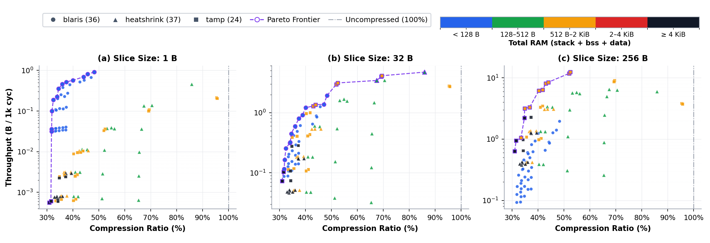
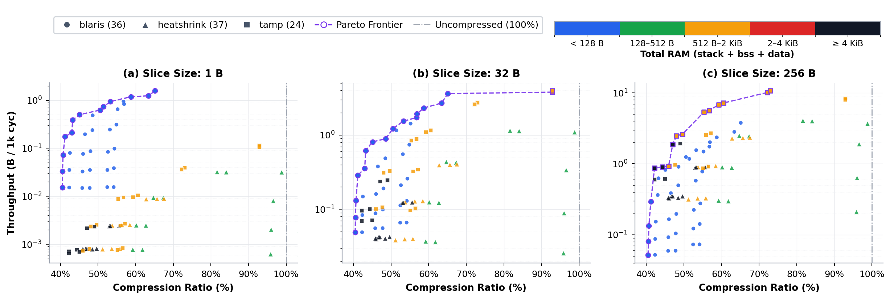

# blaris

**Windowless Random-Access LZSS for Constrained Microcontrollers**

**[Read the Paper (`paper/paper.pdf`)](paper/paper.pdf)**

`blaris` is a windowless LZSS decompressor designed for deeply constrained microcontrollers where RAM budgets are too tight for sliding-window codecs like `heatshrink` or `tamp`. By resolving back-references directly in the compressed payload via bidirectional streams and compact power-of-two checkpoints, `blaris` achieves compression ratios comparable to high-window `heatshrink` and `tamp` configurations (which require `> 1.2 KiB` of RAM) while using only **548–784 B of Flash** and **104–112 B of total RAM**.

For random access to small slices, `blaris` is up to orders of magnitude faster than ratio-matched, block-indexed streaming decoders, though streaming codecs become faster on larger sequential reads (`>= 128 B`) when speed is the priority and sufficient RAM is available.

- **No sliding window:** Uses a fixed **104–112 B of total RAM** (76 B peak stack + 28–36 B static state) regardless of the lookback range (64–256 KiB).
- **Bidirectional streams & checkpoints:** Splits the payload into `controls`, `literals`, and `distance_bits` with power-of-two grid checkpoints (7, 10, or 13 B each) so the decoder can jump to any offset and walk tokens forward or backward in lockstep.
- **Offline optimal parsing & chain flattening:** Uses a dynamic programming optimal parser on the host, with an optional post-processing pass (`f1`) that rewires transitive matches to reduce reference hops.
- **Trusted build-time payloads:** Assumes assets are compressed at build time and omits runtime bounds and error checks to keep code size minimal.

---

## Memory Footprint (RV32IMC, `clang -Os`)

| Codec | Flash (`.text` + `.rodata`) | Peak Stack | Static RAM (`.bss` + `.data`) | Total RAM |
| :--- | ---: | ---: | ---: | ---: |
| **`blaris`** | **548–784 B** | **76 B** | **28–36 B** | **104–112 B** |
| `heatshrink` | 1,300–1,464 B | 140–144 B | 66–16,450 B | 206–16,594 B |
| `tamp` | 2,238–3,238 B | 228–248 B | 292–16,424 B | 520–16,672 B |

---

## Decompression Throughput vs. Compression Ratio

Benchmarks were compiled with Clang (`-Os`) for 32-bit RISC-V (**RV32IMC**) and run in `rv32emu` across 1,000 pseudorandom unaligned offsets per slice size. Because `heatshrink` and `tamp` only decode sequentially, they are wrapped in a block-indexing layer (`2^4` to `2^14 B` blocks).

### 1. Devicetree Blob — `zynq7000s.dtb` (15.2 KiB)


- **1 B slices:** Matching `blaris`'s ~36% ratio requires configuring `heatshrink` and `tamp` with a 1 KiB window (`w10`) and 16 KiB blocks (`b14`). At this ratio, `blaris_o2_a0_s8_f1` takes **2,173 cycles/B** (35.99% ratio, **112 B RAM**), outperforming `heatshrink_b14_i16_w10_l6` (562× slower, 35.63% ratio, 1,214 B RAM) and `tamp_b14_w10_e0` (685× slower, 35.54% ratio, 1,288 B RAM).
- **32 B slices:** `blaris` holds 12 of the 16 sub-50%-ratio Pareto points (reaching 1.92 B/kcyc) while using 104–112 B of RAM.
- **256 B slices:** Streaming codecs overtake `blaris` once slices exceed ~64–128 B and sufficient RAM is available, as `blaris` resolves matches without caching prior output in RAM.

### 2. RTOS Configuration — `FreeRTOSConfig.h` (35.7 KiB)


- On 1 B reads, `blaris_o2_a0_s8_f1` (2,311 cycles/B, **37.10%** ratio) achieves both a better compression ratio and 598× and 641× higher speed than the same `heatshrink` (43.83%) and `tamp` (41.31%) configurations.

### 3. Web Asset — `cp.html` (24.0 KiB)


### Hardware Check (ESP32-C3FN4 XIP)

To check whether SPI Flash wait states on real hardware disproportionately penalize `blaris`'s backward token walking, we also tested one balanced configuration of each codec (`blaris_o2_a0_s8_f1`, `heatshrink_b10_i16_w8_l4`, and `tamp_b10_w8_e1`) on a physical **ESP32-C3FN4** in direct-boot XIP mode (mapping both code and compressed payload to external quad-SPI Flash without copying either to SRAM). Overall hardware cycle counts increased by **29.3% (`1.29×`)** for `blaris`, compared to **+33.5% (`1.33×`)** for `heatshrink` and **+23.6% (`1.24×`)** for `tamp` (`1.51×` on 1 B reads for `blaris` due to cold cache-line fills, stabilizing at `1.30×–1.33×` for slices `>= 4 B`).

---

## Usage & C API

`blaris` has no external dependencies (only `<stdint.h>` for decompression) and consists of three files:
- [`include/blaris.h`](include/blaris.h) — Public header & format specification
- [`src/blaris-decompress.c`](src/blaris-decompress.c) — Windowless XIP decompressor
- [`src/blaris-compress.c`](src/blaris-compress.c) — Host optimal compressor & chain flattener

### Decompression Example (Target MCU)

```c
#include <blaris.h>

// Must be 4-byte aligned in Flash / XIP memory
extern const uint32_t compressed_payload[];

static struct Decoder dec;
static struct Checkpoint cp;

void init_assets(void) {
    blaris_init(compressed_payload, &dec);
    cp = (struct Checkpoint){0};
}

// Read `size` bytes starting at uncompressed `offset` into `out_buf`
void read_slice(uint32_t offset, uint8_t *out_buf, uint32_t size) {
    blaris_decompress(&dec, offset, out_buf, size, &cp);
}
```

### Compression Example (Host)

```c
#define BLARIS_COMPRESS
#include <blaris.h>

size_t max_len = blaris_compress_bound(input_len);
uint8_t *compressed = malloc(max_len);
size_t compressed_len = max_len;

if (blaris_compress(input_data, input_len, compressed, &compressed_len) == 0) {
    // `compressed` now holds `compressed_len` bytes of blaris payload
}
```

### Compile-Time Configuration Macros

Define these macros before including `blaris.h` (or pass via `-D` compiler flags) identically on both compressor and decompressor:

| Macro | Default | Description |
| :--- | :---: | :--- |
| `BLARIS_STREAM_OFFSET_SIZE` | `4` | Byte width (`2`, `3`, or `4`) for stream offsets in checkpoints (`2` suffices for payloads up to 64 KiB and uses 7 B/checkpoint). |
| `BLARIS_DISTANCE_ALIGN_LOG` | `0` | Log2 alignment for match distances (`0` = 1-byte aligned / 64 KiB reach; `1` = 2-byte aligned / 128 KiB reach; `2` = 4-byte aligned / 256 KiB reach). |
| `BLARIS_CHECKPOINTS_SPREAD_LOG` | `10` | Log2 byte spacing between checkpoints (`8` = every 256 B, `10` = every 1,024 B, `0` = disable checkpoints). |
| `BLARIS_FLATTEN_CHAINS` | `1` | Enable (`1`) or disable (`0`) host post-processing pass to flatten transitive match chains. |

---

## Running the Benchmarks & Plotting Scripts

Requires `clang` (with `riscv32-unknown-elf` support), `lld` (`ld.lld`), `llvm-size`, [`rv32emu`](https://github.com/sysprog21/rv32emu), and Python packages `matplotlib` and `numpy` (`PyQt5` optional for interactive `--all` plots; `esptool` and `pyserial` optional for ESP32-C3 runs).

```bash
# Run the full benchmark suite in rv32emu
python3 bench/run.py

# Summarize Flash, Stack, and Static RAM footprints
python3 bench/scripts/summary.py --results bench/results.json

# Analyze reference jump chains (f0 vs f1)
python3 bench/scripts/jumps.py

# Compare ESP32-C3 hardware cycles against rv32emu
python3 bench/scripts/compare_esp32_rv32emu.py

# Plot Pareto frontier for a dataset and slice size (e.g., s=5 -> 32 B)
python3 bench/scripts/compare.py zynq7000s.dtb 5

# Regenerate paper PDF figures and README plots
python3 bench/scripts/paper_plots.py
```

---

## License

Licensed under either of

- Apache License, Version 2.0 ([LICENSE-APACHE](LICENSE-APACHE) or http://www.apache.org/licenses/LICENSE-2.0)
- MIT license ([LICENSE-MIT](LICENSE-MIT) or http://opensource.org/licenses/MIT)

at your option.

## Benchmarking

Detailed per-file comparisons across all 21 corpus datasets at slice sizes of **4 B**, **32 B**, and **256 B**.
For each slice size, every Pareto-optimal `blaris` configuration is grouped with the most lightweight (lowest RAM usage) `heatshrink` and `tamp` configuration that achieves the same or better compression ratio (`ratio <= blaris_ratio`, tie-breaking by lowest decompression cycles; if none reaches that ratio, the best-ratio configuration for that codec is shown as a fallback and marked with `*`).

<details>
<summary><strong><code>FreeRTOSConfig.h</code></strong> (36,522 B)</summary>

#### `FreeRTOSConfig.h` — 4 B Slices

| Configuration | Ratio | Decompression Cycles | vs. `blaris` | RAM Usage |
| :--- | ---: | ---: | ---: | ---: |
| **`blaris_o2_a0_s0_f0`** | **32.71%** | **188,444 cyc** | **-** | **104 B** |
| `heatshrink_b14_i16_w14_l6` | 38.11%* | 937,639 cyc | x4.98 | 16,578 B |
| `tamp_b14_w12_e1` | 34.88%* | 631,535 cyc | x3.35 | 4,384 B |
| | | | | |
| **`blaris_o2_a0_s14_f0`** | **32.78%** | **93,124 cyc** | **-** | **112 B** |
| `heatshrink_b14_i16_w14_l6` | 38.11%* | 937,639 cyc | x10.1 | 16,578 B |
| `tamp_b14_w12_e1` | 34.88%* | 631,535 cyc | x6.78 | 4,384 B |
| | | | | |
| **`blaris_o2_a0_s12_f0`** | **32.89%** | **47,016 cyc** | **-** | **112 B** |
| `heatshrink_b14_i16_w14_l6` | 38.11%* | 937,639 cyc | x19.9 | 16,578 B |
| `tamp_b14_w12_e1` | 34.88%* | 631,535 cyc | x13.4 | 4,384 B |
| | | | | |
| **`blaris_o2_a0_s10_f0`** | **33.40%** | **21,803 cyc** | **-** | **112 B** |
| `heatshrink_b14_i16_w14_l6` | 38.11%* | 937,639 cyc | x43.0 | 16,578 B |
| `tamp_b14_w12_e1` | 34.88%* | 631,535 cyc | x29.0 | 4,384 B |
| | | | | |
| **`blaris_o2_a0_s10_f1`** | **35.04%** | **17,237 cyc** | **-** | **112 B** |
| `heatshrink_b14_i16_w14_l6` | 38.11%* | 937,639 cyc | x54.4 | 16,578 B |
| `tamp_b14_w12_e1` | 34.88% | 631,535 cyc | x36.6 | 4,384 B |
| | | | | |
| **`blaris_o2_a0_s8_f0`** | **35.46%** | **9,661 cyc** | **-** | **112 B** |
| `heatshrink_b14_i16_w14_l6` | 38.11%* | 937,639 cyc | x97.1 | 16,578 B |
| `tamp_b14_w12_e1` | 34.88% | 631,535 cyc | x65.4 | 4,384 B |
| | | | | |
| **`blaris_o2_a0_s8_f1`** | **37.10%** | **7,507 cyc** | **-** | **112 B** |
| `heatshrink_b14_i16_w14_l6` | 38.11%* | 937,639 cyc | x125 | 16,578 B |
| `tamp_b14_w12_e1` | 34.88% | 631,535 cyc | x84.1 | 4,384 B |
| | | | | |
| **`blaris_o2_a1_s8_f1`** | **43.28%** | **6,864 cyc** | **-** | **112 B** |
| `heatshrink_b14_i16_w10_l4` | 43.27% | 965,119 cyc | x141 | 1,214 B |
| `tamp_b14_w10_e0` | 41.31% | 580,240 cyc | x84.5 | 1,288 B |
| | | | | |
| **`blaris_o2_a0_s6_f0`** | **43.66%** | **5,835 cyc** | **-** | **112 B** |
| `heatshrink_b14_i16_w10_l4` | 43.27% | 965,119 cyc | x165 | 1,214 B |
| `tamp_b12_w10_e0` | 43.48% | 154,477 cyc | x26.5 | 1,288 B |
| | | | | |
| **`blaris_o2_a0_s6_f1`** | **45.30%** | **4,648 cyc** | **-** | **112 B** |
| `heatshrink_b14_i16_w10_l6` | 43.83% | 926,694 cyc | x199 | 1,214 B |
| `tamp_b12_w10_e0` | 43.48% | 154,477 cyc | x33.2 | 1,288 B |
| | | | | |
| **`blaris_o2_a1_s6_f1`** | **51.49%** | **4,383 cyc** | **-** | **112 B** |
| `heatshrink_b12_i16_w10_l8` | 48.73% | 243,794 cyc | x55.6 | 1,214 B |
| `tamp_b10_w10_e0` | 51.27% | 50,003 cyc | x11.4 | 1,288 B |
| | | | | |
| **`blaris_o2_a2_s6_f0`** | **56.19%** | **3,953 cyc** | **-** | **112 B** |
| `heatshrink_b10_i16_w10_l4` | 55.55% | 80,513 cyc | x20.4 | 1,214 B |
| `tamp_b14_w8_e0` | 55.94% | 597,188 cyc | x151 | 520 B |
| | | | | |
| **`blaris_o2_a2_s6_f1`** | **57.98%** | **3,351 cyc** | **-** | **112 B** |
| `heatshrink_b10_i16_w10_l6` | 56.77% | 78,441 cyc | x23.4 | 1,214 B |
| `tamp_b12_w8_e0` | 56.57% | 151,365 cyc | x45.2 | 520 B |

#### `FreeRTOSConfig.h` — 32 B Slices

| Configuration | Ratio | Decompression Cycles | vs. `blaris` | RAM Usage |
| :--- | ---: | ---: | ---: | ---: |
| **`blaris_o2_a0_s0_f0`** | **32.71%** | **1,092,700 cyc** | **-** | **104 B** |
| `heatshrink_b14_i16_w14_l6` | 38.11%* | 768,429 cyc | x0.70 | 16,578 B |
| `tamp_b14_w12_e1` | 34.88%* | 324,050 cyc | x0.30 | 4,384 B |
| | | | | |
| **`blaris_o2_a0_s14_f0`** | **32.78%** | **640,627 cyc** | **-** | **112 B** |
| `heatshrink_b14_i16_w14_l6` | 38.11%* | 768,429 cyc | x1.20 | 16,578 B |
| `tamp_b14_w12_e1` | 34.88%* | 324,050 cyc | x0.51 | 4,384 B |
| | | | | |
| **`blaris_o2_a0_s12_f0`** | **32.89%** | **338,172 cyc** | **-** | **112 B** |
| `heatshrink_b14_i16_w14_l6` | 38.11%* | 768,429 cyc | x2.27 | 16,578 B |
| `tamp_b14_w12_e1` | 34.88%* | 324,050 cyc | x0.96 | 4,384 B |
| | | | | |
| **`blaris_o2_a0_s10_f0`** | **33.40%** | **158,431 cyc** | **-** | **112 B** |
| `heatshrink_b14_i16_w14_l6` | 38.11%* | 768,429 cyc | x4.85 | 16,578 B |
| `tamp_b14_w12_e1` | 34.88%* | 324,050 cyc | x2.05 | 4,384 B |
| | | | | |
| **`blaris_o2_a0_s10_f1`** | **35.04%** | **125,373 cyc** | **-** | **112 B** |
| `heatshrink_b14_i16_w14_l6` | 38.11%* | 768,429 cyc | x6.13 | 16,578 B |
| `tamp_b14_w12_e1` | 34.88% | 324,050 cyc | x2.58 | 4,384 B |
| | | | | |
| **`blaris_o2_a0_s8_f0`** | **35.46%** | **70,194 cyc** | **-** | **112 B** |
| `heatshrink_b14_i16_w14_l6` | 38.11%* | 768,429 cyc | x10.9 | 16,578 B |
| `tamp_b14_w12_e1` | 34.88% | 324,050 cyc | x4.62 | 4,384 B |
| | | | | |
| **`blaris_o2_a0_s8_f1`** | **37.10%** | **54,482 cyc** | **-** | **112 B** |
| `heatshrink_b14_i16_w14_l6` | 38.11%* | 768,429 cyc | x14.1 | 16,578 B |
| `tamp_b14_w12_e1` | 34.88% | 324,050 cyc | x5.95 | 4,384 B |
| | | | | |
| **`blaris_o2_a1_s8_f1`** | **43.28%** | **50,938 cyc** | **-** | **112 B** |
| `heatshrink_b14_i16_w10_l4` | 43.27% | 801,235 cyc | x15.7 | 1,214 B |
| `tamp_b14_w10_e0` | 41.31% | 301,226 cyc | x5.91 | 1,288 B |
| | | | | |
| **`blaris_o2_a0_s6_f0`** | **43.66%** | **43,018 cyc** | **-** | **112 B** |
| `heatshrink_b14_i16_w10_l4` | 43.27% | 801,235 cyc | x18.6 | 1,214 B |
| `tamp_b12_w10_e0` | 43.48% | 89,964 cyc | x2.09 | 1,288 B |
| | | | | |
| **`blaris_o2_a0_s6_f1`** | **45.30%** | **34,235 cyc** | **-** | **112 B** |
| `heatshrink_b14_i16_w10_l6` | 43.83% | 764,763 cyc | x22.3 | 1,214 B |
| `tamp_b12_w10_e0` | 43.48% | 89,964 cyc | x2.63 | 1,288 B |
| | | | | |
| **`blaris_o2_a1_s6_f1`** | **51.49%** | **33,587 cyc** | **-** | **112 B** |
| `heatshrink_b12_i16_w10_l8` | 48.73% | 215,666 cyc | x6.42 | 1,214 B |
| `tamp_b10_w10_e0` | 51.27% | 35,267 cyc | x1.05 | 1,288 B |
| | | | | |
| **`blaris_o2_a2_s6_f0`** | **56.19%** | **28,896 cyc** | **-** | **112 B** |
| `heatshrink_b10_i16_w10_l4` | 55.55% | 76,111 cyc | x2.63 | 1,214 B |
| `tamp_b14_w8_e0` | 55.94% | 335,823 cyc | x11.6 | 520 B |
| | | | | |
| **`blaris_o2_a2_s6_f1`** | **57.98%** | **24,491 cyc** | **-** | **112 B** |
| `heatshrink_b10_i16_w10_l6` | 56.77% | 74,019 cyc | x3.02 | 1,214 B |
| `tamp_b12_w8_e0` | 56.57% | 91,054 cyc | x3.72 | 520 B |

#### `FreeRTOSConfig.h` — 256 B Slices

| Configuration | Ratio | Decompression Cycles | vs. `blaris` | RAM Usage |
| :--- | ---: | ---: | ---: | ---: |
| **`blaris_o2_a0_s0_f0`** | **32.71%** | **7,904,612 cyc** | **-** | **104 B** |
| `heatshrink_b14_i16_w14_l6` | 38.11%* | 767,623 cyc | x0.10 | 16,578 B |
| `tamp_b14_w12_e1` | 34.88%* | 290,940 cyc | x0.04 | 4,384 B |
| | | | | |
| **`blaris_o2_a0_s14_f0`** | **32.78%** | **4,906,086 cyc** | **-** | **112 B** |
| `heatshrink_b14_i16_w14_l6` | 38.11%* | 767,623 cyc | x0.16 | 16,578 B |
| `tamp_b14_w12_e1` | 34.88%* | 290,940 cyc | x0.06 | 4,384 B |
| | | | | |
| **`blaris_o2_a0_s12_f0`** | **32.89%** | **2,617,799 cyc** | **-** | **112 B** |
| `heatshrink_b14_i16_w14_l6` | 38.11%* | 767,623 cyc | x0.29 | 16,578 B |
| `tamp_b14_w12_e1` | 34.88%* | 290,940 cyc | x0.11 | 4,384 B |
| | | | | |
| **`blaris_o2_a0_s10_f0`** | **33.40%** | **1,245,458 cyc** | **-** | **112 B** |
| `heatshrink_b14_i16_w14_l6` | 38.11%* | 767,623 cyc | x0.62 | 16,578 B |
| `tamp_b14_w12_e1` | 34.88%* | 290,940 cyc | x0.23 | 4,384 B |
| | | | | |
| **`blaris_o2_a0_s10_f1`** | **35.04%** | **978,633 cyc** | **-** | **112 B** |
| `heatshrink_b14_i16_w14_l6` | 38.11%* | 767,623 cyc | x0.78 | 16,578 B |
| `tamp_b14_w12_e1` | 34.88% | 290,940 cyc | x0.30 | 4,384 B |
| | | | | |
| **`blaris_o2_a0_s8_f0`** | **35.46%** | **548,553 cyc** | **-** | **112 B** |
| `heatshrink_b14_i16_w14_l6` | 38.11%* | 767,623 cyc | x1.40 | 16,578 B |
| `tamp_b14_w12_e1` | 34.88% | 290,940 cyc | x0.53 | 4,384 B |
| | | | | |
| **`blaris_o2_a0_s8_f1`** | **37.10%** | **422,416 cyc** | **-** | **112 B** |
| `heatshrink_b14_i16_w14_l6` | 38.11%* | 767,623 cyc | x1.82 | 16,578 B |
| `tamp_b14_w12_e1` | 34.88% | 290,940 cyc | x0.69 | 4,384 B |
| | | | | |
| **`blaris_o2_a1_s8_f1`** | **43.28%** | **382,233 cyc** | **-** | **112 B** |
| `heatshrink_b14_i16_w10_l4` | 43.27% | 801,339 cyc | x2.10 | 1,214 B |
| `tamp_b14_w10_e0` | 41.31% | 271,513 cyc | x0.71 | 1,288 B |
| | | | | |
| **`blaris_o2_a0_s6_f0`** | **43.66%** | **332,795 cyc** | **-** | **112 B** |
| `heatshrink_b14_i16_w10_l4` | 43.27% | 801,339 cyc | x2.41 | 1,214 B |
| `tamp_b12_w10_e0` | 43.48% | 89,264 cyc | x0.27 | 1,288 B |
| | | | | |
| **`blaris_o2_a0_s6_f1`** | **45.30%** | **262,490 cyc** | **-** | **112 B** |
| `heatshrink_b14_i16_w10_l6` | 43.83% | 764,863 cyc | x2.91 | 1,214 B |
| `tamp_b12_w10_e0` | 43.48% | 89,264 cyc | x0.34 | 1,288 B |
| | | | | |
| **`blaris_o2_a1_s6_f1`** | **51.49%** | **249,232 cyc** | **-** | **112 B** |
| `heatshrink_b12_i16_w10_l8` | 48.73% | 235,320 cyc | x0.94 | 1,214 B |
| `tamp_b10_w10_e0` | 51.27% | 43,158 cyc | x0.17 | 1,288 B |
| | | | | |
| **`blaris_o2_a2_s6_f0`** | **56.19%** | **211,767 cyc** | **-** | **112 B** |
| `heatshrink_b10_i16_w10_l4` | 55.55% | 101,920 cyc | x0.48 | 1,214 B |
| `tamp_b14_w8_e0` | 55.94% | 308,349 cyc | x1.46 | 520 B |
| | | | | |
| **`blaris_o2_a2_s6_f1`** | **57.98%** | **178,260 cyc** | **-** | **112 B** |
| `heatshrink_b10_i16_w10_l6` | 56.77% | 98,949 cyc | x0.56 | 1,214 B |
| `tamp_b12_w8_e0` | 56.57% | 91,806 cyc | x0.52 | 520 B |

</details>

<details>
<summary><strong><code>ch32v003_bootloader.bin</code></strong> (1,920 B)</summary>

#### `ch32v003_bootloader.bin` — 4 B Slices

| Configuration | Ratio | Decompression Cycles | vs. `blaris` | RAM Usage |
| :--- | ---: | ---: | ---: | ---: |
| **`blaris_o2_a1_s0_f0`** | **91.41%** | **3,373 cyc** | **-** | **104 B** |
| `heatshrink_b12_i16_w10_l4` | 91.20% | 188,453 cyc | x55.9 | 1,214 B |
| `tamp_b10_w8_e0` | 89.79% | 41,337 cyc | x12.3 | 520 B |
| | | | | |
| **`blaris_o2_a1_s12_f0`** | **91.82%** | **3,293 cyc** | **-** | **112 B** |
| `heatshrink_b12_i16_w10_l4` | 91.20% | 188,453 cyc | x57.2 | 1,214 B |
| `tamp_b10_w8_e0` | 89.79% | 41,337 cyc | x12.6 | 520 B |
| | | | | |
| **`blaris_o2_a1_s10_f0`** | **92.24%** | **1,600 cyc** | **-** | **112 B** |
| `heatshrink_b12_i16_w8_l4` | 92.08% | 176,291 cyc | x110 | 446 B |
| `tamp_b10_w8_e0` | 89.79% | 41,337 cyc | x25.8 | 520 B |
| | | | | |
| **`blaris_o2_a1_s10_f1`** | **92.71%** | **1,548 cyc** | **-** | **112 B** |
| `heatshrink_b12_i16_w8_l4` | 92.08% | 176,291 cyc | x114 | 446 B |
| `tamp_b10_w8_e0` | 89.79% | 41,337 cyc | x26.7 | 520 B |
| | | | | |
| **`blaris_o2_a0_s10_f1`** | **93.65%** | **1,540 cyc** | **-** | **112 B** |
| `heatshrink_b10_i16_w8_l4` | 92.81% | 91,391 cyc | x59.3 | 446 B |
| `tamp_b10_w8_e0` | 89.79% | 41,337 cyc | x26.8 | 520 B |
| | | | | |
| **`blaris_o2_a1_s8_f0`** | **94.32%** | **669 cyc** | **-** | **112 B** |
| `heatshrink_b10_i16_w8_l4` | 92.81% | 91,391 cyc | x137 | 446 B |
| `tamp_b10_w8_e0` | 89.79% | 41,337 cyc | x61.8 | 520 B |
| | | | | |
| **`blaris_o2_a1_s8_f1`** | **94.79%** | **627 cyc** | **-** | **112 B** |
| `heatshrink_b10_i16_w8_l4` | 92.81% | 91,391 cyc | x146 | 446 B |
| `tamp_b10_w8_e0` | 89.79% | 41,337 cyc | x65.9 | 520 B |
| | | | | |
| **`blaris_o2_a0_s8_f1`** | **95.94%** | **621 cyc** | **-** | **112 B** |
| `heatshrink_b10_i16_w8_l4` | 92.81% | 91,391 cyc | x147 | 446 B |
| `tamp_b8_w8_e0` | 95.36% | 13,140 cyc | x21.1 | 520 B |
| | | | | |
| **`blaris_o2_a2_s8_f0`** | **99.01%** | **562 cyc** | **-** | **112 B** |
| `heatshrink_b8_i16_w6_l4` | 98.85% | 25,473 cyc | x45.3 | 254 B |
| `tamp_b8_w8_e0` | 95.36% | 13,140 cyc | x23.4 | 520 B |
| | | | | |
| **`blaris_o2_a2_s8_f1`** | **99.22%** | **541 cyc** | **-** | **112 B** |
| `heatshrink_b8_i16_w6_l4` | 98.85% | 25,473 cyc | x47.1 | 254 B |
| `tamp_b8_w8_e0` | 95.36% | 13,140 cyc | x24.3 | 520 B |
| | | | | |
| **`blaris_o2_a1_s6_f0`** | **102.45%** | **466 cyc** | **-** | **112 B** |
| `heatshrink_b8_i16_w6_l4` | 98.85% | 25,473 cyc | x54.6 | 254 B |
| `tamp_b8_w8_e0` | 95.36% | 13,140 cyc | x28.2 | 520 B |
| | | | | |
| **`blaris_o2_a1_s6_f1`** | **102.92%** | **437 cyc** | **-** | **112 B** |
| `heatshrink_b8_i16_w6_l4` | 98.85% | 25,473 cyc | x58.4 | 254 B |
| `tamp_b8_w8_e0` | 95.36% | 13,140 cyc | x30.1 | 520 B |
| | | | | |
| **`blaris_o2_a2_s6_f0`** | **106.93%** | **393 cyc** | **-** | **112 B** |
| `heatshrink_b8_i16_w4_l3` | 105.83% | 26,270 cyc | x66.8 | 206 B |
| `tamp_b8_w8_e0` | 95.36% | 13,140 cyc | x33.4 | 520 B |
| | | | | |
| **`blaris_o2_a2_s6_f1`** | **107.14%** | **380 cyc** | **-** | **112 B** |
| `heatshrink_b8_i16_w4_l3` | 105.83% | 26,270 cyc | x69.2 | 206 B |
| `tamp_b8_w8_e0` | 95.36% | 13,140 cyc | x34.6 | 520 B |

#### `ch32v003_bootloader.bin` — 32 B Slices

| Configuration | Ratio | Decompression Cycles | vs. `blaris` | RAM Usage |
| :--- | ---: | ---: | ---: | ---: |
| **`blaris_o2_a1_s0_f0`** | **91.41%** | **7,426 cyc** | **-** | **104 B** |
| `heatshrink_b12_i16_w10_l4` | 91.20% | 177,059 cyc | x23.8 | 1,214 B |
| `tamp_b10_w8_e0` | 89.79% | 27,964 cyc | x3.77 | 520 B |
| | | | | |
| **`blaris_o2_a1_s12_f0`** | **91.82%** | **7,159 cyc** | **-** | **112 B** |
| `heatshrink_b12_i16_w10_l4` | 91.20% | 177,059 cyc | x24.7 | 1,214 B |
| `tamp_b10_w8_e0` | 89.79% | 27,964 cyc | x3.91 | 520 B |
| | | | | |
| **`blaris_o2_a1_s10_f0`** | **92.24%** | **4,395 cyc** | **-** | **112 B** |
| `heatshrink_b12_i16_w8_l4` | 92.08% | 164,913 cyc | x37.5 | 446 B |
| `tamp_b10_w8_e0` | 89.79% | 27,964 cyc | x6.36 | 520 B |
| | | | | |
| **`blaris_o2_a1_s10_f1`** | **92.71%** | **4,109 cyc** | **-** | **112 B** |
| `heatshrink_b12_i16_w8_l4` | 92.08% | 164,913 cyc | x40.1 | 446 B |
| `tamp_b10_w8_e0` | 89.79% | 27,964 cyc | x6.80 | 520 B |
| | | | | |
| **`blaris_o2_a1_s8_f0`** | **94.32%** | **2,787 cyc** | **-** | **112 B** |
| `heatshrink_b10_i16_w8_l4` | 92.81% | 83,574 cyc | x30.0 | 446 B |
| `tamp_b10_w8_e0` | 89.79% | 27,964 cyc | x10.0 | 520 B |
| | | | | |
| **`blaris_o2_a1_s8_f1`** | **94.79%** | **2,542 cyc** | **-** | **112 B** |
| `heatshrink_b10_i16_w8_l4` | 92.81% | 83,574 cyc | x32.9 | 446 B |
| `tamp_b10_w8_e0` | 89.79% | 27,964 cyc | x11.0 | 520 B |
| | | | | |
| **`blaris_o2_a2_s8_f0`** | **99.01%** | **2,103 cyc** | **-** | **112 B** |
| `heatshrink_b8_i16_w6_l4` | 98.85% | 27,892 cyc | x13.3 | 254 B |
| `tamp_b8_w8_e0` | 95.36% | 11,455 cyc | x5.45 | 520 B |
| | | | | |
| **`blaris_o2_a2_s8_f1`** | **99.22%** | **1,984 cyc** | **-** | **112 B** |
| `heatshrink_b8_i16_w6_l4` | 98.85% | 27,892 cyc | x14.1 | 254 B |
| `tamp_b8_w8_e0` | 95.36% | 11,455 cyc | x5.77 | 520 B |
| | | | | |
| **`blaris_o2_a1_s6_f1`** | **102.92%** | **1,945 cyc** | **-** | **112 B** |
| `heatshrink_b8_i16_w6_l4` | 98.85% | 27,892 cyc | x14.3 | 254 B |
| `tamp_b8_w8_e0` | 95.36% | 11,455 cyc | x5.89 | 520 B |
| | | | | |
| **`blaris_o2_a2_s6_f0`** | **106.93%** | **1,607 cyc** | **-** | **112 B** |
| `heatshrink_b8_i16_w4_l3` | 105.83% | 29,006 cyc | x18.0 | 206 B |
| `tamp_b8_w8_e0` | 95.36% | 11,455 cyc | x7.13 | 520 B |
| | | | | |
| **`blaris_o2_a2_s6_f1`** | **107.14%** | **1,529 cyc** | **-** | **112 B** |
| `heatshrink_b8_i16_w4_l3` | 105.83% | 29,006 cyc | x19.0 | 206 B |
| `tamp_b8_w8_e0` | 95.36% | 11,455 cyc | x7.49 | 520 B |

#### `ch32v003_bootloader.bin` — 256 B Slices

| Configuration | Ratio | Decompression Cycles | vs. `blaris` | RAM Usage |
| :--- | ---: | ---: | ---: | ---: |
| **`blaris_o2_a1_s0_f0`** | **91.41%** | **36,464 cyc** | **-** | **104 B** |
| `heatshrink_b12_i16_w10_l4` | 91.20% | 192,114 cyc | x5.27 | 1,214 B |
| `tamp_b10_w8_e0` | 89.79% | 36,521 cyc | x1.00 | 520 B |
| | | | | |
| **`blaris_o2_a1_s12_f0`** | **91.82%** | **34,995 cyc** | **-** | **112 B** |
| `heatshrink_b12_i16_w10_l4` | 91.20% | 192,114 cyc | x5.49 | 1,214 B |
| `tamp_b10_w8_e0` | 89.79% | 36,521 cyc | x1.04 | 520 B |
| | | | | |
| **`blaris_o2_a1_s10_f0`** | **92.24%** | **25,594 cyc** | **-** | **112 B** |
| `heatshrink_b12_i16_w8_l4` | 92.08% | 179,230 cyc | x7.00 | 446 B |
| `tamp_b10_w8_e0` | 89.79% | 36,521 cyc | x1.43 | 520 B |
| | | | | |
| **`blaris_o2_a1_s10_f1`** | **92.71%** | **23,769 cyc** | **-** | **112 B** |
| `heatshrink_b12_i16_w8_l4` | 92.08% | 179,230 cyc | x7.54 | 446 B |
| `tamp_b10_w8_e0` | 89.79% | 36,521 cyc | x1.54 | 520 B |
| | | | | |
| **`blaris_o2_a1_s8_f0`** | **94.32%** | **18,854 cyc** | **-** | **112 B** |
| `heatshrink_b10_i16_w8_l4` | 92.81% | 117,781 cyc | x6.25 | 446 B |
| `tamp_b10_w8_e0` | 89.79% | 36,521 cyc | x1.94 | 520 B |
| | | | | |
| **`blaris_o2_a1_s8_f1`** | **94.79%** | **17,114 cyc** | **-** | **112 B** |
| `heatshrink_b10_i16_w8_l4` | 92.81% | 117,781 cyc | x6.88 | 446 B |
| `tamp_b10_w8_e0` | 89.79% | 36,521 cyc | x2.13 | 520 B |
| | | | | |
| **`blaris_o2_a2_s8_f0`** | **99.01%** | **14,053 cyc** | **-** | **112 B** |
| `heatshrink_b8_i16_w6_l4` | 98.85% | 69,326 cyc | x4.93 | 254 B |
| `tamp_b8_w8_e0` | 95.36% | 24,735 cyc | x1.76 | 520 B |
| | | | | |
| **`blaris_o2_a2_s8_f1`** | **99.22%** | **13,308 cyc** | **-** | **112 B** |
| `heatshrink_b8_i16_w6_l4` | 98.85% | 69,326 cyc | x5.21 | 254 B |
| `tamp_b8_w8_e0` | 95.36% | 24,735 cyc | x1.86 | 520 B |
| | | | | |
| **`blaris_o2_a2_s6_f0`** | **106.93%** | **10,974 cyc** | **-** | **112 B** |
| `heatshrink_b8_i16_w4_l3` | 105.83% | 72,140 cyc | x6.57 | 206 B |
| `tamp_b8_w8_e0` | 95.36% | 24,735 cyc | x2.25 | 520 B |
| | | | | |
| **`blaris_o2_a2_s6_f1`** | **107.14%** | **10,454 cyc** | **-** | **112 B** |
| `heatshrink_b8_i16_w4_l3` | 105.83% | 72,140 cyc | x6.90 | 206 B |
| `tamp_b8_w8_e0` | 95.36% | 24,735 cyc | x2.37 | 520 B |

</details>

<details>
<summary><strong><code>ch32v30x_blink.bin</code></strong> (1,064 B)</summary>

#### `ch32v30x_blink.bin` — 4 B Slices

| Configuration | Ratio | Decompression Cycles | vs. `blaris` | RAM Usage |
| :--- | ---: | ---: | ---: | ---: |
| **`blaris_o2_a1_s0_f0`** | **64.47%** | **3,189 cyc** | **-** | **104 B** |
| `heatshrink_b10_i16_w8_l6` | 64.47% | 53,019 cyc | x16.6 | 446 B |
| `tamp_b10_w8_e0` | 63.91% | 37,042 cyc | x11.6 | 520 B |
| | | | | |
| **`blaris_o2_a1_s0_f1`** | **64.76%** | **3,181 cyc** | **-** | **104 B** |
| `heatshrink_b10_i16_w8_l6` | 64.47% | 53,019 cyc | x16.7 | 446 B |
| `tamp_b10_w8_e0` | 63.91% | 37,042 cyc | x11.6 | 520 B |
| | | | | |
| **`blaris_o2_a0_s0_f0`** | **65.41%** | **3,116 cyc** | **-** | **104 B** |
| `heatshrink_b10_i16_w8_l6` | 64.47% | 53,019 cyc | x17.0 | 446 B |
| `tamp_b10_w8_e0` | 63.91% | 37,042 cyc | x11.9 | 520 B |
| | | | | |
| **`blaris_o2_a0_s0_f1`** | **65.70%** | **3,110 cyc** | **-** | **104 B** |
| `heatshrink_b12_i16_w6_l4` | 65.70% | 58,036 cyc | x18.7 | 254 B |
| `tamp_b10_w8_e0` | 63.91% | 37,042 cyc | x11.9 | 520 B |
| | | | | |
| **`blaris_o2_a2_s0_f0`** | **67.01%** | **2,994 cyc** | **-** | **104 B** |
| `heatshrink_b10_i16_w6_l4` | 66.26% | 54,597 cyc | x18.2 | 254 B |
| `tamp_b10_w8_e0` | 63.91% | 37,042 cyc | x12.4 | 520 B |
| | | | | |
| **`blaris_o2_a2_s0_f1`** | **67.20%** | **2,991 cyc** | **-** | **104 B** |
| `heatshrink_b10_i16_w6_l4` | 66.26% | 54,597 cyc | x18.3 | 254 B |
| `tamp_b10_w8_e0` | 63.91% | 37,042 cyc | x12.4 | 520 B |
| | | | | |
| **`blaris_o2_a1_s8_f0`** | **67.86%** | **2,749 cyc** | **-** | **112 B** |
| `heatshrink_b10_i16_w6_l4` | 66.26% | 54,597 cyc | x19.9 | 254 B |
| `tamp_b10_w8_e0` | 63.91% | 37,042 cyc | x13.5 | 520 B |
| | | | | |
| **`blaris_o2_a1_s8_f1`** | **68.14%** | **2,721 cyc** | **-** | **112 B** |
| `heatshrink_b8_i16_w6_l4` | 68.05% | 18,063 cyc | x6.64 | 254 B |
| `tamp_b8_w8_e0` | 68.14% | 12,441 cyc | x4.57 | 520 B |
| | | | | |
| **`blaris_o2_a0_s8_f0`** | **68.42%** | **2,711 cyc** | **-** | **112 B** |
| `heatshrink_b8_i16_w6_l4` | 68.05% | 18,063 cyc | x6.66 | 254 B |
| `tamp_b8_w8_e0` | 68.14% | 12,441 cyc | x4.59 | 520 B |
| | | | | |
| **`blaris_o2_a0_s8_f1`** | **68.70%** | **2,692 cyc** | **-** | **112 B** |
| `heatshrink_b8_i16_w6_l4` | 68.05% | 18,063 cyc | x6.71 | 254 B |
| `tamp_b8_w8_e0` | 68.14% | 12,441 cyc | x4.62 | 520 B |
| | | | | |
| **`blaris_o2_a2_s8_f0`** | **70.02%** | **2,640 cyc** | **-** | **112 B** |
| `heatshrink_b8_i16_w6_l4` | 68.05% | 18,063 cyc | x6.84 | 254 B |
| `tamp_b8_w8_e0` | 68.14% | 12,441 cyc | x4.71 | 520 B |
| | | | | |
| **`blaris_o2_a2_s8_f1`** | **70.21%** | **2,631 cyc** | **-** | **112 B** |
| `heatshrink_b8_i16_w6_l4` | 68.05% | 18,063 cyc | x6.87 | 254 B |
| `tamp_b8_w8_e0` | 68.14% | 12,441 cyc | x4.73 | 520 B |
| | | | | |
| **`blaris_o2_a1_s6_f0`** | **75.75%** | **2,553 cyc** | **-** | **112 B** |
| `heatshrink_b8_i16_w4_l3` | 72.74% | 18,731 cyc | x7.34 | 206 B |
| `tamp_b8_w8_e0` | 68.14% | 12,441 cyc | x4.87 | 520 B |
| | | | | |
| **`blaris_o2_a1_s6_f1`** | **76.03%** | **2,530 cyc** | **-** | **112 B** |
| `heatshrink_b8_i16_w4_l3` | 72.74% | 18,731 cyc | x7.40 | 206 B |
| `tamp_b8_w8_e0` | 68.14% | 12,441 cyc | x4.92 | 520 B |
| | | | | |
| **`blaris_o2_a0_s6_f0`** | **76.32%** | **2,501 cyc** | **-** | **112 B** |
| `heatshrink_b8_i16_w4_l3` | 72.74% | 18,731 cyc | x7.49 | 206 B |
| `tamp_b8_w8_e0` | 68.14% | 12,441 cyc | x4.98 | 520 B |
| | | | | |
| **`blaris_o2_a0_s6_f1`** | **76.60%** | **2,485 cyc** | **-** | **112 B** |
| `heatshrink_b8_i16_w4_l3` | 72.74% | 18,731 cyc | x7.54 | 206 B |
| `tamp_b8_w8_e0` | 68.14% | 12,441 cyc | x5.01 | 520 B |
| | | | | |
| **`blaris_o2_a2_s6_f0`** | **77.91%** | **2,474 cyc** | **-** | **112 B** |
| `heatshrink_b6_i16_w4_l3` | 77.07% | 5,809 cyc | x2.35 | 206 B |
| `tamp_b6_w8_e0` | 77.44% | 5,875 cyc | x2.37 | 520 B |
| | | | | |
| **`blaris_o2_a2_s6_f1`** | **78.10%** | **2,463 cyc** | **-** | **112 B** |
| `heatshrink_b6_i16_w4_l3` | 77.07% | 5,809 cyc | x2.36 | 206 B |
| `tamp_b6_w8_e0` | 77.44% | 5,875 cyc | x2.39 | 520 B |

#### `ch32v30x_blink.bin` — 32 B Slices

| Configuration | Ratio | Decompression Cycles | vs. `blaris` | RAM Usage |
| :--- | ---: | ---: | ---: | ---: |
| **`blaris_o2_a1_s0_f0`** | **64.47%** | **15,654 cyc** | **-** | **104 B** |
| `heatshrink_b10_i16_w8_l6` | 64.47% | 49,640 cyc | x3.17 | 446 B |
| `tamp_b10_w8_e0` | 63.91% | 22,585 cyc | x1.44 | 520 B |
| | | | | |
| **`blaris_o2_a1_s0_f1`** | **64.76%** | **15,607 cyc** | **-** | **104 B** |
| `heatshrink_b10_i16_w8_l6` | 64.47% | 49,640 cyc | x3.18 | 446 B |
| `tamp_b10_w8_e0` | 63.91% | 22,585 cyc | x1.45 | 520 B |
| | | | | |
| **`blaris_o2_a0_s0_f0`** | **65.41%** | **15,156 cyc** | **-** | **104 B** |
| `heatshrink_b10_i16_w8_l6` | 64.47% | 49,640 cyc | x3.28 | 446 B |
| `tamp_b10_w8_e0` | 63.91% | 22,585 cyc | x1.49 | 520 B |
| | | | | |
| **`blaris_o2_a0_s0_f1`** | **65.70%** | **15,125 cyc** | **-** | **104 B** |
| `heatshrink_b12_i16_w6_l4` | 65.70% | 52,457 cyc | x3.47 | 254 B |
| `tamp_b10_w8_e0` | 63.91% | 22,585 cyc | x1.49 | 520 B |
| | | | | |
| **`blaris_o2_a2_s0_f0`** | **67.01%** | **14,716 cyc** | **-** | **104 B** |
| `heatshrink_b10_i16_w6_l4` | 66.26% | 51,480 cyc | x3.50 | 254 B |
| `tamp_b10_w8_e0` | 63.91% | 22,585 cyc | x1.53 | 520 B |
| | | | | |
| **`blaris_o2_a2_s0_f1`** | **67.20%** | **14,698 cyc** | **-** | **104 B** |
| `heatshrink_b10_i16_w6_l4` | 66.26% | 51,480 cyc | x3.50 | 254 B |
| `tamp_b10_w8_e0` | 63.91% | 22,585 cyc | x1.54 | 520 B |

#### `ch32v30x_blink.bin` — 256 B Slices

| Configuration | Ratio | Decompression Cycles | vs. `blaris` | RAM Usage |
| :--- | ---: | ---: | ---: | ---: |
| **`blaris_o2_a1_s0_f0`** | **64.47%** | **132,928 cyc** | **-** | **104 B** |
| `heatshrink_b12_i16_w8_l6` | 63.91% | 59,743 cyc | x0.45 | 446 B |
| `tamp_b12_w8_e0` | 63.25% | 23,981 cyc | x0.18 | 520 B |
| | | | | |
| **`blaris_o2_a1_s0_f1`** | **64.76%** | **132,615 cyc** | **-** | **104 B** |
| `heatshrink_b12_i16_w8_l6` | 63.91% | 59,743 cyc | x0.45 | 446 B |
| `tamp_b12_w8_e0` | 63.25% | 23,981 cyc | x0.18 | 520 B |
| | | | | |
| **`blaris_o2_a0_s0_f0`** | **65.41%** | **127,931 cyc** | **-** | **104 B** |
| `heatshrink_b12_i16_w8_l6` | 63.91% | 59,743 cyc | x0.47 | 446 B |
| `tamp_b12_w8_e0` | 63.25% | 23,981 cyc | x0.19 | 520 B |
| | | | | |
| **`blaris_o2_a0_s0_f1`** | **65.70%** | **127,701 cyc** | **-** | **104 B** |
| `heatshrink_b12_i16_w6_l4` | 65.70% | 62,324 cyc | x0.49 | 254 B |
| `tamp_b12_w8_e0` | 63.25% | 23,981 cyc | x0.19 | 520 B |
| | | | | |
| **`blaris_o2_a2_s0_f0`** | **67.01%** | **126,603 cyc** | **-** | **104 B** |
| `heatshrink_b12_i16_w6_l4` | 65.70% | 62,324 cyc | x0.49 | 254 B |
| `tamp_b12_w8_e0` | 63.25% | 23,981 cyc | x0.19 | 520 B |
| | | | | |
| **`blaris_o2_a2_s0_f1`** | **67.20%** | **126,459 cyc** | **-** | **104 B** |
| `heatshrink_b12_i16_w6_l4` | 65.70% | 62,324 cyc | x0.49 | 254 B |
| `tamp_b12_w8_e0` | 63.25% | 23,981 cyc | x0.19 | 520 B |

</details>

<details>
<summary><strong><code>cp.html</code></strong> (24,603 B)</summary>

#### `cp.html` — 4 B Slices

| Configuration | Ratio | Decompression Cycles | vs. `blaris` | RAM Usage |
| :--- | ---: | ---: | ---: | ---: |
| **`blaris_o2_a0_s0_f0`** | **40.48%** | **123,062 cyc** | **-** | **104 B** |
| `heatshrink_b14_i16_w14_l6` | 45.87%* | 898,741 cyc | x7.30 | 16,578 B |
| `tamp_b14_w12_e1` | 42.19%* | 578,912 cyc | x4.70 | 4,384 B |
| | | | | |
| **`blaris_o2_a0_s14_f0`** | **40.54%** | **67,129 cyc** | **-** | **112 B** |
| `heatshrink_b14_i16_w14_l6` | 45.87%* | 898,741 cyc | x13.4 | 16,578 B |
| `tamp_b14_w12_e1` | 42.19%* | 578,912 cyc | x8.62 | 4,384 B |
| | | | | |
| **`blaris_o2_a0_s12_f0`** | **40.69%** | **36,388 cyc** | **-** | **112 B** |
| `heatshrink_b14_i16_w14_l6` | 45.87%* | 898,741 cyc | x24.7 | 16,578 B |
| `tamp_b14_w12_e1` | 42.19%* | 578,912 cyc | x15.9 | 4,384 B |
| | | | | |
| **`blaris_o2_a0_s10_f0`** | **41.19%** | **15,916 cyc** | **-** | **112 B** |
| `heatshrink_b14_i16_w14_l6` | 45.87%* | 898,741 cyc | x56.5 | 16,578 B |
| `tamp_b14_w12_e1` | 42.19%* | 578,912 cyc | x36.4 | 4,384 B |
| | | | | |
| **`blaris_o2_a0_s10_f1`** | **43.03%** | **12,908 cyc** | **-** | **112 B** |
| `heatshrink_b14_i16_w14_l6` | 45.87%* | 898,741 cyc | x69.6 | 16,578 B |
| `tamp_b14_w12_e1` | 42.19% | 578,912 cyc | x44.9 | 4,384 B |
| | | | | |
| **`blaris_o2_a0_s8_f0`** | **43.24%** | **7,258 cyc** | **-** | **112 B** |
| `heatshrink_b14_i16_w14_l6` | 45.87%* | 898,741 cyc | x124 | 16,578 B |
| `tamp_b14_w12_e1` | 42.19% | 578,912 cyc | x79.8 | 4,384 B |
| | | | | |
| **`blaris_o2_a0_s8_f1`** | **45.08%** | **5,596 cyc** | **-** | **112 B** |
| `heatshrink_b14_i16_w14_l6` | 45.87%* | 898,741 cyc | x161 | 16,578 B |
| `tamp_b14_w12_e0` | 44.35% | 544,235 cyc | x97.3 | 4,360 B |
| | | | | |
| **`blaris_o2_a1_s8_f0`** | **48.57%** | **5,234 cyc** | **-** | **112 B** |
| `heatshrink_b14_i16_w12_l6` | 47.02% | 859,615 cyc | x164 | 4,290 B |
| `tamp_b14_w10_e0` | 47.66% | 518,834 cyc | x99.1 | 1,288 B |
| | | | | |
| **`blaris_o2_a1_s8_f1`** | **50.54%** | **3,896 cyc** | **-** | **112 B** |
| `heatshrink_b14_i16_w12_l8` | 49.63% | 859,029 cyc | x220 | 4,290 B |
| `tamp_b12_w10_e0` | 49.59% | 166,614 cyc | x42.8 | 1,288 B |
| | | | | |
| **`blaris_o2_a0_s6_f1`** | **53.27%** | **2,974 cyc** | **-** | **112 B** |
| `heatshrink_b14_i16_w10_l4` | 51.21% | 928,127 cyc | x312 | 1,214 B |
| `tamp_b12_w10_e0` | 49.59% | 166,614 cyc | x56.0 | 1,288 B |
| | | | | |
| **`blaris_o2_a1_s6_f0`** | **56.77%** | **2,727 cyc** | **-** | **112 B** |
| `heatshrink_b12_i16_w10_l6` | 56.34% | 288,636 cyc | x106 | 1,214 B |
| `tamp_b14_w8_e0` | 56.46% | 517,289 cyc | x190 | 520 B |
| | | | | |
| **`blaris_o2_a2_s8_f1`** | **56.92%** | **2,678 cyc** | **-** | **112 B** |
| `heatshrink_b12_i16_w10_l6` | 56.34% | 288,636 cyc | x108 | 1,214 B |
| `tamp_b14_w8_e0` | 56.46% | 517,289 cyc | x193 | 520 B |
| | | | | |
| **`blaris_o2_a1_s6_f1`** | **58.74%** | **2,056 cyc** | **-** | **112 B** |
| `heatshrink_b12_i16_w10_l8` | 58.46% | 286,259 cyc | x139 | 1,214 B |
| `tamp_b12_w8_e0` | 57.10% | 159,420 cyc | x77.6 | 520 B |
| | | | | |
| **`blaris_o2_a2_s6_f0`** | **63.40%** | **1,850 cyc** | **-** | **112 B** |
| `heatshrink_b12_i16_w8_l4` | 60.17% | 295,558 cyc | x160 | 446 B |
| `tamp_b10_w8_e0` | 60.52% | 43,209 cyc | x23.4 | 520 B |
| | | | | |
| **`blaris_o2_a2_s6_f1`** | **65.11%** | **1,429 cyc** | **-** | **112 B** |
| `heatshrink_b10_i16_w8_l4` | 64.72% | 81,234 cyc | x56.8 | 446 B |
| `tamp_b10_w8_e0` | 60.52% | 43,209 cyc | x30.2 | 520 B |

#### `cp.html` — 32 B Slices

| Configuration | Ratio | Decompression Cycles | vs. `blaris` | RAM Usage |
| :--- | ---: | ---: | ---: | ---: |
| **`blaris_o2_a0_s0_f0`** | **40.48%** | **655,390 cyc** | **-** | **104 B** |
| `heatshrink_b14_i16_w14_l6` | 45.87%* | 793,222 cyc | x1.21 | 16,578 B |
| `tamp_b14_w12_e1` | 42.19%* | 331,293 cyc | x0.51 | 4,384 B |
| | | | | |
| **`blaris_o2_a0_s14_f0`** | **40.54%** | **413,550 cyc** | **-** | **112 B** |
| `heatshrink_b14_i16_w14_l6` | 45.87%* | 793,222 cyc | x1.92 | 16,578 B |
| `tamp_b14_w12_e1` | 42.19%* | 331,293 cyc | x0.80 | 4,384 B |
| | | | | |
| **`blaris_o2_a0_s12_f0`** | **40.69%** | **244,811 cyc** | **-** | **112 B** |
| `heatshrink_b14_i16_w14_l6` | 45.87%* | 793,222 cyc | x3.24 | 16,578 B |
| `tamp_b14_w12_e1` | 42.19%* | 331,293 cyc | x1.35 | 4,384 B |
| | | | | |
| **`blaris_o2_a0_s10_f0`** | **41.19%** | **111,211 cyc** | **-** | **112 B** |
| `heatshrink_b14_i16_w14_l6` | 45.87%* | 793,222 cyc | x7.13 | 16,578 B |
| `tamp_b14_w12_e1` | 42.19%* | 331,293 cyc | x2.98 | 4,384 B |
| | | | | |
| **`blaris_o2_a0_s10_f1`** | **43.03%** | **89,930 cyc** | **-** | **112 B** |
| `heatshrink_b14_i16_w14_l6` | 45.87%* | 793,222 cyc | x8.82 | 16,578 B |
| `tamp_b14_w12_e1` | 42.19% | 331,293 cyc | x3.68 | 4,384 B |
| | | | | |
| **`blaris_o2_a0_s8_f0`** | **43.24%** | **51,866 cyc** | **-** | **112 B** |
| `heatshrink_b14_i16_w14_l6` | 45.87%* | 793,222 cyc | x15.3 | 16,578 B |
| `tamp_b14_w12_e1` | 42.19% | 331,293 cyc | x6.39 | 4,384 B |
| | | | | |
| **`blaris_o2_a0_s8_f1`** | **45.08%** | **39,524 cyc** | **-** | **112 B** |
| `heatshrink_b14_i16_w14_l6` | 45.87%* | 793,222 cyc | x20.1 | 16,578 B |
| `tamp_b14_w12_e0` | 44.35% | 317,316 cyc | x8.03 | 4,360 B |
| | | | | |
| **`blaris_o2_a1_s8_f0`** | **48.57%** | **35,939 cyc** | **-** | **112 B** |
| `heatshrink_b14_i16_w12_l6` | 47.02% | 756,064 cyc | x21.0 | 4,290 B |
| `tamp_b14_w10_e0` | 47.66% | 298,996 cyc | x8.32 | 1,288 B |
| | | | | |
| **`blaris_o2_a1_s8_f1`** | **50.54%** | **26,193 cyc** | **-** | **112 B** |
| `heatshrink_b14_i16_w12_l6` | 47.02% | 756,064 cyc | x28.9 | 4,290 B |
| `tamp_b12_w10_e0` | 49.59% | 96,931 cyc | x3.70 | 1,288 B |
| | | | | |
| **`blaris_o2_a0_s6_f1`** | **53.27%** | **20,833 cyc** | **-** | **112 B** |
| `heatshrink_b14_i16_w10_l4` | 51.21% | 835,401 cyc | x40.1 | 1,214 B |
| `tamp_b12_w10_e0` | 49.59% | 96,931 cyc | x4.65 | 1,288 B |
| | | | | |
| **`blaris_o2_a1_s6_f0`** | **56.77%** | **18,605 cyc** | **-** | **112 B** |
| `heatshrink_b12_i16_w10_l6` | 56.34% | 250,818 cyc | x13.5 | 1,214 B |
| `tamp_b14_w8_e0` | 56.46% | 310,855 cyc | x16.7 | 520 B |
| | | | | |
| **`blaris_o2_a2_s8_f1`** | **56.92%** | **16,550 cyc** | **-** | **112 B** |
| `heatshrink_b12_i16_w10_l6` | 56.34% | 250,818 cyc | x15.2 | 1,214 B |
| `tamp_b14_w8_e0` | 56.46% | 310,855 cyc | x18.8 | 520 B |
| | | | | |
| **`blaris_o2_a1_s6_f1`** | **58.74%** | **13,793 cyc** | **-** | **112 B** |
| `heatshrink_b12_i16_w10_l8` | 58.46% | 248,628 cyc | x18.0 | 1,214 B |
| `tamp_b12_w8_e0` | 57.10% | 92,871 cyc | x6.73 | 520 B |
| | | | | |
| **`blaris_o2_a2_s6_f0`** | **63.40%** | **11,899 cyc** | **-** | **112 B** |
| `heatshrink_b12_i16_w8_l4` | 60.17% | 257,533 cyc | x21.6 | 446 B |
| `tamp_b10_w8_e0` | 60.52% | 27,588 cyc | x2.32 | 520 B |
| | | | | |
| **`blaris_o2_a2_s6_f1`** | **65.11%** | **8,852 cyc** | **-** | **112 B** |
| `heatshrink_b10_i16_w8_l4` | 64.72% | 73,914 cyc | x8.35 | 446 B |
| `tamp_b10_w8_e0` | 60.52% | 27,588 cyc | x3.12 | 520 B |

#### `cp.html` — 256 B Slices

| Configuration | Ratio | Decompression Cycles | vs. `blaris` | RAM Usage |
| :--- | ---: | ---: | ---: | ---: |
| **`blaris_o2_a0_s0_f0`** | **40.48%** | **4,941,148 cyc** | **-** | **104 B** |
| `heatshrink_b14_i16_w14_l6` | 45.87%* | 774,176 cyc | x0.16 | 16,578 B |
| `tamp_b14_w12_e1` | 42.19%* | 293,594 cyc | x0.06 | 4,384 B |
| | | | | |
| **`blaris_o2_a0_s14_f0`** | **40.54%** | **3,187,546 cyc** | **-** | **112 B** |
| `heatshrink_b14_i16_w14_l6` | 45.87%* | 774,176 cyc | x0.24 | 16,578 B |
| `tamp_b14_w12_e1` | 42.19%* | 293,594 cyc | x0.09 | 4,384 B |
| | | | | |
| **`blaris_o2_a0_s12_f0`** | **40.69%** | **1,907,458 cyc** | **-** | **112 B** |
| `heatshrink_b14_i16_w14_l6` | 45.87%* | 774,176 cyc | x0.41 | 16,578 B |
| `tamp_b14_w12_e1` | 42.19%* | 293,594 cyc | x0.15 | 4,384 B |
| | | | | |
| **`blaris_o2_a0_s10_f0`** | **41.19%** | **872,551 cyc** | **-** | **112 B** |
| `heatshrink_b14_i16_w14_l6` | 45.87%* | 774,176 cyc | x0.89 | 16,578 B |
| `tamp_b14_w12_e1` | 42.19%* | 293,594 cyc | x0.34 | 4,384 B |
| | | | | |
| **`blaris_o2_a0_s10_f1`** | **43.03%** | **705,039 cyc** | **-** | **112 B** |
| `heatshrink_b14_i16_w14_l6` | 45.87%* | 774,176 cyc | x1.10 | 16,578 B |
| `tamp_b14_w12_e1` | 42.19% | 293,594 cyc | x0.42 | 4,384 B |
| | | | | |
| **`blaris_o2_a0_s8_f0`** | **43.24%** | **409,211 cyc** | **-** | **112 B** |
| `heatshrink_b14_i16_w14_l6` | 45.87%* | 774,176 cyc | x1.89 | 16,578 B |
| `tamp_b14_w12_e1` | 42.19% | 293,594 cyc | x0.72 | 4,384 B |
| | | | | |
| **`blaris_o2_a0_s8_f1`** | **45.08%** | **311,838 cyc** | **-** | **112 B** |
| `heatshrink_b14_i16_w14_l6` | 45.87%* | 774,176 cyc | x2.48 | 16,578 B |
| `tamp_b14_w12_e0` | 44.35% | 282,510 cyc | x0.91 | 4,360 B |
| | | | | |
| **`blaris_o2_a1_s8_f0`** | **48.57%** | **281,921 cyc** | **-** | **112 B** |
| `heatshrink_b14_i16_w12_l6` | 47.02% | 735,558 cyc | x2.61 | 4,290 B |
| `tamp_b14_w10_e0` | 47.66% | 264,096 cyc | x0.94 | 1,288 B |
| | | | | |
| **`blaris_o2_a1_s8_f1`** | **50.54%** | **205,229 cyc** | **-** | **112 B** |
| `heatshrink_b14_i16_w12_l6` | 47.02% | 735,558 cyc | x3.58 | 4,290 B |
| `tamp_b12_w10_e0` | 49.59% | 98,057 cyc | x0.48 | 1,288 B |
| | | | | |
| **`blaris_o2_a0_s6_f1`** | **53.27%** | **164,213 cyc** | **-** | **112 B** |
| `heatshrink_b14_i16_w10_l4` | 51.21% | 812,708 cyc | x4.95 | 1,214 B |
| `tamp_b12_w10_e0` | 49.59% | 98,057 cyc | x0.60 | 1,288 B |
| | | | | |
| **`blaris_o2_a1_s6_f0`** | **56.77%** | **146,446 cyc** | **-** | **112 B** |
| `heatshrink_b12_i16_w10_l6` | 56.34% | 277,703 cyc | x1.90 | 1,214 B |
| `tamp_b14_w8_e0` | 56.46% | 277,212 cyc | x1.89 | 520 B |
| | | | | |
| **`blaris_o2_a2_s8_f1`** | **56.92%** | **126,617 cyc** | **-** | **112 B** |
| `heatshrink_b12_i16_w10_l6` | 56.34% | 277,703 cyc | x2.19 | 1,214 B |
| `tamp_b14_w8_e0` | 56.46% | 277,212 cyc | x2.19 | 520 B |
| | | | | |
| **`blaris_o2_a1_s6_f1`** | **58.74%** | **108,401 cyc** | **-** | **112 B** |
| `heatshrink_b12_i16_w10_l8` | 58.46% | 275,392 cyc | x2.54 | 1,214 B |
| `tamp_b12_w8_e0` | 57.10% | 94,754 cyc | x0.87 | 520 B |
| | | | | |
| **`blaris_o2_a2_s6_f0`** | **63.40%** | **90,611 cyc** | **-** | **112 B** |
| `heatshrink_b12_i16_w8_l4` | 60.17% | 286,198 cyc | x3.16 | 446 B |
| `tamp_b10_w8_e0` | 60.52% | 35,447 cyc | x0.39 | 520 B |
| | | | | |
| **`blaris_o2_a2_s6_f1`** | **65.11%** | **67,568 cyc** | **-** | **112 B** |
| `heatshrink_b10_i16_w8_l4` | 64.72% | 102,906 cyc | x1.52 | 446 B |
| `tamp_b10_w8_e0` | 60.52% | 35,447 cyc | x0.52 | 520 B |

</details>

<details>
<summary><strong><code>cp.html.gz</code></strong> (7,960 B)</summary>

#### `cp.html.gz` — 4 B Slices

| Configuration | Ratio | Decompression Cycles | vs. `blaris` | RAM Usage |
| :--- | ---: | ---: | ---: | ---: |
| **`blaris_o2_a0_s0_f0`** | **106.62%** | **3,956 cyc** | **-** | **104 B** |
| `heatshrink_b14_i16_w10_l4` | 112.07%* | 846,798 cyc | x214 | 1,214 B |
| `tamp_b14_w12_e0` | 110.20%* | 349,673 cyc | x88.4 | 4,360 B |
| | | | | |
| **`blaris_o2_a1_s0_f0`** | **106.63%** | **3,879 cyc** | **-** | **104 B** |
| `heatshrink_b14_i16_w10_l4` | 112.07%* | 846,798 cyc | x218 | 1,214 B |
| `tamp_b14_w12_e0` | 110.20%* | 349,673 cyc | x90.1 | 4,360 B |
| | | | | |
| **`blaris_o2_a2_s12_f0`** | **106.82%** | **1,586 cyc** | **-** | **112 B** |
| `heatshrink_b14_i16_w10_l4` | 112.07%* | 846,798 cyc | x534 | 1,214 B |
| `tamp_b14_w12_e0` | 110.20%* | 349,673 cyc | x220 | 4,360 B |
| | | | | |
| **`blaris_o2_a1_s12_f0`** | **106.83%** | **1,568 cyc** | **-** | **112 B** |
| `heatshrink_b14_i16_w10_l4` | 112.07%* | 846,798 cyc | x540 | 1,214 B |
| `tamp_b14_w12_e0` | 110.20%* | 349,673 cyc | x223 | 4,360 B |
| | | | | |
| **`blaris_o2_a0_s10_f0`** | **107.32%** | **476 cyc** | **-** | **112 B** |
| `heatshrink_b14_i16_w10_l4` | 112.07%* | 846,798 cyc | x1,780 | 1,214 B |
| `tamp_b14_w12_e0` | 110.20%* | 349,673 cyc | x735 | 4,360 B |
| | | | | |
| **`blaris_o2_a1_s10_f0`** | **107.34%** | **474 cyc** | **-** | **112 B** |
| `heatshrink_b14_i16_w10_l4` | 112.07%* | 846,798 cyc | x1,788 | 1,214 B |
| `tamp_b14_w12_e0` | 110.20%* | 349,673 cyc | x738 | 4,360 B |
| | | | | |
| **`blaris_o2_a0_s8_f0`** | **109.43%** | **271 cyc** | **-** | **112 B** |
| `heatshrink_b14_i16_w10_l4` | 112.07%* | 846,798 cyc | x3,121 | 1,214 B |
| `tamp_b14_w12_e0` | 110.20%* | 349,673 cyc | x1,289 | 4,360 B |
| | | | | |
| **`blaris_o2_a1_s8_f0`** | **109.45%** | **270 cyc** | **-** | **112 B** |
| `heatshrink_b14_i16_w10_l4` | 112.07%* | 846,798 cyc | x3,140 | 1,214 B |
| `tamp_b14_w12_e0` | 110.20%* | 349,673 cyc | x1,296 | 4,360 B |
| | | | | |
| **`blaris_o2_a2_s6_f0`** | **117.63%** | **225 cyc** | **-** | **112 B** |
| `heatshrink_b6_i16_w4_l3` | 115.69% | 8,057 cyc | x35.8 | 206 B |
| `tamp_b6_w8_e0` | 117.02% | 6,169 cyc | x27.4 | 520 B |

#### `cp.html.gz` — 32 B Slices

| Configuration | Ratio | Decompression Cycles | vs. `blaris` | RAM Usage |
| :--- | ---: | ---: | ---: | ---: |
| **`blaris_o2_a0_s0_f0`** | **106.62%** | **4,299 cyc** | **-** | **104 B** |
| `heatshrink_b14_i16_w10_l4` | 112.07%* | 794,819 cyc | x185 | 1,214 B |
| `tamp_b14_w12_e0` | 110.20%* | 254,301 cyc | x59.2 | 4,360 B |
| | | | | |
| **`blaris_o2_a1_s0_f0`** | **106.63%** | **4,215 cyc** | **-** | **104 B** |
| `heatshrink_b14_i16_w10_l4` | 112.07%* | 794,819 cyc | x189 | 1,214 B |
| `tamp_b14_w12_e0` | 110.20%* | 254,301 cyc | x60.3 | 4,360 B |
| | | | | |
| **`blaris_o2_a2_s12_f0`** | **106.82%** | **1,936 cyc** | **-** | **112 B** |
| `heatshrink_b14_i16_w10_l4` | 112.07%* | 794,819 cyc | x411 | 1,214 B |
| `tamp_b14_w12_e0` | 110.20%* | 254,301 cyc | x131 | 4,360 B |
| | | | | |
| **`blaris_o2_a1_s12_f0`** | **106.83%** | **1,902 cyc** | **-** | **112 B** |
| `heatshrink_b14_i16_w10_l4` | 112.07%* | 794,819 cyc | x418 | 1,214 B |
| `tamp_b14_w12_e0` | 110.20%* | 254,301 cyc | x134 | 4,360 B |
| | | | | |
| **`blaris_o2_a0_s10_f0`** | **107.32%** | **819 cyc** | **-** | **112 B** |
| `heatshrink_b14_i16_w10_l4` | 112.07%* | 794,819 cyc | x970 | 1,214 B |
| `tamp_b14_w12_e0` | 110.20%* | 254,301 cyc | x310 | 4,360 B |
| | | | | |
| **`blaris_o2_a1_s10_f0`** | **107.34%** | **810 cyc** | **-** | **112 B** |
| `heatshrink_b14_i16_w10_l4` | 112.07%* | 794,819 cyc | x981 | 1,214 B |
| `tamp_b14_w12_e0` | 110.20%* | 254,301 cyc | x314 | 4,360 B |
| | | | | |
| **`blaris_o2_a0_s8_f0`** | **109.43%** | **613 cyc** | **-** | **112 B** |
| `heatshrink_b14_i16_w10_l4` | 112.07%* | 794,819 cyc | x1,298 | 1,214 B |
| `tamp_b14_w12_e0` | 110.20%* | 254,301 cyc | x415 | 4,360 B |
| | | | | |
| **`blaris_o2_a1_s8_f0`** | **109.45%** | **606 cyc** | **-** | **112 B** |
| `heatshrink_b14_i16_w10_l4` | 112.07%* | 794,819 cyc | x1,311 | 1,214 B |
| `tamp_b14_w12_e0` | 110.20%* | 254,301 cyc | x419 | 4,360 B |
| | | | | |
| **`blaris_o2_a2_s6_f0`** | **117.63%** | **564 cyc** | **-** | **112 B** |
| `heatshrink_b6_i16_w4_l3` | 115.69% | 13,007 cyc | x23.1 | 206 B |
| `tamp_b6_w8_e0` | 117.02% | 8,000 cyc | x14.2 | 520 B |
| | | | | |
| **`blaris_o2_a1_s6_f0`** | **117.64%** | **561 cyc** | **-** | **112 B** |
| `heatshrink_b6_i16_w4_l3` | 115.69% | 13,007 cyc | x23.2 | 206 B |
| `tamp_b6_w8_e0` | 117.02% | 8,000 cyc | x14.3 | 520 B |

#### `cp.html.gz` — 256 B Slices

| Configuration | Ratio | Decompression Cycles | vs. `blaris` | RAM Usage |
| :--- | ---: | ---: | ---: | ---: |
| **`blaris_o2_a0_s0_f0`** | **106.62%** | **7,082 cyc** | **-** | **104 B** |
| `heatshrink_b14_i16_w10_l4` | 112.07%* | 848,723 cyc | x120 | 1,214 B |
| `tamp_b14_w12_e0` | 110.20%* | 255,360 cyc | x36.1 | 4,360 B |
| | | | | |
| **`blaris_o2_a1_s0_f0`** | **106.63%** | **6,972 cyc** | **-** | **104 B** |
| `heatshrink_b14_i16_w10_l4` | 112.07%* | 848,723 cyc | x122 | 1,214 B |
| `tamp_b14_w12_e0` | 110.20%* | 255,360 cyc | x36.6 | 4,360 B |
| | | | | |
| **`blaris_o2_a0_s12_f0`** | **106.82%** | **4,669 cyc** | **-** | **112 B** |
| `heatshrink_b14_i16_w10_l4` | 112.07%* | 848,723 cyc | x182 | 1,214 B |
| `tamp_b14_w12_e0` | 110.20%* | 255,360 cyc | x54.7 | 4,360 B |
| | | | | |
| **`blaris_o2_a1_s12_f0`** | **106.83%** | **4,621 cyc** | **-** | **112 B** |
| `heatshrink_b14_i16_w10_l4` | 112.07%* | 848,723 cyc | x184 | 1,214 B |
| `tamp_b14_w12_e0` | 110.20%* | 255,360 cyc | x55.3 | 4,360 B |
| | | | | |
| **`blaris_o2_a0_s10_f0`** | **107.32%** | **3,527 cyc** | **-** | **112 B** |
| `heatshrink_b14_i16_w10_l4` | 112.07%* | 848,723 cyc | x241 | 1,214 B |
| `tamp_b14_w12_e0` | 110.20%* | 255,360 cyc | x72.4 | 4,360 B |
| | | | | |
| **`blaris_o2_a1_s10_f0`** | **107.34%** | **3,509 cyc** | **-** | **112 B** |
| `heatshrink_b14_i16_w10_l4` | 112.07%* | 848,723 cyc | x242 | 1,214 B |
| `tamp_b14_w12_e0` | 110.20%* | 255,360 cyc | x72.8 | 4,360 B |
| | | | | |
| **`blaris_o2_a0_s8_f0`** | **109.43%** | **3,315 cyc** | **-** | **112 B** |
| `heatshrink_b14_i16_w10_l4` | 112.07%* | 848,723 cyc | x256 | 1,214 B |
| `tamp_b14_w12_e0` | 110.20%* | 255,360 cyc | x77.0 | 4,360 B |
| | | | | |
| **`blaris_o2_a1_s8_f0`** | **109.45%** | **3,303 cyc** | **-** | **112 B** |
| `heatshrink_b14_i16_w10_l4` | 112.07%* | 848,723 cyc | x257 | 1,214 B |
| `tamp_b14_w12_e0` | 110.20%* | 255,360 cyc | x77.3 | 4,360 B |
| | | | | |
| **`blaris_o2_a0_s6_f0`** | **117.63%** | **3,263 cyc** | **-** | **112 B** |
| `heatshrink_b6_i16_w4_l3` | 115.69% | 58,001 cyc | x17.8 | 206 B |
| `tamp_b8_w8_e0` | 113.54% | 25,345 cyc | x7.77 | 520 B |
| | | | | |
| **`blaris_o2_a1_s6_f0`** | **117.64%** | **3,253 cyc** | **-** | **112 B** |
| `heatshrink_b6_i16_w4_l3` | 115.69% | 58,001 cyc | x17.8 | 206 B |
| `tamp_b8_w8_e0` | 113.54% | 25,345 cyc | x7.79 | 520 B |

</details>

<details>
<summary><strong><code>data-package.json</code></strong> (4,320 B)</summary>

#### `data-package.json` — 4 B Slices

| Configuration | Ratio | Decompression Cycles | vs. `blaris` | RAM Usage |
| :--- | ---: | ---: | ---: | ---: |
| **`blaris_o2_a0_s0_f0`** | **25.93%** | **16,735 cyc** | **-** | **104 B** |
| `heatshrink_b14_i16_w10_l8` | 25.53% | 193,897 cyc | x11.6 | 1,214 B |
| `tamp_b12_w10_e1` | 25.32% | 151,209 cyc | x9.04 | 1,312 B |
| | | | | |
| **`blaris_o2_a0_s14_f0`** | **26.11%** | **14,926 cyc** | **-** | **112 B** |
| `heatshrink_b14_i16_w10_l8` | 25.53% | 193,897 cyc | x13.0 | 1,214 B |
| `tamp_b14_w8_e1` | 26.04% | 156,637 cyc | x10.5 | 544 B |
| | | | | |
| **`blaris_o2_a0_s12_f0`** | **26.30%** | **12,737 cyc** | **-** | **112 B** |
| `heatshrink_b14_i16_w10_l8` | 25.53% | 193,897 cyc | x15.2 | 1,214 B |
| `tamp_b14_w8_e1` | 26.04% | 156,637 cyc | x12.3 | 544 B |
| | | | | |
| **`blaris_o2_a0_s10_f0`** | **26.76%** | **8,669 cyc** | **-** | **112 B** |
| `heatshrink_b14_i16_w8_l6` | 26.60% | 192,284 cyc | x22.2 | 446 B |
| `tamp_b14_w8_e1` | 26.04% | 156,637 cyc | x18.1 | 544 B |
| | | | | |
| **`blaris_o2_a0_s10_f1`** | **27.96%** | **6,504 cyc** | **-** | **112 B** |
| `heatshrink_b14_i16_w8_l6` | 26.60% | 192,284 cyc | x29.6 | 446 B |
| `tamp_b12_w8_e1` | 27.73% | 143,376 cyc | x22.0 | 544 B |
| | | | | |
| **`blaris_o2_a0_s8_f0`** | **28.70%** | **6,147 cyc** | **-** | **112 B** |
| `heatshrink_b14_i16_w8_l6` | 26.60% | 192,284 cyc | x31.3 | 446 B |
| `tamp_b12_w8_e1` | 27.73% | 143,376 cyc | x23.3 | 544 B |
| | | | | |
| **`blaris_o2_a0_s8_f1`** | **29.91%** | **3,098 cyc** | **-** | **112 B** |
| `heatshrink_b12_i16_w8_l6` | 28.73% | 176,915 cyc | x57.1 | 446 B |
| `tamp_b14_w8_e0` | 29.86% | 150,788 cyc | x48.7 | 520 B |
| | | | | |
| **`blaris_o2_a1_s8_f1`** | **35.09%** | **2,862 cyc** | **-** | **112 B** |
| `heatshrink_b10_i16_w8_l6` | 33.96% | 52,764 cyc | x18.4 | 446 B |
| `tamp_b12_w8_e0` | 31.32% | 137,935 cyc | x48.2 | 520 B |
| | | | | |
| **`blaris_o2_a0_s6_f1`** | **38.15%** | **2,190 cyc** | **-** | **112 B** |
| `heatshrink_b10_i16_w8_l6` | 33.96% | 52,764 cyc | x24.1 | 446 B |
| `tamp_b10_w8_e0` | 35.16% | 37,682 cyc | x17.2 | 520 B |
| | | | | |
| **`blaris_o2_a1_s6_f1`** | **43.33%** | **1,778 cyc** | **-** | **112 B** |
| `heatshrink_b10_i16_w8_l6` | 33.96% | 52,764 cyc | x29.7 | 446 B |
| `tamp_b10_w8_e0` | 35.16% | 37,682 cyc | x21.2 | 520 B |
| | | | | |
| **`blaris_o2_a2_s6_f1`** | **49.61%** | **1,283 cyc** | **-** | **112 B** |
| `heatshrink_b10_i16_w8_l6` | 33.96% | 52,764 cyc | x41.1 | 446 B |
| `tamp_b8_w8_e0` | 48.15% | 12,976 cyc | x10.1 | 520 B |

#### `data-package.json` — 32 B Slices

| Configuration | Ratio | Decompression Cycles | vs. `blaris` | RAM Usage |
| :--- | ---: | ---: | ---: | ---: |
| **`blaris_o2_a0_s0_f0`** | **25.93%** | **93,094 cyc** | **-** | **104 B** |
| `heatshrink_b14_i16_w10_l8` | 25.53% | 156,047 cyc | x1.68 | 1,214 B |
| `tamp_b12_w10_e1` | 25.32% | 77,276 cyc | x0.83 | 1,312 B |
| | | | | |
| **`blaris_o2_a0_s14_f0`** | **26.11%** | **79,538 cyc** | **-** | **112 B** |
| `heatshrink_b14_i16_w10_l8` | 25.53% | 156,047 cyc | x1.96 | 1,214 B |
| `tamp_b14_w8_e1` | 26.04% | 75,375 cyc | x0.95 | 544 B |
| | | | | |
| **`blaris_o2_a0_s12_f0`** | **26.30%** | **78,111 cyc** | **-** | **112 B** |
| `heatshrink_b14_i16_w10_l8` | 25.53% | 156,047 cyc | x2.00 | 1,214 B |
| `tamp_b14_w8_e1` | 26.04% | 75,375 cyc | x0.96 | 544 B |
| | | | | |
| **`blaris_o2_a0_s10_f0`** | **26.76%** | **58,056 cyc** | **-** | **112 B** |
| `heatshrink_b14_i16_w8_l6` | 26.60% | 154,283 cyc | x2.66 | 446 B |
| `tamp_b14_w8_e1` | 26.04% | 75,375 cyc | x1.30 | 544 B |
| | | | | |
| **`blaris_o2_a0_s10_f1`** | **27.96%** | **43,388 cyc** | **-** | **112 B** |
| `heatshrink_b14_i16_w8_l6` | 26.60% | 154,283 cyc | x3.56 | 446 B |
| `tamp_b12_w8_e1` | 27.73% | 70,204 cyc | x1.62 | 544 B |
| | | | | |
| **`blaris_o2_a0_s8_f0`** | **28.70%** | **41,768 cyc** | **-** | **112 B** |
| `heatshrink_b14_i16_w8_l6` | 26.60% | 154,283 cyc | x3.69 | 446 B |
| `tamp_b12_w8_e1` | 27.73% | 70,204 cyc | x1.68 | 544 B |
| | | | | |
| **`blaris_o2_a0_s8_f1`** | **29.91%** | **20,967 cyc** | **-** | **112 B** |
| `heatshrink_b12_i16_w8_l6` | 28.73% | 143,979 cyc | x6.87 | 446 B |
| `tamp_b14_w8_e0` | 29.86% | 74,886 cyc | x3.57 | 520 B |
| | | | | |
| **`blaris_o2_a1_s8_f1`** | **35.09%** | **18,360 cyc** | **-** | **112 B** |
| `heatshrink_b10_i16_w8_l6` | 33.96% | 46,844 cyc | x2.55 | 446 B |
| `tamp_b12_w8_e0` | 31.32% | 69,678 cyc | x3.80 | 520 B |
| | | | | |
| **`blaris_o2_a0_s6_f1`** | **38.15%** | **14,973 cyc** | **-** | **112 B** |
| `heatshrink_b10_i16_w8_l6` | 33.96% | 46,844 cyc | x3.13 | 446 B |
| `tamp_b10_w8_e0` | 35.16% | 22,066 cyc | x1.47 | 520 B |
| | | | | |
| **`blaris_o2_a2_s8_f1`** | **41.37%** | **13,993 cyc** | **-** | **112 B** |
| `heatshrink_b10_i16_w8_l6` | 33.96% | 46,844 cyc | x3.35 | 446 B |
| `tamp_b10_w8_e0` | 35.16% | 22,066 cyc | x1.58 | 520 B |
| | | | | |
| **`blaris_o2_a1_s6_f1`** | **43.33%** | **11,466 cyc** | **-** | **112 B** |
| `heatshrink_b10_i16_w8_l6` | 33.96% | 46,844 cyc | x4.09 | 446 B |
| `tamp_b10_w8_e0` | 35.16% | 22,066 cyc | x1.92 | 520 B |
| | | | | |
| **`blaris_o2_a2_s6_f1`** | **49.61%** | **8,075 cyc** | **-** | **112 B** |
| `heatshrink_b10_i16_w8_l6` | 33.96% | 46,844 cyc | x5.80 | 446 B |
| `tamp_b8_w8_e0` | 48.15% | 10,315 cyc | x1.28 | 520 B |

#### `data-package.json` — 256 B Slices

| Configuration | Ratio | Decompression Cycles | vs. `blaris` | RAM Usage |
| :--- | ---: | ---: | ---: | ---: |
| **`blaris_o2_a0_s0_f0`** | **25.93%** | **710,447 cyc** | **-** | **104 B** |
| `heatshrink_b14_i16_w10_l8` | 25.53% | 157,883 cyc | x0.22 | 1,214 B |
| `tamp_b14_w10_e1` | 23.47% | 73,890 cyc | x0.10 | 1,312 B |
| | | | | |
| **`blaris_o2_a0_s14_f0`** | **26.11%** | **602,971 cyc** | **-** | **112 B** |
| `heatshrink_b14_i16_w10_l8` | 25.53% | 157,883 cyc | x0.26 | 1,214 B |
| `tamp_b14_w8_e1` | 26.04% | 67,414 cyc | x0.11 | 544 B |
| | | | | |
| **`blaris_o2_a0_s10_f0`** | **26.76%** | **465,043 cyc** | **-** | **112 B** |
| `heatshrink_b14_i16_w8_l6` | 26.60% | 156,199 cyc | x0.34 | 446 B |
| `tamp_b14_w8_e1` | 26.04% | 67,414 cyc | x0.14 | 544 B |
| | | | | |
| **`blaris_o2_a0_s10_f1`** | **27.96%** | **344,946 cyc** | **-** | **112 B** |
| `heatshrink_b14_i16_w8_l6` | 26.60% | 156,199 cyc | x0.45 | 446 B |
| `tamp_b14_w8_e1` | 26.04% | 67,414 cyc | x0.20 | 544 B |
| | | | | |
| **`blaris_o2_a0_s8_f0`** | **28.70%** | **336,432 cyc** | **-** | **112 B** |
| `heatshrink_b14_i16_w8_l6` | 26.60% | 156,199 cyc | x0.46 | 446 B |
| `tamp_b14_w8_e1` | 26.04% | 67,414 cyc | x0.20 | 544 B |
| | | | | |
| **`blaris_o2_a0_s8_f1`** | **29.91%** | **166,580 cyc** | **-** | **112 B** |
| `heatshrink_b14_i16_w8_l6` | 26.60% | 156,199 cyc | x0.94 | 446 B |
| `tamp_b14_w8_e0` | 29.86% | 67,612 cyc | x0.41 | 520 B |
| | | | | |
| **`blaris_o2_a1_s8_f1`** | **35.09%** | **148,033 cyc** | **-** | **112 B** |
| `heatshrink_b10_i16_w8_l6` | 33.96% | 63,537 cyc | x0.43 | 446 B |
| `tamp_b14_w8_e0` | 29.86% | 67,612 cyc | x0.46 | 520 B |
| | | | | |
| **`blaris_o2_a0_s6_f1`** | **38.15%** | **119,839 cyc** | **-** | **112 B** |
| `heatshrink_b10_i16_w8_l6` | 33.96% | 63,537 cyc | x0.53 | 446 B |
| `tamp_b10_w8_e0` | 35.16% | 27,540 cyc | x0.23 | 520 B |
| | | | | |
| **`blaris_o2_a2_s8_f1`** | **41.37%** | **111,947 cyc** | **-** | **112 B** |
| `heatshrink_b10_i16_w8_l6` | 33.96% | 63,537 cyc | x0.57 | 446 B |
| `tamp_b10_w8_e0` | 35.16% | 27,540 cyc | x0.25 | 520 B |
| | | | | |
| **`blaris_o2_a1_s6_f1`** | **43.33%** | **92,375 cyc** | **-** | **112 B** |
| `heatshrink_b10_i16_w8_l6` | 33.96% | 63,537 cyc | x0.69 | 446 B |
| `tamp_b10_w8_e0` | 35.16% | 27,540 cyc | x0.30 | 520 B |
| | | | | |
| **`blaris_o2_a2_s6_f1`** | **49.61%** | **64,571 cyc** | **-** | **112 B** |
| `heatshrink_b10_i16_w8_l6` | 33.96% | 63,537 cyc | x0.98 | 446 B |
| `tamp_b8_w8_e0` | 48.15% | 20,130 cyc | x0.31 | 520 B |

</details>

<details>
<summary><strong><code>fields.c</code></strong> (11,150 B)</summary>

#### `fields.c` — 4 B Slices

| Configuration | Ratio | Decompression Cycles | vs. `blaris` | RAM Usage |
| :--- | ---: | ---: | ---: | ---: |
| **`blaris_o2_a0_s0_f0`** | **33.96%** | **52,182 cyc** | **-** | **104 B** |
| `heatshrink_b14_i16_w12_l6` | 35.17%* | 629,513 cyc | x12.1 | 4,290 B |
| `tamp_b14_w12_e1` | 33.00% | 470,523 cyc | x9.02 | 4,384 B |
| | | | | |
| **`blaris_o2_a0_s14_f0`** | **34.03%** | **45,140 cyc** | **-** | **112 B** |
| `heatshrink_b14_i16_w12_l6` | 35.17%* | 629,513 cyc | x13.9 | 4,290 B |
| `tamp_b14_w12_e1` | 33.00% | 470,523 cyc | x10.4 | 4,384 B |
| | | | | |
| **`blaris_o2_a0_s12_f0`** | **34.13%** | **25,240 cyc** | **-** | **112 B** |
| `heatshrink_b14_i16_w12_l6` | 35.17%* | 629,513 cyc | x24.9 | 4,290 B |
| `tamp_b14_w12_e1` | 33.00% | 470,523 cyc | x18.6 | 4,384 B |
| | | | | |
| **`blaris_o2_a0_s10_f0`** | **34.64%** | **13,056 cyc** | **-** | **112 B** |
| `heatshrink_b14_i16_w12_l6` | 35.17%* | 629,513 cyc | x48.2 | 4,290 B |
| `tamp_b14_w12_e1` | 33.00% | 470,523 cyc | x36.0 | 4,384 B |
| | | | | |
| **`blaris_o2_a0_s10_f1`** | **36.21%** | **10,794 cyc** | **-** | **112 B** |
| `heatshrink_b14_i16_w12_l6` | 35.17% | 629,513 cyc | x58.3 | 4,290 B |
| `tamp_b14_w12_e0` | 35.32% | 443,636 cyc | x41.1 | 4,360 B |
| | | | | |
| **`blaris_o2_a0_s8_f0`** | **36.72%** | **6,690 cyc** | **-** | **112 B** |
| `heatshrink_b14_i16_w12_l6` | 35.17% | 629,513 cyc | x94.1 | 4,290 B |
| `tamp_b14_w12_e0` | 35.32% | 443,636 cyc | x66.3 | 4,360 B |
| | | | | |
| **`blaris_o2_a0_s8_f1`** | **38.29%** | **4,913 cyc** | **-** | **112 B** |
| `heatshrink_b14_i16_w12_l6` | 35.17% | 629,513 cyc | x128 | 4,290 B |
| `tamp_b14_w10_e1` | 37.34% | 448,443 cyc | x91.3 | 1,312 B |
| | | | | |
| **`blaris_o2_a0_s6_f0`** | **44.93%** | **4,040 cyc** | **-** | **112 B** |
| `heatshrink_b12_i16_w10_l6` | 42.96% | 238,502 cyc | x59.0 | 1,214 B |
| `tamp_b12_w10_e0` | 40.22% | 151,359 cyc | x37.5 | 1,288 B |
| | | | | |
| **`blaris_o2_a1_s8_f1`** | **45.69%** | **4,025 cyc** | **-** | **112 B** |
| `heatshrink_b12_i16_w10_l6` | 42.96% | 238,502 cyc | x59.3 | 1,214 B |
| `tamp_b12_w10_e0` | 40.22% | 151,359 cyc | x37.6 | 1,288 B |
| | | | | |
| **`blaris_o2_a0_s6_f1`** | **46.50%** | **2,897 cyc** | **-** | **112 B** |
| `heatshrink_b12_i16_w10_l6` | 42.96% | 238,502 cyc | x82.3 | 1,214 B |
| `tamp_b14_w8_e1` | 46.05% | 452,604 cyc | x156 | 544 B |
| | | | | |
| **`blaris_o2_a1_s6_f1`** | **53.90%** | **2,201 cyc** | **-** | **112 B** |
| `heatshrink_b10_i16_w8_l4` | 51.23% | 68,004 cyc | x30.9 | 446 B |
| `tamp_b10_w8_e0` | 49.45% | 41,126 cyc | x18.7 | 520 B |
| | | | | |
| **`blaris_o2_a2_s6_f1`** | **62.41%** | **1,773 cyc** | **-** | **112 B** |
| `heatshrink_b10_i16_w8_l4` | 51.23% | 68,004 cyc | x38.4 | 446 B |
| `tamp_b8_w8_e0` | 59.87% | 13,160 cyc | x7.42 | 520 B |

#### `fields.c` — 32 B Slices

| Configuration | Ratio | Decompression Cycles | vs. `blaris` | RAM Usage |
| :--- | ---: | ---: | ---: | ---: |
| **`blaris_o2_a0_s0_f0`** | **33.96%** | **272,273 cyc** | **-** | **104 B** |
| `heatshrink_b14_i16_w12_l6` | 35.17%* | 522,592 cyc | x1.92 | 4,290 B |
| `tamp_b14_w12_e1` | 33.00% | 252,695 cyc | x0.93 | 4,384 B |
| | | | | |
| **`blaris_o2_a0_s14_f0`** | **34.03%** | **225,376 cyc** | **-** | **112 B** |
| `heatshrink_b14_i16_w12_l6` | 35.17%* | 522,592 cyc | x2.32 | 4,290 B |
| `tamp_b14_w12_e1` | 33.00% | 252,695 cyc | x1.12 | 4,384 B |
| | | | | |
| **`blaris_o2_a0_s12_f0`** | **34.13%** | **155,383 cyc** | **-** | **112 B** |
| `heatshrink_b14_i16_w12_l6` | 35.17%* | 522,592 cyc | x3.36 | 4,290 B |
| `tamp_b14_w12_e1` | 33.00% | 252,695 cyc | x1.63 | 4,384 B |
| | | | | |
| **`blaris_o2_a0_s10_f0`** | **34.64%** | **83,943 cyc** | **-** | **112 B** |
| `heatshrink_b14_i16_w12_l6` | 35.17%* | 522,592 cyc | x6.23 | 4,290 B |
| `tamp_b14_w12_e1` | 33.00% | 252,695 cyc | x3.01 | 4,384 B |
| | | | | |
| **`blaris_o2_a0_s10_f1`** | **36.21%** | **68,208 cyc** | **-** | **112 B** |
| `heatshrink_b14_i16_w12_l6` | 35.17% | 522,592 cyc | x7.66 | 4,290 B |
| `tamp_b14_w12_e0` | 35.32% | 243,175 cyc | x3.57 | 4,360 B |
| | | | | |
| **`blaris_o2_a0_s8_f0`** | **36.72%** | **44,601 cyc** | **-** | **112 B** |
| `heatshrink_b14_i16_w12_l6` | 35.17% | 522,592 cyc | x11.7 | 4,290 B |
| `tamp_b14_w12_e0` | 35.32% | 243,175 cyc | x5.45 | 4,360 B |
| | | | | |
| **`blaris_o2_a0_s8_f1`** | **38.29%** | **32,103 cyc** | **-** | **112 B** |
| `heatshrink_b14_i16_w12_l6` | 35.17% | 522,592 cyc | x16.3 | 4,290 B |
| `tamp_b14_w10_e1` | 37.34% | 234,467 cyc | x7.30 | 1,312 B |
| | | | | |
| **`blaris_o2_a0_s6_f0`** | **44.93%** | **27,148 cyc** | **-** | **112 B** |
| `heatshrink_b12_i16_w10_l6` | 42.96% | 204,591 cyc | x7.54 | 1,214 B |
| `tamp_b12_w10_e0` | 40.22% | 85,492 cyc | x3.15 | 1,288 B |
| | | | | |
| **`blaris_o2_a1_s8_f1`** | **45.69%** | **26,350 cyc** | **-** | **112 B** |
| `heatshrink_b12_i16_w10_l6` | 42.96% | 204,591 cyc | x7.76 | 1,214 B |
| `tamp_b12_w10_e0` | 40.22% | 85,492 cyc | x3.24 | 1,288 B |
| | | | | |
| **`blaris_o2_a0_s6_f1`** | **46.50%** | **19,166 cyc** | **-** | **112 B** |
| `heatshrink_b12_i16_w10_l6` | 42.96% | 204,591 cyc | x10.7 | 1,214 B |
| `tamp_b14_w8_e1` | 46.05% | 248,552 cyc | x13.0 | 544 B |
| | | | | |
| **`blaris_o2_a1_s6_f1`** | **53.90%** | **14,399 cyc** | **-** | **112 B** |
| `heatshrink_b10_i16_w8_l4` | 51.23% | 62,061 cyc | x4.31 | 446 B |
| `tamp_b10_w8_e0` | 49.45% | 25,524 cyc | x1.77 | 520 B |
| | | | | |
| **`blaris_o2_a2_s6_f1`** | **62.41%** | **11,017 cyc** | **-** | **112 B** |
| `heatshrink_b10_i16_w8_l4` | 51.23% | 62,061 cyc | x5.63 | 446 B |
| `tamp_b8_w8_e0` | 59.87% | 10,743 cyc | x0.98 | 520 B |

#### `fields.c` — 256 B Slices

| Configuration | Ratio | Decompression Cycles | vs. `blaris` | RAM Usage |
| :--- | ---: | ---: | ---: | ---: |
| **`blaris_o2_a0_s0_f0`** | **33.96%** | **2,058,344 cyc** | **-** | **104 B** |
| `heatshrink_b14_i16_w12_l6` | 35.17%* | 524,980 cyc | x0.26 | 4,290 B |
| `tamp_b14_w12_e1` | 33.00% | 229,324 cyc | x0.11 | 4,384 B |
| | | | | |
| **`blaris_o2_a0_s14_f0`** | **34.03%** | **1,677,729 cyc** | **-** | **112 B** |
| `heatshrink_b14_i16_w12_l6` | 35.17%* | 524,980 cyc | x0.31 | 4,290 B |
| `tamp_b14_w12_e1` | 33.00% | 229,324 cyc | x0.14 | 4,384 B |
| | | | | |
| **`blaris_o2_a0_s12_f0`** | **34.13%** | **1,231,186 cyc** | **-** | **112 B** |
| `heatshrink_b14_i16_w12_l6` | 35.17%* | 524,980 cyc | x0.43 | 4,290 B |
| `tamp_b14_w12_e1` | 33.00% | 229,324 cyc | x0.19 | 4,384 B |
| | | | | |
| **`blaris_o2_a0_s10_f0`** | **34.64%** | **669,057 cyc** | **-** | **112 B** |
| `heatshrink_b14_i16_w12_l6` | 35.17%* | 524,980 cyc | x0.78 | 4,290 B |
| `tamp_b14_w12_e1` | 33.00% | 229,324 cyc | x0.34 | 4,384 B |
| | | | | |
| **`blaris_o2_a0_s10_f1`** | **36.21%** | **542,497 cyc** | **-** | **112 B** |
| `heatshrink_b14_i16_w12_l6` | 35.17% | 524,980 cyc | x0.97 | 4,290 B |
| `tamp_b14_w12_e0` | 35.32% | 221,820 cyc | x0.41 | 4,360 B |
| | | | | |
| **`blaris_o2_a0_s8_f0`** | **36.72%** | **356,264 cyc** | **-** | **112 B** |
| `heatshrink_b14_i16_w12_l6` | 35.17% | 524,980 cyc | x1.47 | 4,290 B |
| `tamp_b14_w12_e0` | 35.32% | 221,820 cyc | x0.62 | 4,360 B |
| | | | | |
| **`blaris_o2_a0_s8_f1`** | **38.29%** | **255,729 cyc** | **-** | **112 B** |
| `heatshrink_b14_i16_w12_l6` | 35.17% | 524,980 cyc | x2.05 | 4,290 B |
| `tamp_b14_w10_e1` | 37.34% | 211,848 cyc | x0.83 | 1,312 B |
| | | | | |
| **`blaris_o2_a0_s6_f0`** | **44.93%** | **216,729 cyc** | **-** | **112 B** |
| `heatshrink_b12_i16_w10_l6` | 42.96% | 218,878 cyc | x1.01 | 1,214 B |
| `tamp_b12_w10_e0` | 40.22% | 83,093 cyc | x0.38 | 1,288 B |
| | | | | |
| **`blaris_o2_a1_s8_f1`** | **45.69%** | **208,715 cyc** | **-** | **112 B** |
| `heatshrink_b12_i16_w10_l6` | 42.96% | 218,878 cyc | x1.05 | 1,214 B |
| `tamp_b12_w10_e0` | 40.22% | 83,093 cyc | x0.40 | 1,288 B |
| | | | | |
| **`blaris_o2_a0_s6_f1`** | **46.50%** | **152,044 cyc** | **-** | **112 B** |
| `heatshrink_b12_i16_w10_l6` | 42.96% | 218,878 cyc | x1.44 | 1,214 B |
| `tamp_b14_w8_e1` | 46.05% | 227,777 cyc | x1.50 | 544 B |
| | | | | |
| **`blaris_o2_a1_s6_f1`** | **53.90%** | **114,395 cyc** | **-** | **112 B** |
| `heatshrink_b10_i16_w8_l4` | 51.23% | 85,868 cyc | x0.75 | 446 B |
| `tamp_b10_w8_e0` | 49.45% | 32,219 cyc | x0.28 | 520 B |
| | | | | |
| **`blaris_o2_a2_s6_f1`** | **62.41%** | **85,476 cyc** | **-** | **112 B** |
| `heatshrink_b10_i16_w8_l4` | 51.23% | 85,868 cyc | x1.00 | 446 B |
| `tamp_b8_w8_e0` | 59.87% | 21,952 cyc | x0.26 | 520 B |

</details>

<details>
<summary><strong><code>fvp_base_gicv3.dtb</code></strong> (10,908 B)</summary>

#### `fvp_base_gicv3.dtb` — 4 B Slices

| Configuration | Ratio | Decompression Cycles | vs. `blaris` | RAM Usage |
| :--- | ---: | ---: | ---: | ---: |
| **`blaris_o2_a0_s0_f0`** | **30.73%** | **43,752 cyc** | **-** | **104 B** |
| `heatshrink_b14_i16_w10_l4` | 31.99%* | 518,916 cyc | x11.9 | 1,214 B |
| `tamp_b14_w10_e1` | 30.64% | 397,758 cyc | x9.09 | 1,312 B |
| | | | | |
| **`blaris_o2_a0_s14_f0`** | **30.80%** | **33,322 cyc** | **-** | **112 B** |
| `heatshrink_b14_i16_w10_l4` | 31.99%* | 518,916 cyc | x15.6 | 1,214 B |
| `tamp_b14_w10_e1` | 30.64% | 397,758 cyc | x11.9 | 1,312 B |
| | | | | |
| **`blaris_o2_a0_s12_f0`** | **30.95%** | **20,108 cyc** | **-** | **112 B** |
| `heatshrink_b14_i16_w10_l4` | 31.99%* | 518,916 cyc | x25.8 | 1,214 B |
| `tamp_b14_w10_e1` | 30.64% | 397,758 cyc | x19.8 | 1,312 B |
| | | | | |
| **`blaris_o2_a0_s10_f0`** | **31.46%** | **12,682 cyc** | **-** | **112 B** |
| `heatshrink_b14_i16_w10_l4` | 31.99%* | 518,916 cyc | x40.9 | 1,214 B |
| `tamp_b14_w10_e1` | 30.64% | 397,758 cyc | x31.4 | 1,312 B |
| | | | | |
| **`blaris_o2_a0_s10_f1`** | **32.99%** | **9,706 cyc** | **-** | **112 B** |
| `heatshrink_b14_i16_w8_l4` | 32.72% | 500,048 cyc | x51.5 | 446 B |
| `tamp_b14_w8_e1` | 32.56% | 392,557 cyc | x40.4 | 544 B |
| | | | | |
| **`blaris_o2_a0_s8_f0`** | **33.52%** | **7,880 cyc** | **-** | **112 B** |
| `heatshrink_b12_i16_w8_l4` | 33.44% | 173,733 cyc | x22.0 | 446 B |
| `tamp_b12_w8_e1` | 33.12% | 136,616 cyc | x17.3 | 544 B |
| | | | | |
| **`blaris_o2_a0_s8_f1`** | **35.05%** | **5,329 cyc** | **-** | **112 B** |
| `heatshrink_b12_i16_w8_l6` | 34.21% | 170,989 cyc | x32.1 | 446 B |
| `tamp_b12_w8_e0` | 34.38% | 129,205 cyc | x24.2 | 520 B |
| | | | | |
| **`blaris_o2_a2_s8_f1`** | **37.17%** | **4,847 cyc** | **-** | **112 B** |
| `heatshrink_b10_i16_w8_l4` | 35.67% | 51,561 cyc | x10.6 | 446 B |
| `tamp_b10_w8_e0` | 36.53% | 36,622 cyc | x7.56 | 520 B |
| | | | | |
| **`blaris_o2_a0_s6_f1`** | **43.26%** | **3,453 cyc** | **-** | **112 B** |
| `heatshrink_b10_i16_w8_l4` | 35.67% | 51,561 cyc | x14.9 | 446 B |
| `tamp_b10_w8_e0` | 36.53% | 36,622 cyc | x10.6 | 520 B |
| | | | | |
| **`blaris_o2_a2_s6_f1`** | **45.39%** | **3,180 cyc** | **-** | **112 B** |
| `heatshrink_b10_i16_w8_l4` | 35.67% | 51,561 cyc | x16.2 | 446 B |
| `tamp_b10_w8_e0` | 36.53% | 36,622 cyc | x11.5 | 520 B |

#### `fvp_base_gicv3.dtb` — 32 B Slices

| Configuration | Ratio | Decompression Cycles | vs. `blaris` | RAM Usage |
| :--- | ---: | ---: | ---: | ---: |
| **`blaris_o2_a0_s0_f0`** | **30.73%** | **264,129 cyc** | **-** | **104 B** |
| `heatshrink_b14_i16_w10_l4` | 31.99%* | 428,030 cyc | x1.62 | 1,214 B |
| `tamp_b14_w10_e1` | 30.64% | 196,947 cyc | x0.75 | 1,312 B |
| | | | | |
| **`blaris_o2_a0_s14_f0`** | **30.80%** | **183,970 cyc** | **-** | **112 B** |
| `heatshrink_b14_i16_w10_l4` | 31.99%* | 428,030 cyc | x2.33 | 1,214 B |
| `tamp_b14_w10_e1` | 30.64% | 196,947 cyc | x1.07 | 1,312 B |
| | | | | |
| **`blaris_o2_a0_s12_f0`** | **30.95%** | **147,618 cyc** | **-** | **112 B** |
| `heatshrink_b14_i16_w10_l4` | 31.99%* | 428,030 cyc | x2.90 | 1,214 B |
| `tamp_b14_w10_e1` | 30.64% | 196,947 cyc | x1.33 | 1,312 B |
| | | | | |
| **`blaris_o2_a0_s10_f0`** | **31.46%** | **100,703 cyc** | **-** | **112 B** |
| `heatshrink_b14_i16_w10_l4` | 31.99%* | 428,030 cyc | x4.25 | 1,214 B |
| `tamp_b14_w10_e1` | 30.64% | 196,947 cyc | x1.96 | 1,312 B |
| | | | | |
| **`blaris_o2_a0_s10_f1`** | **32.99%** | **75,451 cyc** | **-** | **112 B** |
| `heatshrink_b14_i16_w8_l4` | 32.72% | 409,613 cyc | x5.43 | 446 B |
| `tamp_b14_w8_e1` | 32.56% | 194,347 cyc | x2.58 | 544 B |
| | | | | |
| **`blaris_o2_a0_s8_f0`** | **33.52%** | **62,929 cyc** | **-** | **112 B** |
| `heatshrink_b12_i16_w8_l4` | 33.44% | 138,538 cyc | x2.20 | 446 B |
| `tamp_b12_w8_e1` | 33.12% | 66,119 cyc | x1.05 | 544 B |
| | | | | |
| **`blaris_o2_a0_s8_f1`** | **35.05%** | **41,440 cyc** | **-** | **112 B** |
| `heatshrink_b12_i16_w8_l6` | 34.21% | 135,622 cyc | x3.27 | 446 B |
| `tamp_b12_w8_e0` | 34.38% | 63,797 cyc | x1.54 | 520 B |
| | | | | |
| **`blaris_o2_a2_s8_f1`** | **37.17%** | **35,545 cyc** | **-** | **112 B** |
| `heatshrink_b10_i16_w8_l4` | 35.67% | 45,718 cyc | x1.29 | 446 B |
| `tamp_b10_w8_e0` | 36.53% | 21,810 cyc | x0.61 | 520 B |
| | | | | |
| **`blaris_o2_a0_s6_f1`** | **43.26%** | **26,966 cyc** | **-** | **112 B** |
| `heatshrink_b10_i16_w8_l4` | 35.67% | 45,718 cyc | x1.70 | 446 B |
| `tamp_b10_w8_e0` | 36.53% | 21,810 cyc | x0.81 | 520 B |
| | | | | |
| **`blaris_o2_a2_s6_f1`** | **45.39%** | **23,383 cyc** | **-** | **112 B** |
| `heatshrink_b10_i16_w8_l4` | 35.67% | 45,718 cyc | x1.96 | 446 B |
| `tamp_b10_w8_e0` | 36.53% | 21,810 cyc | x0.93 | 520 B |

#### `fvp_base_gicv3.dtb` — 256 B Slices

| Configuration | Ratio | Decompression Cycles | vs. `blaris` | RAM Usage |
| :--- | ---: | ---: | ---: | ---: |
| **`blaris_o2_a0_s0_f0`** | **30.73%** | **1,926,232 cyc** | **-** | **104 B** |
| `heatshrink_b14_i16_w10_l4` | 31.99%* | 416,744 cyc | x0.22 | 1,214 B |
| `tamp_b14_w10_e1` | 30.64% | 169,241 cyc | x0.09 | 1,312 B |
| | | | | |
| **`blaris_o2_a0_s14_f0`** | **30.80%** | **1,317,443 cyc** | **-** | **112 B** |
| `heatshrink_b14_i16_w10_l4` | 31.99%* | 416,744 cyc | x0.32 | 1,214 B |
| `tamp_b14_w10_e1` | 30.64% | 169,241 cyc | x0.13 | 1,312 B |
| | | | | |
| **`blaris_o2_a0_s12_f0`** | **30.95%** | **1,110,406 cyc** | **-** | **112 B** |
| `heatshrink_b14_i16_w10_l4` | 31.99%* | 416,744 cyc | x0.38 | 1,214 B |
| `tamp_b14_w10_e1` | 30.64% | 169,241 cyc | x0.15 | 1,312 B |
| | | | | |
| **`blaris_o2_a0_s10_f0`** | **31.46%** | **774,740 cyc** | **-** | **112 B** |
| `heatshrink_b14_i16_w10_l4` | 31.99%* | 416,744 cyc | x0.54 | 1,214 B |
| `tamp_b14_w10_e1` | 30.64% | 169,241 cyc | x0.22 | 1,312 B |
| | | | | |
| **`blaris_o2_a0_s10_f1`** | **32.99%** | **577,420 cyc** | **-** | **112 B** |
| `heatshrink_b14_i16_w8_l4` | 32.72% | 398,637 cyc | x0.69 | 446 B |
| `tamp_b14_w8_e1` | 32.56% | 167,067 cyc | x0.29 | 544 B |
| | | | | |
| **`blaris_o2_a0_s8_f0`** | **33.52%** | **489,322 cyc** | **-** | **112 B** |
| `heatshrink_b12_i16_w8_l4` | 33.44% | 153,484 cyc | x0.31 | 446 B |
| `tamp_b12_w8_e1` | 33.12% | 64,642 cyc | x0.13 | 544 B |
| | | | | |
| **`blaris_o2_a0_s8_f1`** | **35.05%** | **321,210 cyc** | **-** | **112 B** |
| `heatshrink_b12_i16_w8_l6` | 34.21% | 150,803 cyc | x0.47 | 446 B |
| `tamp_b12_w8_e0` | 34.38% | 62,389 cyc | x0.19 | 520 B |
| | | | | |
| **`blaris_o2_a2_s8_f1`** | **37.17%** | **273,033 cyc** | **-** | **112 B** |
| `heatshrink_b10_i16_w8_l4` | 35.67% | 62,796 cyc | x0.23 | 446 B |
| `tamp_b10_w8_e0` | 36.53% | 26,782 cyc | x0.10 | 520 B |
| | | | | |
| **`blaris_o2_a0_s6_f1`** | **43.26%** | **209,743 cyc** | **-** | **112 B** |
| `heatshrink_b10_i16_w8_l4` | 35.67% | 62,796 cyc | x0.30 | 446 B |
| `tamp_b10_w8_e0` | 36.53% | 26,782 cyc | x0.13 | 520 B |
| | | | | |
| **`blaris_o2_a2_s6_f1`** | **45.39%** | **180,166 cyc** | **-** | **112 B** |
| `heatshrink_b10_i16_w8_l4` | 35.67% | 62,796 cyc | x0.35 | 446 B |
| `tamp_b10_w8_e0` | 36.53% | 26,782 cyc | x0.15 | 520 B |

</details>

<details>
<summary><strong><code>grammar.lsp</code></strong> (3,721 B)</summary>

#### `grammar.lsp` — 4 B Slices

| Configuration | Ratio | Decompression Cycles | vs. `blaris` | RAM Usage |
| :--- | ---: | ---: | ---: | ---: |
| **`blaris_o2_a0_s0_f0`** | **41.04%** | **14,057 cyc** | **-** | **104 B** |
| `heatshrink_b12_i16_w10_l4` | 41.41%* | 207,677 cyc | x14.8 | 1,214 B |
| `tamp_b12_w10_e0` | 40.47% | 141,308 cyc | x10.1 | 1,288 B |
| | | | | |
| **`blaris_o2_a0_s12_f0`** | **41.25%** | **13,539 cyc** | **-** | **112 B** |
| `heatshrink_b12_i16_w10_l4` | 41.41%* | 207,677 cyc | x15.3 | 1,214 B |
| `tamp_b12_w10_e0` | 40.47% | 141,308 cyc | x10.4 | 1,288 B |
| | | | | |
| **`blaris_o2_a0_s10_f0`** | **41.79%** | **7,097 cyc** | **-** | **112 B** |
| `heatshrink_b12_i16_w10_l4` | 41.41% | 207,677 cyc | x29.3 | 1,214 B |
| `tamp_b12_w10_e0` | 40.47% | 141,308 cyc | x19.9 | 1,288 B |
| | | | | |
| **`blaris_o2_a0_s10_f1`** | **42.89%** | **6,481 cyc** | **-** | **112 B** |
| `heatshrink_b12_i16_w10_l4` | 41.41% | 207,677 cyc | x32.0 | 1,214 B |
| `tamp_b12_w8_e1` | 42.57% | 143,605 cyc | x22.2 | 544 B |
| | | | | |
| **`blaris_o2_a0_s8_f0`** | **43.83%** | **4,627 cyc** | **-** | **112 B** |
| `heatshrink_b12_i16_w10_l6` | 43.27% | 202,219 cyc | x43.7 | 1,214 B |
| `tamp_b12_w8_e0` | 43.70% | 134,323 cyc | x29.0 | 520 B |
| | | | | |
| **`blaris_o2_a0_s8_f1`** | **44.93%** | **3,969 cyc** | **-** | **112 B** |
| `heatshrink_b12_i16_w8_l4` | 44.91% | 203,239 cyc | x51.2 | 446 B |
| `tamp_b12_w8_e0` | 43.70% | 134,323 cyc | x33.8 | 520 B |
| | | | | |
| **`blaris_o2_a1_s8_f0`** | **51.46%** | **3,410 cyc** | **-** | **112 B** |
| `heatshrink_b10_i16_w8_l4` | 48.27% | 61,163 cyc | x17.9 | 446 B |
| `tamp_b10_w8_e0` | 46.20% | 38,338 cyc | x11.2 | 520 B |
| | | | | |
| **`blaris_o2_a0_s6_f0`** | **52.11%** | **3,090 cyc** | **-** | **112 B** |
| `heatshrink_b10_i16_w8_l4` | 48.27% | 61,163 cyc | x19.8 | 446 B |
| `tamp_b10_w8_e0` | 46.20% | 38,338 cyc | x12.4 | 520 B |
| | | | | |
| **`blaris_o2_a1_s8_f1`** | **52.54%** | **2,721 cyc** | **-** | **112 B** |
| `heatshrink_b10_i16_w8_l4` | 48.27% | 61,163 cyc | x22.5 | 446 B |
| `tamp_b10_w8_e0` | 46.20% | 38,338 cyc | x14.1 | 520 B |
| | | | | |
| **`blaris_o2_a0_s6_f1`** | **53.21%** | **2,501 cyc** | **-** | **112 B** |
| `heatshrink_b10_i16_w8_l4` | 48.27% | 61,163 cyc | x24.5 | 446 B |
| `tamp_b10_w8_e0` | 46.20% | 38,338 cyc | x15.3 | 520 B |
| | | | | |
| **`blaris_o2_a1_s6_f0`** | **59.74%** | **2,083 cyc** | **-** | **112 B** |
| `heatshrink_b10_i16_w8_l4` | 48.27% | 61,163 cyc | x29.4 | 446 B |
| `tamp_b8_w8_e0` | 55.79% | 12,930 cyc | x6.21 | 520 B |
| | | | | |
| **`blaris_o2_a1_s6_f1`** | **60.82%** | **1,552 cyc** | **-** | **112 B** |
| `heatshrink_b8_i16_w8_l4` | 59.98% | 20,553 cyc | x13.2 | 446 B |
| `tamp_b8_w8_e0` | 55.79% | 12,930 cyc | x8.33 | 520 B |
| | | | | |
| **`blaris_o2_a2_s6_f0`** | **68.69%** | **1,338 cyc** | **-** | **112 B** |
| `heatshrink_b8_i16_w6_l4` | 68.18% | 20,788 cyc | x15.5 | 254 B |
| `tamp_b8_w8_e0` | 55.79% | 12,930 cyc | x9.66 | 520 B |
| | | | | |
| **`blaris_o2_a2_s6_f1`** | **69.82%** | **1,030 cyc** | **-** | **112 B** |
| `heatshrink_b8_i16_w6_l4` | 68.18% | 20,788 cyc | x20.2 | 254 B |
| `tamp_b8_w8_e0` | 55.79% | 12,930 cyc | x12.6 | 520 B |

#### `grammar.lsp` — 32 B Slices

| Configuration | Ratio | Decompression Cycles | vs. `blaris` | RAM Usage |
| :--- | ---: | ---: | ---: | ---: |
| **`blaris_o2_a0_s0_f0`** | **41.04%** | **71,364 cyc** | **-** | **104 B** |
| `heatshrink_b12_i16_w10_l4` | 41.41%* | 177,947 cyc | x2.49 | 1,214 B |
| `tamp_b12_w10_e0` | 40.47% | 77,746 cyc | x1.09 | 1,288 B |
| | | | | |
| **`blaris_o2_a0_s12_f0`** | **41.25%** | **67,744 cyc** | **-** | **112 B** |
| `heatshrink_b12_i16_w10_l4` | 41.41%* | 177,947 cyc | x2.63 | 1,214 B |
| `tamp_b12_w10_e0` | 40.47% | 77,746 cyc | x1.15 | 1,288 B |
| | | | | |
| **`blaris_o2_a0_s10_f0`** | **41.79%** | **46,066 cyc** | **-** | **112 B** |
| `heatshrink_b12_i16_w10_l4` | 41.41% | 177,947 cyc | x3.86 | 1,214 B |
| `tamp_b12_w10_e0` | 40.47% | 77,746 cyc | x1.69 | 1,288 B |
| | | | | |
| **`blaris_o2_a0_s10_f1`** | **42.89%** | **41,406 cyc** | **-** | **112 B** |
| `heatshrink_b12_i16_w10_l4` | 41.41% | 177,947 cyc | x4.30 | 1,214 B |
| `tamp_b12_w8_e1` | 42.57% | 75,655 cyc | x1.83 | 544 B |
| | | | | |
| **`blaris_o2_a0_s8_f0`** | **43.83%** | **31,833 cyc** | **-** | **112 B** |
| `heatshrink_b12_i16_w10_l6` | 43.27% | 172,606 cyc | x5.42 | 1,214 B |
| `tamp_b12_w8_e0` | 43.70% | 72,073 cyc | x2.26 | 520 B |
| | | | | |
| **`blaris_o2_a0_s8_f1`** | **44.93%** | **26,969 cyc** | **-** | **112 B** |
| `heatshrink_b12_i16_w8_l4` | 44.91% | 173,835 cyc | x6.45 | 446 B |
| `tamp_b12_w8_e0` | 43.70% | 72,073 cyc | x2.67 | 520 B |
| | | | | |
| **`blaris_o2_a1_s8_f0`** | **51.46%** | **22,884 cyc** | **-** | **112 B** |
| `heatshrink_b10_i16_w8_l4` | 48.27% | 57,588 cyc | x2.52 | 446 B |
| `tamp_b10_w8_e0` | 46.20% | 24,250 cyc | x1.06 | 520 B |
| | | | | |
| **`blaris_o2_a0_s6_f0`** | **52.11%** | **21,513 cyc** | **-** | **112 B** |
| `heatshrink_b10_i16_w8_l4` | 48.27% | 57,588 cyc | x2.68 | 446 B |
| `tamp_b10_w8_e0` | 46.20% | 24,250 cyc | x1.13 | 520 B |
| | | | | |
| **`blaris_o2_a1_s8_f1`** | **52.54%** | **17,968 cyc** | **-** | **112 B** |
| `heatshrink_b10_i16_w8_l4` | 48.27% | 57,588 cyc | x3.21 | 446 B |
| `tamp_b10_w8_e0` | 46.20% | 24,250 cyc | x1.35 | 520 B |
| | | | | |
| **`blaris_o2_a0_s6_f1`** | **53.21%** | **17,240 cyc** | **-** | **112 B** |
| `heatshrink_b10_i16_w8_l4` | 48.27% | 57,588 cyc | x3.34 | 446 B |
| `tamp_b10_w8_e0` | 46.20% | 24,250 cyc | x1.41 | 520 B |
| | | | | |
| **`blaris_o2_a1_s6_f0`** | **59.74%** | **14,128 cyc** | **-** | **112 B** |
| `heatshrink_b10_i16_w8_l4` | 48.27% | 57,588 cyc | x4.08 | 446 B |
| `tamp_b8_w8_e0` | 55.79% | 10,411 cyc | x0.74 | 520 B |
| | | | | |
| **`blaris_o2_a1_s6_f1`** | **60.82%** | **10,340 cyc** | **-** | **112 B** |
| `heatshrink_b8_i16_w8_l4` | 59.98% | 21,750 cyc | x2.10 | 446 B |
| `tamp_b8_w8_e0` | 55.79% | 10,411 cyc | x1.01 | 520 B |
| | | | | |
| **`blaris_o2_a2_s6_f0`** | **68.69%** | **8,632 cyc** | **-** | **112 B** |
| `heatshrink_b8_i16_w6_l4` | 68.18% | 22,187 cyc | x2.57 | 254 B |
| `tamp_b8_w8_e0` | 55.79% | 10,411 cyc | x1.21 | 520 B |
| | | | | |
| **`blaris_o2_a2_s6_f1`** | **69.82%** | **6,345 cyc** | **-** | **112 B** |
| `heatshrink_b8_i16_w6_l4` | 68.18% | 22,187 cyc | x3.50 | 254 B |
| `tamp_b8_w8_e0` | 55.79% | 10,411 cyc | x1.64 | 520 B |

#### `grammar.lsp` — 256 B Slices

| Configuration | Ratio | Decompression Cycles | vs. `blaris` | RAM Usage |
| :--- | ---: | ---: | ---: | ---: |
| **`blaris_o2_a0_s0_f0`** | **41.04%** | **516,594 cyc** | **-** | **104 B** |
| `heatshrink_b12_i16_w10_l4` | 41.41%* | 179,918 cyc | x0.35 | 1,214 B |
| `tamp_b12_w10_e0` | 40.47% | 71,064 cyc | x0.14 | 1,288 B |
| | | | | |
| **`blaris_o2_a0_s12_f0`** | **41.25%** | **492,085 cyc** | **-** | **112 B** |
| `heatshrink_b12_i16_w10_l4` | 41.41%* | 179,918 cyc | x0.37 | 1,214 B |
| `tamp_b12_w10_e0` | 40.47% | 71,064 cyc | x0.14 | 1,288 B |
| | | | | |
| **`blaris_o2_a0_s10_f0`** | **41.79%** | **356,765 cyc** | **-** | **112 B** |
| `heatshrink_b12_i16_w10_l4` | 41.41% | 179,918 cyc | x0.50 | 1,214 B |
| `tamp_b12_w10_e0` | 40.47% | 71,064 cyc | x0.20 | 1,288 B |
| | | | | |
| **`blaris_o2_a0_s10_f1`** | **42.89%** | **321,776 cyc** | **-** | **112 B** |
| `heatshrink_b12_i16_w10_l4` | 41.41% | 179,918 cyc | x0.56 | 1,214 B |
| `tamp_b12_w8_e1` | 42.57% | 68,600 cyc | x0.21 | 544 B |
| | | | | |
| **`blaris_o2_a0_s8_f0`** | **43.83%** | **249,690 cyc** | **-** | **112 B** |
| `heatshrink_b12_i16_w10_l6` | 43.27% | 174,426 cyc | x0.70 | 1,214 B |
| `tamp_b12_w8_e0` | 43.70% | 65,703 cyc | x0.26 | 520 B |
| | | | | |
| **`blaris_o2_a0_s8_f1`** | **44.93%** | **212,191 cyc** | **-** | **112 B** |
| `heatshrink_b12_i16_w8_l4` | 44.91% | 175,960 cyc | x0.83 | 446 B |
| `tamp_b12_w8_e0` | 43.70% | 65,703 cyc | x0.31 | 520 B |
| | | | | |
| **`blaris_o2_a1_s8_f0`** | **51.46%** | **176,989 cyc** | **-** | **112 B** |
| `heatshrink_b10_i16_w8_l4` | 48.27% | 75,336 cyc | x0.43 | 446 B |
| `tamp_b10_w8_e0` | 46.20% | 29,051 cyc | x0.16 | 520 B |
| | | | | |
| **`blaris_o2_a0_s6_f0`** | **52.11%** | **169,691 cyc** | **-** | **112 B** |
| `heatshrink_b10_i16_w8_l4` | 48.27% | 75,336 cyc | x0.44 | 446 B |
| `tamp_b10_w8_e0` | 46.20% | 29,051 cyc | x0.17 | 520 B |
| | | | | |
| **`blaris_o2_a1_s8_f1`** | **52.54%** | **139,066 cyc** | **-** | **112 B** |
| `heatshrink_b10_i16_w8_l4` | 48.27% | 75,336 cyc | x0.54 | 446 B |
| `tamp_b10_w8_e0` | 46.20% | 29,051 cyc | x0.21 | 520 B |
| | | | | |
| **`blaris_o2_a0_s6_f1`** | **53.21%** | **135,966 cyc** | **-** | **112 B** |
| `heatshrink_b10_i16_w8_l4` | 48.27% | 75,336 cyc | x0.55 | 446 B |
| `tamp_b10_w8_e0` | 46.20% | 29,051 cyc | x0.21 | 520 B |
| | | | | |
| **`blaris_o2_a1_s6_f0`** | **59.74%** | **109,173 cyc** | **-** | **112 B** |
| `heatshrink_b10_i16_w8_l4` | 48.27% | 75,336 cyc | x0.69 | 446 B |
| `tamp_b8_w8_e0` | 55.79% | 20,919 cyc | x0.19 | 520 B |
| | | | | |
| **`blaris_o2_a1_s6_f1`** | **60.82%** | **79,509 cyc** | **-** | **112 B** |
| `heatshrink_b8_i16_w8_l4` | 59.98% | 48,358 cyc | x0.61 | 446 B |
| `tamp_b8_w8_e0` | 55.79% | 20,919 cyc | x0.26 | 520 B |
| | | | | |
| **`blaris_o2_a2_s6_f0`** | **68.69%** | **67,468 cyc** | **-** | **112 B** |
| `heatshrink_b8_i16_w6_l4` | 68.18% | 51,595 cyc | x0.76 | 254 B |
| `tamp_b8_w8_e0` | 55.79% | 20,919 cyc | x0.31 | 520 B |
| | | | | |
| **`blaris_o2_a2_s6_f1`** | **69.82%** | **49,602 cyc** | **-** | **112 B** |
| `heatshrink_b8_i16_w6_l4` | 68.18% | 51,595 cyc | x1.04 | 254 B |
| `tamp_b8_w8_e0` | 55.79% | 20,919 cyc | x0.42 | 520 B |

</details>

<details>
<summary><strong><code>hifive-unleashed.dts</code></strong> (2,290 B)</summary>

#### `hifive-unleashed.dts` — 4 B Slices

| Configuration | Ratio | Decompression Cycles | vs. `blaris` | RAM Usage |
| :--- | ---: | ---: | ---: | ---: |
| **`blaris_o2_a0_s0_f0`** | **48.47%** | **8,691 cyc** | **-** | **104 B** |
| `heatshrink_b12_i16_w10_l6` | 47.34% | 160,276 cyc | x18.4 | 1,214 B |
| `tamp_b12_w8_e0` | 48.43% | 90,500 cyc | x10.4 | 520 B |
| | | | | |
| **`blaris_o2_a0_s12_f0`** | **48.82%** | **8,290 cyc** | **-** | **112 B** |
| `heatshrink_b12_i16_w10_l6` | 47.34% | 160,276 cyc | x19.3 | 1,214 B |
| `tamp_b12_w8_e0` | 48.43% | 90,500 cyc | x10.9 | 520 B |
| | | | | |
| **`blaris_o2_a0_s10_f0`** | **49.34%** | **4,815 cyc** | **-** | **112 B** |
| `heatshrink_b12_i16_w8_l4` | 49.34% | 156,833 cyc | x32.6 | 446 B |
| `tamp_b12_w8_e0` | 48.43% | 90,500 cyc | x18.8 | 520 B |
| | | | | |
| **`blaris_o2_a0_s10_f1`** | **50.31%** | **4,412 cyc** | **-** | **112 B** |
| `heatshrink_b12_i16_w8_l4` | 49.34% | 156,833 cyc | x35.5 | 446 B |
| `tamp_b12_w8_e0` | 48.43% | 90,500 cyc | x20.5 | 520 B |
| | | | | |
| **`blaris_o2_a0_s8_f0`** | **51.27%** | **2,978 cyc** | **-** | **112 B** |
| `heatshrink_b12_i16_w8_l4` | 49.34% | 156,833 cyc | x52.7 | 446 B |
| `tamp_b10_w8_e0` | 51.05% | 37,520 cyc | x12.6 | 520 B |
| | | | | |
| **`blaris_o2_a0_s8_f1`** | **52.23%** | **2,334 cyc** | **-** | **112 B** |
| `heatshrink_b12_i16_w8_l4` | 49.34% | 156,833 cyc | x67.2 | 446 B |
| `tamp_b10_w8_e0` | 51.05% | 37,520 cyc | x16.1 | 520 B |
| | | | | |
| **`blaris_o2_a0_s6_f0`** | **59.48%** | **1,925 cyc** | **-** | **112 B** |
| `heatshrink_b10_i16_w8_l6` | 52.97% | 61,861 cyc | x32.1 | 446 B |
| `tamp_b10_w8_e0` | 51.05% | 37,520 cyc | x19.5 | 520 B |
| | | | | |
| **`blaris_o2_a0_s6_f1`** | **60.44%** | **1,453 cyc** | **-** | **112 B** |
| `heatshrink_b10_i16_w8_l6` | 52.97% | 61,861 cyc | x42.6 | 446 B |
| `tamp_b10_w8_e0` | 51.05% | 37,520 cyc | x25.8 | 520 B |
| | | | | |
| **`blaris_o2_a1_s6_f0`** | **71.18%** | **1,301 cyc** | **-** | **112 B** |
| `heatshrink_b8_i16_w8_l4` | 67.55% | 22,326 cyc | x17.2 | 446 B |
| `tamp_b8_w8_e0` | 64.24% | 13,187 cyc | x10.1 | 520 B |
| | | | | |
| **`blaris_o2_a1_s6_f1`** | **71.97%** | **1,075 cyc** | **-** | **112 B** |
| `heatshrink_b8_i16_w8_l4` | 67.55% | 22,326 cyc | x20.8 | 446 B |
| `tamp_b8_w8_e0` | 64.24% | 13,187 cyc | x12.3 | 520 B |
| | | | | |
| **`blaris_o2_a2_s6_f0`** | **84.98%** | **913 cyc** | **-** | **112 B** |
| `heatshrink_b8_i16_w6_l4` | 77.34% | 22,131 cyc | x24.2 | 254 B |
| `tamp_b8_w8_e0` | 64.24% | 13,187 cyc | x14.4 | 520 B |
| | | | | |
| **`blaris_o2_a2_s6_f1`** | **85.85%** | **780 cyc** | **-** | **112 B** |
| `heatshrink_b8_i16_w6_l4` | 77.34% | 22,131 cyc | x28.4 | 254 B |
| `tamp_b8_w8_e0` | 64.24% | 13,187 cyc | x16.9 | 520 B |

#### `hifive-unleashed.dts` — 32 B Slices

| Configuration | Ratio | Decompression Cycles | vs. `blaris` | RAM Usage |
| :--- | ---: | ---: | ---: | ---: |
| **`blaris_o2_a0_s0_f0`** | **48.47%** | **40,213 cyc** | **-** | **104 B** |
| `heatshrink_b12_i16_w10_l6` | 47.34% | 139,197 cyc | x3.46 | 1,214 B |
| `tamp_b12_w8_e0` | 48.43% | 51,773 cyc | x1.29 | 520 B |
| | | | | |
| **`blaris_o2_a0_s12_f0`** | **48.82%** | **37,634 cyc** | **-** | **112 B** |
| `heatshrink_b12_i16_w10_l6` | 47.34% | 139,197 cyc | x3.70 | 1,214 B |
| `tamp_b12_w8_e0` | 48.43% | 51,773 cyc | x1.38 | 520 B |
| | | | | |
| **`blaris_o2_a0_s10_f0`** | **49.34%** | **29,551 cyc** | **-** | **112 B** |
| `heatshrink_b12_i16_w8_l4` | 49.34% | 135,435 cyc | x4.58 | 446 B |
| `tamp_b12_w8_e0` | 48.43% | 51,773 cyc | x1.75 | 520 B |
| | | | | |
| **`blaris_o2_a0_s10_f1`** | **50.31%** | **26,705 cyc** | **-** | **112 B** |
| `heatshrink_b12_i16_w8_l4` | 49.34% | 135,435 cyc | x5.07 | 446 B |
| `tamp_b12_w8_e0` | 48.43% | 51,773 cyc | x1.94 | 520 B |
| | | | | |
| **`blaris_o2_a0_s8_f0`** | **51.27%** | **19,299 cyc** | **-** | **112 B** |
| `heatshrink_b12_i16_w8_l4` | 49.34% | 135,435 cyc | x7.02 | 446 B |
| `tamp_b10_w8_e0` | 51.05% | 24,296 cyc | x1.26 | 520 B |
| | | | | |
| **`blaris_o2_a0_s8_f1`** | **52.23%** | **14,851 cyc** | **-** | **112 B** |
| `heatshrink_b12_i16_w8_l4` | 49.34% | 135,435 cyc | x9.12 | 446 B |
| `tamp_b10_w8_e0` | 51.05% | 24,296 cyc | x1.64 | 520 B |
| | | | | |
| **`blaris_o2_a0_s6_f0`** | **59.48%** | **12,672 cyc** | **-** | **112 B** |
| `heatshrink_b10_i16_w8_l6` | 52.97% | 59,477 cyc | x4.69 | 446 B |
| `tamp_b10_w8_e0` | 51.05% | 24,296 cyc | x1.92 | 520 B |
| | | | | |
| **`blaris_o2_a0_s6_f1`** | **60.44%** | **9,454 cyc** | **-** | **112 B** |
| `heatshrink_b10_i16_w8_l6` | 52.97% | 59,477 cyc | x6.29 | 446 B |
| `tamp_b10_w8_e0` | 51.05% | 24,296 cyc | x2.57 | 520 B |
| | | | | |
| **`blaris_o2_a1_s6_f0`** | **71.18%** | **8,040 cyc** | **-** | **112 B** |
| `heatshrink_b8_i16_w8_l4` | 67.55% | 24,042 cyc | x2.99 | 446 B |
| `tamp_b8_w8_e0` | 64.24% | 10,866 cyc | x1.35 | 520 B |
| | | | | |
| **`blaris_o2_a1_s6_f1`** | **71.97%** | **6,535 cyc** | **-** | **112 B** |
| `heatshrink_b8_i16_w8_l4` | 67.55% | 24,042 cyc | x3.68 | 446 B |
| `tamp_b8_w8_e0` | 64.24% | 10,866 cyc | x1.66 | 520 B |
| | | | | |
| **`blaris_o2_a2_s6_f0`** | **84.98%** | **5,105 cyc** | **-** | **112 B** |
| `heatshrink_b8_i16_w6_l4` | 77.34% | 24,434 cyc | x4.79 | 254 B |
| `tamp_b8_w8_e0` | 64.24% | 10,866 cyc | x2.13 | 520 B |
| | | | | |
| **`blaris_o2_a2_s6_f1`** | **85.85%** | **4,257 cyc** | **-** | **112 B** |
| `heatshrink_b8_i16_w6_l4` | 77.34% | 24,434 cyc | x5.74 | 254 B |
| `tamp_b8_w8_e0` | 64.24% | 10,866 cyc | x2.55 | 520 B |

#### `hifive-unleashed.dts` — 256 B Slices

| Configuration | Ratio | Decompression Cycles | vs. `blaris` | RAM Usage |
| :--- | ---: | ---: | ---: | ---: |
| **`blaris_o2_a0_s0_f0`** | **48.47%** | **282,401 cyc** | **-** | **104 B** |
| `heatshrink_b12_i16_w10_l6` | 47.34% | 147,220 cyc | x0.52 | 1,214 B |
| `tamp_b12_w8_e0` | 48.43% | 50,058 cyc | x0.18 | 520 B |
| | | | | |
| **`blaris_o2_a0_s12_f0`** | **48.82%** | **263,830 cyc** | **-** | **112 B** |
| `heatshrink_b12_i16_w10_l6` | 47.34% | 147,220 cyc | x0.56 | 1,214 B |
| `tamp_b12_w8_e0` | 48.43% | 50,058 cyc | x0.19 | 520 B |
| | | | | |
| **`blaris_o2_a0_s10_f0`** | **49.34%** | **223,772 cyc** | **-** | **112 B** |
| `heatshrink_b12_i16_w8_l4` | 49.34% | 143,836 cyc | x0.64 | 446 B |
| `tamp_b12_w8_e0` | 48.43% | 50,058 cyc | x0.22 | 520 B |
| | | | | |
| **`blaris_o2_a0_s10_f1`** | **50.31%** | **200,551 cyc** | **-** | **112 B** |
| `heatshrink_b12_i16_w8_l4` | 49.34% | 143,836 cyc | x0.72 | 446 B |
| `tamp_b12_w8_e0` | 48.43% | 50,058 cyc | x0.25 | 520 B |
| | | | | |
| **`blaris_o2_a0_s8_f0`** | **51.27%** | **148,328 cyc** | **-** | **112 B** |
| `heatshrink_b12_i16_w8_l4` | 49.34% | 143,836 cyc | x0.97 | 446 B |
| `tamp_b10_w8_e0` | 51.05% | 32,037 cyc | x0.22 | 520 B |
| | | | | |
| **`blaris_o2_a0_s8_f1`** | **52.23%** | **113,398 cyc** | **-** | **112 B** |
| `heatshrink_b12_i16_w8_l4` | 49.34% | 143,836 cyc | x1.27 | 446 B |
| `tamp_b10_w8_e0` | 51.05% | 32,037 cyc | x0.28 | 520 B |
| | | | | |
| **`blaris_o2_a0_s6_f0`** | **59.48%** | **97,498 cyc** | **-** | **112 B** |
| `heatshrink_b10_i16_w8_l6` | 52.97% | 86,131 cyc | x0.88 | 446 B |
| `tamp_b10_w8_e0` | 51.05% | 32,037 cyc | x0.33 | 520 B |
| | | | | |
| **`blaris_o2_a0_s6_f1`** | **60.44%** | **72,095 cyc** | **-** | **112 B** |
| `heatshrink_b10_i16_w8_l6` | 52.97% | 86,131 cyc | x1.19 | 446 B |
| `tamp_b10_w8_e0` | 51.05% | 32,037 cyc | x0.44 | 520 B |
| | | | | |
| **`blaris_o2_a1_s6_f0`** | **71.18%** | **60,964 cyc** | **-** | **112 B** |
| `heatshrink_b8_i16_w8_l4` | 67.55% | 54,137 cyc | x0.89 | 446 B |
| `tamp_b8_w8_e0` | 64.24% | 22,015 cyc | x0.36 | 520 B |
| | | | | |
| **`blaris_o2_a1_s6_f1`** | **71.97%** | **49,721 cyc** | **-** | **112 B** |
| `heatshrink_b8_i16_w8_l4` | 67.55% | 54,137 cyc | x1.09 | 446 B |
| `tamp_b8_w8_e0` | 64.24% | 22,015 cyc | x0.44 | 520 B |
| | | | | |
| **`blaris_o2_a2_s6_f0`** | **84.98%** | **38,297 cyc** | **-** | **112 B** |
| `heatshrink_b8_i16_w6_l4` | 77.34% | 57,543 cyc | x1.50 | 254 B |
| `tamp_b8_w8_e0` | 64.24% | 22,015 cyc | x0.57 | 520 B |
| | | | | |
| **`blaris_o2_a2_s6_f1`** | **85.85%** | **31,959 cyc** | **-** | **112 B** |
| `heatshrink_b8_i16_w6_l4` | 77.34% | 57,543 cyc | x1.80 | 254 B |
| `tamp_b8_w8_e0` | 64.24% | 22,015 cyc | x0.69 | 520 B |

</details>

<details>
<summary><strong><code>hifive_setup.bin</code></strong> (25,296 B)</summary>

#### `hifive_setup.bin` — 4 B Slices

| Configuration | Ratio | Decompression Cycles | vs. `blaris` | RAM Usage |
| :--- | ---: | ---: | ---: | ---: |
| **`blaris_o2_a0_s0_f0`** | **42.75%** | **86,970 cyc** | **-** | **104 B** |
| `heatshrink_b14_i16_w12_l6` | 43.98%* | 961,263 cyc | x11.1 | 4,290 B |
| `tamp_b12_w10_e1` | 41.93% | 151,171 cyc | x1.74 | 1,312 B |
| | | | | |
| **`blaris_o2_a0_s14_f0`** | **42.79%** | **60,136 cyc** | **-** | **112 B** |
| `heatshrink_b14_i16_w12_l6` | 43.98%* | 961,263 cyc | x16.0 | 4,290 B |
| `tamp_b12_w10_e1` | 41.93% | 151,171 cyc | x2.51 | 1,312 B |
| | | | | |
| **`blaris_o2_a0_s12_f0`** | **42.94%** | **34,665 cyc** | **-** | **112 B** |
| `heatshrink_b14_i16_w12_l6` | 43.98%* | 961,263 cyc | x27.7 | 4,290 B |
| `tamp_b12_w10_e1` | 41.93% | 151,171 cyc | x4.36 | 1,312 B |
| | | | | |
| **`blaris_o2_a1_s12_f0`** | **43.36%** | **23,589 cyc** | **-** | **112 B** |
| `heatshrink_b14_i16_w12_l6` | 43.98%* | 961,263 cyc | x40.8 | 4,290 B |
| `tamp_b12_w10_e1` | 41.93% | 151,171 cyc | x6.41 | 1,312 B |
| | | | | |
| **`blaris_o2_a0_s10_f0`** | **43.43%** | **20,961 cyc** | **-** | **112 B** |
| `heatshrink_b14_i16_w12_l6` | 43.98%* | 961,263 cyc | x45.9 | 4,290 B |
| `tamp_b12_w10_e1` | 41.93% | 151,171 cyc | x7.21 | 1,312 B |
| | | | | |
| **`blaris_o2_a1_s10_f0`** | **43.86%** | **14,387 cyc** | **-** | **112 B** |
| `heatshrink_b14_i16_w12_l6` | 43.98%* | 961,263 cyc | x66.8 | 4,290 B |
| `tamp_b12_w10_e1` | 41.93% | 151,171 cyc | x10.5 | 1,312 B |
| | | | | |
| **`blaris_o2_a1_s10_f1`** | **44.94%** | **10,588 cyc** | **-** | **112 B** |
| `heatshrink_b14_i16_w10_l6` | 44.11% | 939,764 cyc | x88.8 | 1,214 B |
| `tamp_b14_w10_e0` | 44.54% | 503,754 cyc | x47.6 | 1,288 B |
| | | | | |
| **`blaris_o2_a1_s8_f0`** | **45.90%** | **8,248 cyc** | **-** | **112 B** |
| `heatshrink_b12_i16_w10_l6` | 45.11% | 229,978 cyc | x27.9 | 1,214 B |
| `tamp_b12_w10_e0` | 45.54% | 146,141 cyc | x17.7 | 1,288 B |
| | | | | |
| **`blaris_o2_a1_s8_f1`** | **46.98%** | **6,237 cyc** | **-** | **112 B** |
| `heatshrink_b12_i16_w10_l8` | 46.13% | 226,163 cyc | x36.3 | 1,214 B |
| `tamp_b12_w10_e0` | 45.54% | 146,141 cyc | x23.4 | 1,288 B |
| | | | | |
| **`blaris_o2_a1_s6_f0`** | **54.13%** | **5,828 cyc** | **-** | **112 B** |
| `heatshrink_b10_i16_w8_l6` | 52.98% | 66,303 cyc | x11.4 | 446 B |
| `tamp_b10_w8_e0` | 52.38% | 40,019 cyc | x6.87 | 520 B |
| | | | | |
| **`blaris_o2_a1_s6_f1`** | **55.21%** | **4,500 cyc** | **-** | **112 B** |
| `heatshrink_b10_i16_w8_l6` | 52.98% | 66,303 cyc | x14.7 | 446 B |
| `tamp_b10_w8_e0` | 52.38% | 40,019 cyc | x8.89 | 520 B |

#### `hifive_setup.bin` — 32 B Slices

| Configuration | Ratio | Decompression Cycles | vs. `blaris` | RAM Usage |
| :--- | ---: | ---: | ---: | ---: |
| **`blaris_o2_a0_s0_f0`** | **42.75%** | **491,364 cyc** | **-** | **104 B** |
| `heatshrink_b14_i16_w12_l6` | 43.98%* | 829,944 cyc | x1.69 | 4,290 B |
| `tamp_b12_w10_e1` | 41.93% | 85,359 cyc | x0.17 | 1,312 B |
| | | | | |
| **`blaris_o2_a0_s14_f0`** | **42.79%** | **414,662 cyc** | **-** | **112 B** |
| `heatshrink_b14_i16_w12_l6` | 43.98%* | 829,944 cyc | x2.00 | 4,290 B |
| `tamp_b12_w10_e1` | 41.93% | 85,359 cyc | x0.21 | 1,312 B |
| | | | | |
| **`blaris_o2_a0_s12_f0`** | **42.94%** | **263,524 cyc** | **-** | **112 B** |
| `heatshrink_b14_i16_w12_l6` | 43.98%* | 829,944 cyc | x3.15 | 4,290 B |
| `tamp_b12_w10_e1` | 41.93% | 85,359 cyc | x0.32 | 1,312 B |
| | | | | |
| **`blaris_o2_a1_s14_f0`** | **43.22%** | **242,982 cyc** | **-** | **112 B** |
| `heatshrink_b14_i16_w12_l6` | 43.98%* | 829,944 cyc | x3.42 | 4,290 B |
| `tamp_b12_w10_e1` | 41.93% | 85,359 cyc | x0.35 | 1,312 B |
| | | | | |
| **`blaris_o2_a1_s12_f0`** | **43.36%** | **160,067 cyc** | **-** | **112 B** |
| `heatshrink_b14_i16_w12_l6` | 43.98%* | 829,944 cyc | x5.18 | 4,290 B |
| `tamp_b12_w10_e1` | 41.93% | 85,359 cyc | x0.53 | 1,312 B |
| | | | | |
| **`blaris_o2_a1_s10_f0`** | **43.86%** | **102,542 cyc** | **-** | **112 B** |
| `heatshrink_b14_i16_w12_l6` | 43.98%* | 829,944 cyc | x8.09 | 4,290 B |
| `tamp_b12_w10_e1` | 41.93% | 85,359 cyc | x0.83 | 1,312 B |
| | | | | |
| **`blaris_o2_a1_s10_f1`** | **44.94%** | **75,102 cyc** | **-** | **112 B** |
| `heatshrink_b14_i16_w10_l6` | 44.11% | 816,222 cyc | x10.9 | 1,214 B |
| `tamp_b14_w10_e0` | 44.54% | 285,632 cyc | x3.80 | 1,288 B |
| | | | | |
| **`blaris_o2_a1_s8_f0`** | **45.90%** | **59,454 cyc** | **-** | **112 B** |
| `heatshrink_b12_i16_w10_l6` | 45.11% | 202,962 cyc | x3.41 | 1,214 B |
| `tamp_b12_w10_e0` | 45.54% | 85,180 cyc | x1.43 | 1,288 B |
| | | | | |
| **`blaris_o2_a1_s8_f1`** | **46.98%** | **45,083 cyc** | **-** | **112 B** |
| `heatshrink_b12_i16_w10_l8` | 46.13% | 199,535 cyc | x4.43 | 1,214 B |
| `tamp_b12_w10_e0` | 45.54% | 85,180 cyc | x1.89 | 1,288 B |
| | | | | |
| **`blaris_o2_a1_s6_f0`** | **54.13%** | **42,253 cyc** | **-** | **112 B** |
| `heatshrink_b10_i16_w8_l6` | 52.98% | 59,367 cyc | x1.41 | 446 B |
| `tamp_b10_w8_e0` | 52.38% | 24,656 cyc | x0.58 | 520 B |
| | | | | |
| **`blaris_o2_a1_s6_f1`** | **55.21%** | **32,760 cyc** | **-** | **112 B** |
| `heatshrink_b10_i16_w8_l6` | 52.98% | 59,367 cyc | x1.81 | 446 B |
| `tamp_b10_w8_e0` | 52.38% | 24,656 cyc | x0.75 | 520 B |

#### `hifive_setup.bin` — 256 B Slices

| Configuration | Ratio | Decompression Cycles | vs. `blaris` | RAM Usage |
| :--- | ---: | ---: | ---: | ---: |
| **`blaris_o2_a0_s0_f0`** | **42.75%** | **3,563,573 cyc** | **-** | **104 B** |
| `heatshrink_b14_i16_w12_l6` | 43.98%* | 894,971 cyc | x0.25 | 4,290 B |
| `tamp_b12_w10_e1` | 41.93% | 85,361 cyc | x0.02 | 1,312 B |
| | | | | |
| **`blaris_o2_a0_s14_f0`** | **42.79%** | **3,124,351 cyc** | **-** | **112 B** |
| `heatshrink_b14_i16_w12_l6` | 43.98%* | 894,971 cyc | x0.29 | 4,290 B |
| `tamp_b12_w10_e1` | 41.93% | 85,361 cyc | x0.03 | 1,312 B |
| | | | | |
| **`blaris_o2_a0_s12_f0`** | **42.94%** | **2,029,063 cyc** | **-** | **112 B** |
| `heatshrink_b14_i16_w12_l6` | 43.98%* | 894,971 cyc | x0.44 | 4,290 B |
| `tamp_b12_w10_e1` | 41.93% | 85,361 cyc | x0.04 | 1,312 B |
| | | | | |
| **`blaris_o2_a1_s14_f0`** | **43.22%** | **1,756,616 cyc** | **-** | **112 B** |
| `heatshrink_b14_i16_w12_l6` | 43.98%* | 894,971 cyc | x0.51 | 4,290 B |
| `tamp_b12_w10_e1` | 41.93% | 85,361 cyc | x0.05 | 1,312 B |
| | | | | |
| **`blaris_o2_a1_s12_f0`** | **43.36%** | **1,212,979 cyc** | **-** | **112 B** |
| `heatshrink_b14_i16_w12_l6` | 43.98%* | 894,971 cyc | x0.74 | 4,290 B |
| `tamp_b12_w10_e1` | 41.93% | 85,361 cyc | x0.07 | 1,312 B |
| | | | | |
| **`blaris_o2_a1_s10_f0`** | **43.86%** | **785,661 cyc** | **-** | **112 B** |
| `heatshrink_b14_i16_w12_l6` | 43.98%* | 894,971 cyc | x1.14 | 4,290 B |
| `tamp_b12_w10_e1` | 41.93% | 85,361 cyc | x0.11 | 1,312 B |
| | | | | |
| **`blaris_o2_a1_s10_f1`** | **44.94%** | **571,010 cyc** | **-** | **112 B** |
| `heatshrink_b14_i16_w10_l6` | 44.11% | 881,832 cyc | x1.54 | 1,214 B |
| `tamp_b14_w10_e0` | 44.54% | 280,318 cyc | x0.49 | 1,288 B |
| | | | | |
| **`blaris_o2_a1_s8_f0`** | **45.90%** | **451,561 cyc** | **-** | **112 B** |
| `heatshrink_b12_i16_w10_l6` | 45.11% | 225,220 cyc | x0.50 | 1,214 B |
| `tamp_b12_w10_e0` | 45.54% | 85,727 cyc | x0.19 | 1,288 B |
| | | | | |
| **`blaris_o2_a1_s8_f1`** | **46.98%** | **337,957 cyc** | **-** | **112 B** |
| `heatshrink_b12_i16_w10_l8` | 46.13% | 221,313 cyc | x0.65 | 1,214 B |
| `tamp_b12_w10_e0` | 45.54% | 85,727 cyc | x0.25 | 1,288 B |
| | | | | |
| **`blaris_o2_a1_s6_f0`** | **54.13%** | **319,351 cyc** | **-** | **112 B** |
| `heatshrink_b10_i16_w8_l6` | 52.98% | 84,914 cyc | x0.27 | 446 B |
| `tamp_b10_w8_e0` | 52.38% | 31,515 cyc | x0.10 | 520 B |
| | | | | |
| **`blaris_o2_a1_s6_f1`** | **55.21%** | **244,214 cyc** | **-** | **112 B** |
| `heatshrink_b10_i16_w8_l6` | 52.98% | 84,914 cyc | x0.35 | 446 B |
| `tamp_b10_w8_e0` | 52.38% | 31,515 cyc | x0.13 | 520 B |

</details>

<details>
<summary><strong><code>rv32i_add.bin</code></strong> (8,708 B)</summary>

#### `rv32i_add.bin` — 4 B Slices

| Configuration | Ratio | Decompression Cycles | vs. `blaris` | RAM Usage |
| :--- | ---: | ---: | ---: | ---: |
| **`blaris_o2_a2_s0_f0`** | **15.45%** | **188,760 cyc** | **-** | **104 B** |
| `heatshrink_b8_i16_w8_l6` | 13.32% | 8,992 cyc | x0.05 | 446 B |
| `tamp_b8_w8_e1` | 12.12% | 10,099 cyc | x0.05 | 544 B |
| | | | | |
| **`blaris_o2_a2_s0_f1`** | **15.55%** | **188,451 cyc** | **-** | **104 B** |
| `heatshrink_b8_i16_w8_l6` | 13.32% | 8,992 cyc | x0.05 | 446 B |
| `tamp_b8_w8_e1` | 12.12% | 10,099 cyc | x0.05 | 544 B |

#### `rv32i_add.bin` — 32 B Slices

| Configuration | Ratio | Decompression Cycles | vs. `blaris` | RAM Usage |
| :--- | ---: | ---: | ---: | ---: |
| **`blaris_o2_a2_s0_f0`** | **15.45%** | **1,399,561 cyc** | **-** | **104 B** |
| `heatshrink_b8_i16_w8_l6` | 13.32% | 8,450 cyc | x0.01 | 446 B |
| `tamp_b8_w8_e1` | 12.12% | 6,255 cyc | x0.00 | 544 B |
| | | | | |
| **`blaris_o2_a2_s0_f1`** | **15.55%** | **1,397,197 cyc** | **-** | **104 B** |
| `heatshrink_b8_i16_w8_l6` | 13.32% | 8,450 cyc | x0.01 | 446 B |
| `tamp_b8_w8_e1` | 12.12% | 6,255 cyc | x0.00 | 544 B |

#### `rv32i_add.bin` — 256 B Slices

| Configuration | Ratio | Decompression Cycles | vs. `blaris` | RAM Usage |
| :--- | ---: | ---: | ---: | ---: |
| **`blaris_o2_a2_s0_f0`** | **15.45%** | **11,310,483 cyc** | **-** | **104 B** |
| `heatshrink_b8_i16_w8_l6` | 13.32% | 18,072 cyc | x0.00 | 446 B |
| `tamp_b8_w8_e1` | 12.12% | 10,922 cyc | x0.00 | 544 B |
| | | | | |
| **`blaris_o2_a2_s0_f1`** | **15.55%** | **11,291,529 cyc** | **-** | **104 B** |
| `heatshrink_b8_i16_w8_l6` | 13.32% | 18,072 cyc | x0.00 | 446 B |
| `tamp_b8_w8_e1` | 12.12% | 10,922 cyc | x0.00 | 544 B |

</details>

<details>
<summary><strong><code>rv32i_fence_i.bin</code></strong> (4,232 B)</summary>

#### `rv32i_fence_i.bin` — 4 B Slices

| Configuration | Ratio | Decompression Cycles | vs. `blaris` | RAM Usage |
| :--- | ---: | ---: | ---: | ---: |
| **`blaris_o2_a1_s0_f0`** | **10.63%** | **182,304 cyc** | **-** | **104 B** |
| `heatshrink_b8_i16_w8_l6` | 7.25% | 7,941 cyc | x0.04 | 446 B |
| `tamp_b8_w8_e1` | 6.76% | 9,871 cyc | x0.05 | 544 B |
| | | | | |
| **`blaris_o2_a1_s0_f1`** | **10.66%** | **182,037 cyc** | **-** | **104 B** |
| `heatshrink_b8_i16_w8_l6` | 7.25% | 7,941 cyc | x0.04 | 446 B |
| `tamp_b8_w8_e1` | 6.76% | 9,871 cyc | x0.05 | 544 B |
| | | | | |
| **`blaris_o2_a2_s0_f0`** | **10.68%** | **98,271 cyc** | **-** | **104 B** |
| `heatshrink_b8_i16_w8_l6` | 7.25% | 7,941 cyc | x0.08 | 446 B |
| `tamp_b8_w8_e1` | 6.76% | 9,871 cyc | x0.10 | 544 B |
| | | | | |
| **`blaris_o2_a2_s0_f1`** | **10.70%** | **98,047 cyc** | **-** | **104 B** |
| `heatshrink_b8_i16_w8_l6` | 7.25% | 7,941 cyc | x0.08 | 446 B |
| `tamp_b8_w8_e1` | 6.76% | 9,871 cyc | x0.10 | 544 B |

#### `rv32i_fence_i.bin` — 32 B Slices

| Configuration | Ratio | Decompression Cycles | vs. `blaris` | RAM Usage |
| :--- | ---: | ---: | ---: | ---: |
| **`blaris_o2_a1_s0_f0`** | **10.63%** | **1,436,252 cyc** | **-** | **104 B** |
| `heatshrink_b8_i16_w8_l6` | 7.25% | 6,520 cyc | x0.00 | 446 B |
| `tamp_b8_w8_e1` | 6.76% | 5,741 cyc | x0.00 | 544 B |
| | | | | |
| **`blaris_o2_a1_s0_f1`** | **10.66%** | **1,434,095 cyc** | **-** | **104 B** |
| `heatshrink_b8_i16_w8_l6` | 7.25% | 6,520 cyc | x0.00 | 446 B |
| `tamp_b8_w8_e1` | 6.76% | 5,741 cyc | x0.00 | 544 B |
| | | | | |
| **`blaris_o2_a2_s0_f0`** | **10.68%** | **765,174 cyc** | **-** | **104 B** |
| `heatshrink_b8_i16_w8_l6` | 7.25% | 6,520 cyc | x0.01 | 446 B |
| `tamp_b8_w8_e1` | 6.76% | 5,741 cyc | x0.01 | 544 B |
| | | | | |
| **`blaris_o2_a2_s0_f1`** | **10.70%** | **763,366 cyc** | **-** | **104 B** |
| `heatshrink_b8_i16_w8_l6` | 7.25% | 6,520 cyc | x0.01 | 446 B |
| `tamp_b8_w8_e1` | 6.76% | 5,741 cyc | x0.01 | 544 B |

#### `rv32i_fence_i.bin` — 256 B Slices

| Configuration | Ratio | Decompression Cycles | vs. `blaris` | RAM Usage |
| :--- | ---: | ---: | ---: | ---: |
| **`blaris_o2_a1_s0_f0`** | **10.63%** | **11,537,459 cyc** | **-** | **104 B** |
| `heatshrink_b8_i16_w8_l6` | 7.25% | 13,411 cyc | x0.00 | 446 B |
| `tamp_b8_w8_e1` | 6.76% | 9,688 cyc | x0.00 | 544 B |
| | | | | |
| **`blaris_o2_a1_s0_f1`** | **10.66%** | **11,520,274 cyc** | **-** | **104 B** |
| `heatshrink_b8_i16_w8_l6` | 7.25% | 13,411 cyc | x0.00 | 446 B |
| `tamp_b8_w8_e1` | 6.76% | 9,688 cyc | x0.00 | 544 B |
| | | | | |
| **`blaris_o2_a2_s0_f0`** | **10.68%** | **6,137,476 cyc** | **-** | **104 B** |
| `heatshrink_b8_i16_w8_l6` | 7.25% | 13,411 cyc | x0.00 | 446 B |
| `tamp_b8_w8_e1` | 6.76% | 9,688 cyc | x0.00 | 544 B |
| | | | | |
| **`blaris_o2_a2_s0_f1`** | **10.70%** | **6,123,131 cyc** | **-** | **104 B** |
| `heatshrink_b8_i16_w8_l6` | 7.25% | 13,411 cyc | x0.00 | 446 B |
| `tamp_b8_w8_e1` | 6.76% | 9,688 cyc | x0.00 | 544 B |

</details>

<details>
<summary><strong><code>speed_7578.csv</code></strong> (25,928 B)</summary>

#### `speed_7578.csv` — 4 B Slices

| Configuration | Ratio | Decompression Cycles | vs. `blaris` | RAM Usage |
| :--- | ---: | ---: | ---: | ---: |
| **`blaris_o2_a0_s0_f0`** | **20.52%** | **95,516 cyc** | **-** | **104 B** |
| `heatshrink_b14_i16_w8_l4` | 21.20%* | 543,896 cyc | x5.69 | 446 B |
| `tamp_b14_w8_e1` | 23.37%* | 507,119 cyc | x5.31 | 544 B |
| | | | | |
| **`blaris_o2_a0_s14_f0`** | **20.56%** | **65,334 cyc** | **-** | **112 B** |
| `heatshrink_b14_i16_w8_l4` | 21.20%* | 543,896 cyc | x8.32 | 446 B |
| `tamp_b14_w8_e1` | 23.37%* | 507,119 cyc | x7.76 | 544 B |
| | | | | |
| **`blaris_o2_a0_s12_f0`** | **20.70%** | **49,560 cyc** | **-** | **112 B** |
| `heatshrink_b14_i16_w8_l4` | 21.20%* | 543,896 cyc | x11.0 | 446 B |
| `tamp_b14_w8_e1` | 23.37%* | 507,119 cyc | x10.2 | 544 B |
| | | | | |
| **`blaris_o2_a0_s10_f0`** | **21.21%** | **36,127 cyc** | **-** | **112 B** |
| `heatshrink_b14_i16_w8_l4` | 21.20% | 543,896 cyc | x15.1 | 446 B |
| `tamp_b14_w8_e1` | 23.37%* | 507,119 cyc | x14.0 | 544 B |
| | | | | |
| **`blaris_o2_a0_s10_f1`** | **22.34%** | **31,847 cyc** | **-** | **112 B** |
| `heatshrink_b12_i16_w8_l4` | 21.78% | 151,672 cyc | x4.76 | 446 B |
| `tamp_b14_w8_e1` | 23.37%* | 507,119 cyc | x15.9 | 544 B |
| | | | | |
| **`blaris_o2_a0_s8_f0`** | **23.26%** | **25,120 cyc** | **-** | **112 B** |
| `heatshrink_b14_i16_w6_l4` | 23.21% | 568,147 cyc | x22.6 | 254 B |
| `tamp_b14_w8_e1` | 23.37%* | 507,119 cyc | x20.2 | 544 B |
| | | | | |
| **`blaris_o2_a1_s10_f0`** | **23.77%** | **23,430 cyc** | **-** | **112 B** |
| `heatshrink_b12_i16_w6_l4` | 23.67% | 157,210 cyc | x6.71 | 254 B |
| `tamp_b14_w8_e1` | 23.37% | 507,119 cyc | x21.6 | 544 B |
| | | | | |
| **`blaris_o2_a0_s8_f1`** | **24.39%** | **21,068 cyc** | **-** | **112 B** |
| `heatshrink_b12_i16_w6_l4` | 23.67% | 157,210 cyc | x7.46 | 254 B |
| `tamp_b14_w8_e0` | 23.84% | 473,007 cyc | x22.5 | 520 B |
| | | | | |
| **`blaris_o2_a1_s10_f1`** | **24.91%** | **19,689 cyc** | **-** | **112 B** |
| `heatshrink_b12_i16_w6_l4` | 23.67% | 157,210 cyc | x7.98 | 254 B |
| `tamp_b12_w8_e0` | 24.40% | 131,384 cyc | x6.67 | 520 B |
| | | | | |
| **`blaris_o2_a1_s8_f0`** | **25.83%** | **14,652 cyc** | **-** | **112 B** |
| `heatshrink_b10_i16_w6_l4` | 25.41% | 43,723 cyc | x2.98 | 254 B |
| `tamp_b12_w8_e0` | 24.40% | 131,384 cyc | x8.97 | 520 B |
| | | | | |
| **`blaris_o2_a1_s8_f1`** | **26.96%** | **11,346 cyc** | **-** | **112 B** |
| `heatshrink_b10_i16_w6_l4` | 25.41% | 43,723 cyc | x3.85 | 254 B |
| `tamp_b10_w8_e0` | 26.60% | 36,694 cyc | x3.23 | 520 B |
| | | | | |
| **`blaris_o2_a2_s8_f1`** | **29.90%** | **9,429 cyc** | **-** | **112 B** |
| `heatshrink_b10_i16_w6_l4` | 25.41% | 43,723 cyc | x4.64 | 254 B |
| `tamp_b10_w8_e0` | 26.60% | 36,694 cyc | x3.89 | 520 B |
| | | | | |
| **`blaris_o2_a1_s6_f1`** | **35.17%** | **7,209 cyc** | **-** | **112 B** |
| `heatshrink_b8_i16_w6_l4` | 32.41% | 14,403 cyc | x2.00 | 254 B |
| `tamp_b8_w8_e0` | 35.16% | 12,461 cyc | x1.73 | 520 B |
| | | | | |
| **`blaris_o2_a2_s6_f0`** | **37.00%** | **6,993 cyc** | **-** | **112 B** |
| `heatshrink_b8_i16_w6_l4` | 32.41% | 14,403 cyc | x2.06 | 254 B |
| `tamp_b8_w8_e0` | 35.16% | 12,461 cyc | x1.78 | 520 B |
| | | | | |
| **`blaris_o2_a2_s6_f1`** | **38.11%** | **5,319 cyc** | **-** | **112 B** |
| `heatshrink_b8_i16_w6_l4` | 32.41% | 14,403 cyc | x2.71 | 254 B |
| `tamp_b8_w8_e0` | 35.16% | 12,461 cyc | x2.34 | 520 B |

#### `speed_7578.csv` — 32 B Slices

| Configuration | Ratio | Decompression Cycles | vs. `blaris` | RAM Usage |
| :--- | ---: | ---: | ---: | ---: |
| **`blaris_o2_a0_s0_f0`** | **20.52%** | **537,609 cyc** | **-** | **104 B** |
| `heatshrink_b14_i16_w8_l4` | 21.20%* | 403,287 cyc | x0.75 | 446 B |
| `tamp_b14_w8_e1` | 23.37%* | 225,323 cyc | x0.42 | 544 B |
| | | | | |
| **`blaris_o2_a0_s14_f0`** | **20.56%** | **406,860 cyc** | **-** | **112 B** |
| `heatshrink_b14_i16_w8_l4` | 21.20%* | 403,287 cyc | x0.99 | 446 B |
| `tamp_b14_w8_e1` | 23.37%* | 225,323 cyc | x0.55 | 544 B |
| | | | | |
| **`blaris_o2_a0_s12_f0`** | **20.70%** | **323,726 cyc** | **-** | **112 B** |
| `heatshrink_b14_i16_w8_l4` | 21.20%* | 403,287 cyc | x1.25 | 446 B |
| `tamp_b14_w8_e1` | 23.37%* | 225,323 cyc | x0.70 | 544 B |
| | | | | |
| **`blaris_o2_a0_s10_f0`** | **21.21%** | **235,264 cyc** | **-** | **112 B** |
| `heatshrink_b14_i16_w8_l4` | 21.20% | 403,287 cyc | x1.71 | 446 B |
| `tamp_b14_w8_e1` | 23.37%* | 225,323 cyc | x0.96 | 544 B |
| | | | | |
| **`blaris_o2_a0_s10_f1`** | **22.34%** | **206,119 cyc** | **-** | **112 B** |
| `heatshrink_b12_i16_w8_l4` | 21.78% | 116,726 cyc | x0.57 | 446 B |
| `tamp_b14_w8_e1` | 23.37%* | 225,323 cyc | x1.09 | 544 B |
| | | | | |
| **`blaris_o2_a0_s8_f0`** | **23.26%** | **161,739 cyc** | **-** | **112 B** |
| `heatshrink_b14_i16_w6_l4` | 23.21% | 427,637 cyc | x2.64 | 254 B |
| `tamp_b14_w8_e1` | 23.37%* | 225,323 cyc | x1.39 | 544 B |
| | | | | |
| **`blaris_o2_a1_s10_f0`** | **23.77%** | **158,105 cyc** | **-** | **112 B** |
| `heatshrink_b12_i16_w6_l4` | 23.67% | 122,436 cyc | x0.77 | 254 B |
| `tamp_b14_w8_e1` | 23.37% | 225,323 cyc | x1.43 | 544 B |
| | | | | |
| **`blaris_o2_a0_s8_f1`** | **24.39%** | **134,579 cyc** | **-** | **112 B** |
| `heatshrink_b12_i16_w6_l4` | 23.67% | 122,436 cyc | x0.91 | 254 B |
| `tamp_b14_w8_e0` | 23.84% | 207,260 cyc | x1.54 | 520 B |
| | | | | |
| **`blaris_o2_a1_s10_f1`** | **24.91%** | **131,887 cyc** | **-** | **112 B** |
| `heatshrink_b12_i16_w6_l4` | 23.67% | 122,436 cyc | x0.93 | 254 B |
| `tamp_b12_w8_e0` | 24.40% | 60,935 cyc | x0.46 | 520 B |
| | | | | |
| **`blaris_o2_a1_s8_f0`** | **25.83%** | **97,649 cyc** | **-** | **112 B** |
| `heatshrink_b10_i16_w6_l4` | 25.41% | 36,047 cyc | x0.37 | 254 B |
| `tamp_b12_w8_e0` | 24.40% | 60,935 cyc | x0.62 | 520 B |
| | | | | |
| **`blaris_o2_a1_s8_f1`** | **26.96%** | **75,450 cyc** | **-** | **112 B** |
| `heatshrink_b10_i16_w6_l4` | 25.41% | 36,047 cyc | x0.48 | 254 B |
| `tamp_b10_w8_e0` | 26.60% | 19,380 cyc | x0.26 | 520 B |
| | | | | |
| **`blaris_o2_a2_s8_f1`** | **29.90%** | **60,121 cyc** | **-** | **112 B** |
| `heatshrink_b10_i16_w6_l4` | 25.41% | 36,047 cyc | x0.60 | 254 B |
| `tamp_b10_w8_e0` | 26.60% | 19,380 cyc | x0.32 | 520 B |
| | | | | |
| **`blaris_o2_a1_s6_f1`** | **35.17%** | **47,692 cyc** | **-** | **112 B** |
| `heatshrink_b8_i16_w6_l4` | 32.41% | 13,952 cyc | x0.29 | 254 B |
| `tamp_b8_w8_e0` | 35.16% | 9,010 cyc | x0.19 | 520 B |
| | | | | |
| **`blaris_o2_a2_s6_f0`** | **37.00%** | **44,631 cyc** | **-** | **112 B** |
| `heatshrink_b8_i16_w6_l4` | 32.41% | 13,952 cyc | x0.31 | 254 B |
| `tamp_b8_w8_e0` | 35.16% | 9,010 cyc | x0.20 | 520 B |
| | | | | |
| **`blaris_o2_a2_s6_f1`** | **38.11%** | **33,773 cyc** | **-** | **112 B** |
| `heatshrink_b8_i16_w6_l4` | 32.41% | 13,952 cyc | x0.41 | 254 B |
| `tamp_b8_w8_e0` | 35.16% | 9,010 cyc | x0.27 | 520 B |

#### `speed_7578.csv` — 256 B Slices

| Configuration | Ratio | Decompression Cycles | vs. `blaris` | RAM Usage |
| :--- | ---: | ---: | ---: | ---: |
| **`blaris_o2_a0_s0_f0`** | **20.52%** | **3,978,589 cyc** | **-** | **104 B** |
| `heatshrink_b14_i16_w8_l4` | 21.20%* | 401,769 cyc | x0.10 | 446 B |
| `tamp_b14_w8_e1` | 23.37%* | 198,312 cyc | x0.05 | 544 B |
| | | | | |
| **`blaris_o2_a0_s14_f0`** | **20.56%** | **3,096,633 cyc** | **-** | **112 B** |
| `heatshrink_b14_i16_w8_l4` | 21.20%* | 401,769 cyc | x0.13 | 446 B |
| `tamp_b14_w8_e1` | 23.37%* | 198,312 cyc | x0.06 | 544 B |
| | | | | |
| **`blaris_o2_a0_s12_f0`** | **20.70%** | **2,502,518 cyc** | **-** | **112 B** |
| `heatshrink_b14_i16_w8_l4` | 21.20%* | 401,769 cyc | x0.16 | 446 B |
| `tamp_b14_w8_e1` | 23.37%* | 198,312 cyc | x0.08 | 544 B |
| | | | | |
| **`blaris_o2_a0_s10_f0`** | **21.21%** | **1,821,881 cyc** | **-** | **112 B** |
| `heatshrink_b14_i16_w8_l4` | 21.20% | 401,769 cyc | x0.22 | 446 B |
| `tamp_b14_w8_e1` | 23.37%* | 198,312 cyc | x0.11 | 544 B |
| | | | | |
| **`blaris_o2_a0_s10_f1`** | **22.34%** | **1,596,114 cyc** | **-** | **112 B** |
| `heatshrink_b12_i16_w8_l4` | 21.78% | 132,370 cyc | x0.08 | 446 B |
| `tamp_b14_w8_e1` | 23.37%* | 198,312 cyc | x0.12 | 544 B |
| | | | | |
| **`blaris_o2_a0_s8_f0`** | **23.26%** | **1,254,839 cyc** | **-** | **112 B** |
| `heatshrink_b14_i16_w6_l4` | 23.21% | 426,967 cyc | x0.34 | 254 B |
| `tamp_b14_w8_e1` | 23.37%* | 198,312 cyc | x0.16 | 544 B |
| | | | | |
| **`blaris_o2_a1_s10_f0`** | **23.77%** | **1,208,169 cyc** | **-** | **112 B** |
| `heatshrink_b12_i16_w6_l4` | 23.67% | 139,206 cyc | x0.12 | 254 B |
| `tamp_b14_w8_e1` | 23.37% | 198,312 cyc | x0.16 | 544 B |
| | | | | |
| **`blaris_o2_a0_s8_f1`** | **24.39%** | **1,043,698 cyc** | **-** | **112 B** |
| `heatshrink_b12_i16_w6_l4` | 23.67% | 139,206 cyc | x0.13 | 254 B |
| `tamp_b14_w8_e0` | 23.84% | 181,443 cyc | x0.17 | 520 B |
| | | | | |
| **`blaris_o2_a1_s10_f1`** | **24.91%** | **1,006,844 cyc** | **-** | **112 B** |
| `heatshrink_b12_i16_w6_l4` | 23.67% | 139,206 cyc | x0.14 | 254 B |
| `tamp_b12_w8_e0` | 24.40% | 60,995 cyc | x0.06 | 520 B |
| | | | | |
| **`blaris_o2_a1_s8_f0`** | **25.83%** | **747,994 cyc** | **-** | **112 B** |
| `heatshrink_b10_i16_w6_l4` | 25.41% | 50,644 cyc | x0.07 | 254 B |
| `tamp_b12_w8_e0` | 24.40% | 60,995 cyc | x0.08 | 520 B |
| | | | | |
| **`blaris_o2_a1_s8_f1`** | **26.96%** | **576,856 cyc** | **-** | **112 B** |
| `heatshrink_b10_i16_w6_l4` | 25.41% | 50,644 cyc | x0.09 | 254 B |
| `tamp_b10_w8_e0` | 26.60% | 24,082 cyc | x0.04 | 520 B |
| | | | | |
| **`blaris_o2_a2_s8_f1`** | **29.90%** | **459,369 cyc** | **-** | **112 B** |
| `heatshrink_b10_i16_w6_l4` | 25.41% | 50,644 cyc | x0.11 | 254 B |
| `tamp_b10_w8_e0` | 26.60% | 24,082 cyc | x0.05 | 520 B |
| | | | | |
| **`blaris_o2_a1_s6_f1`** | **35.17%** | **365,156 cyc** | **-** | **112 B** |
| `heatshrink_b8_i16_w6_l4` | 32.41% | 30,429 cyc | x0.08 | 254 B |
| `tamp_b8_w8_e0` | 35.16% | 17,385 cyc | x0.05 | 520 B |
| | | | | |
| **`blaris_o2_a2_s6_f0`** | **37.00%** | **341,161 cyc** | **-** | **112 B** |
| `heatshrink_b8_i16_w6_l4` | 32.41% | 30,429 cyc | x0.09 | 254 B |
| `tamp_b8_w8_e0` | 35.16% | 17,385 cyc | x0.05 | 520 B |
| | | | | |
| **`blaris_o2_a2_s6_f1`** | **38.11%** | **257,922 cyc** | **-** | **112 B** |
| `heatshrink_b8_i16_w6_l4` | 32.41% | 30,429 cyc | x0.12 | 254 B |
| `tamp_b8_w8_e0` | 35.16% | 17,385 cyc | x0.07 | 520 B |

</details>

<details>
<summary><strong><code>test.dtb</code></strong> (1,805 B)</summary>

#### `test.dtb` — 4 B Slices

| Configuration | Ratio | Decompression Cycles | vs. `blaris` | RAM Usage |
| :--- | ---: | ---: | ---: | ---: |
| **`blaris_o2_a0_s0_f0`** | **33.63%** | **10,590 cyc** | **-** | **104 B** |
| `heatshrink_b12_i16_w10_l6` | 30.36% | 90,221 cyc | x8.52 | 1,214 B |
| `tamp_b12_w10_e0` | 32.02% | 73,849 cyc | x6.97 | 1,288 B |
| | | | | |
| **`blaris_o2_a1_s0_f0`** | **33.80%** | **10,069 cyc** | **-** | **104 B** |
| `heatshrink_b12_i16_w10_l6` | 30.36% | 90,221 cyc | x8.96 | 1,214 B |
| `tamp_b12_w10_e0` | 32.02% | 73,849 cyc | x7.33 | 1,288 B |
| | | | | |
| **`blaris_o2_a2_s0_f0`** | **34.24%** | **7,759 cyc** | **-** | **104 B** |
| `heatshrink_b12_i16_w10_l6` | 30.36% | 90,221 cyc | x11.6 | 1,214 B |
| `tamp_b12_w10_e0` | 32.02% | 73,849 cyc | x9.52 | 1,288 B |
| | | | | |
| **`blaris_o2_a2_s12_f0`** | **34.68%** | **7,622 cyc** | **-** | **112 B** |
| `heatshrink_b12_i16_w10_l6` | 30.36% | 90,221 cyc | x11.8 | 1,214 B |
| `tamp_b12_w10_e0` | 32.02% | 73,849 cyc | x9.69 | 1,288 B |
| | | | | |
| **`blaris_o2_a2_s10_f0`** | **35.12%** | **5,612 cyc** | **-** | **112 B** |
| `heatshrink_b10_i16_w10_l4` | 34.96% | 53,442 cyc | x9.52 | 1,214 B |
| `tamp_b12_w10_e0` | 32.02% | 73,849 cyc | x13.2 | 1,288 B |
| | | | | |
| **`blaris_o2_a2_s10_f1`** | **36.29%** | **4,266 cyc** | **-** | **112 B** |
| `heatshrink_b12_i16_w8_l4` | 35.18% | 90,645 cyc | x21.2 | 446 B |
| `tamp_b12_w8_e1` | 35.84% | 70,649 cyc | x16.6 | 544 B |
| | | | | |
| **`blaris_o2_a2_s8_f0`** | **37.34%** | **3,487 cyc** | **-** | **112 B** |
| `heatshrink_b10_i16_w8_l4` | 37.06% | 47,815 cyc | x13.7 | 446 B |
| `tamp_b12_w8_e0` | 37.34% | 66,168 cyc | x19.0 | 520 B |
| | | | | |
| **`blaris_o2_a2_s8_f1`** | **38.50%** | **2,641 cyc** | **-** | **112 B** |
| `heatshrink_b10_i16_w8_l4` | 37.06% | 47,815 cyc | x18.1 | 446 B |
| `tamp_b12_w8_e0` | 37.34% | 66,168 cyc | x25.1 | 520 B |
| | | | | |
| **`blaris_o2_a2_s6_f0`** | **45.54%** | **2,511 cyc** | **-** | **112 B** |
| `heatshrink_b10_i16_w8_l4` | 37.06% | 47,815 cyc | x19.0 | 446 B |
| `tamp_b10_w8_e0` | 39.28% | 34,325 cyc | x13.7 | 520 B |
| | | | | |
| **`blaris_o2_a2_s6_f1`** | **46.70%** | **1,812 cyc** | **-** | **112 B** |
| `heatshrink_b8_i16_w8_l4` | 46.04% | 17,416 cyc | x9.61 | 446 B |
| `tamp_b10_w8_e0` | 39.28% | 34,325 cyc | x18.9 | 520 B |

#### `test.dtb` — 32 B Slices

| Configuration | Ratio | Decompression Cycles | vs. `blaris` | RAM Usage |
| :--- | ---: | ---: | ---: | ---: |
| **`blaris_o2_a0_s0_f0`** | **33.63%** | **63,544 cyc** | **-** | **104 B** |
| `heatshrink_b12_i16_w10_l6` | 30.36% | 71,762 cyc | x1.13 | 1,214 B |
| `tamp_b12_w10_e0` | 32.02% | 40,705 cyc | x0.64 | 1,288 B |
| | | | | |
| **`blaris_o2_a1_s0_f0`** | **33.80%** | **60,270 cyc** | **-** | **104 B** |
| `heatshrink_b12_i16_w10_l6` | 30.36% | 71,762 cyc | x1.19 | 1,214 B |
| `tamp_b12_w10_e0` | 32.02% | 40,705 cyc | x0.68 | 1,288 B |
| | | | | |
| **`blaris_o2_a2_s0_f0`** | **34.24%** | **36,568 cyc** | **-** | **104 B** |
| `heatshrink_b12_i16_w10_l6` | 30.36% | 71,762 cyc | x1.96 | 1,214 B |
| `tamp_b12_w10_e0` | 32.02% | 40,705 cyc | x1.11 | 1,288 B |
| | | | | |
| **`blaris_o2_a2_s12_f0`** | **34.68%** | **35,627 cyc** | **-** | **112 B** |
| `heatshrink_b12_i16_w10_l6` | 30.36% | 71,762 cyc | x2.01 | 1,214 B |
| `tamp_b12_w10_e0` | 32.02% | 40,705 cyc | x1.14 | 1,288 B |
| | | | | |
| **`blaris_o2_a2_s10_f0`** | **35.12%** | **30,945 cyc** | **-** | **112 B** |
| `heatshrink_b10_i16_w10_l4` | 34.96% | 47,489 cyc | x1.53 | 1,214 B |
| `tamp_b12_w10_e0` | 32.02% | 40,705 cyc | x1.32 | 1,288 B |
| | | | | |
| **`blaris_o2_a2_s12_f1`** | **35.84%** | **27,116 cyc** | **-** | **112 B** |
| `heatshrink_b12_i16_w8_l4` | 35.18% | 71,965 cyc | x2.65 | 446 B |
| `tamp_b12_w8_e1` | 35.84% | 35,534 cyc | x1.31 | 544 B |
| | | | | |
| **`blaris_o2_a2_s10_f1`** | **36.29%** | **22,852 cyc** | **-** | **112 B** |
| `heatshrink_b12_i16_w8_l4` | 35.18% | 71,965 cyc | x3.15 | 446 B |
| `tamp_b12_w8_e1` | 35.84% | 35,534 cyc | x1.55 | 544 B |
| | | | | |
| **`blaris_o2_a2_s8_f0`** | **37.34%** | **21,035 cyc** | **-** | **112 B** |
| `heatshrink_b10_i16_w8_l4` | 37.06% | 41,894 cyc | x1.99 | 446 B |
| `tamp_b12_w8_e0` | 37.34% | 33,938 cyc | x1.61 | 520 B |
| | | | | |
| **`blaris_o2_a2_s8_f1`** | **38.50%** | **15,903 cyc** | **-** | **112 B** |
| `heatshrink_b10_i16_w8_l4` | 37.06% | 41,894 cyc | x2.63 | 446 B |
| `tamp_b12_w8_e0` | 37.34% | 33,938 cyc | x2.13 | 520 B |
| | | | | |
| **`blaris_o2_a2_s6_f0`** | **45.54%** | **15,391 cyc** | **-** | **112 B** |
| `heatshrink_b10_i16_w8_l4` | 37.06% | 41,894 cyc | x2.72 | 446 B |
| `tamp_b10_w8_e0` | 39.28% | 20,352 cyc | x1.32 | 520 B |
| | | | | |
| **`blaris_o2_a2_s6_f1`** | **46.70%** | **11,064 cyc** | **-** | **112 B** |
| `heatshrink_b8_i16_w8_l4` | 46.04% | 17,899 cyc | x1.62 | 446 B |
| `tamp_b10_w8_e0` | 39.28% | 20,352 cyc | x1.84 | 520 B |

#### `test.dtb` — 256 B Slices

| Configuration | Ratio | Decompression Cycles | vs. `blaris` | RAM Usage |
| :--- | ---: | ---: | ---: | ---: |
| **`blaris_o2_a0_s0_f0`** | **33.63%** | **511,216 cyc** | **-** | **104 B** |
| `heatshrink_b12_i16_w10_l6` | 30.36% | 78,423 cyc | x0.15 | 1,214 B |
| `tamp_b12_w10_e0` | 32.02% | 39,849 cyc | x0.08 | 1,288 B |
| | | | | |
| **`blaris_o2_a1_s0_f0`** | **33.80%** | **486,955 cyc** | **-** | **104 B** |
| `heatshrink_b12_i16_w10_l6` | 30.36% | 78,423 cyc | x0.16 | 1,214 B |
| `tamp_b12_w10_e0` | 32.02% | 39,849 cyc | x0.08 | 1,288 B |
| | | | | |
| **`blaris_o2_a2_s0_f0`** | **34.24%** | **284,670 cyc** | **-** | **104 B** |
| `heatshrink_b12_i16_w10_l6` | 30.36% | 78,423 cyc | x0.28 | 1,214 B |
| `tamp_b12_w10_e0` | 32.02% | 39,849 cyc | x0.14 | 1,288 B |
| | | | | |
| **`blaris_o2_a2_s12_f0`** | **34.68%** | **276,605 cyc** | **-** | **112 B** |
| `heatshrink_b12_i16_w10_l6` | 30.36% | 78,423 cyc | x0.28 | 1,214 B |
| `tamp_b12_w10_e0` | 32.02% | 39,849 cyc | x0.14 | 1,288 B |
| | | | | |
| **`blaris_o2_a2_s10_f0`** | **35.12%** | **250,419 cyc** | **-** | **112 B** |
| `heatshrink_b10_i16_w10_l4` | 34.96% | 62,596 cyc | x0.25 | 1,214 B |
| `tamp_b12_w10_e0` | 32.02% | 39,849 cyc | x0.16 | 1,288 B |
| | | | | |
| **`blaris_o2_a2_s12_f1`** | **35.84%** | **210,179 cyc** | **-** | **112 B** |
| `heatshrink_b12_i16_w8_l4` | 35.18% | 79,506 cyc | x0.38 | 446 B |
| `tamp_b12_w8_e1` | 35.84% | 34,927 cyc | x0.17 | 544 B |
| | | | | |
| **`blaris_o2_a2_s10_f1`** | **36.29%** | **185,153 cyc** | **-** | **112 B** |
| `heatshrink_b12_i16_w8_l4` | 35.18% | 79,506 cyc | x0.43 | 446 B |
| `tamp_b12_w8_e1` | 35.84% | 34,927 cyc | x0.19 | 544 B |
| | | | | |
| **`blaris_o2_a2_s8_f0`** | **37.34%** | **170,644 cyc** | **-** | **112 B** |
| `heatshrink_b10_i16_w8_l4` | 37.06% | 56,564 cyc | x0.33 | 446 B |
| `tamp_b12_w8_e0` | 37.34% | 33,495 cyc | x0.20 | 520 B |
| | | | | |
| **`blaris_o2_a2_s8_f1`** | **38.50%** | **129,463 cyc** | **-** | **112 B** |
| `heatshrink_b10_i16_w8_l4` | 37.06% | 56,564 cyc | x0.44 | 446 B |
| `tamp_b12_w8_e0` | 37.34% | 33,495 cyc | x0.26 | 520 B |
| | | | | |
| **`blaris_o2_a2_s6_f0`** | **45.54%** | **124,042 cyc** | **-** | **112 B** |
| `heatshrink_b10_i16_w8_l4` | 37.06% | 56,564 cyc | x0.46 | 446 B |
| `tamp_b10_w8_e0` | 39.28% | 24,670 cyc | x0.20 | 520 B |
| | | | | |
| **`blaris_o2_a2_s6_f1`** | **46.70%** | **89,264 cyc** | **-** | **112 B** |
| `heatshrink_b8_i16_w8_l4` | 46.04% | 39,015 cyc | x0.44 | 446 B |
| `tamp_b10_w8_e0` | 39.28% | 24,670 cyc | x0.28 | 520 B |

</details>

<details>
<summary><strong><code>wled_index.htm</code></strong> (19,395 B)</summary>

#### `wled_index.htm` — 4 B Slices

| Configuration | Ratio | Decompression Cycles | vs. `blaris` | RAM Usage |
| :--- | ---: | ---: | ---: | ---: |
| **`blaris_o2_a0_s0_f0`** | **33.84%** | **63,562 cyc** | **-** | **104 B** |
| `heatshrink_b14_i16_w14_l6` | 34.49%* | 781,345 cyc | x12.3 | 16,578 B |
| `tamp_b14_w12_e1` | 32.95% | 552,332 cyc | x8.69 | 4,384 B |
| | | | | |
| **`blaris_o2_a0_s14_f0`** | **33.91%** | **40,627 cyc** | **-** | **112 B** |
| `heatshrink_b14_i16_w14_l6` | 34.49%* | 781,345 cyc | x19.2 | 16,578 B |
| `tamp_b14_w12_e1` | 32.95% | 552,332 cyc | x13.6 | 4,384 B |
| | | | | |
| **`blaris_o2_a0_s12_f0`** | **34.01%** | **23,622 cyc** | **-** | **112 B** |
| `heatshrink_b14_i16_w14_l6` | 34.49%* | 781,345 cyc | x33.1 | 16,578 B |
| `tamp_b14_w12_e1` | 32.95% | 552,332 cyc | x23.4 | 4,384 B |
| | | | | |
| **`blaris_o2_a0_s10_f0`** | **34.52%** | **12,969 cyc** | **-** | **112 B** |
| `heatshrink_b14_i16_w14_l6` | 34.49% | 781,345 cyc | x60.2 | 16,578 B |
| `tamp_b14_w12_e1` | 32.95% | 552,332 cyc | x42.6 | 4,384 B |
| | | | | |
| **`blaris_o2_a0_s10_f1`** | **35.75%** | **10,694 cyc** | **-** | **112 B** |
| `heatshrink_b14_i16_w12_l6` | 35.35% | 736,672 cyc | x68.9 | 4,290 B |
| `tamp_b14_w10_e1` | 34.79% | 520,599 cyc | x48.7 | 1,312 B |
| | | | | |
| **`blaris_o2_a0_s8_f0`** | **36.59%** | **6,324 cyc** | **-** | **112 B** |
| `heatshrink_b14_i16_w12_l6` | 35.35% | 736,672 cyc | x116 | 4,290 B |
| `tamp_b14_w10_e1` | 34.79% | 520,599 cyc | x82.3 | 1,312 B |
| | | | | |
| **`blaris_o2_a0_s8_f1`** | **37.81%** | **4,753 cyc** | **-** | **112 B** |
| `heatshrink_b14_i16_w12_l8` | 36.73% | 729,037 cyc | x153 | 4,290 B |
| `tamp_b12_w10_e1` | 37.37% | 157,626 cyc | x33.2 | 1,312 B |
| | | | | |
| **`blaris_o2_a1_s8_f0`** | **42.06%** | **4,568 cyc** | **-** | **112 B** |
| `heatshrink_b12_i16_w10_l6` | 41.07% | 224,080 cyc | x49.1 | 1,214 B |
| `tamp_b12_w10_e0` | 40.73% | 150,250 cyc | x32.9 | 1,288 B |
| | | | | |
| **`blaris_o2_a1_s8_f1`** | **43.26%** | **3,486 cyc** | **-** | **112 B** |
| `heatshrink_b12_i16_w10_l8` | 42.53% | 221,646 cyc | x63.6 | 1,214 B |
| `tamp_b12_w10_e0` | 40.73% | 150,250 cyc | x43.1 | 1,288 B |
| | | | | |
| **`blaris_o2_a0_s6_f1`** | **46.04%** | **2,831 cyc** | **-** | **112 B** |
| `heatshrink_b12_i16_w10_l8` | 42.53% | 221,646 cyc | x78.3 | 1,214 B |
| `tamp_b12_w10_e0` | 40.73% | 150,250 cyc | x53.1 | 1,288 B |
| | | | | |
| **`blaris_o2_a2_s8_f1`** | **50.18%** | **2,591 cyc** | **-** | **112 B** |
| `heatshrink_b12_i16_w8_l4` | 50.17% | 249,222 cyc | x96.2 | 446 B |
| `tamp_b12_w8_e0` | 48.91% | 146,388 cyc | x56.5 | 520 B |
| | | | | |
| **`blaris_o2_a1_s6_f1`** | **51.49%** | **2,074 cyc** | **-** | **112 B** |
| `heatshrink_b12_i16_w8_l4` | 50.17% | 249,222 cyc | x120 | 446 B |
| `tamp_b12_w8_e0` | 48.91% | 146,388 cyc | x70.6 | 520 B |
| | | | | |
| **`blaris_o2_a2_s6_f0`** | **57.19%** | **1,856 cyc** | **-** | **112 B** |
| `heatshrink_b10_i16_w8_l4` | 53.84% | 72,642 cyc | x39.1 | 446 B |
| `tamp_b10_w8_e0` | 51.79% | 42,649 cyc | x23.0 | 520 B |
| | | | | |
| **`blaris_o2_a2_s6_f1`** | **58.41%** | **1,482 cyc** | **-** | **112 B** |
| `heatshrink_b10_i16_w8_l4` | 53.84% | 72,642 cyc | x49.0 | 446 B |
| `tamp_b10_w8_e0` | 51.79% | 42,649 cyc | x28.8 | 520 B |

#### `wled_index.htm` — 32 B Slices

| Configuration | Ratio | Decompression Cycles | vs. `blaris` | RAM Usage |
| :--- | ---: | ---: | ---: | ---: |
| **`blaris_o2_a0_s0_f0`** | **33.84%** | **310,442 cyc** | **-** | **104 B** |
| `heatshrink_b14_i16_w14_l6` | 34.49%* | 658,791 cyc | x2.12 | 16,578 B |
| `tamp_b14_w12_e1` | 32.95% | 294,354 cyc | x0.95 | 4,384 B |
| | | | | |
| **`blaris_o2_a0_s14_f0`** | **33.91%** | **235,499 cyc** | **-** | **112 B** |
| `heatshrink_b14_i16_w14_l6` | 34.49%* | 658,791 cyc | x2.80 | 16,578 B |
| `tamp_b14_w12_e1` | 32.95% | 294,354 cyc | x1.25 | 4,384 B |
| | | | | |
| **`blaris_o2_a0_s12_f0`** | **34.01%** | **150,228 cyc** | **-** | **112 B** |
| `heatshrink_b14_i16_w14_l6` | 34.49%* | 658,791 cyc | x4.39 | 16,578 B |
| `tamp_b14_w12_e1` | 32.95% | 294,354 cyc | x1.96 | 4,384 B |
| | | | | |
| **`blaris_o2_a0_s10_f0`** | **34.52%** | **87,923 cyc** | **-** | **112 B** |
| `heatshrink_b14_i16_w14_l6` | 34.49% | 658,791 cyc | x7.49 | 16,578 B |
| `tamp_b14_w12_e1` | 32.95% | 294,354 cyc | x3.35 | 4,384 B |
| | | | | |
| **`blaris_o2_a0_s10_f1`** | **35.75%** | **71,521 cyc** | **-** | **112 B** |
| `heatshrink_b14_i16_w12_l6` | 35.35% | 614,813 cyc | x8.60 | 4,290 B |
| `tamp_b14_w10_e1` | 34.79% | 265,611 cyc | x3.71 | 1,312 B |
| | | | | |
| **`blaris_o2_a0_s8_f0`** | **36.59%** | **43,392 cyc** | **-** | **112 B** |
| `heatshrink_b14_i16_w12_l6` | 35.35% | 614,813 cyc | x14.2 | 4,290 B |
| `tamp_b14_w10_e1` | 34.79% | 265,611 cyc | x6.12 | 1,312 B |
| | | | | |
| **`blaris_o2_a0_s8_f1`** | **37.81%** | **31,934 cyc** | **-** | **112 B** |
| `heatshrink_b14_i16_w12_l8` | 36.73% | 608,437 cyc | x19.1 | 4,290 B |
| `tamp_b12_w10_e1` | 37.37% | 86,279 cyc | x2.70 | 1,312 B |
| | | | | |
| **`blaris_o2_a1_s8_f0`** | **42.06%** | **31,912 cyc** | **-** | **112 B** |
| `heatshrink_b12_i16_w10_l6` | 41.07% | 191,177 cyc | x5.99 | 1,214 B |
| `tamp_b12_w10_e0` | 40.73% | 84,486 cyc | x2.65 | 1,288 B |
| | | | | |
| **`blaris_o2_a1_s8_f1`** | **43.26%** | **24,048 cyc** | **-** | **112 B** |
| `heatshrink_b12_i16_w10_l8` | 42.53% | 188,803 cyc | x7.85 | 1,214 B |
| `tamp_b12_w10_e0` | 40.73% | 84,486 cyc | x3.51 | 1,288 B |
| | | | | |
| **`blaris_o2_a0_s6_f1`** | **46.04%** | **19,204 cyc** | **-** | **112 B** |
| `heatshrink_b12_i16_w10_l8` | 42.53% | 188,803 cyc | x9.83 | 1,214 B |
| `tamp_b12_w10_e0` | 40.73% | 84,486 cyc | x4.40 | 1,288 B |
| | | | | |
| **`blaris_o2_a2_s8_f1`** | **50.18%** | **16,804 cyc** | **-** | **112 B** |
| `heatshrink_b12_i16_w8_l4` | 50.17% | 218,558 cyc | x13.0 | 446 B |
| `tamp_b12_w8_e0` | 48.91% | 84,031 cyc | x5.00 | 520 B |
| | | | | |
| **`blaris_o2_a1_s6_f1`** | **51.49%** | **14,286 cyc** | **-** | **112 B** |
| `heatshrink_b12_i16_w8_l4` | 50.17% | 218,558 cyc | x15.3 | 446 B |
| `tamp_b12_w8_e0` | 48.91% | 84,031 cyc | x5.88 | 520 B |
| | | | | |
| **`blaris_o2_a2_s6_f0`** | **57.19%** | **12,105 cyc** | **-** | **112 B** |
| `heatshrink_b10_i16_w8_l4` | 53.84% | 64,095 cyc | x5.29 | 446 B |
| `tamp_b10_w8_e0` | 51.79% | 25,736 cyc | x2.13 | 520 B |
| | | | | |
| **`blaris_o2_a2_s6_f1`** | **58.41%** | **9,519 cyc** | **-** | **112 B** |
| `heatshrink_b10_i16_w8_l4` | 53.84% | 64,095 cyc | x6.73 | 446 B |
| `tamp_b10_w8_e0` | 51.79% | 25,736 cyc | x2.70 | 520 B |

#### `wled_index.htm` — 256 B Slices

| Configuration | Ratio | Decompression Cycles | vs. `blaris` | RAM Usage |
| :--- | ---: | ---: | ---: | ---: |
| **`blaris_o2_a0_s0_f0`** | **33.84%** | **2,350,425 cyc** | **-** | **104 B** |
| `heatshrink_b14_i16_w14_l6` | 34.49%* | 672,316 cyc | x0.29 | 16,578 B |
| `tamp_b14_w12_e1` | 32.95% | 270,601 cyc | x0.12 | 4,384 B |
| | | | | |
| **`blaris_o2_a0_s14_f0`** | **33.91%** | **1,843,877 cyc** | **-** | **112 B** |
| `heatshrink_b14_i16_w14_l6` | 34.49%* | 672,316 cyc | x0.36 | 16,578 B |
| `tamp_b14_w12_e1` | 32.95% | 270,601 cyc | x0.15 | 4,384 B |
| | | | | |
| **`blaris_o2_a0_s12_f0`** | **34.01%** | **1,205,833 cyc** | **-** | **112 B** |
| `heatshrink_b14_i16_w14_l6` | 34.49%* | 672,316 cyc | x0.56 | 16,578 B |
| `tamp_b14_w12_e1` | 32.95% | 270,601 cyc | x0.22 | 4,384 B |
| | | | | |
| **`blaris_o2_a0_s10_f0`** | **34.52%** | **710,045 cyc** | **-** | **112 B** |
| `heatshrink_b14_i16_w14_l6` | 34.49% | 672,316 cyc | x0.95 | 16,578 B |
| `tamp_b14_w12_e1` | 32.95% | 270,601 cyc | x0.38 | 4,384 B |
| | | | | |
| **`blaris_o2_a0_s10_f1`** | **35.75%** | **577,928 cyc** | **-** | **112 B** |
| `heatshrink_b14_i16_w12_l6` | 35.35% | 628,261 cyc | x1.09 | 4,290 B |
| `tamp_b14_w10_e1` | 34.79% | 242,327 cyc | x0.42 | 1,312 B |
| | | | | |
| **`blaris_o2_a0_s8_f0`** | **36.59%** | **352,787 cyc** | **-** | **112 B** |
| `heatshrink_b14_i16_w12_l6` | 35.35% | 628,261 cyc | x1.78 | 4,290 B |
| `tamp_b14_w10_e1` | 34.79% | 242,327 cyc | x0.69 | 1,312 B |
| | | | | |
| **`blaris_o2_a0_s8_f1`** | **37.81%** | **260,155 cyc** | **-** | **112 B** |
| `heatshrink_b14_i16_w12_l8` | 36.73% | 622,322 cyc | x2.39 | 4,290 B |
| `tamp_b12_w10_e1` | 37.37% | 84,580 cyc | x0.33 | 1,312 B |
| | | | | |
| **`blaris_o2_a1_s8_f1`** | **43.26%** | **195,437 cyc** | **-** | **112 B** |
| `heatshrink_b12_i16_w10_l8` | 42.53% | 205,145 cyc | x1.05 | 1,214 B |
| `tamp_b12_w10_e0` | 40.73% | 83,384 cyc | x0.43 | 1,288 B |
| | | | | |
| **`blaris_o2_a0_s6_f1`** | **46.04%** | **155,648 cyc** | **-** | **112 B** |
| `heatshrink_b12_i16_w10_l8` | 42.53% | 205,145 cyc | x1.32 | 1,214 B |
| `tamp_b12_w10_e0` | 40.73% | 83,384 cyc | x0.54 | 1,288 B |
| | | | | |
| **`blaris_o2_a2_s8_f1`** | **50.18%** | **137,488 cyc** | **-** | **112 B** |
| `heatshrink_b12_i16_w8_l4` | 50.17% | 238,472 cyc | x1.73 | 446 B |
| `tamp_b12_w8_e0` | 48.91% | 83,649 cyc | x0.61 | 520 B |
| | | | | |
| **`blaris_o2_a1_s6_f1`** | **51.49%** | **116,035 cyc** | **-** | **112 B** |
| `heatshrink_b12_i16_w8_l4` | 50.17% | 238,472 cyc | x2.06 | 446 B |
| `tamp_b12_w8_e0` | 48.91% | 83,649 cyc | x0.72 | 520 B |
| | | | | |
| **`blaris_o2_a2_s6_f0`** | **57.19%** | **99,335 cyc** | **-** | **112 B** |
| `heatshrink_b10_i16_w8_l4` | 53.84% | 89,768 cyc | x0.90 | 446 B |
| `tamp_b10_w8_e0` | 51.79% | 33,036 cyc | x0.33 | 520 B |
| | | | | |
| **`blaris_o2_a2_s6_f1`** | **58.41%** | **77,642 cyc** | **-** | **112 B** |
| `heatshrink_b10_i16_w8_l4` | 53.84% | 89,768 cyc | x1.16 | 446 B |
| `tamp_b10_w8_e0` | 51.79% | 33,036 cyc | x0.43 | 520 B |

</details>

<details>
<summary><strong><code>wled_settings_leds.htm</code></strong> (67,173 B)</summary>

#### `wled_settings_leds.htm` — 4 B Slices

| Configuration | Ratio | Decompression Cycles | vs. `blaris` | RAM Usage |
| :--- | ---: | ---: | ---: | ---: |
| **`blaris_o2_a0_s0_f0`** | **34.35%** | **325,557 cyc** | **-** | **104 B** |
| `heatshrink_b14_i16_w14_l4` | 43.18%* | 1,010,496 cyc | x3.10 | 16,578 B |
| `tamp_b14_w12_e1` | 39.99%* | 660,258 cyc | x2.03 | 4,384 B |
| | | | | |
| **`blaris_o2_a0_s14_f0`** | **34.40%** | **104,361 cyc** | **-** | **112 B** |
| `heatshrink_b14_i16_w14_l4` | 43.18%* | 1,010,496 cyc | x9.68 | 16,578 B |
| `tamp_b14_w12_e1` | 39.99%* | 660,258 cyc | x6.33 | 4,384 B |
| | | | | |
| **`blaris_o2_a0_s12_f0`** | **34.52%** | **48,635 cyc** | **-** | **112 B** |
| `heatshrink_b14_i16_w14_l4` | 43.18%* | 1,010,496 cyc | x20.8 | 16,578 B |
| `tamp_b14_w12_e1` | 39.99%* | 660,258 cyc | x13.6 | 4,384 B |
| | | | | |
| **`blaris_o2_a0_s10_f0`** | **35.04%** | **21,357 cyc** | **-** | **112 B** |
| `heatshrink_b14_i16_w14_l4` | 43.18%* | 1,010,496 cyc | x47.3 | 16,578 B |
| `tamp_b14_w12_e1` | 39.99%* | 660,258 cyc | x30.9 | 4,384 B |
| | | | | |
| **`blaris_o2_a0_s10_f1`** | **37.03%** | **16,036 cyc** | **-** | **112 B** |
| `heatshrink_b14_i16_w14_l4` | 43.18%* | 1,010,496 cyc | x63.0 | 16,578 B |
| `tamp_b14_w12_e1` | 39.99%* | 660,258 cyc | x41.2 | 4,384 B |
| | | | | |
| **`blaris_o2_a0_s8_f0`** | **37.08%** | **9,958 cyc** | **-** | **112 B** |
| `heatshrink_b14_i16_w14_l4` | 43.18%* | 1,010,496 cyc | x101 | 16,578 B |
| `tamp_b14_w12_e1` | 39.99%* | 660,258 cyc | x66.3 | 4,384 B |
| | | | | |
| **`blaris_o2_a0_s8_f1`** | **39.07%** | **6,856 cyc** | **-** | **112 B** |
| `heatshrink_b14_i16_w14_l4` | 43.18%* | 1,010,496 cyc | x147 | 16,578 B |
| `tamp_b14_w12_e1` | 39.99%* | 660,258 cyc | x96.3 | 4,384 B |
| | | | | |
| **`blaris_o2_a1_s8_f1`** | **44.52%** | **5,203 cyc** | **-** | **112 B** |
| `heatshrink_b14_i16_w12_l6` | 43.90% | 955,128 cyc | x184 | 4,290 B |
| `tamp_b14_w10_e1` | 43.10% | 636,401 cyc | x122 | 1,312 B |
| | | | | |
| **`blaris_o2_a0_s6_f1`** | **47.28%** | **3,730 cyc** | **-** | **112 B** |
| `heatshrink_b14_i16_w10_l4` | 47.13% | 1,014,240 cyc | x272 | 1,214 B |
| `tamp_b12_w10_e0` | 46.51% | 159,107 cyc | x42.7 | 1,288 B |
| | | | | |
| **`blaris_o2_a1_s6_f1`** | **52.72%** | **2,814 cyc** | **-** | **112 B** |
| `heatshrink_b12_i16_w10_l6` | 51.03% | 261,701 cyc | x93.0 | 1,214 B |
| `tamp_b12_w10_e0` | 46.51% | 159,107 cyc | x56.5 | 1,288 B |
| | | | | |
| **`blaris_o2_a2_s6_f1`** | **59.69%** | **2,090 cyc** | **-** | **112 B** |
| `heatshrink_b12_i16_w8_l4` | 57.87% | 274,948 cyc | x132 | 446 B |
| `tamp_b10_w8_e0` | 57.90% | 42,436 cyc | x20.3 | 520 B |

#### `wled_settings_leds.htm` — 32 B Slices

| Configuration | Ratio | Decompression Cycles | vs. `blaris` | RAM Usage |
| :--- | ---: | ---: | ---: | ---: |
| **`blaris_o2_a0_s0_f0`** | **34.35%** | **1,825,802 cyc** | **-** | **104 B** |
| `heatshrink_b14_i16_w14_l4` | 43.18%* | 858,080 cyc | x0.47 | 16,578 B |
| `tamp_b14_w12_e1` | 39.99%* | 354,266 cyc | x0.19 | 4,384 B |
| | | | | |
| **`blaris_o2_a0_s14_f0`** | **34.40%** | **730,105 cyc** | **-** | **112 B** |
| `heatshrink_b14_i16_w14_l4` | 43.18%* | 858,080 cyc | x1.18 | 16,578 B |
| `tamp_b14_w12_e1` | 39.99%* | 354,266 cyc | x0.49 | 4,384 B |
| | | | | |
| **`blaris_o2_a0_s12_f0`** | **34.52%** | **354,704 cyc** | **-** | **112 B** |
| `heatshrink_b14_i16_w14_l4` | 43.18%* | 858,080 cyc | x2.42 | 16,578 B |
| `tamp_b14_w12_e1` | 39.99%* | 354,266 cyc | x1.00 | 4,384 B |
| | | | | |
| **`blaris_o2_a0_s10_f0`** | **35.04%** | **161,320 cyc** | **-** | **112 B** |
| `heatshrink_b14_i16_w14_l4` | 43.18%* | 858,080 cyc | x5.32 | 16,578 B |
| `tamp_b14_w12_e1` | 39.99%* | 354,266 cyc | x2.20 | 4,384 B |
| | | | | |
| **`blaris_o2_a0_s10_f1`** | **37.03%** | **118,639 cyc** | **-** | **112 B** |
| `heatshrink_b14_i16_w14_l4` | 43.18%* | 858,080 cyc | x7.23 | 16,578 B |
| `tamp_b14_w12_e1` | 39.99%* | 354,266 cyc | x2.99 | 4,384 B |
| | | | | |
| **`blaris_o2_a0_s8_f0`** | **37.08%** | **76,280 cyc** | **-** | **112 B** |
| `heatshrink_b14_i16_w14_l4` | 43.18%* | 858,080 cyc | x11.2 | 16,578 B |
| `tamp_b14_w12_e1` | 39.99%* | 354,266 cyc | x4.64 | 4,384 B |
| | | | | |
| **`blaris_o2_a0_s8_f1`** | **39.07%** | **51,327 cyc** | **-** | **112 B** |
| `heatshrink_b14_i16_w14_l4` | 43.18%* | 858,080 cyc | x16.7 | 16,578 B |
| `tamp_b14_w12_e1` | 39.99%* | 354,266 cyc | x6.90 | 4,384 B |
| | | | | |
| **`blaris_o2_a1_s8_f1`** | **44.52%** | **36,647 cyc** | **-** | **112 B** |
| `heatshrink_b14_i16_w12_l6` | 43.90% | 801,025 cyc | x21.9 | 4,290 B |
| `tamp_b14_w10_e1` | 43.10% | 336,599 cyc | x9.18 | 1,312 B |
| | | | | |
| **`blaris_o2_a0_s6_f1`** | **47.28%** | **27,696 cyc** | **-** | **112 B** |
| `heatshrink_b14_i16_w10_l4` | 47.13% | 868,623 cyc | x31.4 | 1,214 B |
| `tamp_b12_w10_e0` | 46.51% | 92,795 cyc | x3.35 | 1,288 B |
| | | | | |
| **`blaris_o2_a2_s8_f1`** | **51.49%** | **26,985 cyc** | **-** | **112 B** |
| `heatshrink_b12_i16_w10_l6` | 51.03% | 229,981 cyc | x8.52 | 1,214 B |
| `tamp_b12_w10_e0` | 46.51% | 92,795 cyc | x3.44 | 1,288 B |
| | | | | |
| **`blaris_o2_a1_s6_f1`** | **52.72%** | **19,901 cyc** | **-** | **112 B** |
| `heatshrink_b12_i16_w10_l6` | 51.03% | 229,981 cyc | x11.6 | 1,214 B |
| `tamp_b12_w10_e0` | 46.51% | 92,795 cyc | x4.66 | 1,288 B |
| | | | | |
| **`blaris_o2_a2_s6_f1`** | **59.69%** | **14,419 cyc** | **-** | **112 B** |
| `heatshrink_b12_i16_w8_l4` | 57.87% | 245,048 cyc | x17.0 | 446 B |
| `tamp_b10_w8_e0` | 57.90% | 26,939 cyc | x1.87 | 520 B |

#### `wled_settings_leds.htm` — 256 B Slices

| Configuration | Ratio | Decompression Cycles | vs. `blaris` | RAM Usage |
| :--- | ---: | ---: | ---: | ---: |
| **`blaris_o2_a0_s0_f0`** | **34.35%** | **14,068,467 cyc** | **-** | **104 B** |
| `heatshrink_b14_i16_w14_l4` | 43.18%* | 875,482 cyc | x0.06 | 16,578 B |
| `tamp_b14_w12_e1` | 39.99%* | 326,774 cyc | x0.02 | 4,384 B |
| | | | | |
| **`blaris_o2_a0_s14_f0`** | **34.40%** | **5,775,306 cyc** | **-** | **112 B** |
| `heatshrink_b14_i16_w14_l4` | 43.18%* | 875,482 cyc | x0.15 | 16,578 B |
| `tamp_b14_w12_e1` | 39.99%* | 326,774 cyc | x0.06 | 4,384 B |
| | | | | |
| **`blaris_o2_a0_s12_f0`** | **34.52%** | **2,804,355 cyc** | **-** | **112 B** |
| `heatshrink_b14_i16_w14_l4` | 43.18%* | 875,482 cyc | x0.31 | 16,578 B |
| `tamp_b14_w12_e1` | 39.99%* | 326,774 cyc | x0.12 | 4,384 B |
| | | | | |
| **`blaris_o2_a0_s10_f0`** | **35.04%** | **1,279,202 cyc** | **-** | **112 B** |
| `heatshrink_b14_i16_w14_l4` | 43.18%* | 875,482 cyc | x0.68 | 16,578 B |
| `tamp_b14_w12_e1` | 39.99%* | 326,774 cyc | x0.26 | 4,384 B |
| | | | | |
| **`blaris_o2_a0_s10_f1`** | **37.03%** | **935,888 cyc** | **-** | **112 B** |
| `heatshrink_b14_i16_w14_l4` | 43.18%* | 875,482 cyc | x0.94 | 16,578 B |
| `tamp_b14_w12_e1` | 39.99%* | 326,774 cyc | x0.35 | 4,384 B |
| | | | | |
| **`blaris_o2_a0_s8_f0`** | **37.08%** | **605,018 cyc** | **-** | **112 B** |
| `heatshrink_b14_i16_w14_l4` | 43.18%* | 875,482 cyc | x1.45 | 16,578 B |
| `tamp_b14_w12_e1` | 39.99%* | 326,774 cyc | x0.54 | 4,384 B |
| | | | | |
| **`blaris_o2_a0_s8_f1`** | **39.07%** | **406,333 cyc** | **-** | **112 B** |
| `heatshrink_b14_i16_w14_l4` | 43.18%* | 875,482 cyc | x2.15 | 16,578 B |
| `tamp_b14_w12_e1` | 39.99%* | 326,774 cyc | x0.80 | 4,384 B |
| | | | | |
| **`blaris_o2_a1_s8_f1`** | **44.52%** | **285,829 cyc** | **-** | **112 B** |
| `heatshrink_b14_i16_w12_l6` | 43.90% | 818,209 cyc | x2.86 | 4,290 B |
| `tamp_b14_w10_e1` | 43.10% | 310,227 cyc | x1.09 | 1,312 B |
| | | | | |
| **`blaris_o2_a0_s6_f1`** | **47.28%** | **218,876 cyc** | **-** | **112 B** |
| `heatshrink_b14_i16_w10_l4` | 47.13% | 890,487 cyc | x4.07 | 1,214 B |
| `tamp_b12_w10_e0` | 46.51% | 92,640 cyc | x0.42 | 1,288 B |
| | | | | |
| **`blaris_o2_a2_s8_f1`** | **51.49%** | **216,039 cyc** | **-** | **112 B** |
| `heatshrink_b12_i16_w10_l6` | 51.03% | 252,875 cyc | x1.17 | 1,214 B |
| `tamp_b12_w10_e0` | 46.51% | 92,640 cyc | x0.43 | 1,288 B |
| | | | | |
| **`blaris_o2_a1_s6_f1`** | **52.72%** | **154,820 cyc** | **-** | **112 B** |
| `heatshrink_b12_i16_w10_l6` | 51.03% | 252,875 cyc | x1.63 | 1,214 B |
| `tamp_b12_w10_e0` | 46.51% | 92,640 cyc | x0.60 | 1,288 B |
| | | | | |
| **`blaris_o2_a2_s6_f1`** | **59.69%** | **115,621 cyc** | **-** | **112 B** |
| `heatshrink_b12_i16_w8_l4` | 57.87% | 270,074 cyc | x2.34 | 446 B |
| `tamp_b10_w8_e0` | 57.90% | 34,312 cyc | x0.30 | 520 B |

</details>

<details>
<summary><strong><code>wled_settings_wifi.htm</code></strong> (13,011 B)</summary>

#### `wled_settings_wifi.htm` — 4 B Slices

| Configuration | Ratio | Decompression Cycles | vs. `blaris` | RAM Usage |
| :--- | ---: | ---: | ---: | ---: |
| **`blaris_o2_a0_s0_f0`** | **42.12%** | **59,476 cyc** | **-** | **104 B** |
| `heatshrink_b14_i16_w14_l6` | 44.32%* | 863,334 cyc | x14.5 | 16,578 B |
| `tamp_b14_w12_e1` | 40.41% | 550,726 cyc | x9.26 | 4,384 B |
| | | | | |
| **`blaris_o2_a0_s14_f0`** | **42.18%** | **47,776 cyc** | **-** | **112 B** |
| `heatshrink_b14_i16_w14_l6` | 44.32%* | 863,334 cyc | x18.1 | 16,578 B |
| `tamp_b14_w12_e1` | 40.41% | 550,726 cyc | x11.5 | 4,384 B |
| | | | | |
| **`blaris_o2_a0_s12_f0`** | **42.33%** | **21,482 cyc** | **-** | **112 B** |
| `heatshrink_b14_i16_w14_l6` | 44.32%* | 863,334 cyc | x40.2 | 16,578 B |
| `tamp_b14_w12_e1` | 40.41% | 550,726 cyc | x25.6 | 4,384 B |
| | | | | |
| **`blaris_o2_a0_s10_f0`** | **42.83%** | **11,348 cyc** | **-** | **112 B** |
| `heatshrink_b14_i16_w14_l6` | 44.32%* | 863,334 cyc | x76.1 | 16,578 B |
| `tamp_b14_w12_e0` | 42.72% | 516,557 cyc | x45.5 | 4,360 B |
| | | | | |
| **`blaris_o2_a0_s10_f1`** | **44.42%** | **8,914 cyc** | **-** | **112 B** |
| `heatshrink_b14_i16_w12_l4` | 44.41% | 814,393 cyc | x91.4 | 4,290 B |
| `tamp_b14_w10_e1` | 43.14% | 524,468 cyc | x58.8 | 1,312 B |
| | | | | |
| **`blaris_o2_a0_s8_f0`** | **44.89%** | **5,729 cyc** | **-** | **112 B** |
| `heatshrink_b14_i16_w12_l6` | 44.59% | 811,175 cyc | x142 | 4,290 B |
| `tamp_b14_w10_e1` | 43.14% | 524,468 cyc | x91.5 | 1,312 B |
| | | | | |
| **`blaris_o2_a0_s8_f1`** | **46.48%** | **4,303 cyc** | **-** | **112 B** |
| `heatshrink_b14_i16_w12_l6` | 44.59% | 811,175 cyc | x188 | 4,290 B |
| `tamp_b14_w10_e0` | 44.99% | 488,624 cyc | x114 | 1,288 B |
| | | | | |
| **`blaris_o2_a0_s6_f0`** | **53.09%** | **3,414 cyc** | **-** | **112 B** |
| `heatshrink_b12_i16_w10_l6` | 51.26% | 242,209 cyc | x71.0 | 1,214 B |
| `tamp_b12_w8_e0` | 52.46% | 142,434 cyc | x41.7 | 520 B |
| | | | | |
| **`blaris_o2_a1_s8_f1`** | **53.61%** | **3,312 cyc** | **-** | **112 B** |
| `heatshrink_b14_i16_w8_l4` | 53.58% | 858,951 cyc | x259 | 446 B |
| `tamp_b12_w8_e0` | 52.46% | 142,434 cyc | x43.0 | 520 B |
| | | | | |
| **`blaris_o2_a0_s6_f1`** | **54.68%** | **2,356 cyc** | **-** | **112 B** |
| `heatshrink_b14_i16_w8_l4` | 53.58% | 858,951 cyc | x365 | 446 B |
| `tamp_b12_w8_e0` | 52.46% | 142,434 cyc | x60.5 | 520 B |
| | | | | |
| **`blaris_o2_a1_s6_f1`** | **61.82%** | **1,840 cyc** | **-** | **112 B** |
| `heatshrink_b10_i16_w8_l4` | 58.00% | 72,557 cyc | x39.4 | 446 B |
| `tamp_b10_w8_e0` | 55.03% | 41,572 cyc | x22.6 | 520 B |
| | | | | |
| **`blaris_o2_a2_s6_f0`** | **68.92%** | **1,618 cyc** | **-** | **112 B** |
| `heatshrink_b10_i16_w8_l4` | 58.00% | 72,557 cyc | x44.9 | 446 B |
| `tamp_b8_w8_e0` | 65.51% | 13,333 cyc | x8.24 | 520 B |
| | | | | |
| **`blaris_o2_a2_s6_f1`** | **70.25%** | **1,212 cyc** | **-** | **112 B** |
| `heatshrink_b10_i16_w8_l4` | 58.00% | 72,557 cyc | x59.8 | 446 B |
| `tamp_b8_w8_e0` | 65.51% | 13,333 cyc | x11.0 | 520 B |

#### `wled_settings_wifi.htm` — 32 B Slices

| Configuration | Ratio | Decompression Cycles | vs. `blaris` | RAM Usage |
| :--- | ---: | ---: | ---: | ---: |
| **`blaris_o2_a0_s0_f0`** | **42.12%** | **300,846 cyc** | **-** | **104 B** |
| `heatshrink_b14_i16_w14_l6` | 44.32%* | 729,346 cyc | x2.42 | 16,578 B |
| `tamp_b14_w12_e1` | 40.41% | 299,767 cyc | x1.00 | 4,384 B |
| | | | | |
| **`blaris_o2_a0_s14_f0`** | **42.18%** | **221,709 cyc** | **-** | **112 B** |
| `heatshrink_b14_i16_w14_l6` | 44.32%* | 729,346 cyc | x3.29 | 16,578 B |
| `tamp_b14_w12_e1` | 40.41% | 299,767 cyc | x1.35 | 4,384 B |
| | | | | |
| **`blaris_o2_a0_s12_f0`** | **42.33%** | **133,526 cyc** | **-** | **112 B** |
| `heatshrink_b14_i16_w14_l6` | 44.32%* | 729,346 cyc | x5.46 | 16,578 B |
| `tamp_b14_w12_e1` | 40.41% | 299,767 cyc | x2.25 | 4,384 B |
| | | | | |
| **`blaris_o2_a0_s10_f0`** | **42.83%** | **74,757 cyc** | **-** | **112 B** |
| `heatshrink_b14_i16_w14_l6` | 44.32%* | 729,346 cyc | x9.76 | 16,578 B |
| `tamp_b14_w12_e0` | 42.72% | 287,033 cyc | x3.84 | 4,360 B |
| | | | | |
| **`blaris_o2_a0_s10_f1`** | **44.42%** | **57,319 cyc** | **-** | **112 B** |
| `heatshrink_b14_i16_w12_l4` | 44.41% | 680,398 cyc | x11.9 | 4,290 B |
| `tamp_b14_w10_e1` | 43.14% | 277,872 cyc | x4.85 | 1,312 B |
| | | | | |
| **`blaris_o2_a0_s8_f0`** | **44.89%** | **38,839 cyc** | **-** | **112 B** |
| `heatshrink_b14_i16_w12_l6` | 44.59% | 677,215 cyc | x17.4 | 4,290 B |
| `tamp_b14_w10_e1` | 43.14% | 277,872 cyc | x7.15 | 1,312 B |
| | | | | |
| **`blaris_o2_a0_s8_f1`** | **46.48%** | **28,799 cyc** | **-** | **112 B** |
| `heatshrink_b14_i16_w12_l6` | 44.59% | 677,215 cyc | x23.5 | 4,290 B |
| `tamp_b14_w10_e0` | 44.99% | 263,615 cyc | x9.15 | 1,288 B |
| | | | | |
| **`blaris_o2_a0_s6_f0`** | **53.09%** | **23,324 cyc** | **-** | **112 B** |
| `heatshrink_b12_i16_w10_l6` | 51.26% | 216,635 cyc | x9.29 | 1,214 B |
| `tamp_b12_w8_e0` | 52.46% | 82,989 cyc | x3.56 | 520 B |
| | | | | |
| **`blaris_o2_a1_s8_f1`** | **53.61%** | **21,904 cyc** | **-** | **112 B** |
| `heatshrink_b14_i16_w8_l4` | 53.58% | 732,024 cyc | x33.4 | 446 B |
| `tamp_b12_w8_e0` | 52.46% | 82,989 cyc | x3.79 | 520 B |
| | | | | |
| **`blaris_o2_a0_s6_f1`** | **54.68%** | **15,727 cyc** | **-** | **112 B** |
| `heatshrink_b14_i16_w8_l4` | 53.58% | 732,024 cyc | x46.5 | 446 B |
| `tamp_b12_w8_e0` | 52.46% | 82,989 cyc | x5.28 | 520 B |
| | | | | |
| **`blaris_o2_a1_s6_f1`** | **61.82%** | **12,183 cyc** | **-** | **112 B** |
| `heatshrink_b10_i16_w8_l4` | 58.00% | 66,587 cyc | x5.47 | 446 B |
| `tamp_b10_w8_e0` | 55.03% | 26,175 cyc | x2.15 | 520 B |
| | | | | |
| **`blaris_o2_a2_s6_f0`** | **68.92%** | **10,213 cyc** | **-** | **112 B** |
| `heatshrink_b10_i16_w8_l4` | 58.00% | 66,587 cyc | x6.52 | 446 B |
| `tamp_b8_w8_e0` | 65.51% | 11,309 cyc | x1.11 | 520 B |
| | | | | |
| **`blaris_o2_a2_s6_f1`** | **70.25%** | **7,428 cyc** | **-** | **112 B** |
| `heatshrink_b10_i16_w8_l4` | 58.00% | 66,587 cyc | x8.96 | 446 B |
| `tamp_b8_w8_e0` | 65.51% | 11,309 cyc | x1.52 | 520 B |

#### `wled_settings_wifi.htm` — 256 B Slices

| Configuration | Ratio | Decompression Cycles | vs. `blaris` | RAM Usage |
| :--- | ---: | ---: | ---: | ---: |
| **`blaris_o2_a0_s0_f0`** | **42.12%** | **2,193,951 cyc** | **-** | **104 B** |
| `heatshrink_b14_i16_w14_l6` | 44.32%* | 729,092 cyc | x0.33 | 16,578 B |
| `tamp_b14_w12_e1` | 40.41% | 272,546 cyc | x0.12 | 4,384 B |
| | | | | |
| **`blaris_o2_a0_s14_f0`** | **42.18%** | **1,572,414 cyc** | **-** | **112 B** |
| `heatshrink_b14_i16_w14_l6` | 44.32%* | 729,092 cyc | x0.46 | 16,578 B |
| `tamp_b14_w12_e1` | 40.41% | 272,546 cyc | x0.17 | 4,384 B |
| | | | | |
| **`blaris_o2_a0_s12_f0`** | **42.33%** | **1,039,282 cyc** | **-** | **112 B** |
| `heatshrink_b14_i16_w14_l6` | 44.32%* | 729,092 cyc | x0.70 | 16,578 B |
| `tamp_b14_w12_e1` | 40.41% | 272,546 cyc | x0.26 | 4,384 B |
| | | | | |
| **`blaris_o2_a0_s10_f0`** | **42.83%** | **591,993 cyc** | **-** | **112 B** |
| `heatshrink_b14_i16_w14_l6` | 44.32%* | 729,092 cyc | x1.23 | 16,578 B |
| `tamp_b14_w12_e0` | 42.72% | 262,324 cyc | x0.44 | 4,360 B |
| | | | | |
| **`blaris_o2_a0_s10_f1`** | **44.42%** | **453,327 cyc** | **-** | **112 B** |
| `heatshrink_b14_i16_w12_l4` | 44.41% | 679,152 cyc | x1.50 | 4,290 B |
| `tamp_b14_w10_e1` | 43.14% | 250,491 cyc | x0.55 | 1,312 B |
| | | | | |
| **`blaris_o2_a0_s8_f0`** | **44.89%** | **309,846 cyc** | **-** | **112 B** |
| `heatshrink_b14_i16_w12_l6` | 44.59% | 676,273 cyc | x2.18 | 4,290 B |
| `tamp_b14_w10_e1` | 43.14% | 250,491 cyc | x0.81 | 1,312 B |
| | | | | |
| **`blaris_o2_a0_s8_f1`** | **46.48%** | **228,792 cyc** | **-** | **112 B** |
| `heatshrink_b14_i16_w12_l6` | 44.59% | 676,273 cyc | x2.96 | 4,290 B |
| `tamp_b14_w10_e0` | 44.99% | 238,709 cyc | x1.04 | 1,288 B |
| | | | | |
| **`blaris_o2_a0_s6_f0`** | **53.09%** | **185,726 cyc** | **-** | **112 B** |
| `heatshrink_b12_i16_w10_l6` | 51.26% | 240,525 cyc | x1.30 | 1,214 B |
| `tamp_b12_w8_e0` | 52.46% | 84,318 cyc | x0.45 | 520 B |
| | | | | |
| **`blaris_o2_a1_s8_f1`** | **53.61%** | **171,471 cyc** | **-** | **112 B** |
| `heatshrink_b14_i16_w8_l4` | 53.58% | 733,569 cyc | x4.28 | 446 B |
| `tamp_b12_w8_e0` | 52.46% | 84,318 cyc | x0.49 | 520 B |
| | | | | |
| **`blaris_o2_a0_s6_f1`** | **54.68%** | **124,893 cyc** | **-** | **112 B** |
| `heatshrink_b14_i16_w8_l4` | 53.58% | 733,569 cyc | x5.87 | 446 B |
| `tamp_b12_w8_e0` | 52.46% | 84,318 cyc | x0.68 | 520 B |
| | | | | |
| **`blaris_o2_a1_s6_f1`** | **61.82%** | **95,593 cyc** | **-** | **112 B** |
| `heatshrink_b10_i16_w8_l4` | 58.00% | 92,031 cyc | x0.96 | 446 B |
| `tamp_b10_w8_e0` | 55.03% | 33,178 cyc | x0.35 | 520 B |
| | | | | |
| **`blaris_o2_a2_s6_f0`** | **68.92%** | **78,837 cyc** | **-** | **112 B** |
| `heatshrink_b10_i16_w8_l4` | 58.00% | 92,031 cyc | x1.17 | 446 B |
| `tamp_b8_w8_e0` | 65.51% | 22,624 cyc | x0.29 | 520 B |
| | | | | |
| **`blaris_o2_a2_s6_f1`** | **70.25%** | **57,360 cyc** | **-** | **112 B** |
| `heatshrink_b10_i16_w8_l4` | 58.00% | 92,031 cyc | x1.60 | 446 B |
| `tamp_b8_w8_e0` | 65.51% | 22,624 cyc | x0.39 | 520 B |

</details>

<details>
<summary><strong><code>xargs.1</code></strong> (4,227 B)</summary>

#### `xargs.1` — 4 B Slices

| Configuration | Ratio | Decompression Cycles | vs. `blaris` | RAM Usage |
| :--- | ---: | ---: | ---: | ---: |
| **`blaris_o2_a0_s0_f0`** | **50.77%** | **22,103 cyc** | **-** | **104 B** |
| `heatshrink_b14_i16_w12_l4` | 50.77% | 307,136 cyc | x13.9 | 4,290 B |
| `tamp_b12_w10_e0` | 49.59% | 162,090 cyc | x7.33 | 1,288 B |
| | | | | |
| **`blaris_o2_a0_s14_f0`** | **50.96%** | **17,079 cyc** | **-** | **112 B** |
| `heatshrink_b14_i16_w12_l4` | 50.77% | 307,136 cyc | x18.0 | 4,290 B |
| `tamp_b12_w10_e0` | 49.59% | 162,090 cyc | x9.49 | 1,288 B |
| | | | | |
| **`blaris_o2_a0_s12_f0`** | **51.15%** | **13,113 cyc** | **-** | **112 B** |
| `heatshrink_b14_i16_w12_l4` | 50.77% | 307,136 cyc | x23.4 | 4,290 B |
| `tamp_b12_w10_e0` | 49.59% | 162,090 cyc | x12.4 | 1,288 B |
| | | | | |
| **`blaris_o2_a0_s10_f0`** | **51.62%** | **6,728 cyc** | **-** | **112 B** |
| `heatshrink_b12_i16_w12_l4` | 51.43% | 289,542 cyc | x43.0 | 4,290 B |
| `tamp_b12_w10_e0` | 49.59% | 162,090 cyc | x24.1 | 1,288 B |
| | | | | |
| **`blaris_o2_a0_s8_f0`** | **53.61%** | **3,264 cyc** | **-** | **112 B** |
| `heatshrink_b12_i16_w10_l4` | 53.47% | 286,189 cyc | x87.7 | 1,214 B |
| `tamp_b12_w10_e0` | 49.59% | 162,090 cyc | x49.7 | 1,288 B |
| | | | | |
| **`blaris_o2_a0_s8_f1`** | **55.81%** | **2,665 cyc** | **-** | **112 B** |
| `heatshrink_b12_i16_w10_l4` | 53.47% | 286,189 cyc | x107 | 1,214 B |
| `tamp_b12_w10_e0` | 49.59% | 162,090 cyc | x60.8 | 1,288 B |
| | | | | |
| **`blaris_o2_a0_s6_f0`** | **61.84%** | **1,814 cyc** | **-** | **112 B** |
| `heatshrink_b12_i16_w10_l8` | 60.70% | 285,227 cyc | x157 | 1,214 B |
| `tamp_b10_w8_e0` | 61.25% | 41,495 cyc | x22.9 | 520 B |
| | | | | |
| **`blaris_o2_a0_s6_f1`** | **64.04%** | **1,438 cyc** | **-** | **112 B** |
| `heatshrink_b14_i16_w8_l4` | 63.99% | 317,008 cyc | x220 | 446 B |
| `tamp_b10_w8_e0` | 61.25% | 41,495 cyc | x28.9 | 520 B |
| | | | | |
| **`blaris_o2_a1_s6_f1`** | **72.82%** | **1,169 cyc** | **-** | **112 B** |
| `heatshrink_b10_i16_w8_l4` | 66.78% | 77,270 cyc | x66.1 | 446 B |
| `tamp_b8_w8_e0` | 69.32% | 13,708 cyc | x11.7 | 520 B |
| | | | | |
| **`blaris_o2_a2_s6_f0`** | **80.91%** | **1,004 cyc** | **-** | **112 B** |
| `heatshrink_b10_i16_w6_l4` | 80.48% | 84,534 cyc | x84.2 | 254 B |
| `tamp_b8_w8_e0` | 69.32% | 13,708 cyc | x13.6 | 520 B |
| | | | | |
| **`blaris_o2_a2_s6_f1`** | **82.45%** | **842 cyc** | **-** | **112 B** |
| `heatshrink_b10_i16_w6_l4` | 80.48% | 84,534 cyc | x100 | 254 B |
| `tamp_b8_w8_e0` | 69.32% | 13,708 cyc | x16.3 | 520 B |

#### `xargs.1` — 32 B Slices

| Configuration | Ratio | Decompression Cycles | vs. `blaris` | RAM Usage |
| :--- | ---: | ---: | ---: | ---: |
| **`blaris_o2_a0_s0_f0`** | **50.77%** | **108,224 cyc** | **-** | **104 B** |
| `heatshrink_b14_i16_w12_l4` | 50.77% | 268,812 cyc | x2.48 | 4,290 B |
| `tamp_b12_w10_e0` | 49.59% | 98,360 cyc | x0.91 | 1,288 B |
| | | | | |
| **`blaris_o2_a0_s14_f0`** | **50.96%** | **75,212 cyc** | **-** | **112 B** |
| `heatshrink_b14_i16_w12_l4` | 50.77% | 268,812 cyc | x3.57 | 4,290 B |
| `tamp_b12_w10_e0` | 49.59% | 98,360 cyc | x1.31 | 1,288 B |
| | | | | |
| **`blaris_o2_a0_s12_f0`** | **51.15%** | **71,614 cyc** | **-** | **112 B** |
| `heatshrink_b14_i16_w12_l4` | 50.77% | 268,812 cyc | x3.75 | 4,290 B |
| `tamp_b12_w10_e0` | 49.59% | 98,360 cyc | x1.37 | 1,288 B |
| | | | | |
| **`blaris_o2_a0_s10_f0`** | **51.62%** | **41,040 cyc** | **-** | **112 B** |
| `heatshrink_b12_i16_w12_l4` | 51.43% | 259,655 cyc | x6.33 | 4,290 B |
| `tamp_b12_w10_e0` | 49.59% | 98,360 cyc | x2.40 | 1,288 B |
| | | | | |
| **`blaris_o2_a0_s8_f0`** | **53.61%** | **20,685 cyc** | **-** | **112 B** |
| `heatshrink_b12_i16_w10_l4` | 53.47% | 258,500 cyc | x12.5 | 1,214 B |
| `tamp_b12_w10_e0` | 49.59% | 98,360 cyc | x4.76 | 1,288 B |
| | | | | |
| **`blaris_o2_a0_s8_f1`** | **55.81%** | **16,575 cyc** | **-** | **112 B** |
| `heatshrink_b12_i16_w10_l4` | 53.47% | 258,500 cyc | x15.6 | 1,214 B |
| `tamp_b12_w10_e0` | 49.59% | 98,360 cyc | x5.93 | 1,288 B |
| | | | | |
| **`blaris_o2_a0_s6_f0`** | **61.84%** | **11,704 cyc** | **-** | **112 B** |
| `heatshrink_b12_i16_w10_l4` | 53.47% | 258,500 cyc | x22.1 | 1,214 B |
| `tamp_b10_w8_e0` | 61.25% | 28,187 cyc | x2.41 | 520 B |
| | | | | |
| **`blaris_o2_a0_s6_f1`** | **64.04%** | **9,072 cyc** | **-** | **112 B** |
| `heatshrink_b14_i16_w8_l4` | 63.99% | 281,489 cyc | x31.0 | 446 B |
| `tamp_b10_w8_e0` | 61.25% | 28,187 cyc | x3.11 | 520 B |
| | | | | |
| **`blaris_o2_a1_s6_f1`** | **72.82%** | **7,062 cyc** | **-** | **112 B** |
| `heatshrink_b10_i16_w8_l4` | 66.78% | 74,205 cyc | x10.5 | 446 B |
| `tamp_b8_w8_e0` | 69.32% | 11,501 cyc | x1.63 | 520 B |
| | | | | |
| **`blaris_o2_a2_s6_f0`** | **80.91%** | **5,874 cyc** | **-** | **112 B** |
| `heatshrink_b10_i16_w6_l4` | 80.48% | 82,514 cyc | x14.0 | 254 B |
| `tamp_b8_w8_e0` | 69.32% | 11,501 cyc | x1.96 | 520 B |
| | | | | |
| **`blaris_o2_a2_s6_f1`** | **82.45%** | **4,745 cyc** | **-** | **112 B** |
| `heatshrink_b10_i16_w6_l4` | 80.48% | 82,514 cyc | x17.4 | 254 B |
| `tamp_b8_w8_e0` | 69.32% | 11,501 cyc | x2.42 | 520 B |

#### `xargs.1` — 256 B Slices

| Configuration | Ratio | Decompression Cycles | vs. `blaris` | RAM Usage |
| :--- | ---: | ---: | ---: | ---: |
| **`blaris_o2_a0_s0_f0`** | **50.77%** | **801,239 cyc** | **-** | **104 B** |
| `heatshrink_b14_i16_w12_l4` | 50.77% | 278,483 cyc | x0.35 | 4,290 B |
| `tamp_b14_w10_e0` | 49.16% | 96,804 cyc | x0.12 | 1,288 B |
| | | | | |
| **`blaris_o2_a0_s14_f0`** | **50.96%** | **539,651 cyc** | **-** | **112 B** |
| `heatshrink_b14_i16_w12_l4` | 50.77% | 278,483 cyc | x0.52 | 4,290 B |
| `tamp_b14_w10_e0` | 49.16% | 96,804 cyc | x0.18 | 1,288 B |
| | | | | |
| **`blaris_o2_a0_s12_f0`** | **51.15%** | **538,553 cyc** | **-** | **112 B** |
| `heatshrink_b14_i16_w12_l4` | 50.77% | 278,483 cyc | x0.52 | 4,290 B |
| `tamp_b14_w10_e0` | 49.16% | 96,804 cyc | x0.18 | 1,288 B |
| | | | | |
| **`blaris_o2_a0_s10_f0`** | **51.62%** | **315,179 cyc** | **-** | **112 B** |
| `heatshrink_b14_i16_w12_l4` | 50.77% | 278,483 cyc | x0.88 | 4,290 B |
| `tamp_b14_w10_e0` | 49.16% | 96,804 cyc | x0.31 | 1,288 B |
| | | | | |
| **`blaris_o2_a0_s8_f0`** | **53.61%** | **160,516 cyc** | **-** | **112 B** |
| `heatshrink_b14_i16_w10_l4` | 53.04% | 278,831 cyc | x1.74 | 1,214 B |
| `tamp_b14_w10_e0` | 49.16% | 96,804 cyc | x0.60 | 1,288 B |
| | | | | |
| **`blaris_o2_a0_s8_f1`** | **55.81%** | **128,733 cyc** | **-** | **112 B** |
| `heatshrink_b14_i16_w10_l4` | 53.04% | 278,831 cyc | x2.17 | 1,214 B |
| `tamp_b14_w10_e0` | 49.16% | 96,804 cyc | x0.75 | 1,288 B |
| | | | | |
| **`blaris_o2_a0_s6_f0`** | **61.84%** | **90,951 cyc** | **-** | **112 B** |
| `heatshrink_b14_i16_w10_l4` | 53.04% | 278,831 cyc | x3.07 | 1,214 B |
| `tamp_b10_w8_e0` | 61.25% | 35,821 cyc | x0.39 | 520 B |
| | | | | |
| **`blaris_o2_a0_s6_f1`** | **64.04%** | **70,492 cyc** | **-** | **112 B** |
| `heatshrink_b14_i16_w8_l4` | 63.99% | 293,695 cyc | x4.17 | 446 B |
| `tamp_b10_w8_e0` | 61.25% | 35,821 cyc | x0.51 | 520 B |
| | | | | |
| **`blaris_o2_a1_s6_f1`** | **72.82%** | **54,668 cyc** | **-** | **112 B** |
| `heatshrink_b10_i16_w8_l4` | 66.78% | 102,814 cyc | x1.88 | 446 B |
| `tamp_b8_w8_e0` | 69.32% | 23,508 cyc | x0.43 | 520 B |
| | | | | |
| **`blaris_o2_a2_s6_f0`** | **80.91%** | **45,269 cyc** | **-** | **112 B** |
| `heatshrink_b10_i16_w6_l4` | 80.48% | 115,782 cyc | x2.56 | 254 B |
| `tamp_b8_w8_e0` | 69.32% | 23,508 cyc | x0.52 | 520 B |
| | | | | |
| **`blaris_o2_a2_s6_f1`** | **82.45%** | **36,155 cyc** | **-** | **112 B** |
| `heatshrink_b10_i16_w6_l4` | 80.48% | 115,782 cyc | x3.20 | 254 B |
| `tamp_b8_w8_e0` | 69.32% | 23,508 cyc | x0.65 | 520 B |

</details>

<details>
<summary><strong><code>zcu102_arm.dtb</code></strong> (66,838 B)</summary>

#### `zcu102_arm.dtb` — 4 B Slices

| Configuration | Ratio | Decompression Cycles | vs. `blaris` | RAM Usage |
| :--- | ---: | ---: | ---: | ---: |
| **`blaris_o2_a2_s0_f0`** | **22.80%** | **198,752 cyc** | **-** | **104 B** |
| `heatshrink_b14_i16_w10_l6` | 23.98%* | 635,586 cyc | x3.20 | 1,214 B |
| `tamp_b14_w10_e1` | 22.59% | 549,120 cyc | x2.76 | 1,312 B |
| | | | | |
| **`blaris_o2_a2_s14_f0`** | **22.86%** | **68,941 cyc** | **-** | **112 B** |
| `heatshrink_b14_i16_w10_l6` | 23.98%* | 635,586 cyc | x9.22 | 1,214 B |
| `tamp_b14_w10_e1` | 22.59% | 549,120 cyc | x7.97 | 1,312 B |
| | | | | |
| **`blaris_o2_a2_s12_f0`** | **22.98%** | **42,462 cyc** | **-** | **112 B** |
| `heatshrink_b14_i16_w10_l6` | 23.98%* | 635,586 cyc | x15.0 | 1,214 B |
| `tamp_b14_w10_e1` | 22.59% | 549,120 cyc | x12.9 | 1,312 B |
| | | | | |
| **`blaris_o2_a2_s10_f0`** | **23.50%** | **26,074 cyc** | **-** | **112 B** |
| `heatshrink_b14_i16_w10_l6` | 23.98%* | 635,586 cyc | x24.4 | 1,214 B |
| `tamp_b14_w10_e1` | 22.59% | 549,120 cyc | x21.1 | 1,312 B |
| | | | | |
| **`blaris_o2_a2_s10_f1`** | **25.48%** | **14,431 cyc** | **-** | **112 B** |
| `heatshrink_b12_i16_w10_l6` | 25.47% | 176,198 cyc | x12.2 | 1,214 B |
| `tamp_b12_w10_e1` | 24.16% | 152,726 cyc | x10.6 | 1,312 B |
| | | | | |
| **`blaris_o2_a2_s8_f1`** | **27.54%** | **7,658 cyc** | **-** | **112 B** |
| `heatshrink_b12_i16_w10_l8` | 26.71% | 175,103 cyc | x22.9 | 1,214 B |
| `tamp_b14_w10_e0` | 26.95% | 530,705 cyc | x69.3 | 1,288 B |
| | | | | |
| **`blaris_o2_a2_s6_f1`** | **35.73%** | **5,153 cyc** | **-** | **112 B** |
| `heatshrink_b10_i16_w8_l6` | 33.81% | 48,444 cyc | x9.40 | 446 B |
| `tamp_b10_w8_e0` | 34.63% | 35,729 cyc | x6.93 | 520 B |

#### `zcu102_arm.dtb` — 32 B Slices

| Configuration | Ratio | Decompression Cycles | vs. `blaris` | RAM Usage |
| :--- | ---: | ---: | ---: | ---: |
| **`blaris_o2_a2_s0_f0`** | **22.80%** | **1,069,636 cyc** | **-** | **104 B** |
| `heatshrink_b14_i16_w10_l6` | 23.98%* | 503,998 cyc | x0.47 | 1,214 B |
| `tamp_b14_w10_e1` | 22.59% | 250,889 cyc | x0.23 | 1,312 B |
| | | | | |
| **`blaris_o2_a2_s14_f0`** | **22.86%** | **459,391 cyc** | **-** | **112 B** |
| `heatshrink_b14_i16_w10_l6` | 23.98%* | 503,998 cyc | x1.10 | 1,214 B |
| `tamp_b14_w10_e1` | 22.59% | 250,889 cyc | x0.55 | 1,312 B |
| | | | | |
| **`blaris_o2_a2_s12_f0`** | **22.98%** | **299,217 cyc** | **-** | **112 B** |
| `heatshrink_b14_i16_w10_l6` | 23.98%* | 503,998 cyc | x1.68 | 1,214 B |
| `tamp_b14_w10_e1` | 22.59% | 250,889 cyc | x0.84 | 1,312 B |
| | | | | |
| **`blaris_o2_a2_s10_f0`** | **23.50%** | **187,064 cyc** | **-** | **112 B** |
| `heatshrink_b14_i16_w10_l6` | 23.98%* | 503,998 cyc | x2.69 | 1,214 B |
| `tamp_b14_w10_e1` | 22.59% | 250,889 cyc | x1.34 | 1,312 B |
| | | | | |
| **`blaris_o2_a2_s10_f1`** | **25.48%** | **101,949 cyc** | **-** | **112 B** |
| `heatshrink_b12_i16_w10_l6` | 25.47% | 137,149 cyc | x1.35 | 1,214 B |
| `tamp_b12_w10_e1` | 24.16% | 73,006 cyc | x0.72 | 1,312 B |
| | | | | |
| **`blaris_o2_a2_s8_f1`** | **27.54%** | **54,096 cyc** | **-** | **112 B** |
| `heatshrink_b12_i16_w10_l8` | 26.71% | 136,158 cyc | x2.52 | 1,214 B |
| `tamp_b14_w10_e0` | 26.95% | 252,090 cyc | x4.66 | 1,288 B |
| | | | | |
| **`blaris_o2_a2_s6_f1`** | **35.73%** | **36,147 cyc** | **-** | **112 B** |
| `heatshrink_b10_i16_w8_l6` | 33.81% | 43,521 cyc | x1.20 | 446 B |
| `tamp_b10_w8_e0` | 34.63% | 21,263 cyc | x0.59 | 520 B |

#### `zcu102_arm.dtb` — 256 B Slices

| Configuration | Ratio | Decompression Cycles | vs. `blaris` | RAM Usage |
| :--- | ---: | ---: | ---: | ---: |
| **`blaris_o2_a2_s0_f0`** | **22.80%** | **7,991,455 cyc** | **-** | **104 B** |
| `heatshrink_b14_i16_w10_l6` | 23.98%* | 483,955 cyc | x0.06 | 1,214 B |
| `tamp_b14_w10_e1` | 22.59% | 209,820 cyc | x0.03 | 1,312 B |
| | | | | |
| **`blaris_o2_a2_s14_f0`** | **22.86%** | **3,505,249 cyc** | **-** | **112 B** |
| `heatshrink_b14_i16_w10_l6` | 23.98%* | 483,955 cyc | x0.14 | 1,214 B |
| `tamp_b14_w10_e1` | 22.59% | 209,820 cyc | x0.06 | 1,312 B |
| | | | | |
| **`blaris_o2_a2_s12_f0`** | **22.98%** | **2,306,300 cyc** | **-** | **112 B** |
| `heatshrink_b14_i16_w10_l6` | 23.98%* | 483,955 cyc | x0.21 | 1,214 B |
| `tamp_b14_w10_e1` | 22.59% | 209,820 cyc | x0.09 | 1,312 B |
| | | | | |
| **`blaris_o2_a2_s10_f0`** | **23.50%** | **1,456,761 cyc** | **-** | **112 B** |
| `heatshrink_b14_i16_w10_l6` | 23.98%* | 483,955 cyc | x0.33 | 1,214 B |
| `tamp_b14_w10_e1` | 22.59% | 209,820 cyc | x0.14 | 1,312 B |
| | | | | |
| **`blaris_o2_a2_s10_f1`** | **25.48%** | **793,654 cyc** | **-** | **112 B** |
| `heatshrink_b12_i16_w10_l6` | 25.47% | 150,777 cyc | x0.19 | 1,214 B |
| `tamp_b12_w10_e1` | 24.16% | 71,184 cyc | x0.09 | 1,312 B |
| | | | | |
| **`blaris_o2_a2_s8_f1`** | **27.54%** | **420,377 cyc** | **-** | **112 B** |
| `heatshrink_b12_i16_w10_l8` | 26.71% | 149,666 cyc | x0.36 | 1,214 B |
| `tamp_b14_w10_e0` | 26.95% | 213,975 cyc | x0.51 | 1,288 B |
| | | | | |
| **`blaris_o2_a2_s6_f1`** | **35.73%** | **281,251 cyc** | **-** | **112 B** |
| `heatshrink_b10_i16_w8_l6` | 33.81% | 61,269 cyc | x0.22 | 446 B |
| `tamp_b10_w8_e0` | 34.63% | 26,894 cyc | x0.10 | 520 B |

</details>

<details>
<summary><strong><code>zynq7000s.dtb</code></strong> (15,583 B)</summary>

#### `zynq7000s.dtb` — 4 B Slices

| Configuration | Ratio | Decompression Cycles | vs. `blaris` | RAM Usage |
| :--- | ---: | ---: | ---: | ---: |
| **`blaris_o2_a0_s0_f0`** | **31.79%** | **61,545 cyc** | **-** | **104 B** |
| `heatshrink_b14_i16_w14_l6` | 32.97%* | 783,732 cyc | x12.7 | 16,578 B |
| `tamp_b14_w12_e1` | 31.57% | 585,790 cyc | x9.52 | 4,384 B |
| | | | | |
| **`blaris_o2_a0_s14_f0`** | **31.84%** | **48,714 cyc** | **-** | **112 B** |
| `heatshrink_b14_i16_w14_l6` | 32.97%* | 783,732 cyc | x16.1 | 16,578 B |
| `tamp_b14_w12_e1` | 31.57% | 585,790 cyc | x12.0 | 4,384 B |
| | | | | |
| **`blaris_o2_a0_s12_f0`** | **31.97%** | **26,310 cyc** | **-** | **112 B** |
| `heatshrink_b14_i16_w14_l6` | 32.97%* | 783,732 cyc | x29.8 | 16,578 B |
| `tamp_b14_w12_e1` | 31.57% | 585,790 cyc | x22.3 | 4,384 B |
| | | | | |
| **`blaris_o2_a0_s10_f0`** | **32.51%** | **15,915 cyc** | **-** | **112 B** |
| `heatshrink_b14_i16_w14_l6` | 32.97%* | 783,732 cyc | x49.2 | 16,578 B |
| `tamp_b14_w12_e1` | 31.57% | 585,790 cyc | x36.8 | 4,384 B |
| | | | | |
| **`blaris_o2_a0_s10_f1`** | **33.97%** | **13,058 cyc** | **-** | **112 B** |
| `heatshrink_b14_i16_w12_l6` | 33.84% | 737,116 cyc | x56.5 | 4,290 B |
| `tamp_b14_w10_e1` | 33.41% | 555,374 cyc | x42.5 | 1,312 B |
| | | | | |
| **`blaris_o2_a0_s8_f0`** | **34.54%** | **8,967 cyc** | **-** | **112 B** |
| `heatshrink_b14_i16_w12_l6` | 33.84% | 737,116 cyc | x82.2 | 4,290 B |
| `tamp_b14_w10_e1` | 33.41% | 555,374 cyc | x61.9 | 1,312 B |
| | | | | |
| **`blaris_o2_a0_s8_f1`** | **35.99%** | **6,833 cyc** | **-** | **112 B** |
| `heatshrink_b14_i16_w10_l6` | 35.63% | 729,719 cyc | x107 | 1,214 B |
| `tamp_b14_w10_e0` | 35.54% | 524,336 cyc | x76.7 | 1,288 B |
| | | | | |
| **`blaris_o2_a1_s8_f1`** | **37.50%** | **5,366 cyc** | **-** | **112 B** |
| `heatshrink_b12_i16_w10_l6` | 37.16% | 205,621 cyc | x38.3 | 1,214 B |
| `tamp_b12_w10_e0` | 36.76% | 146,310 cyc | x27.3 | 1,288 B |
| | | | | |
| **`blaris_o2_a2_s8_f0`** | **38.88%** | **5,357 cyc** | **-** | **112 B** |
| `heatshrink_b12_i16_w10_l6` | 37.16% | 205,621 cyc | x38.4 | 1,214 B |
| `tamp_b12_w10_e0` | 36.76% | 146,310 cyc | x27.3 | 1,288 B |
| | | | | |
| **`blaris_o2_a2_s8_f1`** | **40.08%** | **4,035 cyc** | **-** | **112 B** |
| `heatshrink_b12_i16_w10_l6` | 37.16% | 205,621 cyc | x51.0 | 1,214 B |
| `tamp_b12_w10_e0` | 36.76% | 146,310 cyc | x36.3 | 1,288 B |
| | | | | |
| **`blaris_o2_a1_s6_f1`** | **45.72%** | **3,436 cyc** | **-** | **112 B** |
| `heatshrink_b10_i16_w8_l4` | 43.59% | 60,004 cyc | x17.5 | 446 B |
| `tamp_b10_w8_e0` | 43.93% | 38,809 cyc | x11.3 | 520 B |
| | | | | |
| **`blaris_o2_a2_s6_f1`** | **48.30%** | **2,545 cyc** | **-** | **112 B** |
| `heatshrink_b10_i16_w8_l4` | 43.59% | 60,004 cyc | x23.6 | 446 B |
| `tamp_b10_w8_e0` | 43.93% | 38,809 cyc | x15.2 | 520 B |

#### `zynq7000s.dtb` — 32 B Slices

| Configuration | Ratio | Decompression Cycles | vs. `blaris` | RAM Usage |
| :--- | ---: | ---: | ---: | ---: |
| **`blaris_o2_a0_s0_f0`** | **31.79%** | **367,278 cyc** | **-** | **104 B** |
| `heatshrink_b14_i16_w14_l6` | 32.97%* | 663,326 cyc | x1.81 | 16,578 B |
| `tamp_b14_w12_e1` | 31.57% | 306,481 cyc | x0.83 | 4,384 B |
| | | | | |
| **`blaris_o2_a0_s14_f0`** | **31.84%** | **274,755 cyc** | **-** | **112 B** |
| `heatshrink_b14_i16_w14_l6` | 32.97%* | 663,326 cyc | x2.41 | 16,578 B |
| `tamp_b14_w12_e1` | 31.57% | 306,481 cyc | x1.12 | 4,384 B |
| | | | | |
| **`blaris_o2_a0_s12_f0`** | **31.97%** | **195,023 cyc** | **-** | **112 B** |
| `heatshrink_b14_i16_w14_l6` | 32.97%* | 663,326 cyc | x3.40 | 16,578 B |
| `tamp_b14_w12_e1` | 31.57% | 306,481 cyc | x1.57 | 4,384 B |
| | | | | |
| **`blaris_o2_a0_s10_f0`** | **32.51%** | **125,410 cyc** | **-** | **112 B** |
| `heatshrink_b14_i16_w14_l6` | 32.97%* | 663,326 cyc | x5.29 | 16,578 B |
| `tamp_b14_w12_e1` | 31.57% | 306,481 cyc | x2.44 | 4,384 B |
| | | | | |
| **`blaris_o2_a0_s10_f1`** | **33.97%** | **101,675 cyc** | **-** | **112 B** |
| `heatshrink_b14_i16_w12_l6` | 33.84% | 616,401 cyc | x6.06 | 4,290 B |
| `tamp_b14_w10_e1` | 33.41% | 280,357 cyc | x2.76 | 1,312 B |
| | | | | |
| **`blaris_o2_a1_s10_f0`** | **34.17%** | **99,776 cyc** | **-** | **112 B** |
| `heatshrink_b14_i16_w12_l6` | 33.84% | 616,401 cyc | x6.18 | 4,290 B |
| `tamp_b14_w10_e1` | 33.41% | 280,357 cyc | x2.81 | 1,312 B |
| | | | | |
| **`blaris_o2_a0_s8_f0`** | **34.54%** | **71,229 cyc** | **-** | **112 B** |
| `heatshrink_b14_i16_w12_l6` | 33.84% | 616,401 cyc | x8.65 | 4,290 B |
| `tamp_b14_w10_e1` | 33.41% | 280,357 cyc | x3.94 | 1,312 B |
| | | | | |
| **`blaris_o2_a0_s8_f1`** | **35.99%** | **53,830 cyc** | **-** | **112 B** |
| `heatshrink_b14_i16_w10_l6` | 35.63% | 619,587 cyc | x11.5 | 1,214 B |
| `tamp_b14_w10_e0` | 35.54% | 269,674 cyc | x5.01 | 1,288 B |
| | | | | |
| **`blaris_o2_a1_s8_f1`** | **37.50%** | **39,934 cyc** | **-** | **112 B** |
| `heatshrink_b12_i16_w10_l6` | 37.16% | 171,026 cyc | x4.28 | 1,214 B |
| `tamp_b12_w10_e0` | 36.76% | 78,559 cyc | x1.97 | 1,288 B |
| | | | | |
| **`blaris_o2_a2_s8_f0`** | **38.88%** | **35,129 cyc** | **-** | **112 B** |
| `heatshrink_b12_i16_w10_l6` | 37.16% | 171,026 cyc | x4.87 | 1,214 B |
| `tamp_b12_w10_e0` | 36.76% | 78,559 cyc | x2.24 | 1,288 B |
| | | | | |
| **`blaris_o2_a2_s8_f1`** | **40.08%** | **26,413 cyc** | **-** | **112 B** |
| `heatshrink_b12_i16_w10_l6` | 37.16% | 171,026 cyc | x6.48 | 1,214 B |
| `tamp_b12_w10_e0` | 36.76% | 78,559 cyc | x2.97 | 1,288 B |
| | | | | |
| **`blaris_o2_a1_s6_f1`** | **45.72%** | **25,552 cyc** | **-** | **112 B** |
| `heatshrink_b10_i16_w8_l4` | 43.59% | 53,541 cyc | x2.10 | 446 B |
| `tamp_b10_w8_e0` | 43.93% | 23,585 cyc | x0.92 | 520 B |
| | | | | |
| **`blaris_o2_a2_s6_f0`** | **47.10%** | **23,286 cyc** | **-** | **112 B** |
| `heatshrink_b10_i16_w8_l4` | 43.59% | 53,541 cyc | x2.30 | 446 B |
| `tamp_b10_w8_e0` | 43.93% | 23,585 cyc | x1.01 | 520 B |
| | | | | |
| **`blaris_o2_a2_s6_f1`** | **48.30%** | **16,692 cyc** | **-** | **112 B** |
| `heatshrink_b10_i16_w8_l4` | 43.59% | 53,541 cyc | x3.21 | 446 B |
| `tamp_b10_w8_e0` | 43.93% | 23,585 cyc | x1.41 | 520 B |

#### `zynq7000s.dtb` — 256 B Slices

| Configuration | Ratio | Decompression Cycles | vs. `blaris` | RAM Usage |
| :--- | ---: | ---: | ---: | ---: |
| **`blaris_o2_a0_s0_f0`** | **31.79%** | **2,765,014 cyc** | **-** | **104 B** |
| `heatshrink_b14_i16_w14_l6` | 32.97%* | 651,454 cyc | x0.24 | 16,578 B |
| `tamp_b14_w12_e1` | 31.57% | 268,989 cyc | x0.10 | 4,384 B |
| | | | | |
| **`blaris_o2_a0_s14_f0`** | **31.84%** | **2,048,068 cyc** | **-** | **112 B** |
| `heatshrink_b14_i16_w14_l6` | 32.97%* | 651,454 cyc | x0.32 | 16,578 B |
| `tamp_b14_w12_e1` | 31.57% | 268,989 cyc | x0.13 | 4,384 B |
| | | | | |
| **`blaris_o2_a0_s12_f0`** | **31.97%** | **1,519,849 cyc** | **-** | **112 B** |
| `heatshrink_b14_i16_w14_l6` | 32.97%* | 651,454 cyc | x0.43 | 16,578 B |
| `tamp_b14_w12_e1` | 31.57% | 268,989 cyc | x0.18 | 4,384 B |
| | | | | |
| **`blaris_o2_a0_s10_f0`** | **32.51%** | **991,319 cyc** | **-** | **112 B** |
| `heatshrink_b14_i16_w14_l6` | 32.97%* | 651,454 cyc | x0.66 | 16,578 B |
| `tamp_b14_w12_e1` | 31.57% | 268,989 cyc | x0.27 | 4,384 B |
| | | | | |
| **`blaris_o2_a0_s10_f1`** | **33.97%** | **803,956 cyc** | **-** | **112 B** |
| `heatshrink_b14_i16_w12_l6` | 33.84% | 604,516 cyc | x0.75 | 4,290 B |
| `tamp_b14_w10_e1` | 33.41% | 243,408 cyc | x0.30 | 1,312 B |
| | | | | |
| **`blaris_o2_a1_s10_f0`** | **34.17%** | **786,965 cyc** | **-** | **112 B** |
| `heatshrink_b14_i16_w12_l6` | 33.84% | 604,516 cyc | x0.77 | 4,290 B |
| `tamp_b14_w10_e1` | 33.41% | 243,408 cyc | x0.31 | 1,312 B |
| | | | | |
| **`blaris_o2_a0_s8_f0`** | **34.54%** | **559,630 cyc** | **-** | **112 B** |
| `heatshrink_b14_i16_w12_l6` | 33.84% | 604,516 cyc | x1.08 | 4,290 B |
| `tamp_b14_w10_e1` | 33.41% | 243,408 cyc | x0.43 | 1,312 B |
| | | | | |
| **`blaris_o2_a0_s8_f1`** | **35.99%** | **424,519 cyc** | **-** | **112 B** |
| `heatshrink_b14_i16_w10_l6` | 35.63% | 609,139 cyc | x1.43 | 1,214 B |
| `tamp_b14_w10_e0` | 35.54% | 235,432 cyc | x0.55 | 1,288 B |
| | | | | |
| **`blaris_o2_a1_s8_f1`** | **37.50%** | **314,819 cyc** | **-** | **112 B** |
| `heatshrink_b12_i16_w10_l6` | 37.16% | 187,351 cyc | x0.60 | 1,214 B |
| `tamp_b12_w10_e0` | 36.76% | 77,480 cyc | x0.25 | 1,288 B |
| | | | | |
| **`blaris_o2_a2_s8_f0`** | **38.88%** | **274,863 cyc** | **-** | **112 B** |
| `heatshrink_b12_i16_w10_l6` | 37.16% | 187,351 cyc | x0.68 | 1,214 B |
| `tamp_b12_w10_e0` | 36.76% | 77,480 cyc | x0.28 | 1,288 B |
| | | | | |
| **`blaris_o2_a2_s8_f1`** | **40.08%** | **206,914 cyc** | **-** | **112 B** |
| `heatshrink_b12_i16_w10_l6` | 37.16% | 187,351 cyc | x0.91 | 1,214 B |
| `tamp_b12_w10_e0` | 36.76% | 77,480 cyc | x0.37 | 1,288 B |
| | | | | |
| **`blaris_o2_a1_s6_f1`** | **45.72%** | **201,707 cyc** | **-** | **112 B** |
| `heatshrink_b10_i16_w8_l4` | 43.59% | 75,736 cyc | x0.38 | 446 B |
| `tamp_b10_w8_e0` | 43.93% | 30,162 cyc | x0.15 | 520 B |
| | | | | |
| **`blaris_o2_a2_s6_f0`** | **47.10%** | **182,408 cyc** | **-** | **112 B** |
| `heatshrink_b10_i16_w8_l4` | 43.59% | 75,736 cyc | x0.42 | 446 B |
| `tamp_b10_w8_e0` | 43.93% | 30,162 cyc | x0.17 | 520 B |
| | | | | |
| **`blaris_o2_a2_s6_f1`** | **48.30%** | **130,961 cyc** | **-** | **112 B** |
| `heatshrink_b10_i16_w8_l4` | 43.59% | 75,736 cyc | x0.58 | 446 B |
| `tamp_b10_w8_e0` | 43.93% | 30,162 cyc | x0.23 | 520 B |

</details>
