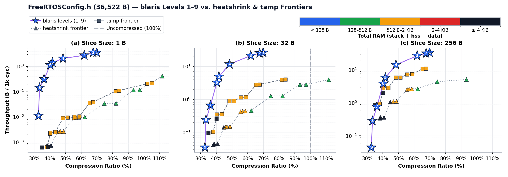
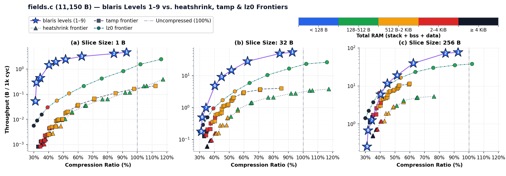
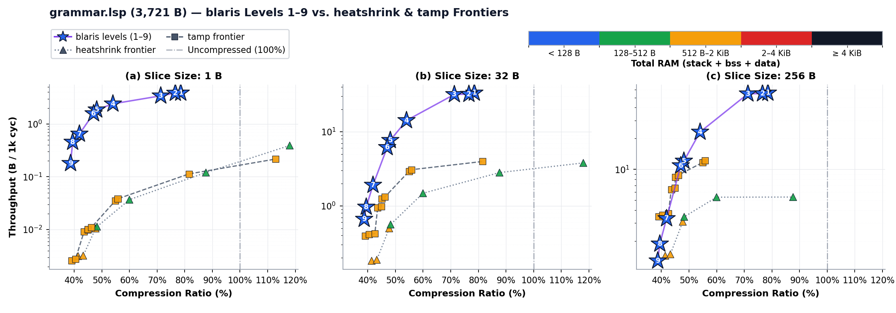
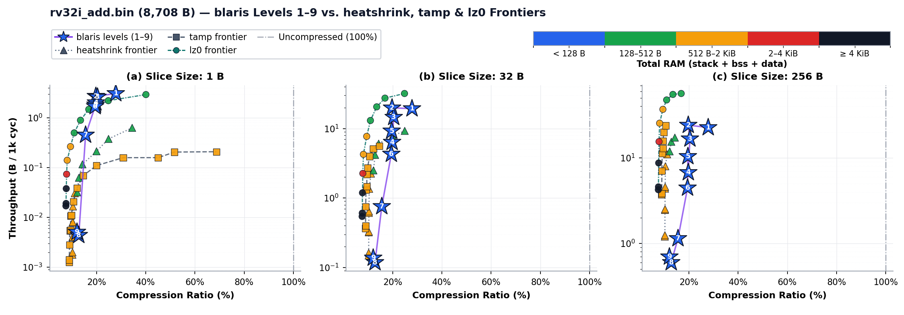
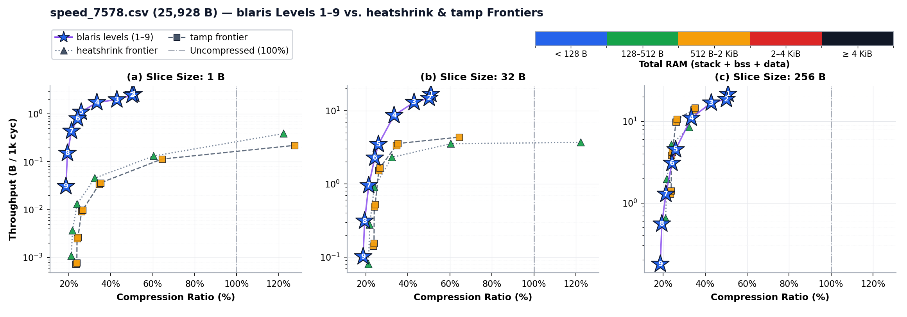
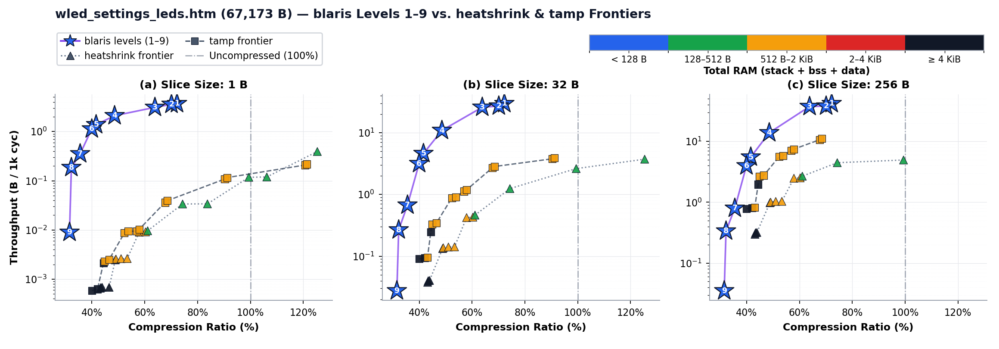
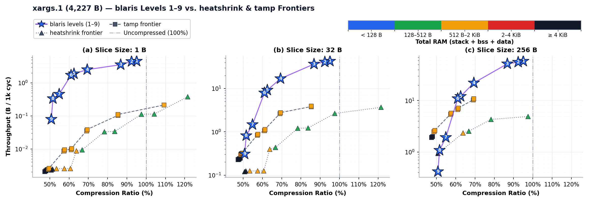

# blaris

**Windowless Random-Access LZSS for Constrained Microcontrollers**

[](https://arxiv.org/abs/2611.22900)

`blaris` is a windowless random-access LZSS decompressor designed for systems with very little
Flash and RAM memory. Because it is windowless, it never allocates a buffer in RAM to
resolve bytes; instead, the compressed payload is structured in a way which allows
the decompressor to walk it in both directions.

`blaris` should be used in workflows where some data is compressed once and
decompressed many times on the MCU. It supports super efficient partial decompression
(imagine decompressing a single record from a configuration table), as well as $O(n)$ full-file
decompression, although the latter is not the intended use case.

`blaris` is incredibly tiny in both Flash and RAM usage. Unlike traditional codecs
like `heatshrink` and `tamp`, `blaris` uses the exact same amount of memory regardless of
how large the input file is.

## Flash and RAM usage

| Codec | Flash (`.text` + `.rodata`) | Peak Stack | Static RAM (`.bss` + `.data`) | Total RAM |
| :--- | ---: | ---: | ---: | ---: |
| **`blaris`** | **590–794 B** | **84–88 B** | **28–36 B** | **112–124 B** |
| `heatshrink` | 1,300–1,464 B | 140–144 B | 66–16,450 B | 206–16,594 B |
| `lz0` | 1,344–1,364 B | 108 B | 36–16,404 B | 144–16,512 B |
| `tamp` | 2,238–3,238 B | 228–248 B | 292–16,424 B | 520–16,672 B |


## Performance note
Across the benchmark corpus (21 files: `.csv`, `.bin`, `.dtb`, `.c`, `.html`, etc.),
`blaris` is extremely fast when decompressing small slices (`<= 32 B`).
For larger slices, `blaris` stays very fast and delivers compression ratios comparable to or
beating `heatshrink` and `tamp`.

Benchmarks were compiled with Clang (`-Os`) for 32-bit RISC-V (**RV32IMC**) and run in `rv32emu` across 1,000 pseudorandom unaligned offsets per slice size. Because `heatshrink` and `tamp` only decode sequentially, they are wrapped in a block-indexing layer (`2^4` to `2^14 B` blocks).

### 1. Devicetree Blob — `zynq7000s.dtb` (15.2 KiB)


### 2. RTOS Configuration — `FreeRTOSConfig.h` (35.7 KiB)


### 3. Web Asset — `cp.html` (24.0 KiB)


### Hardware Check (ESP32-C3FN4 XIP)
> Note: tested on v1.0.0, not v1.1.0

To check whether SPI Flash wait states on real hardware disproportionately penalize `blaris`'s backward token walking, we also tested one balanced configuration of each codec (`blaris_o2_a0_s8_f1`, `heatshrink_b10_i16_w8_l4`, and `tamp_b10_w8_e1`) on a physical **ESP32-C3FN4** in direct-boot XIP mode (mapping both code and compressed payload to external quad-SPI Flash without copying either to SRAM). Overall hardware cycle counts increased by **29.3% (`1.29×`)** for `blaris`, compared to **+33.5% (`1.33×`)** for `heatshrink` and **+23.6% (`1.24×`)** for `tamp` (`1.51×` on 1 B reads for `blaris` due to cold cache-line fills, stabilizing at `1.30×–1.33×` for slices `>= 4 B`).

---

## Usage & C API

`blaris` can be used either with a predefined configuration or by tuning the
parameters for the specific use case. I highly recommend going with the latter, as
decompression speed and ratio are very dependent on the data, and while predefined
levels are fine, they might not give the best results.

9 configuration levels are supported, with `1` being the fastest and `9` compressing the
best. Levels `1` through `7` use
`src/blaris-compress-greedymaxhops.c` for compression, which is made for fast
decompression and deterministic worst-case latency. Specifically, a slice of size `L`
can be decompressed in `O(L * H * D/2)` time (with `s > 0`), where `H` is `BLARIS_MAX_HOPS` and `D`
is `1 << BLARIS_CHECKPOINTS_SPREAD_LOG`.

Levels `8` and `9` use a different compressor, `src/blaris-compress-optimal.c`, which is
designed to provide the best possible ratio. However, this method suffers from an
unconstrained number of hops any byte can take, and should not be used in systems
where latency predictability is of the highest importance.

If `BLARIS_LEVEL` is set to any number from `1` to `9` (identically on both compressor and decompressor), simply compile
`src/blaris-compress.c` as the compressor and `src/blaris-decompress.c` as the
decompressor. Predefined levels can be found in `include/config.h`.

If `BLARIS_LEVEL` is not defined, or is set to `0`, include either
`src/blaris-compress-optimal.c` or `src/blaris-compress-greedymaxhops.c` as the
compressor file. To tune parameters manually, check the defines in
`include/blaris.h`, `src/blaris-decompress.c`, and the chosen compressor.

> By default, setting `BLARIS_LEVEL` to `4` or `5` should be fine, as those levels are relatively
> fast and produce good compression ratios.

### Decompression Example (Target MCU)

Compile with `src/blaris-decompress.c` and `-DBLARIS_LEVEL=4` (matching the compressor):

```c
#define BLARIS_LEVEL 4
#include <blaris.h>

// Must be 4-byte aligned in Flash / XIP memory
extern const uint32_t compressed_payload[];

static struct Decoder dec;
static struct Checkpoint cp;

void init_assets(void) {
    blaris_init(compressed_payload, &dec);
    cp = (struct Checkpoint){0};
}

// Read `size` bytes starting at uncompressed `offset` into `out_buf`
void read_slice(uint32_t offset, uint8_t *out_buf, uint32_t size) {
    blaris_decompress(&dec, offset, out_buf, size, &cp);
}
```

### Compression Example (Host)

Compile and link with `src/blaris-compress.c` and `-DBLARIS_LEVEL=4`:

```c
#define BLARIS_LEVEL 4
#define BLARIS_COMPRESS
#include <blaris.h>

size_t max_len = blaris_compress_bound(input_len);
uint8_t *compressed = malloc(max_len);
size_t compressed_len = max_len;

if (blaris_compress(input_data, input_len, compressed, &compressed_len) == 0) {
    // `compressed` now holds `compressed_len` bytes of blaris payload
}
```

## CLI

A standalone host CLI is available in [`cli/`](cli/Makefile) with all 9 preset levels built in:

```bash
make -C cli
```

Usage:
```bash
# Compress to a binary file (default level 6)
./cli/blaris input.bin output.bl

# Compress at level 9 and emit a .c array with a custom symbol name
./cli/blaris -9 -c --sym asset_payload input.bin asset_payload.c

# Decompress (full file or random-access slice)
./cli/blaris -d -9 output.bl restored.bin
./cli/blaris -d -9 --offset 128 --size 64 output.bl slice.bin
```

## Running the Benchmarks & Plotting Scripts

Requires `clang` (with `riscv32-unknown-elf` support), `lld` (`ld.lld`), `llvm-size`, [`rv32emu`](https://github.com/sysprog21/rv32emu), and Python packages `matplotlib` and `numpy` (`PyQt5` optional for interactive `--all` plots; `esptool` and `pyserial` optional for ESP32-C3 runs).

```bash
# Run the full benchmark suite in rv32emu
python3 bench/run.py

# Summarize Flash, Stack, and Static RAM footprints
python3 bench/scripts/summary.py

# View per-file level tables in plain text in the terminal
python3 bench/scripts/generate_tables.py --dataset FreeRTOSConfig.h --slice 32

# Plot Pareto frontier for a dataset and slice size (e.g., s=5 -> 32 B)
python3 bench/scripts/compare.py zynq7000s.dtb 5
```

---

## License

Licensed under either of

- Apache License, Version 2.0 ([LICENSE-APACHE](LICENSE-APACHE) or http://www.apache.org/licenses/LICENSE-2.0)
- MIT license ([LICENSE-MIT](LICENSE-MIT) or http://opensource.org/licenses/MIT)

at your option.

## Benchmarking

Detailed per-file comparisons across all 21 corpus datasets at slice sizes of **4 B**, **32 B**, and **256 B**.
For each slice size, all 9 `blaris` preset levels (`L9` tightest to `L1` fastest) are grouped with the most lightweight (lowest RAM usage) `heatshrink`, `tamp`, and `lz0` configuration that achieves the same or better compression ratio (`ratio <= blaris_ratio`, tie-breaking by lowest decompression cycles; if none reaches that ratio, the best-ratio configuration for that codec is shown as a fallback and marked with `*`).

<details>
<summary><strong><code>FreeRTOSConfig.h</code></strong> (36,522 B)</summary>


#### `FreeRTOSConfig.h` — 4 B Slices

| Configuration | Ratio | Decompression Cycles | vs. `blaris` | RAM Usage |
| :--- | ---: | ---: | ---: | ---: |
| **`L9`** | **29.37%** | **115,112 cyc** | **-** | **116 B** |
| `heatshrink_b14_i16_w13_l6` | 37.47%* | 896,925 cyc | x7.79 | 8,386 B |
| `tamp_b14_w13_e1` | 34.61%* | 674,780 cyc | x5.86 | 8,480 B |
| `lz0_b14` | 32.89%* | 256,940 cyc | x2.23 | 16,512 B |
| | | | | |
| **`L8`** | **30.06%** | **14,778 cyc** | **-** | **124 B** |
| `heatshrink_b14_i16_w13_l6` | 37.47%* | 896,925 cyc | x60.7 | 8,386 B |
| `tamp_b14_w13_e1` | 34.61%* | 674,780 cyc | x45.7 | 8,480 B |
| `lz0_b14` | 32.89%* | 256,940 cyc | x17.4 | 16,512 B |
| | | | | |
| **`L7`** | **33.33%** | **5,967 cyc** | **-** | **124 B** |
| `heatshrink_b14_i16_w13_l6` | 37.47%* | 896,925 cyc | x150 | 8,386 B |
| `tamp_b14_w13_e1` | 34.61%* | 674,780 cyc | x113 | 8,480 B |
| `lz0_b14` | 32.89% | 256,940 cyc | x43.1 | 16,512 B |
| | | | | |
| **`L6`** | **38.91%** | **1,161 cyc** | **-** | **124 B** |
| `heatshrink_b14_i16_w12_l6` | 38.64% | 889,849 cyc | x767 | 4,290 B |
| `tamp_b13_w10_e1` | 38.84% | 309,167 cyc | x266 | 1,312 B |
| `lz0_b13` | 35.55% | 133,968 cyc | x115 | 8,320 B |
| | | | | |
| **`L5`** | **43.49%** | **793 cyc** | **-** | **124 B** |
| `heatshrink_b14_i16_w10_l4` | 43.27% | 965,119 cyc | x1,218 | 1,214 B |
| `tamp_b12_w9_e1` | 42.83% | 156,550 cyc | x198 | 800 B |
| `lz0_b12` | 39.40% | 71,590 cyc | x90.3 | 4,224 B |
| | | | | |
| **`L4`** | **49.55%** | **592 cyc** | **-** | **124 B** |
| `heatshrink_b12_i16_w9_l4` | 49.21% | 263,036 cyc | x444 | 702 B |
| `tamp_b11_w9_e0` | 48.37% | 81,866 cyc | x138 | 776 B |
| `lz0_b11` | 44.22% | 36,419 cyc | x61.5 | 2,176 B |
| | | | | |
| **`L3`** | **58.66%** | **423 cyc** | **-** | **124 B** |
| `heatshrink_b14_i16_w8_l4` | 58.45% | 1,093,102 cyc | x2,585 | 446 B |
| `tamp_b11_w8_e0` | 57.19% | 80,478 cyc | x190 | 520 B |
| `lz0_b10` | 51.04% | 18,356 cyc | x43.4 | 1,152 B |
| | | | | |
| **`L2`** | **72.85%** | **350 cyc** | **-** | **124 B** |
| `heatshrink_b9_i16_w7_l4` | 72.15% | 43,871 cyc | x125 | 318 B |
| `tamp_b8_w8_e0` | 67.58% | 13,486 cyc | x38.6 | 520 B |
| `lz0_b8` | 72.51% | 4,659 cyc | x13.3 | 384 B |
| | | | | |
| **`L1`** | **81.42%** | **308 cyc** | **-** | **124 B** |
| `heatshrink_b9_i16_w6_l4` | 80.47% | 46,191 cyc | x150 | 254 B |
| `tamp_b7_w8_e0` | 75.48% | 8,679 cyc | x28.2 | 520 B |
| `lz0_b8` | 72.51% | 4,659 cyc | x15.1 | 384 B |

#### `FreeRTOSConfig.h` — 32 B Slices

| Configuration | Ratio | Decompression Cycles | vs. `blaris` | RAM Usage |
| :--- | ---: | ---: | ---: | ---: |
| **`L9`** | **29.37%** | **622,080 cyc** | **-** | **116 B** |
| `heatshrink_b14_i16_w13_l6` | 37.47%* | 727,806 cyc | x1.17 | 8,386 B |
| `tamp_b14_w13_e1` | 34.61%* | 366,250 cyc | x0.59 | 8,480 B |
| `lz0_b14` | 32.89%* | 256,213 cyc | x0.41 | 16,512 B |
| | | | | |
| **`L8`** | **30.06%** | **106,683 cyc** | **-** | **124 B** |
| `heatshrink_b14_i16_w13_l6` | 37.47%* | 727,806 cyc | x6.82 | 8,386 B |
| `tamp_b14_w13_e1` | 34.61%* | 366,250 cyc | x3.43 | 8,480 B |
| `lz0_b14` | 32.89%* | 256,213 cyc | x2.40 | 16,512 B |
| | | | | |
| **`L7`** | **33.33%** | **38,860 cyc** | **-** | **124 B** |
| `heatshrink_b14_i16_w13_l6` | 37.47%* | 727,806 cyc | x18.7 | 8,386 B |
| `tamp_b14_w13_e1` | 34.61%* | 366,250 cyc | x9.42 | 8,480 B |
| `lz0_b14` | 32.89% | 256,213 cyc | x6.59 | 16,512 B |
| | | | | |
| **`L6`** | **38.91%** | **5,818 cyc** | **-** | **124 B** |
| `heatshrink_b14_i16_w12_l6` | 38.64% | 721,225 cyc | x124 | 4,290 B |
| `tamp_b13_w10_e1` | 38.84% | 161,466 cyc | x27.8 | 1,312 B |
| `lz0_b13` | 35.55% | 133,845 cyc | x23.0 | 8,320 B |
| | | | | |
| **`L5`** | **43.49%** | **3,462 cyc** | **-** | **124 B** |
| `heatshrink_b14_i16_w10_l4` | 43.27% | 801,235 cyc | x231 | 1,214 B |
| `tamp_b12_w9_e1` | 42.83% | 87,610 cyc | x25.3 | 800 B |
| `lz0_b12` | 39.40% | 72,451 cyc | x20.9 | 4,224 B |
| | | | | |
| **`L4`** | **49.55%** | **2,223 cyc** | **-** | **124 B** |
| `heatshrink_b12_i16_w9_l4` | 49.21% | 233,432 cyc | x105 | 702 B |
| `tamp_b11_w9_e0` | 48.37% | 48,958 cyc | x22.0 | 776 B |
| `lz0_b11` | 44.22% | 37,219 cyc | x16.7 | 2,176 B |
| | | | | |
| **`L3`** | **58.66%** | **1,330 cyc** | **-** | **124 B** |
| `heatshrink_b14_i16_w8_l4` | 58.45% | 925,011 cyc | x696 | 446 B |
| `tamp_b11_w8_e0` | 57.19% | 48,736 cyc | x36.6 | 520 B |
| `lz0_b10` | 51.04% | 19,163 cyc | x14.4 | 1,152 B |
| | | | | |
| **`L2`** | **72.85%** | **972 cyc** | **-** | **124 B** |
| `heatshrink_b9_i16_w7_l4` | 72.15% | 41,251 cyc | x42.4 | 318 B |
| `tamp_b8_w8_e0` | 67.58% | 11,207 cyc | x11.5 | 520 B |
| `lz0_b8` | 72.51% | 5,225 cyc | x5.38 | 384 B |
| | | | | |
| **`L1`** | **81.42%** | **885 cyc** | **-** | **124 B** |
| `heatshrink_b9_i16_w6_l4` | 80.47% | 43,830 cyc | x49.5 | 254 B |
| `tamp_b7_w8_e0` | 75.48% | 8,738 cyc | x9.87 | 520 B |
| `lz0_b8` | 72.51% | 5,225 cyc | x5.90 | 384 B |

#### `FreeRTOSConfig.h` — 256 B Slices

| Configuration | Ratio | Decompression Cycles | vs. `blaris` | RAM Usage |
| :--- | ---: | ---: | ---: | ---: |
| **`L9`** | **29.37%** | **3,967,882 cyc** | **-** | **116 B** |
| `heatshrink_b14_i16_w13_l6` | 37.47%* | 726,524 cyc | x0.18 | 8,386 B |
| `tamp_b14_w13_e1` | 34.61%* | 333,299 cyc | x0.08 | 8,480 B |
| `lz0_b14` | 32.89%* | 262,228 cyc | x0.07 | 16,512 B |
| | | | | |
| **`L8`** | **30.06%** | **731,857 cyc** | **-** | **124 B** |
| `heatshrink_b14_i16_w13_l6` | 37.47%* | 726,524 cyc | x0.99 | 8,386 B |
| `tamp_b14_w13_e1` | 34.61%* | 333,299 cyc | x0.46 | 8,480 B |
| `lz0_b14` | 32.89%* | 262,228 cyc | x0.36 | 16,512 B |
| | | | | |
| **`L7`** | **33.33%** | **271,095 cyc** | **-** | **124 B** |
| `heatshrink_b14_i16_w13_l6` | 37.47%* | 726,524 cyc | x2.68 | 8,386 B |
| `tamp_b14_w13_e1` | 34.61%* | 333,299 cyc | x1.23 | 8,480 B |
| `lz0_b14` | 32.89% | 262,228 cyc | x0.97 | 16,512 B |
| | | | | |
| **`L6`** | **38.91%** | **41,400 cyc** | **-** | **124 B** |
| `heatshrink_b14_i16_w12_l6` | 38.64% | 719,427 cyc | x17.4 | 4,290 B |
| `tamp_b13_w10_e1` | 38.84% | 150,981 cyc | x3.65 | 1,312 B |
| `lz0_b13` | 35.55% | 138,531 cyc | x3.35 | 8,320 B |
| | | | | |
| **`L5`** | **43.49%** | **23,408 cyc** | **-** | **124 B** |
| `heatshrink_b14_i16_w10_l4` | 43.27% | 801,339 cyc | x34.2 | 1,214 B |
| `tamp_b12_w9_e1` | 42.83% | 86,485 cyc | x3.69 | 800 B |
| `lz0_b12` | 39.40% | 76,253 cyc | x3.26 | 4,224 B |
| | | | | |
| **`L4`** | **49.55%** | **14,295 cyc** | **-** | **124 B** |
| `heatshrink_b12_i16_w9_l4` | 49.21% | 255,995 cyc | x17.9 | 702 B |
| `tamp_b11_w9_e0` | 48.37% | 51,597 cyc | x3.61 | 776 B |
| `lz0_b11` | 44.22% | 41,163 cyc | x2.88 | 2,176 B |
| | | | | |
| **`L3`** | **58.66%** | **8,273 cyc** | **-** | **124 B** |
| `heatshrink_b14_i16_w8_l4` | 58.45% | 927,050 cyc | x112 | 446 B |
| `tamp_b11_w8_e0` | 57.19% | 52,029 cyc | x6.29 | 520 B |
| `lz0_b10` | 51.04% | 24,326 cyc | x2.94 | 1,152 B |
| | | | | |
| **`L2`** | **72.85%** | **5,765 cyc** | **-** | **124 B** |
| `heatshrink_b9_i16_w7_l4` | 72.15% | 74,000 cyc | x12.8 | 318 B |
| `tamp_b8_w8_e0` | 67.58% | 23,173 cyc | x4.02 | 520 B |
| `lz0_b8` | 72.51% | 10,702 cyc | x1.86 | 384 B |
| | | | | |
| **`L1`** | **81.42%** | **5,177 cyc** | **-** | **124 B** |
| `heatshrink_b9_i16_w6_l4` | 80.47% | 79,502 cyc | x15.4 | 254 B |
| `tamp_b8_w8_e0` | 67.58% | 23,173 cyc | x4.48 | 520 B |
| `lz0_b8` | 72.51% | 10,702 cyc | x2.07 | 384 B |

</details>

<details>
<summary><strong><code>ch32v003_bootloader.bin</code></strong> (1,920 B)</summary>


#### `ch32v003_bootloader.bin` — 4 B Slices

| Configuration | Ratio | Decompression Cycles | vs. `blaris` | RAM Usage |
| :--- | ---: | ---: | ---: | ---: |
| **`L9`** | **90.73%** | **2,296 cyc** | **-** | **116 B** |
| `heatshrink_b12_i16_w9_l4` | 90.99%* | 185,864 cyc | x80.9 | 702 B |
| `tamp_b10_w8_e0` | 89.79% | 41,337 cyc | x18.0 | 520 B |
| `lz0_b9` | 88.85% | 8,061 cyc | x3.51 | 640 B |
| | | | | |
| **`L8`** | **91.56%** | **1,119 cyc** | **-** | **124 B** |
| `heatshrink_b12_i16_w9_l4` | 90.99% | 185,864 cyc | x166 | 702 B |
| `tamp_b9_w8_e0` | 91.51% | 22,987 cyc | x20.5 | 520 B |
| `lz0_b9` | 88.85% | 8,061 cyc | x7.21 | 640 B |
| | | | | |
| **`L7`** | **93.49%** | **957 cyc** | **-** | **124 B** |
| `heatshrink_b10_i16_w8_l4` | 92.81% | 91,391 cyc | x95.5 | 446 B |
| `tamp_b9_w8_e0` | 91.51% | 22,987 cyc | x24.0 | 520 B |
| `lz0_b8` | 91.72% | 3,865 cyc | x4.04 | 384 B |
| | | | | |
| **`L6`** | **98.70%** | **279 cyc** | **-** | **124 B** |
| `heatshrink_b9_i16_w6_l4` | 97.71% | 49,443 cyc | x177 | 254 B |
| `tamp_b8_w8_e0` | 95.36% | 13,140 cyc | x47.2 | 520 B |
| `lz0_b7` | 97.08% | 1,941 cyc | x6.97 | 256 B |
| | | | | |
| **`L5`** | **100.99%** | **244 cyc** | **-** | **124 B** |
| `heatshrink_b8_i16_w6_l4` | 98.85% | 25,473 cyc | x104 | 254 B |
| `tamp_b8_w8_e0` | 95.36% | 13,140 cyc | x53.9 | 520 B |
| `lz0_b7` | 97.08% | 1,941 cyc | x7.96 | 256 B |
| | | | | |
| **`L4`** | **102.66%** | **227 cyc** | **-** | **124 B** |
| `heatshrink_b10_i16_w5_l4` | 102.34% | 99,073 cyc | x437 | 222 B |
| `tamp_b7_w8_e0` | 102.55% | 8,413 cyc | x37.1 | 520 B |
| `lz0_b6` | 101.51% | 1,032 cyc | x4.55 | 192 B |
| | | | | |
| **`L3`** | **104.38%** | **215 cyc** | **-** | **124 B** |
| `heatshrink_b8_i16_w5_l4` | 103.39% | 25,992 cyc | x121 | 222 B |
| `tamp_b7_w8_e0` | 102.55% | 8,413 cyc | x39.2 | 520 B |
| `lz0_b6` | 101.51% | 1,032 cyc | x4.81 | 192 B |
| | | | | |
| **`L2`** | **106.77%** | **210 cyc** | **-** | **124 B** |
| `heatshrink_b8_i16_w4_l3` | 105.83% | 26,270 cyc | x125 | 206 B |
| `tamp_b7_w8_e0` | 102.55% | 8,413 cyc | x40.1 | 520 B |
| `lz0_b6` | 101.51% | 1,032 cyc | x4.92 | 192 B |
| | | | | |
| **`L1`** | **114.84%** | **200 cyc** | **-** | **124 B** |
| `heatshrink_b5_i16_w4_l3` | 113.70% | 4,368 cyc | x21.9 | 206 B |
| `tamp_b6_w8_e0` | 107.81% | 6,032 cyc | x30.2 | 520 B |
| `lz0_b5` | 109.22% | 612 cyc | x3.06 | 160 B |

#### `ch32v003_bootloader.bin` — 32 B Slices

| Configuration | Ratio | Decompression Cycles | vs. `blaris` | RAM Usage |
| :--- | ---: | ---: | ---: | ---: |
| **`L9`** | **90.73%** | **4,536 cyc** | **-** | **116 B** |
| `heatshrink_b12_i16_w9_l4` | 90.99%* | 174,042 cyc | x38.4 | 702 B |
| `tamp_b10_w8_e0` | 89.79% | 27,964 cyc | x6.17 | 520 B |
| `lz0_b9` | 88.85% | 8,596 cyc | x1.90 | 640 B |
| | | | | |
| **`L8`** | **91.56%** | **2,872 cyc** | **-** | **124 B** |
| `heatshrink_b12_i16_w9_l4` | 90.99% | 174,042 cyc | x60.6 | 702 B |
| `tamp_b9_w8_e0` | 91.51% | 17,008 cyc | x5.92 | 520 B |
| `lz0_b9` | 88.85% | 8,596 cyc | x2.99 | 640 B |
| | | | | |
| **`L7`** | **93.49%** | **2,305 cyc** | **-** | **124 B** |
| `heatshrink_b10_i16_w8_l4` | 92.81% | 83,574 cyc | x36.3 | 446 B |
| `tamp_b9_w8_e0` | 91.51% | 17,008 cyc | x7.38 | 520 B |
| `lz0_b8` | 91.72% | 4,507 cyc | x1.95 | 384 B |
| | | | | |
| **`L6`** | **98.70%** | **722 cyc** | **-** | **124 B** |
| `heatshrink_b9_i16_w6_l4` | 97.71% | 47,868 cyc | x66.3 | 254 B |
| `tamp_b8_w8_e0` | 95.36% | 11,455 cyc | x15.9 | 520 B |
| `lz0_b7` | 97.08% | 2,555 cyc | x3.54 | 256 B |
| | | | | |
| **`L5`** | **100.99%** | **544 cyc** | **-** | **124 B** |
| `heatshrink_b8_i16_w6_l4` | 98.85% | 27,892 cyc | x51.3 | 254 B |
| `tamp_b8_w8_e0` | 95.36% | 11,455 cyc | x21.1 | 520 B |
| `lz0_b7` | 97.08% | 2,555 cyc | x4.70 | 256 B |
| | | | | |
| **`L4`** | **102.66%** | **470 cyc** | **-** | **124 B** |
| `heatshrink_b10_i16_w5_l4` | 102.34% | 91,436 cyc | x194 | 222 B |
| `tamp_b7_w8_e0` | 102.55% | 8,961 cyc | x19.1 | 520 B |
| `lz0_b6` | 101.51% | 1,629 cyc | x3.46 | 192 B |
| | | | | |
| **`L3`** | **104.38%** | **428 cyc** | **-** | **124 B** |
| `heatshrink_b8_i16_w5_l4` | 103.39% | 28,633 cyc | x66.9 | 222 B |
| `tamp_b7_w8_e0` | 102.55% | 8,961 cyc | x20.9 | 520 B |
| `lz0_b6` | 101.51% | 1,629 cyc | x3.81 | 192 B |
| | | | | |
| **`L2`** | **106.77%** | **415 cyc** | **-** | **124 B** |
| `heatshrink_b8_i16_w4_l3` | 105.83% | 29,006 cyc | x69.9 | 206 B |
| `tamp_b7_w8_e0` | 102.55% | 8,961 cyc | x21.6 | 520 B |
| `lz0_b6` | 101.51% | 1,629 cyc | x3.93 | 192 B |
| | | | | |
| **`L1`** | **114.84%** | **404 cyc** | **-** | **124 B** |
| `heatshrink_b5_i16_w4_l3` | 113.70% | 9,814 cyc | x24.3 | 206 B |
| `tamp_b6_w8_e0` | 107.81% | 8,155 cyc | x20.2 | 520 B |
| `lz0_b5` | 109.22% | 1,196 cyc | x2.96 | 160 B |

#### `ch32v003_bootloader.bin` — 256 B Slices

| Configuration | Ratio | Decompression Cycles | vs. `blaris` | RAM Usage |
| :--- | ---: | ---: | ---: | ---: |
| **`L9`** | **90.73%** | **16,482 cyc** | **-** | **116 B** |
| `heatshrink_b12_i16_w9_l4` | 90.99%* | 189,049 cyc | x11.5 | 702 B |
| `tamp_b10_w8_e0` | 89.79% | 36,521 cyc | x2.22 | 520 B |
| `lz0_b9` | 88.85% | 13,424 cyc | x0.81 | 640 B |
| | | | | |
| **`L8`** | **91.56%** | **11,586 cyc** | **-** | **124 B** |
| `heatshrink_b12_i16_w9_l4` | 90.99% | 189,049 cyc | x16.3 | 702 B |
| `tamp_b9_w8_e0` | 91.51% | 28,421 cyc | x2.45 | 520 B |
| `lz0_b9` | 88.85% | 13,424 cyc | x1.16 | 640 B |
| | | | | |
| **`L7`** | **93.49%** | **9,429 cyc** | **-** | **124 B** |
| `heatshrink_b10_i16_w8_l4` | 92.81% | 117,781 cyc | x12.5 | 446 B |
| `tamp_b9_w8_e0` | 91.51% | 28,421 cyc | x3.01 | 520 B |
| `lz0_b8` | 91.72% | 9,182 cyc | x0.97 | 384 B |
| | | | | |
| **`L6`** | **98.70%** | **3,330 cyc** | **-** | **124 B** |
| `heatshrink_b9_i16_w6_l4` | 97.71% | 89,029 cyc | x26.7 | 254 B |
| `tamp_b8_w8_e0` | 95.36% | 24,735 cyc | x7.43 | 520 B |
| `lz0_b7` | 97.08% | 6,930 cyc | x2.08 | 256 B |
| | | | | |
| **`L5`** | **100.99%** | **2,601 cyc** | **-** | **124 B** |
| `heatshrink_b8_i16_w6_l4` | 98.85% | 69,326 cyc | x26.7 | 254 B |
| `tamp_b8_w8_e0` | 95.36% | 24,735 cyc | x9.51 | 520 B |
| `lz0_b7` | 97.08% | 6,930 cyc | x2.66 | 256 B |
| | | | | |
| **`L4`** | **102.66%** | **2,299 cyc** | **-** | **124 B** |
| `heatshrink_b10_i16_w5_l4` | 102.34% | 129,664 cyc | x56.4 | 222 B |
| `tamp_b8_w8_e0` | 95.36% | 24,735 cyc | x10.8 | 520 B |
| `lz0_b6` | 101.51% | 6,006 cyc | x2.61 | 192 B |
| | | | | |
| **`L3`** | **104.38%** | **2,117 cyc** | **-** | **124 B** |
| `heatshrink_b8_i16_w5_l4` | 103.39% | 71,176 cyc | x33.6 | 222 B |
| `tamp_b8_w8_e0` | 95.36% | 24,735 cyc | x11.7 | 520 B |
| `lz0_b6` | 101.51% | 6,006 cyc | x2.84 | 192 B |
| | | | | |
| **`L2`** | **106.77%** | **2,077 cyc** | **-** | **124 B** |
| `heatshrink_b8_i16_w4_l3` | 105.83% | 72,140 cyc | x34.7 | 206 B |
| `tamp_b8_w8_e0` | 95.36% | 24,735 cyc | x11.9 | 520 B |
| `lz0_b6` | 101.51% | 6,006 cyc | x2.89 | 192 B |
| | | | | |
| **`L1`** | **114.84%** | **2,025 cyc** | **-** | **124 B** |
| `heatshrink_b5_i16_w4_l3` | 113.70% | 54,909 cyc | x27.1 | 206 B |
| `tamp_b8_w8_e0` | 95.36% | 24,735 cyc | x12.2 | 520 B |
| `lz0_b5` | 109.22% | 5,767 cyc | x2.85 | 160 B |

</details>

<details>
<summary><strong><code>ch32v30x_blink.bin</code></strong> (1,064 B)</summary>


#### `ch32v30x_blink.bin` — 4 B Slices

| Configuration | Ratio | Decompression Cycles | vs. `blaris` | RAM Usage |
| :--- | ---: | ---: | ---: | ---: |
| **`L9`** | **63.16%** | **2,830 cyc** | **-** | **116 B** |
| `heatshrink_b12_i16_w9_l4` | 63.72%* | 62,714 cyc | x22.2 | 702 B |
| `tamp_b9_w8_e1` | 62.78% | 22,156 cyc | x7.83 | 544 B |
| `lz0_b8` | 62.69% | 3,008 cyc | x1.06 | 384 B |
| | | | | |
| **`L8`** | **64.29%** | **3,037 cyc** | **-** | **124 B** |
| `heatshrink_b12_i16_w8_l6` | 63.91% | 56,339 cyc | x18.6 | 446 B |
| `tamp_b10_w8_e0` | 63.91% | 37,042 cyc | x12.2 | 520 B |
| `lz0_b8` | 62.69% | 3,008 cyc | x0.99 | 384 B |
| | | | | |
| **`L7`** | **65.70%** | **1,094 cyc** | **-** | **124 B** |
| `heatshrink_b12_i16_w6_l4` | 65.70% | 58,036 cyc | x53.1 | 254 B |
| `tamp_b9_w8_e0` | 65.23% | 21,327 cyc | x19.5 | 520 B |
| `lz0_b7` | 65.60% | 1,631 cyc | x1.49 | 256 B |
| | | | | |
| **`L6`** | **69.55%** | **761 cyc** | **-** | **124 B** |
| `heatshrink_b7_i16_w5_l4` | 69.27% | 9,834 cyc | x12.9 | 222 B |
| `tamp_b8_w8_e0` | 68.14% | 12,441 cyc | x16.4 | 520 B |
| `lz0_b7` | 65.60% | 1,631 cyc | x2.14 | 256 B |
| | | | | |
| **`L5`** | **70.21%** | **475 cyc** | **-** | **124 B** |
| `heatshrink_b7_i16_w5_l4` | 69.27% | 9,834 cyc | x20.7 | 222 B |
| `tamp_b8_w8_e0` | 68.14% | 12,441 cyc | x26.2 | 520 B |
| `lz0_b6` | 69.74% | 910 cyc | x1.91 | 192 B |
| | | | | |
| **`L4`** | **70.96%** | **467 cyc** | **-** | **124 B** |
| `heatshrink_b7_i16_w5_l4` | 69.27% | 9,834 cyc | x21.1 | 222 B |
| `tamp_b8_w8_e0` | 68.14% | 12,441 cyc | x26.7 | 520 B |
| `lz0_b6` | 69.74% | 910 cyc | x1.95 | 192 B |
| | | | | |
| **`L3`** | **73.03%** | **381 cyc** | **-** | **124 B** |
| `heatshrink_b8_i16_w4_l3` | 72.74% | 18,731 cyc | x49.1 | 206 B |
| `tamp_b7_w8_e0` | 71.90% | 8,056 cyc | x21.1 | 520 B |
| `lz0_b6` | 69.74% | 910 cyc | x2.38 | 192 B |
| | | | | |
| **`L2`** | **74.06%** | **377 cyc** | **-** | **124 B** |
| `heatshrink_b8_i16_w4_l3` | 72.74% | 18,731 cyc | x49.7 | 206 B |
| `tamp_b7_w8_e0` | 71.90% | 8,056 cyc | x21.4 | 520 B |
| `lz0_b6` | 69.74% | 910 cyc | x2.41 | 192 B |
| | | | | |
| **`L1`** | **81.95%** | **335 cyc** | **-** | **124 B** |
| `heatshrink_b6_i16_w4_l3` | 77.07% | 5,809 cyc | x17.3 | 206 B |
| `tamp_b6_w8_e0` | 77.44% | 5,875 cyc | x17.5 | 520 B |
| `lz0_b5` | 80.45% | 586 cyc | x1.75 | 160 B |

#### `ch32v30x_blink.bin` — 32 B Slices

| Configuration | Ratio | Decompression Cycles | vs. `blaris` | RAM Usage |
| :--- | ---: | ---: | ---: | ---: |
| **`L9`** | **63.16%** | **4,191 cyc** | **-** | **116 B** |
| `heatshrink_b12_i16_w9_l4` | 63.72%* | 57,229 cyc | x13.7 | 702 B |
| `tamp_b9_w8_e1` | 62.78% | 14,864 cyc | x3.55 | 544 B |
| `lz0_b8` | 62.69% | 3,598 cyc | x0.86 | 384 B |
| | | | | |
| **`L8`** | **64.29%** | **4,590 cyc** | **-** | **124 B** |
| `heatshrink_b12_i16_w8_l6` | 63.91% | 50,546 cyc | x11.0 | 446 B |
| `tamp_b10_w8_e0` | 63.91% | 22,585 cyc | x4.92 | 520 B |
| `lz0_b8` | 62.69% | 3,598 cyc | x0.78 | 384 B |
| | | | | |
| **`L7`** | **65.70%** | **4,529 cyc** | **-** | **124 B** |
| `heatshrink_b12_i16_w6_l4` | 65.70% | 52,457 cyc | x11.6 | 254 B |
| `tamp_b9_w8_e0` | 65.23% | 14,594 cyc | x3.22 | 520 B |
| `lz0_b7` | 65.60% | 2,173 cyc | x0.48 | 256 B |
| | | | | |
| **`L6`** | **69.55%** | **3,572 cyc** | **-** | **124 B** |
| `heatshrink_b7_i16_w5_l4` | 69.27% | 12,969 cyc | x3.63 | 222 B |
| `tamp_b8_w8_e0` | 68.14% | 10,148 cyc | x2.84 | 520 B |
| `lz0_b7` | 65.60% | 2,173 cyc | x0.61 | 256 B |
| | | | | |
| **`L5`** | **70.21%** | **1,546 cyc** | **-** | **124 B** |
| `heatshrink_b7_i16_w5_l4` | 69.27% | 12,969 cyc | x8.39 | 222 B |
| `tamp_b8_w8_e0` | 68.14% | 10,148 cyc | x6.56 | 520 B |
| `lz0_b6` | 69.74% | 1,424 cyc | x0.92 | 192 B |
| | | | | |
| **`L4`** | **70.96%** | **1,502 cyc** | **-** | **124 B** |
| `heatshrink_b7_i16_w5_l4` | 69.27% | 12,969 cyc | x8.64 | 222 B |
| `tamp_b8_w8_e0` | 68.14% | 10,148 cyc | x6.76 | 520 B |
| `lz0_b6` | 69.74% | 1,424 cyc | x0.95 | 192 B |
| | | | | |
| **`L3`** | **73.03%** | **1,184 cyc** | **-** | **124 B** |
| `heatshrink_b8_i16_w4_l3` | 72.74% | 21,035 cyc | x17.8 | 206 B |
| `tamp_b7_w8_e0` | 71.90% | 8,120 cyc | x6.86 | 520 B |
| `lz0_b6` | 69.74% | 1,424 cyc | x1.20 | 192 B |
| | | | | |
| **`L2`** | **74.06%** | **1,176 cyc** | **-** | **124 B** |
| `heatshrink_b8_i16_w4_l3` | 72.74% | 21,035 cyc | x17.9 | 206 B |
| `tamp_b7_w8_e0` | 71.90% | 8,120 cyc | x6.90 | 520 B |
| `lz0_b6` | 69.74% | 1,424 cyc | x1.21 | 192 B |
| | | | | |
| **`L1`** | **81.95%** | **981 cyc** | **-** | **124 B** |
| `heatshrink_b6_i16_w4_l3` | 77.07% | 9,503 cyc | x9.69 | 206 B |
| `tamp_b6_w8_e0` | 77.44% | 7,507 cyc | x7.66 | 520 B |
| `lz0_b5` | 80.45% | 1,156 cyc | x1.18 | 160 B |

#### `ch32v30x_blink.bin` — 256 B Slices

| Configuration | Ratio | Decompression Cycles | vs. `blaris` | RAM Usage |
| :--- | ---: | ---: | ---: | ---: |
| **`L9`** | **63.16%** | **13,838 cyc** | **-** | **116 B** |
| `heatshrink_b12_i16_w9_l4` | 63.72%* | 67,392 cyc | x4.87 | 702 B |
| `tamp_b9_w8_e1` | 62.78% | 20,545 cyc | x1.48 | 544 B |
| `lz0_b8` | 62.69% | 7,396 cyc | x0.53 | 384 B |
| | | | | |
| **`L8`** | **64.29%** | **15,825 cyc** | **-** | **124 B** |
| `heatshrink_b12_i16_w8_l6` | 63.91% | 59,743 cyc | x3.78 | 446 B |
| `tamp_b12_w8_e0` | 63.25% | 23,981 cyc | x1.52 | 520 B |
| `lz0_b8` | 62.69% | 7,396 cyc | x0.47 | 384 B |
| | | | | |
| **`L7`** | **65.70%** | **28,404 cyc** | **-** | **124 B** |
| `heatshrink_b12_i16_w6_l4` | 65.70% | 62,324 cyc | x2.19 | 254 B |
| `tamp_b9_w8_e0` | 65.23% | 20,441 cyc | x0.72 | 520 B |
| `lz0_b7` | 65.60% | 6,099 cyc | x0.21 | 256 B |
| | | | | |
| **`L6`** | **69.55%** | **24,166 cyc** | **-** | **124 B** |
| `heatshrink_b7_i16_w5_l4` | 69.27% | 40,626 cyc | x1.68 | 222 B |
| `tamp_b8_w8_e0` | 68.14% | 20,206 cyc | x0.84 | 520 B |
| `lz0_b7` | 65.60% | 6,099 cyc | x0.25 | 256 B |
| | | | | |
| **`L5`** | **70.21%** | **9,684 cyc** | **-** | **124 B** |
| `heatshrink_b7_i16_w5_l4` | 69.27% | 40,626 cyc | x4.20 | 222 B |
| `tamp_b8_w8_e0` | 68.14% | 20,206 cyc | x2.09 | 520 B |
| `lz0_b6` | 69.74% | 5,511 cyc | x0.57 | 192 B |
| | | | | |
| **`L4`** | **70.96%** | **9,352 cyc** | **-** | **124 B** |
| `heatshrink_b7_i16_w5_l4` | 69.27% | 40,626 cyc | x4.34 | 222 B |
| `tamp_b8_w8_e0` | 68.14% | 20,206 cyc | x2.16 | 520 B |
| `lz0_b6` | 69.74% | 5,511 cyc | x0.59 | 192 B |
| | | | | |
| **`L3`** | **73.03%** | **7,336 cyc** | **-** | **124 B** |
| `heatshrink_b8_i16_w4_l3` | 72.74% | 48,539 cyc | x6.62 | 206 B |
| `tamp_b8_w8_e0` | 68.14% | 20,206 cyc | x2.75 | 520 B |
| `lz0_b6` | 69.74% | 5,511 cyc | x0.75 | 192 B |
| | | | | |
| **`L2`** | **74.06%** | **7,301 cyc** | **-** | **124 B** |
| `heatshrink_b8_i16_w4_l3` | 72.74% | 48,539 cyc | x6.65 | 206 B |
| `tamp_b8_w8_e0` | 68.14% | 20,206 cyc | x2.77 | 520 B |
| `lz0_b6` | 69.74% | 5,511 cyc | x0.75 | 192 B |
| | | | | |
| **`L1`** | **81.95%** | **5,797 cyc** | **-** | **124 B** |
| `heatshrink_b6_i16_w4_l3` | 77.07% | 41,336 cyc | x7.13 | 206 B |
| `tamp_b8_w8_e0` | 68.14% | 20,206 cyc | x3.49 | 520 B |
| `lz0_b5` | 80.45% | 5,646 cyc | x0.97 | 160 B |

</details>

<details>
<summary><strong><code>cp.html</code></strong> (24,603 B)</summary>


#### `cp.html` — 4 B Slices

| Configuration | Ratio | Decompression Cycles | vs. `blaris` | RAM Usage |
| :--- | ---: | ---: | ---: | ---: |
| **`L9`** | **37.34%** | **78,976 cyc** | **-** | **116 B** |
| `heatshrink_b14_i16_w13_l4` | 45.39%* | 871,932 cyc | x11.0 | 8,386 B |
| `tamp_b14_w13_e1` | 41.32%* | 619,371 cyc | x7.84 | 8,480 B |
| `lz0_b14` | 40.36%* | 262,839 cyc | x3.33 | 16,512 B |
| | | | | |
| **`L8`** | **38.05%** | **9,729 cyc** | **-** | **124 B** |
| `heatshrink_b14_i16_w13_l4` | 45.39%* | 871,932 cyc | x89.6 | 8,386 B |
| `tamp_b14_w13_e1` | 41.32%* | 619,371 cyc | x63.7 | 8,480 B |
| `lz0_b14` | 40.36%* | 262,839 cyc | x27.0 | 16,512 B |
| | | | | |
| **`L7`** | **41.95%** | **4,174 cyc** | **-** | **124 B** |
| `heatshrink_b14_i16_w13_l4` | 45.39%* | 871,932 cyc | x209 | 8,386 B |
| `tamp_b14_w13_e1` | 41.32% | 619,371 cyc | x148 | 8,480 B |
| `lz0_b14` | 40.36% | 262,839 cyc | x63.0 | 16,512 B |
| | | | | |
| **`L6`** | **47.91%** | **918 cyc** | **-** | **124 B** |
| `heatshrink_b14_i16_w12_l6` | 47.02% | 859,615 cyc | x936 | 4,290 B |
| `tamp_b14_w10_e0` | 47.66% | 518,834 cyc | x565 | 1,288 B |
| `lz0_b12` | 47.54% | 81,098 cyc | x88.3 | 4,224 B |
| | | | | |
| **`L5`** | **51.49%** | **682 cyc** | **-** | **124 B** |
| `heatshrink_b14_i16_w10_l4` | 51.21% | 928,127 cyc | x1,362 | 1,214 B |
| `tamp_b13_w9_e0` | 51.48% | 310,233 cyc | x455 | 776 B |
| `lz0_b12` | 47.54% | 81,098 cyc | x119 | 4,224 B |
| | | | | |
| **`L4`** | **56.25%** | **535 cyc** | **-** | **124 B** |
| `heatshrink_b12_i16_w9_l4` | 55.92% | 300,806 cyc | x562 | 702 B |
| `tamp_b12_w8_e1` | 55.86% | 171,406 cyc | x320 | 544 B |
| `lz0_b11` | 52.68% | 40,329 cyc | x75.4 | 2,176 B |
| | | | | |
| **`L3`** | **63.95%** | **416 cyc** | **-** | **124 B** |
| `heatshrink_b12_i16_w8_l4` | 60.17% | 295,558 cyc | x711 | 446 B |
| `tamp_b10_w8_e0` | 60.52% | 43,209 cyc | x104 | 520 B |
| `lz0_b10` | 59.27% | 19,752 cyc | x47.5 | 1,152 B |
| | | | | |
| **`L2`** | **74.12%** | **360 cyc** | **-** | **124 B** |
| `heatshrink_b9_i16_w8_l4` | 70.34% | 44,418 cyc | x123 | 446 B |
| `tamp_b8_w8_e0` | 72.97% | 13,683 cyc | x38.0 | 520 B |
| `lz0_b9` | 67.62% | 9,442 cyc | x26.2 | 640 B |
| | | | | |
| **`L1`** | **82.61%** | **309 cyc** | **-** | **124 B** |
| `heatshrink_b9_i16_w7_l4` | 80.69% | 46,603 cyc | x151 | 318 B |
| `tamp_b8_w8_e0` | 72.97% | 13,683 cyc | x44.3 | 520 B |
| `lz0_b8` | 79.40% | 4,526 cyc | x14.7 | 384 B |

#### `cp.html` — 32 B Slices

| Configuration | Ratio | Decompression Cycles | vs. `blaris` | RAM Usage |
| :--- | ---: | ---: | ---: | ---: |
| **`L9`** | **37.34%** | **386,430 cyc** | **-** | **116 B** |
| `heatshrink_b14_i16_w13_l4` | 45.39%* | 767,906 cyc | x1.99 | 8,386 B |
| `tamp_b14_w13_e1` | 41.32%* | 370,038 cyc | x0.96 | 8,480 B |
| `lz0_b14` | 40.36%* | 266,055 cyc | x0.69 | 16,512 B |
| | | | | |
| **`L8`** | **38.05%** | **64,065 cyc** | **-** | **124 B** |
| `heatshrink_b14_i16_w13_l4` | 45.39%* | 767,906 cyc | x12.0 | 8,386 B |
| `tamp_b14_w13_e1` | 41.32%* | 370,038 cyc | x5.78 | 8,480 B |
| `lz0_b14` | 40.36%* | 266,055 cyc | x4.15 | 16,512 B |
| | | | | |
| **`L7`** | **41.95%** | **24,230 cyc** | **-** | **124 B** |
| `heatshrink_b14_i16_w13_l4` | 45.39%* | 767,906 cyc | x31.7 | 8,386 B |
| `tamp_b14_w13_e1` | 41.32% | 370,038 cyc | x15.3 | 8,480 B |
| `lz0_b14` | 40.36% | 266,055 cyc | x11.0 | 16,512 B |
| | | | | |
| **`L6`** | **47.91%** | **4,020 cyc** | **-** | **124 B** |
| `heatshrink_b14_i16_w12_l6` | 47.02% | 756,064 cyc | x188 | 4,290 B |
| `tamp_b14_w10_e0` | 47.66% | 298,996 cyc | x74.4 | 1,288 B |
| `lz0_b12` | 47.54% | 81,964 cyc | x20.4 | 4,224 B |
| | | | | |
| **`L5`** | **51.49%** | **2,636 cyc** | **-** | **124 B** |
| `heatshrink_b14_i16_w10_l4` | 51.21% | 835,401 cyc | x317 | 1,214 B |
| `tamp_b13_w9_e0` | 51.48% | 180,097 cyc | x68.3 | 776 B |
| `lz0_b12` | 47.54% | 81,964 cyc | x31.1 | 4,224 B |
| | | | | |
| **`L4`** | **56.25%** | **1,886 cyc** | **-** | **124 B** |
| `heatshrink_b12_i16_w9_l4` | 55.92% | 262,022 cyc | x139 | 702 B |
| `tamp_b12_w8_e1` | 55.86% | 98,463 cyc | x52.2 | 544 B |
| `lz0_b11` | 52.68% | 41,129 cyc | x21.8 | 2,176 B |
| | | | | |
| **`L3`** | **63.95%** | **1,305 cyc** | **-** | **124 B** |
| `heatshrink_b12_i16_w8_l4` | 60.17% | 257,533 cyc | x197 | 446 B |
| `tamp_b10_w8_e0` | 60.52% | 27,588 cyc | x21.1 | 520 B |
| `lz0_b10` | 59.27% | 20,491 cyc | x15.7 | 1,152 B |
| | | | | |
| **`L2`** | **74.12%** | **979 cyc** | **-** | **124 B** |
| `heatshrink_b9_i16_w8_l4` | 70.34% | 43,542 cyc | x44.5 | 446 B |
| `tamp_b8_w8_e0` | 72.97% | 11,630 cyc | x11.9 | 520 B |
| `lz0_b9` | 67.62% | 10,089 cyc | x10.3 | 640 B |
| | | | | |
| **`L1`** | **82.61%** | **900 cyc** | **-** | **124 B** |
| `heatshrink_b9_i16_w7_l4` | 80.69% | 45,963 cyc | x51.1 | 318 B |
| `tamp_b8_w8_e0` | 72.97% | 11,630 cyc | x12.9 | 520 B |
| `lz0_b8` | 79.40% | 5,128 cyc | x5.70 | 384 B |

#### `cp.html` — 256 B Slices

| Configuration | Ratio | Decompression Cycles | vs. `blaris` | RAM Usage |
| :--- | ---: | ---: | ---: | ---: |
| **`L9`** | **37.34%** | **2,505,290 cyc** | **-** | **116 B** |
| `heatshrink_b14_i16_w13_l4` | 45.39%* | 747,762 cyc | x0.30 | 8,386 B |
| `tamp_b14_w13_e1` | 41.32%* | 332,956 cyc | x0.13 | 8,480 B |
| `lz0_b14` | 40.36%* | 266,699 cyc | x0.11 | 16,512 B |
| | | | | |
| **`L8`** | **38.05%** | **431,840 cyc** | **-** | **124 B** |
| `heatshrink_b14_i16_w13_l4` | 45.39%* | 747,762 cyc | x1.73 | 8,386 B |
| `tamp_b14_w13_e1` | 41.32%* | 332,956 cyc | x0.77 | 8,480 B |
| `lz0_b14` | 40.36%* | 266,699 cyc | x0.62 | 16,512 B |
| | | | | |
| **`L7`** | **41.95%** | **171,362 cyc** | **-** | **124 B** |
| `heatshrink_b14_i16_w13_l4` | 45.39%* | 747,762 cyc | x4.36 | 8,386 B |
| `tamp_b14_w13_e1` | 41.32% | 332,956 cyc | x1.94 | 8,480 B |
| `lz0_b14` | 40.36% | 266,699 cyc | x1.56 | 16,512 B |
| | | | | |
| **`L6`** | **47.91%** | **28,256 cyc** | **-** | **124 B** |
| `heatshrink_b14_i16_w12_l6` | 47.02% | 735,558 cyc | x26.0 | 4,290 B |
| `tamp_b14_w10_e0` | 47.66% | 264,096 cyc | x9.35 | 1,288 B |
| `lz0_b12` | 47.54% | 87,109 cyc | x3.08 | 4,224 B |
| | | | | |
| **`L5`** | **51.49%** | **17,943 cyc** | **-** | **124 B** |
| `heatshrink_b14_i16_w10_l4` | 51.21% | 812,708 cyc | x45.3 | 1,214 B |
| `tamp_b13_w9_e0` | 51.48% | 170,697 cyc | x9.51 | 776 B |
| `lz0_b12` | 47.54% | 87,109 cyc | x4.85 | 4,224 B |
| | | | | |
| **`L4`** | **56.25%** | **12,492 cyc** | **-** | **124 B** |
| `heatshrink_b12_i16_w9_l4` | 55.92% | 290,670 cyc | x23.3 | 702 B |
| `tamp_b12_w8_e1` | 55.86% | 100,123 cyc | x8.02 | 544 B |
| `lz0_b11` | 52.68% | 47,231 cyc | x3.78 | 2,176 B |
| | | | | |
| **`L3`** | **63.95%** | **8,348 cyc** | **-** | **124 B** |
| `heatshrink_b12_i16_w8_l4` | 60.17% | 286,198 cyc | x34.3 | 446 B |
| `tamp_b10_w8_e0` | 60.52% | 35,447 cyc | x4.25 | 520 B |
| `lz0_b10` | 59.27% | 26,218 cyc | x3.14 | 1,152 B |
| | | | | |
| **`L2`** | **74.12%** | **5,989 cyc** | **-** | **124 B** |
| `heatshrink_b9_i16_w8_l4` | 70.34% | 75,932 cyc | x12.7 | 446 B |
| `tamp_b8_w8_e0` | 72.97% | 23,887 cyc | x3.99 | 520 B |
| `lz0_b9` | 67.62% | 15,860 cyc | x2.65 | 640 B |
| | | | | |
| **`L1`** | **82.61%** | **5,535 cyc** | **-** | **124 B** |
| `heatshrink_b9_i16_w7_l4` | 80.69% | 82,188 cyc | x14.8 | 318 B |
| `tamp_b8_w8_e0` | 72.97% | 23,887 cyc | x4.32 | 520 B |
| `lz0_b8` | 79.40% | 10,385 cyc | x1.88 | 384 B |

</details>

<details>
<summary><strong><code>cp.html.gz</code></strong> (7,960 B)</summary>


#### `cp.html.gz` — 4 B Slices

| Configuration | Ratio | Decompression Cycles | vs. `blaris` | RAM Usage |
| :--- | ---: | ---: | ---: | ---: |
| **`L9`** | **103.53%** | **1,703 cyc** | **-** | **116 B** |
| `heatshrink_b14_i16_w10_l4` | 112.07%* | 846,798 cyc | x497 | 1,214 B |
| `tamp_b14_w12_e0` | 110.20%* | 349,673 cyc | x205 | 4,360 B |
| `lz0_b8` | 102.09% | 1,884 cyc | x1.11 | 384 B |
| | | | | |
| **`L8`** | **104.23%** | **289 cyc** | **-** | **124 B** |
| `heatshrink_b14_i16_w10_l4` | 112.07%* | 846,798 cyc | x2,929 | 1,214 B |
| `tamp_b14_w12_e0` | 110.20%* | 349,673 cyc | x1,210 | 4,360 B |
| `lz0_b7` | 104.01% | 1,148 cyc | x3.97 | 256 B |
| | | | | |
| **`L7`** | **104.28%** | **282 cyc** | **-** | **124 B** |
| `heatshrink_b14_i16_w10_l4` | 112.07%* | 846,798 cyc | x3,003 | 1,214 B |
| `tamp_b14_w12_e0` | 110.20%* | 349,673 cyc | x1,240 | 4,360 B |
| `lz0_b7` | 104.01% | 1,148 cyc | x4.07 | 256 B |
| | | | | |
| **`L6`** | **106.38%** | **210 cyc** | **-** | **124 B** |
| `heatshrink_b14_i16_w10_l4` | 112.07%* | 846,798 cyc | x4,026 | 1,214 B |
| `tamp_b14_w12_e0` | 110.20%* | 349,673 cyc | x1,662 | 4,360 B |
| `lz0_b6` | 106.37% | 715 cyc | x3.40 | 192 B |
| | | | | |
| **`L5`** | **106.38%** | **210 cyc** | **-** | **124 B** |
| `heatshrink_b14_i16_w10_l4` | 112.07%* | 846,798 cyc | x4,026 | 1,214 B |
| `tamp_b14_w12_e0` | 110.20%* | 349,673 cyc | x1,662 | 4,360 B |
| `lz0_b6` | 106.37% | 715 cyc | x3.40 | 192 B |
| | | | | |
| **`L4`** | **106.38%** | **210 cyc** | **-** | **124 B** |
| `heatshrink_b14_i16_w10_l4` | 112.07%* | 846,798 cyc | x4,026 | 1,214 B |
| `tamp_b14_w12_e0` | 110.20%* | 349,673 cyc | x1,662 | 4,360 B |
| `lz0_b6` | 106.37% | 715 cyc | x3.40 | 192 B |
| | | | | |
| **`L3`** | **106.38%** | **210 cyc** | **-** | **124 B** |
| `heatshrink_b14_i16_w10_l4` | 112.07%* | 846,798 cyc | x4,026 | 1,214 B |
| `tamp_b14_w12_e0` | 110.20%* | 349,673 cyc | x1,662 | 4,360 B |
| `lz0_b6` | 106.37% | 715 cyc | x3.40 | 192 B |
| | | | | |
| **`L2`** | **106.38%** | **210 cyc** | **-** | **124 B** |
| `heatshrink_b14_i16_w10_l4` | 112.07%* | 846,798 cyc | x4,026 | 1,214 B |
| `tamp_b14_w12_e0` | 110.20%* | 349,673 cyc | x1,662 | 4,360 B |
| `lz0_b6` | 106.37% | 715 cyc | x3.40 | 192 B |
| | | | | |
| **`L1`** | **114.52%** | **194 cyc** | **-** | **124 B** |
| `heatshrink_b7_i16_w4_l3` | 114.13% | 14,782 cyc | x76.0 | 206 B |
| `tamp_b8_w8_e0` | 113.54% | 13,446 cyc | x69.1 | 520 B |
| `lz0_b5` | 112.55% | 521 cyc | x2.68 | 160 B |

#### `cp.html.gz` — 32 B Slices

| Configuration | Ratio | Decompression Cycles | vs. `blaris` | RAM Usage |
| :--- | ---: | ---: | ---: | ---: |
| **`L9`** | **103.53%** | **1,911 cyc** | **-** | **116 B** |
| `heatshrink_b14_i16_w10_l4` | 112.07%* | 794,819 cyc | x416 | 1,214 B |
| `tamp_b14_w12_e0` | 110.20%* | 254,301 cyc | x133 | 4,360 B |
| `lz0_b8` | 102.09% | 2,232 cyc | x1.17 | 384 B |
| | | | | |
| **`L8`** | **104.23%** | **497 cyc** | **-** | **124 B** |
| `heatshrink_b14_i16_w10_l4` | 112.07%* | 794,819 cyc | x1,599 | 1,214 B |
| `tamp_b14_w12_e0` | 110.20%* | 254,301 cyc | x512 | 4,360 B |
| `lz0_b7` | 104.01% | 1,527 cyc | x3.07 | 256 B |
| | | | | |
| **`L7`** | **104.28%** | **481 cyc** | **-** | **124 B** |
| `heatshrink_b14_i16_w10_l4` | 112.07%* | 794,819 cyc | x1,652 | 1,214 B |
| `tamp_b14_w12_e0` | 110.20%* | 254,301 cyc | x529 | 4,360 B |
| `lz0_b7` | 104.01% | 1,527 cyc | x3.17 | 256 B |
| | | | | |
| **`L6`** | **106.38%** | **408 cyc** | **-** | **124 B** |
| `heatshrink_b14_i16_w10_l4` | 112.07%* | 794,819 cyc | x1,950 | 1,214 B |
| `tamp_b14_w12_e0` | 110.20%* | 254,301 cyc | x624 | 4,360 B |
| `lz0_b6` | 106.37% | 1,124 cyc | x2.76 | 192 B |
| | | | | |
| **`L5`** | **106.38%** | **408 cyc** | **-** | **124 B** |
| `heatshrink_b14_i16_w10_l4` | 112.07%* | 794,819 cyc | x1,950 | 1,214 B |
| `tamp_b14_w12_e0` | 110.20%* | 254,301 cyc | x624 | 4,360 B |
| `lz0_b6` | 106.37% | 1,124 cyc | x2.76 | 192 B |
| | | | | |
| **`L4`** | **106.38%** | **408 cyc** | **-** | **124 B** |
| `heatshrink_b14_i16_w10_l4` | 112.07%* | 794,819 cyc | x1,950 | 1,214 B |
| `tamp_b14_w12_e0` | 110.20%* | 254,301 cyc | x624 | 4,360 B |
| `lz0_b6` | 106.37% | 1,124 cyc | x2.76 | 192 B |
| | | | | |
| **`L3`** | **106.38%** | **408 cyc** | **-** | **124 B** |
| `heatshrink_b14_i16_w10_l4` | 112.07%* | 794,819 cyc | x1,950 | 1,214 B |
| `tamp_b14_w12_e0` | 110.20%* | 254,301 cyc | x624 | 4,360 B |
| `lz0_b6` | 106.37% | 1,124 cyc | x2.76 | 192 B |
| | | | | |
| **`L2`** | **106.38%** | **408 cyc** | **-** | **124 B** |
| `heatshrink_b14_i16_w10_l4` | 112.07%* | 794,819 cyc | x1,950 | 1,214 B |
| `tamp_b14_w12_e0` | 110.20%* | 254,301 cyc | x624 | 4,360 B |
| `lz0_b6` | 106.37% | 1,124 cyc | x2.76 | 192 B |
| | | | | |
| **`L1`** | **114.52%** | **391 cyc** | **-** | **124 B** |
| `heatshrink_b7_i16_w4_l3` | 114.13% | 19,238 cyc | x49.2 | 206 B |
| `tamp_b8_w8_e0` | 113.54% | 11,870 cyc | x30.3 | 520 B |
| `lz0_b5` | 112.55% | 1,016 cyc | x2.60 | 160 B |

#### `cp.html.gz` — 256 B Slices

| Configuration | Ratio | Decompression Cycles | vs. `blaris` | RAM Usage |
| :--- | ---: | ---: | ---: | ---: |
| **`L9`** | **103.53%** | **3,590 cyc** | **-** | **116 B** |
| `heatshrink_b14_i16_w10_l4` | 112.07%* | 848,723 cyc | x236 | 1,214 B |
| `tamp_b14_w12_e0` | 110.20%* | 255,360 cyc | x71.1 | 4,360 B |
| `lz0_b8` | 102.09% | 5,134 cyc | x1.43 | 384 B |
| | | | | |
| **`L8`** | **104.23%** | **2,132 cyc** | **-** | **124 B** |
| `heatshrink_b14_i16_w10_l4` | 112.07%* | 848,723 cyc | x398 | 1,214 B |
| `tamp_b14_w12_e0` | 110.20%* | 255,360 cyc | x120 | 4,360 B |
| `lz0_b7` | 104.01% | 4,653 cyc | x2.18 | 256 B |
| | | | | |
| **`L7`** | **104.28%** | **2,066 cyc** | **-** | **124 B** |
| `heatshrink_b14_i16_w10_l4` | 112.07%* | 848,723 cyc | x411 | 1,214 B |
| `tamp_b14_w12_e0` | 110.20%* | 255,360 cyc | x124 | 4,360 B |
| `lz0_b7` | 104.01% | 4,653 cyc | x2.25 | 256 B |
| | | | | |
| **`L6`** | **106.38%** | **1,996 cyc** | **-** | **124 B** |
| `heatshrink_b14_i16_w10_l4` | 112.07%* | 848,723 cyc | x425 | 1,214 B |
| `tamp_b14_w12_e0` | 110.20%* | 255,360 cyc | x128 | 4,360 B |
| `lz0_b6` | 106.37% | 4,534 cyc | x2.27 | 192 B |
| | | | | |
| **`L5`** | **106.38%** | **1,996 cyc** | **-** | **124 B** |
| `heatshrink_b14_i16_w10_l4` | 112.07%* | 848,723 cyc | x425 | 1,214 B |
| `tamp_b14_w12_e0` | 110.20%* | 255,360 cyc | x128 | 4,360 B |
| `lz0_b6` | 106.37% | 4,534 cyc | x2.27 | 192 B |
| | | | | |
| **`L4`** | **106.38%** | **1,996 cyc** | **-** | **124 B** |
| `heatshrink_b14_i16_w10_l4` | 112.07%* | 848,723 cyc | x425 | 1,214 B |
| `tamp_b14_w12_e0` | 110.20%* | 255,360 cyc | x128 | 4,360 B |
| `lz0_b6` | 106.37% | 4,534 cyc | x2.27 | 192 B |
| | | | | |
| **`L3`** | **106.38%** | **1,996 cyc** | **-** | **124 B** |
| `heatshrink_b14_i16_w10_l4` | 112.07%* | 848,723 cyc | x425 | 1,214 B |
| `tamp_b14_w12_e0` | 110.20%* | 255,360 cyc | x128 | 4,360 B |
| `lz0_b6` | 106.37% | 4,534 cyc | x2.27 | 192 B |
| | | | | |
| **`L2`** | **106.38%** | **1,996 cyc** | **-** | **124 B** |
| `heatshrink_b14_i16_w10_l4` | 112.07%* | 848,723 cyc | x425 | 1,214 B |
| `tamp_b14_w12_e0` | 110.20%* | 255,360 cyc | x128 | 4,360 B |
| `lz0_b6` | 106.37% | 4,534 cyc | x2.27 | 192 B |
| | | | | |
| **`L1`** | **114.52%** | **1,980 cyc** | **-** | **124 B** |
| `heatshrink_b7_i16_w4_l3` | 114.13% | 63,669 cyc | x32.2 | 206 B |
| `tamp_b8_w8_e0` | 113.54% | 25,345 cyc | x12.8 | 520 B |
| `lz0_b5` | 112.55% | 5,037 cyc | x2.54 | 160 B |

</details>

<details>
<summary><strong><code>data-package.json</code></strong> (4,320 B)</summary>


#### `data-package.json` — 4 B Slices

| Configuration | Ratio | Decompression Cycles | vs. `blaris` | RAM Usage |
| :--- | ---: | ---: | ---: | ---: |
| **`L9`** | **22.22%** | **10,817 cyc** | **-** | **116 B** |
| `heatshrink_b14_i16_w12_l6` | 22.06% | 203,953 cyc | x18.9 | 4,290 B |
| `tamp_b14_w11_e1` | 21.99% | 174,505 cyc | x16.1 | 2,336 B |
| `lz0_b13` | 20.21% | 51,029 cyc | x4.72 | 8,320 B |
| | | | | |
| **`L8`** | **23.06%** | **6,230 cyc** | **-** | **124 B** |
| `heatshrink_b14_i16_w11_l6` | 22.45% | 195,536 cyc | x31.4 | 2,238 B |
| `tamp_b14_w11_e1` | 21.99% | 174,505 cyc | x28.0 | 2,336 B |
| `lz0_b12` | 22.29% | 46,673 cyc | x7.49 | 4,224 B |
| | | | | |
| **`L7`** | **24.68%** | **3,162 cyc** | **-** | **124 B** |
| `heatshrink_b14_i16_w9_l6` | 24.68% | 194,015 cyc | x61.4 | 702 B |
| `tamp_b14_w9_e1` | 23.33% | 158,863 cyc | x50.2 | 800 B |
| `lz0_b12` | 22.29% | 46,673 cyc | x14.8 | 4,224 B |
| | | | | |
| **`L6`** | **28.59%** | **1,054 cyc** | **-** | **124 B** |
| `heatshrink_b14_i16_w8_l6` | 26.60% | 192,284 cyc | x182 | 446 B |
| `tamp_b12_w8_e1` | 27.73% | 143,376 cyc | x136 | 544 B |
| `lz0_b11` | 25.44% | 24,635 cyc | x23.4 | 2,176 B |
| | | | | |
| **`L5`** | **30.63%** | **781 cyc** | **-** | **124 B** |
| `heatshrink_b12_i16_w8_l6` | 28.73% | 176,915 cyc | x226 | 446 B |
| `tamp_b14_w8_e0` | 29.86% | 150,788 cyc | x193 | 520 B |
| `lz0_b11` | 25.44% | 24,635 cyc | x31.5 | 2,176 B |
| | | | | |
| **`L4`** | **33.36%** | **682 cyc** | **-** | **124 B** |
| `heatshrink_b12_i16_w8_l6` | 28.73% | 176,915 cyc | x259 | 446 B |
| `tamp_b11_w8_e0` | 32.50% | 70,300 cyc | x103 | 520 B |
| `lz0_b10` | 30.74% | 13,130 cyc | x19.3 | 1,152 B |
| | | | | |
| **`L3`** | **38.06%** | **473 cyc** | **-** | **124 B** |
| `heatshrink_b10_i16_w8_l6` | 33.96% | 52,764 cyc | x112 | 446 B |
| `tamp_b10_w8_e0` | 35.16% | 37,682 cyc | x79.7 | 520 B |
| `lz0_b9` | 37.71% | 7,078 cyc | x15.0 | 640 B |
| | | | | |
| **`L2`** | **53.33%** | **398 cyc** | **-** | **124 B** |
| `heatshrink_b8_i16_w7_l4` | 52.92% | 18,904 cyc | x47.5 | 318 B |
| `tamp_b8_w8_e0` | 48.15% | 12,976 cyc | x32.6 | 520 B |
| `lz0_b8` | 49.91% | 4,041 cyc | x10.2 | 384 B |
| | | | | |
| **`L1`** | **61.25%** | **326 cyc** | **-** | **124 B** |
| `heatshrink_b10_i16_w6_l4` | 61.20% | 69,568 cyc | x213 | 254 B |
| `tamp_b8_w8_e0` | 48.15% | 12,976 cyc | x39.8 | 520 B |
| `lz0_b8` | 49.91% | 4,041 cyc | x12.4 | 384 B |

#### `data-package.json` — 32 B Slices

| Configuration | Ratio | Decompression Cycles | vs. `blaris` | RAM Usage |
| :--- | ---: | ---: | ---: | ---: |
| **`L9`** | **22.22%** | **58,147 cyc** | **-** | **116 B** |
| `heatshrink_b14_i16_w12_l6` | 22.06% | 163,469 cyc | x2.81 | 4,290 B |
| `tamp_b14_w11_e1` | 21.99% | 91,816 cyc | x1.58 | 2,336 B |
| `lz0_b13` | 20.21% | 51,197 cyc | x0.88 | 8,320 B |
| | | | | |
| **`L8`** | **23.06%** | **41,018 cyc** | **-** | **124 B** |
| `heatshrink_b14_i16_w11_l6` | 22.45% | 156,946 cyc | x3.83 | 2,238 B |
| `tamp_b14_w11_e1` | 21.99% | 91,816 cyc | x2.24 | 2,336 B |
| `lz0_b12` | 22.29% | 47,137 cyc | x1.15 | 4,224 B |
| | | | | |
| **`L7`** | **24.68%** | **17,800 cyc** | **-** | **124 B** |
| `heatshrink_b14_i16_w9_l6` | 24.68% | 155,741 cyc | x8.75 | 702 B |
| `tamp_b14_w9_e1` | 23.33% | 76,821 cyc | x4.32 | 800 B |
| `lz0_b12` | 22.29% | 47,137 cyc | x2.65 | 4,224 B |
| | | | | |
| **`L6`** | **28.59%** | **5,759 cyc** | **-** | **124 B** |
| `heatshrink_b14_i16_w8_l6` | 26.60% | 154,283 cyc | x26.8 | 446 B |
| `tamp_b12_w8_e1` | 27.73% | 70,204 cyc | x12.2 | 544 B |
| `lz0_b11` | 25.44% | 25,102 cyc | x4.36 | 2,176 B |
| | | | | |
| **`L5`** | **30.63%** | **3,666 cyc** | **-** | **124 B** |
| `heatshrink_b12_i16_w8_l6` | 28.73% | 143,979 cyc | x39.3 | 446 B |
| `tamp_b14_w8_e0` | 29.86% | 74,886 cyc | x20.4 | 520 B |
| `lz0_b11` | 25.44% | 25,102 cyc | x6.85 | 2,176 B |
| | | | | |
| **`L4`** | **33.36%** | **2,873 cyc** | **-** | **124 B** |
| `heatshrink_b12_i16_w8_l6` | 28.73% | 143,979 cyc | x50.1 | 446 B |
| `tamp_b11_w8_e0` | 32.50% | 36,958 cyc | x12.9 | 520 B |
| `lz0_b10` | 30.74% | 13,677 cyc | x4.76 | 1,152 B |
| | | | | |
| **`L3`** | **38.06%** | **1,465 cyc** | **-** | **124 B** |
| `heatshrink_b10_i16_w8_l6` | 33.96% | 46,844 cyc | x32.0 | 446 B |
| `tamp_b10_w8_e0` | 35.16% | 22,066 cyc | x15.1 | 520 B |
| `lz0_b9` | 37.71% | 7,675 cyc | x5.24 | 640 B |
| | | | | |
| **`L2`** | **53.33%** | **1,118 cyc** | **-** | **124 B** |
| `heatshrink_b8_i16_w7_l4` | 52.92% | 19,811 cyc | x17.7 | 318 B |
| `tamp_b8_w8_e0` | 48.15% | 10,315 cyc | x9.23 | 520 B |
| `lz0_b8` | 49.91% | 4,654 cyc | x4.16 | 384 B |
| | | | | |
| **`L1`** | **61.25%** | **884 cyc** | **-** | **124 B** |
| `heatshrink_b10_i16_w6_l4` | 61.20% | 64,868 cyc | x73.4 | 254 B |
| `tamp_b8_w8_e0` | 48.15% | 10,315 cyc | x11.7 | 520 B |
| `lz0_b8` | 49.91% | 4,654 cyc | x5.27 | 384 B |

#### `data-package.json` — 256 B Slices

| Configuration | Ratio | Decompression Cycles | vs. `blaris` | RAM Usage |
| :--- | ---: | ---: | ---: | ---: |
| **`L9`** | **22.22%** | **285,817 cyc** | **-** | **116 B** |
| `heatshrink_b14_i16_w12_l6` | 22.06% | 164,784 cyc | x0.58 | 4,290 B |
| `tamp_b14_w11_e1` | 21.99% | 83,368 cyc | x0.29 | 2,336 B |
| `lz0_b13` | 20.21% | 52,541 cyc | x0.18 | 8,320 B |
| | | | | |
| **`L8`** | **23.06%** | **204,236 cyc** | **-** | **124 B** |
| `heatshrink_b14_i16_w11_l6` | 22.45% | 158,052 cyc | x0.77 | 2,238 B |
| `tamp_b14_w11_e1` | 21.99% | 83,368 cyc | x0.41 | 2,336 B |
| `lz0_b12` | 22.29% | 50,503 cyc | x0.25 | 4,224 B |
| | | | | |
| **`L7`** | **24.68%** | **114,979 cyc** | **-** | **124 B** |
| `heatshrink_b14_i16_w9_l6` | 24.68% | 157,693 cyc | x1.37 | 702 B |
| `tamp_b14_w9_e1` | 23.33% | 68,603 cyc | x0.60 | 800 B |
| `lz0_b12` | 22.29% | 50,503 cyc | x0.44 | 4,224 B |
| | | | | |
| **`L6`** | **28.59%** | **41,009 cyc** | **-** | **124 B** |
| `heatshrink_b14_i16_w8_l6` | 26.60% | 156,199 cyc | x3.81 | 446 B |
| `tamp_b14_w8_e1` | 26.04% | 67,414 cyc | x1.64 | 544 B |
| `lz0_b11` | 25.44% | 29,116 cyc | x0.71 | 2,176 B |
| | | | | |
| **`L5`** | **30.63%** | **25,799 cyc** | **-** | **124 B** |
| `heatshrink_b14_i16_w8_l6` | 26.60% | 156,199 cyc | x6.05 | 446 B |
| `tamp_b14_w8_e0` | 29.86% | 67,612 cyc | x2.62 | 520 B |
| `lz0_b11` | 25.44% | 29,116 cyc | x1.13 | 2,176 B |
| | | | | |
| **`L4`** | **33.36%** | **19,630 cyc** | **-** | **124 B** |
| `heatshrink_b14_i16_w8_l6` | 26.60% | 156,199 cyc | x7.96 | 446 B |
| `tamp_b11_w8_e0` | 32.50% | 40,357 cyc | x2.06 | 520 B |
| `lz0_b10` | 30.74% | 17,757 cyc | x0.90 | 1,152 B |
| | | | | |
| **`L3`** | **38.06%** | **9,148 cyc** | **-** | **124 B** |
| `heatshrink_b10_i16_w8_l6` | 33.96% | 63,537 cyc | x6.95 | 446 B |
| `tamp_b10_w8_e0` | 35.16% | 27,540 cyc | x3.01 | 520 B |
| `lz0_b9` | 37.71% | 11,881 cyc | x1.30 | 640 B |
| | | | | |
| **`L2`** | **53.33%** | **6,721 cyc** | **-** | **124 B** |
| `heatshrink_b8_i16_w7_l4` | 52.92% | 43,196 cyc | x6.43 | 318 B |
| `tamp_b8_w8_e0` | 48.15% | 20,130 cyc | x2.99 | 520 B |
| `lz0_b8` | 49.91% | 9,241 cyc | x1.37 | 384 B |
| | | | | |
| **`L1`** | **61.25%** | **5,253 cyc** | **-** | **124 B** |
| `heatshrink_b10_i16_w6_l4` | 61.20% | 93,515 cyc | x17.8 | 254 B |
| `tamp_b8_w8_e0` | 48.15% | 20,130 cyc | x3.83 | 520 B |
| `lz0_b8` | 49.91% | 9,241 cyc | x1.76 | 384 B |

</details>

<details>
<summary><strong><code>fields.c</code></strong> (11,150 B)</summary>



#### `fields.c` — 4 B Slices

| Configuration | Ratio | Decompression Cycles | vs. `blaris` | RAM Usage |
| :--- | ---: | ---: | ---: | ---: |
| **`L9`** | **31.13%** | **36,154 cyc** | **-** | **116 B** |
| `heatshrink_b14_i16_w13_l6` | 35.08%* | 649,907 cyc | x18.0 | 8,386 B |
| `tamp_b14_w12_e1` | 33.00%* | 470,523 cyc | x13.0 | 4,384 B |
| `lz0_b14` | 30.00% | 178,757 cyc | x4.94 | 16,512 B |
| | | | | |
| **`L8`** | **31.85%** | **10,225 cyc** | **-** | **124 B** |
| `heatshrink_b14_i16_w13_l6` | 35.08%* | 649,907 cyc | x63.6 | 8,386 B |
| `tamp_b14_w12_e1` | 33.00%* | 470,523 cyc | x46.0 | 4,384 B |
| `lz0_b14` | 30.00% | 178,757 cyc | x17.5 | 16,512 B |
| | | | | |
| **`L7`** | **34.36%** | **5,716 cyc** | **-** | **124 B** |
| `heatshrink_b14_i16_w13_l6` | 35.08%* | 649,907 cyc | x114 | 8,386 B |
| `tamp_b14_w11_e1` | 34.33% | 450,897 cyc | x78.9 | 2,336 B |
| `lz0_b13` | 32.30% | 111,702 cyc | x19.5 | 8,320 B |
| | | | | |
| **`L6`** | **40.34%** | **1,303 cyc** | **-** | **124 B** |
| `heatshrink_b13_i16_w10_l4` | 40.22% | 428,928 cyc | x329 | 1,214 B |
| `tamp_b12_w10_e0` | 40.22% | 151,359 cyc | x116 | 1,288 B |
| `lz0_b11` | 39.37% | 33,424 cyc | x25.6 | 2,176 B |
| | | | | |
| **`L5`** | **44.90%** | **822 cyc** | **-** | **124 B** |
| `heatshrink_b13_i16_w9_l4` | 44.48% | 450,746 cyc | x548 | 702 B |
| `tamp_b11_w9_e0` | 44.80% | 76,797 cyc | x93.4 | 776 B |
| `lz0_b11` | 39.37% | 33,424 cyc | x40.7 | 2,176 B |
| | | | | |
| **`L4`** | **51.52%** | **577 cyc** | **-** | **124 B** |
| `heatshrink_b10_i16_w8_l4` | 51.23% | 68,004 cyc | x118 | 446 B |
| `tamp_b10_w8_e0` | 49.45% | 41,126 cyc | x71.2 | 520 B |
| `lz0_b10` | 45.61% | 18,057 cyc | x31.3 | 1,152 B |
| | | | | |
| **`L3`** | **62.46%** | **381 cyc** | **-** | **124 B** |
| `heatshrink_b9_i16_w7_l4` | 59.73% | 36,497 cyc | x95.9 | 318 B |
| `tamp_b8_w8_e0` | 59.87% | 13,160 cyc | x34.6 | 520 B |
| `lz0_b9` | 53.88% | 9,345 cyc | x24.5 | 640 B |
| | | | | |
| **`L2`** | **84.21%** | **279 cyc** | **-** | **124 B** |
| `heatshrink_b7_i16_w6_l4` | 79.93% | 12,281 cyc | x44.0 | 254 B |
| `tamp_b7_w8_e0` | 70.90% | 8,497 cyc | x30.4 | 520 B |
| `lz0_b7` | 75.93% | 2,437 cyc | x8.72 | 256 B |
| | | | | |
| **`L1`** | **92.71%** | **249 cyc** | **-** | **124 B** |
| `heatshrink_b7_i16_w5_l4` | 89.61% | 12,671 cyc | x51.0 | 222 B |
| `tamp_b6_w8_e0` | 85.22% | 6,159 cyc | x24.8 | 520 B |
| `lz0_b6` | 90.55% | 1,278 cyc | x5.14 | 192 B |

#### `fields.c` — 32 B Slices

| Configuration | Ratio | Decompression Cycles | vs. `blaris` | RAM Usage |
| :--- | ---: | ---: | ---: | ---: |
| **`L9`** | **31.13%** | **181,347 cyc** | **-** | **116 B** |
| `heatshrink_b14_i16_w13_l6` | 35.08%* | 542,392 cyc | x2.99 | 8,386 B |
| `tamp_b14_w12_e1` | 33.00%* | 252,695 cyc | x1.39 | 4,384 B |
| `lz0_b14` | 30.00% | 178,925 cyc | x0.99 | 16,512 B |
| | | | | |
| **`L8`** | **31.85%** | **65,278 cyc** | **-** | **124 B** |
| `heatshrink_b14_i16_w13_l6` | 35.08%* | 542,392 cyc | x8.31 | 8,386 B |
| `tamp_b14_w12_e1` | 33.00%* | 252,695 cyc | x3.87 | 4,384 B |
| `lz0_b14` | 30.00% | 178,925 cyc | x2.74 | 16,512 B |
| | | | | |
| **`L7`** | **34.36%** | **32,867 cyc** | **-** | **124 B** |
| `heatshrink_b14_i16_w13_l6` | 35.08%* | 542,392 cyc | x16.5 | 8,386 B |
| `tamp_b14_w11_e1` | 34.33% | 234,358 cyc | x7.13 | 2,336 B |
| `lz0_b13` | 32.30% | 111,845 cyc | x3.40 | 8,320 B |
| | | | | |
| **`L6`** | **40.34%** | **6,688 cyc** | **-** | **124 B** |
| `heatshrink_b13_i16_w10_l4` | 40.22% | 365,287 cyc | x54.6 | 1,214 B |
| `tamp_b12_w10_e0` | 40.22% | 85,492 cyc | x12.8 | 1,288 B |
| `lz0_b11` | 39.37% | 34,253 cyc | x5.12 | 2,176 B |
| | | | | |
| **`L5`** | **44.90%** | **3,539 cyc** | **-** | **124 B** |
| `heatshrink_b13_i16_w9_l4` | 44.48% | 387,078 cyc | x109 | 702 B |
| `tamp_b11_w9_e0` | 44.80% | 46,698 cyc | x13.2 | 776 B |
| `lz0_b11` | 39.37% | 34,253 cyc | x9.68 | 2,176 B |
| | | | | |
| **`L4`** | **51.52%** | **2,195 cyc** | **-** | **124 B** |
| `heatshrink_b10_i16_w8_l4` | 51.23% | 62,061 cyc | x28.3 | 446 B |
| `tamp_b10_w8_e0` | 49.45% | 25,524 cyc | x11.6 | 520 B |
| `lz0_b10` | 45.61% | 18,828 cyc | x8.58 | 1,152 B |
| | | | | |
| **`L3`** | **62.46%** | **1,150 cyc** | **-** | **124 B** |
| `heatshrink_b9_i16_w7_l4` | 59.73% | 37,098 cyc | x32.3 | 318 B |
| `tamp_b8_w8_e0` | 59.87% | 10,743 cyc | x9.34 | 520 B |
| `lz0_b9` | 53.88% | 10,032 cyc | x8.72 | 640 B |
| | | | | |
| **`L2`** | **84.21%** | **657 cyc** | **-** | **124 B** |
| `heatshrink_b7_i16_w6_l4` | 79.93% | 15,498 cyc | x23.6 | 254 B |
| `tamp_b7_w8_e0` | 70.90% | 8,516 cyc | x13.0 | 520 B |
| `lz0_b7` | 75.93% | 3,090 cyc | x4.70 | 256 B |
| | | | | |
| **`L1`** | **92.71%** | **598 cyc** | **-** | **124 B** |
| `heatshrink_b7_i16_w5_l4` | 89.61% | 16,254 cyc | x27.2 | 222 B |
| `tamp_b6_w8_e0` | 85.22% | 8,040 cyc | x13.4 | 520 B |
| `lz0_b6` | 90.55% | 1,942 cyc | x3.25 | 192 B |

#### `fields.c` — 256 B Slices

| Configuration | Ratio | Decompression Cycles | vs. `blaris` | RAM Usage |
| :--- | ---: | ---: | ---: | ---: |
| **`L9`** | **31.13%** | **1,015,574 cyc** | **-** | **116 B** |
| `heatshrink_b14_i16_w13_l6` | 35.08%* | 545,620 cyc | x0.54 | 8,386 B |
| `tamp_b14_w12_e1` | 33.00%* | 229,324 cyc | x0.23 | 4,384 B |
| `lz0_b14` | 30.00% | 180,269 cyc | x0.18 | 16,512 B |
| | | | | |
| **`L8`** | **31.85%** | **380,336 cyc** | **-** | **124 B** |
| `heatshrink_b14_i16_w13_l6` | 35.08%* | 545,620 cyc | x1.43 | 8,386 B |
| `tamp_b14_w12_e1` | 33.00%* | 229,324 cyc | x0.60 | 4,384 B |
| `lz0_b14` | 30.00% | 180,269 cyc | x0.47 | 16,512 B |
| | | | | |
| **`L7`** | **34.36%** | **204,464 cyc** | **-** | **124 B** |
| `heatshrink_b14_i16_w13_l6` | 35.08%* | 545,620 cyc | x2.67 | 8,386 B |
| `tamp_b14_w11_e1` | 34.33% | 211,079 cyc | x1.03 | 2,336 B |
| `lz0_b13` | 32.30% | 115,398 cyc | x0.56 | 8,320 B |
| | | | | |
| **`L6`** | **40.34%** | **42,829 cyc** | **-** | **124 B** |
| `heatshrink_b13_i16_w10_l4` | 40.22% | 384,984 cyc | x8.99 | 1,214 B |
| `tamp_b12_w10_e0` | 40.22% | 83,093 cyc | x1.94 | 1,288 B |
| `lz0_b11` | 39.37% | 38,984 cyc | x0.91 | 2,176 B |
| | | | | |
| **`L5`** | **44.90%** | **22,084 cyc** | **-** | **124 B** |
| `heatshrink_b13_i16_w9_l4` | 44.48% | 409,384 cyc | x18.5 | 702 B |
| `tamp_b11_w9_e0` | 44.80% | 50,472 cyc | x2.29 | 776 B |
| `lz0_b11` | 39.37% | 38,984 cyc | x1.77 | 2,176 B |
| | | | | |
| **`L4`** | **51.52%** | **13,368 cyc** | **-** | **124 B** |
| `heatshrink_b10_i16_w8_l4` | 51.23% | 85,868 cyc | x6.42 | 446 B |
| `tamp_b10_w8_e0` | 49.45% | 32,219 cyc | x2.41 | 520 B |
| `lz0_b10` | 45.61% | 23,848 cyc | x1.78 | 1,152 B |
| | | | | |
| **`L3`** | **62.46%** | **6,454 cyc** | **-** | **124 B** |
| `heatshrink_b9_i16_w7_l4` | 59.73% | 64,275 cyc | x9.96 | 318 B |
| `tamp_b8_w8_e0` | 59.87% | 21,952 cyc | x3.40 | 520 B |
| `lz0_b9` | 53.88% | 15,478 cyc | x2.40 | 640 B |
| | | | | |
| **`L2`** | **84.21%** | **3,523 cyc** | **-** | **124 B** |
| `heatshrink_b7_i16_w6_l4` | 79.93% | 49,591 cyc | x14.1 | 254 B |
| `tamp_b8_w8_e0` | 59.87% | 21,952 cyc | x6.23 | 520 B |
| `lz0_b7` | 75.93% | 8,480 cyc | x2.41 | 256 B |
| | | | | |
| **`L1`** | **92.71%** | **3,297 cyc** | **-** | **124 B** |
| `heatshrink_b7_i16_w5_l4` | 89.61% | 53,476 cyc | x16.2 | 222 B |
| `tamp_b8_w8_e0` | 59.87% | 21,952 cyc | x6.66 | 520 B |
| `lz0_b6` | 90.55% | 7,250 cyc | x2.20 | 192 B |

</details>

<details>
<summary><strong><code>fvp_base_gicv3.dtb</code></strong> (10,908 B)</summary>


#### `fvp_base_gicv3.dtb` — 4 B Slices

| Configuration | Ratio | Decompression Cycles | vs. `blaris` | RAM Usage |
| :--- | ---: | ---: | ---: | ---: |
| **`L9`** | **28.77%** | **29,418 cyc** | **-** | **116 B** |
| `heatshrink_b14_i16_w9_l4` | 31.61%* | 516,523 cyc | x17.6 | 702 B |
| `tamp_b14_w12_e1` | 29.81%* | 430,582 cyc | x14.6 | 4,384 B |
| `lz0_b12` | 26.76% | 49,307 cyc | x1.68 | 4,224 B |
| | | | | |
| **`L8`** | **29.46%** | **10,308 cyc** | **-** | **124 B** |
| `heatshrink_b14_i16_w9_l4` | 31.61%* | 516,523 cyc | x50.1 | 702 B |
| `tamp_b14_w12_e1` | 29.81%* | 430,582 cyc | x41.8 | 4,384 B |
| `lz0_b11` | 29.06% | 25,733 cyc | x2.50 | 2,176 B |
| | | | | |
| **`L7`** | **31.55%** | **4,767 cyc** | **-** | **124 B** |
| `heatshrink_b14_i16_w9_l4` | 31.61%* | 516,523 cyc | x108 | 702 B |
| `tamp_b13_w9_e1` | 31.45% | 255,663 cyc | x53.6 | 800 B |
| `lz0_b10` | 31.37% | 13,815 cyc | x2.90 | 1,152 B |
| | | | | |
| **`L6`** | **36.07%** | **1,343 cyc** | **-** | **124 B** |
| `heatshrink_b10_i16_w8_l4` | 35.67% | 51,561 cyc | x38.4 | 446 B |
| `tamp_b11_w8_e0` | 35.08% | 69,193 cyc | x51.5 | 520 B |
| `lz0_b9` | 35.69% | 7,316 cyc | x5.45 | 640 B |
| | | | | |
| **`L5`** | **40.36%** | **957 cyc** | **-** | **124 B** |
| `heatshrink_b9_i16_w8_l4` | 39.07% | 28,782 cyc | x30.1 | 446 B |
| `tamp_b9_w8_e0` | 39.78% | 20,248 cyc | x21.2 | 520 B |
| `lz0_b9` | 35.69% | 7,316 cyc | x7.64 | 640 B |
| | | | | |
| **`L4`** | **43.22%** | **744 cyc** | **-** | **124 B** |
| `heatshrink_b14_i16_w7_l4` | 43.12% | 573,365 cyc | x771 | 318 B |
| `tamp_b9_w8_e0` | 39.78% | 20,248 cyc | x27.2 | 520 B |
| `lz0_b8` | 43.08% | 4,054 cyc | x5.45 | 384 B |
| | | | | |
| **`L3`** | **51.63%** | **477 cyc** | **-** | **124 B** |
| `heatshrink_b9_i16_w6_l4` | 50.47% | 31,152 cyc | x65.3 | 254 B |
| `tamp_b8_w8_e0` | 46.24% | 12,398 cyc | x26.0 | 520 B |
| `lz0_b8` | 43.08% | 4,054 cyc | x8.50 | 384 B |
| | | | | |
| **`L2`** | **51.89%** | **466 cyc** | **-** | **124 B** |
| `heatshrink_b9_i16_w6_l4` | 50.47% | 31,152 cyc | x66.9 | 254 B |
| `tamp_b8_w8_e0` | 46.24% | 12,398 cyc | x26.6 | 520 B |
| `lz0_b8` | 43.08% | 4,054 cyc | x8.70 | 384 B |
| | | | | |
| **`L1`** | **60.43%** | **403 cyc** | **-** | **124 B** |
| `heatshrink_b8_i16_w4_l3` | 59.64% | 18,405 cyc | x45.6 | 206 B |
| `tamp_b7_w8_e0` | 56.50% | 8,275 cyc | x20.5 | 520 B |
| `lz0_b7` | 53.84% | 2,321 cyc | x5.75 | 256 B |

#### `fvp_base_gicv3.dtb` — 32 B Slices

| Configuration | Ratio | Decompression Cycles | vs. `blaris` | RAM Usage |
| :--- | ---: | ---: | ---: | ---: |
| **`L9`** | **28.77%** | **168,634 cyc** | **-** | **116 B** |
| `heatshrink_b14_i16_w9_l4` | 31.61%* | 424,239 cyc | x2.52 | 702 B |
| `tamp_b14_w12_e1` | 29.81%* | 227,712 cyc | x1.35 | 4,384 B |
| `lz0_b12` | 26.76% | 49,395 cyc | x0.29 | 4,224 B |
| | | | | |
| **`L8`** | **29.46%** | **79,119 cyc** | **-** | **124 B** |
| `heatshrink_b14_i16_w9_l4` | 31.61%* | 424,239 cyc | x5.36 | 702 B |
| `tamp_b14_w12_e1` | 29.81%* | 227,712 cyc | x2.88 | 4,384 B |
| `lz0_b11` | 29.06% | 26,293 cyc | x0.33 | 2,176 B |
| | | | | |
| **`L7`** | **31.55%** | **31,498 cyc** | **-** | **124 B** |
| `heatshrink_b14_i16_w9_l4` | 31.61%* | 424,239 cyc | x13.5 | 702 B |
| `tamp_b13_w9_e1` | 31.45% | 123,346 cyc | x3.92 | 800 B |
| `lz0_b10` | 31.37% | 14,221 cyc | x0.45 | 1,152 B |
| | | | | |
| **`L6`** | **36.07%** | **7,215 cyc** | **-** | **124 B** |
| `heatshrink_b10_i16_w8_l4` | 35.67% | 45,718 cyc | x6.34 | 446 B |
| `tamp_b11_w8_e0` | 35.08% | 36,781 cyc | x5.10 | 520 B |
| `lz0_b9` | 35.69% | 7,835 cyc | x1.09 | 640 B |
| | | | | |
| **`L5`** | **40.36%** | **4,494 cyc** | **-** | **124 B** |
| `heatshrink_b9_i16_w8_l4` | 39.07% | 27,607 cyc | x6.14 | 446 B |
| `tamp_b9_w8_e0` | 39.78% | 13,844 cyc | x3.08 | 520 B |
| `lz0_b9` | 35.69% | 7,835 cyc | x1.74 | 640 B |
| | | | | |
| **`L4`** | **43.22%** | **3,121 cyc** | **-** | **124 B** |
| `heatshrink_b14_i16_w7_l4` | 43.12% | 486,117 cyc | x156 | 318 B |
| `tamp_b9_w8_e0` | 39.78% | 13,844 cyc | x4.44 | 520 B |
| `lz0_b8` | 43.08% | 4,626 cyc | x1.48 | 384 B |
| | | | | |
| **`L3`** | **51.63%** | **1,481 cyc** | **-** | **124 B** |
| `heatshrink_b9_i16_w6_l4` | 50.47% | 30,921 cyc | x20.9 | 254 B |
| `tamp_b8_w8_e0` | 46.24% | 9,860 cyc | x6.66 | 520 B |
| `lz0_b8` | 43.08% | 4,626 cyc | x3.12 | 384 B |
| | | | | |
| **`L2`** | **51.89%** | **1,416 cyc** | **-** | **124 B** |
| `heatshrink_b9_i16_w6_l4` | 50.47% | 30,921 cyc | x21.8 | 254 B |
| `tamp_b8_w8_e0` | 46.24% | 9,860 cyc | x6.96 | 520 B |
| `lz0_b8` | 43.08% | 4,626 cyc | x3.27 | 384 B |
| | | | | |
| **`L1`** | **60.43%** | **1,268 cyc** | **-** | **124 B** |
| `heatshrink_b8_i16_w4_l3` | 59.64% | 19,815 cyc | x15.6 | 206 B |
| `tamp_b7_w8_e0` | 56.50% | 8,103 cyc | x6.39 | 520 B |
| `lz0_b7` | 53.84% | 2,982 cyc | x2.35 | 256 B |

#### `fvp_base_gicv3.dtb` — 256 B Slices

| Configuration | Ratio | Decompression Cycles | vs. `blaris` | RAM Usage |
| :--- | ---: | ---: | ---: | ---: |
| **`L9`** | **28.77%** | **775,978 cyc** | **-** | **116 B** |
| `heatshrink_b14_i16_w9_l4` | 31.61%* | 413,135 cyc | x0.53 | 702 B |
| `tamp_b14_w12_e1` | 29.81%* | 199,837 cyc | x0.26 | 4,384 B |
| `lz0_b12` | 26.76% | 52,832 cyc | x0.07 | 4,224 B |
| | | | | |
| **`L8`** | **29.46%** | **356,600 cyc** | **-** | **124 B** |
| `heatshrink_b14_i16_w9_l4` | 31.61%* | 413,135 cyc | x1.16 | 702 B |
| `tamp_b14_w12_e1` | 29.81%* | 199,837 cyc | x0.56 | 4,384 B |
| `lz0_b11` | 29.06% | 30,112 cyc | x0.08 | 2,176 B |
| | | | | |
| **`L7`** | **31.55%** | **183,576 cyc** | **-** | **124 B** |
| `heatshrink_b14_i16_w9_l4` | 31.61%* | 413,135 cyc | x2.25 | 702 B |
| `tamp_b13_w9_e1` | 31.45% | 111,444 cyc | x0.61 | 800 B |
| `lz0_b10` | 31.37% | 18,614 cyc | x0.10 | 1,152 B |
| | | | | |
| **`L6`** | **36.07%** | **46,514 cyc** | **-** | **124 B** |
| `heatshrink_b10_i16_w8_l4` | 35.67% | 62,796 cyc | x1.35 | 446 B |
| `tamp_b11_w8_e0` | 35.08% | 38,354 cyc | x0.82 | 520 B |
| `lz0_b9` | 35.69% | 12,320 cyc | x0.26 | 640 B |
| | | | | |
| **`L5`** | **40.36%** | **29,790 cyc** | **-** | **124 B** |
| `heatshrink_b9_i16_w8_l4` | 39.07% | 46,918 cyc | x1.57 | 446 B |
| `tamp_b9_w8_e0` | 39.78% | 21,057 cyc | x0.71 | 520 B |
| `lz0_b9` | 35.69% | 12,320 cyc | x0.41 | 640 B |
| | | | | |
| **`L4`** | **43.22%** | **20,148 cyc** | **-** | **124 B** |
| `heatshrink_b14_i16_w7_l4` | 43.12% | 474,096 cyc | x23.5 | 318 B |
| `tamp_b9_w8_e0` | 39.78% | 21,057 cyc | x1.05 | 520 B |
| `lz0_b8` | 43.08% | 9,409 cyc | x0.47 | 384 B |
| | | | | |
| **`L3`** | **51.63%** | **8,828 cyc** | **-** | **124 B** |
| `heatshrink_b9_i16_w6_l4` | 50.47% | 53,847 cyc | x6.10 | 254 B |
| `tamp_b8_w8_e0` | 46.24% | 19,579 cyc | x2.22 | 520 B |
| `lz0_b8` | 43.08% | 9,409 cyc | x1.07 | 384 B |
| | | | | |
| **`L2`** | **51.89%** | **8,220 cyc** | **-** | **124 B** |
| `heatshrink_b9_i16_w6_l4` | 50.47% | 53,847 cyc | x6.55 | 254 B |
| `tamp_b8_w8_e0` | 46.24% | 19,579 cyc | x2.38 | 520 B |
| `lz0_b8` | 43.08% | 9,409 cyc | x1.14 | 384 B |
| | | | | |
| **`L1`** | **60.43%** | **7,653 cyc** | **-** | **124 B** |
| `heatshrink_b8_i16_w4_l3` | 59.64% | 47,544 cyc | x6.21 | 206 B |
| `tamp_b8_w8_e0` | 46.24% | 19,579 cyc | x2.56 | 520 B |
| `lz0_b7` | 53.84% | 8,103 cyc | x1.06 | 256 B |

</details>

<details>
<summary><strong><code>grammar.lsp</code></strong> (3,721 B)</summary>



#### `grammar.lsp` — 4 B Slices

| Configuration | Ratio | Decompression Cycles | vs. `blaris` | RAM Usage |
| :--- | ---: | ---: | ---: | ---: |
| **`L9`** | **38.70%** | **10,102 cyc** | **-** | **116 B** |
| `heatshrink_b12_i16_w11_l4` | 40.63%* | 210,494 cyc | x20.8 | 2,238 B |
| `tamp_b12_w11_e1` | 38.22% | 161,377 cyc | x16.0 | 2,336 B |
| `lz0_b12` | 37.33% | 64,499 cyc | x6.38 | 4,224 B |
| | | | | |
| **`L8`** | **39.45%** | **5,448 cyc** | **-** | **124 B** |
| `heatshrink_b12_i16_w11_l4` | 40.63%* | 210,494 cyc | x38.6 | 2,238 B |
| `tamp_b12_w10_e1` | 39.08% | 150,496 cyc | x27.6 | 1,312 B |
| `lz0_b12` | 37.33% | 64,499 cyc | x11.8 | 4,224 B |
| | | | | |
| **`L7`** | **41.90%** | **3,082 cyc** | **-** | **124 B** |
| `heatshrink_b12_i16_w10_l4` | 41.41% | 207,677 cyc | x67.4 | 1,214 B |
| `tamp_b11_w9_e0` | 41.84% | 72,099 cyc | x23.4 | 776 B |
| `lz0_b11` | 39.99% | 32,050 cyc | x10.4 | 2,176 B |
| | | | | |
| **`L6`** | **48.16%** | **900 cyc** | **-** | **124 B** |
| `heatshrink_b12_i16_w7_l4` | 47.81% | 209,395 cyc | x233 | 318 B |
| `tamp_b10_w8_e0` | 46.20% | 38,338 cyc | x42.6 | 520 B |
| `lz0_b10` | 44.80% | 16,356 cyc | x18.2 | 1,152 B |
| | | | | |
| **`L5`** | **52.22%** | **647 cyc** | **-** | **124 B** |
| `heatshrink_b10_i16_w7_l4` | 50.58% | 62,109 cyc | x96.0 | 318 B |
| `tamp_b9_w8_e0` | 49.93% | 21,750 cyc | x33.6 | 520 B |
| `lz0_b9` | 50.60% | 8,770 cyc | x13.6 | 640 B |
| | | | | |
| **`L4`** | **57.67%** | **537 cyc** | **-** | **124 B** |
| `heatshrink_b9_i16_w7_l4` | 54.23% | 34,316 cyc | x63.9 | 318 B |
| `tamp_b8_w8_e0` | 55.79% | 12,930 cyc | x24.1 | 520 B |
| `lz0_b9` | 50.60% | 8,770 cyc | x16.3 | 640 B |
| | | | | |
| **`L3`** | **71.32%** | **364 cyc** | **-** | **124 B** |
| `heatshrink_b8_i16_w6_l4` | 68.18% | 20,788 cyc | x57.0 | 254 B |
| `tamp_b7_w8_e0` | 66.35% | 8,493 cyc | x23.3 | 520 B |
| `lz0_b7` | 71.30% | 2,430 cyc | x6.67 | 256 B |
| | | | | |
| **`L2`** | **89.33%** | **268 cyc** | **-** | **124 B** |
| `heatshrink_b7_i16_w5_l4` | 84.87% | 12,511 cyc | x46.8 | 222 B |
| `tamp_b6_w8_e0` | 81.51% | 6,169 cyc | x23.1 | 520 B |
| `lz0_b6` | 86.89% | 1,291 cyc | x4.82 | 192 B |
| | | | | |
| **`L1`** | **99.49%** | **233 cyc** | **-** | **124 B** |
| `heatshrink_b7_i16_w4_l3` | 97.37% | 13,233 cyc | x56.8 | 206 B |
| `tamp_b5_w8_e0` | 97.26% | 5,102 cyc | x21.9 | 520 B |
| `lz0_b6` | 86.89% | 1,291 cyc | x5.54 | 192 B |

#### `grammar.lsp` — 32 B Slices

| Configuration | Ratio | Decompression Cycles | vs. `blaris` | RAM Usage |
| :--- | ---: | ---: | ---: | ---: |
| **`L9`** | **38.70%** | **48,281 cyc** | **-** | **116 B** |
| `heatshrink_b12_i16_w11_l4` | 40.63%* | 180,317 cyc | x3.73 | 2,238 B |
| `tamp_b12_w11_e1` | 38.22% | 91,770 cyc | x1.90 | 2,336 B |
| `lz0_b12` | 37.33% | 64,667 cyc | x1.34 | 4,224 B |
| | | | | |
| **`L8`** | **39.45%** | **33,115 cyc** | **-** | **124 B** |
| `heatshrink_b12_i16_w11_l4` | 40.63%* | 180,317 cyc | x5.45 | 2,238 B |
| `tamp_b12_w10_e1` | 39.08% | 81,299 cyc | x2.46 | 1,312 B |
| `lz0_b12` | 37.33% | 64,667 cyc | x1.95 | 4,224 B |
| | | | | |
| **`L7`** | **41.90%** | **16,789 cyc** | **-** | **124 B** |
| `heatshrink_b12_i16_w10_l4` | 41.41% | 177,947 cyc | x10.6 | 1,214 B |
| `tamp_b11_w9_e0` | 41.84% | 41,395 cyc | x2.47 | 776 B |
| `lz0_b11` | 39.99% | 32,413 cyc | x1.93 | 2,176 B |
| | | | | |
| **`L6`** | **48.16%** | **4,180 cyc** | **-** | **124 B** |
| `heatshrink_b12_i16_w7_l4` | 47.81% | 180,096 cyc | x43.1 | 318 B |
| `tamp_b10_w8_e0` | 46.20% | 24,250 cyc | x5.80 | 520 B |
| `lz0_b10` | 44.80% | 16,960 cyc | x4.06 | 1,152 B |
| | | | | |
| **`L5`** | **52.22%** | **2,554 cyc** | **-** | **124 B** |
| `heatshrink_b10_i16_w7_l4` | 50.58% | 58,711 cyc | x23.0 | 318 B |
| `tamp_b9_w8_e0` | 49.93% | 15,314 cyc | x6.00 | 520 B |
| `lz0_b9` | 50.60% | 9,389 cyc | x3.68 | 640 B |
| | | | | |
| **`L4`** | **57.67%** | **1,946 cyc** | **-** | **124 B** |
| `heatshrink_b9_i16_w7_l4` | 54.23% | 34,326 cyc | x17.6 | 318 B |
| `tamp_b8_w8_e0` | 55.79% | 10,411 cyc | x5.35 | 520 B |
| `lz0_b9` | 50.60% | 9,389 cyc | x4.83 | 640 B |
| | | | | |
| **`L3`** | **71.32%** | **1,007 cyc** | **-** | **124 B** |
| `heatshrink_b8_i16_w6_l4` | 68.18% | 22,187 cyc | x22.0 | 254 B |
| `tamp_b7_w8_e0` | 66.35% | 8,517 cyc | x8.46 | 520 B |
| `lz0_b7` | 71.30% | 3,088 cyc | x3.07 | 256 B |
| | | | | |
| **`L2`** | **89.33%** | **626 cyc** | **-** | **124 B** |
| `heatshrink_b7_i16_w5_l4` | 84.87% | 16,002 cyc | x25.6 | 222 B |
| `tamp_b6_w8_e0` | 81.51% | 8,067 cyc | x12.9 | 520 B |
| `lz0_b6` | 86.89% | 1,978 cyc | x3.16 | 192 B |
| | | | | |
| **`L1`** | **99.49%** | **549 cyc** | **-** | **124 B** |
| `heatshrink_b7_i16_w4_l3` | 97.37% | 17,276 cyc | x31.5 | 206 B |
| `tamp_b6_w8_e0` | 81.51% | 8,067 cyc | x14.7 | 520 B |
| `lz0_b6` | 86.89% | 1,978 cyc | x3.60 | 192 B |

#### `grammar.lsp` — 256 B Slices

| Configuration | Ratio | Decompression Cycles | vs. `blaris` | RAM Usage |
| :--- | ---: | ---: | ---: | ---: |
| **`L9`** | **38.70%** | **198,507 cyc** | **-** | **116 B** |
| `heatshrink_b12_i16_w11_l4` | 40.63%* | 182,502 cyc | x0.92 | 2,238 B |
| `tamp_b12_w11_e1` | 38.22% | 84,436 cyc | x0.43 | 2,336 B |
| `lz0_b12` | 37.33% | 66,011 cyc | x0.33 | 4,224 B |
| | | | | |
| **`L8`** | **39.45%** | **135,875 cyc** | **-** | **124 B** |
| `heatshrink_b12_i16_w11_l4` | 40.63%* | 182,502 cyc | x1.34 | 2,238 B |
| `tamp_b12_w10_e1` | 39.08% | 73,900 cyc | x0.54 | 1,312 B |
| `lz0_b12` | 37.33% | 66,011 cyc | x0.49 | 4,224 B |
| | | | | |
| **`L7`** | **41.90%** | **76,944 cyc** | **-** | **124 B** |
| `heatshrink_b12_i16_w10_l4` | 41.41% | 179,918 cyc | x2.34 | 1,214 B |
| `tamp_b11_w9_e0` | 41.84% | 43,020 cyc | x0.56 | 776 B |
| `lz0_b11` | 39.99% | 35,898 cyc | x0.47 | 2,176 B |
| | | | | |
| **`L6`** | **48.16%** | **21,199 cyc** | **-** | **124 B** |
| `heatshrink_b12_i16_w7_l4` | 47.81% | 182,900 cyc | x8.63 | 318 B |
| `tamp_b10_w8_e0` | 46.20% | 29,051 cyc | x1.37 | 520 B |
| `lz0_b10` | 44.80% | 21,409 cyc | x1.01 | 1,152 B |
| | | | | |
| **`L5`** | **52.22%** | **13,279 cyc** | **-** | **124 B** |
| `heatshrink_b10_i16_w7_l4` | 50.58% | 77,066 cyc | x5.80 | 318 B |
| `tamp_b9_w8_e0` | 49.93% | 22,448 cyc | x1.69 | 520 B |
| `lz0_b9` | 50.60% | 14,139 cyc | x1.06 | 640 B |
| | | | | |
| **`L4`** | **57.67%** | **9,482 cyc** | **-** | **124 B** |
| `heatshrink_b9_i16_w7_l4` | 54.23% | 55,566 cyc | x5.86 | 318 B |
| `tamp_b8_w8_e0` | 55.79% | 20,919 cyc | x2.21 | 520 B |
| `lz0_b9` | 50.60% | 14,139 cyc | x1.49 | 640 B |
| | | | | |
| **`L3`** | **71.32%** | **4,696 cyc** | **-** | **124 B** |
| `heatshrink_b8_i16_w6_l4` | 68.18% | 51,595 cyc | x11.0 | 254 B |
| `tamp_b8_w8_e0` | 55.79% | 20,919 cyc | x4.45 | 520 B |
| `lz0_b7` | 71.30% | 8,457 cyc | x1.80 | 256 B |
| | | | | |
| **`L2`** | **89.33%** | **3,336 cyc** | **-** | **124 B** |
| `heatshrink_b7_i16_w5_l4` | 84.87% | 51,332 cyc | x15.4 | 222 B |
| `tamp_b8_w8_e0` | 55.79% | 20,919 cyc | x6.27 | 520 B |
| `lz0_b6` | 86.89% | 7,338 cyc | x2.20 | 192 B |
| | | | | |
| **`L1`** | **99.49%** | **2,920 cyc** | **-** | **124 B** |
| `heatshrink_b7_i16_w4_l3` | 97.37% | 56,763 cyc | x19.4 | 206 B |
| `tamp_b8_w8_e0` | 55.79% | 20,919 cyc | x7.16 | 520 B |
| `lz0_b6` | 86.89% | 7,338 cyc | x2.51 | 192 B |

</details>

<details>
<summary><strong><code>hifive-unleashed.dts</code></strong> (2,290 B)</summary>


#### `hifive-unleashed.dts` — 4 B Slices

| Configuration | Ratio | Decompression Cycles | vs. `blaris` | RAM Usage |
| :--- | ---: | ---: | ---: | ---: |
| **`L9`** | **45.24%** | **6,827 cyc** | **-** | **116 B** |
| `heatshrink_b12_i16_w11_l6` | 46.64%* | 168,008 cyc | x24.6 | 2,238 B |
| `tamp_b12_w9_e1` | 43.28% | 98,814 cyc | x14.5 | 800 B |
| `lz0_b11` | 44.02% | 29,448 cyc | x4.31 | 2,176 B |
| | | | | |
| **`L8`** | **46.29%** | **4,037 cyc** | **-** | **124 B** |
| `heatshrink_b12_i16_w11_l6` | 46.64%* | 168,008 cyc | x41.6 | 2,238 B |
| `tamp_b12_w8_e1` | 45.81% | 96,003 cyc | x23.8 | 544 B |
| `lz0_b11` | 44.02% | 29,448 cyc | x7.29 | 2,176 B |
| | | | | |
| **`L7`** | **48.95%** | **2,733 cyc** | **-** | **124 B** |
| `heatshrink_b12_i16_w9_l6` | 48.17% | 158,655 cyc | x58.1 | 702 B |
| `tamp_b12_w8_e0` | 48.43% | 90,500 cyc | x33.1 | 520 B |
| `lz0_b10` | 47.60% | 14,765 cyc | x5.40 | 1,152 B |
| | | | | |
| **`L6`** | **54.76%** | **697 cyc** | **-** | **124 B** |
| `heatshrink_b10_i16_w8_l6` | 52.97% | 61,861 cyc | x88.8 | 446 B |
| `tamp_b9_w8_e0` | 53.49% | 20,667 cyc | x29.7 | 520 B |
| `lz0_b9` | 51.53% | 7,325 cyc | x10.5 | 640 B |
| | | | | |
| **`L5`** | **56.94%** | **506 cyc** | **-** | **124 B** |
| `heatshrink_b9_i16_w8_l6` | 55.55% | 34,241 cyc | x67.7 | 446 B |
| `tamp_b9_w8_e0` | 53.49% | 20,667 cyc | x40.9 | 520 B |
| `lz0_b9` | 51.53% | 7,325 cyc | x14.5 | 640 B |
| | | | | |
| **`L4`** | **60.61%** | **404 cyc** | **-** | **124 B** |
| `heatshrink_b10_i16_w7_l4` | 59.83% | 63,838 cyc | x158 | 318 B |
| `tamp_b9_w8_e0` | 53.49% | 20,667 cyc | x51.2 | 520 B |
| `lz0_b9` | 51.53% | 7,325 cyc | x18.1 | 640 B |
| | | | | |
| **`L3`** | **67.99%** | **330 cyc** | **-** | **124 B** |
| `heatshrink_b8_i16_w7_l4` | 67.73% | 21,553 cyc | x65.3 | 318 B |
| `tamp_b8_w8_e0` | 64.24% | 13,187 cyc | x40.0 | 520 B |
| `lz0_b8` | 65.41% | 4,326 cyc | x13.1 | 384 B |
| | | | | |
| **`L2`** | **96.03%** | **239 cyc** | **-** | **124 B** |
| `heatshrink_b7_i16_w5_l4` | 89.65% | 12,759 cyc | x53.4 | 222 B |
| `tamp_b6_w8_e0` | 90.22% | 6,171 cyc | x25.8 | 520 B |
| `lz0_b6` | 92.58% | 1,229 cyc | x5.14 | 192 B |
| | | | | |
| **`L1`** | **104.24%** | **219 cyc** | **-** | **124 B** |
| `heatshrink_b7_i16_w4_l3` | 103.62% | 13,808 cyc | x63.0 | 206 B |
| `tamp_b6_w8_e0` | 90.22% | 6,171 cyc | x28.1 | 520 B |
| `lz0_b6` | 92.58% | 1,229 cyc | x5.60 | 192 B |

#### `hifive-unleashed.dts` — 32 B Slices

| Configuration | Ratio | Decompression Cycles | vs. `blaris` | RAM Usage |
| :--- | ---: | ---: | ---: | ---: |
| **`L9`** | **45.24%** | **33,136 cyc** | **-** | **116 B** |
| `heatshrink_b12_i16_w11_l6` | 46.64%* | 146,672 cyc | x4.43 | 2,238 B |
| `tamp_b12_w9_e1` | 43.28% | 55,938 cyc | x1.69 | 800 B |
| `lz0_b11` | 44.02% | 29,966 cyc | x0.90 | 2,176 B |
| | | | | |
| **`L8`** | **46.29%** | **25,863 cyc** | **-** | **124 B** |
| `heatshrink_b12_i16_w11_l6` | 46.64%* | 146,672 cyc | x5.67 | 2,238 B |
| `tamp_b12_w8_e1` | 45.81% | 53,743 cyc | x2.08 | 544 B |
| `lz0_b11` | 44.02% | 29,966 cyc | x1.16 | 2,176 B |
| | | | | |
| **`L7`** | **48.95%** | **15,576 cyc** | **-** | **124 B** |
| `heatshrink_b12_i16_w9_l6` | 48.17% | 137,440 cyc | x8.82 | 702 B |
| `tamp_b12_w8_e0` | 48.43% | 51,773 cyc | x3.32 | 520 B |
| `lz0_b10` | 47.60% | 15,491 cyc | x0.99 | 1,152 B |
| | | | | |
| **`L6`** | **54.76%** | **2,881 cyc** | **-** | **124 B** |
| `heatshrink_b10_i16_w8_l6` | 52.97% | 59,477 cyc | x20.6 | 446 B |
| `tamp_b9_w8_e0` | 53.49% | 14,816 cyc | x5.14 | 520 B |
| `lz0_b9` | 51.53% | 7,945 cyc | x2.76 | 640 B |
| | | | | |
| **`L5`** | **56.94%** | **1,787 cyc** | **-** | **124 B** |
| `heatshrink_b9_i16_w8_l6` | 55.55% | 34,080 cyc | x19.1 | 446 B |
| `tamp_b9_w8_e0` | 53.49% | 14,816 cyc | x8.29 | 520 B |
| `lz0_b9` | 51.53% | 7,945 cyc | x4.45 | 640 B |
| | | | | |
| **`L4`** | **60.61%** | **1,160 cyc** | **-** | **124 B** |
| `heatshrink_b10_i16_w7_l4` | 59.83% | 62,219 cyc | x53.6 | 318 B |
| `tamp_b9_w8_e0` | 53.49% | 14,816 cyc | x12.8 | 520 B |
| `lz0_b9` | 51.53% | 7,945 cyc | x6.85 | 640 B |
| | | | | |
| **`L3`** | **67.99%** | **840 cyc** | **-** | **124 B** |
| `heatshrink_b8_i16_w7_l4` | 67.73% | 23,245 cyc | x27.7 | 318 B |
| `tamp_b8_w8_e0` | 64.24% | 10,866 cyc | x12.9 | 520 B |
| `lz0_b8` | 65.41% | 4,946 cyc | x5.89 | 384 B |
| | | | | |
| **`L2`** | **96.03%** | **512 cyc** | **-** | **124 B** |
| `heatshrink_b7_i16_w5_l4` | 89.65% | 16,311 cyc | x31.9 | 222 B |
| `tamp_b6_w8_e0` | 90.22% | 7,938 cyc | x15.5 | 520 B |
| `lz0_b6` | 92.58% | 1,859 cyc | x3.63 | 192 B |
| | | | | |
| **`L1`** | **104.24%** | **488 cyc** | **-** | **124 B** |
| `heatshrink_b7_i16_w4_l3` | 103.62% | 17,804 cyc | x36.5 | 206 B |
| `tamp_b6_w8_e0` | 90.22% | 7,938 cyc | x16.3 | 520 B |
| `lz0_b6` | 92.58% | 1,859 cyc | x3.81 | 192 B |

#### `hifive-unleashed.dts` — 256 B Slices

| Configuration | Ratio | Decompression Cycles | vs. `blaris` | RAM Usage |
| :--- | ---: | ---: | ---: | ---: |
| **`L9`** | **45.24%** | **133,860 cyc** | **-** | **116 B** |
| `heatshrink_b12_i16_w11_l6` | 46.64%* | 154,794 cyc | x1.16 | 2,238 B |
| `tamp_b12_w9_e1` | 43.28% | 53,689 cyc | x0.40 | 800 B |
| `lz0_b11` | 44.02% | 34,755 cyc | x0.26 | 2,176 B |
| | | | | |
| **`L8`** | **46.29%** | **107,496 cyc** | **-** | **124 B** |
| `heatshrink_b12_i16_w11_l6` | 46.64%* | 154,794 cyc | x1.44 | 2,238 B |
| `tamp_b12_w8_e1` | 45.81% | 51,691 cyc | x0.48 | 544 B |
| `lz0_b11` | 44.02% | 34,755 cyc | x0.32 | 2,176 B |
| | | | | |
| **`L7`** | **48.95%** | **78,340 cyc** | **-** | **124 B** |
| `heatshrink_b12_i16_w9_l6` | 48.17% | 145,609 cyc | x1.86 | 702 B |
| `tamp_b12_w8_e0` | 48.43% | 50,058 cyc | x0.64 | 520 B |
| `lz0_b10` | 47.60% | 20,439 cyc | x0.26 | 1,152 B |
| | | | | |
| **`L6`** | **54.76%** | **16,111 cyc** | **-** | **124 B** |
| `heatshrink_b10_i16_w8_l6` | 52.97% | 86,131 cyc | x5.35 | 446 B |
| `tamp_b9_w8_e0` | 53.49% | 23,665 cyc | x1.47 | 520 B |
| `lz0_b9` | 51.53% | 12,594 cyc | x0.78 | 640 B |
| | | | | |
| **`L5`** | **56.94%** | **9,750 cyc** | **-** | **124 B** |
| `heatshrink_b9_i16_w8_l6` | 55.55% | 60,035 cyc | x6.16 | 446 B |
| `tamp_b9_w8_e0` | 53.49% | 23,665 cyc | x2.43 | 520 B |
| `lz0_b9` | 51.53% | 12,594 cyc | x1.29 | 640 B |
| | | | | |
| **`L4`** | **60.61%** | **6,013 cyc** | **-** | **124 B** |
| `heatshrink_b10_i16_w7_l4` | 59.83% | 92,421 cyc | x15.4 | 318 B |
| `tamp_b9_w8_e0` | 53.49% | 23,665 cyc | x3.94 | 520 B |
| `lz0_b9` | 51.53% | 12,594 cyc | x2.09 | 640 B |
| | | | | |
| **`L3`** | **67.99%** | **4,120 cyc** | **-** | **124 B** |
| `heatshrink_b8_i16_w7_l4` | 67.73% | 52,776 cyc | x12.8 | 318 B |
| `tamp_b8_w8_e0` | 64.24% | 22,015 cyc | x5.34 | 520 B |
| `lz0_b8` | 65.41% | 10,067 cyc | x2.44 | 384 B |
| | | | | |
| **`L2`** | **96.03%** | **2,522 cyc** | **-** | **124 B** |
| `heatshrink_b7_i16_w5_l4` | 89.65% | 53,933 cyc | x21.4 | 222 B |
| `tamp_b8_w8_e0` | 64.24% | 22,015 cyc | x8.73 | 520 B |
| `lz0_b6` | 92.58% | 7,074 cyc | x2.81 | 192 B |
| | | | | |
| **`L1`** | **104.24%** | **2,479 cyc** | **-** | **124 B** |
| `heatshrink_b7_i16_w4_l3` | 103.62% | 59,462 cyc | x24.0 | 206 B |
| `tamp_b8_w8_e0` | 64.24% | 22,015 cyc | x8.88 | 520 B |
| `lz0_b6` | 92.58% | 7,074 cyc | x2.85 | 192 B |

</details>

<details>
<summary><strong><code>hifive_setup.bin</code></strong> (25,296 B)</summary>


#### `hifive_setup.bin` — 4 B Slices

| Configuration | Ratio | Decompression Cycles | vs. `blaris` | RAM Usage |
| :--- | ---: | ---: | ---: | ---: |
| **`L9`** | **39.97%** | **51,145 cyc** | **-** | **116 B** |
| `heatshrink_b14_i16_w11_l6` | 43.97%* | 947,339 cyc | x18.5 | 2,238 B |
| `tamp_b14_w11_e1` | 40.51%* | 543,989 cyc | x10.6 | 2,336 B |
| `lz0_b12` | 38.33% | 53,049 cyc | x1.04 | 4,224 B |
| | | | | |
| **`L8`** | **40.67%** | **13,054 cyc** | **-** | **124 B** |
| `heatshrink_b14_i16_w11_l6` | 43.97%* | 947,339 cyc | x72.6 | 2,238 B |
| `tamp_b14_w11_e1` | 40.51% | 543,989 cyc | x41.7 | 2,336 B |
| `lz0_b12` | 38.33% | 53,049 cyc | x4.06 | 4,224 B |
| | | | | |
| **`L7`** | **43.11%** | **4,710 cyc** | **-** | **124 B** |
| `heatshrink_b14_i16_w11_l6` | 43.97%* | 947,339 cyc | x201 | 2,238 B |
| `tamp_b12_w9_e1` | 42.64% | 145,456 cyc | x30.9 | 800 B |
| `lz0_b11` | 40.70% | 26,634 cyc | x5.65 | 2,176 B |
| | | | | |
| **`L6`** | **48.10%** | **994 cyc** | **-** | **124 B** |
| `heatshrink_b12_i16_w9_l8` | 46.51% | 224,183 cyc | x226 | 702 B |
| `tamp_b14_w8_e1` | 48.04% | 530,571 cyc | x534 | 544 B |
| `lz0_b10` | 43.46% | 13,688 cyc | x13.8 | 1,152 B |
| | | | | |
| **`L5`** | **50.28%** | **677 cyc** | **-** | **124 B** |
| `heatshrink_b10_i16_w9_l6` | 49.65% | 68,061 cyc | x101 | 702 B |
| `tamp_b10_w8_e1` | 49.33% | 41,657 cyc | x61.5 | 544 B |
| `lz0_b9` | 49.26% | 7,282 cyc | x10.8 | 640 B |
| | | | | |
| **`L4`** | **52.86%** | **559 cyc** | **-** | **124 B** |
| `heatshrink_b10_i16_w8_l4` | 52.13% | 66,468 cyc | x119 | 446 B |
| `tamp_b10_w8_e0` | 52.38% | 40,019 cyc | x71.6 | 520 B |
| `lz0_b9` | 49.26% | 7,282 cyc | x13.0 | 640 B |
| | | | | |
| **`L3`** | **59.65%** | **404 cyc** | **-** | **124 B** |
| `heatshrink_b9_i16_w6_l4` | 58.70% | 34,570 cyc | x85.6 | 254 B |
| `tamp_b8_w8_e0` | 58.37% | 12,615 cyc | x31.2 | 520 B |
| `lz0_b8` | 53.83% | 3,816 cyc | x9.44 | 384 B |
| | | | | |
| **`L2`** | **60.83%** | **388 cyc** | **-** | **124 B** |
| `heatshrink_b8_i16_w6_l4` | 60.03% | 18,361 cyc | x47.4 | 254 B |
| `tamp_b8_w8_e0` | 58.37% | 12,615 cyc | x32.6 | 520 B |
| `lz0_b7` | 59.86% | 2,042 cyc | x5.27 | 256 B |
| | | | | |
| **`L1`** | **69.77%** | **345 cyc** | **-** | **124 B** |
| `heatshrink_b7_i16_w4_l3` | 68.08% | 10,425 cyc | x30.2 | 206 B |
| `tamp_b7_w8_e0` | 64.96% | 8,185 cyc | x23.7 | 520 B |
| `lz0_b6` | 66.49% | 1,146 cyc | x3.32 | 192 B |

#### `hifive_setup.bin` — 32 B Slices

| Configuration | Ratio | Decompression Cycles | vs. `blaris` | RAM Usage |
| :--- | ---: | ---: | ---: | ---: |
| **`L9`** | **39.97%** | **214,275 cyc** | **-** | **116 B** |
| `heatshrink_b14_i16_w11_l6` | 43.97%* | 822,488 cyc | x3.84 | 2,238 B |
| `tamp_b14_w11_e1` | 40.51%* | 306,176 cyc | x1.43 | 2,336 B |
| `lz0_b12` | 38.33% | 53,572 cyc | x0.25 | 4,224 B |
| | | | | |
| **`L8`** | **40.67%** | **78,858 cyc** | **-** | **124 B** |
| `heatshrink_b14_i16_w11_l6` | 43.97%* | 822,488 cyc | x10.4 | 2,238 B |
| `tamp_b14_w11_e1` | 40.51% | 306,176 cyc | x3.88 | 2,336 B |
| `lz0_b12` | 38.33% | 53,572 cyc | x0.68 | 4,224 B |
| | | | | |
| **`L7`** | **43.11%** | **30,331 cyc** | **-** | **124 B** |
| `heatshrink_b14_i16_w11_l6` | 43.97%* | 822,488 cyc | x27.1 | 2,238 B |
| `tamp_b12_w9_e1` | 42.64% | 79,974 cyc | x2.64 | 800 B |
| `lz0_b11` | 40.70% | 27,186 cyc | x0.90 | 2,176 B |
| | | | | |
| **`L6`** | **48.10%** | **4,893 cyc** | **-** | **124 B** |
| `heatshrink_b12_i16_w9_l8` | 46.51% | 197,673 cyc | x40.4 | 702 B |
| `tamp_b14_w8_e1` | 48.04% | 300,840 cyc | x61.5 | 544 B |
| `lz0_b10` | 43.46% | 14,280 cyc | x2.92 | 1,152 B |
| | | | | |
| **`L5`** | **50.28%** | **2,730 cyc** | **-** | **124 B** |
| `heatshrink_b10_i16_w9_l6` | 49.65% | 60,844 cyc | x22.3 | 702 B |
| `tamp_b10_w8_e1` | 49.33% | 24,880 cyc | x9.11 | 544 B |
| `lz0_b9` | 49.26% | 7,841 cyc | x2.87 | 640 B |
| | | | | |
| **`L4`** | **52.86%** | **2,203 cyc** | **-** | **124 B** |
| `heatshrink_b10_i16_w8_l4` | 52.13% | 59,549 cyc | x27.0 | 446 B |
| `tamp_b10_w8_e0` | 52.38% | 24,656 cyc | x11.2 | 520 B |
| `lz0_b9` | 49.26% | 7,841 cyc | x3.56 | 640 B |
| | | | | |
| **`L3`** | **59.65%** | **1,238 cyc** | **-** | **124 B** |
| `heatshrink_b9_i16_w6_l4` | 58.70% | 34,195 cyc | x27.6 | 254 B |
| `tamp_b8_w8_e0` | 58.37% | 10,227 cyc | x8.26 | 520 B |
| `lz0_b8` | 53.83% | 4,404 cyc | x3.56 | 384 B |
| | | | | |
| **`L2`** | **60.83%** | **1,127 cyc** | **-** | **124 B** |
| `heatshrink_b8_i16_w6_l4` | 60.03% | 19,573 cyc | x17.4 | 254 B |
| `tamp_b8_w8_e0` | 58.37% | 10,227 cyc | x9.07 | 520 B |
| `lz0_b7` | 59.86% | 2,640 cyc | x2.34 | 256 B |
| | | | | |
| **`L1`** | **69.77%** | **978 cyc** | **-** | **124 B** |
| `heatshrink_b7_i16_w4_l3` | 68.08% | 12,975 cyc | x13.3 | 206 B |
| `tamp_b7_w8_e0` | 64.96% | 8,092 cyc | x8.27 | 520 B |
| `lz0_b6` | 66.49% | 1,757 cyc | x1.80 | 192 B |

#### `hifive_setup.bin` — 256 B Slices

| Configuration | Ratio | Decompression Cycles | vs. `blaris` | RAM Usage |
| :--- | ---: | ---: | ---: | ---: |
| **`L9`** | **39.97%** | **1,261,266 cyc** | **-** | **116 B** |
| `heatshrink_b14_i16_w11_l6` | 43.97%* | 887,718 cyc | x0.70 | 2,238 B |
| `tamp_b14_w11_e1` | 40.51%* | 299,738 cyc | x0.24 | 2,336 B |
| `lz0_b12` | 38.33% | 58,415 cyc | x0.05 | 4,224 B |
| | | | | |
| **`L8`** | **40.67%** | **510,269 cyc** | **-** | **124 B** |
| `heatshrink_b14_i16_w11_l6` | 43.97%* | 887,718 cyc | x1.74 | 2,238 B |
| `tamp_b14_w11_e1` | 40.51% | 299,738 cyc | x0.59 | 2,336 B |
| `lz0_b12` | 38.33% | 58,415 cyc | x0.11 | 4,224 B |
| | | | | |
| **`L7`** | **43.11%** | **202,078 cyc** | **-** | **124 B** |
| `heatshrink_b14_i16_w11_l6` | 43.97%* | 887,718 cyc | x4.39 | 2,238 B |
| `tamp_b12_w9_e1` | 42.64% | 79,768 cyc | x0.39 | 800 B |
| `lz0_b11` | 40.70% | 31,367 cyc | x0.16 | 2,176 B |
| | | | | |
| **`L6`** | **48.10%** | **33,529 cyc** | **-** | **124 B** |
| `heatshrink_b12_i16_w9_l8` | 46.51% | 219,450 cyc | x6.55 | 702 B |
| `tamp_b14_w8_e1` | 48.04% | 296,729 cyc | x8.85 | 544 B |
| `lz0_b10` | 43.46% | 19,002 cyc | x0.57 | 1,152 B |
| | | | | |
| **`L5`** | **50.28%** | **18,262 cyc** | **-** | **124 B** |
| `heatshrink_b10_i16_w9_l6` | 49.65% | 86,593 cyc | x4.74 | 702 B |
| `tamp_b10_w8_e1` | 49.33% | 31,718 cyc | x1.74 | 544 B |
| `lz0_b9` | 49.26% | 12,565 cyc | x0.69 | 640 B |
| | | | | |
| **`L4`** | **52.86%** | **14,591 cyc** | **-** | **124 B** |
| `heatshrink_b10_i16_w8_l4` | 52.13% | 85,015 cyc | x5.83 | 446 B |
| `tamp_b10_w8_e0` | 52.38% | 31,515 cyc | x2.16 | 520 B |
| `lz0_b9` | 49.26% | 12,565 cyc | x0.86 | 640 B |
| | | | | |
| **`L3`** | **59.65%** | **7,703 cyc** | **-** | **124 B** |
| `heatshrink_b9_i16_w6_l4` | 58.70% | 61,097 cyc | x7.93 | 254 B |
| `tamp_b8_w8_e0` | 58.37% | 20,722 cyc | x2.69 | 520 B |
| `lz0_b8` | 53.83% | 9,035 cyc | x1.17 | 384 B |
| | | | | |
| **`L2`** | **60.83%** | **7,022 cyc** | **-** | **124 B** |
| `heatshrink_b8_i16_w6_l4` | 60.03% | 46,330 cyc | x6.60 | 254 B |
| `tamp_b8_w8_e0` | 58.37% | 20,722 cyc | x2.95 | 520 B |
| `lz0_b7` | 59.86% | 7,370 cyc | x1.05 | 256 B |
| | | | | |
| **`L1`** | **69.77%** | **5,970 cyc** | **-** | **124 B** |
| `heatshrink_b7_i16_w4_l3` | 68.08% | 42,844 cyc | x7.18 | 206 B |
| `tamp_b8_w8_e0` | 58.37% | 20,722 cyc | x3.47 | 520 B |
| `lz0_b6` | 66.49% | 6,651 cyc | x1.11 | 192 B |

</details>

<details>
<summary><strong><code>rv32i_add.bin</code></strong> (8,708 B)</summary>



#### `rv32i_add.bin` — 4 B Slices

| Configuration | Ratio | Decompression Cycles | vs. `blaris` | RAM Usage |
| :--- | ---: | ---: | ---: | ---: |
| **`L9`** | **12.08%** | **204,036 cyc** | **-** | **116 B** |
| `heatshrink_b10_i16_w7_l6` | 11.90% | 29,833 cyc | x0.15 | 318 B |
| `tamp_b9_w8_e1` | 10.62% | 16,856 cyc | x0.08 | 544 B |
| `lz0_b8` | 10.96% | 1,951 cyc | x0.01 | 384 B |
| | | | | |
| **`L8`** | **12.82%** | **236,513 cyc** | **-** | **124 B** |
| `heatshrink_b9_i16_w7_l6` | 12.18% | 15,573 cyc | x0.07 | 318 B |
| `tamp_b8_w8_e1` | 12.12% | 10,099 cyc | x0.04 | 544 B |
| `lz0_b8` | 10.96% | 1,951 cyc | x0.01 | 384 B |
| | | | | |
| **`L7`** | **15.57%** | **6,345 cyc** | **-** | **124 B** |
| `heatshrink_b7_i16_w7_l6` | 14.30% | 4,815 cyc | x0.76 | 318 B |
| `tamp_b7_w8_e1` | 14.54% | 6,912 cyc | x1.09 | 544 B |
| `lz0_b7` | 13.50% | 1,113 cyc | x0.18 | 256 B |
| | | | | |
| **`L6`** | **19.45%** | **1,301 cyc** | **-** | **124 B** |
| `heatshrink_b7_i16_w5_l4` | 18.42% | 4,939 cyc | x3.80 | 222 B |
| `tamp_b7_w8_e1` | 14.54% | 6,912 cyc | x5.31 | 544 B |
| `lz0_b6` | 16.87% | 699 cyc | x0.54 | 192 B |
| | | | | |
| **`L5`** | **19.59%** | **846 cyc** | **-** | **124 B** |
| `heatshrink_b7_i16_w5_l4` | 18.42% | 4,939 cyc | x5.84 | 222 B |
| `tamp_b14_w8_e0` | 19.52% | 293,383 cyc | x347 | 520 B |
| `lz0_b6` | 16.87% | 699 cyc | x0.83 | 192 B |
| | | | | |
| **`L4`** | **19.76%** | **965 cyc** | **-** | **124 B** |
| `heatshrink_b7_i16_w5_l4` | 18.42% | 4,939 cyc | x5.12 | 222 B |
| `tamp_b12_w8_e0` | 19.75% | 133,573 cyc | x138 | 520 B |
| `lz0_b6` | 16.87% | 699 cyc | x0.72 | 192 B |
| | | | | |
| **`L3`** | **20.42%** | **567 cyc** | **-** | **124 B** |
| `heatshrink_b6_i16_w5_l4` | 20.02% | 2,840 cyc | x5.01 | 222 B |
| `tamp_b10_w8_e0` | 20.31% | 36,010 cyc | x63.5 | 520 B |
| `lz0_b6` | 16.87% | 699 cyc | x1.23 | 192 B |
| | | | | |
| **`L2`** | **19.74%** | **496 cyc** | **-** | **124 B** |
| `heatshrink_b7_i16_w5_l4` | 18.42% | 4,939 cyc | x9.95 | 222 B |
| `tamp_b13_w8_e0` | 19.66% | 263,899 cyc | x532 | 520 B |
| `lz0_b6` | 16.87% | 699 cyc | x1.41 | 192 B |
| | | | | |
| **`L1`** | **27.85%** | **460 cyc** | **-** | **124 B** |
| `heatshrink_b6_i16_w4_l3` | 24.60% | 3,148 cyc | x6.85 | 206 B |
| `tamp_b7_w8_e0` | 25.90% | 7,602 cyc | x16.5 | 520 B |
| `lz0_b5` | 24.80% | 498 cyc | x1.08 | 160 B |

#### `rv32i_add.bin` — 32 B Slices

| Configuration | Ratio | Decompression Cycles | vs. `blaris` | RAM Usage |
| :--- | ---: | ---: | ---: | ---: |
| **`L9`** | **12.08%** | **233,293 cyc** | **-** | **116 B** |
| `heatshrink_b10_i16_w7_l6` | 11.90% | 22,932 cyc | x0.10 | 318 B |
| `tamp_b9_w8_e1` | 10.62% | 8,032 cyc | x0.03 | 544 B |
| `lz0_b8` | 10.96% | 2,448 cyc | x0.01 | 384 B |
| | | | | |
| **`L8`** | **12.82%** | **270,903 cyc** | **-** | **124 B** |
| `heatshrink_b9_i16_w7_l6` | 12.18% | 12,802 cyc | x0.05 | 318 B |
| `tamp_b8_w8_e1` | 12.12% | 6,255 cyc | x0.02 | 544 B |
| `lz0_b8` | 10.96% | 2,448 cyc | x0.01 | 384 B |
| | | | | |
| **`L7`** | **15.57%** | **42,294 cyc** | **-** | **124 B** |
| `heatshrink_b7_i16_w7_l6` | 14.30% | 5,265 cyc | x0.12 | 318 B |
| `tamp_b7_w8_e1` | 14.54% | 5,730 cyc | x0.14 | 544 B |
| `lz0_b7` | 13.50% | 1,556 cyc | x0.04 | 256 B |
| | | | | |
| **`L6`** | **19.45%** | **7,447 cyc** | **-** | **124 B** |
| `heatshrink_b7_i16_w5_l4` | 18.42% | 5,521 cyc | x0.74 | 222 B |
| `tamp_b7_w8_e1` | 14.54% | 5,730 cyc | x0.77 | 544 B |
| `lz0_b6` | 16.87% | 1,166 cyc | x0.16 | 192 B |
| | | | | |
| **`L5`** | **19.59%** | **3,456 cyc** | **-** | **124 B** |
| `heatshrink_b7_i16_w5_l4` | 18.42% | 5,521 cyc | x1.60 | 222 B |
| `tamp_b14_w8_e0` | 19.52% | 131,627 cyc | x38.1 | 520 B |
| `lz0_b6` | 16.87% | 1,166 cyc | x0.34 | 192 B |
| | | | | |
| **`L4`** | **19.76%** | **5,019 cyc** | **-** | **124 B** |
| `heatshrink_b7_i16_w5_l4` | 18.42% | 5,521 cyc | x1.10 | 222 B |
| `tamp_b12_w8_e0` | 19.75% | 60,881 cyc | x12.1 | 520 B |
| `lz0_b6` | 16.87% | 1,166 cyc | x0.23 | 192 B |
| | | | | |
| **`L3`** | **20.42%** | **2,196 cyc** | **-** | **124 B** |
| `heatshrink_b6_i16_w5_l4` | 20.02% | 4,068 cyc | x1.85 | 222 B |
| `tamp_b10_w8_e0` | 20.31% | 17,756 cyc | x8.09 | 520 B |
| `lz0_b6` | 16.87% | 1,166 cyc | x0.53 | 192 B |
| | | | | |
| **`L2`** | **19.74%** | **1,609 cyc** | **-** | **124 B** |
| `heatshrink_b7_i16_w5_l4` | 18.42% | 5,521 cyc | x3.43 | 222 B |
| `tamp_b13_w8_e0` | 19.66% | 118,197 cyc | x73.5 | 520 B |
| `lz0_b6` | 16.87% | 1,166 cyc | x0.72 | 192 B |
| | | | | |
| **`L1`** | **27.85%** | **1,651 cyc** | **-** | **124 B** |
| `heatshrink_b6_i16_w4_l3` | 24.60% | 4,668 cyc | x2.83 | 206 B |
| `tamp_b7_w8_e0` | 25.90% | 6,790 cyc | x4.11 | 520 B |
| `lz0_b5` | 24.80% | 1,000 cyc | x0.61 | 160 B |

#### `rv32i_add.bin` — 256 B Slices

| Configuration | Ratio | Decompression Cycles | vs. `blaris` | RAM Usage |
| :--- | ---: | ---: | ---: | ---: |
| **`L9`** | **12.08%** | **366,330 cyc** | **-** | **116 B** |
| `heatshrink_b10_i16_w7_l6` | 11.90% | 32,046 cyc | x0.09 | 318 B |
| `tamp_b9_w8_e1` | 10.62% | 10,754 cyc | x0.03 | 544 B |
| `lz0_b8` | 10.96% | 5,393 cyc | x0.01 | 384 B |
| | | | | |
| **`L8`** | **12.82%** | **426,357 cyc** | **-** | **124 B** |
| `heatshrink_b9_i16_w7_l6` | 12.18% | 21,590 cyc | x0.05 | 318 B |
| `tamp_b9_w8_e1` | 10.62% | 10,754 cyc | x0.03 | 544 B |
| `lz0_b8` | 10.96% | 5,393 cyc | x0.01 | 384 B |
| | | | | |
| **`L7`** | **15.57%** | **223,761 cyc** | **-** | **124 B** |
| `heatshrink_b7_i16_w7_l6` | 14.30% | 14,850 cyc | x0.07 | 318 B |
| `tamp_b9_w8_e1` | 10.62% | 10,754 cyc | x0.05 | 544 B |
| `lz0_b7` | 13.50% | 4,650 cyc | x0.02 | 256 B |
| | | | | |
| **`L6`** | **19.45%** | **57,402 cyc** | **-** | **124 B** |
| `heatshrink_b7_i16_w5_l4` | 18.42% | 16,452 cyc | x0.29 | 222 B |
| `tamp_b9_w8_e1` | 10.62% | 10,754 cyc | x0.19 | 544 B |
| `lz0_b6` | 16.87% | 4,536 cyc | x0.08 | 192 B |
| | | | | |
| **`L5`** | **19.59%** | **24,636 cyc** | **-** | **124 B** |
| `heatshrink_b7_i16_w5_l4` | 18.42% | 16,452 cyc | x0.67 | 222 B |
| `tamp_b14_w8_e0` | 19.52% | 116,050 cyc | x4.71 | 520 B |
| `lz0_b6` | 16.87% | 4,536 cyc | x0.18 | 192 B |
| | | | | |
| **`L4`** | **19.76%** | **37,919 cyc** | **-** | **124 B** |
| `heatshrink_b7_i16_w5_l4` | 18.42% | 16,452 cyc | x0.43 | 222 B |
| `tamp_b12_w8_e0` | 19.75% | 58,242 cyc | x1.54 | 520 B |
| `lz0_b6` | 16.87% | 4,536 cyc | x0.12 | 192 B |
| | | | | |
| **`L3`** | **20.42%** | **15,335 cyc** | **-** | **124 B** |
| `heatshrink_b6_i16_w5_l4` | 20.02% | 15,700 cyc | x1.02 | 222 B |
| `tamp_b10_w8_e0` | 20.31% | 22,048 cyc | x1.44 | 520 B |
| `lz0_b6` | 16.87% | 4,536 cyc | x0.30 | 192 B |
| | | | | |
| **`L2`** | **19.74%** | **10,626 cyc** | **-** | **124 B** |
| `heatshrink_b7_i16_w5_l4` | 18.42% | 16,452 cyc | x1.55 | 222 B |
| `tamp_b13_w8_e0` | 19.66% | 110,946 cyc | x10.4 | 520 B |
| `lz0_b6` | 16.87% | 4,536 cyc | x0.43 | 192 B |
| | | | | |
| **`L1`** | **27.85%** | **11,321 cyc** | **-** | **124 B** |
| `heatshrink_b6_i16_w4_l3` | 24.60% | 18,686 cyc | x1.65 | 206 B |
| `tamp_b8_w8_e0` | 23.11% | 15,612 cyc | x1.38 | 520 B |
| `lz0_b5` | 24.80% | 4,926 cyc | x0.44 | 160 B |

</details>

<details>
<summary><strong><code>rv32i_fence_i.bin</code></strong> (4,232 B)</summary>


#### `rv32i_fence_i.bin` — 4 B Slices

| Configuration | Ratio | Decompression Cycles | vs. `blaris` | RAM Usage |
| :--- | ---: | ---: | ---: | ---: |
| **`L9`** | **6.88%** | **104,775 cyc** | **-** | **116 B** |
| `heatshrink_b8_i16_w7_l6` | 6.85% | 7,247 cyc | x0.07 | 318 B |
| `tamp_b8_w8_e1` | 6.76% | 9,871 cyc | x0.09 | 544 B |
| `lz0_b8` | 4.99% | 1,772 cyc | x0.02 | 384 B |
| | | | | |
| **`L8`** | **7.73%** | **122,526 cyc** | **-** | **124 B** |
| `heatshrink_b8_i16_w7_l6` | 6.85% | 7,247 cyc | x0.06 | 318 B |
| `tamp_b8_w8_e1` | 6.76% | 9,871 cyc | x0.08 | 544 B |
| `lz0_b8` | 4.99% | 1,772 cyc | x0.01 | 384 B |
| | | | | |
| **`L7`** | **10.52%** | **2,542 cyc** | **-** | **124 B** |
| `heatshrink_b7_i16_w7_l6` | 8.18% | 4,166 cyc | x1.64 | 318 B |
| `tamp_b7_w8_e1` | 9.12% | 6,770 cyc | x2.66 | 544 B |
| `lz0_b7` | 7.96% | 1,050 cyc | x0.41 | 256 B |
| | | | | |
| **`L6`** | **13.92%** | **1,437 cyc** | **-** | **124 B** |
| `heatshrink_b7_i16_w5_l4` | 12.52% | 4,304 cyc | x3.00 | 222 B |
| `tamp_b7_w8_e1` | 9.12% | 6,770 cyc | x4.71 | 544 B |
| `lz0_b6` | 11.22% | 675 cyc | x0.47 | 192 B |
| | | | | |
| **`L5`** | **14.22%** | **989 cyc** | **-** | **124 B** |
| `heatshrink_b6_i16_w5_l4` | 14.18% | 2,628 cyc | x2.66 | 222 B |
| `tamp_b7_w8_e1` | 9.12% | 6,770 cyc | x6.85 | 544 B |
| `lz0_b6` | 11.22% | 675 cyc | x0.68 | 192 B |
| | | | | |
| **`L4`** | **14.46%** | **975 cyc** | **-** | **124 B** |
| `heatshrink_b6_i16_w5_l4` | 14.18% | 2,628 cyc | x2.70 | 222 B |
| `tamp_b7_w8_e1` | 9.12% | 6,770 cyc | x6.94 | 544 B |
| `lz0_b6` | 11.22% | 675 cyc | x0.69 | 192 B |
| | | | | |
| **`L3`** | **14.98%** | **537 cyc** | **-** | **124 B** |
| `heatshrink_b6_i16_w5_l4` | 14.18% | 2,628 cyc | x4.89 | 222 B |
| `tamp_b6_w8_e1` | 14.51% | 5,408 cyc | x10.1 | 544 B |
| `lz0_b6` | 11.22% | 675 cyc | x1.26 | 192 B |
| | | | | |
| **`L2`** | **14.13%** | **481 cyc** | **-** | **124 B** |
| `heatshrink_b7_i16_w5_l4` | 12.52% | 4,304 cyc | x8.95 | 222 B |
| `tamp_b7_w8_e1` | 9.12% | 6,770 cyc | x14.1 | 544 B |
| `lz0_b6` | 11.22% | 675 cyc | x1.40 | 192 B |
| | | | | |
| **`L1`** | **22.35%** | **471 cyc** | **-** | **124 B** |
| `heatshrink_b5_i16_w4_l3` | 21.98% | 1,813 cyc | x3.85 | 206 B |
| `tamp_b7_w8_e0` | 20.94% | 7,487 cyc | x15.9 | 520 B |
| `lz0_b5` | 19.23% | 492 cyc | x1.05 | 160 B |

#### `rv32i_fence_i.bin` — 32 B Slices

| Configuration | Ratio | Decompression Cycles | vs. `blaris` | RAM Usage |
| :--- | ---: | ---: | ---: | ---: |
| **`L9`** | **6.88%** | **106,719 cyc** | **-** | **116 B** |
| `heatshrink_b8_i16_w7_l6` | 6.85% | 5,753 cyc | x0.05 | 318 B |
| `tamp_b8_w8_e1` | 6.76% | 5,741 cyc | x0.05 | 544 B |
| `lz0_b8` | 4.99% | 2,063 cyc | x0.02 | 384 B |
| | | | | |
| **`L8`** | **7.73%** | **124,764 cyc** | **-** | **124 B** |
| `heatshrink_b8_i16_w7_l6` | 6.85% | 5,753 cyc | x0.05 | 318 B |
| `tamp_b8_w8_e1` | 6.76% | 5,741 cyc | x0.05 | 544 B |
| `lz0_b8` | 4.99% | 2,063 cyc | x0.02 | 384 B |
| | | | | |
| **`L7`** | **10.52%** | **13,642 cyc** | **-** | **124 B** |
| `heatshrink_b7_i16_w7_l6` | 8.18% | 4,001 cyc | x0.29 | 318 B |
| `tamp_b7_w8_e1` | 9.12% | 5,354 cyc | x0.39 | 544 B |
| `lz0_b7` | 7.96% | 1,380 cyc | x0.10 | 256 B |
| | | | | |
| **`L6`** | **13.92%** | **9,782 cyc** | **-** | **124 B** |
| `heatshrink_b7_i16_w5_l4` | 12.52% | 4,381 cyc | x0.45 | 222 B |
| `tamp_b7_w8_e1` | 9.12% | 5,354 cyc | x0.55 | 544 B |
| `lz0_b6` | 11.22% | 1,055 cyc | x0.11 | 192 B |
| | | | | |
| **`L5`** | **14.22%** | **6,044 cyc** | **-** | **124 B** |
| `heatshrink_b6_i16_w5_l4` | 14.18% | 3,237 cyc | x0.54 | 222 B |
| `tamp_b7_w8_e1` | 9.12% | 5,354 cyc | x0.89 | 544 B |
| `lz0_b6` | 11.22% | 1,055 cyc | x0.17 | 192 B |
| | | | | |
| **`L4`** | **14.46%** | **5,936 cyc** | **-** | **124 B** |
| `heatshrink_b6_i16_w5_l4` | 14.18% | 3,237 cyc | x0.55 | 222 B |
| `tamp_b7_w8_e1` | 9.12% | 5,354 cyc | x0.90 | 544 B |
| `lz0_b6` | 11.22% | 1,055 cyc | x0.18 | 192 B |
| | | | | |
| **`L3`** | **14.98%** | **2,093 cyc** | **-** | **124 B** |
| `heatshrink_b6_i16_w5_l4` | 14.18% | 3,237 cyc | x1.55 | 222 B |
| `tamp_b7_w8_e1` | 9.12% | 5,354 cyc | x2.56 | 544 B |
| `lz0_b6` | 11.22% | 1,055 cyc | x0.50 | 192 B |
| | | | | |
| **`L2`** | **14.13%** | **1,592 cyc** | **-** | **124 B** |
| `heatshrink_b7_i16_w5_l4` | 12.52% | 4,381 cyc | x2.75 | 222 B |
| `tamp_b7_w8_e1` | 9.12% | 5,354 cyc | x3.36 | 544 B |
| `lz0_b6` | 11.22% | 1,055 cyc | x0.66 | 192 B |
| | | | | |
| **`L1`** | **22.35%** | **1,582 cyc** | **-** | **124 B** |
| `heatshrink_b5_i16_w4_l3` | 21.98% | 3,257 cyc | x2.06 | 206 B |
| `tamp_b7_w8_e0` | 20.94% | 6,529 cyc | x4.13 | 520 B |
| `lz0_b5` | 19.23% | 979 cyc | x0.62 | 160 B |

#### `rv32i_fence_i.bin` — 256 B Slices

| Configuration | Ratio | Decompression Cycles | vs. `blaris` | RAM Usage |
| :--- | ---: | ---: | ---: | ---: |
| **`L9`** | **6.88%** | **101,102 cyc** | **-** | **116 B** |
| `heatshrink_b8_i16_w7_l6` | 6.85% | 11,990 cyc | x0.12 | 318 B |
| `tamp_b9_w8_e1` | 5.41% | 9,079 cyc | x0.09 | 544 B |
| `lz0_b8` | 4.99% | 4,793 cyc | x0.05 | 384 B |
| | | | | |
| **`L8`** | **7.73%** | **117,784 cyc** | **-** | **124 B** |
| `heatshrink_b8_i16_w7_l6` | 6.85% | 11,990 cyc | x0.10 | 318 B |
| `tamp_b9_w8_e1` | 5.41% | 9,079 cyc | x0.08 | 544 B |
| `lz0_b8` | 4.99% | 4,793 cyc | x0.04 | 384 B |
| | | | | |
| **`L7`** | **10.52%** | **56,770 cyc** | **-** | **124 B** |
| `heatshrink_b7_i16_w7_l6` | 8.18% | 11,184 cyc | x0.20 | 318 B |
| `tamp_b9_w8_e1` | 5.41% | 9,079 cyc | x0.16 | 544 B |
| `lz0_b7` | 7.96% | 4,317 cyc | x0.08 | 256 B |
| | | | | |
| **`L6`** | **13.92%** | **74,590 cyc** | **-** | **124 B** |
| `heatshrink_b7_i16_w5_l4` | 12.52% | 12,977 cyc | x0.17 | 222 B |
| `tamp_b9_w8_e1` | 5.41% | 9,079 cyc | x0.12 | 544 B |
| `lz0_b6` | 11.22% | 4,307 cyc | x0.06 | 192 B |
| | | | | |
| **`L5`** | **14.22%** | **45,313 cyc** | **-** | **124 B** |
| `heatshrink_b6_i16_w5_l4` | 14.18% | 12,644 cyc | x0.28 | 222 B |
| `tamp_b9_w8_e1` | 5.41% | 9,079 cyc | x0.20 | 544 B |
| `lz0_b6` | 11.22% | 4,307 cyc | x0.10 | 192 B |
| | | | | |
| **`L4`** | **14.46%** | **44,492 cyc** | **-** | **124 B** |
| `heatshrink_b6_i16_w5_l4` | 14.18% | 12,644 cyc | x0.28 | 222 B |
| `tamp_b9_w8_e1` | 5.41% | 9,079 cyc | x0.20 | 544 B |
| `lz0_b6` | 11.22% | 4,307 cyc | x0.10 | 192 B |
| | | | | |
| **`L3`** | **14.98%** | **14,265 cyc** | **-** | **124 B** |
| `heatshrink_b6_i16_w5_l4` | 14.18% | 12,644 cyc | x0.89 | 222 B |
| `tamp_b9_w8_e1` | 5.41% | 9,079 cyc | x0.64 | 544 B |
| `lz0_b6` | 11.22% | 4,307 cyc | x0.30 | 192 B |
| | | | | |
| **`L2`** | **14.13%** | **10,237 cyc** | **-** | **124 B** |
| `heatshrink_b7_i16_w5_l4` | 12.52% | 12,977 cyc | x1.27 | 222 B |
| `tamp_b9_w8_e1` | 5.41% | 9,079 cyc | x0.89 | 544 B |
| `lz0_b6` | 11.22% | 4,307 cyc | x0.42 | 192 B |
| | | | | |
| **`L1`** | **22.35%** | **10,226 cyc** | **-** | **124 B** |
| `heatshrink_b6_i16_w4_l3` | 18.62% | 15,710 cyc | x1.54 | 206 B |
| `tamp_b8_w8_e0` | 18.29% | 14,724 cyc | x1.44 | 520 B |
| `lz0_b5` | 19.23% | 4,836 cyc | x0.47 | 160 B |

</details>

<details>
<summary><strong><code>speed_7578.csv</code></strong> (25,928 B)</summary>



#### `speed_7578.csv` — 4 B Slices

| Configuration | Ratio | Decompression Cycles | vs. `blaris` | RAM Usage |
| :--- | ---: | ---: | ---: | ---: |
| **`L9`** | **18.65%** | **61,601 cyc** | **-** | **116 B** |
| `heatshrink_b14_i16_w8_l4` | 21.20%* | 543,896 cyc | x8.83 | 446 B |
| `tamp_b14_w9_e1` | 23.35%* | 510,772 cyc | x8.29 | 800 B |
| `lz0_b14` | 19.49%* | 172,875 cyc | x2.81 | 16,512 B |
| | | | | |
| **`L8`** | **19.36%** | **16,608 cyc** | **-** | **124 B** |
| `heatshrink_b14_i16_w8_l4` | 21.20%* | 543,896 cyc | x32.7 | 446 B |
| `tamp_b14_w9_e1` | 23.35%* | 510,772 cyc | x30.8 | 800 B |
| `lz0_b14` | 19.49%* | 172,875 cyc | x10.4 | 16,512 B |
| | | | | |
| **`L7`** | **21.31%** | **5,505 cyc** | **-** | **124 B** |
| `heatshrink_b14_i16_w8_l4` | 21.20% | 543,896 cyc | x98.8 | 446 B |
| `tamp_b14_w9_e1` | 23.35%* | 510,772 cyc | x92.8 | 800 B |
| `lz0_b11` | 20.93% | 24,820 cyc | x4.51 | 2,176 B |
| | | | | |
| **`L6`** | **25.93%** | **1,744 cyc** | **-** | **124 B** |
| `heatshrink_b12_i16_w5_l4` | 25.90% | 165,012 cyc | x94.6 | 222 B |
| `tamp_b11_w8_e0` | 25.13% | 68,983 cyc | x39.6 | 520 B |
| `lz0_b9` | 25.11% | 6,549 cyc | x3.76 | 640 B |
| | | | | |
| **`L5`** | **32.48%** | **975 cyc** | **-** | **124 B** |
| `heatshrink_b9_i16_w5_l4` | 29.71% | 25,658 cyc | x26.3 | 222 B |
| `tamp_b9_w8_e0` | 29.43% | 21,165 cyc | x21.7 | 520 B |
| `lz0_b8` | 30.19% | 3,448 cyc | x3.54 | 384 B |
| | | | | |
| **`L4`** | **36.19%** | **767 cyc** | **-** | **124 B** |
| `heatshrink_b8_i16_w5_l4` | 34.08% | 14,553 cyc | x19.0 | 222 B |
| `tamp_b8_w8_e0` | 35.16% | 12,461 cyc | x16.2 | 520 B |
| `lz0_b8` | 30.19% | 3,448 cyc | x4.50 | 384 B |
| | | | | |
| **`L3`** | **42.92%** | **693 cyc** | **-** | **124 B** |
| `heatshrink_b7_i16_w5_l4` | 42.85% | 8,911 cyc | x12.9 | 222 B |
| `tamp_b8_w8_e0` | 35.16% | 12,461 cyc | x18.0 | 520 B |
| `lz0_b7` | 39.85% | 1,905 cyc | x2.75 | 256 B |
| | | | | |
| **`L2`** | **49.02%** | **624 cyc** | **-** | **124 B** |
| `heatshrink_b7_i16_w5_l4` | 42.85% | 8,911 cyc | x14.3 | 222 B |
| `tamp_b7_w8_e0` | 45.58% | 8,048 cyc | x12.9 | 520 B |
| `lz0_b7` | 39.85% | 1,905 cyc | x3.05 | 256 B |
| | | | | |
| **`L1`** | **56.92%** | **496 cyc** | **-** | **124 B** |
| `heatshrink_b7_i16_w5_l4` | 42.85% | 8,911 cyc | x18.0 | 222 B |
| `tamp_b7_w8_e0` | 45.58% | 8,048 cyc | x16.2 | 520 B |
| `lz0_b7` | 39.85% | 1,905 cyc | x3.84 | 256 B |

#### `speed_7578.csv` — 32 B Slices

| Configuration | Ratio | Decompression Cycles | vs. `blaris` | RAM Usage |
| :--- | ---: | ---: | ---: | ---: |
| **`L9`** | **18.65%** | **314,796 cyc** | **-** | **116 B** |
| `heatshrink_b14_i16_w8_l4` | 21.20%* | 403,287 cyc | x1.28 | 446 B |
| `tamp_b14_w9_e1` | 23.35%* | 226,923 cyc | x0.72 | 800 B |
| `lz0_b14` | 19.49%* | 170,547 cyc | x0.54 | 16,512 B |
| | | | | |
| **`L8`** | **19.36%** | **102,704 cyc** | **-** | **124 B** |
| `heatshrink_b14_i16_w8_l4` | 21.20%* | 403,287 cyc | x3.93 | 446 B |
| `tamp_b14_w9_e1` | 23.35%* | 226,923 cyc | x2.21 | 800 B |
| `lz0_b14` | 19.49%* | 170,547 cyc | x1.66 | 16,512 B |
| | | | | |
| **`L7`** | **21.31%** | **33,687 cyc** | **-** | **124 B** |
| `heatshrink_b14_i16_w8_l4` | 21.20% | 403,287 cyc | x12.0 | 446 B |
| `tamp_b14_w9_e1` | 23.35%* | 226,923 cyc | x6.74 | 800 B |
| `lz0_b11` | 20.93% | 25,445 cyc | x0.76 | 2,176 B |
| | | | | |
| **`L6`** | **25.93%** | **9,261 cyc** | **-** | **124 B** |
| `heatshrink_b12_i16_w5_l4` | 25.90% | 130,520 cyc | x14.1 | 222 B |
| `tamp_b11_w8_e0` | 25.13% | 33,771 cyc | x3.65 | 520 B |
| `lz0_b9` | 25.11% | 7,088 cyc | x0.77 | 640 B |
| | | | | |
| **`L5`** | **32.48%** | **4,327 cyc** | **-** | **124 B** |
| `heatshrink_b9_i16_w5_l4` | 29.71% | 22,255 cyc | x5.14 | 222 B |
| `tamp_b9_w8_e0` | 29.43% | 12,464 cyc | x2.88 | 520 B |
| `lz0_b8` | 30.19% | 4,000 cyc | x0.92 | 384 B |
| | | | | |
| **`L4`** | **36.19%** | **3,048 cyc** | **-** | **124 B** |
| `heatshrink_b8_i16_w5_l4` | 34.08% | 14,208 cyc | x4.66 | 222 B |
| `tamp_b8_w8_e0` | 35.16% | 9,010 cyc | x2.96 | 520 B |
| `lz0_b8` | 30.19% | 4,000 cyc | x1.31 | 384 B |
| | | | | |
| **`L3`** | **42.92%** | **2,465 cyc** | **-** | **124 B** |
| `heatshrink_b7_i16_w5_l4` | 42.85% | 10,203 cyc | x4.14 | 222 B |
| `tamp_b8_w8_e0` | 35.16% | 9,010 cyc | x3.66 | 520 B |
| `lz0_b7` | 39.85% | 2,424 cyc | x0.98 | 256 B |
| | | | | |
| **`L2`** | **49.02%** | **2,188 cyc** | **-** | **124 B** |
| `heatshrink_b7_i16_w5_l4` | 42.85% | 10,203 cyc | x4.66 | 222 B |
| `tamp_b7_w8_e0` | 45.58% | 7,393 cyc | x3.38 | 520 B |
| `lz0_b7` | 39.85% | 2,424 cyc | x1.11 | 256 B |
| | | | | |
| **`L1`** | **56.92%** | **1,884 cyc** | **-** | **124 B** |
| `heatshrink_b7_i16_w5_l4` | 42.85% | 10,203 cyc | x5.42 | 222 B |
| `tamp_b7_w8_e0` | 45.58% | 7,393 cyc | x3.92 | 520 B |
| `lz0_b7` | 39.85% | 2,424 cyc | x1.29 | 256 B |

#### `speed_7578.csv` — 256 B Slices

| Configuration | Ratio | Decompression Cycles | vs. `blaris` | RAM Usage |
| :--- | ---: | ---: | ---: | ---: |
| **`L9`** | **18.65%** | **1,440,470 cyc** | **-** | **116 B** |
| `heatshrink_b14_i16_w8_l4` | 21.20%* | 401,769 cyc | x0.28 | 446 B |
| `tamp_b14_w9_e1` | 23.35%* | 199,755 cyc | x0.14 | 800 B |
| `lz0_b14` | 19.49%* | 174,684 cyc | x0.12 | 16,512 B |
| | | | | |
| **`L8`** | **19.36%** | **461,875 cyc** | **-** | **124 B** |
| `heatshrink_b14_i16_w8_l4` | 21.20%* | 401,769 cyc | x0.87 | 446 B |
| `tamp_b14_w9_e1` | 23.35%* | 199,755 cyc | x0.43 | 800 B |
| `lz0_b14` | 19.49%* | 174,684 cyc | x0.38 | 16,512 B |
| | | | | |
| **`L7`** | **21.31%** | **199,274 cyc** | **-** | **124 B** |
| `heatshrink_b14_i16_w8_l4` | 21.20% | 401,769 cyc | x2.02 | 446 B |
| `tamp_b14_w9_e1` | 23.35%* | 199,755 cyc | x1.00 | 800 B |
| `lz0_b11` | 20.93% | 29,359 cyc | x0.15 | 2,176 B |
| | | | | |
| **`L6`** | **25.93%** | **56,679 cyc** | **-** | **124 B** |
| `heatshrink_b12_i16_w5_l4` | 25.90% | 148,799 cyc | x2.63 | 222 B |
| `tamp_b11_w8_e0` | 25.13% | 36,262 cyc | x0.64 | 520 B |
| `lz0_b9` | 25.11% | 11,249 cyc | x0.20 | 640 B |
| | | | | |
| **`L5`** | **32.48%** | **27,160 cyc** | **-** | **124 B** |
| `heatshrink_b9_i16_w5_l4` | 29.71% | 37,661 cyc | x1.39 | 222 B |
| `tamp_b9_w8_e0` | 29.43% | 18,582 cyc | x0.68 | 520 B |
| `lz0_b8` | 30.19% | 8,253 cyc | x0.30 | 384 B |
| | | | | |
| **`L4`** | **36.19%** | **18,968 cyc** | **-** | **124 B** |
| `heatshrink_b8_i16_w5_l4` | 34.08% | 31,296 cyc | x1.65 | 222 B |
| `tamp_b8_w8_e0` | 35.16% | 17,385 cyc | x0.92 | 520 B |
| `lz0_b8` | 30.19% | 8,253 cyc | x0.44 | 384 B |
| | | | | |
| **`L3`** | **42.92%** | **15,164 cyc** | **-** | **124 B** |
| `heatshrink_b7_i16_w5_l4` | 42.85% | 30,676 cyc | x2.02 | 222 B |
| `tamp_b8_w8_e0` | 35.16% | 17,385 cyc | x1.15 | 520 B |
| `lz0_b7` | 39.85% | 6,937 cyc | x0.46 | 256 B |
| | | | | |
| **`L2`** | **49.02%** | **14,288 cyc** | **-** | **124 B** |
| `heatshrink_b7_i16_w5_l4` | 42.85% | 30,676 cyc | x2.15 | 222 B |
| `tamp_b8_w8_e0` | 35.16% | 17,385 cyc | x1.22 | 520 B |
| `lz0_b7` | 39.85% | 6,937 cyc | x0.49 | 256 B |
| | | | | |
| **`L1`** | **56.92%** | **12,417 cyc** | **-** | **124 B** |
| `heatshrink_b7_i16_w5_l4` | 42.85% | 30,676 cyc | x2.47 | 222 B |
| `tamp_b8_w8_e0` | 35.16% | 17,385 cyc | x1.40 | 520 B |
| `lz0_b7` | 39.85% | 6,937 cyc | x0.56 | 256 B |

</details>

<details>
<summary><strong><code>test.dtb</code></strong> (1,805 B)</summary>


#### `test.dtb` — 4 B Slices

| Configuration | Ratio | Decompression Cycles | vs. `blaris` | RAM Usage |
| :--- | ---: | ---: | ---: | ---: |
| **`L9`** | **31.58%** | **7,741 cyc** | **-** | **116 B** |
| `heatshrink_b12_i16_w9_l6` | 30.58% | 87,998 cyc | x11.4 | 702 B |
| `tamp_b12_w9_e1` | 29.42% | 71,647 cyc | x9.26 | 800 B |
| `lz0_b10` | 30.19% | 12,686 cyc | x1.64 | 1,152 B |
| | | | | |
| **`L8`** | **32.47%** | **6,718 cyc** | **-** | **124 B** |
| `heatshrink_b12_i16_w9_l6` | 30.58% | 87,998 cyc | x13.1 | 702 B |
| `tamp_b12_w9_e0` | 32.08% | 68,234 cyc | x10.2 | 776 B |
| `lz0_b10` | 30.19% | 12,686 cyc | x1.89 | 1,152 B |
| | | | | |
| **`L7`** | **34.52%** | **3,925 cyc** | **-** | **124 B** |
| `heatshrink_b10_i16_w9_l6` | 34.40% | 49,644 cyc | x12.6 | 702 B |
| `tamp_b12_w9_e0` | 32.08% | 68,234 cyc | x17.4 | 776 B |
| `lz0_b10` | 30.19% | 12,686 cyc | x3.23 | 1,152 B |
| | | | | |
| **`L6`** | **39.72%** | **1,030 cyc** | **-** | **124 B** |
| `heatshrink_b10_i16_w7_l4` | 38.45% | 48,170 cyc | x46.8 | 318 B |
| `tamp_b10_w8_e0` | 39.28% | 34,325 cyc | x33.3 | 520 B |
| `lz0_b9` | 35.84% | 7,084 cyc | x6.88 | 640 B |
| | | | | |
| **`L5`** | **43.71%** | **849 cyc** | **-** | **124 B** |
| `heatshrink_b9_i16_w7_l4` | 42.38% | 27,808 cyc | x32.8 | 318 B |
| `tamp_b9_w8_e0` | 43.27% | 20,160 cyc | x23.8 | 520 B |
| `lz0_b9` | 35.84% | 7,084 cyc | x8.35 | 640 B |
| | | | | |
| **`L4`** | **47.92%** | **659 cyc** | **-** | **124 B** |
| `heatshrink_b8_i16_w7_l4` | 45.76% | 16,584 cyc | x25.2 | 318 B |
| `tamp_b9_w8_e0` | 43.27% | 20,160 cyc | x30.6 | 520 B |
| `lz0_b8` | 43.88% | 4,232 cyc | x6.42 | 384 B |
| | | | | |
| **`L3`** | **56.45%** | **415 cyc** | **-** | **124 B** |
| `heatshrink_b7_i16_w5_l4` | 54.63% | 9,033 cyc | x21.8 | 222 B |
| `tamp_b8_w8_e0` | 48.03% | 12,768 cyc | x30.8 | 520 B |
| `lz0_b7` | 52.08% | 2,373 cyc | x5.71 | 256 B |
| | | | | |
| **`L2`** | **55.24%** | **422 cyc** | **-** | **124 B** |
| `heatshrink_b7_i16_w5_l4` | 54.63% | 9,033 cyc | x21.4 | 222 B |
| `tamp_b8_w8_e0` | 48.03% | 12,768 cyc | x30.3 | 520 B |
| `lz0_b7` | 52.08% | 2,373 cyc | x5.63 | 256 B |
| | | | | |
| **`L1`** | **62.11%** | **405 cyc** | **-** | **124 B** |
| `heatshrink_b6_i16_w4_l3` | 61.44% | 5,135 cyc | x12.7 | 206 B |
| `tamp_b7_w8_e0` | 56.73% | 8,138 cyc | x20.1 | 520 B |
| `lz0_b6` | 61.44% | 1,371 cyc | x3.39 | 192 B |

#### `test.dtb` — 32 B Slices

| Configuration | Ratio | Decompression Cycles | vs. `blaris` | RAM Usage |
| :--- | ---: | ---: | ---: | ---: |
| **`L9`** | **31.58%** | **44,464 cyc** | **-** | **116 B** |
| `heatshrink_b12_i16_w9_l6` | 30.58% | 69,336 cyc | x1.56 | 702 B |
| `tamp_b12_w9_e1` | 29.42% | 36,197 cyc | x0.81 | 800 B |
| `lz0_b10` | 30.19% | 13,145 cyc | x0.30 | 1,152 B |
| | | | | |
| **`L8`** | **32.47%** | **43,909 cyc** | **-** | **124 B** |
| `heatshrink_b12_i16_w9_l6` | 30.58% | 69,336 cyc | x1.58 | 702 B |
| `tamp_b12_w9_e0` | 32.08% | 35,159 cyc | x0.80 | 776 B |
| `lz0_b10` | 30.19% | 13,145 cyc | x0.30 | 1,152 B |
| | | | | |
| **`L7`** | **34.52%** | **23,117 cyc** | **-** | **124 B** |
| `heatshrink_b10_i16_w9_l6` | 34.40% | 43,520 cyc | x1.88 | 702 B |
| `tamp_b12_w9_e0` | 32.08% | 35,159 cyc | x1.52 | 776 B |
| `lz0_b10` | 30.19% | 13,145 cyc | x0.57 | 1,152 B |
| | | | | |
| **`L6`** | **39.72%** | **5,215 cyc** | **-** | **124 B** |
| `heatshrink_b10_i16_w7_l4` | 38.45% | 42,450 cyc | x8.14 | 318 B |
| `tamp_b10_w8_e0` | 39.28% | 20,352 cyc | x3.90 | 520 B |
| `lz0_b9` | 35.84% | 7,666 cyc | x1.47 | 640 B |
| | | | | |
| **`L5`** | **43.71%** | **3,902 cyc** | **-** | **124 B** |
| `heatshrink_b9_i16_w7_l4` | 42.38% | 26,454 cyc | x6.78 | 318 B |
| `tamp_b9_w8_e0` | 43.27% | 13,714 cyc | x3.51 | 520 B |
| `lz0_b9` | 35.84% | 7,666 cyc | x1.96 | 640 B |
| | | | | |
| **`L4`** | **47.92%** | **2,756 cyc** | **-** | **124 B** |
| `heatshrink_b8_i16_w7_l4` | 45.76% | 16,993 cyc | x6.17 | 318 B |
| `tamp_b9_w8_e0` | 43.27% | 13,714 cyc | x4.98 | 520 B |
| `lz0_b8` | 43.88% | 4,800 cyc | x1.74 | 384 B |
| | | | | |
| **`L3`** | **56.45%** | **1,142 cyc** | **-** | **124 B** |
| `heatshrink_b7_i16_w5_l4` | 54.63% | 11,329 cyc | x9.92 | 222 B |
| `tamp_b8_w8_e0` | 48.03% | 9,985 cyc | x8.75 | 520 B |
| `lz0_b7` | 52.08% | 3,012 cyc | x2.64 | 256 B |
| | | | | |
| **`L2`** | **55.24%** | **1,175 cyc** | **-** | **124 B** |
| `heatshrink_b7_i16_w5_l4` | 54.63% | 11,329 cyc | x9.64 | 222 B |
| `tamp_b8_w8_e0` | 48.03% | 9,985 cyc | x8.50 | 520 B |
| `lz0_b7` | 52.08% | 3,012 cyc | x2.56 | 256 B |
| | | | | |
| **`L1`** | **62.11%** | **1,384 cyc** | **-** | **124 B** |
| `heatshrink_b6_i16_w4_l3` | 61.44% | 8,368 cyc | x6.05 | 206 B |
| `tamp_b7_w8_e0` | 56.73% | 8,142 cyc | x5.89 | 520 B |
| `lz0_b6` | 61.44% | 2,098 cyc | x1.52 | 192 B |

#### `test.dtb` — 256 B Slices

| Configuration | Ratio | Decompression Cycles | vs. `blaris` | RAM Usage |
| :--- | ---: | ---: | ---: | ---: |
| **`L9`** | **31.58%** | **255,950 cyc** | **-** | **116 B** |
| `heatshrink_b12_i16_w9_l6` | 30.58% | 76,037 cyc | x0.30 | 702 B |
| `tamp_b12_w9_e1` | 29.42% | 35,260 cyc | x0.14 | 800 B |
| `lz0_b10` | 30.19% | 16,378 cyc | x0.06 | 1,152 B |
| | | | | |
| **`L8`** | **32.47%** | **258,560 cyc** | **-** | **124 B** |
| `heatshrink_b12_i16_w9_l6` | 30.58% | 76,037 cyc | x0.29 | 702 B |
| `tamp_b12_w9_e0` | 32.08% | 34,398 cyc | x0.13 | 776 B |
| `lz0_b10` | 30.19% | 16,378 cyc | x0.06 | 1,152 B |
| | | | | |
| **`L7`** | **34.52%** | **142,770 cyc** | **-** | **124 B** |
| `heatshrink_b10_i16_w9_l6` | 34.40% | 57,474 cyc | x0.40 | 702 B |
| `tamp_b12_w9_e0` | 32.08% | 34,398 cyc | x0.24 | 776 B |
| `lz0_b10` | 30.19% | 16,378 cyc | x0.11 | 1,152 B |
| | | | | |
| **`L6`** | **39.72%** | **33,592 cyc** | **-** | **124 B** |
| `heatshrink_b10_i16_w7_l4` | 38.45% | 58,102 cyc | x1.73 | 318 B |
| `tamp_b10_w8_e0` | 39.28% | 24,670 cyc | x0.73 | 520 B |
| `lz0_b9` | 35.84% | 12,007 cyc | x0.36 | 640 B |
| | | | | |
| **`L5`** | **43.71%** | **26,346 cyc** | **-** | **124 B** |
| `heatshrink_b9_i16_w7_l4` | 42.38% | 46,143 cyc | x1.75 | 318 B |
| `tamp_b9_w8_e0` | 43.27% | 21,038 cyc | x0.80 | 520 B |
| `lz0_b9` | 35.84% | 12,007 cyc | x0.46 | 640 B |
| | | | | |
| **`L4`** | **47.92%** | **17,155 cyc** | **-** | **124 B** |
| `heatshrink_b8_i16_w7_l4` | 45.76% | 37,672 cyc | x2.20 | 318 B |
| `tamp_b9_w8_e0` | 43.27% | 21,038 cyc | x1.23 | 520 B |
| `lz0_b8` | 43.88% | 9,755 cyc | x0.57 | 384 B |
| | | | | |
| **`L3`** | **56.45%** | **6,820 cyc** | **-** | **124 B** |
| `heatshrink_b7_i16_w5_l4` | 54.63% | 35,386 cyc | x5.19 | 222 B |
| `tamp_b8_w8_e0` | 48.03% | 19,541 cyc | x2.87 | 520 B |
| `lz0_b7` | 52.08% | 8,225 cyc | x1.21 | 256 B |
| | | | | |
| **`L2`** | **55.24%** | **7,097 cyc** | **-** | **124 B** |
| `heatshrink_b7_i16_w5_l4` | 54.63% | 35,386 cyc | x4.99 | 222 B |
| `tamp_b8_w8_e0` | 48.03% | 19,541 cyc | x2.75 | 520 B |
| `lz0_b7` | 52.08% | 8,225 cyc | x1.16 | 256 B |
| | | | | |
| **`L1`** | **62.11%** | **8,325 cyc** | **-** | **124 B** |
| `heatshrink_b6_i16_w4_l3` | 61.44% | 35,839 cyc | x4.30 | 206 B |
| `tamp_b8_w8_e0` | 48.03% | 19,541 cyc | x2.35 | 520 B |
| `lz0_b6` | 61.44% | 7,704 cyc | x0.93 | 192 B |

</details>

<details>
<summary><strong><code>wled_index.htm</code></strong> (19,395 B)</summary>


#### `wled_index.htm` — 4 B Slices

| Configuration | Ratio | Decompression Cycles | vs. `blaris` | RAM Usage |
| :--- | ---: | ---: | ---: | ---: |
| **`L9`** | **30.17%** | **42,099 cyc** | **-** | **116 B** |
| `heatshrink_b14_i16_w13_l6` | 34.16%* | 745,360 cyc | x17.7 | 8,386 B |
| `tamp_b14_w13_e1` | 32.18%* | 596,361 cyc | x14.2 | 8,480 B |
| `lz0_b14` | 29.40% | 185,409 cyc | x4.40 | 16,512 B |
| | | | | |
| **`L8`** | **30.85%** | **9,534 cyc** | **-** | **124 B** |
| `heatshrink_b14_i16_w13_l6` | 34.16%* | 745,360 cyc | x78.2 | 8,386 B |
| `tamp_b14_w13_e1` | 32.18%* | 596,361 cyc | x62.6 | 8,480 B |
| `lz0_b14` | 29.40% | 185,409 cyc | x19.4 | 16,512 B |
| | | | | |
| **`L7`** | **33.48%** | **4,361 cyc** | **-** | **124 B** |
| `heatshrink_b14_i16_w13_l6` | 34.16%* | 745,360 cyc | x171 | 8,386 B |
| `tamp_b14_w11_e1` | 33.19% | 530,150 cyc | x122 | 2,336 B |
| `lz0_b13` | 31.22% | 99,975 cyc | x22.9 | 8,320 B |
| | | | | |
| **`L6`** | **38.63%** | **1,128 cyc** | **-** | **124 B** |
| `heatshrink_b14_i16_w10_l6` | 38.06% | 731,546 cyc | x648 | 1,214 B |
| `tamp_b12_w9_e1` | 38.59% | 152,784 cyc | x135 | 800 B |
| `lz0_b12` | 34.76% | 57,370 cyc | x50.8 | 4,224 B |
| | | | | |
| **`L5`** | **41.19%** | **706 cyc** | **-** | **124 B** |
| `heatshrink_b13_i16_w9_l6` | 40.42% | 404,474 cyc | x573 | 702 B |
| `tamp_b13_w9_e0` | 40.08% | 261,084 cyc | x370 | 776 B |
| `lz0_b11` | 38.83% | 29,886 cyc | x42.3 | 2,176 B |
| | | | | |
| **`L4`** | **44.56%** | **588 cyc** | **-** | **124 B** |
| `heatshrink_b12_i16_w9_l8` | 43.89% | 223,427 cyc | x380 | 702 B |
| `tamp_b11_w9_e0` | 43.09% | 79,204 cyc | x135 | 776 B |
| `lz0_b10` | 44.19% | 16,278 cyc | x27.7 | 1,152 B |
| | | | | |
| **`L3`** | **50.51%** | **470 cyc** | **-** | **124 B** |
| `heatshrink_b12_i16_w8_l4` | 50.17% | 249,222 cyc | x530 | 446 B |
| `tamp_b11_w8_e0` | 50.33% | 78,051 cyc | x166 | 520 B |
| `lz0_b10` | 44.19% | 16,278 cyc | x34.6 | 1,152 B |
| | | | | |
| **`L2`** | **68.21%** | **350 cyc** | **-** | **124 B** |
| `heatshrink_b9_i16_w7_l4` | 63.81% | 40,317 cyc | x115 | 318 B |
| `tamp_b8_w8_e0` | 62.88% | 13,426 cyc | x38.3 | 520 B |
| `lz0_b8` | 66.51% | 4,645 cyc | x13.3 | 384 B |
| | | | | |
| **`L1`** | **76.29%** | **298 cyc** | **-** | **124 B** |
| `heatshrink_b9_i16_w6_l4` | 76.05% | 43,898 cyc | x147 | 254 B |
| `tamp_b7_w8_e0` | 75.50% | 8,690 cyc | x29.2 | 520 B |
| `lz0_b8` | 66.51% | 4,645 cyc | x15.6 | 384 B |

#### `wled_index.htm` — 32 B Slices

| Configuration | Ratio | Decompression Cycles | vs. `blaris` | RAM Usage |
| :--- | ---: | ---: | ---: | ---: |
| **`L9`** | **30.17%** | **205,940 cyc** | **-** | **116 B** |
| `heatshrink_b14_i16_w13_l6` | 34.16%* | 622,493 cyc | x3.02 | 8,386 B |
| `tamp_b14_w13_e1` | 32.18%* | 337,350 cyc | x1.64 | 8,480 B |
| `lz0_b14` | 29.40% | 188,729 cyc | x0.92 | 16,512 B |
| | | | | |
| **`L8`** | **30.85%** | **66,523 cyc** | **-** | **124 B** |
| `heatshrink_b14_i16_w13_l6` | 34.16%* | 622,493 cyc | x9.36 | 8,386 B |
| `tamp_b14_w13_e1` | 32.18%* | 337,350 cyc | x5.07 | 8,480 B |
| `lz0_b14` | 29.40% | 188,729 cyc | x2.84 | 16,512 B |
| | | | | |
| **`L7`** | **33.48%** | **27,852 cyc** | **-** | **124 B** |
| `heatshrink_b14_i16_w13_l6` | 34.16%* | 622,493 cyc | x22.4 | 8,386 B |
| `tamp_b14_w11_e1` | 33.19% | 273,439 cyc | x9.82 | 2,336 B |
| `lz0_b13` | 31.22% | 101,104 cyc | x3.63 | 8,320 B |
| | | | | |
| **`L6`** | **38.63%** | **5,633 cyc** | **-** | **124 B** |
| `heatshrink_b14_i16_w10_l6` | 38.06% | 617,998 cyc | x110 | 1,214 B |
| `tamp_b12_w9_e1` | 38.59% | 82,035 cyc | x14.6 | 800 B |
| `lz0_b12` | 34.76% | 57,552 cyc | x10.2 | 4,224 B |
| | | | | |
| **`L5`** | **41.19%** | **3,065 cyc** | **-** | **124 B** |
| `heatshrink_b13_i16_w9_l6` | 40.42% | 349,387 cyc | x114 | 702 B |
| `tamp_b13_w9_e0` | 40.08% | 142,091 cyc | x46.4 | 776 B |
| `lz0_b11` | 38.83% | 30,212 cyc | x9.86 | 2,176 B |
| | | | | |
| **`L4`** | **44.56%** | **2,194 cyc** | **-** | **124 B** |
| `heatshrink_b12_i16_w9_l8` | 43.89% | 190,939 cyc | x87.0 | 702 B |
| `tamp_b11_w9_e0` | 43.09% | 44,655 cyc | x20.4 | 776 B |
| `lz0_b10` | 44.19% | 16,519 cyc | x7.53 | 1,152 B |
| | | | | |
| **`L3`** | **50.51%** | **1,516 cyc** | **-** | **124 B** |
| `heatshrink_b12_i16_w8_l4` | 50.17% | 218,558 cyc | x144 | 446 B |
| `tamp_b11_w8_e0` | 50.33% | 44,383 cyc | x29.3 | 520 B |
| `lz0_b10` | 44.19% | 16,519 cyc | x10.9 | 1,152 B |
| | | | | |
| **`L2`** | **68.21%** | **932 cyc** | **-** | **124 B** |
| `heatshrink_b9_i16_w7_l4` | 63.81% | 39,576 cyc | x42.4 | 318 B |
| `tamp_b8_w8_e0` | 62.88% | 11,239 cyc | x12.1 | 520 B |
| `lz0_b8` | 66.51% | 5,321 cyc | x5.71 | 384 B |
| | | | | |
| **`L1`** | **76.29%** | **812 cyc** | **-** | **124 B** |
| `heatshrink_b9_i16_w6_l4` | 76.05% | 43,932 cyc | x54.1 | 254 B |
| `tamp_b7_w8_e0` | 75.50% | 8,873 cyc | x10.9 | 520 B |
| `lz0_b8` | 66.51% | 5,321 cyc | x6.55 | 384 B |

#### `wled_index.htm` — 256 B Slices

| Configuration | Ratio | Decompression Cycles | vs. `blaris` | RAM Usage |
| :--- | ---: | ---: | ---: | ---: |
| **`L9`** | **30.17%** | **1,253,973 cyc** | **-** | **116 B** |
| `heatshrink_b14_i16_w13_l6` | 34.16%* | 635,216 cyc | x0.51 | 8,386 B |
| `tamp_b14_w13_e1` | 32.18%* | 313,932 cyc | x0.25 | 8,480 B |
| `lz0_b14` | 29.40% | 192,523 cyc | x0.15 | 16,512 B |
| | | | | |
| **`L8`** | **30.85%** | **424,566 cyc** | **-** | **124 B** |
| `heatshrink_b14_i16_w13_l6` | 34.16%* | 635,216 cyc | x1.50 | 8,386 B |
| `tamp_b14_w13_e1` | 32.18%* | 313,932 cyc | x0.74 | 8,480 B |
| `lz0_b14` | 29.40% | 192,523 cyc | x0.45 | 16,512 B |
| | | | | |
| **`L7`** | **33.48%** | **199,660 cyc** | **-** | **124 B** |
| `heatshrink_b14_i16_w13_l6` | 34.16%* | 635,216 cyc | x3.18 | 8,386 B |
| `tamp_b14_w11_e1` | 33.19% | 249,670 cyc | x1.25 | 2,336 B |
| `lz0_b13` | 31.22% | 104,972 cyc | x0.53 | 8,320 B |
| | | | | |
| **`L6`** | **38.63%** | **41,237 cyc** | **-** | **124 B** |
| `heatshrink_b14_i16_w10_l6` | 38.06% | 633,491 cyc | x15.4 | 1,214 B |
| `tamp_b12_w9_e1` | 38.59% | 80,225 cyc | x1.95 | 800 B |
| `lz0_b12` | 34.76% | 61,766 cyc | x1.50 | 4,224 B |
| | | | | |
| **`L5`** | **41.19%** | **20,872 cyc** | **-** | **124 B** |
| `heatshrink_b13_i16_w9_l6` | 40.42% | 358,326 cyc | x17.2 | 702 B |
| `tamp_b13_w9_e0` | 40.08% | 131,645 cyc | x6.31 | 776 B |
| `lz0_b11` | 38.83% | 35,071 cyc | x1.68 | 2,176 B |
| | | | | |
| **`L4`** | **44.56%** | **14,497 cyc** | **-** | **124 B** |
| `heatshrink_b12_i16_w9_l8` | 43.89% | 207,701 cyc | x14.3 | 702 B |
| `tamp_b11_w9_e0` | 43.09% | 48,661 cyc | x3.36 | 776 B |
| `lz0_b10` | 44.19% | 21,659 cyc | x1.49 | 1,152 B |
| | | | | |
| **`L3`** | **50.51%** | **9,587 cyc** | **-** | **124 B** |
| `heatshrink_b12_i16_w8_l4` | 50.17% | 238,472 cyc | x24.9 | 446 B |
| `tamp_b11_w8_e0` | 50.33% | 49,161 cyc | x5.13 | 520 B |
| `lz0_b10` | 44.19% | 21,659 cyc | x2.26 | 1,152 B |
| | | | | |
| **`L2`** | **68.21%** | **5,663 cyc** | **-** | **124 B** |
| `heatshrink_b9_i16_w7_l4` | 63.81% | 67,301 cyc | x11.9 | 318 B |
| `tamp_b8_w8_e0` | 62.88% | 22,193 cyc | x3.92 | 520 B |
| `lz0_b8` | 66.51% | 10,545 cyc | x1.86 | 384 B |
| | | | | |
| **`L1`** | **76.29%** | **4,848 cyc** | **-** | **124 B** |
| `heatshrink_b9_i16_w6_l4` | 76.05% | 75,600 cyc | x15.6 | 254 B |
| `tamp_b8_w8_e0` | 62.88% | 22,193 cyc | x4.58 | 520 B |
| `lz0_b8` | 66.51% | 10,545 cyc | x2.18 | 384 B |

</details>

<details>
<summary><strong><code>wled_settings_leds.htm</code></strong> (67,173 B)</summary>



#### `wled_settings_leds.htm` — 4 B Slices

| Configuration | Ratio | Decompression Cycles | vs. `blaris` | RAM Usage |
| :--- | ---: | ---: | ---: | ---: |
| **`L9`** | **31.52%** | **215,668 cyc** | **-** | **116 B** |
| `heatshrink_b14_i16_w13_l4` | 42.41%* | 968,895 cyc | x4.49 | 8,386 B |
| `tamp_b14_w13_e1` | 39.47%* | 702,682 cyc | x3.26 | 8,480 B |
| `lz0_b14` | 37.00%* | 289,623 cyc | x1.34 | 16,512 B |
| | | | | |
| **`L8`** | **32.22%** | **15,770 cyc** | **-** | **124 B** |
| `heatshrink_b14_i16_w13_l4` | 42.41%* | 968,895 cyc | x61.4 | 8,386 B |
| `tamp_b14_w13_e1` | 39.47%* | 702,682 cyc | x44.6 | 8,480 B |
| `lz0_b14` | 37.00%* | 289,623 cyc | x18.4 | 16,512 B |
| | | | | |
| **`L7`** | **35.54%** | **7,024 cyc** | **-** | **124 B** |
| `heatshrink_b14_i16_w13_l4` | 42.41%* | 968,895 cyc | x138 | 8,386 B |
| `tamp_b14_w13_e1` | 39.47%* | 702,682 cyc | x100 | 8,480 B |
| `lz0_b14` | 37.00%* | 289,623 cyc | x41.2 | 16,512 B |
| | | | | |
| **`L6`** | **41.58%** | **1,315 cyc** | **-** | **124 B** |
| `heatshrink_b14_i16_w13_l4` | 42.41%* | 968,895 cyc | x737 | 8,386 B |
| `tamp_b14_w11_e1` | 40.94% | 641,707 cyc | x488 | 2,336 B |
| `lz0_b13` | 39.68% | 147,145 cyc | x112 | 8,320 B |
| | | | | |
| **`L5`** | **46.24%** | **823 cyc** | **-** | **124 B** |
| `heatshrink_b14_i16_w11_l6` | 45.67% | 956,802 cyc | x1,163 | 2,238 B |
| `tamp_b13_w10_e0` | 45.36% | 300,288 cyc | x365 | 1,288 B |
| `lz0_b12` | 43.15% | 74,704 cyc | x90.8 | 4,224 B |
| | | | | |
| **`L4`** | **52.97%** | **591 cyc** | **-** | **124 B** |
| `heatshrink_b12_i16_w9_l4` | 52.13% | 274,595 cyc | x464 | 702 B |
| `tamp_b11_w9_e0` | 50.78% | 83,320 cyc | x141 | 776 B |
| `lz0_b11` | 47.48% | 37,973 cyc | x64.2 | 2,176 B |
| | | | | |
| **`L3`** | **63.84%** | **413 cyc** | **-** | **124 B** |
| `heatshrink_b10_i16_w8_l4` | 61.09% | 76,728 cyc | x186 | 446 B |
| `tamp_b9_w8_e0` | 61.23% | 23,175 cyc | x56.1 | 520 B |
| `lz0_b9` | 62.22% | 9,491 cyc | x23.0 | 640 B |
| | | | | |
| **`L2`** | **79.33%** | **329 cyc** | **-** | **124 B** |
| `heatshrink_b8_i16_w7_l4` | 75.77% | 23,196 cyc | x70.5 | 318 B |
| `tamp_b8_w8_e0` | 68.50% | 13,419 cyc | x40.8 | 520 B |
| `lz0_b8` | 72.47% | 4,650 cyc | x14.1 | 384 B |
| | | | | |
| **`L1`** | **87.50%** | **284 cyc** | **-** | **124 B** |
| `heatshrink_b8_i16_w6_l4` | 83.72% | 23,784 cyc | x83.7 | 254 B |
| `tamp_b7_w8_e0` | 79.33% | 8,541 cyc | x30.0 | 520 B |
| `lz0_b7` | 83.66% | 2,228 cyc | x7.84 | 256 B |

#### `wled_settings_leds.htm` — 32 B Slices

| Configuration | Ratio | Decompression Cycles | vs. `blaris` | RAM Usage |
| :--- | ---: | ---: | ---: | ---: |
| **`L9`** | **31.52%** | **1,164,731 cyc** | **-** | **116 B** |
| `heatshrink_b14_i16_w13_l4` | 42.41%* | 816,074 cyc | x0.70 | 8,386 B |
| `tamp_b14_w13_e1` | 39.47%* | 395,128 cyc | x0.34 | 8,480 B |
| `lz0_b14` | 37.00%* | 288,424 cyc | x0.25 | 16,512 B |
| | | | | |
| **`L8`** | **32.22%** | **120,118 cyc** | **-** | **124 B** |
| `heatshrink_b14_i16_w13_l4` | 42.41%* | 816,074 cyc | x6.79 | 8,386 B |
| `tamp_b14_w13_e1` | 39.47%* | 395,128 cyc | x3.29 | 8,480 B |
| `lz0_b14` | 37.00%* | 288,424 cyc | x2.40 | 16,512 B |
| | | | | |
| **`L7`** | **35.54%** | **47,622 cyc** | **-** | **124 B** |
| `heatshrink_b14_i16_w13_l4` | 42.41%* | 816,074 cyc | x17.1 | 8,386 B |
| `tamp_b14_w13_e1` | 39.47%* | 395,128 cyc | x8.30 | 8,480 B |
| `lz0_b14` | 37.00%* | 288,424 cyc | x6.06 | 16,512 B |
| | | | | |
| **`L6`** | **41.58%** | **6,952 cyc** | **-** | **124 B** |
| `heatshrink_b14_i16_w13_l4` | 42.41%* | 816,074 cyc | x117 | 8,386 B |
| `tamp_b14_w11_e1` | 40.94% | 338,052 cyc | x48.6 | 2,336 B |
| `lz0_b13` | 39.68% | 146,191 cyc | x21.0 | 8,320 B |
| | | | | |
| **`L5`** | **46.24%** | **3,529 cyc** | **-** | **124 B** |
| `heatshrink_b14_i16_w11_l6` | 45.67% | 810,021 cyc | x230 | 2,238 B |
| `tamp_b13_w10_e0` | 45.36% | 169,178 cyc | x47.9 | 1,288 B |
| `lz0_b12` | 43.15% | 74,634 cyc | x21.1 | 4,224 B |
| | | | | |
| **`L4`** | **52.97%** | **2,196 cyc** | **-** | **124 B** |
| `heatshrink_b12_i16_w9_l4` | 52.13% | 242,826 cyc | x111 | 702 B |
| `tamp_b11_w9_e0` | 50.78% | 49,566 cyc | x22.6 | 776 B |
| `lz0_b11` | 47.48% | 38,282 cyc | x17.4 | 2,176 B |
| | | | | |
| **`L3`** | **63.84%** | **1,236 cyc** | **-** | **124 B** |
| `heatshrink_b10_i16_w8_l4` | 61.09% | 69,851 cyc | x56.5 | 446 B |
| `tamp_b9_w8_e0` | 61.23% | 16,394 cyc | x13.3 | 520 B |
| `lz0_b9` | 62.22% | 10,086 cyc | x8.16 | 640 B |
| | | | | |
| **`L2`** | **79.33%** | **834 cyc** | **-** | **124 B** |
| `heatshrink_b8_i16_w7_l4` | 75.77% | 25,267 cyc | x30.3 | 318 B |
| `tamp_b8_w8_e0` | 68.50% | 11,282 cyc | x13.5 | 520 B |
| `lz0_b8` | 72.47% | 5,287 cyc | x6.34 | 384 B |
| | | | | |
| **`L1`** | **87.50%** | **753 cyc** | **-** | **124 B** |
| `heatshrink_b8_i16_w6_l4` | 83.72% | 26,224 cyc | x34.8 | 254 B |
| `tamp_b7_w8_e0` | 79.33% | 8,923 cyc | x11.9 | 520 B |
| `lz0_b7` | 83.66% | 2,875 cyc | x3.82 | 256 B |

#### `wled_settings_leds.htm` — 256 B Slices

| Configuration | Ratio | Decompression Cycles | vs. `blaris` | RAM Usage |
| :--- | ---: | ---: | ---: | ---: |
| **`L9`** | **31.52%** | **7,288,809 cyc** | **-** | **116 B** |
| `heatshrink_b14_i16_w13_l4` | 42.41%* | 832,576 cyc | x0.11 | 8,386 B |
| `tamp_b14_w13_e1` | 39.47%* | 367,857 cyc | x0.05 | 8,480 B |
| `lz0_b14` | 37.00%* | 295,244 cyc | x0.04 | 16,512 B |
| | | | | |
| **`L8`** | **32.22%** | **760,417 cyc** | **-** | **124 B** |
| `heatshrink_b14_i16_w13_l4` | 42.41%* | 832,576 cyc | x1.09 | 8,386 B |
| `tamp_b14_w13_e1` | 39.47%* | 367,857 cyc | x0.48 | 8,480 B |
| `lz0_b14` | 37.00%* | 295,244 cyc | x0.39 | 16,512 B |
| | | | | |
| **`L7`** | **35.54%** | **320,927 cyc** | **-** | **124 B** |
| `heatshrink_b14_i16_w13_l4` | 42.41%* | 832,576 cyc | x2.59 | 8,386 B |
| `tamp_b14_w13_e1` | 39.47%* | 367,857 cyc | x1.15 | 8,480 B |
| `lz0_b14` | 37.00%* | 295,244 cyc | x0.92 | 16,512 B |
| | | | | |
| **`L6`** | **41.58%** | **46,323 cyc** | **-** | **124 B** |
| `heatshrink_b14_i16_w13_l4` | 42.41%* | 832,576 cyc | x18.0 | 8,386 B |
| `tamp_b14_w11_e1` | 40.94% | 310,903 cyc | x6.71 | 2,336 B |
| `lz0_b13` | 39.68% | 152,737 cyc | x3.30 | 8,320 B |
| | | | | |
| **`L5`** | **46.24%** | **22,683 cyc** | **-** | **124 B** |
| `heatshrink_b14_i16_w11_l6` | 45.67% | 828,994 cyc | x36.5 | 2,238 B |
| `tamp_b13_w10_e0` | 45.36% | 164,364 cyc | x7.25 | 1,288 B |
| `lz0_b12` | 43.15% | 80,164 cyc | x3.53 | 4,224 B |
| | | | | |
| **`L4`** | **52.97%** | **13,593 cyc** | **-** | **124 B** |
| `heatshrink_b12_i16_w9_l4` | 52.13% | 267,380 cyc | x19.7 | 702 B |
| `tamp_b11_w9_e0` | 50.78% | 54,654 cyc | x4.02 | 776 B |
| `lz0_b11` | 47.48% | 44,102 cyc | x3.24 | 2,176 B |
| | | | | |
| **`L3`** | **63.84%** | **6,838 cyc** | **-** | **124 B** |
| `heatshrink_b10_i16_w8_l4` | 61.09% | 97,196 cyc | x14.2 | 446 B |
| `tamp_b9_w8_e0` | 61.23% | 25,807 cyc | x3.77 | 520 B |
| `lz0_b9` | 62.22% | 15,637 cyc | x2.29 | 640 B |
| | | | | |
| **`L2`** | **79.33%** | **4,576 cyc** | **-** | **124 B** |
| `heatshrink_b8_i16_w7_l4` | 75.77% | 57,625 cyc | x12.6 | 318 B |
| `tamp_b8_w8_e0` | 68.50% | 22,888 cyc | x5.00 | 520 B |
| `lz0_b8` | 72.47% | 10,554 cyc | x2.31 | 384 B |
| | | | | |
| **`L1`** | **87.50%** | **4,216 cyc** | **-** | **124 B** |
| `heatshrink_b8_i16_w6_l4` | 83.72% | 61,030 cyc | x14.5 | 254 B |
| `tamp_b8_w8_e0` | 68.50% | 22,888 cyc | x5.43 | 520 B |
| `lz0_b7` | 83.66% | 7,849 cyc | x1.86 | 256 B |

</details>

<details>
<summary><strong><code>wled_settings_wifi.htm</code></strong> (13,011 B)</summary>


#### `wled_settings_wifi.htm` — 4 B Slices

| Configuration | Ratio | Decompression Cycles | vs. `blaris` | RAM Usage |
| :--- | ---: | ---: | ---: | ---: |
| **`L9`** | **39.56%** | **41,252 cyc** | **-** | **116 B** |
| `heatshrink_b14_i16_w13_l4` | 43.27%* | 825,183 cyc | x20.0 | 8,386 B |
| `tamp_b14_w13_e1` | 39.77%* | 593,887 cyc | x14.4 | 8,480 B |
| `lz0_b13` | 39.54% | 125,713 cyc | x3.05 | 8,320 B |
| | | | | |
| **`L8`** | **40.24%** | **8,812 cyc** | **-** | **124 B** |
| `heatshrink_b14_i16_w13_l4` | 43.27%* | 825,183 cyc | x93.6 | 8,386 B |
| `tamp_b14_w13_e1` | 39.77% | 593,887 cyc | x67.4 | 8,480 B |
| `lz0_b13` | 39.54% | 125,713 cyc | x14.3 | 8,320 B |
| | | | | |
| **`L7`** | **43.50%** | **4,732 cyc** | **-** | **124 B** |
| `heatshrink_b14_i16_w13_l6` | 43.29% | 821,172 cyc | x174 | 8,386 B |
| `tamp_b14_w10_e1` | 43.14% | 524,468 cyc | x111 | 1,312 B |
| `lz0_b13` | 39.54% | 125,713 cyc | x26.6 | 8,320 B |
| | | | | |
| **`L6`** | **49.74%** | **1,076 cyc** | **-** | **124 B** |
| `heatshrink_b12_i16_w10_l4` | 49.50% | 249,128 cyc | x232 | 1,214 B |
| `tamp_b12_w9_e0` | 48.64% | 144,524 cyc | x134 | 776 B |
| `lz0_b11` | 47.74% | 36,317 cyc | x33.7 | 2,176 B |
| | | | | |
| **`L5`** | **54.02%** | **689 cyc** | **-** | **124 B** |
| `heatshrink_b13_i16_w8_l4` | 53.79% | 446,055 cyc | x647 | 446 B |
| `tamp_b11_w8_e0` | 53.38% | 76,539 cyc | x111 | 520 B |
| `lz0_b10` | 52.82% | 18,514 cyc | x26.9 | 1,152 B |
| | | | | |
| **`L4`** | **60.63%** | **491 cyc** | **-** | **124 B** |
| `heatshrink_b10_i16_w8_l4` | 58.00% | 72,557 cyc | x148 | 446 B |
| `tamp_b9_w8_e0` | 59.14% | 22,924 cyc | x46.7 | 520 B |
| `lz0_b10` | 52.82% | 18,514 cyc | x37.7 | 1,152 B |
| | | | | |
| **`L3`** | **71.08%** | **362 cyc** | **-** | **124 B** |
| `heatshrink_b9_i16_w7_l4` | 67.72% | 40,748 cyc | x113 | 318 B |
| `tamp_b8_w8_e0` | 65.51% | 13,333 cyc | x36.9 | 520 B |
| `lz0_b8` | 69.80% | 4,623 cyc | x12.8 | 384 B |
| | | | | |
| **`L2`** | **84.11%** | **285 cyc** | **-** | **124 B** |
| `heatshrink_b8_i16_w6_l4` | 81.78% | 23,457 cyc | x82.2 | 254 B |
| `tamp_b7_w8_e0` | 77.05% | 8,676 cyc | x30.4 | 520 B |
| `lz0_b7` | 82.87% | 2,320 cyc | x8.13 | 256 B |
| | | | | |
| **`L1`** | **92.40%** | **257 cyc** | **-** | **124 B** |
| `heatshrink_b9_i16_w5_l4` | 92.25% | 49,276 cyc | x192 | 222 B |
| `tamp_b6_w8_e0` | 89.15% | 6,312 cyc | x24.6 | 520 B |
| `lz0_b7` | 82.87% | 2,320 cyc | x9.04 | 256 B |

#### `wled_settings_wifi.htm` — 32 B Slices

| Configuration | Ratio | Decompression Cycles | vs. `blaris` | RAM Usage |
| :--- | ---: | ---: | ---: | ---: |
| **`L9`** | **39.56%** | **204,725 cyc** | **-** | **116 B** |
| `heatshrink_b14_i16_w13_l4` | 43.27%* | 690,621 cyc | x3.37 | 8,386 B |
| `tamp_b14_w13_e1` | 39.77%* | 341,864 cyc | x1.67 | 8,480 B |
| `lz0_b13` | 39.54% | 127,315 cyc | x0.62 | 8,320 B |
| | | | | |
| **`L8`** | **40.24%** | **60,281 cyc** | **-** | **124 B** |
| `heatshrink_b14_i16_w13_l4` | 43.27%* | 690,621 cyc | x11.5 | 8,386 B |
| `tamp_b14_w13_e1` | 39.77% | 341,864 cyc | x5.67 | 8,480 B |
| `lz0_b13` | 39.54% | 127,315 cyc | x2.11 | 8,320 B |
| | | | | |
| **`L7`** | **43.50%** | **27,400 cyc** | **-** | **124 B** |
| `heatshrink_b14_i16_w13_l6` | 43.29% | 687,112 cyc | x25.1 | 8,386 B |
| `tamp_b14_w10_e1` | 43.14% | 277,872 cyc | x10.1 | 1,312 B |
| `lz0_b13` | 39.54% | 127,315 cyc | x4.65 | 8,320 B |
| | | | | |
| **`L6`** | **49.74%** | **5,603 cyc** | **-** | **124 B** |
| `heatshrink_b12_i16_w10_l4` | 49.50% | 223,042 cyc | x39.8 | 1,214 B |
| `tamp_b12_w9_e0` | 48.64% | 83,781 cyc | x15.0 | 776 B |
| `lz0_b11` | 47.74% | 37,184 cyc | x6.64 | 2,176 B |
| | | | | |
| **`L5`** | **54.02%** | **2,864 cyc** | **-** | **124 B** |
| `heatshrink_b13_i16_w8_l4` | 53.79% | 390,013 cyc | x136 | 446 B |
| `tamp_b11_w8_e0` | 53.38% | 46,695 cyc | x16.3 | 520 B |
| `lz0_b10` | 52.82% | 19,260 cyc | x6.73 | 1,152 B |
| | | | | |
| **`L4`** | **60.63%** | **1,589 cyc** | **-** | **124 B** |
| `heatshrink_b10_i16_w8_l4` | 58.00% | 66,587 cyc | x41.9 | 446 B |
| `tamp_b9_w8_e0` | 59.14% | 16,475 cyc | x10.4 | 520 B |
| `lz0_b10` | 52.82% | 19,260 cyc | x12.1 | 1,152 B |
| | | | | |
| **`L3`** | **71.08%** | **976 cyc** | **-** | **124 B** |
| `heatshrink_b9_i16_w7_l4` | 67.72% | 40,903 cyc | x41.9 | 318 B |
| `tamp_b8_w8_e0` | 65.51% | 11,309 cyc | x11.6 | 520 B |
| `lz0_b8` | 69.80% | 5,292 cyc | x5.42 | 384 B |
| | | | | |
| **`L2`** | **84.11%** | **668 cyc** | **-** | **124 B** |
| `heatshrink_b8_i16_w6_l4` | 81.78% | 26,153 cyc | x39.2 | 254 B |
| `tamp_b7_w8_e0` | 77.05% | 8,924 cyc | x13.4 | 520 B |
| `lz0_b7` | 82.87% | 2,973 cyc | x4.45 | 256 B |
| | | | | |
| **`L1`** | **92.40%** | **616 cyc** | **-** | **124 B** |
| `heatshrink_b9_i16_w5_l4` | 92.25% | 50,295 cyc | x81.7 | 222 B |
| `tamp_b6_w8_e0` | 89.15% | 8,189 cyc | x13.3 | 520 B |
| `lz0_b7` | 82.87% | 2,973 cyc | x4.83 | 256 B |

#### `wled_settings_wifi.htm` — 256 B Slices

| Configuration | Ratio | Decompression Cycles | vs. `blaris` | RAM Usage |
| :--- | ---: | ---: | ---: | ---: |
| **`L9`** | **39.56%** | **1,060,774 cyc** | **-** | **116 B** |
| `heatshrink_b14_i16_w13_l4` | 43.27%* | 690,214 cyc | x0.65 | 8,386 B |
| `tamp_b14_w13_e1` | 39.77%* | 314,316 cyc | x0.30 | 8,480 B |
| `lz0_b13` | 39.54% | 131,887 cyc | x0.12 | 8,320 B |
| | | | | |
| **`L8`** | **40.24%** | **327,466 cyc** | **-** | **124 B** |
| `heatshrink_b14_i16_w13_l4` | 43.27%* | 690,214 cyc | x2.11 | 8,386 B |
| `tamp_b14_w13_e1` | 39.77% | 314,316 cyc | x0.96 | 8,480 B |
| `lz0_b13` | 39.54% | 131,887 cyc | x0.40 | 8,320 B |
| | | | | |
| **`L7`** | **43.50%** | **165,234 cyc** | **-** | **124 B** |
| `heatshrink_b14_i16_w13_l6` | 43.29% | 686,661 cyc | x4.16 | 8,386 B |
| `tamp_b14_w10_e1` | 43.14% | 250,491 cyc | x1.52 | 1,312 B |
| `lz0_b13` | 39.54% | 131,887 cyc | x0.80 | 8,320 B |
| | | | | |
| **`L6`** | **49.74%** | **33,535 cyc** | **-** | **124 B** |
| `heatshrink_b12_i16_w10_l4` | 49.50% | 247,796 cyc | x7.39 | 1,214 B |
| `tamp_b12_w9_e0` | 48.64% | 84,802 cyc | x2.53 | 776 B |
| `lz0_b11` | 47.74% | 42,809 cyc | x1.28 | 2,176 B |
| | | | | |
| **`L5`** | **54.02%** | **17,604 cyc** | **-** | **124 B** |
| `heatshrink_b13_i16_w8_l4` | 53.79% | 416,643 cyc | x23.7 | 446 B |
| `tamp_b11_w8_e0` | 53.38% | 51,391 cyc | x2.92 | 520 B |
| `lz0_b10` | 52.82% | 24,656 cyc | x1.40 | 1,152 B |
| | | | | |
| **`L4`** | **60.63%** | **8,889 cyc** | **-** | **124 B** |
| `heatshrink_b10_i16_w8_l4` | 58.00% | 92,031 cyc | x10.4 | 446 B |
| `tamp_b9_w8_e0` | 59.14% | 25,772 cyc | x2.90 | 520 B |
| `lz0_b10` | 52.82% | 24,656 cyc | x2.77 | 1,152 B |
| | | | | |
| **`L3`** | **71.08%** | **5,161 cyc** | **-** | **124 B** |
| `heatshrink_b9_i16_w7_l4` | 67.72% | 70,959 cyc | x13.7 | 318 B |
| `tamp_b8_w8_e0` | 65.51% | 22,624 cyc | x4.38 | 520 B |
| `lz0_b8` | 69.80% | 10,516 cyc | x2.04 | 384 B |
| | | | | |
| **`L2`** | **84.11%** | **3,471 cyc** | **-** | **124 B** |
| `heatshrink_b8_i16_w6_l4` | 81.78% | 60,532 cyc | x17.4 | 254 B |
| `tamp_b8_w8_e0` | 65.51% | 22,624 cyc | x6.52 | 520 B |
| `lz0_b7` | 82.87% | 8,085 cyc | x2.33 | 256 B |
| | | | | |
| **`L1`** | **92.40%** | **3,291 cyc** | **-** | **124 B** |
| `heatshrink_b9_i16_w5_l4` | 92.25% | 89,277 cyc | x27.1 | 222 B |
| `tamp_b8_w8_e0` | 65.51% | 22,624 cyc | x6.88 | 520 B |
| `lz0_b7` | 82.87% | 8,085 cyc | x2.46 | 256 B |

</details>

<details>
<summary><strong><code>xargs.1</code></strong> (4,227 B)</summary>



#### `xargs.1` — 4 B Slices

| Configuration | Ratio | Decompression Cycles | vs. `blaris` | RAM Usage |
| :--- | ---: | ---: | ---: | ---: |
| **`L9`** | **48.55%** | **16,351 cyc** | **-** | **116 B** |
| `heatshrink_b14_i16_w12_l4` | 50.77%* | 307,136 cyc | x18.8 | 4,290 B |
| `tamp_b12_w11_e0` | 48.38% | 172,356 cyc | x10.5 | 2,312 B |
| `lz0_b12` | 46.77% | 82,312 cyc | x5.03 | 4,224 B |
| | | | | |
| **`L8`** | **49.30%** | **5,390 cyc** | **-** | **124 B** |
| `heatshrink_b14_i16_w12_l4` | 50.77%* | 307,136 cyc | x57.0 | 4,290 B |
| `tamp_b14_w10_e0` | 49.16% | 172,522 cyc | x32.0 | 1,288 B |
| `lz0_b12` | 46.77% | 82,312 cyc | x15.3 | 4,224 B |
| | | | | |
| **`L7`** | **53.28%** | **3,374 cyc** | **-** | **124 B** |
| `heatshrink_b14_i16_w10_l4` | 53.04% | 304,970 cyc | x90.4 | 1,214 B |
| `tamp_b14_w9_e0` | 53.09% | 167,833 cyc | x49.7 | 776 B |
| `lz0_b11` | 53.06% | 42,759 cyc | x12.7 | 2,176 B |
| | | | | |
| **`L6`** | **61.04%** | **717 cyc** | **-** | **124 B** |
| `heatshrink_b12_i16_w9_l4` | 57.77% | 297,205 cyc | x414 | 702 B |
| `tamp_b11_w8_e0` | 59.78% | 80,420 cyc | x112 | 520 B |
| `lz0_b10` | 60.44% | 21,472 cyc | x29.9 | 1,152 B |
| | | | | |
| **`L5`** | **65.74%** | **547 cyc** | **-** | **124 B** |
| `heatshrink_b12_i16_w8_l4` | 64.23% | 296,691 cyc | x542 | 446 B |
| `tamp_b9_w8_e0` | 63.80% | 23,338 cyc | x42.7 | 520 B |
| `lz0_b10` | 60.44% | 21,472 cyc | x39.3 | 1,152 B |
| | | | | |
| **`L4`** | **73.48%** | **410 cyc** | **-** | **124 B** |
| `heatshrink_b10_i16_w7_l4` | 72.34% | 80,266 cyc | x196 | 318 B |
| `tamp_b8_w8_e0` | 69.32% | 13,708 cyc | x33.4 | 520 B |
| `lz0_b9` | 68.82% | 10,690 cyc | x26.0 | 640 B |
| | | | | |
| **`L3`** | **84.43%** | **298 cyc** | **-** | **124 B** |
| `heatshrink_b8_i16_w6_l4` | 83.70% | 24,009 cyc | x80.5 | 254 B |
| `tamp_b7_w8_e0` | 76.60% | 8,736 cyc | x29.3 | 520 B |
| `lz0_b8` | 78.00% | 5,253 cyc | x17.6 | 384 B |
| | | | | |
| **`L2`** | **99.72%** | **233 cyc** | **-** | **124 B** |
| `heatshrink_b9_i16_w4_l3` | 99.38% | 50,622 cyc | x217 | 206 B |
| `tamp_b5_w8_e0` | 95.48% | 5,103 cyc | x21.9 | 520 B |
| `lz0_b6` | 96.95% | 1,246 cyc | x5.34 | 192 B |
| | | | | |
| **`L1`** | **107.97%** | **216 cyc** | **-** | **124 B** |
| `heatshrink_b6_i16_w4_l3` | 104.21% | 7,616 cyc | x35.2 | 206 B |
| `tamp_b5_w8_e0` | 95.48% | 5,103 cyc | x23.6 | 520 B |
| `lz0_b5` | 107.55% | 674 cyc | x3.11 | 160 B |

#### `xargs.1` — 32 B Slices

| Configuration | Ratio | Decompression Cycles | vs. `blaris` | RAM Usage |
| :--- | ---: | ---: | ---: | ---: |
| **`L9`** | **48.55%** | **76,663 cyc** | **-** | **116 B** |
| `heatshrink_b14_i16_w12_l4` | 50.77%* | 268,812 cyc | x3.51 | 4,290 B |
| `tamp_b12_w11_e0` | 48.38% | 107,915 cyc | x1.41 | 2,312 B |
| `lz0_b12` | 46.77% | 83,565 cyc | x1.09 | 4,224 B |
| | | | | |
| **`L8`** | **49.30%** | **32,821 cyc** | **-** | **124 B** |
| `heatshrink_b14_i16_w12_l4` | 50.77%* | 268,812 cyc | x8.19 | 4,290 B |
| `tamp_b14_w10_e0` | 49.16% | 101,819 cyc | x3.10 | 1,288 B |
| `lz0_b12` | 46.77% | 83,565 cyc | x2.55 | 4,224 B |
| | | | | |
| **`L7`** | **53.28%** | **18,959 cyc** | **-** | **124 B** |
| `heatshrink_b14_i16_w10_l4` | 53.04% | 268,535 cyc | x14.2 | 1,214 B |
| `tamp_b14_w9_e0` | 53.09% | 99,292 cyc | x5.24 | 776 B |
| `lz0_b11` | 53.06% | 43,728 cyc | x2.31 | 2,176 B |
| | | | | |
| **`L6`** | **61.04%** | **3,172 cyc** | **-** | **124 B** |
| `heatshrink_b12_i16_w9_l4` | 57.77% | 270,049 cyc | x85.1 | 702 B |
| `tamp_b11_w8_e0` | 59.78% | 50,666 cyc | x16.0 | 520 B |
| `lz0_b10` | 60.44% | 22,392 cyc | x7.06 | 1,152 B |
| | | | | |
| **`L5`** | **65.74%** | **2,103 cyc** | **-** | **124 B** |
| `heatshrink_b12_i16_w8_l4` | 64.23% | 270,453 cyc | x129 | 446 B |
| `tamp_b9_w8_e0` | 63.80% | 17,197 cyc | x8.18 | 520 B |
| `lz0_b10` | 60.44% | 22,392 cyc | x10.6 | 1,152 B |
| | | | | |
| **`L4`** | **73.48%** | **1,292 cyc** | **-** | **124 B** |
| `heatshrink_b10_i16_w7_l4` | 72.34% | 77,570 cyc | x60.1 | 318 B |
| `tamp_b8_w8_e0` | 69.32% | 11,501 cyc | x8.90 | 520 B |
| `lz0_b9` | 68.82% | 11,460 cyc | x8.87 | 640 B |
| | | | | |
| **`L3`** | **84.43%** | **761 cyc** | **-** | **124 B** |
| `heatshrink_b8_i16_w6_l4` | 83.70% | 26,312 cyc | x34.6 | 254 B |
| `tamp_b7_w8_e0` | 76.60% | 9,039 cyc | x11.9 | 520 B |
| `lz0_b8` | 78.00% | 6,008 cyc | x7.89 | 384 B |
| | | | | |
| **`L2`** | **99.72%** | **489 cyc** | **-** | **124 B** |
| `heatshrink_b9_i16_w4_l3` | 99.38% | 52,086 cyc | x107 | 206 B |
| `tamp_b6_w8_e0` | 85.33% | 8,055 cyc | x16.5 | 520 B |
| `lz0_b6` | 96.95% | 1,885 cyc | x3.86 | 192 B |
| | | | | |
| **`L1`** | **107.97%** | **464 cyc** | **-** | **124 B** |
| `heatshrink_b6_i16_w4_l3` | 104.21% | 12,199 cyc | x26.3 | 206 B |
| `tamp_b6_w8_e0` | 85.33% | 8,055 cyc | x17.3 | 520 B |
| `lz0_b5` | 107.55% | 1,296 cyc | x2.79 | 160 B |

#### `xargs.1` — 256 B Slices

| Configuration | Ratio | Decompression Cycles | vs. `blaris` | RAM Usage |
| :--- | ---: | ---: | ---: | ---: |
| **`L9`** | **48.55%** | **456,466 cyc** | **-** | **116 B** |
| `heatshrink_b14_i16_w12_l4` | 50.77%* | 278,483 cyc | x0.61 | 4,290 B |
| `tamp_b14_w11_e0` | 47.88% | 105,804 cyc | x0.23 | 2,312 B |
| `lz0_b12` | 46.77% | 86,710 cyc | x0.19 | 4,224 B |
| | | | | |
| **`L8`** | **49.30%** | **200,686 cyc** | **-** | **124 B** |
| `heatshrink_b14_i16_w12_l4` | 50.77%* | 278,483 cyc | x1.39 | 4,290 B |
| `tamp_b14_w10_e0` | 49.16% | 96,804 cyc | x0.48 | 1,288 B |
| `lz0_b12` | 46.77% | 86,710 cyc | x0.43 | 4,224 B |
| | | | | |
| **`L7`** | **53.28%** | **118,142 cyc** | **-** | **124 B** |
| `heatshrink_b14_i16_w10_l4` | 53.04% | 278,831 cyc | x2.36 | 1,214 B |
| `tamp_b14_w9_e0` | 53.09% | 94,635 cyc | x0.80 | 776 B |
| `lz0_b11` | 53.06% | 47,805 cyc | x0.40 | 2,176 B |
| | | | | |
| **`L6`** | **61.04%** | **19,480 cyc** | **-** | **124 B** |
| `heatshrink_b14_i16_w9_l4` | 57.44% | 292,352 cyc | x15.0 | 702 B |
| `tamp_b11_w8_e0` | 59.78% | 54,773 cyc | x2.81 | 520 B |
| `lz0_b10` | 60.44% | 27,918 cyc | x1.43 | 1,152 B |
| | | | | |
| **`L5`** | **65.74%** | **13,104 cyc** | **-** | **124 B** |
| `heatshrink_b14_i16_w8_l4` | 63.99% | 293,695 cyc | x22.4 | 446 B |
| `tamp_b9_w8_e0` | 63.80% | 26,799 cyc | x2.05 | 520 B |
| `lz0_b10` | 60.44% | 27,918 cyc | x2.13 | 1,152 B |
| | | | | |
| **`L4`** | **73.48%** | **7,392 cyc** | **-** | **124 B** |
| `heatshrink_b10_i16_w7_l4` | 72.34% | 108,283 cyc | x14.6 | 318 B |
| `tamp_b8_w8_e0` | 69.32% | 23,508 cyc | x3.18 | 520 B |
| `lz0_b9` | 68.82% | 17,491 cyc | x2.37 | 640 B |
| | | | | |
| **`L3`** | **84.43%** | **4,364 cyc** | **-** | **124 B** |
| `heatshrink_b8_i16_w6_l4` | 83.70% | 61,085 cyc | x14.0 | 254 B |
| `tamp_b8_w8_e0` | 69.32% | 23,508 cyc | x5.39 | 520 B |
| `lz0_b8` | 78.00% | 11,802 cyc | x2.70 | 384 B |
| | | | | |
| **`L2`** | **99.72%** | **2,501 cyc** | **-** | **124 B** |
| `heatshrink_b9_i16_w4_l3` | 99.38% | 91,269 cyc | x36.5 | 206 B |
| `tamp_b8_w8_e0` | 69.32% | 23,508 cyc | x9.40 | 520 B |
| `lz0_b6` | 96.95% | 7,092 cyc | x2.84 | 192 B |
| | | | | |
| **`L1`** | **107.97%** | **2,441 cyc** | **-** | **124 B** |
| `heatshrink_b6_i16_w4_l3` | 104.21% | 54,162 cyc | x22.2 | 206 B |
| `tamp_b8_w8_e0` | 69.32% | 23,508 cyc | x9.63 | 520 B |
| `lz0_b5` | 107.55% | 6,331 cyc | x2.59 | 160 B |

</details>

<details>
<summary><strong><code>zcu102_arm.dtb</code></strong> (66,838 B)</summary>


#### `zcu102_arm.dtb` — 4 B Slices

| Configuration | Ratio | Decompression Cycles | vs. `blaris` | RAM Usage |
| :--- | ---: | ---: | ---: | ---: |
| **`L9`** | **19.45%** | **150,309 cyc** | **-** | **116 B** |
| `heatshrink_b14_i16_w13_l6` | 23.79%* | 675,209 cyc | x4.49 | 8,386 B |
| `tamp_b14_w13_e1` | 21.87%* | 627,088 cyc | x4.17 | 8,480 B |
| `lz0_b12` | 19.44% | 43,882 cyc | x0.29 | 4,224 B |
| | | | | |
| **`L8`** | **20.14%** | **27,290 cyc** | **-** | **124 B** |
| `heatshrink_b14_i16_w13_l6` | 23.79%* | 675,209 cyc | x24.7 | 8,386 B |
| `tamp_b14_w13_e1` | 21.87%* | 627,088 cyc | x23.0 | 8,480 B |
| `lz0_b12` | 19.44% | 43,882 cyc | x1.61 | 4,224 B |
| | | | | |
| **`L7`** | **22.28%** | **6,454 cyc** | **-** | **124 B** |
| `heatshrink_b14_i16_w13_l6` | 23.79%* | 675,209 cyc | x105 | 8,386 B |
| `tamp_b14_w13_e1` | 21.87% | 627,088 cyc | x97.2 | 8,480 B |
| `lz0_b11` | 21.88% | 23,250 cyc | x3.60 | 2,176 B |
| | | | | |
| **`L6`** | **26.75%** | **1,825 cyc** | **-** | **124 B** |
| `heatshrink_b12_i16_w9_l6` | 26.09% | 174,919 cyc | x95.9 | 702 B |
| `tamp_b12_w9_e1` | 25.16% | 147,416 cyc | x80.8 | 800 B |
| `lz0_b10` | 25.58% | 12,465 cyc | x6.83 | 1,152 B |
| | | | | |
| **`L5`** | **30.14%** | **1,005 cyc** | **-** | **124 B** |
| `heatshrink_b12_i16_w9_l8` | 27.44% | 173,406 cyc | x173 | 702 B |
| `tamp_b13_w8_e1` | 29.99% | 287,832 cyc | x286 | 544 B |
| `lz0_b10` | 25.58% | 12,465 cyc | x12.4 | 1,152 B |
| | | | | |
| **`L4`** | **32.38%** | **799 cyc** | **-** | **124 B** |
| `heatshrink_b12_i16_w8_l6` | 30.95% | 185,122 cyc | x232 | 446 B |
| `tamp_b12_w8_e0` | 32.21% | 141,054 cyc | x176 | 520 B |
| `lz0_b9` | 31.71% | 6,886 cyc | x8.62 | 640 B |
| | | | | |
| **`L3`** | **37.11%** | **562 cyc** | **-** | **124 B** |
| `heatshrink_b12_i16_w7_l4` | 35.52% | 204,097 cyc | x363 | 318 B |
| `tamp_b10_w8_e0` | 34.63% | 35,729 cyc | x63.6 | 520 B |
| `lz0_b9` | 31.71% | 6,886 cyc | x12.2 | 640 B |
| | | | | |
| **`L2`** | **36.24%** | **571 cyc** | **-** | **124 B** |
| `heatshrink_b12_i16_w7_l4` | 35.52% | 204,097 cyc | x357 | 318 B |
| `tamp_b10_w8_e0` | 34.63% | 35,729 cyc | x62.5 | 520 B |
| `lz0_b9` | 31.71% | 6,886 cyc | x12.1 | 640 B |
| | | | | |
| **`L1`** | **44.23%** | **490 cyc** | **-** | **124 B** |
| `heatshrink_b8_i16_w7_l4` | 43.15% | 15,787 cyc | x32.2 | 318 B |
| `tamp_b8_w8_e0` | 43.84% | 12,181 cyc | x24.9 | 520 B |
| `lz0_b8` | 39.68% | 3,885 cyc | x7.93 | 384 B |

#### `zcu102_arm.dtb` — 32 B Slices

| Configuration | Ratio | Decompression Cycles | vs. `blaris` | RAM Usage |
| :--- | ---: | ---: | ---: | ---: |
| **`L9`** | **19.45%** | **890,092 cyc** | **-** | **116 B** |
| `heatshrink_b14_i16_w13_l6` | 23.79%* | 533,977 cyc | x0.60 | 8,386 B |
| `tamp_b14_w13_e1` | 21.87%* | 325,965 cyc | x0.37 | 8,480 B |
| `lz0_b12` | 19.44% | 44,493 cyc | x0.05 | 4,224 B |
| | | | | |
| **`L8`** | **20.14%** | **204,729 cyc** | **-** | **124 B** |
| `heatshrink_b14_i16_w13_l6` | 23.79%* | 533,977 cyc | x2.61 | 8,386 B |
| `tamp_b14_w13_e1` | 21.87%* | 325,965 cyc | x1.59 | 8,480 B |
| `lz0_b12` | 19.44% | 44,493 cyc | x0.22 | 4,224 B |
| | | | | |
| **`L7`** | **22.28%** | **41,709 cyc** | **-** | **124 B** |
| `heatshrink_b14_i16_w13_l6` | 23.79%* | 533,977 cyc | x12.8 | 8,386 B |
| `tamp_b14_w13_e1` | 21.87% | 325,965 cyc | x7.82 | 8,480 B |
| `lz0_b11` | 21.88% | 23,697 cyc | x0.57 | 2,176 B |
| | | | | |
| **`L6`** | **26.75%** | **11,034 cyc** | **-** | **124 B** |
| `heatshrink_b12_i16_w9_l6` | 26.09% | 135,806 cyc | x12.3 | 702 B |
| `tamp_b12_w9_e1` | 25.16% | 67,989 cyc | x6.16 | 800 B |
| `lz0_b10` | 25.58% | 12,792 cyc | x1.16 | 1,152 B |
| | | | | |
| **`L5`** | **30.14%** | **5,027 cyc** | **-** | **124 B** |
| `heatshrink_b12_i16_w9_l8` | 27.44% | 134,716 cyc | x26.8 | 702 B |
| `tamp_b13_w8_e1` | 29.99% | 132,946 cyc | x26.4 | 544 B |
| `lz0_b10` | 25.58% | 12,792 cyc | x2.54 | 1,152 B |
| | | | | |
| **`L4`** | **32.38%** | **3,548 cyc** | **-** | **124 B** |
| `heatshrink_b12_i16_w8_l6` | 30.95% | 144,463 cyc | x40.7 | 446 B |
| `tamp_b12_w8_e0` | 32.21% | 68,176 cyc | x19.2 | 520 B |
| `lz0_b9` | 31.71% | 7,365 cyc | x2.08 | 640 B |
| | | | | |
| **`L3`** | **37.11%** | **1,960 cyc** | **-** | **124 B** |
| `heatshrink_b12_i16_w7_l4` | 35.52% | 163,006 cyc | x83.2 | 318 B |
| `tamp_b10_w8_e0` | 34.63% | 21,263 cyc | x10.9 | 520 B |
| `lz0_b9` | 31.71% | 7,365 cyc | x3.76 | 640 B |
| | | | | |
| **`L2`** | **36.24%** | **1,977 cyc** | **-** | **124 B** |
| `heatshrink_b12_i16_w7_l4` | 35.52% | 163,006 cyc | x82.4 | 318 B |
| `tamp_b10_w8_e0` | 34.63% | 21,263 cyc | x10.8 | 520 B |
| `lz0_b9` | 31.71% | 7,365 cyc | x3.73 | 640 B |
| | | | | |
| **`L1`** | **44.23%** | **1,753 cyc** | **-** | **124 B** |
| `heatshrink_b8_i16_w7_l4` | 43.15% | 16,642 cyc | x9.49 | 318 B |
| `tamp_b8_w8_e0` | 43.84% | 9,718 cyc | x5.54 | 520 B |
| `lz0_b8` | 39.68% | 4,434 cyc | x2.53 | 384 B |

#### `zcu102_arm.dtb` — 256 B Slices

| Configuration | Ratio | Decompression Cycles | vs. `blaris` | RAM Usage |
| :--- | ---: | ---: | ---: | ---: |
| **`L9`** | **19.45%** | **5,146,351 cyc** | **-** | **116 B** |
| `heatshrink_b14_i16_w13_l6` | 23.79%* | 513,483 cyc | x0.10 | 8,386 B |
| `tamp_b14_w13_e1` | 21.87%* | 286,064 cyc | x0.06 | 8,480 B |
| `lz0_b12` | 19.44% | 49,013 cyc | x0.01 | 4,224 B |
| | | | | |
| **`L8`** | **20.14%** | **1,188,507 cyc** | **-** | **124 B** |
| `heatshrink_b14_i16_w13_l6` | 23.79%* | 513,483 cyc | x0.43 | 8,386 B |
| `tamp_b14_w13_e1` | 21.87%* | 286,064 cyc | x0.24 | 8,480 B |
| `lz0_b12` | 19.44% | 49,013 cyc | x0.04 | 4,224 B |
| | | | | |
| **`L7`** | **22.28%** | **273,000 cyc** | **-** | **124 B** |
| `heatshrink_b14_i16_w13_l6` | 23.79%* | 513,483 cyc | x1.88 | 8,386 B |
| `tamp_b14_w13_e1` | 21.87% | 286,064 cyc | x1.05 | 8,480 B |
| `lz0_b11` | 21.88% | 28,184 cyc | x0.10 | 2,176 B |
| | | | | |
| **`L6`** | **26.75%** | **73,900 cyc** | **-** | **124 B** |
| `heatshrink_b12_i16_w9_l6` | 26.09% | 149,566 cyc | x2.02 | 702 B |
| `tamp_b12_w9_e1` | 25.16% | 66,017 cyc | x0.89 | 800 B |
| `lz0_b10` | 25.58% | 17,253 cyc | x0.23 | 1,152 B |
| | | | | |
| **`L5`** | **30.14%** | **33,513 cyc** | **-** | **124 B** |
| `heatshrink_b12_i16_w9_l8` | 27.44% | 148,410 cyc | x4.43 | 702 B |
| `tamp_b13_w8_e1` | 29.99% | 122,898 cyc | x3.67 | 544 B |
| `lz0_b10` | 25.58% | 17,253 cyc | x0.51 | 1,152 B |
| | | | | |
| **`L4`** | **32.38%** | **22,446 cyc** | **-** | **124 B** |
| `heatshrink_b12_i16_w8_l6` | 30.95% | 162,448 cyc | x7.24 | 446 B |
| `tamp_b12_w8_e0` | 32.21% | 68,003 cyc | x3.03 | 520 B |
| `lz0_b9` | 31.71% | 11,649 cyc | x0.52 | 640 B |
| | | | | |
| **`L3`** | **37.11%** | **12,428 cyc** | **-** | **124 B** |
| `heatshrink_b12_i16_w7_l4` | 35.52% | 183,165 cyc | x14.7 | 318 B |
| `tamp_b10_w8_e0` | 34.63% | 26,894 cyc | x2.16 | 520 B |
| `lz0_b9` | 31.71% | 11,649 cyc | x0.94 | 640 B |
| | | | | |
| **`L2`** | **36.24%** | **12,542 cyc** | **-** | **124 B** |
| `heatshrink_b12_i16_w7_l4` | 35.52% | 183,165 cyc | x14.6 | 318 B |
| `tamp_b10_w8_e0` | 34.63% | 26,894 cyc | x2.14 | 520 B |
| `lz0_b9` | 31.71% | 11,649 cyc | x0.93 | 640 B |
| | | | | |
| **`L1`** | **44.23%** | **10,815 cyc** | **-** | **124 B** |
| `heatshrink_b8_i16_w7_l4` | 43.15% | 37,376 cyc | x3.46 | 318 B |
| `tamp_b8_w8_e0` | 43.84% | 19,157 cyc | x1.77 | 520 B |
| `lz0_b8` | 39.68% | 9,017 cyc | x0.83 | 384 B |

</details>

<details>
<summary><strong><code>zynq7000s.dtb</code></strong> (15,583 B)</summary>


#### `zynq7000s.dtb` — 4 B Slices

| Configuration | Ratio | Decompression Cycles | vs. `blaris` | RAM Usage |
| :--- | ---: | ---: | ---: | ---: |
| **`L9`** | **29.17%** | **38,972 cyc** | **-** | **116 B** |
| `heatshrink_b14_i16_w14_l6` | 32.97%* | 783,732 cyc | x20.1 | 16,578 B |
| `tamp_b14_w14_e1` | 30.96%* | 720,491 cyc | x18.5 | 16,672 B |
| `lz0_b13` | 28.11% | 110,711 cyc | x2.84 | 8,320 B |
| | | | | |
| **`L8`** | **29.89%** | **10,705 cyc** | **-** | **124 B** |
| `heatshrink_b14_i16_w14_l6` | 32.97%* | 783,732 cyc | x73.2 | 16,578 B |
| `tamp_b14_w14_e1` | 30.96%* | 720,491 cyc | x67.3 | 16,672 B |
| `lz0_b13` | 28.11% | 110,711 cyc | x10.3 | 8,320 B |
| | | | | |
| **`L7`** | **32.29%** | **5,289 cyc** | **-** | **124 B** |
| `heatshrink_b14_i16_w14_l6` | 32.97%* | 783,732 cyc | x148 | 16,578 B |
| `tamp_b14_w11_e1` | 32.25% | 563,637 cyc | x107 | 2,336 B |
| `lz0_b12` | 30.28% | 55,907 cyc | x10.6 | 4,224 B |
| | | | | |
| **`L6`** | **36.94%** | **1,305 cyc** | **-** | **124 B** |
| `heatshrink_b13_i16_w9_l4` | 36.87% | 400,165 cyc | x307 | 702 B |
| `tamp_b12_w9_e1` | 36.49% | 150,205 cyc | x115 | 800 B |
| `lz0_b11` | 33.72% | 28,748 cyc | x22.0 | 2,176 B |
| | | | | |
| **`L5`** | **41.27%** | **869 cyc** | **-** | **124 B** |
| `heatshrink_b12_i16_w8_l4` | 41.00% | 207,570 cyc | x239 | 446 B |
| `tamp_b13_w8_e0` | 41.18% | 270,941 cyc | x312 | 520 B |
| `lz0_b10` | 37.35% | 15,276 cyc | x17.6 | 1,152 B |
| | | | | |
| **`L4`** | **45.22%** | **640 cyc** | **-** | **124 B** |
| `heatshrink_b10_i16_w8_l4` | 43.59% | 60,004 cyc | x93.7 | 446 B |
| `tamp_b10_w8_e0` | 43.93% | 38,809 cyc | x60.6 | 520 B |
| `lz0_b9` | 43.10% | 8,075 cyc | x12.6 | 640 B |
| | | | | |
| **`L3`** | **53.67%** | **471 cyc** | **-** | **124 B** |
| `heatshrink_b9_i16_w6_l4` | 53.27% | 33,057 cyc | x70.2 | 254 B |
| `tamp_b8_w8_e0` | 52.40% | 12,844 cyc | x27.3 | 520 B |
| `lz0_b8` | 50.48% | 4,361 cyc | x9.26 | 384 B |
| | | | | |
| **`L2`** | **56.25%** | **448 cyc** | **-** | **124 B** |
| `heatshrink_b8_i16_w6_l4` | 54.88% | 18,167 cyc | x40.6 | 254 B |
| `tamp_b8_w8_e0` | 52.40% | 12,844 cyc | x28.7 | 520 B |
| `lz0_b8` | 50.48% | 4,361 cyc | x9.74 | 384 B |
| | | | | |
| **`L1`** | **63.71%** | **383 cyc** | **-** | **124 B** |
| `heatshrink_b8_i16_w5_l4` | 61.83% | 19,314 cyc | x50.4 | 222 B |
| `tamp_b7_w8_e0` | 59.51% | 8,247 cyc | x21.5 | 520 B |
| `lz0_b7` | 57.99% | 2,360 cyc | x6.15 | 256 B |

#### `zynq7000s.dtb` — 32 B Slices

| Configuration | Ratio | Decompression Cycles | vs. `blaris` | RAM Usage |
| :--- | ---: | ---: | ---: | ---: |
| **`L9`** | **29.17%** | **215,034 cyc** | **-** | **116 B** |
| `heatshrink_b14_i16_w14_l6` | 32.97%* | 663,326 cyc | x3.08 | 16,578 B |
| `tamp_b14_w14_e1` | 30.96%* | 439,454 cyc | x2.04 | 16,672 B |
| `lz0_b13` | 28.11% | 110,987 cyc | x0.52 | 8,320 B |
| | | | | |
| **`L8`** | **29.89%** | **78,686 cyc** | **-** | **124 B** |
| `heatshrink_b14_i16_w14_l6` | 32.97%* | 663,326 cyc | x8.43 | 16,578 B |
| `tamp_b14_w14_e1` | 30.96%* | 439,454 cyc | x5.58 | 16,672 B |
| `lz0_b13` | 28.11% | 110,987 cyc | x1.41 | 8,320 B |
| | | | | |
| **`L7`** | **32.29%** | **34,467 cyc** | **-** | **124 B** |
| `heatshrink_b14_i16_w14_l6` | 32.97%* | 663,326 cyc | x19.2 | 16,578 B |
| `tamp_b14_w11_e1` | 32.25% | 286,293 cyc | x8.31 | 2,336 B |
| `lz0_b12` | 30.28% | 56,186 cyc | x1.63 | 4,224 B |
| | | | | |
| **`L6`** | **36.94%** | **7,169 cyc** | **-** | **124 B** |
| `heatshrink_b13_i16_w9_l4` | 36.87% | 328,863 cyc | x45.9 | 702 B |
| `tamp_b12_w9_e1` | 36.49% | 77,410 cyc | x10.8 | 800 B |
| `lz0_b11` | 33.72% | 29,392 cyc | x4.10 | 2,176 B |
| | | | | |
| **`L5`** | **41.27%** | **4,045 cyc** | **-** | **124 B** |
| `heatshrink_b12_i16_w8_l4` | 41.00% | 173,487 cyc | x42.9 | 446 B |
| `tamp_b13_w8_e0` | 41.18% | 139,677 cyc | x34.5 | 520 B |
| `lz0_b10` | 37.35% | 15,832 cyc | x3.91 | 1,152 B |
| | | | | |
| **`L4`** | **45.22%** | **2,583 cyc** | **-** | **124 B** |
| `heatshrink_b10_i16_w8_l4` | 43.59% | 53,541 cyc | x20.7 | 446 B |
| `tamp_b10_w8_e0` | 43.93% | 23,585 cyc | x9.13 | 520 B |
| `lz0_b9` | 43.10% | 8,658 cyc | x3.35 | 640 B |
| | | | | |
| **`L3`** | **53.67%** | **1,526 cyc** | **-** | **124 B** |
| `heatshrink_b9_i16_w6_l4` | 53.27% | 32,076 cyc | x21.0 | 254 B |
| `tamp_b8_w8_e0` | 52.40% | 10,269 cyc | x6.73 | 520 B |
| `lz0_b8` | 50.48% | 5,005 cyc | x3.28 | 384 B |
| | | | | |
| **`L2`** | **56.25%** | **1,437 cyc** | **-** | **124 B** |
| `heatshrink_b8_i16_w6_l4` | 54.88% | 19,110 cyc | x13.3 | 254 B |
| `tamp_b8_w8_e0` | 52.40% | 10,269 cyc | x7.15 | 520 B |
| `lz0_b8` | 50.48% | 5,005 cyc | x3.48 | 384 B |
| | | | | |
| **`L1`** | **63.71%** | **1,287 cyc** | **-** | **124 B** |
| `heatshrink_b8_i16_w5_l4` | 61.83% | 20,580 cyc | x16.0 | 222 B |
| `tamp_b7_w8_e0` | 59.51% | 8,246 cyc | x6.41 | 520 B |
| `lz0_b7` | 57.99% | 3,039 cyc | x2.36 | 256 B |

#### `zynq7000s.dtb` — 256 B Slices

| Configuration | Ratio | Decompression Cycles | vs. `blaris` | RAM Usage |
| :--- | ---: | ---: | ---: | ---: |
| **`L9`** | **29.17%** | **1,300,546 cyc** | **-** | **116 B** |
| `heatshrink_b14_i16_w14_l6` | 32.97%* | 651,454 cyc | x0.50 | 16,578 B |
| `tamp_b14_w14_e1` | 30.96%* | 401,759 cyc | x0.31 | 16,672 B |
| `lz0_b13` | 28.11% | 113,439 cyc | x0.09 | 8,320 B |
| | | | | |
| **`L8`** | **29.89%** | **505,704 cyc** | **-** | **124 B** |
| `heatshrink_b14_i16_w14_l6` | 32.97%* | 651,454 cyc | x1.29 | 16,578 B |
| `tamp_b14_w14_e1` | 30.96%* | 401,759 cyc | x0.79 | 16,672 B |
| `lz0_b13` | 28.11% | 113,439 cyc | x0.22 | 8,320 B |
| | | | | |
| **`L7`** | **32.29%** | **228,822 cyc** | **-** | **124 B** |
| `heatshrink_b14_i16_w14_l6` | 32.97%* | 651,454 cyc | x2.85 | 16,578 B |
| `tamp_b14_w11_e1` | 32.25% | 249,128 cyc | x1.09 | 2,336 B |
| `lz0_b12` | 30.28% | 60,442 cyc | x0.26 | 4,224 B |
| | | | | |
| **`L6`** | **36.94%** | **49,113 cyc** | **-** | **124 B** |
| `heatshrink_b13_i16_w9_l4` | 36.87% | 345,441 cyc | x7.03 | 702 B |
| `tamp_b12_w9_e1` | 36.49% | 76,047 cyc | x1.55 | 800 B |
| `lz0_b11` | 33.72% | 33,748 cyc | x0.69 | 2,176 B |
| | | | | |
| **`L5`** | **41.27%** | **27,612 cyc** | **-** | **124 B** |
| `heatshrink_b12_i16_w8_l4` | 41.00% | 191,512 cyc | x6.94 | 446 B |
| `tamp_b13_w8_e0` | 41.18% | 131,900 cyc | x4.78 | 520 B |
| `lz0_b10` | 37.35% | 20,672 cyc | x0.75 | 1,152 B |
| | | | | |
| **`L4`** | **45.22%** | **16,520 cyc** | **-** | **124 B** |
| `heatshrink_b10_i16_w8_l4` | 43.59% | 75,736 cyc | x4.58 | 446 B |
| `tamp_b10_w8_e0` | 43.93% | 30,162 cyc | x1.83 | 520 B |
| `lz0_b9` | 43.10% | 13,560 cyc | x0.82 | 640 B |
| | | | | |
| **`L3`** | **53.67%** | **9,246 cyc** | **-** | **124 B** |
| `heatshrink_b9_i16_w6_l4` | 53.27% | 57,094 cyc | x6.17 | 254 B |
| `tamp_b8_w8_e0` | 52.40% | 20,633 cyc | x2.23 | 520 B |
| `lz0_b8` | 50.48% | 10,091 cyc | x1.09 | 384 B |
| | | | | |
| **`L2`** | **56.25%** | **8,675 cyc** | **-** | **124 B** |
| `heatshrink_b8_i16_w6_l4` | 54.88% | 44,217 cyc | x5.10 | 254 B |
| `tamp_b8_w8_e0` | 52.40% | 20,633 cyc | x2.38 | 520 B |
| `lz0_b8` | 50.48% | 10,091 cyc | x1.16 | 384 B |
| | | | | |
| **`L1`** | **63.71%** | **8,027 cyc** | **-** | **124 B** |
| `heatshrink_b8_i16_w5_l4` | 61.83% | 48,155 cyc | x6.00 | 222 B |
| `tamp_b8_w8_e0` | 52.40% | 20,633 cyc | x2.57 | 520 B |
| `lz0_b7` | 57.99% | 8,293 cyc | x1.03 | 256 B |

</details>
